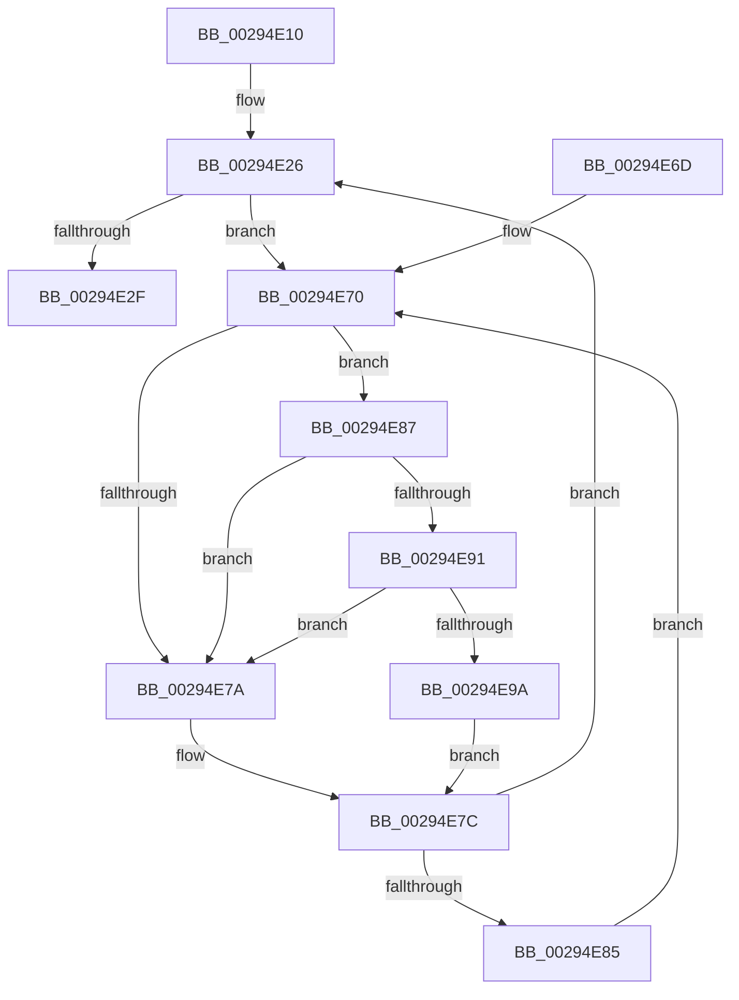

# MiLockSetPfnPriority

- RVA: `0x00294E10`–`0x00294EA3` (길이 `147` bytes)
- VA: `0x0000000140294E10`
- 실행 섹션: `.text`
- PDB 이름 있음: `예`; PDB Function 태그: `아니요`
- unwind 정보 RVA: `0x000677E0`
- 디코드: `45`개 명령, `147/147` bytes 표시
- 미해석 바이트: `0` (있으면 어셈블리에 `.byte`로 보존)

> 이 문서는 커널 이미지의 기계어와 PDB 기호를 분석해 생성했습니다. 4번과 5번은 함수 원형과 자료형을 바이너리 사용 방식에서 추정한 C 해석이며 원본 소스 복구 결과는 아닙니다.

## 1. Dependencies

- 직접 호출 지점: **2**; 고유 호출 대상: **2**
- 직접 호출자로 확인된 함수: **3**
- RIP 상대 이미지 참조: **2**

### Outgoing calls
- `0x00294E91` → [KiCheckVpBackingLongSpinWaitHypercall](../30/KiCheckVpBackingLongSpinWaitHypercall_function_0030F490.md) (function, `0x0030F490`)
- `0x00294E9C` → [HvlNotifyLongSpinWait](../30/HvlNotifyLongSpinWait_function_0030F460.md) (function, `0x0030F460`)

### Direct callers
- [sub_00293F76](Unknown_function_00293F76.md) at `0x0029419B`
- [MiResolvePageFileFault](../36/MiResolvePageFileFault_function_0036D968.md) at `0x0036DF24`
- [MiUpdateOldPteWorker](../49/MiUpdateOldPteWorker_function_0049CFD4.md) at `0x0049D046`

### Static image references
- `0x00294E72` → RVA `0x00FC52AC` (`ALMOSTRO`; reference)
- `0x00294E87` → RVA `0x00FC6AB8` (`ALMOSTRO`; read)

## 2. Other-region calls and transfers

- 다른 실행 섹션으로 향하는 call: **0**
- 별도 외부 분기/꼬리 이동을 확인하지 못했습니다.

## 3. Assembly (complete function range)

```asm
00294E10  48 89 5C 24 08                  mov qword ptr [rsp + 8], rbx
00294E15  48 89 74 24 18                  mov qword ptr [rsp + 0x18], rsi
00294E1A  57                              push rdi
00294E1B  48 83 EC 20                     sub rsp, 0x20
00294E1F  8B F2                           mov esi, edx
00294E21  48 8B D9                        mov rbx, rcx
00294E24  33 FF                           xor edi, edi
00294E26  F0 48 0F BA 6B 18 3F            lock bts qword ptr [rbx + 0x18], 0x3f
00294E2D  72 41                           jb 0x140294e70
00294E2F  8B 4B 20                        mov ecx, dword ptr [rbx + 0x20]
00294E32  89 4C 24 38                     mov dword ptr [rsp + 0x38], ecx
00294E36  C1 E9 18                        shr ecx, 0x18
00294E39  0F B6 C1                        movzx eax, cl
00294E3C  40 32 C6                        xor al, sil
00294E3F  24 07                           and al, 7
00294E41  32 C1                           xor al, cl
00294E43  88 44 24 3B                     mov byte ptr [rsp + 0x3b], al
00294E47  8B 44 24 38                     mov eax, dword ptr [rsp + 0x38]
00294E4B  89 43 20                        mov dword ptr [rbx + 0x20], eax
00294E4E  48 B8 FF FF FF FF FF FF FF 7F   movabs rax, 0x7fffffffffffffff
00294E58  F0 48 21 43 18                  lock and qword ptr [rbx + 0x18], rax
00294E5D  48 8B 5C 24 30                  mov rbx, qword ptr [rsp + 0x30]
00294E62  48 8B 74 24 40                  mov rsi, qword ptr [rsp + 0x40]
00294E67  48 83 C4 20                     add rsp, 0x20
00294E6B  5F                              pop rdi
00294E6C  C3                              ret
00294E6D  CC                              int3
00294E6E  66 90                           nop
00294E70  FF C7                           inc edi
00294E72  85 3D 34 04 D3 00               test dword ptr [rip + 0xd30434], edi
00294E78  74 0D                           je 0x140294e87
00294E7A  F3 90                           pause
00294E7C  48 8B 43 18                     mov rax, qword ptr [rbx + 0x18]
00294E80  48 85 C0                        test rax, rax
00294E83  79 A1                           jns 0x140294e26
00294E85  EB E9                           jmp 0x140294e70
00294E87  8B 05 2B 1C D3 00               mov eax, dword ptr [rip + 0xd31c2b]
00294E8D  A8 40                           test al, 0x40
00294E8F  74 E9                           je 0x140294e7a
00294E91  E8 FA A5 07 00                  call 0x14030f490
00294E96  84 C0                           test al, al
00294E98  74 E0                           je 0x140294e7a
00294E9A  8B CF                           mov ecx, edi
00294E9C  E8 BF A5 07 00                  call 0x14030f460
00294EA1  EB D9                           jmp 0x140294e7c
```

## 4. C-style interpretation (structured pseudocode)

```c
__int64 __fastcall MiLockSetPfnPriority(__int64 a1, int a2)
{
    __int64 result;
    __int64 v_rdi;
    __int64 v_rsp;
    unsigned int v_stack_p10;
    unsigned __int8 v_stack_p13;
    unsigned __int64 v_stack_p18;
    unsigned __int64 v_stack_p8;

    v_stack_p8 = v_rbx;
    v_stack_p18 = v_rsi;
    v_rsp = (v_rsp) - (32);
    v_rdi = 0;
loc_00294E26:
    if (condition_is_below) goto loc_00294E70;
    v_stack_p10 = (unsigned int)((unsigned int)(*(unsigned int *)(a1 + 32)));
    a1 = (unsigned int)(((unsigned int)(*(unsigned int *)(a1 + 32))) >> (24));
    result = (unsigned __int8)(((unsigned __int8)(a1)) ^ ((unsigned __int8)((unsigned int)(a2))));
    result = (unsigned __int8)((result) & (7));
    result = (unsigned __int8)((result) ^ ((unsigned __int8)(a1)));
    v_stack_p13 = (unsigned __int8)(result);
    *(unsigned int *)(a1 + 32) = (unsigned int)((unsigned int)(v_stack_p10));
    v_rsp = (v_rsp) + (32);
    return (unsigned int)(v_stack_p10);
loc_00294E70:
    v_rdi = (unsigned int)((v_rdi) + 1);
    if (((*(unsigned int *)(v_rip + 13829172)) & ((unsigned int)(v_rdi))) == 0) goto loc_00294E87;
loc_00294E7A:
loc_00294E7C:
    if (!sign_flag) goto loc_00294E26;
    goto loc_00294E70;
loc_00294E87:
    if ((((unsigned __int8)((unsigned int)(*(unsigned int *)(v_rip + 13835307)))) & (64)) == 0) goto loc_00294E7A;
    result = KiCheckVpBackingLongSpinWaitHypercall(a1, a2, a3, a4);
    if ((unsigned __int8)(result) == 0) goto loc_00294E7A;
    result = HvlNotifyLongSpinWait((unsigned int)((unsigned int)(v_rdi)), a2, a3, a4);
    goto loc_00294E7C;
}
```

## 5. (Beta) C Style

```c
int64_t MiLockSetPfnPriority(void *Arg1, int32_t Arg2)
{
    uint8_t *arg1 = (uint8_t *)Arg1;

    int64_t result;
    int64_t local_rdi;
    int64_t local_rsp;
    uint32_t v_stack_p10;
    uint8_t v_stack_p13;
    uint64_t v_stack_p18;
    uint64_t v_stack_p8;

    v_stack_p8 = local_rbx;
    v_stack_p18 = local_rsi;
    local_rsp = (local_rsp) - (32);
    local_rdi = 0;
loc_00294E26:
    if (condition_is_below) goto loc_00294E70;
    v_stack_p10 = (uint32_t)((uint32_t)(*(uint32_t *)(arg1 + 0x20)));
    Arg1 = (uint32_t)(((uint32_t)(*(uint32_t *)(arg1 + 0x20))) >> (24));
    result = (uint8_t)(((uint8_t)(Arg1)) ^ ((uint8_t)((uint32_t)(Arg2))));
    result = (uint8_t)((result) & (7));
    result = (uint8_t)((result) ^ ((uint8_t)(Arg1)));
    v_stack_p13 = (uint8_t)(result);
    *(uint32_t *)(arg1 + 0x20) = (uint32_t)((uint32_t)(v_stack_p10));
    local_rsp = (local_rsp) + (32);
    return (uint32_t)(v_stack_p10);
loc_00294E70:
    local_rdi = (uint32_t)((local_rdi) + 1);
    if (((*(uint32_t *)(v_rip + 0xD30434)) & ((uint32_t)(local_rdi))) == 0) goto loc_00294E87;
loc_00294E7A:
loc_00294E7C:
    if (!sign_flag) goto loc_00294E26;
    goto loc_00294E70;
loc_00294E87:
    if ((((uint8_t)((uint32_t)(*(uint32_t *)(v_rip + 0xD31C2B)))) & (64)) == 0) goto loc_00294E7A;
    result = KiCheckVpBackingLongSpinWaitHypercall(Arg1, Arg2, a3, a4);
    if ((uint8_t)(result) == 0) goto loc_00294E7A;
    result = HvlNotifyLongSpinWait((uint32_t)((uint32_t)(local_rdi)), Arg2, a3, a4);
    goto loc_00294E7C;
}
```

### 관측된 메모리 오프셋

구조체 형식이 확인되지 않은 접근은 인자 기준의 오프셋으로만 기록했습니다.

| 기준 인자 | 오프셋 표현 | 폭 (bit) | 접근 |
|---|---:|---:|---|
| `Arg1` | `+ 0x18` | `64` | `R` |
| `Arg1` | `+ 0x18` | `64` | `R/W` |
| `Arg1` | `+ 0x20` | `32` | `R` |
| `Arg1` | `+ 0x20` | `32` | `W` |

## 6. Execution-region graph

[열기: 2D/3D 그래프와 함수 탐색 컨트롤 패널](../../../control-panel.html?section=text&rva=0x00294E10&view=graph)

- 2D 그래프는 위에서 아래로 흐르고, 3D 그래프는 빈 공간을 드래그해 회전합니다. Shift+드래그는 이동, 휠은 확대·축소, 함수 노드 선택은 대상 보고서 이동입니다.

### Static fallback


