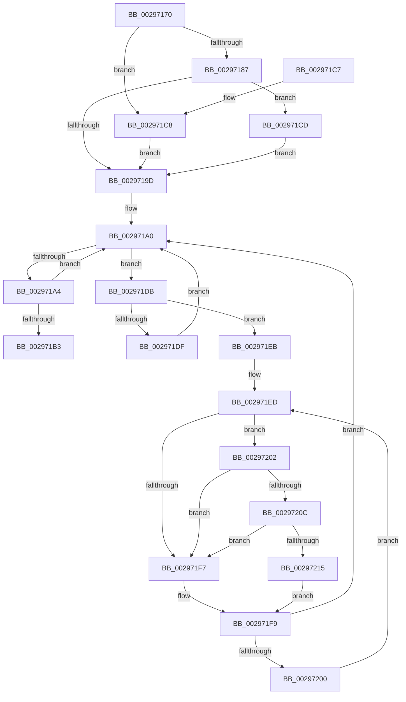

# MiLockVadCore

- RVA: `0x00297170`–`0x0029721E` (길이 `174` bytes)
- VA: `0x0000000140297170`
- 실행 섹션: `.text`
- PDB 이름 있음: `예`; PDB Function 태그: `아니요`
- unwind 정보 RVA: `0x0006797C`
- 디코드: `57`개 명령, `174/174` bytes 표시
- 미해석 바이트: `0` (있으면 어셈블리에 `.byte`로 보존)

> 이 문서는 커널 이미지의 기계어와 PDB 기호를 분석해 생성했습니다. 4번과 5번은 함수 원형과 자료형을 바이너리 사용 방식에서 추정한 C 해석이며 원본 소스 복구 결과는 아닙니다.

## 1. Dependencies

- 직접 호출 지점: **3**; 고유 호출 대상: **3**
- 직접 호출자로 확인된 함수: **15**
- RIP 상대 이미지 참조: **3**

### Outgoing calls
- `0x002971D4` → [KiRaiseIrqlProcessIrqlFlags](../4F/KiRaiseIrqlProcessIrqlFlags_function_004F56FC.md) (function, `0x004F56FC`)
- `0x0029720C` → [KiCheckVpBackingLongSpinWaitHypercall](../30/KiCheckVpBackingLongSpinWaitHypercall_function_0030F490.md) (function, `0x0030F490`)
- `0x00297217` → [HvlNotifyLongSpinWait](../30/HvlNotifyLongSpinWait_function_0030F460.md) (function, `0x0030F460`)

### Direct callers
- [MiSetVadDeleted](MiSetVadDeleted_function_00296E00.md) at `0x00296E92`
- [sub_0032D782](../32/Unknown_function_0032D782.md) at `0x0032DBE1`
- [sub_0032E327](../32/Unknown_function_0032E327.md) at `0x0032E38E`
- [MiCheckVirtualAddress](../32/MiCheckVirtualAddress_function_0032E4F0.md) at `0x0032E7A4`
- [sub_0041C08D](../41/Unknown_function_0041C08D.md) at `0x0041C098`
- [sub_0042ACFF](../42/Unknown_function_0042ACFF.md) at `0x0042AD0A`
- [MiMakeSecureExclusive](../43/MiMakeSecureExclusive_function_00430CA4.md) at `0x00430CBC`
- [MiLocateOldestSecure](../43/MiLocateOldestSecure_function_00430D10.md) at `0x00430D21`
- [MiRemoveSecureEntry](../43/MiRemoveSecureEntry_function_00430D5C.md) at `0x00430D84`
- [MiInsertVadEvent](../43/MiInsertVadEvent_function_00430E74.md) at `0x00430E8B`
- [MiGetVadWakeList](../43/MiGetVadWakeList_function_00431134.md) at `0x00431153`
- [MiSetVadFlags](../43/MiSetVadFlags_function_004311FC.md) at `0x0043124A`
- [MiCheckUserVirtualAddress](../48/MiCheckUserVirtualAddress_function_00488834.md) at `0x0048894C`
- [MiRemoveVadEvent](../67/MiRemoveVadEvent_function_0067E41C.md) at `0x0067E435`
- [sub_006F2D78](../6F/Unknown_function_006F2D78.md) at `0x006F2D7D`

### Static image references
- `0x00297194` → RVA `0x00FC6D20` (`ALMOSTRO`; read)
- `0x002971EF` → RVA `0x00FC52AC` (`ALMOSTRO`; reference)
- `0x00297202` → RVA `0x00FC6AB8` (`ALMOSTRO`; read)

## 2. Other-region calls and transfers

- 다른 실행 섹션으로 향하는 call: **0**
- 별도 외부 분기/꼬리 이동을 확인하지 못했습니다.

## 3. Assembly (complete function range)

```asm
00297170  48 89 5C 24 08                  mov qword ptr [rsp + 8], rbx
00297175  48 89 74 24 10                  mov qword ptr [rsp + 0x10], rsi
0029717A  57                              push rdi
0029717B  48 83 EC 20                     sub rsp, 0x20
0029717F  48 8B D9                        mov rbx, rcx
00297182  F6 C2 01                        test dl, 1
00297185  75 41                           jne 0x1402971c8
00297187  44 0F 20 C7                     mov rdi, cr8
0029718B  B8 02 00 00 00                  mov eax, 2
00297190  44 0F 22 C0                     mov cr8, rax
00297194  83 3D 85 FB D2 00 00            cmp dword ptr [rip + 0xd2fb85], 0
0029719B  75 30                           jne 0x1402971cd
0029719D  8B 43 30                        mov eax, dword ptr [rbx + 0x30]
002971A0  A8 01                           test al, 1
002971A2  75 37                           jne 0x1402971db
002971A4  8B C8                           mov ecx, eax
002971A6  83 E1 FD                        and ecx, 0xfffffffd
002971A9  83 C9 01                        or ecx, 1
002971AC  F0 0F B1 4B 30                  lock cmpxchg dword ptr [rbx + 0x30], ecx
002971B1  75 ED                           jne 0x1402971a0
002971B3  48 8B 5C 24 30                  mov rbx, qword ptr [rsp + 0x30]
002971B8  40 0F B6 C7                     movzx eax, dil
002971BC  48 8B 74 24 38                  mov rsi, qword ptr [rsp + 0x38]
002971C1  48 83 C4 20                     add rsp, 0x20
002971C5  5F                              pop rdi
002971C6  C3                              ret
002971C7  CC                              int3
002971C8  40 B7 11                        mov dil, 0x11
002971CB  EB D0                           jmp 0x14029719d
002971CD  0F B6 D0                        movzx edx, al
002971D0  40 0F B6 CF                     movzx ecx, dil
002971D4  E8 23 E5 25 00                  call 0x1404f56fc
002971D9  EB C2                           jmp 0x14029719d
002971DB  A8 02                           test al, 2
002971DD  75 0C                           jne 0x1402971eb
002971DF  8B C8                           mov ecx, eax
002971E1  83 C9 02                        or ecx, 2
002971E4  F0 0F B1 4B 30                  lock cmpxchg dword ptr [rbx + 0x30], ecx
002971E9  EB B5                           jmp 0x1402971a0
002971EB  33 F6                           xor esi, esi
002971ED  FF C6                           inc esi
002971EF  85 35 B7 E0 D2 00               test dword ptr [rip + 0xd2e0b7], esi
002971F5  74 0B                           je 0x140297202
002971F7  F3 90                           pause
002971F9  8B 43 30                        mov eax, dword ptr [rbx + 0x30]
002971FC  A8 01                           test al, 1
002971FE  74 A0                           je 0x1402971a0
00297200  EB EB                           jmp 0x1402971ed
00297202  8B 05 B0 F8 D2 00               mov eax, dword ptr [rip + 0xd2f8b0]
00297208  A8 40                           test al, 0x40
0029720A  74 EB                           je 0x1402971f7
0029720C  E8 7F 82 07 00                  call 0x14030f490
00297211  84 C0                           test al, al
00297213  74 E2                           je 0x1402971f7
00297215  8B CE                           mov ecx, esi
00297217  E8 44 82 07 00                  call 0x14030f460
0029721C  EB DB                           jmp 0x1402971f9
```

## 4. C-style interpretation (structured pseudocode)

```c
__int64 __fastcall MiLockVadCore(__int64 a1, unsigned __int8 a2)
{
    __int64 result;
    __int64 v_rsi;
    __int64 v_rsp;
    unsigned __int64 v_stack_p10;
    unsigned __int64 v_stack_p8;

    v_stack_p8 = v_rbx;
    v_stack_p10 = v_rsi;
    v_rsp = (v_rsp) - (32);
    if (((a2) & (1)) != 0) goto loc_002971C8;
    if ((*(unsigned int *)(v_rip + 13826949)) != 0) goto loc_002971CD;
loc_0029719D:
loc_002971A0:
    if ((((unsigned __int8)((unsigned int)(*(unsigned int *)(a1 + 48)))) & (1)) != 0) goto loc_002971DB;
    a1 = (unsigned int)(((unsigned int)((unsigned int)((unsigned int)(*(unsigned int *)(a1 + 48))))) & (0xFFFFFFFDULL));
    a1 = (unsigned int)((a1) | (1));
    if (condition_is_not_equal) goto loc_002971A0;
    v_rsp = (v_rsp) + (32);
    return (unsigned __int8)(v_cr8);
loc_002971C8:
    goto loc_0029719D;
loc_002971CD:
    result = KiRaiseIrqlProcessIrqlFlags(17, (unsigned __int8)((unsigned __int8)(v_cr8)), a3, a4);
    goto loc_0029719D;
loc_002971DB:
    if ((((unsigned __int8)(result)) & (2)) != 0) goto loc_002971EB;
    a1 = (unsigned int)(((unsigned int)((unsigned int)(result))) | (2));
    goto loc_002971A0;
loc_002971EB:
    v_rsi = 0;
loc_002971ED:
    v_rsi = (unsigned int)((v_rsi) + 1);
    if (((*(unsigned int *)(v_rip + 13820087)) & ((unsigned int)(v_rsi))) == 0) goto loc_00297202;
loc_002971F7:
loc_002971F9:
    if ((((unsigned __int8)((unsigned int)(*(unsigned int *)(v_stack_p8 + 48)))) & (1)) == 0) goto loc_002971A0;
    goto loc_002971ED;
loc_00297202:
    if ((((unsigned __int8)((unsigned int)(*(unsigned int *)(v_rip + 13826224)))) & (64)) == 0) goto loc_002971F7;
    result = KiCheckVpBackingLongSpinWaitHypercall(a1, (unsigned __int8)((unsigned __int8)(v_cr8)), a3, a4);
    if ((unsigned __int8)(result) == 0) goto loc_002971F7;
    result = HvlNotifyLongSpinWait((unsigned int)((unsigned int)(v_rsi)), (unsigned __int8)((unsigned __int8)(v_cr8)), a3, a4);
    goto loc_002971F9;
}
```

## 5. (Beta) C Style

```c
int64_t MiLockVadCore(void *Arg1, uint8_t Arg2)
{
    uint8_t *arg1 = (uint8_t *)Arg1;

    int64_t result;
    int64_t local_rsi;
    int64_t local_rsp;
    uint64_t v_stack_p10;
    uint64_t v_stack_p8;

    v_stack_p8 = local_rbx;
    v_stack_p10 = local_rsi;
    local_rsp = (local_rsp) - (32);
    if (((Arg2) & (1)) != 0) goto loc_002971C8;
    if ((*(uint32_t *)(v_rip + 0xD2FB85)) != 0) goto loc_002971CD;
loc_0029719D:
loc_002971A0:
    if ((((uint8_t)((uint32_t)(*(uint32_t *)(arg1 + 0x30)))) & (1)) != 0) goto loc_002971DB;
    Arg1 = (uint32_t)(((uint32_t)((uint32_t)((uint32_t)(*(uint32_t *)(arg1 + 0x30))))) & (0xFFFFFFFDULL));
    Arg1 = (uint32_t)((Arg1) | (1));
    if (condition_is_not_equal) goto loc_002971A0;
    local_rsp = (local_rsp) + (32);
    return (uint8_t)(v_cr8);
loc_002971C8:
    goto loc_0029719D;
loc_002971CD:
    result = KiRaiseIrqlProcessIrqlFlags(17, (uint8_t)((uint8_t)(v_cr8)), a3, a4);
    goto loc_0029719D;
loc_002971DB:
    if ((((uint8_t)(result)) & (2)) != 0) goto loc_002971EB;
    Arg1 = (uint32_t)(((uint32_t)((uint32_t)(result))) | (2));
    goto loc_002971A0;
loc_002971EB:
    local_rsi = 0;
loc_002971ED:
    local_rsi = (uint32_t)((local_rsi) + 1);
    if (((*(uint32_t *)(v_rip + 0xD2E0B7)) & ((uint32_t)(local_rsi))) == 0) goto loc_00297202;
loc_002971F7:
loc_002971F9:
    if ((((uint8_t)((uint32_t)(*(uint32_t *)(v_stack_p8 + 0x30)))) & (1)) == 0) goto loc_002971A0;
    goto loc_002971ED;
loc_00297202:
    if ((((uint8_t)((uint32_t)(*(uint32_t *)(v_rip + 0xD2F8B0)))) & (64)) == 0) goto loc_002971F7;
    result = KiCheckVpBackingLongSpinWaitHypercall(Arg1, (uint8_t)((uint8_t)(v_cr8)), a3, a4);
    if ((uint8_t)(result) == 0) goto loc_002971F7;
    result = HvlNotifyLongSpinWait((uint32_t)((uint32_t)(local_rsi)), (uint8_t)((uint8_t)(v_cr8)), a3, a4);
    goto loc_002971F9;
}
```

### 관측된 메모리 오프셋

구조체 형식이 확인되지 않은 접근은 인자 기준의 오프셋으로만 기록했습니다.

| 기준 인자 | 오프셋 표현 | 폭 (bit) | 접근 |
|---|---:|---:|---|
| `Arg1` | `+ 0x30` | `32` | `R` |

## 6. Execution-region graph

[열기: 2D/3D 그래프와 함수 탐색 컨트롤 패널](../../../control-panel.html?section=text&rva=0x00297170&view=graph)

- 2D 그래프는 위에서 아래로 흐르고, 3D 그래프는 빈 공간을 드래그해 회전합니다. Shift+드래그는 이동, 휠은 확대·축소, 함수 노드 선택은 대상 보고서 이동입니다.

### Static fallback


