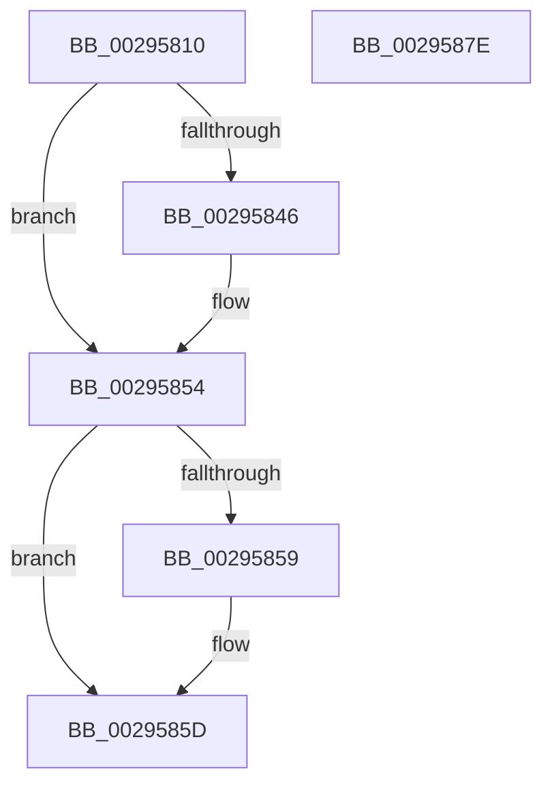

# MiLockVad

- RVA: `0x00295810`–`0x0029587F` (길이 `111` bytes)
- VA: `0x0000000140295810`
- 실행 섹션: `.text`
- PDB 이름 있음: `예`; PDB Function 태그: `아니요`
- unwind 정보 RVA: `0x00060BC4`
- 디코드: `32`개 명령, `111/111` bytes 표시
- 미해석 바이트: `0` (있으면 어셈블리에 `.byte`로 보존)

> 이 문서는 커널 이미지의 기계어와 PDB 기호를 분석해 생성했습니다. 4번과 5번은 함수 원형과 자료형을 바이너리 사용 방식에서 추정한 C 해석이며 원본 소스 복구 결과는 아닙니다.

## 1. Dependencies

- 직접 호출 지점: **2**; 고유 호출 대상: **2**
- 직접 호출자로 확인된 함수: **32**
- RIP 상대 이미지 참조: **0**

### Outgoing calls
- `0x00295836` → [KeAbPreAcquire](../21/KeAbPreAcquire_function_00210230.md) (function, `0x00210230`)
- `0x0029584F` → [ExfAcquirePushLockExclusiveEx](../20/ExfAcquirePushLockExclusiveEx_function_0020FC90.md) (function, `0x0020FC90`)

### Direct callers
- [MiMapImageScpCfgPages](MiMapImageScpCfgPages_function_00294FA4.md) at `0x00295059`
- [MiObtainReferencedSecureVad](MiObtainReferencedSecureVad_function_00295688.md) at `0x0029570F`
- [MiDeleteEmptyPageTables](../2A/MiDeleteEmptyPageTables_function_002A5220.md) at `0x002A5306`
- [MiInsertViewOfPhysicalSection](../2A/MiInsertViewOfPhysicalSection_function_002A57E0.md) at `0x002A587E`
- [MiEmptyWorkingSetPrivatePagesByVa](../2A/MiEmptyWorkingSetPrivatePagesByVa_function_002A6AC0.md) at `0x002A6B47`
- [MiFindPlaceholderVadToReplace](../2A/MiFindPlaceholderVadToReplace_function_002A7280.md) at `0x002A72C0`
- [sub_00316832](../31/Unknown_function_00316832.md) at `0x0031689C`
- [MiWaitForVadDeletion](../31/MiWaitForVadDeletion_function_00316F1C.md) at `0x00316FA8`
- [MiReleaseOutSwappedProcessCommit](../3C/MiReleaseOutSwappedProcessCommit_function_003C8320.md) at `0x003C8459`
- [MiReleaseCommitForResetPages](../66/MiReleaseCommitForResetPages_function_0066FAF8.md) at `0x0066FB7A`
- [MiCanDeleteEnclave](../68/MiCanDeleteEnclave_function_00686D18.md) at `0x00686DD4`
- [MiApplyImageHotPatchRequest](../../page/80/MiApplyImageHotPatchRequest_function_008025AC.md) at `0x00802A1B`
- [MiApplyImageHotPatchRequest](../../page/80/MiApplyImageHotPatchRequest_function_008025AC.md) at `0x00802A5E`
- [MiPrepareToHotPatchVad](../../page/80/MiPrepareToHotPatchVad_function_00806E70.md) at `0x00806E99`
- [MiProcessPatchImageCfg](../../page/80/MiProcessPatchImageCfg_function_00806F9C.md) at `0x0080707B`
- [MiAllocateEnclaveVad](../../page/80/MiAllocateEnclaveVad_function_008080A4.md) at `0x00808375`
- [MiInitializeVsmEnclave](../../page/80/MiInitializeVsmEnclave_function_00808AE0.md) at `0x00808BEA`
- [MiTerminateEnclave](../../page/80/MiTerminateEnclave_function_00808C18.md) at `0x00808C98`
- [MiDeleteInsertedCloneVads](../../page/81/MiDeleteInsertedCloneVads_function_00811564.md) at `0x00811618`
- [MiLockVadRange](../../page/87/MiLockVadRange_function_0087F670.md) at `0x0087F765`
- [MiLockVadRange](../../page/87/MiLockVadRange_function_0087F670.md) at `0x0087F8B4`
- [MiCoalescePlaceholderAllocations](../../page/88/MiCoalescePlaceholderAllocations_function_0088095C.md) at `0x00880AE3`
- [MiCommitFileBackedSection](../../page/88/MiCommitFileBackedSection_function_00882238.md) at `0x00882358`
- [MiReserveUserMemory](../../page/88/MiReserveUserMemory_function_00884498.md) at `0x00884790`
- [sub_00884EE1](../../page/88/Unknown_function_00884EE1.md) at `0x0088526A`
- [MiCommitInitialVadMetadataBits](../../page/8D/MiCommitInitialVadMetadataBits_function_008D09CC.md) at `0x008D0A6E`
- [MiMapViewOfImageSection](../../page/97/MiMapViewOfImageSection_function_0097E92C.md) at `0x0097F011`
- [MiMapViewOfImageSection](../../page/97/MiMapViewOfImageSection_function_0097E92C.md) at `0x0097F87E`
- [MiMapViewOfPhysicalSection](../../page/97/MiMapViewOfPhysicalSection_function_0097F984.md) at `0x0097FC4D`
- [MiMapLockedPagesInUserSpace](../../page/97/MiMapLockedPagesInUserSpace_function_0097FE04.md) at `0x009800E6`
- [MiAllocateFromSubAllocatedRegion](../../page/98/MiAllocateFromSubAllocatedRegion_function_00981C24.md) at `0x00981D4A`
- [MiAllocateNewSubAllocatedRegion](../../page/98/MiAllocateNewSubAllocatedRegion_function_00981EC0.md) at `0x00982111`
- [MmCleanProcessAddressSpace](../../page/A1/MmCleanProcessAddressSpace_function_00A17EC0.md) at `0x00A17FAE`
- [MmCleanProcessAddressSpace](../../page/A1/MmCleanProcessAddressSpace_function_00A17EC0.md) at `0x00A17FDE`
- [MmCleanProcessAddressSpace](../../page/A1/MmCleanProcessAddressSpace_function_00A17EC0.md) at `0x00A18111`
- [MiLoadSectionIntoVsmEnclave](../../page/AB/MiLoadSectionIntoVsmEnclave_function_00AB1D4C.md) at `0x00AB1DC0`
- [MiLoadSectionIntoVsmEnclave](../../page/AB/MiLoadSectionIntoVsmEnclave_function_00AB1D4C.md) at `0x00AB1E6F`
- [MiDeleteVadHotPatchState](../../page/AC/MiDeleteVadHotPatchState_function_00ACA608.md) at `0x00ACA684`

### Static image references
- 디코드된 RIP-relative 메모리 참조가 없습니다.

## 2. Other-region calls and transfers

- 다른 실행 섹션으로 향하는 call: **0**
- 별도 외부 분기/꼬리 이동을 확인하지 못했습니다.

## 3. Assembly (complete function range)

```asm
00295810  48 89 5C 24 08                  mov qword ptr [rsp + 8], rbx
00295815  48 89 74 24 10                  mov qword ptr [rsp + 0x10], rsi
0029581A  57                              push rdi
0029581B  48 83 EC 20                     sub rsp, 0x20
0029581F  66 FF 89 E6 01 00 00            dec word ptr [rcx + 0x1e6]
00295826  48 8D 7A 28                     lea rdi, [rdx + 0x28]
0029582A  48 8B F1                        mov rsi, rcx
0029582D  45 33 C0                        xor r8d, r8d
00295830  48 8B CF                        mov rcx, rdi
00295833  33 D2                           xor edx, edx
00295835  90                              nop
00295836  E8 F5 A9 F7 FF                  call 0x140210230
0029583B  F0 48 0F BA 2F 00               lock bts qword ptr [rdi], 0
00295841  48 8B D8                        mov rbx, rax
00295844  73 0E                           jae 0x140295854
00295846  4C 8B C7                        mov r8, rdi
00295849  48 8B D0                        mov rdx, rax
0029584C  48 8B CF                        mov rcx, rdi
0029584F  E8 3C A4 F7 FF                  call 0x14020fc90
00295854  48 85 DB                        test rbx, rbx
00295857  74 04                           je 0x14029585d
00295859  C6 43 0A 01                     mov byte ptr [rbx + 0xa], 1
0029585D  8B 86 A8 05 00 00               mov eax, dword ptr [rsi + 0x5a8]
00295863  48 8B 5C 24 30                  mov rbx, qword ptr [rsp + 0x30]
00295868  0F BA E8 07                     bts eax, 7
0029586C  89 86 A8 05 00 00               mov dword ptr [rsi + 0x5a8], eax
00295872  90                              nop
00295873  48 8B 74 24 38                  mov rsi, qword ptr [rsp + 0x38]
00295878  48 83 C4 20                     add rsp, 0x20
0029587C  5F                              pop rdi
0029587D  C3                              ret
0029587E  CC                              int3
```

## 4. C-style interpretation (structured pseudocode)

```c
__int64 __fastcall MiLockVad(__int64 a1, __int64 a2, int a3)
{
    __int64 result;
    __int64 v_rsp;
    unsigned __int64 v_stack_p10;
    unsigned __int64 v_stack_p8;

    v_stack_p8 = v_rbx;
    v_stack_p10 = v_rsi;
    v_rsp = (v_rsp) - (32);
    a3 = 0;
    a2 = 0;
    result = KeAbPreAcquire(a2 + 40, a2, a3, a4);
    if (!(condition_is_above_or_equal)) {
        a3 = a2 + 40;
        a2 = result;
        a1 = a2 + 40;
        result = ExfAcquirePushLockExclusiveEx(a1, a2, a3, a4);
    }
    if (result != 0) {
        *(unsigned __int8 *)(result + 10) = 1;
    }
    *(unsigned int *)(a1 + 1448) = (unsigned int)((unsigned int)(*(unsigned int *)(a1 + 1448)));
    v_rsp = (v_rsp) + (32);
    return (unsigned int)(*(unsigned int *)(a1 + 1448));
}
```

## 5. (Beta) C Style

```c
int64_t MiLockVad(void *Arg1, void *Arg2, int32_t Arg3)
{
    uint8_t *arg1 = (uint8_t *)Arg1;
    uint8_t *arg2 = (uint8_t *)Arg2;

    int64_t result;
    int64_t local_rsp;
    uint64_t v_stack_p10;
    uint64_t v_stack_p8;

    v_stack_p8 = local_rbx;
    v_stack_p10 = local_rsi;
    local_rsp = (local_rsp) - (32);
    Arg3 = 0;
    Arg2 = 0;
    result = KeAbPreAcquire(Arg2 + 40, Arg2, Arg3, a4);
    if (!(condition_is_above_or_equal)) {
        Arg3 = Arg2 + 40;
        Arg2 = result;
        Arg1 = Arg2 + 40;
        result = ExfAcquirePushLockExclusiveEx(Arg1, Arg2, Arg3, a4);
    }
    if (result != 0) {
        *(uint8_t *)(result + 0xA) = 1;
    }
    *(uint32_t *)(arg1 + 0x5A8) = (uint32_t)((uint32_t)(*(uint32_t *)(arg1 + 0x5A8)));
    local_rsp = (local_rsp) + (32);
    return (uint32_t)(*(uint32_t *)(arg1 + 0x5A8));
}
```

### 관측된 메모리 오프셋

구조체 형식이 확인되지 않은 접근은 인자 기준의 오프셋으로만 기록했습니다.

| 기준 인자 | 오프셋 표현 | 폭 (bit) | 접근 |
|---|---:|---:|---|
| `Arg1` | `+ 0x1E6` | `16` | `R/W` |
| `Arg1` | `+ 0x5A8` | `32` | `R` |
| `Arg1` | `+ 0x5A8` | `32` | `W` |
| `Arg2` | `+ 0x0` | `64` | `R/W` |
| `Arg2` | `+ 0x28` | `64` | `R` |

## 6. Execution-region graph

[열기: 2D/3D 그래프와 함수 탐색 컨트롤 패널](../../../control-panel.html?section=text&rva=0x00295810&view=graph)

- 2D 그래프는 위에서 아래로 흐르고, 3D 그래프는 빈 공간을 드래그해 회전합니다. Shift+드래그는 이동, 휠은 확대·축소, 함수 노드 선택은 대상 보고서 이동입니다.

### Static fallback


