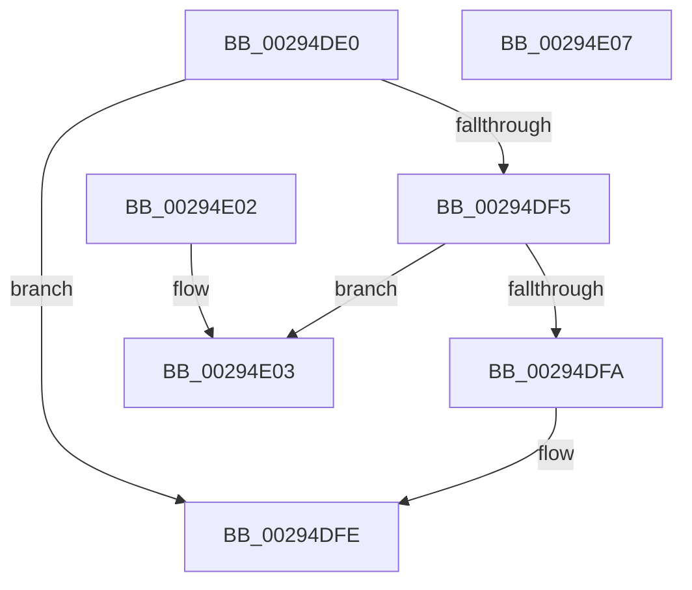

# MiMakePrototypePteDirect

- RVA: `0x00294DE0`–`0x00294E08` (길이 `40` bytes)
- VA: `0x0000000140294DE0`
- 실행 섹션: `.text`
- PDB 이름 있음: `예`; PDB Function 태그: `아니요`
- unwind 정보 RVA: `0x000DB714`
- 디코드: `14`개 명령, `40/40` bytes 표시
- 미해석 바이트: `0` (있으면 어셈블리에 `.byte`로 보존)

> 이 문서는 커널 이미지의 기계어와 PDB 기호를 분석해 생성했습니다. 4번과 5번은 함수 원형과 자료형을 바이너리 사용 방식에서 추정한 C 해석이며 원본 소스 복구 결과는 아닙니다.

## 1. Dependencies

- 직접 호출 지점: **0**; 고유 호출 대상: **0**
- 직접 호출자로 확인된 함수: **13**
- RIP 상대 이미지 참조: **1**

### Outgoing calls
- 직접 디코드된 call 명령이 없습니다.

### Direct callers
- [MiCombineWithExisting](../22/MiCombineWithExisting_function_0022B4B8.md) at `0x0022B696`
- [MiCombineInitialInstance](../22/MiCombineInitialInstance_function_0022BC0C.md) at `0x0022C647`
- [MiHandleForkTransitionPte](../22/MiHandleForkTransitionPte_function_0022D34C.md) at `0x0022D398`
- [MiBuildForkPte](../22/MiBuildForkPte_function_0022E32C.md) at `0x0022E6DC`
- [MiBuildForkPte](../22/MiBuildForkPte_function_0022E32C.md) at `0x0022E8CB`
- [MiBuildForkPte](../22/MiBuildForkPte_function_0022E32C.md) at `0x0022EE33`
- [MiMakePerSessionProtoPte](../22/MiMakePerSessionProtoPte_function_0022F7EC.md) at `0x0022F8D4`
- [MiPteForTrimmedProto](MiPteForTrimmedProto_function_0029496C.md) at `0x002949F2`
- [MiMapImageScpCfgPages](MiMapImageScpCfgPages_function_00294FA4.md) at `0x00295062`
- [MiResolveSharedZeroFault](../32/MiResolveSharedZeroFault_function_0032EF20.md) at `0x0032F521`
- [MiResolveSharedZeroFault](../32/MiResolveSharedZeroFault_function_0032EF20.md) at `0x0032F5B6`
- [MiExpandSharedZeroCluster](../36/MiExpandSharedZeroCluster_function_0036F20C.md) at `0x0036F51D`
- [MiWriteSharedDemandZeroPte](../4A/MiWriteSharedDemandZeroPte_function_004A8DDC.md) at `0x004A8E36`
- [MiTrimSystemImagePages](../4B/MiTrimSystemImagePages_function_004B18FC.md) at `0x004B1A80`
- [MiAddMappedPtesPadding](../4D/MiAddMappedPtesPadding_function_004DA2E8.md) at `0x004DA35B`
- [sub_006D7070](../6D/Unknown_function_006D7070.md) at `0x006D70B6`

### Static image references
- `0x00294DE0` → RVA `0x00E2DC80` (`.data`; read)

## 2. Other-region calls and transfers

- 다른 실행 섹션으로 향하는 call: **0**
- 별도 외부 분기/꼬리 이동을 확인하지 못했습니다.

## 3. Assembly (complete function range)

```asm
00294DE0  48 8B 05 99 8E B9 00            mov rax, qword ptr [rip + 0xb98e99]
00294DE7  48 C1 E1 10                     shl rcx, 0x10
00294DEB  48 0F BA E9 0A                  bts rcx, 0xa
00294DF0  48 85 C0                        test rax, rax
00294DF3  74 09                           je 0x140294dfe
00294DF5  48 85 C1                        test rcx, rax
00294DF8  74 09                           je 0x140294e03
00294DFA  48 83 C9 10                     or rcx, 0x10
00294DFE  48 8B C1                        mov rax, rcx
00294E01  C3                              ret
00294E02  CC                              int3
00294E03  48 0B C1                        or rax, rcx
00294E06  C3                              ret
00294E07  CC                              int3
```

## 4. C-style interpretation (structured pseudocode)

```c
__int64 __fastcall MiMakePrototypePteDirect(__int64 a1)
{
    __int64 result;

    a1 = (a1) << (16);
    if (*(unsigned __int64 *)(v_rip + 12160665) == 0) goto loc_00294DFE;
    if (((a1) & (*(unsigned __int64 *)(v_rip + 12160665))) == 0) goto loc_00294E03;
    a1 = (a1) | (16);
loc_00294DFE:
    return a1;
loc_00294E03:
    result = (a1) | (a1);
    return result;
}
```

## 5. (Beta) C Style

```c
int64_t MiMakePrototypePteDirect(int64_t Arg1)
{
    int64_t result;

    Arg1 = (Arg1) << (16);
    if (*(uint64_t *)(v_rip + 0xB98E99) == 0) goto loc_00294DFE;
    if (((Arg1) & (*(uint64_t *)(v_rip + 0xB98E99))) == 0) goto loc_00294E03;
    Arg1 = (Arg1) | (16);
loc_00294DFE:
    return Arg1;
loc_00294E03:
    result = (Arg1) | (Arg1);
    return result;
}
```

## 6. Execution-region graph

[열기: 2D/3D 그래프와 함수 탐색 컨트롤 패널](../../../control-panel.html?section=text&rva=0x00294DE0&view=graph)

- 2D 그래프는 위에서 아래로 흐르고, 3D 그래프는 빈 공간을 드래그해 회전합니다. Shift+드래그는 이동, 휠은 확대·축소, 함수 노드 선택은 대상 보고서 이동입니다.

### Static fallback


