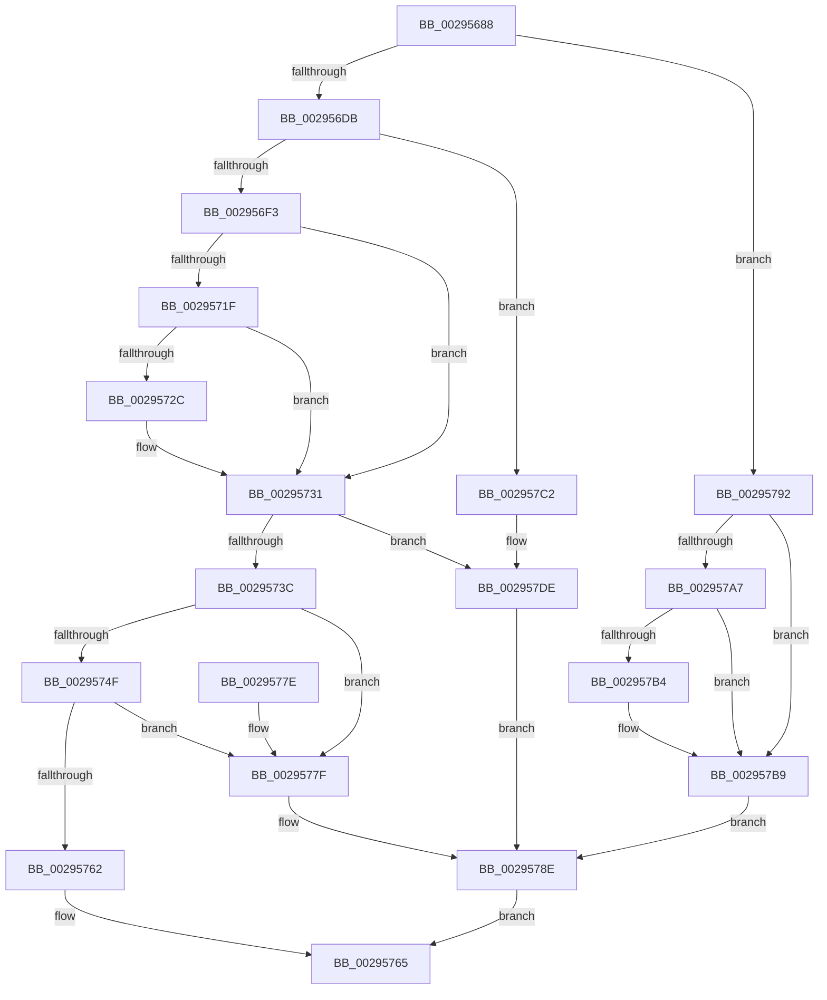

# MiObtainReferencedSecureVad

- RVA: `0x00295688`–`0x00295809` (길이 `385` bytes)
- VA: `0x0000000140295688`
- 실행 섹션: `.text`
- PDB 이름 있음: `예`; PDB Function 태그: `아니요`
- unwind 정보 RVA: `0x00067844`
- 디코드: `105`개 명령, `385/385` bytes 표시
- 미해석 바이트: `0` (있으면 어셈블리에 `.byte`로 보존)

> 이 문서는 커널 이미지의 기계어와 PDB 기호를 분석해 생성했습니다. 4번과 5번은 함수 원형과 자료형을 바이너리 사용 방식에서 추정한 C 해석이며 원본 소스 복구 결과는 아닙니다.

## 1. Dependencies

- 직접 호출 지점: **12**; 고유 호출 대상: **9**
- 직접 호출자로 확인된 함수: **5**
- RIP 상대 이미지 참조: **0**

### Outgoing calls
- `0x002956C3` → [MiLockVadTree](../27/MiLockVadTree_function_0027C0F0.md) (function, `0x0027C0F0`)
- `0x002956E2` → [MiLocateAddress](../31/MiLocateAddress_function_003168D0.md) (function, `0x003168D0`)
- `0x002956F6` → [MiReferenceVad](MiReferenceVad_function_00295890.md) (function, `0x00295890`)
- `0x00295700` → [MiUnlockVadTree](MiUnlockVadTree_function_00297020.md) (function, `0x00297020`)
- `0x0029570F` → [MiLockVad](MiLockVad_function_00295810.md) (function, `0x00295810`)
- `0x0029572C` → [KiCheckForKernelApcDelivery](../2E/KiCheckForKernelApcDelivery_function_002E2C80.md) (function, `0x002E2C80`)
- `0x00295782` → [MiUnlockAndDereferenceVad](../31/MiUnlockAndDereferenceVad_function_00316E60.md) (function, `0x00316E60`)
- `0x00295797` → [MiUnlockVadTree](MiUnlockVadTree_function_00297020.md) (function, `0x00297020`)
- `0x002957B4` → [KiCheckForKernelApcDelivery](../2E/KiCheckForKernelApcDelivery_function_002E2C80.md) (function, `0x002E2C80`)
- `0x002957D8` → [KeBugCheckEx](../4F/KeBugCheckEx_function_004FD660.md) (function, `0x004FD660`)
- `0x002957E1` → [MiWaitForVadDeletion](../31/MiWaitForVadDeletion_function_00316F1C.md) (function, `0x00316F1C`)
- `0x002957E9` → [MiUnlockAndDereferenceVad](../31/MiUnlockAndDereferenceVad_function_00316E60.md) (function, `0x00316E60`)

### Direct callers
- [MiCheckLockUnlockByVa](../67/MiCheckLockUnlockByVa_function_00673D7C.md) at `0x00673DAC`
- [MmAdjustSecuredVirtualMemorySize](../../page/7F/MmAdjustSecuredVirtualMemorySize_function_007FE7E8.md) at `0x007FE829`
- [MmCommitDecommitSecuredMemory](../../page/7F/MmCommitDecommitSecuredMemory_function_007FE904.md) at `0x007FE953`
- [MmUnsecureVirtualMemory](../../page/88/MmUnsecureVirtualMemory_function_0088A2A0.md) at `0x0088A2D1`
- [MmStoreAllocateVirtualMemory](../../page/A6/MmStoreAllocateVirtualMemory_function_00A68238.md) at `0x00A68319`

### Static image references
- 디코드된 RIP-relative 메모리 참조가 없습니다.

## 2. Other-region calls and transfers

- 다른 실행 섹션으로 향하는 call: **0**
- 별도 외부 분기/꼬리 이동을 확인하지 못했습니다.

## 3. Assembly (complete function range)

```asm
00295688  48 89 5C 24 08                  mov qword ptr [rsp + 8], rbx
0029568D  48 89 6C 24 10                  mov qword ptr [rsp + 0x10], rbp
00295692  48 89 74 24 18                  mov qword ptr [rsp + 0x18], rsi
00295697  57                              push rdi
00295698  41 56                           push r14
0029569A  41 57                           push r15
0029569C  48 83 EC 30                     sub rsp, 0x30
002956A0  65 48 8B 3C 25 88 01 00 00      mov rdi, qword ptr gs:[0x188]
002956A9  48 8B E9                        mov rbp, rcx
002956AC  83 22 00                        and dword ptr [rdx], 0
002956AF  33 C9                           xor ecx, ecx
002956B1  4C 8B F2                        mov r14, rdx
002956B4  4C 8B BF B8 00 00 00            mov r15, qword ptr [rdi + 0xb8]
002956BB  66 FF 8F E6 01 00 00            dec word ptr [rdi + 0x1e6]
002956C2  90                              nop
002956C3  E8 28 6A FE FF                  call 0x14027c0f0
002956C8  41 8B 8F F4 01 00 00            mov ecx, dword ptr [r15 + 0x1f4]
002956CF  44 8A D8                        mov r11b, al
002956D2  F6 C1 20                        test cl, 0x20
002956D5  0F 85 B7 00 00 00               jne 0x140295792
002956DB  48 8B 75 08                     mov rsi, qword ptr [rbp + 8]
002956DF  48 8B CE                        mov rcx, rsi
002956E2  E8 E9 11 08 00                  call 0x1403168d0
002956E7  48 8B D8                        mov rbx, rax
002956EA  48 85 C0                        test rax, rax
002956ED  0F 84 CF 00 00 00               je 0x1402957c2
002956F3  48 8B C8                        mov rcx, rax
002956F6  E8 95 01 00 00                  call 0x140295890
002956FB  33 C9                           xor ecx, ecx
002956FD  41 8A D3                        mov dl, r11b
00295700  E8 1B 19 00 00                  call 0x140297020
00295705  48 8B D3                        mov rdx, rbx
00295708  48 C1 EE 0C                     shr rsi, 0xc
0029570C  48 8B CF                        mov rcx, rdi
0029570F  E8 FC 00 00 00                  call 0x140295810
00295714  90                              nop
00295715  66 83 87 E6 01 00 00 01         add word ptr [rdi + 0x1e6], 1
0029571D  75 12                           jne 0x140295731
0029571F  48 8D 87 98 00 00 00            lea rax, [rdi + 0x98]
00295726  90                              nop
00295727  48 39 00                        cmp qword ptr [rax], rax
0029572A  74 05                           je 0x140295731
0029572C  E8 4F D5 04 00                  call 0x1402e2c80
00295731  8B 43 30                        mov eax, dword ptr [rbx + 0x30]
00295734  A8 04                           test al, 4
00295736  0F 85 A2 00 00 00               jne 0x1402957de
0029573C  0F B6 4B 20                     movzx ecx, byte ptr [rbx + 0x20]
00295740  8B 43 18                        mov eax, dword ptr [rbx + 0x18]
00295743  48 C1 E1 20                     shl rcx, 0x20
00295747  48 0B C8                        or rcx, rax
0029574A  48 3B F1                        cmp rsi, rcx
0029574D  72 30                           jb 0x14029577f
0029574F  0F B6 4B 21                     movzx ecx, byte ptr [rbx + 0x21]
00295753  8B 43 1C                        mov eax, dword ptr [rbx + 0x1c]
00295756  48 C1 E1 20                     shl rcx, 0x20
0029575A  48 0B C8                        or rcx, rax
0029575D  48 3B F1                        cmp rsi, rcx
00295760  77 1D                           ja 0x14029577f
00295762  48 8B C3                        mov rax, rbx
00295765  48 8B 5C 24 50                  mov rbx, qword ptr [rsp + 0x50]
0029576A  48 8B 6C 24 58                  mov rbp, qword ptr [rsp + 0x58]
0029576F  48 8B 74 24 60                  mov rsi, qword ptr [rsp + 0x60]
00295774  48 83 C4 30                     add rsp, 0x30
00295778  41 5F                           pop r15
0029577A  41 5E                           pop r14
0029577C  5F                              pop rdi
0029577D  C3                              ret
0029577E  CC                              int3
0029577F  48 8B CB                        mov rcx, rbx
00295782  E8 D9 16 08 00                  call 0x140316e60
00295787  41 C7 06 A0 00 00 C0            mov dword ptr [r14], 0xc00000a0
0029578E  33 C0                           xor eax, eax
00295790  EB D3                           jmp 0x140295765
00295792  41 8A D3                        mov dl, r11b
00295795  33 C9                           xor ecx, ecx
00295797  E8 84 18 00 00                  call 0x140297020
0029579C  90                              nop
0029579D  66 83 87 E6 01 00 00 01         add word ptr [rdi + 0x1e6], 1
002957A5  75 12                           jne 0x1402957b9
002957A7  48 8D 87 98 00 00 00            lea rax, [rdi + 0x98]
002957AE  90                              nop
002957AF  48 39 00                        cmp qword ptr [rax], rax
002957B2  74 05                           je 0x1402957b9
002957B4  E8 C7 D4 04 00                  call 0x1402e2c80
002957B9  41 C7 06 0A 01 00 C0            mov dword ptr [r14], 0xc000010a
002957C0  EB CC                           jmp 0x14029578e
002957C2  48 83 64 24 20 00               and qword ptr [rsp + 0x20], 0
002957C8  4C 8B CD                        mov r9, rbp
002957CB  4C 8B C6                        mov r8, rsi
002957CE  BA 00 50 01 00                  mov edx, 0x15000
002957D3  B9 1A 00 00 00                  mov ecx, 0x1a
002957D8  E8 83 7E 26 00                  call 0x1404fd660
002957DD  CC                              int3
002957DE  48 8B CB                        mov rcx, rbx
002957E1  E8 36 17 08 00                  call 0x140316f1c
002957E6  48 8B CB                        mov rcx, rbx
002957E9  E8 72 16 08 00                  call 0x140316e60
002957EE  41 8B 87 F4 01 00 00            mov eax, dword ptr [r15 + 0x1f4]
002957F5  24 20                           and al, 0x20
002957F7  F6 D8                           neg al
002957F9  1B C9                           sbb ecx, ecx
002957FB  83 E1 6A                        and ecx, 0x6a
002957FE  81 C1 A0 00 00 C0               add ecx, 0xc00000a0
00295804  41 89 0E                        mov dword ptr [r14], ecx
00295807  EB 85                           jmp 0x14029578e
```

## 4. C-style interpretation (structured pseudocode)

```c
__int64 __fastcall MiObtainReferencedSecureVad(__int64 a1, __int64 a2)
{
    __int64 result;
    __int64 v_rsi;
    __int64 v_rsp;
    unsigned __int64 v_stack_p10;
    unsigned __int64 v_stack_p18;
    unsigned __int64 v_stack_p20;
    unsigned __int64 v_stack_p8;

    v_stack_p8 = v_rbx;
    v_stack_p10 = v_rbp;
    v_stack_p18 = v_rsi;
    v_rsp = (v_rsp) - (48);
    a1 = 0;
    result = MiLockVadTree(a1, a2, a3, a4);
    if ((((unsigned __int8)((unsigned int)(*(unsigned int *)(*(unsigned __int64 *)(*(unsigned __int64 *)(gs_base + (0 + 392)) + 184) + 500)))) & (32)) != 0) goto loc_00295792;
    result = MiLocateAddress(*(unsigned __int64 *)(a1 + 8), a2, a3, a4);
    if (result == 0) goto loc_002957C2;
    result = MiReferenceVad(result, a2, a3, a4);
    a1 = 0;
    result = MiUnlockVadTree(a1, (unsigned __int8)((unsigned __int8)(result)), a3, a4);
    v_rsi = (*(unsigned __int64 *)(a1 + 8)) >> (12);
    result = MiLockVad(*(unsigned __int64 *)(gs_base + (0 + 392)), result, a3, a4);
    if (condition_is_not_equal) goto loc_00295731;
    result = *(unsigned __int64 *)(gs_base + (0 + 392)) + 152;
    if ((*(unsigned __int64 *)(*(unsigned __int64 *)(gs_base + (0 + 392)) + 152)) != (*(unsigned __int64 *)(gs_base + (0 + 392)) + 152)) {
        result = KiCheckForKernelApcDelivery(*(unsigned __int64 *)(gs_base + (0 + 392)), result, a3, a4);
    }
    if ((((unsigned __int8)((unsigned int)(*(unsigned int *)(result + 48)))) & (4)) != 0) goto loc_002957DE;
    a1 = (*(unsigned __int8 *)(result + 32)) << (32);
    a1 = (a1) | ((unsigned int)(*(unsigned int *)(result + 24)));
    if (v_rsi < a1) goto loc_0029577F;
    a1 = (*(unsigned __int8 *)(result + 33)) << (32);
    a1 = (a1) | ((unsigned int)(*(unsigned int *)(result + 28)));
    if (v_rsi > a1) goto loc_0029577F;
loc_00295765:
    v_rsp = (v_rsp) + (48);
    return result;
loc_0029577F:
    result = MiUnlockAndDereferenceVad(v_stack_p8, result, a3, a4);
    *(unsigned int *)(a2) = 0xC00000A0ULL;
loc_0029578E:
    result = 0;
    goto loc_00295765;
loc_00295792:
    a1 = 0;
    result = MiUnlockVadTree(a1, (unsigned __int8)((unsigned __int8)(result)), a3, a4);
    if (condition_is_not_equal) goto loc_002957B9;
    result = *(unsigned __int64 *)(gs_base + (0 + 392)) + 152;
    if ((*(unsigned __int64 *)(*(unsigned __int64 *)(gs_base + (0 + 392)) + 152)) != (*(unsigned __int64 *)(gs_base + (0 + 392)) + 152)) {
        result = KiCheckForKernelApcDelivery(a1, (unsigned __int8)((unsigned __int8)(result)), a3, a4);
    }
    *(unsigned int *)(a2) = 0xC000010AULL;
    goto loc_0029578E;
loc_002957C2:
    result = KeBugCheckEx(26, (unsigned int)(0x15000ULL), v_stack_p18, v_stack_p10);
loc_002957DE:
    result = MiWaitForVadDeletion(v_stack_p8, (unsigned int)(0x15000ULL), v_stack_p18, v_stack_p10);
    result = MiUnlockAndDereferenceVad(v_stack_p8, (unsigned int)(0x15000ULL), v_stack_p18, v_stack_p10);
    result = (unsigned __int8)(((unsigned int)(*(unsigned int *)(*(unsigned __int64 *)(*(unsigned __int64 *)(gs_base + (0 + 392)) + 184) + 500))) & (32));
    result = (unsigned __int8)(-(result));
    a1 = (unsigned int)((v_stack_p8) & (106));
    a1 = (unsigned int)((a1) + (0xC00000A0ULL));
    *(unsigned int *)(a2) = (unsigned int)(a1);
    goto loc_0029578E;
}
```

## 5. (Beta) C Style

```c
int64_t MiObtainReferencedSecureVad(void *Arg1, void *Arg2)
{
    uint8_t *arg1 = (uint8_t *)Arg1;
    uint8_t *arg2 = (uint8_t *)Arg2;

    int64_t result;
    int64_t local_rsi;
    int64_t local_rsp;
    uint64_t v_stack_p10;
    uint64_t v_stack_p18;
    uint64_t v_stack_p20;
    uint64_t v_stack_p8;

    v_stack_p8 = local_rbx;
    v_stack_p10 = local_rbp;
    v_stack_p18 = local_rsi;
    local_rsp = (local_rsp) - (48);
    Arg1 = 0;
    result = MiLockVadTree(Arg1, Arg2, a3, a4);
    if ((((uint8_t)((uint32_t)(*(uint32_t *)(*(uint64_t *)(*(uint64_t *)(gs_base + (0 + 0x188)) + 0xB8) + 0x1F4)))) & (32)) != 0) goto loc_00295792;
    result = MiLocateAddress(*(uint64_t *)(arg1 + 0x8), Arg2, a3, a4);
    if (result == 0) goto loc_002957C2;
    result = MiReferenceVad(result, Arg2, a3, a4);
    Arg1 = 0;
    result = MiUnlockVadTree(Arg1, (uint8_t)((uint8_t)(result)), a3, a4);
    local_rsi = (*(uint64_t *)(arg1 + 0x8)) >> (12);
    result = MiLockVad(*(uint64_t *)(gs_base + (0 + 0x188)), result, a3, a4);
    if (condition_is_not_equal) goto loc_00295731;
    result = *(uint64_t *)(gs_base + (0 + 0x188)) + 152;
    if ((*(uint64_t *)(*(uint64_t *)(gs_base + (0 + 0x188)) + 0x98)) != (*(uint64_t *)(gs_base + (0 + 0x188)) + 152)) {
        result = KiCheckForKernelApcDelivery(*(uint64_t *)(gs_base + (0 + 0x188)), result, a3, a4);
    }
    if ((((uint8_t)((uint32_t)(*(uint32_t *)(result + 0x30)))) & (4)) != 0) goto loc_002957DE;
    Arg1 = (*(uint8_t *)(result + 0x20)) << (32);
    Arg1 = (Arg1) | ((uint32_t)(*(uint32_t *)(result + 0x18)));
    if (local_rsi < Arg1) goto loc_0029577F;
    Arg1 = (*(uint8_t *)(result + 0x21)) << (32);
    Arg1 = (Arg1) | ((uint32_t)(*(uint32_t *)(result + 0x1C)));
    if (local_rsi > Arg1) goto loc_0029577F;
loc_00295765:
    local_rsp = (local_rsp) + (48);
    return result;
loc_0029577F:
    result = MiUnlockAndDereferenceVad(v_stack_p8, result, a3, a4);
    *(uint32_t *)(arg2) = 0xC00000A0ULL;
loc_0029578E:
    result = 0;
    goto loc_00295765;
loc_00295792:
    Arg1 = 0;
    result = MiUnlockVadTree(Arg1, (uint8_t)((uint8_t)(result)), a3, a4);
    if (condition_is_not_equal) goto loc_002957B9;
    result = *(uint64_t *)(gs_base + (0 + 0x188)) + 152;
    if ((*(uint64_t *)(*(uint64_t *)(gs_base + (0 + 0x188)) + 0x98)) != (*(uint64_t *)(gs_base + (0 + 0x188)) + 152)) {
        result = KiCheckForKernelApcDelivery(Arg1, (uint8_t)((uint8_t)(result)), a3, a4);
    }
    *(uint32_t *)(arg2) = 0xC000010AULL;
    goto loc_0029578E;
loc_002957C2:
    result = KeBugCheckEx(26, (uint32_t)(0x15000ULL), v_stack_p18, v_stack_p10);
loc_002957DE:
    result = MiWaitForVadDeletion(v_stack_p8, (uint32_t)(0x15000ULL), v_stack_p18, v_stack_p10);
    result = MiUnlockAndDereferenceVad(v_stack_p8, (uint32_t)(0x15000ULL), v_stack_p18, v_stack_p10);
    result = (uint8_t)(((uint32_t)(*(uint32_t *)(*(uint64_t *)(*(uint64_t *)(gs_base + (0 + 0x188)) + 0xB8) + 0x1F4))) & (32));
    result = (uint8_t)(-(result));
    Arg1 = (uint32_t)((v_stack_p8) & (106));
    Arg1 = (uint32_t)((Arg1) + (0xC00000A0ULL));
    *(uint32_t *)(arg2) = (uint32_t)(Arg1);
    goto loc_0029578E;
}
```

### 관측된 메모리 오프셋

구조체 형식이 확인되지 않은 접근은 인자 기준의 오프셋으로만 기록했습니다.

| 기준 인자 | 오프셋 표현 | 폭 (bit) | 접근 |
|---|---:|---:|---|
| `Arg1` | `+ 0x8` | `64` | `R` |
| `Arg2` | `+ 0x0` | `32` | `R/W` |
| `Arg2` | `+ 0x0` | `32` | `W` |

## 6. Execution-region graph

[열기: 2D/3D 그래프와 함수 탐색 컨트롤 패널](../../../control-panel.html?section=text&rva=0x00295688&view=graph)

- 2D 그래프는 위에서 아래로 흐르고, 3D 그래프는 빈 공간을 드래그해 회전합니다. Shift+드래그는 이동, 휠은 확대·축소, 함수 노드 선택은 대상 보고서 이동입니다.

### Static fallback


