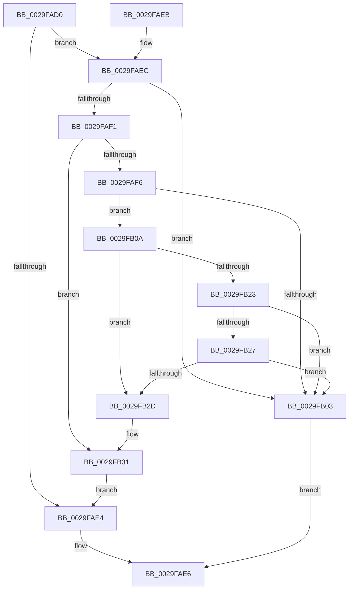

# MiPageAttributeBatchChangeNeeded

- RVA: `0x0029FAD0`–`0x0029FB38` (길이 `104` bytes)
- VA: `0x000000014029FAD0`
- 실행 섹션: `.text`
- PDB 이름 있음: `예`; PDB Function 태그: `아니요`
- unwind 정보 RVA: `0x00068348`
- 디코드: `34`개 명령, `104/104` bytes 표시
- 미해석 바이트: `0` (있으면 어셈블리에 `.byte`로 보존)

> 이 문서는 커널 이미지의 기계어와 PDB 기호를 분석해 생성했습니다. 4번과 5번은 함수 원형과 자료형을 바이너리 사용 방식에서 추정한 C 해석이며 원본 소스 복구 결과는 아닙니다.

## 1. Dependencies

- 직접 호출 지점: **1**; 고유 호출 대상: **1**
- 직접 호출자로 확인된 함수: **3**
- RIP 상대 이미지 참조: **1**

### Outgoing calls
- `0x0029FB31` → [MiChangePageAttribute](../33/MiChangePageAttribute_function_00332ECC.md) (function, `0x00332ECC`)

### Direct callers
- [MiConvertContiguousPages](MiConvertContiguousPages_function_0029F894.md) at `0x0029F953`
- [MiUpdateCacheAttributeListsForPage](../2C/MiUpdateCacheAttributeListsForPage_function_002C97CC.md) at `0x002C9831`
- [MiUpdateCacheAttributeListsForPage](../2C/MiUpdateCacheAttributeListsForPage_function_002C97CC.md) at `0x002C9875`
- [MiSwitchToTransition](../4C/MiSwitchToTransition_function_004C0F5C.md) at `0x004C1133`

### Static image references
- `0x0029FB0F` → RVA `0x00FCF080` (`CACHEALI`; read)

## 2. Other-region calls and transfers

- 다른 실행 섹션으로 향하는 call: **0**
- 별도 외부 분기/꼬리 이동을 확인하지 못했습니다.

## 3. Assembly (complete function range)

```asm
0029FAD0  48 83 EC 28                     sub rsp, 0x28
0029FAD4  8B 41 20                        mov eax, dword ptr [rcx + 0x20]
0029FAD7  C1 E8 10                        shr eax, 0x10
0029FADA  0F B6 C0                        movzx eax, al
0029FADD  C1 E8 06                        shr eax, 6
0029FAE0  3B C2                           cmp eax, edx
0029FAE2  75 08                           jne 0x14029faec
0029FAE4  33 C0                           xor eax, eax
0029FAE6  48 83 C4 28                     add rsp, 0x28
0029FAEA  C3                              ret
0029FAEB  CC                              int3
0029FAEC  83 F8 01                        cmp eax, 1
0029FAEF  74 12                           je 0x14029fb03
0029FAF1  83 F8 03                        cmp eax, 3
0029FAF4  74 3B                           je 0x14029fb31
0029FAF6  48 8B 41 18                     mov rax, qword ptr [rcx + 0x18]
0029FAFA  48 C1 E8 3B                     shr rax, 0x3b
0029FAFE  83 E0 07                        and eax, 7
0029FB01  75 07                           jne 0x14029fb0a
0029FB03  B8 01 00 00 00                  mov eax, 1
0029FB08  EB DC                           jmp 0x14029fae6
0029FB0A  F0 83 0C 24 00                  lock or dword ptr [rsp], 0
0029FB0F  44 8B 0D 6A F5 D2 00            mov r9d, dword ptr [rip + 0xd2f56a]
0029FB16  44 2B C8                        sub r9d, eax
0029FB19  41 83 E1 07                     and r9d, 7
0029FB1D  41 83 F9 02                     cmp r9d, 2
0029FB21  77 0A                           ja 0x14029fb2d
0029FB23  A8 01                           test al, 1
0029FB25  75 DC                           jne 0x14029fb03
0029FB27  41 83 F9 02                     cmp r9d, 2
0029FB2B  72 D6                           jb 0x14029fb03
0029FB2D  41 83 C8 04                     or r8d, 4
0029FB31  E8 96 33 09 00                  call 0x140332ecc
0029FB36  EB AC                           jmp 0x14029fae4
```

## 4. C-style interpretation (structured pseudocode)

```c
__int64 __fastcall MiPageAttributeBatchChangeNeeded(__int64 a1, int a2, int a3)
{
    __int64 result;
    __int64 v_rsp;
    unsigned int v_stack_p0;

    v_rsp = (v_rsp) - (40);
    result = (unsigned int)(((unsigned int)(*(unsigned int *)(a1 + 32))) >> (16));
    result = (unsigned int)(((unsigned __int8)(result)) >> (6));
    if (((unsigned int)(result)) != a2) goto loc_0029FAEC;
loc_0029FAE4:
    result = 0;
loc_0029FAE6:
    v_rsp = (v_rsp) + (40);
    return result;
loc_0029FAEC:
    if (0 == 1) goto loc_0029FB03;
    if (0 == 3) goto loc_0029FB31;
    result = (*(unsigned __int64 *)(a1 + 24)) >> (59);
    result = (unsigned int)((result) & (7));
    if (condition_is_not_equal) goto loc_0029FB0A;
loc_0029FB03:
    goto loc_0029FAE6;
loc_0029FB0A:
    a4 = (unsigned int)(((unsigned int)(*(unsigned int *)(v_rip + 13825386))) - (1));
    a4 = (unsigned int)((a4) & (7));
    if (((unsigned int)(a4)) > 2) goto loc_0029FB2D;
    if (1 != 0) goto loc_0029FB03;
    if (((unsigned int)(a4)) < 2) goto loc_0029FB03;
loc_0029FB2D:
    a3 = (unsigned int)((a3) | (4));
loc_0029FB31:
    result = MiChangePageAttribute(a1, a2, a3, a4);
    goto loc_0029FAE4;
}
```

## 5. (Beta) C Style

```c
int64_t MiPageAttributeBatchChangeNeeded(void *Arg1, int32_t Arg2, int32_t Arg3)
{
    uint8_t *arg1 = (uint8_t *)Arg1;

    int64_t result;
    int64_t local_rsp;
    uint32_t v_stack_p0;

    local_rsp = (local_rsp) - (40);
    result = (uint32_t)(((uint32_t)(*(uint32_t *)(arg1 + 0x20))) >> (16));
    result = (uint32_t)(((uint8_t)(result)) >> (6));
    if (((uint32_t)(result)) != Arg2) goto loc_0029FAEC;
loc_0029FAE4:
    result = 0;
loc_0029FAE6:
    local_rsp = (local_rsp) + (40);
    return result;
loc_0029FAEC:
    if (0 == 1) goto loc_0029FB03;
    if (0 == 3) goto loc_0029FB31;
    result = (*(uint64_t *)(arg1 + 0x18)) >> (59);
    result = (uint32_t)((result) & (7));
    if (condition_is_not_equal) goto loc_0029FB0A;
loc_0029FB03:
    goto loc_0029FAE6;
loc_0029FB0A:
    a4 = (uint32_t)(((uint32_t)(*(uint32_t *)(v_rip + 0xD2F56A))) - (1));
    a4 = (uint32_t)((a4) & (7));
    if (((uint32_t)(a4)) > 2) goto loc_0029FB2D;
    if (1 != 0) goto loc_0029FB03;
    if (((uint32_t)(a4)) < 2) goto loc_0029FB03;
loc_0029FB2D:
    Arg3 = (uint32_t)((Arg3) | (4));
loc_0029FB31:
    result = MiChangePageAttribute(Arg1, Arg2, Arg3, a4);
    goto loc_0029FAE4;
}
```

### 관측된 메모리 오프셋

구조체 형식이 확인되지 않은 접근은 인자 기준의 오프셋으로만 기록했습니다.

| 기준 인자 | 오프셋 표현 | 폭 (bit) | 접근 |
|---|---:|---:|---|
| `Arg1` | `+ 0x18` | `64` | `R` |
| `Arg1` | `+ 0x20` | `32` | `R` |

## 6. Execution-region graph

[열기: 2D/3D 그래프와 함수 탐색 컨트롤 패널](../../../control-panel.html?section=text&rva=0x0029FAD0&view=graph)

- 2D 그래프는 위에서 아래로 흐르고, 3D 그래프는 빈 공간을 드래그해 회전합니다. Shift+드래그는 이동, 휠은 확대·축소, 함수 노드 선택은 대상 보고서 이동입니다.

### Static fallback


