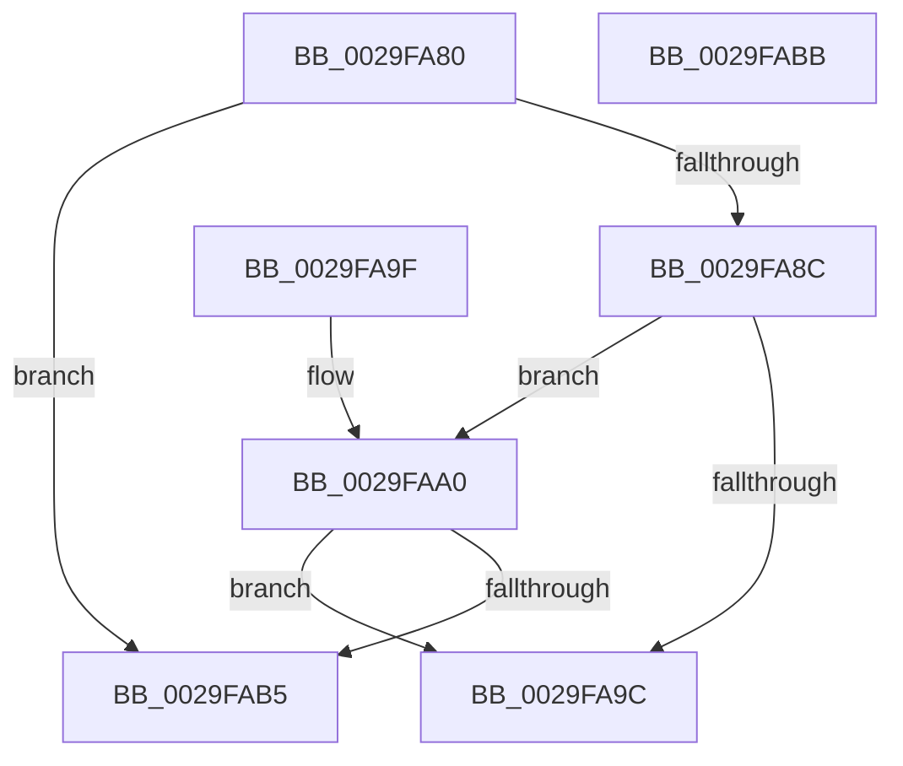

# MiPfnZeroingNeeded

- RVA: `0x0029FA80`–`0x0029FABC` (길이 `60` bytes)
- VA: `0x000000014029FA80`
- 실행 섹션: `.text`
- PDB 이름 있음: `예`; PDB Function 태그: `아니요`
- unwind 정보 RVA: `0x000DB714`
- 디코드: `21`개 명령, `60/60` bytes 표시
- 미해석 바이트: `0` (있으면 어셈블리에 `.byte`로 보존)

> 이 문서는 커널 이미지의 기계어와 PDB 기호를 분석해 생성했습니다. 4번과 5번은 함수 원형과 자료형을 바이너리 사용 방식에서 추정한 C 해석이며 원본 소스 복구 결과는 아닙니다.

## 1. Dependencies

- 직접 호출 지점: **0**; 고유 호출 대상: **0**
- 직접 호출자로 확인된 함수: **9**
- RIP 상대 이미지 참조: **1**

### Outgoing calls
- 직접 디코드된 call 명령이 없습니다.

### Direct callers
- [MiConvertContiguousPages](MiConvertContiguousPages_function_0029F894.md) at `0x0029F93E`
- [MiMakePageAvoidRead](../2B/MiMakePageAvoidRead_function_002B7DE0.md) at `0x002B8352`
- [MiInitializeMdlOneNodeBatchPages](../2C/MiInitializeMdlOneNodeBatchPages_function_002C9480.md) at `0x002C95DB`
- [sub_002F6E32](../2F/Unknown_function_002F6E32.md) at `0x002F725B`
- [MiChangePageAttribute](../33/MiChangePageAttribute_function_00332ECC.md) at `0x00332F23`
- [MiCoalesceFreeSmallPages](../33/MiCoalesceFreeSmallPages_function_00336340.md) at `0x00336B29`
- [MiPfPutPagesInTransition](../36/MiPfPutPagesInTransition_function_003640EC.md) at `0x00364ABC`
- [MiGetSlabPage](../37/MiGetSlabPage_function_00376FBC.md) at `0x003770F4`
- [MiFindLargePageMemory](../../page/AA/MiFindLargePageMemory_function_00AA8334.md) at `0x00AA8544`

### Static image references
- `0x0029FAAD` → RVA `0x00E2DCD8` (`.data`; reference)

## 2. Other-region calls and transfers

- 다른 실행 섹션으로 향하는 call: **0**
- 별도 외부 분기/꼬리 이동을 확인하지 못했습니다.

## 3. Assembly (complete function range)

```asm
0029FA80  48 8B 41 10                     mov rax, qword ptr [rcx + 0x10]
0029FA84  48 A9 E0 03 00 00               test rax, 0x3e0
0029FA8A  75 29                           jne 0x14029fab5
0029FA8C  8B 41 20                        mov eax, dword ptr [rcx + 0x20]
0029FA8F  C1 E8 10                        shr eax, 0x10
0029FA92  0F B6 C8                        movzx ecx, al
0029FA95  C1 E9 06                        shr ecx, 6
0029FA98  3B CA                           cmp ecx, edx
0029FA9A  75 04                           jne 0x14029faa0
0029FA9C  33 C0                           xor eax, eax
0029FA9E  C3                              ret
0029FA9F  CC                              int3
0029FAA0  B8 01 00 00 00                  mov eax, 1
0029FAA5  D2 E0                           shl al, cl
0029FAA7  0F B6 C8                        movzx ecx, al
0029FAAA  0F AB D1                        bts ecx, edx
0029FAAD  84 0D 25 E2 B8 00               test byte ptr [rip + 0xb8e225], cl
0029FAB3  74 E7                           je 0x14029fa9c
0029FAB5  B8 01 00 00 00                  mov eax, 1
0029FABA  C3                              ret
0029FABB  CC                              int3
```

## 4. C-style interpretation (structured pseudocode)

```c
__int64 __fastcall MiPfnZeroingNeeded(__int64 a1, int a2)
{
    __int64 result;

    if (((*(unsigned __int64 *)(a1 + 16)) & (992)) != 0) goto loc_0029FAB5;
    result = (unsigned int)(((unsigned int)(*(unsigned int *)(a1 + 32))) >> (16));
    a1 = (unsigned int)(((unsigned __int8)(result)) >> (6));
    if (((unsigned int)(a1)) != a2) goto loc_0029FAA0;
loc_0029FA9C:
    result = 0;
    return result;
loc_0029FAA0:
    result = (unsigned __int8)((1) << ((unsigned __int8)(a1)));
    if (((*(unsigned __int8 *)(v_rip + 12116517)) & ((unsigned __int8)((unsigned __int8)(result)))) == 0) goto loc_0029FA9C;
loc_0029FAB5:
    return 1;
}
```

## 5. (Beta) C Style

```c
int64_t MiPfnZeroingNeeded(void *Arg1, int32_t Arg2)
{
    uint8_t *arg1 = (uint8_t *)Arg1;

    int64_t result;

    if (((*(uint64_t *)(arg1 + 0x10)) & (992)) != 0) goto loc_0029FAB5;
    result = (uint32_t)(((uint32_t)(*(uint32_t *)(arg1 + 0x20))) >> (16));
    Arg1 = (uint32_t)(((uint8_t)(result)) >> (6));
    if (((uint32_t)(Arg1)) != Arg2) goto loc_0029FAA0;
loc_0029FA9C:
    result = 0;
    return result;
loc_0029FAA0:
    result = (uint8_t)((1) << ((uint8_t)(Arg1)));
    if (((*(uint8_t *)(v_rip + 0xB8E225)) & ((uint8_t)((uint8_t)(result)))) == 0) goto loc_0029FA9C;
loc_0029FAB5:
    return 1;
}
```

### 관측된 메모리 오프셋

구조체 형식이 확인되지 않은 접근은 인자 기준의 오프셋으로만 기록했습니다.

| 기준 인자 | 오프셋 표현 | 폭 (bit) | 접근 |
|---|---:|---:|---|
| `Arg1` | `+ 0x10` | `64` | `R` |
| `Arg1` | `+ 0x20` | `32` | `R` |

## 6. Execution-region graph

[열기: 2D/3D 그래프와 함수 탐색 컨트롤 패널](../../../control-panel.html?section=text&rva=0x0029FA80&view=graph)

- 2D 그래프는 위에서 아래로 흐르고, 3D 그래프는 빈 공간을 드래그해 회전합니다. Shift+드래그는 이동, 휠은 확대·축소, 함수 노드 선택은 대상 보고서 이동입니다.

### Static fallback


