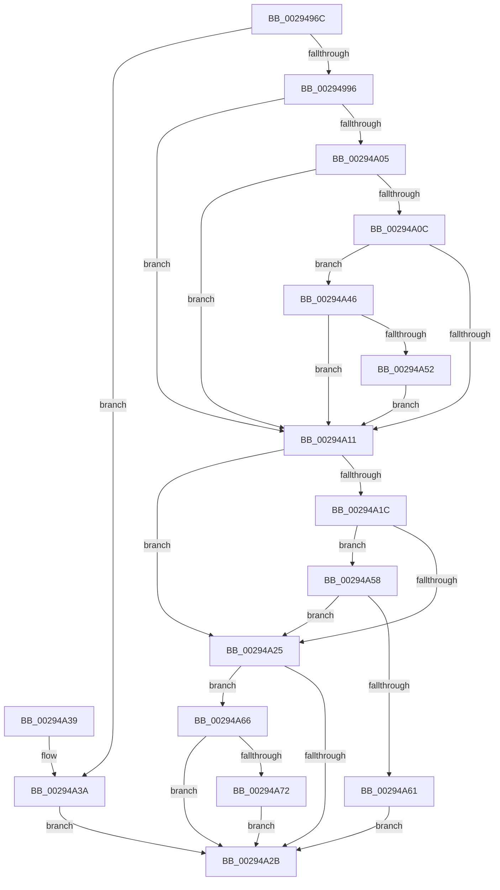

# MiPteForTrimmedProto

- RVA: `0x0029496C`–`0x00294A78` (길이 `268` bytes)
- VA: `0x000000014029496C`
- 실행 섹션: `.text`
- PDB 이름 있음: `예`; PDB Function 태그: `아니요`
- unwind 정보 RVA: `0x000677AC`
- 디코드: `73`개 명령, `268/268` bytes 표시
- 미해석 바이트: `0` (있으면 어셈블리에 `.byte`로 보존)

> 이 문서는 커널 이미지의 기계어와 PDB 기호를 분석해 생성했습니다. 4번과 5번은 함수 원형과 자료형을 바이너리 사용 방식에서 추정한 C 해석이며 원본 소스 복구 결과는 아닙니다.

## 1. Dependencies

- 직접 호출 지점: **5**; 고유 호출 대상: **5**
- 직접 호출자로 확인된 함수: **1**
- RIP 상대 이미지 참조: **0**

### Outgoing calls
- `0x0029497F` → [MiGetWsleContents](../31/MiGetWsleContents_function_00316540.md) (function, `0x00316540`)
- `0x00294989` → [MiGetWsleProtection](MiGetWsleProtection_function_00294A80.md) (function, `0x00294A80`)
- `0x002949F2` → [MiMakePrototypePteDirect](MiMakePrototypePteDirect_function_00294DE0.md) (function, `0x00294DE0`)
- `0x00294A3C` → [MiMakePrototypePteVadLookup](../2C/MiMakePrototypePteVadLookup_function_002C3480.md) (function, `0x002C3480`)
- `0x00294A69` → [MiClonePteReadonly](../4A/MiClonePteReadonly_function_004A5F6C.md) (function, `0x004A5F6C`)

### Direct callers
- [MiWsleFlush](../23/MiWsleFlush_function_0023FB30.md) at `0x0023FD45`

### Static image references
- 디코드된 RIP-relative 메모리 참조가 없습니다.

## 2. Other-region calls and transfers

- 다른 실행 섹션으로 향하는 call: **0**
- 별도 외부 분기/꼬리 이동을 확인하지 못했습니다.

## 3. Assembly (complete function range)

```asm
0029496C  48 89 5C 24 08                  mov qword ptr [rsp + 8], rbx
00294971  57                              push rdi
00294972  48 83 EC 20                     sub rsp, 0x20
00294976  41 8B F8                        mov edi, r8d
00294979  4C 8B DA                        mov r11, rdx
0029497C  48 8B D9                        mov rbx, rcx
0029497F  E8 BC 1B 08 00                  call 0x140316540
00294984  8A D0                           mov dl, al
00294986  49 8B CB                        mov rcx, r11
00294989  E8 F2 00 00 00                  call 0x140294a80
0029498E  85 C0                           test eax, eax
00294990  0F 85 A4 00 00 00               jne 0x140294a3a
00294996  49 C1 EB 09                     shr r11, 9
0029499A  48 B8 F8 FF FF FF 7F 00 00 00   movabs rax, 0x7ffffffff8
002949A4  4C 23 D8                        and r11, rax
002949A7  48 B8 00 00 00 00 80 F6 FF FF   movabs rax, 0xfffff68000000000
002949B1  49 8B 14 03                     mov rdx, qword ptr [r11 + rax]
002949B5  48 B9 FF FF FF FF FF 00 00 00   movabs rcx, 0xffffffffff
002949BF  48 8B C2                        mov rax, rdx
002949C2  48 C1 E8 0C                     shr rax, 0xc
002949C6  48 23 C1                        and rax, rcx
002949C9  4C 8D 0C 40                     lea r9, [rax + rax*2]
002949CD  49 C1 E1 04                     shl r9, 4
002949D1  48 B8 00 00 00 00 00 DE FF FF   movabs rax, 0xffffde0000000000
002949DB  4C 03 C8                        add r9, rax
002949DE  48 B8 00 00 00 00 00 00 00 80   movabs rax, 0x8000000000000000
002949E8  4D 8B 51 08                     mov r10, qword ptr [r9 + 8]
002949EC  4C 0B D0                        or r10, rax
002949EF  49 8B CA                        mov rcx, r10
002949F2  E8 E9 03 00 00                  call 0x140294de0
002949F7  41 BB 00 08 00 00               mov r11d, 0x800
002949FD  4C 8B C0                        mov r8, rax
00294A00  49 85 D3                        test r11, rdx
00294A03  75 0C                           jne 0x140294a11
00294A05  48 0F BA E2 09                  bt rdx, 9
00294A0A  72 05                           jb 0x140294a11
00294A0C  48 85 D2                        test rdx, rdx
00294A0F  78 35                           js 0x140294a46
00294A11  49 8B 41 28                     mov rax, qword ptr [r9 + 0x28]
00294A15  48 0F BA E0 28                  bt rax, 0x28
00294A1A  72 09                           jb 0x140294a25
00294A1C  49 8B 41 08                     mov rax, qword ptr [r9 + 8]
00294A20  48 85 C0                        test rax, rax
00294A23  79 33                           jns 0x140294a58
00294A25  40 F6 C7 02                     test dil, 2
00294A29  75 3B                           jne 0x140294a66
00294A2B  48 8B 5C 24 30                  mov rbx, qword ptr [rsp + 0x30]
00294A30  49 8B C0                        mov rax, r8
00294A33  48 83 C4 20                     add rsp, 0x20
00294A37  5F                              pop rdi
00294A38  C3                              ret
00294A39  CC                              int3
00294A3A  8B C8                           mov ecx, eax
00294A3C  E8 3F EA 02 00                  call 0x1402c3480
00294A41  4C 8B C0                        mov r8, rax
00294A44  EB E5                           jmp 0x140294a2b
00294A46  8B 83 B8 00 00 00               mov eax, dword ptr [rbx + 0xb8]
00294A4C  24 0F                           and al, 0xf
00294A4E  3C 01                           cmp al, 1
00294A50  72 BF                           jb 0x140294a11
00294A52  49 83 C8 08                     or r8, 8
00294A56  EB B9                           jmp 0x140294a11
00294A58  49 8B 41 08                     mov rax, qword ptr [r9 + 8]
00294A5C  48 85 C0                        test rax, rax
00294A5F  74 C4                           je 0x140294a25
00294A61  4D 0B C3                        or r8, r11
00294A64  EB C5                           jmp 0x140294a2b
00294A66  49 8B CA                        mov rcx, r10
00294A69  E8 FE 14 21 00                  call 0x1404a5f6c
00294A6E  85 C0                           test eax, eax
00294A70  74 B9                           je 0x140294a2b
00294A72  49 83 C8 08                     or r8, 8
00294A76  EB B3                           jmp 0x140294a2b
```

## 4. C-style interpretation (structured pseudocode)

```c
__int64 __fastcall MiPteForTrimmedProto(__int64 a1, __int64 a2, int a3)
{
    __int64 result;
    __int64 v_r10;
    __int64 v_r11;
    __int64 v_rsp;
    unsigned __int64 v_stack_p8;

    v_stack_p8 = v_rbx;
    v_rsp = (v_rsp) - (32);
    result = MiGetWsleContents(a1, a2, a3, a4);
    result = MiGetWsleProtection(a2, (unsigned __int8)(result), a3, a4);
    if ((unsigned int)(result) != 0) goto loc_00294A3A;
    v_r11 = (a2) >> (9);
    v_r11 = (v_r11) & (result);
    result = (*(unsigned __int64 *)(v_r11 + result * 1)) >> (12);
    result = (result) & (a2);
    a4 = (result + result * 2) << (4);
    a4 = (a4) + (result);
    v_r10 = (*(unsigned __int64 *)(a4 + 8)) | (result);
    result = MiMakePrototypePteDirect(v_r10, *(unsigned __int64 *)(v_r11 + result * 1), a3, a4);
    if ((((unsigned int)(0x800ULL)) & (*(unsigned __int64 *)(v_r11 + result * 1))) != 0) goto loc_00294A11;
    if (condition_is_below) goto loc_00294A11;
    if (sign_flag) goto loc_00294A46;
loc_00294A11:
    if (condition_is_below) goto loc_00294A25;
    if (!sign_flag) goto loc_00294A58;
loc_00294A25:
    if ((((unsigned __int8)((unsigned int)(a3))) & (2)) != 0) goto loc_00294A66;
loc_00294A2B:
    v_rsp = (v_rsp) + (32);
    return result;
loc_00294A3A:
    result = MiMakePrototypePteVadLookup((unsigned int)((unsigned int)(result)), *(unsigned __int64 *)(v_r11 + result * 1), result, a4);
    goto loc_00294A2B;
loc_00294A46:
    result = (unsigned __int8)(((unsigned int)(*(unsigned int *)(v_stack_p8 + 184))) & (15));
    if (((unsigned __int8)(result)) < 1) goto loc_00294A11;
    a3 = (result) | (8);
    goto loc_00294A11;
loc_00294A58:
    if (*(unsigned __int64 *)(a4 + 8) == 0) goto loc_00294A25;
    a3 = (a3) | ((unsigned int)(0x800ULL));
    goto loc_00294A2B;
loc_00294A66:
    result = MiClonePteReadonly(v_r10, *(unsigned __int64 *)(v_r11 + result * 1), a3, a4);
    if ((unsigned int)(result) == 0) goto loc_00294A2B;
    a3 = (a3) | (8);
    goto loc_00294A2B;
}
```

## 5. (Beta) C Style

```c
int64_t MiPteForTrimmedProto(void *Arg1, int64_t Arg2, int32_t Arg3)
{
    uint8_t *arg1 = (uint8_t *)Arg1;

    int64_t result;
    int64_t local_r10;
    int64_t local_r11;
    int64_t local_rsp;
    uint64_t v_stack_p8;

    v_stack_p8 = local_rbx;
    local_rsp = (local_rsp) - (32);
    result = MiGetWsleContents(Arg1, Arg2, Arg3, a4);
    result = MiGetWsleProtection(Arg2, (uint8_t)(result), Arg3, a4);
    if ((uint32_t)(result) != 0) goto loc_00294A3A;
    local_r11 = (Arg2) >> (9);
    local_r11 = (local_r11) & (result);
    result = (*(uint64_t *)(local_r11 + result * 1)) >> (12);
    result = (result) & (Arg2);
    a4 = (result + result * 2) << (4);
    a4 = (a4) + (result);
    local_r10 = (*(uint64_t *)(a4 + 0x8)) | (result);
    result = MiMakePrototypePteDirect(local_r10, *(uint64_t *)(local_r11 + result * 1), Arg3, a4);
    if ((((uint32_t)(0x800ULL)) & (*(uint64_t *)(local_r11 + result * 1))) != 0) goto loc_00294A11;
    if (condition_is_below) goto loc_00294A11;
    if (sign_flag) goto loc_00294A46;
loc_00294A11:
    if (condition_is_below) goto loc_00294A25;
    if (!sign_flag) goto loc_00294A58;
loc_00294A25:
    if ((((uint8_t)((uint32_t)(Arg3))) & (2)) != 0) goto loc_00294A66;
loc_00294A2B:
    local_rsp = (local_rsp) + (32);
    return result;
loc_00294A3A:
    result = MiMakePrototypePteVadLookup((uint32_t)((uint32_t)(result)), *(uint64_t *)(local_r11 + result * 1), result, a4);
    goto loc_00294A2B;
loc_00294A46:
    result = (uint8_t)(((uint32_t)(*(uint32_t *)(v_stack_p8 + 0xB8))) & (15));
    if (((uint8_t)(result)) < 1) goto loc_00294A11;
    Arg3 = (result) | (8);
    goto loc_00294A11;
loc_00294A58:
    if (*(uint64_t *)(a4 + 0x8) == 0) goto loc_00294A25;
    Arg3 = (Arg3) | ((uint32_t)(0x800ULL));
    goto loc_00294A2B;
loc_00294A66:
    result = MiClonePteReadonly(local_r10, *(uint64_t *)(local_r11 + result * 1), Arg3, a4);
    if ((uint32_t)(result) == 0) goto loc_00294A2B;
    Arg3 = (Arg3) | (8);
    goto loc_00294A2B;
}
```

### 관측된 메모리 오프셋

구조체 형식이 확인되지 않은 접근은 인자 기준의 오프셋으로만 기록했습니다.

| 기준 인자 | 오프셋 표현 | 폭 (bit) | 접근 |
|---|---:|---:|---|
| `Arg1` | `+ 0xB8` | `32` | `R` |

## 6. Execution-region graph

[열기: 2D/3D 그래프와 함수 탐색 컨트롤 패널](../../../control-panel.html?section=text&rva=0x0029496C&view=graph)

- 2D 그래프는 위에서 아래로 흐르고, 3D 그래프는 빈 공간을 드래그해 회전합니다. Shift+드래그는 이동, 휠은 확대·축소, 함수 노드 선택은 대상 보고서 이동입니다.

### Static fallback


