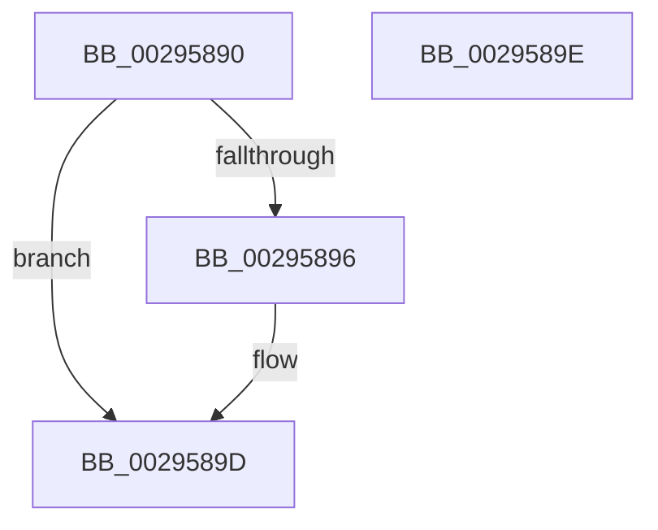

# MiReferenceVad

- RVA: `0x00295890`–`0x0029589F` (길이 `15` bytes)
- VA: `0x0000000140295890`
- 실행 섹션: `.text`
- PDB 이름 있음: `예`; PDB Function 태그: `아니요`
- unwind 정보 RVA: `0x000DB714`
- 디코드: `6`개 명령, `15/15` bytes 표시
- 미해석 바이트: `0` (있으면 어셈블리에 `.byte`로 보존)

> 이 문서는 커널 이미지의 기계어와 PDB 기호를 분석해 생성했습니다. 4번과 5번은 함수 원형과 자료형을 바이너리 사용 방식에서 추정한 C 해석이며 원본 소스 복구 결과는 아닙니다.

## 1. Dependencies

- 직접 호출 지점: **0**; 고유 호출 대상: **0**
- 직접 호출자로 확인된 함수: **16**
- RIP 상대 이미지 참조: **0**

### Outgoing calls
- 직접 디코드된 call 명령이 없습니다.

### Direct callers
- [MiObtainReferencedSecureVad](MiObtainReferencedSecureVad_function_00295688.md) at `0x002956F6`
- [sub_006F9816](../6F/Unknown_function_006F9816.md) at `0x006F9819`
- [MiHotPatchProcess](../../page/80/MiHotPatchProcess_function_00803B78.md) at `0x00803CEC`
- [MiAllocateEnclaveVad](../../page/80/MiAllocateEnclaveVad_function_008080A4.md) at `0x008083A0`
- [MiDeleteInsertedCloneVads](../../page/81/MiDeleteInsertedCloneVads_function_00811564.md) at `0x00811620`
- [MiLockVadRange](../../page/87/MiLockVadRange_function_0087F670.md) at `0x0087F8BE`
- [MiCoalescePlaceholderAllocations](../../page/88/MiCoalescePlaceholderAllocations_function_0088095C.md) at `0x00880A24`
- [MiCoalescePlaceholderAllocations](../../page/88/MiCoalescePlaceholderAllocations_function_0088095C.md) at `0x00880A5F`
- [MiReserveUserMemory](../../page/88/MiReserveUserMemory_function_00884498.md) at `0x00884940`
- [sub_0088535F](../../page/88/Unknown_function_0088535F.md) at `0x008853BB`
- [MiCommitInitialVadMetadataBits](../../page/8D/MiCommitInitialVadMetadataBits_function_008D09CC.md) at `0x008D0A58`
- [MiMapViewOfImageSection](../../page/97/MiMapViewOfImageSection_function_0097E92C.md) at `0x0097F38B`
- [MiMapViewOfPhysicalSection](../../page/97/MiMapViewOfPhysicalSection_function_0097F984.md) at `0x0097FC78`
- [MiMapLockedPagesInUserSpace](../../page/97/MiMapLockedPagesInUserSpace_function_0097FE04.md) at `0x00980142`
- [MiAllocateFromSubAllocatedRegion](../../page/98/MiAllocateFromSubAllocatedRegion_function_00981C24.md) at `0x00981D34`
- [MmCleanProcessAddressSpace](../../page/A1/MmCleanProcessAddressSpace_function_00A17EC0.md) at `0x00A17F7D`
- [MmCleanProcessAddressSpace](../../page/A1/MmCleanProcessAddressSpace_function_00A17EC0.md) at `0x00A17F98`
- [MiPreparePlaceholderVadReplacement](../../page/A7/MiPreparePlaceholderVadReplacement_function_00A7E998.md) at `0x00A7E9B0`

### Static image references
- 디코드된 RIP-relative 메모리 참조가 없습니다.

## 2. Other-region calls and transfers

- 다른 실행 섹션으로 향하는 call: **0**
- 별도 외부 분기/꼬리 이동을 확인하지 못했습니다.

## 3. Assembly (complete function range)

```asm
00295890  F0 FF 41 24                     lock inc dword ptr [rcx + 0x24]
00295894  75 07                           jne 0x14029589d
00295896  B9 0E 00 00 00                  mov ecx, 0xe
0029589B  CD 29                           int 0x29
0029589D  C3                              ret
0029589E  CC                              int3
```

## 4. C-style interpretation (structured pseudocode)

```c
void __fastcall MiReferenceVad(__int64 a1)
{
    if (!(condition_is_not_equal)) {
        a1 = 14;
    }
    return;
}
```

## 5. (Beta) C Style

```c
void MiReferenceVad(void *Arg1)
{
    uint8_t *arg1 = (uint8_t *)Arg1;

    if (!(condition_is_not_equal)) {
        Arg1 = 14;
    }
    return;
}
```

### 관측된 메모리 오프셋

구조체 형식이 확인되지 않은 접근은 인자 기준의 오프셋으로만 기록했습니다.

| 기준 인자 | 오프셋 표현 | 폭 (bit) | 접근 |
|---|---:|---:|---|
| `Arg1` | `+ 0x24` | `32` | `R/W` |

## 6. Execution-region graph

[열기: 2D/3D 그래프와 함수 탐색 컨트롤 패널](../../../control-panel.html?section=text&rva=0x00295890&view=graph)

- 2D 그래프는 위에서 아래로 흐르고, 3D 그래프는 빈 공간을 드래그해 회전합니다. Shift+드래그는 이동, 휠은 확대·축소, 함수 노드 선택은 대상 보고서 이동입니다.

### Static fallback


