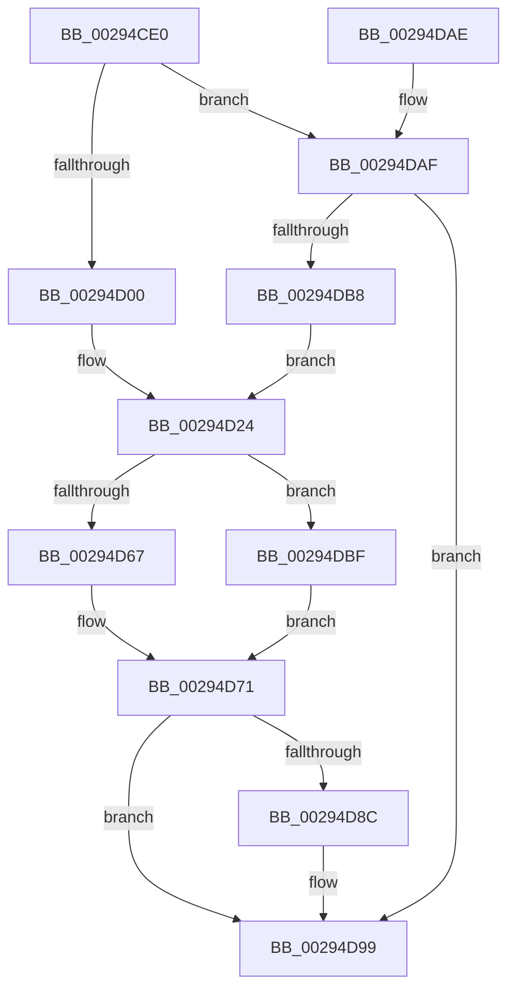

# MiReleaseSystemCacheView

- RVA: `0x00294CE0`–`0x00294DCB` (길이 `235` bytes)
- VA: `0x0000000140294CE0`
- 실행 섹션: `.text`
- PDB 이름 있음: `예`; PDB Function 태그: `아니요`
- unwind 정보 RVA: `0x000677C8`
- 디코드: `58`개 명령, `235/235` bytes 표시
- 미해석 바이트: `0` (있으면 어셈블리에 `.byte`로 보존)

> 이 문서는 커널 이미지의 기계어와 PDB 기호를 분석해 생성했습니다. 4번과 5번은 함수 원형과 자료형을 바이너리 사용 방식에서 추정한 C 해석이며 원본 소스 복구 결과는 아닙니다.

## 1. Dependencies

- 직접 호출 지점: **7**; 고유 호출 대상: **7**
- 직접 호출자로 확인된 함수: **4**
- RIP 상대 이미지 참조: **3**

### Outgoing calls
- `0x00294D03` → [MiGetSystemCacheReverseMap](MiGetSystemCacheReverseMap_function_00294BF0.md) (function, `0x00294BF0`)
- `0x00294D3F` → [ExAcquireSpinLockExclusive](../24/ExAcquireSpinLockExclusive_function_00248690.md) (function, `0x00248690`)
- `0x00294D5A` → [MiRebalanceSystemCacheFreedViews](../41/MiRebalanceSystemCacheFreedViews_function_00419620.md) (function, `0x00419620`)
- `0x00294D6C` → [MiFreeSystemCacheView](../44/MiFreeSystemCacheView_function_0044800C.md) (function, `0x0044800C`)
- `0x00294D7B` → [MiReleaseSpinLockExclusive](../24/MiReleaseSpinLockExclusive_function_002482C0.md) (function, `0x002482C0`)
- `0x00294D94` → [MiReturnSystemCacheRegionsToKva](../49/MiReturnSystemCacheRegionsToKva_function_00494DFC.md) (function, `0x00494DFC`)
- `0x00294DC4` → [MiGetSystemCacheRegionsToFree](../48/MiGetSystemCacheRegionsToFree_function_004896F4.md) (function, `0x004896F4`)

### Direct callers
- [sub_00238DB5](../23/Unknown_function_00238DB5.md) at `0x00238DEA`
- [sub_00293C9B](Unknown_function_00293C9B.md) at `0x00293F56`
- [MiWorkingSetManager](../2D/MiWorkingSetManager_function_002DA7E0.md) at `0x002DA90A`
- [MmFreeSystemCacheReserveView](../../page/7F/MmFreeSystemCacheReserveView_function_007FE2D8.md) at `0x007FE33E`

### Static image references
- `0x00294D0F` → RVA `0x00E30088` (`.data`; read)
- `0x00294D2E` → RVA `0x00E2F3B8` (`.data`; read)
- `0x00294D4C` → RVA `0x00FCF080` (`CACHEALI`; read)

## 2. Other-region calls and transfers

- 다른 실행 섹션으로 향하는 call: **0**
- 별도 외부 분기/꼬리 이동을 확인하지 못했습니다.

## 3. Assembly (complete function range)

```asm
00294CE0  48 89 5C 24 08                  mov qword ptr [rsp + 8], rbx
00294CE5  48 89 6C 24 10                  mov qword ptr [rsp + 0x10], rbp
00294CEA  48 89 74 24 18                  mov qword ptr [rsp + 0x18], rsi
00294CEF  57                              push rdi
00294CF0  48 83 EC 30                     sub rsp, 0x30
00294CF4  48 8B D9                        mov rbx, rcx
00294CF7  48 85 D2                        test rdx, rdx
00294CFA  0F 84 AF 00 00 00               je 0x140294daf
00294D00  48 8B CA                        mov rcx, rdx
00294D03  E8 E8 FE FF FF                  call 0x140294bf0
00294D08  48 8B F8                        mov rdi, rax
00294D0B  48 8B 48 20                     mov rcx, qword ptr [rax + 0x20]
00294D0F  48 8B 15 72 B3 B9 00            mov rdx, qword ptr [rip + 0xb9b372]
00294D16  48 C1 E9 06                     shr rcx, 6
00294D1A  81 E1 FF 03 00 00               and ecx, 0x3ff
00294D20  48 8B 1C CA                     mov rbx, qword ptr [rdx + rcx*8]
00294D24  48 8D 44 24 20                  lea rax, [rsp + 0x20]
00294D29  48 89 44 24 28                  mov qword ptr [rsp + 0x28], rax
00294D2E  48 8D 0D 83 A6 B9 00            lea rcx, [rip + 0xb9a683]
00294D35  48 8D 44 24 20                  lea rax, [rsp + 0x20]
00294D3A  48 89 44 24 20                  mov qword ptr [rsp + 0x20], rax
00294D3F  E8 4C 39 FB FF                  call 0x140248690
00294D44  40 8A E8                        mov bpl, al
00294D47  F0 83 0C 24 00                  lock or dword ptr [rsp], 0
00294D4C  8B 35 2E A3 D3 00               mov esi, dword ptr [rip + 0xd3a32e]
00294D52  45 33 C0                        xor r8d, r8d
00294D55  8B D6                           mov edx, esi
00294D57  48 8B CB                        mov rcx, rbx
00294D5A  E8 C1 48 18 00                  call 0x140419620
00294D5F  48 8B CB                        mov rcx, rbx
00294D62  48 85 FF                        test rdi, rdi
00294D65  74 58                           je 0x140294dbf
00294D67  4C 8B C7                        mov r8, rdi
00294D6A  8B D6                           mov edx, esi
00294D6C  E8 9B 32 1B 00                  call 0x14044800c
00294D71  40 8A D5                        mov dl, bpl
00294D74  48 8D 0D 3D A6 B9 00            lea rcx, [rip + 0xb9a63d]
00294D7B  E8 40 35 FB FF                  call 0x1402482c0
00294D80  48 8D 44 24 20                  lea rax, [rsp + 0x20]
00294D85  48 39 44 24 20                  cmp qword ptr [rsp + 0x20], rax
00294D8A  74 0D                           je 0x140294d99
00294D8C  48 8D 54 24 20                  lea rdx, [rsp + 0x20]
00294D91  48 8B CB                        mov rcx, rbx
00294D94  E8 63 00 20 00                  call 0x140494dfc
00294D99  48 8B 5C 24 40                  mov rbx, qword ptr [rsp + 0x40]
00294D9E  48 8B 6C 24 48                  mov rbp, qword ptr [rsp + 0x48]
00294DA3  48 8B 74 24 50                  mov rsi, qword ptr [rsp + 0x50]
00294DA8  48 83 C4 30                     add rsp, 0x30
00294DAC  5F                              pop rdi
00294DAD  C3                              ret
00294DAE  CC                              int3
00294DAF  80 B9 5C 48 00 00 00            cmp byte ptr [rcx + 0x485c], 0
00294DB6  74 E1                           je 0x140294d99
00294DB8  33 FF                           xor edi, edi
00294DBA  E9 65 FF FF FF                  jmp 0x140294d24
00294DBF  48 8D 54 24 20                  lea rdx, [rsp + 0x20]
00294DC4  E8 2B 49 1F 00                  call 0x1404896f4
00294DC9  EB A6                           jmp 0x140294d71
```

## 4. C-style interpretation (structured pseudocode)

```c
__int64 __fastcall MiReleaseSystemCacheView(__int64 a1, __int64 a2, int a3)
{
    __int64 result;
    __int64 v_rdi;
    __int64 v_rsp;
    unsigned __int64 v_stack_m10;
    unsigned __int64 v_stack_m18;
    unsigned int v_stack_m38;
    unsigned __int64 v_stack_p10;
    unsigned __int64 v_stack_p18;
    unsigned __int64 v_stack_p20;
    unsigned __int64 v_stack_p8;

    v_stack_p8 = v_rbx;
    v_stack_p10 = v_rbp;
    v_stack_p18 = v_rsi;
    v_rsp = (v_rsp) - (48);
    if (a2 == 0) goto loc_00294DAF;
    result = MiGetSystemCacheReverseMap(a2, a2, a3, a4);
    a1 = (*(unsigned __int64 *)(result + 32)) >> (6);
    a1 = (unsigned int)((a1) & (0x3FFULL));
loc_00294D24:
    v_stack_m10 = v_stack_m18;
    v_stack_m18 = v_stack_m18;
    result = ExAcquireSpinLockExclusive(v_rip + 12166787, *(unsigned __int64 *)(v_rip + 12170098), a3, a4);
    a3 = 0;
    result = MiRebalanceSystemCacheFreedViews(*(unsigned __int64 *)(*(unsigned __int64 *)(v_rip + 12170098) + a1 * 8), (unsigned int)((unsigned int)((unsigned int)(*(unsigned int *)(v_rip + 13869870)))), a3, a4);
    if (result == 0) goto loc_00294DBF;
    result = MiFreeSystemCacheView(*(unsigned __int64 *)(*(unsigned __int64 *)(v_rip + 12170098) + a1 * 8), (unsigned int)((unsigned int)((unsigned int)(*(unsigned int *)(v_rip + 13869870)))), result, a4);
loc_00294D71:
    result = MiReleaseSpinLockExclusive(v_rip + 12166717, (unsigned __int8)((unsigned __int8)(result)), result, a4);
    result = v_stack_m18;
    if (v_stack_m18 != v_stack_m18) {
        a2 = v_stack_m18;
        a1 = *(unsigned __int64 *)(*(unsigned __int64 *)(v_rip + 12170098) + a1 * 8);
        result = MiReturnSystemCacheRegionsToKva(a1, a2, result, a4);
    }
    v_rsp = (v_rsp) + (48);
    return result;
loc_00294DAF:
    if ((*(unsigned __int8 *)(a1 + 18524)) == 0) goto loc_00294D99;
    v_rdi = 0;
    goto loc_00294D24;
loc_00294DBF:
    result = MiGetSystemCacheRegionsToFree(a1, v_stack_p20, result, a4);
    goto loc_00294D71;
}
```

## 5. (Beta) C Style

```c
int64_t MiReleaseSystemCacheView(void *Arg1, int64_t Arg2, int32_t Arg3)
{
    uint8_t *arg1 = (uint8_t *)Arg1;

    int64_t result;
    int64_t local_rdi;
    int64_t local_rsp;
    uint64_t v_stack_m10;
    uint64_t v_stack_m18;
    uint32_t v_stack_m38;
    uint64_t v_stack_p10;
    uint64_t v_stack_p18;
    uint64_t v_stack_p20;
    uint64_t v_stack_p8;

    v_stack_p8 = local_rbx;
    v_stack_p10 = local_rbp;
    v_stack_p18 = local_rsi;
    local_rsp = (local_rsp) - (48);
    if (Arg2 == 0) goto loc_00294DAF;
    result = MiGetSystemCacheReverseMap(Arg2, Arg2, Arg3, a4);
    Arg1 = (*(uint64_t *)(result + 0x20)) >> (6);
    Arg1 = (uint32_t)((Arg1) & (0x3FFULL));
loc_00294D24:
    v_stack_m10 = v_stack_m18;
    v_stack_m18 = v_stack_m18;
    result = ExAcquireSpinLockExclusive(v_rip + 12166787, *(uint64_t *)(v_rip + 0xB9B372), Arg3, a4);
    Arg3 = 0;
    result = MiRebalanceSystemCacheFreedViews(*(uint64_t *)(*(uint64_t *)(v_rip + 0xB9B372) + arg1 * 8), (uint32_t)((uint32_t)((uint32_t)(*(uint32_t *)(v_rip + 0xD3A32E)))), Arg3, a4);
    if (result == 0) goto loc_00294DBF;
    result = MiFreeSystemCacheView(*(uint64_t *)(*(uint64_t *)(v_rip + 0xB9B372) + arg1 * 8), (uint32_t)((uint32_t)((uint32_t)(*(uint32_t *)(v_rip + 0xD3A32E)))), result, a4);
loc_00294D71:
    result = MiReleaseSpinLockExclusive(v_rip + 12166717, (uint8_t)((uint8_t)(result)), result, a4);
    result = v_stack_m18;
    if (v_stack_m18 != v_stack_m18) {
        Arg2 = v_stack_m18;
        Arg1 = *(uint64_t *)(*(uint64_t *)(v_rip + 0xB9B372) + arg1 * 8);
        result = MiReturnSystemCacheRegionsToKva(Arg1, Arg2, result, a4);
    }
    local_rsp = (local_rsp) + (48);
    return result;
loc_00294DAF:
    if ((*(uint8_t *)(arg1 + 0x485C)) == 0) goto loc_00294D99;
    local_rdi = 0;
    goto loc_00294D24;
loc_00294DBF:
    result = MiGetSystemCacheRegionsToFree(Arg1, v_stack_p20, result, a4);
    goto loc_00294D71;
}
```

### 관측된 메모리 오프셋

구조체 형식이 확인되지 않은 접근은 인자 기준의 오프셋으로만 기록했습니다.

| 기준 인자 | 오프셋 표현 | 폭 (bit) | 접근 |
|---|---:|---:|---|
| `Arg1` | `+ 0x485C` | `8` | `R` |

## 6. Execution-region graph

[열기: 2D/3D 그래프와 함수 탐색 컨트롤 패널](../../../control-panel.html?section=text&rva=0x00294CE0&view=graph)

- 2D 그래프는 위에서 아래로 흐르고, 3D 그래프는 빈 공간을 드래그해 회전합니다. Shift+드래그는 이동, 휠은 확대·축소, 함수 노드 선택은 대상 보고서 이동입니다.

### Static fallback


