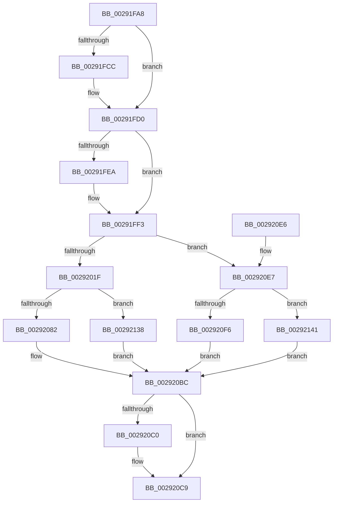

# MiRemoveActivePageTableLinks

- RVA: `0x00291FA8`–`0x00292156` (길이 `430` bytes)
- VA: `0x0000000140291FA8`
- 실행 섹션: `.text`
- PDB 이름 있음: `예`; PDB Function 태그: `아니요`
- unwind 정보 RVA: `0x00067520`
- 디코드: `106`개 명령, `430/430` bytes 표시
- 미해석 바이트: `0` (있으면 어셈블리에 `.byte`로 보존)

> 이 문서는 커널 이미지의 기계어와 PDB 기호를 분석해 생성했습니다. 4번과 5번은 함수 원형과 자료형을 바이너리 사용 방식에서 추정한 C 해석이며 원본 소스 복구 결과는 아닙니다.

## 1. Dependencies

- 직접 호출 지점: **3**; 고유 호출 대상: **3**
- 직접 호출자로 확인된 함수: **6**
- RIP 상대 이미지 참조: **0**

### Outgoing calls
- `0x00291FEE` → [ExAcquireSpinLockExclusiveAtDpcLevel](../24/ExAcquireSpinLockExclusiveAtDpcLevel_function_00248E80.md) (function, `0x00248E80`)
- `0x002920C4` → [ExReleaseSpinLockExclusiveFromDpcLevel](../24/ExReleaseSpinLockExclusiveFromDpcLevel_function_002497E0.md) (function, `0x002497E0`)
- `0x002920CC` → [MiRevertPfnActivePageTable](MiRevertPfnActivePageTable_function_002938F4.md) (function, `0x002938F4`)

### Direct callers
- [MiAddWorkingSetEntries](../27/MiAddWorkingSetEntries_function_0027DC00.md) at `0x0027DF42`
- [MiAddWorkingSetEntries](../27/MiAddWorkingSetEntries_function_0027DC00.md) at `0x0027DFA3`
- [MiSetVaAgeList](MiSetVaAgeList_function_00290A20.md) at `0x00290EA4`
- [MiSetVaAgeList](MiSetVaAgeList_function_00290A20.md) at `0x00290F34`
- [MiSetVaAgeList](MiSetVaAgeList_function_00290A20.md) at `0x00291061`
- [MiSetVaAgeList](MiSetVaAgeList_function_00290A20.md) at `0x00291134`
- [sub_00291A10](Unknown_function_00291A10.md) at `0x00291AF1`
- [sub_00291A10](Unknown_function_00291A10.md) at `0x00291B82`
- [sub_00292218](Unknown_function_00292218.md) at `0x00292478`
- [sub_00292218](Unknown_function_00292218.md) at `0x0029250C`
- [MiSetPfnOldestWsleLeafAge](MiSetPfnOldestWsleLeafAge_function_00293AC4.md) at `0x00293AFB`
- [MiRebuildPageTableAges](../40/MiRebuildPageTableAges_function_0040D4E0.md) at `0x0040D5A8`

### Static image references
- 디코드된 RIP-relative 메모리 참조가 없습니다.

## 2. Other-region calls and transfers

- 다른 실행 섹션으로 향하는 call: **0**
- 별도 외부 분기/꼬리 이동을 확인하지 못했습니다.

## 3. Assembly (complete function range)

```asm
00291FA8  48 89 5C 24 08                  mov qword ptr [rsp + 8], rbx
00291FAD  48 89 6C 24 10                  mov qword ptr [rsp + 0x10], rbp
00291FB2  48 89 74 24 18                  mov qword ptr [rsp + 0x18], rsi
00291FB7  57                              push rdi
00291FB8  48 83 EC 20                     sub rsp, 0x20
00291FBC  8B 81 B8 00 00 00               mov eax, dword ptr [rcx + 0xb8]
00291FC2  41 8B F0                        mov esi, r8d
00291FC5  48 8B FA                        mov rdi, rdx
00291FC8  A8 0F                           test al, 0xf
00291FCA  74 04                           je 0x140291fd0
00291FCC  48 8B 42 08                     mov rax, qword ptr [rdx + 8]
00291FD0  48 8B 02                        mov rax, qword ptr [rdx]
00291FD3  48 8B 51 10                     mov rdx, qword ptr [rcx + 0x10]
00291FD7  48 C1 E8 37                     shr rax, 0x37
00291FDB  83 E0 07                        and eax, 7
00291FDE  48 8D 0C 40                     lea rcx, [rax + rax*2]
00291FE2  48 8D 1C CA                     lea rbx, [rdx + rcx*8]
00291FE6  85 F6                           test esi, esi
00291FE8  75 09                           jne 0x140291ff3
00291FEA  48 8D 4B 40                     lea rcx, [rbx + 0x40]
00291FEE  E8 8D 6E FB FF                  call 0x140248e80
00291FF3  8B 43 44                        mov eax, dword ptr [rbx + 0x44]
00291FF6  48 BA FF FF FF FF FF 00 00 00   movabs rdx, 0xffffffffff
00292000  FF C8                           dec eax
00292002  89 43 44                        mov dword ptr [rbx + 0x44], eax
00292005  8B 47 24                        mov eax, dword ptr [rdi + 0x24]
00292008  48 8B 4F 10                     mov rcx, qword ptr [rdi + 0x10]
0029200C  4C 8B C1                        mov r8, rcx
0029200F  4C 23 C2                        and r8, rdx
00292012  48 8B 53 48                     mov rdx, qword ptr [rbx + 0x48]
00292016  48 3B D7                        cmp rdx, rdi
00292019  0F 84 C8 00 00 00               je 0x1402920e7
0029201F  48 BA 00 00 FF FF FF 00 00 00   movabs rdx, 0xffffff0000
00292029  49 BB 00 00 00 00 00 DE FF FF   movabs r11, 0xffffde0000000000
00292033  4C 8B C9                        mov r9, rcx
00292036  49 C1 E9 18                     shr r9, 0x18
0029203A  4C 23 CA                        and r9, rdx
0029203D  0F B7 D0                        movzx edx, ax
00292040  4C 0B CA                        or r9, rdx
00292043  4F 8D 14 49                     lea r10, [r9 + r9*2]
00292047  49 C1 E2 04                     shl r10, 4
0029204B  49 8B C3                        mov rax, r11
0029204E  4C 03 D0                        add r10, rax
00292051  48 8B D1                        mov rdx, rcx
00292054  48 BD 00 00 00 00 00 FF FF FF   movabs rbp, 0xffffff0000000000
0029205E  49 8B 42 10                     mov rax, qword ptr [r10 + 0x10]
00292062  48 33 D0                        xor rdx, rax
00292065  48 B8 FF FF FF FF 3F 00 00 00   movabs rax, 0x3fffffffff
0029206F  48 23 D5                        and rdx, rbp
00292072  48 33 D1                        xor rdx, rcx
00292075  49 89 52 10                     mov qword ptr [r10 + 0x10], rdx
00292079  4C 3B C0                        cmp r8, rax
0029207C  0F 84 B6 00 00 00               je 0x140292138
00292082  4B 8D 14 40                     lea rdx, [r8 + r8*2]
00292086  48 C1 E2 04                     shl rdx, 4
0029208A  49 8B C3                        mov rax, r11
0029208D  48 03 D0                        add rdx, rax
00292090  49 8B C9                        mov rcx, r9
00292093  48 C1 E1 18                     shl rcx, 0x18
00292097  48 8B 42 10                     mov rax, qword ptr [rdx + 0x10]
0029209B  48 33 C8                        xor rcx, rax
0029209E  48 23 CD                        and rcx, rbp
002920A1  48 33 C8                        xor rcx, rax
002920A4  48 89 4A 10                     mov qword ptr [rdx + 0x10], rcx
002920A8  41 8B C9                        mov ecx, r9d
002920AB  8B 42 24                        mov eax, dword ptr [rdx + 0x24]
002920AE  33 C8                           xor ecx, eax
002920B0  81 E1 00 00 FF FF               and ecx, 0xffff0000
002920B6  41 33 C9                        xor ecx, r9d
002920B9  89 4A 24                        mov dword ptr [rdx + 0x24], ecx
002920BC  85 F6                           test esi, esi
002920BE  75 09                           jne 0x1402920c9
002920C0  48 8D 4B 40                     lea rcx, [rbx + 0x40]
002920C4  E8 17 77 FB FF                  call 0x1402497e0
002920C9  48 8B CF                        mov rcx, rdi
002920CC  E8 23 18 00 00                  call 0x1402938f4
002920D1  48 8B 5C 24 30                  mov rbx, qword ptr [rsp + 0x30]
002920D6  48 8B 6C 24 38                  mov rbp, qword ptr [rsp + 0x38]
002920DB  48 8B 74 24 40                  mov rsi, qword ptr [rsp + 0x40]
002920E0  48 83 C4 20                     add rsp, 0x20
002920E4  5F                              pop rdi
002920E5  C3                              ret
002920E6  CC                              int3
002920E7  48 B8 FF FF FF FF 3F 00 00 00   movabs rax, 0x3fffffffff
002920F1  4C 3B C0                        cmp r8, rax
002920F4  74 4B                           je 0x140292141
002920F6  4B 8D 0C 40                     lea rcx, [r8 + r8*2]
002920FA  49 BB 00 00 00 00 00 DE FF FF   movabs r11, 0xffffde0000000000
00292104  48 C1 E1 04                     shl rcx, 4
00292108  49 8B C3                        mov rax, r11
0029210B  48 03 C8                        add rcx, rax
0029210E  48 BD 00 00 00 00 00 FF FF FF   movabs rbp, 0xffffff0000000000
00292118  48 8B 41 10                     mov rax, qword ptr [rcx + 0x10]
0029211C  48 89 4B 48                     mov qword ptr [rbx + 0x48], rcx
00292120  48 8B 41 10                     mov rax, qword ptr [rcx + 0x10]
00292124  48 0B C5                        or rax, rbp
00292127  48 89 41 10                     mov qword ptr [rcx + 0x10], rax
0029212B  8B 41 24                        mov eax, dword ptr [rcx + 0x24]
0029212E  0D FF FF 00 00                  or eax, 0xffff
00292133  89 41 24                        mov dword ptr [rcx + 0x24], eax
00292136  EB 84                           jmp 0x1402920bc
00292138  4C 89 53 50                     mov qword ptr [rbx + 0x50], r10
0029213C  E9 7B FF FF FF                  jmp 0x1402920bc
00292141  48 C7 43 48 00 00 00 00         mov qword ptr [rbx + 0x48], 0
00292149  48 C7 43 50 00 00 00 00         mov qword ptr [rbx + 0x50], 0
00292151  E9 66 FF FF FF                  jmp 0x1402920bc
```

## 4. C-style interpretation (structured pseudocode)

```c
__int64 __fastcall MiRemoveActivePageTableLinks(__int64 a1, __int64 a2, int a3)
{
    __int64 result;
    __int64 v_r10;
    __int64 v_rsp;
    unsigned __int64 v_stack_p10;
    unsigned __int64 v_stack_p18;
    unsigned __int64 v_stack_p8;

    v_stack_p8 = v_rbx;
    v_stack_p10 = v_rbp;
    v_stack_p18 = v_rsi;
    v_rsp = (v_rsp) - (32);
    result = (unsigned int)(*(unsigned int *)(a1 + 184));
    if ((((unsigned __int8)((unsigned int)(*(unsigned int *)(a1 + 184)))) & (15)) != 0) {
        result = *(unsigned __int64 *)(a2 + 8);
    }
    result = (*(unsigned __int64 *)(a2)) >> (55);
    result = (unsigned int)((result) & (7));
    if ((unsigned int)((unsigned int)(a3)) == 0) {
        a1 = *(unsigned __int64 *)(a1 + 16) + result + result * 2 * 8 + 64;
        result = ExAcquireSpinLockExclusiveAtDpcLevel(a1, *(unsigned __int64 *)(a1 + 16), a3, a4);
    }
    result = (unsigned int)(((unsigned int)(*(unsigned int *)(*(unsigned __int64 *)(a1 + 16) + result + result * 2 * 8 + 68))) - 1);
    *(unsigned int *)(*(unsigned __int64 *)(a1 + 16) + result + result * 2 * 8 + 68) = (unsigned int)(result);
    a3 = (*(unsigned __int64 *)(a2 + 16)) & (*(unsigned __int64 *)(a1 + 16));
    if ((*(unsigned __int64 *)(*(unsigned __int64 *)(a1 + 16) + result + result * 2 * 8 + 72)) == a2) goto loc_002920E7;
    a4 = (*(unsigned __int64 *)(a2 + 16)) >> (24);
    a4 = (a4) & (*(unsigned __int64 *)(*(unsigned __int64 *)(a1 + 16) + result + result * 2 * 8 + 72));
    a4 = (a4) | ((unsigned __int16)((unsigned int)(*(unsigned int *)(a2 + 36))));
    v_r10 = (a4 + a4 * 2) << (4);
    v_r10 = (v_r10) + (v_r11);
    a2 = (*(unsigned __int64 *)(a2 + 16)) ^ (*(unsigned __int64 *)(v_r10 + 16));
    a2 = (a2) & (v_rbp);
    a2 = (a2) ^ (*(unsigned __int64 *)(a2 + 16));
    *(unsigned __int64 *)(v_r10 + 16) = a2;
    if (a3 == (*(unsigned __int64 *)(v_r10 + 16))) goto loc_00292138;
    a2 = (a3 + a3 * 2) << (4);
    a2 = (a2) + (v_r11);
    a1 = (a4) << (24);
    a1 = (a1) ^ (*(unsigned __int64 *)(a2 + 16));
    a1 = (a1) & (v_rbp);
    a1 = (a1) ^ (*(unsigned __int64 *)(a2 + 16));
    *(unsigned __int64 *)(a2 + 16) = a1;
    a1 = (unsigned int)(((unsigned int)((unsigned int)(a4))) ^ ((unsigned int)((unsigned int)(*(unsigned int *)(a2 + 36)))));
    a1 = (unsigned int)((a1) & (0xFFFF0000ULL));
    a1 = (unsigned int)((a1) ^ ((unsigned int)(a4)));
    *(unsigned int *)(a2 + 36) = (unsigned int)(a1);
loc_002920BC:
    result = (unsigned int)(*(unsigned int *)(a2 + 36));
    if ((unsigned int)((unsigned int)(a3)) == 0) {
        a1 = *(unsigned __int64 *)(a1 + 16) + result + result * 2 * 8 + 64;
        result = ExReleaseSpinLockExclusiveFromDpcLevel(a1, a2, a3, a4);
    }
    result = MiRevertPfnActivePageTable(a2, a2, a3, a4);
    v_rsp = (v_rsp) + (32);
    return result;
loc_002920E7:
    if (a3 == result) goto loc_00292141;
    a1 = (a3 + a3 * 2) << (4);
    a1 = (a1) + (v_r11);
    *(unsigned __int64 *)(v_stack_p8 + 72) = a1;
    result = (*(unsigned __int64 *)(a1 + 16)) | (v_stack_p10);
    *(unsigned __int64 *)(a1 + 16) = result;
    result = (unsigned int)(((unsigned int)(*(unsigned int *)(a1 + 36))) | (0xFFFFULL));
    *(unsigned int *)(a1 + 36) = (unsigned int)(result);
    goto loc_002920BC;
loc_00292138:
    *(unsigned __int64 *)(v_stack_p8 + 80) = v_r10;
    goto loc_002920BC;
loc_00292141:
    *(unsigned __int64 *)(v_stack_p8 + 72) = 0;
    *(unsigned __int64 *)(v_stack_p8 + 80) = 0;
    goto loc_002920BC;
}
```

## 5. (Beta) C Style

```c
int64_t MiRemoveActivePageTableLinks(void *Arg1, void *Arg2, int32_t Arg3)
{
    uint8_t *arg1 = (uint8_t *)Arg1;
    uint8_t *arg2 = (uint8_t *)Arg2;

    int64_t result;
    int64_t local_r10;
    int64_t local_rsp;
    uint64_t v_stack_p10;
    uint64_t v_stack_p18;
    uint64_t v_stack_p8;

    v_stack_p8 = local_rbx;
    v_stack_p10 = local_rbp;
    v_stack_p18 = local_rsi;
    local_rsp = (local_rsp) - (32);
    result = (uint32_t)(*(uint32_t *)(arg1 + 0xB8));
    if ((((uint8_t)((uint32_t)(*(uint32_t *)(arg1 + 0xB8)))) & (15)) != 0) {
        result = *(uint64_t *)(arg2 + 0x8);
    }
    result = (*(uint64_t *)(arg2)) >> (55);
    result = (uint32_t)((result) & (7));
    if ((uint32_t)((uint32_t)(Arg3)) == 0) {
        Arg1 = *(uint64_t *)(arg1 + 0x10) + result + result * 2 * 8 + 64;
        result = ExAcquireSpinLockExclusiveAtDpcLevel(Arg1, *(uint64_t *)(arg1 + 0x10), Arg3, a4);
    }
    result = (uint32_t)(((uint32_t)(*(uint32_t *)(*(uint64_t *)(arg1 + 0x10) + result + result * 2 * 8 + 0x44))) - 1);
    *(uint32_t *)(*(uint64_t *)(arg1 + 0x10) + result + result * 2 * 8 + 0x44) = (uint32_t)(result);
    Arg3 = (*(uint64_t *)(arg2 + 0x10)) & (*(uint64_t *)(arg1 + 0x10));
    if ((*(uint64_t *)(*(uint64_t *)(arg1 + 0x10) + result + result * 2 * 8 + 0x48)) == Arg2) goto loc_002920E7;
    a4 = (*(uint64_t *)(arg2 + 0x10)) >> (24);
    a4 = (a4) & (*(uint64_t *)(*(uint64_t *)(arg1 + 0x10) + result + result * 2 * 8 + 0x48));
    a4 = (a4) | ((uint16_t)((uint32_t)(*(uint32_t *)(arg2 + 0x24))));
    local_r10 = (a4 + a4 * 2) << (4);
    local_r10 = (local_r10) + (local_r11);
    Arg2 = (*(uint64_t *)(arg2 + 0x10)) ^ (*(uint64_t *)(local_r10 + 0x10));
    Arg2 = (Arg2) & (local_rbp);
    Arg2 = (Arg2) ^ (*(uint64_t *)(arg2 + 0x10));
    *(void **)(local_r10 + 0x10) = Arg2;
    if (Arg3 == (*(uint64_t *)(local_r10 + 0x10))) goto loc_00292138;
    Arg2 = (Arg3 + Arg3 * 2) << (4);
    Arg2 = (Arg2) + (local_r11);
    Arg1 = (a4) << (24);
    Arg1 = (Arg1) ^ (*(uint64_t *)(arg2 + 0x10));
    Arg1 = (Arg1) & (local_rbp);
    Arg1 = (Arg1) ^ (*(uint64_t *)(arg2 + 0x10));
    *(void **)(arg2 + 0x10) = Arg1;
    Arg1 = (uint32_t)(((uint32_t)((uint32_t)(a4))) ^ ((uint32_t)((uint32_t)(*(uint32_t *)(arg2 + 0x24)))));
    Arg1 = (uint32_t)((Arg1) & (0xFFFF0000ULL));
    Arg1 = (uint32_t)((Arg1) ^ ((uint32_t)(a4)));
    *(uint32_t *)(arg2 + 0x24) = (uint32_t)(Arg1);
loc_002920BC:
    result = (uint32_t)(*(uint32_t *)(arg2 + 0x24));
    if ((uint32_t)((uint32_t)(Arg3)) == 0) {
        Arg1 = *(uint64_t *)(arg1 + 0x10) + result + result * 2 * 8 + 64;
        result = ExReleaseSpinLockExclusiveFromDpcLevel(Arg1, Arg2, Arg3, a4);
    }
    result = MiRevertPfnActivePageTable(Arg2, Arg2, Arg3, a4);
    local_rsp = (local_rsp) + (32);
    return result;
loc_002920E7:
    if (Arg3 == result) goto loc_00292141;
    Arg1 = (Arg3 + Arg3 * 2) << (4);
    Arg1 = (Arg1) + (local_r11);
    *(void **)(v_stack_p8 + 0x48) = Arg1;
    result = (*(uint64_t *)(arg1 + 0x10)) | (v_stack_p10);
    *(uint64_t *)(arg1 + 0x10) = result;
    result = (uint32_t)(((uint32_t)(*(uint32_t *)(arg1 + 0x24))) | (0xFFFFULL));
    *(uint32_t *)(arg1 + 0x24) = (uint32_t)(result);
    goto loc_002920BC;
loc_00292138:
    *(uint64_t *)(v_stack_p8 + 0x50) = local_r10;
    goto loc_002920BC;
loc_00292141:
    *(uint64_t *)(v_stack_p8 + 0x48) = 0;
    *(uint64_t *)(v_stack_p8 + 0x50) = 0;
    goto loc_002920BC;
}
```

### 관측된 메모리 오프셋

구조체 형식이 확인되지 않은 접근은 인자 기준의 오프셋으로만 기록했습니다.

| 기준 인자 | 오프셋 표현 | 폭 (bit) | 접근 |
|---|---:|---:|---|
| `Arg1` | `+ 0x10` | `64` | `R` |
| `Arg1` | `+ 0xB8` | `32` | `R` |
| `Arg2` | `+ 0x0` | `64` | `R` |
| `Arg2` | `+ 0x8` | `64` | `R` |
| `Arg2` | `+ 0x10` | `64` | `R` |
| `Arg2` | `+ 0x24` | `32` | `R` |

## 6. Execution-region graph

[열기: 2D/3D 그래프와 함수 탐색 컨트롤 패널](../../../control-panel.html?section=text&rva=0x00291FA8&view=graph)

- 2D 그래프는 위에서 아래로 흐르고, 3D 그래프는 빈 공간을 드래그해 회전합니다. Shift+드래그는 이동, 휠은 확대·축소, 함수 노드 선택은 대상 보고서 이동입니다.

### Static fallback


