# MiRemoveFromSystemSpace

- RVA: `0x002962FC`–`0x00296643` (길이 `839` bytes)
- VA: `0x00000001402962FC`
- 실행 섹션: `.text`
- PDB 이름 있음: `예`; PDB Function 태그: `예`
- unwind 정보 RVA: `0x000678CC`
- 디코드: `206`개 명령, `839/839` bytes 표시
- 미해석 바이트: `0` (있으면 어셈블리에 `.byte`로 보존)

> 이 문서는 커널 이미지의 기계어와 PDB 기호를 분석해 생성했습니다. 4번과 5번은 함수 원형과 자료형을 바이너리 사용 방식에서 추정한 C 해석이며 원본 소스 복구 결과는 아닙니다.

## 1. Dependencies

- 직접 호출 지점: **20**; 고유 호출 대상: **18**
- 직접 호출자로 확인된 함수: **18**
- RIP 상대 이미지 참조: **7**

### Outgoing calls
- `0x00296331` → [memset](../6C/memset_function_006C6C40.md) (function, `0x006C6C40`)
- `0x0029638A` → [KeAbPreAcquire](../21/KeAbPreAcquire_function_00210230.md) (function, `0x00210230`)
- `0x002963A3` → [ExfAcquirePushLockExclusiveEx](../20/ExfAcquirePushLockExclusiveEx_function_0020FC90.md) (function, `0x0020FC90`)
- `0x002963B8` → [MiLockWorkingSetExclusive](../32/MiLockWorkingSetExclusive_function_003238A0.md) (function, `0x003238A0`)
- `0x0029640A` → [RtlAvlRemoveNode](RtlAvlRemoveNode_function_00296650.md) (function, `0x00296650`)
- `0x00296419` → [MiUnlockWorkingSetExclusive](../27/MiUnlockWorkingSetExclusive_function_0027EC70.md) (function, `0x0027EC70`)
- `0x00296453` → [KeAbPreAcquire](../21/KeAbPreAcquire_function_00210230.md) (function, `0x00210230`)
- `0x0029646D` → [ExfAcquirePushLockExclusiveEx](../20/ExfAcquirePushLockExclusiveEx_function_0020FC90.md) (function, `0x0020FC90`)
- `0x0029648B` → [MiUnlockControlAreaFileObjectExclusive](../2E/MiUnlockControlAreaFileObjectExclusive_function_002E22D0.md) (function, `0x002E22D0`)
- `0x002964B1` → [KeAbPostRelease](../2E/KeAbPostRelease_function_002E1600.md) (function, `0x002E1600`)
- `0x002964D3` → [KiCheckForKernelApcDelivery](../2E/KiCheckForKernelApcDelivery_function_002E2C80.md) (function, `0x002E2C80`)
- `0x00296504` → [MiRemoveMappedPtes](MiRemoveMappedPtes_function_00296A50.md) (function, `0x00296A50`)
- `0x00296543` → [MiReleasePtes](../24/MiReleasePtes_function_00247240.md) (function, `0x00247240`)
- `0x0029654D` → [ExFreePoolWithTag](../../poolcode/B8/ExFreePoolWithTag_function_00B82870.md) (function, `0x00B82870`)
- `0x0029659D` → [ExfTryToWakePushLock](../26/ExfTryToWakePushLock_function_00265DD0.md) (function, `0x00265DD0`)
- `0x002965CB` → [MiReturnSystemVa](../23/MiReturnSystemVa_function_002394C4.md) (function, `0x002394C4`)
- `0x002965F1` → [ExAcquireSpinLockExclusive](../24/ExAcquireSpinLockExclusive_function_00248690.md) (function, `0x00248690`)
- `0x00296615` → [KeBugCheckEx](../4F/KeBugCheckEx_function_004FD660.md) (function, `0x004FD660`)
- `0x00296623` → [ObfDereferenceObjectWithTag](../2F/ObfDereferenceObjectWithTag_function_002F78E0.md) (function, `0x002F78E0`)
- `0x00296639` → [MiDereferencePerSessionProtos](../../page/A2/MiDereferencePerSessionProtos_function_00A2EDE8.md) (function, `0x00A2EDE8`)

### Direct callers
- [MiInsertInSystemSpace](../3B/MiInsertInSystemSpace_function_003B2F5C.md) at `0x003B34F4`
- [EtwpCoverageEnsureContext](../../page/70/EtwpCoverageEnsureContext_function_007028E4.md) at `0x00702D72`
- [IopDeleteIoRing](../../page/71/IopDeleteIoRing_function_0071F8A0.md) at `0x0071F8F2`
- [PspDeleteServerSiloGlobals](../../page/77/PspDeleteServerSiloGlobals_function_0077FC54.md) at `0x0077FD88`
- [PspDeleteServerSiloGlobals](../../page/77/PspDeleteServerSiloGlobals_function_0077FC54.md) at `0x0077FDC6`
- [RtlNlsDeleteState](../../page/78/RtlNlsDeleteState_function_0078BE30.md) at `0x0078BE6E`
- [RtlNlsDeleteState](../../page/78/RtlNlsDeleteState_function_0078BE30.md) at `0x0078BE8C`
- [RtlNlsDeleteState](../../page/78/RtlNlsDeleteState_function_0078BE30.md) at `0x0078BEAA`
- [EtwpCoverageSamplerCleanup](../../page/7C/EtwpCoverageSamplerCleanup_function_007C1E80.md) at `0x007C1EF2`
- [EtwpCoverageSamplerSetBloomFilter](../../page/7C/EtwpCoverageSamplerSetBloomFilter_function_007C2070.md) at `0x007C221B`
- [ExInitializeLeapSecondData](../../page/7C/ExInitializeLeapSecondData_function_007C562C.md) at `0x007C57BA`
- [SLUpdateLicenseDataInternal](../../page/7C/SLUpdateLicenseDataInternal_function_007C9C04.md) at `0x007CA9A3`
- [SLUpdateLicenseDataInternal](../../page/7C/SLUpdateLicenseDataInternal_function_007C9C04.md) at `0x007CA9BB`
- [NtMapCMFModule](../../page/7D/NtMapCMFModule_function_007D4310.md) at `0x007D459B`
- [AlpcViewDestroyProcedure](../../page/88/AlpcViewDestroyProcedure_function_0088B080.md) at `0x0088B2F7`
- [MiUpdateCfgSystemWideBitmapWorker](../../page/8C/MiUpdateCfgSystemWideBitmapWorker_function_008CE650.md) at `0x008CE957`
- [MiUnmapImageInSystemSpace](../../page/94/MiUnmapImageInSystemSpace_function_0094206C.md) at `0x0094208F`
- [KsepSdbUnmapFromMemory](../../page/95/KsepSdbUnmapFromMemory_function_0095B504.md) at `0x0095B52C`
- [KsepSdbMapToMemory](../../page/95/KsepSdbMapToMemory_function_0095B81C.md) at `0x0095BB6C`
- [CmFcpUnmapSection](../../page/A4/CmFcpUnmapSection_function_00A44B8C.md) at `0x00A44B9E`
- [MmUnmapViewInSessionSpace](../../page/A5/MmUnmapViewInSessionSpace_function_00A5FE60.md) at `0x00A5FE69`
- [PspSchedulerSharedDataRegionDelete](../../page/A7/PspSchedulerSharedDataRegionDelete_function_00A777A0.md) at `0x00A777E0`

### Static image references
- `0x0029637A` → RVA `0x00E36040` (`.data`; read)
- `0x002963B1` → RVA `0x00E37F80` (`.data`; read)
- `0x002963BD` → RVA `0x00E36048` (`.data`; read)
- `0x002963FA` → RVA `0x00E36050` (`.data`; read/write)
- `0x00296497` → RVA `0x00E36040` (`.data`; read/write)
- `0x00296539` → RVA `0x00E35E20` (`.data`; read)
- `0x002965DF` → RVA `0x00E36280` (`.data`; read)

## 2. Other-region calls and transfers

- 다른 실행 섹션으로 향하는 call: **2**
  - `0x0029654D` → [ExFreePoolWithTag](../../poolcode/B8/ExFreePoolWithTag_function_00B82870.md) (`.text` → `POOLCODE`)
  - `0x00296639` → [MiDereferencePerSessionProtos](../../page/A2/MiDereferencePerSessionProtos_function_00A2EDE8.md) (`.text` → `PAGE`)
- call이 아닌 외부 분기/꼬리 이동: **1**
  - `0x002965FC` → [sub_006DA6DC + 0x25](../6D/Unknown_function_006DA6DC.md) (`tail-transfer`)

## 3. Assembly (complete function range)

```asm
002962FC  48 8B C4                        mov rax, rsp
002962FF  48 89 58 08                     mov qword ptr [rax + 8], rbx
00296303  48 89 68 18                     mov qword ptr [rax + 0x18], rbp
00296307  48 89 70 20                     mov qword ptr [rax + 0x20], rsi
0029630B  89 50 10                        mov dword ptr [rax + 0x10], edx
0029630E  57                              push rdi
0029630F  41 54                           push r12
00296311  41 55                           push r13
00296313  41 56                           push r14
00296315  41 57                           push r15
00296317  48 81 EC D0 00 00 00            sub rsp, 0xd0
0029631E  44 8B E2                        mov r12d, edx
00296321  48 8B F1                        mov rsi, rcx
00296324  33 D2                           xor edx, edx
00296326  48 8D 4C 24 38                  lea rcx, [rsp + 0x38]
0029632B  41 B8 90 00 00 00               mov r8d, 0x90
00296331  E8 0A 09 43 00                  call 0x1406c6c40
00296336  65 4C 8B 2C 25 88 01 00 00      mov r13, qword ptr gs:[0x188]
0029633F  4C 8B FE                        mov r15, rsi
00296342  49 C1 EF 09                     shr r15, 9
00296346  48 B8 F8 FF FF FF 7F 00 00 00   movabs rax, 0x7ffffffff8
00296350  4C 23 F8                        and r15, rax
00296353  48 B8 00 00 00 00 80 F6 FF FF   movabs rax, 0xfffff68000000000
0029635D  4C 03 F8                        add r15, rax
00296360  BD 01 00 00 00                  mov ebp, 1
00296365  48 F7 C6 FF FF FF 3F            test rsi, 0x3fffffff
0029636C  0F 84 63 02 00 00               je 0x1402965d5
00296372  66 41 29 AD E6 01 00 00         sub word ptr [r13 + 0x1e6], bp
0029637A  48 8D 3D BF FC B9 00            lea rdi, [rip + 0xb9fcbf]
00296381  48 8B CF                        mov rcx, rdi
00296384  45 33 C0                        xor r8d, r8d
00296387  33 D2                           xor edx, edx
00296389  90                              nop
0029638A  E8 A1 9E F7 FF                  call 0x140210230
0029638F  F0 48 0F BA 2F 00               lock bts qword ptr [rdi], 0
00296395  48 8B D8                        mov rbx, rax
00296398  73 0E                           jae 0x1402963a8
0029639A  4C 8B C7                        mov r8, rdi
0029639D  48 8B D0                        mov rdx, rax
002963A0  48 8B CF                        mov rcx, rdi
002963A3  E8 E8 98 F7 FF                  call 0x14020fc90
002963A8  48 85 DB                        test rbx, rbx
002963AB  74 04                           je 0x1402963b1
002963AD  40 88 6B 0A                     mov byte ptr [rbx + 0xa], bpl
002963B1  48 8D 0D C8 1B BA 00            lea rcx, [rip + 0xba1bc8]
002963B8  E8 E3 D4 08 00                  call 0x1403238a0
002963BD  48 8B 1D 84 FC B9 00            mov rbx, qword ptr [rip + 0xb9fc84]
002963C4  40 8A F8                        mov dil, al
002963C7  EB 23                           jmp 0x1402963ec
002963C9  4C 8B 43 58                     mov r8, qword ptr [rbx + 0x58]
002963CD  48 8B 53 20                     mov rdx, qword ptr [rbx + 0x20]
002963D1  49 81 E0 00 F0 FF FF            and r8, 0xfffffffffffff000
002963D8  49 03 D0                        add rdx, r8
002963DB  48 3B F2                        cmp rsi, rdx
002963DE  0F 83 90 01 00 00               jae 0x140296574
002963E4  49 3B F0                        cmp rsi, r8
002963E7  73 08                           jae 0x1402963f1
002963E9  48 8B 1B                        mov rbx, qword ptr [rbx]
002963EC  48 85 DB                        test rbx, rbx
002963EF  75 D8                           jne 0x1402963c9
002963F1  48 85 DB                        test rbx, rbx
002963F4  0F 84 07 02 00 00               je 0x140296601
002963FA  FF 0D 50 FC B9 00               dec dword ptr [rip + 0xb9fc50]
00296400  48 8D 0D 41 FC B9 00            lea rcx, [rip + 0xb9fc41]
00296407  48 8B D3                        mov rdx, rbx
0029640A  E8 41 02 00 00                  call 0x140296650
0029640F  40 8A D7                        mov dl, dil
00296412  48 8D 0D 67 1B BA 00            lea rcx, [rip + 0xba1b67]
00296419  E8 52 88 FE FF                  call 0x14027ec70
0029641E  48 8B 43 30                     mov rax, qword ptr [rbx + 0x30]
00296422  48 8D 73 48                     lea rsi, [rbx + 0x48]
00296426  4C 8B 73 40                     mov r14, qword ptr [rbx + 0x40]
0029642A  48 83 C9 FF                     or rcx, 0xffffffffffffffff
0029642E  45 33 C0                        xor r8d, r8d
00296431  33 D2                           xor edx, edx
00296433  48 8B 38                        mov rdi, qword ptr [rax]
00296436  48 89 7C 24 30                  mov qword ptr [rsp + 0x30], rdi
0029643B  65 48 8B 04 25 88 01 00 00      mov rax, qword ptr gs:[0x188]
00296444  4C 8D 67 68                     lea r12, [rdi + 0x68]
00296448  66 01 88 E6 01 00 00            add word ptr [rax + 0x1e6], cx
0029644F  49 8B CC                        mov rcx, r12
00296452  90                              nop
00296453  E8 D8 9D F7 FF                  call 0x140210230
00296458  F0 49 0F BA 2C 24 00            lock bts qword ptr [r12], 0
0029645F  48 8B E8                        mov rbp, rax
00296462  73 0E                           jae 0x140296472
00296464  4D 8B C4                        mov r8, r12
00296467  48 8B D0                        mov rdx, rax
0029646A  49 8B CC                        mov rcx, r12
0029646D  E8 1E 98 F7 FF                  call 0x14020fc90
00296472  48 85 ED                        test rbp, rbp
00296475  74 04                           je 0x14029647b
00296477  C6 45 0A 01                     mov byte ptr [rbp + 0xa], 1
0029647B  F7 47 38 00 04 00 00            test dword ptr [rdi + 0x38], 0x400
00296482  0F 84 F5 00 00 00               je 0x14029657d
00296488  48 8B CF                        mov rcx, rdi
0029648B  E8 40 BE 04 00                  call 0x1402e22d0
00296490  48 83 CD FF                     or rbp, 0xffffffffffffffff
00296494  48 8B C5                        mov rax, rbp
00296497  F0 48 0F C1 05 A0 FB B9 00      lock xadd qword ptr [rip + 0xb9fba0], rax
002964A0  24 06                           and al, 6
002964A2  3C 02                           cmp al, 2
002964A4  0F 84 EC 00 00 00               je 0x140296596
002964AA  48 8D 0D 8F FB B9 00            lea rcx, [rip + 0xb9fb8f]
002964B1  E8 4A B1 04 00                  call 0x1402e1600
002964B6  BE 01 00 00 00                  mov esi, 1
002964BB  90                              nop
002964BC  66 41 01 B5 E6 01 00 00         add word ptr [r13 + 0x1e6], si
002964C4  75 12                           jne 0x1402964d8
002964C6  49 8D 85 98 00 00 00            lea rax, [r13 + 0x98]
002964CD  90                              nop
002964CE  48 39 00                        cmp qword ptr [rax], rax
002964D1  74 05                           je 0x1402964d8
002964D3  E8 A8 C7 04 00                  call 0x1402e2c80
002964D8  44 8B A4 24 08 01 00 00         mov r12d, dword ptr [rsp + 0x108]
002964E0  4D 85 F6                        test r14, r14
002964E3  0F 85 32 01 00 00               jne 0x14029661b
002964E9  8B 43 38                        mov eax, dword ptr [rbx + 0x38]
002964EC  40 84 C6                        test sil, al
002964EF  0F 85 38 01 00 00               jne 0x14029662d
002964F5  45 85 E4                        test r12d, r12d
002964F8  74 0F                           je 0x140296509
002964FA  48 8D 15 7F 1A BA 00            lea rdx, [rip + 0xba1a7f]
00296501  48 8B CB                        mov rcx, rbx
00296504  E8 47 05 00 00                  call 0x140296a50
00296509  8B 53 60                        mov edx, dword ptr [rbx + 0x60]
0029650C  81 FA FF FF 07 00               cmp edx, 0x7ffff
00296512  0F 85 1E 01 00 00               jne 0x140296636
00296518  48 8B 53 20                     mov rdx, qword ptr [rbx + 0x20]
0029651C  B8 F0 FF FF FF                  mov eax, 0xfffffff0
00296521  48 C1 EA 0C                     shr rdx, 0xc
00296525  48 83 C2 0F                     add rdx, 0xf
00296529  48 23 D0                        and rdx, rax
0029652C  8B 43 38                        mov eax, dword ptr [rbx + 0x38]
0029652F  83 E0 18                        and eax, 0x18
00296532  3C 18                           cmp al, 0x18
00296534  75 7D                           jne 0x1402965b3
00296536  44 8B C2                        mov r8d, edx
00296539  48 8D 0D E0 F8 B9 00            lea rcx, [rip + 0xb9f8e0]
00296540  49 8B D7                        mov rdx, r15
00296543  E8 F8 0C FB FF                  call 0x140247240
00296548  33 D2                           xor edx, edx
0029654A  48 8B CB                        mov rcx, rbx
0029654D  E8 1E C3 8E 00                  call 0x140b82870
00296552  4C 8D 9C 24 D0 00 00 00         lea r11, [rsp + 0xd0]
0029655A  49 8B 5B 30                     mov rbx, qword ptr [r11 + 0x30]
0029655E  49 8B 6B 40                     mov rbp, qword ptr [r11 + 0x40]
00296562  49 8B 73 48                     mov rsi, qword ptr [r11 + 0x48]
00296566  49 8B E3                        mov rsp, r11
00296569  41 5F                           pop r15
0029656B  41 5E                           pop r14
0029656D  41 5D                           pop r13
0029656F  41 5C                           pop r12
00296571  5F                              pop rdi
00296572  C3                              ret
00296573  CC                              int3
00296574  48 8B 5B 08                     mov rbx, qword ptr [rbx + 8]
00296578  E9 6F FE FF FF                  jmp 0x1402963ec
0029657D  48 8B 0E                        mov rcx, qword ptr [rsi]
00296580  48 39 71 08                     cmp qword ptr [rcx + 8], rsi
00296584  75 09                           jne 0x14029658f
00296586  48 8B 46 08                     mov rax, qword ptr [rsi + 8]
0029658A  48 39 30                        cmp qword ptr [rax], rsi
0029658D  74 18                           je 0x1402965a7
0029658F  B9 03 00 00 00                  mov ecx, 3
00296594  CD 29                           int 0x29
00296596  48 8D 0D A3 FA B9 00            lea rcx, [rip + 0xb9faa3]
0029659D  E8 2E F8 FC FF                  call 0x140265dd0
002965A2  E9 03 FF FF FF                  jmp 0x1402964aa
002965A7  48 89 08                        mov qword ptr [rax], rcx
002965AA  48 89 41 08                     mov qword ptr [rcx + 8], rax
002965AE  E9 D5 FE FF FF                  jmp 0x140296488
002965B3  48 8B 4B 58                     mov rcx, qword ptr [rbx + 0x58]
002965B7  41 B8 0C 00 00 00               mov r8d, 0xc
002965BD  48 81 E1 00 F0 FF FF            and rcx, 0xfffffffffffff000
002965C4  48 C1 E2 0C                     shl rdx, 0xc
002965C8  48 03 D1                        add rdx, rcx
002965CB  E8 F4 2E FA FF                  call 0x1402394c4
002965D0  E9 73 FF FF FF                  jmp 0x140296548
002965D5  48 8B C6                        mov rax, rsi
002965D8  48 C1 E8 1E                     shr rax, 0x1e
002965DC  0F B6 F8                        movzx edi, al
002965DF  48 8D 05 9A FC B9 00            lea rax, [rip + 0xb9fc9a]
002965E6  48 C1 E7 04                     shl rdi, 4
002965EA  48 03 F8                        add rdi, rax
002965ED  48 8D 4F 0C                     lea rcx, [rdi + 0xc]
002965F1  E8 9A 20 FB FF                  call 0x140248690
002965F6  48 8B 1F                        mov rbx, qword ptr [rdi]
002965F9  44 8A F0                        mov r14b, al
002965FC  E9 00 41 44 00                  jmp 0x1406da701
00296601  48 83 64 24 20 00               and qword ptr [rsp + 0x20], 0
00296607  45 33 C9                        xor r9d, r9d
0029660A  4C 8B C5                        mov r8, rbp
0029660D  48 8B D6                        mov rdx, rsi
00296610  B9 D7 00 00 00                  mov ecx, 0xd7
00296615  E8 46 70 26 00                  call 0x1404fd660
0029661A  CC                              int3
0029661B  BA 4D 6D 53 63                  mov edx, 0x63536d4d
00296620  49 8B CE                        mov rcx, r14
00296623  E8 B8 12 06 00                  call 0x1402f78e0
00296628  E9 BC FE FF FF                  jmp 0x1402964e9
0029662D  F0 01 6F 5C                     lock add dword ptr [rdi + 0x5c], ebp
00296631  E9 BF FE FF FF                  jmp 0x1402964f5
00296636  48 8B CF                        mov rcx, rdi
00296639  E8 AA 87 79 00                  call 0x140a2ede8
0029663E  E9 D5 FE FF FF                  jmp 0x140296518
```

## 4. C-style interpretation (structured pseudocode)

```c
__int64 __fastcall MiRemoveFromSystemSpace(__int64 a1, int a2, __int64 a3, int a4)
{
    __int64 result;
    __int64 v_r15;
    __int64 v_rbp;
    __int64 v_rdi;
    __int64 v_rsp;
    unsigned __int64 v_stack_m28;
    unsigned __int64 v_stack_mB0;
    unsigned __int64 v_stack_mC0;
    unsigned __int64 v_stack_mC8;
    unsigned int v_stack_p10;

    *(unsigned __int64 *)(v_rsp + 8) = v_rbx;
    *(unsigned __int64 *)(v_rsp + 24) = v_rbp;
    *(unsigned __int64 *)(v_rsp + 32) = v_rsi;
    *(unsigned int *)(v_rsp + 16) = a2;
    v_rsp = (v_rsp) - (208);
    a2 = 0;
    result = memset(v_stack_mC0, a2, 144, a4);
    v_r15 = (a1) >> (9);
    v_r15 = (v_r15) & (result);
    v_r15 = (v_r15) + (result);
    if (((a1) & (0x3FFFFFFFULL)) == 0) goto loc_002965D5;
    a3 = 0;
    a2 = 0;
    result = KeAbPreAcquire(v_rip + 12188863, a2, a3, a4);
    if (!(condition_is_above_or_equal)) {
        a3 = v_rip + 12188863;
        a2 = result;
        a1 = v_rip + 12188863;
        result = ExfAcquirePushLockExclusiveEx(a1, a2, a3, a4);
    }
    if (result != 0) {
        *(unsigned __int8 *)(result + 10) = 1;
    }
    result = MiLockWorkingSetExclusive(v_rip + 12196808, a2, a3, a4);
    goto loc_002963EC;
loc_002963C9:
    a3 = (*(unsigned __int64 *)(*(unsigned __int64 *)(v_rip + 12188804) + 88)) & (0xFFFFFFFFFFFFF000ULL);
    a2 = (*(unsigned __int64 *)(*(unsigned __int64 *)(v_rip + 12188804) + 32)) + (a3);
    if (a1 >= a2) goto loc_00296574;
    if (a1 >= a3) goto loc_002963F1;
loc_002963EC:
    if (*(unsigned __int64 *)(*(unsigned __int64 *)(v_rip + 12188804)) != 0) goto loc_002963C9;
loc_002963F1:
    if (*(unsigned __int64 *)(*(unsigned __int64 *)(v_rip + 12188804)) == 0) goto loc_00296601;
    result = RtlAvlRemoveNode(v_rip + 12188737, *(unsigned __int64 *)(*(unsigned __int64 *)(v_rip + 12188804)), a3, a4);
    result = MiUnlockWorkingSetExclusive(v_rip + 12196711, (unsigned __int8)((unsigned __int8)(result)), a3, a4);
    a1 = (v_rip + 12196711) | (-1);
    a3 = 0;
    a2 = 0;
    v_stack_mC8 = *(unsigned __int64 *)(*(unsigned __int64 *)(*(unsigned __int64 *)(*(unsigned __int64 *)(v_rip + 12188804)) + 48));
    result = KeAbPreAcquire(*(unsigned __int64 *)(*(unsigned __int64 *)(*(unsigned __int64 *)(*(unsigned __int64 *)(v_rip + 12188804)) + 48)) + 104, a2, a3, a4);
    if (!(condition_is_above_or_equal)) {
        a3 = *(unsigned __int64 *)(*(unsigned __int64 *)(*(unsigned __int64 *)(*(unsigned __int64 *)(v_rip + 12188804)) + 48)) + 104;
        a2 = result;
        a1 = *(unsigned __int64 *)(*(unsigned __int64 *)(*(unsigned __int64 *)(*(unsigned __int64 *)(v_rip + 12188804)) + 48)) + 104;
        result = ExfAcquirePushLockExclusiveEx(a1, a2, a3, a4);
    }
    if (result != 0) {
        *(unsigned __int8 *)(result + 10) = 1;
    }
    if (((*(unsigned int *)(*(unsigned __int64 *)(*(unsigned __int64 *)(*(unsigned __int64 *)(*(unsigned __int64 *)(v_rip + 12188804)) + 48)) + 56)) & (0x400ULL)) == 0) goto loc_0029657D;
loc_00296488:
    result = MiUnlockControlAreaFileObjectExclusive(*(unsigned __int64 *)(*(unsigned __int64 *)(*(unsigned __int64 *)(*(unsigned __int64 *)(v_rip + 12188804)) + 48)), a2, a3, a4);
    v_rbp = (result) | (-1);
    result = (unsigned __int8)((v_rbp) & (6));
    if (((unsigned __int8)(result)) == 2) goto loc_00296596;
loc_002964AA:
    result = KeAbPostRelease(v_rip + 12188559, a2, a3, a4);
    if (((unsigned __int8)(result)) != 2) goto loc_002964D8;
    result = *(unsigned __int64 *)(gs_base + (0 + 392)) + 152;
    if ((*(unsigned __int64 *)(*(unsigned __int64 *)(gs_base + (0 + 392)) + 152)) != (*(unsigned __int64 *)(gs_base + (0 + 392)) + 152)) {
        result = KiCheckForKernelApcDelivery(v_rip + 12188559, a2, a3, a4);
    }
    if (*(unsigned __int64 *)(*(unsigned __int64 *)(*(unsigned __int64 *)(v_rip + 12188804)) + 64) != 0) goto loc_0029661B;
loc_002964E9:
    if (((1) & ((unsigned __int8)((unsigned int)(*(unsigned int *)(*(unsigned __int64 *)(*(unsigned __int64 *)(v_rip + 12188804)) + 56))))) != 0) goto loc_0029662D;
loc_002964F5:
    result = (unsigned int)(*(unsigned int *)(*(unsigned __int64 *)(*(unsigned __int64 *)(v_rip + 12188804)) + 56));
    if ((unsigned int)((unsigned int)(v_stack_p10)) != 0) {
        a2 = v_rip + 12196479;
        a1 = *(unsigned __int64 *)(*(unsigned __int64 *)(v_rip + 12188804));
        result = MiRemoveMappedPtes(a1, a2, a3, a4);
    }
    if (((unsigned int)((unsigned int)(*(unsigned int *)(*(unsigned __int64 *)(*(unsigned __int64 *)(v_rip + 12188804)) + 96)))) != 0x7FFFFULL) goto loc_00296636;
loc_00296518:
    a2 = (*(unsigned __int64 *)(*(unsigned __int64 *)(*(unsigned __int64 *)(v_rip + 12188804)) + 32)) >> (12);
    a2 = (a2) + (15);
    a2 = (a2) & ((unsigned int)(0xFFFFFFF0ULL));
    result = (unsigned int)(((unsigned int)(*(unsigned int *)(*(unsigned __int64 *)(*(unsigned __int64 *)(v_rip + 12188804)) + 56))) & (24));
    if (((unsigned __int8)(result)) != 24) goto loc_002965B3;
    result = MiReleasePtes(v_rip + 12187872, v_r15, (unsigned int)(a2), a4);
loc_00296548:
    a2 = 0;
    result = ExFreePoolWithTag(*(unsigned __int64 *)(*(unsigned __int64 *)(v_rip + 12188804)), a2, (unsigned int)(a2), a4);
    return result;
loc_00296574:
    goto loc_002963EC;
loc_0029657D:
    if ((*(unsigned __int64 *)(*(unsigned __int64 *)(*(unsigned __int64 *)(v_stack_m28 + 72)) + 8)) != (*(unsigned __int64 *)(v_stack_m28 + 72))) goto loc_0029658F;
    if ((*(unsigned __int64 *)(*(unsigned __int64 *)(*(unsigned __int64 *)(v_stack_m28 + 72) + 8))) == (*(unsigned __int64 *)(v_stack_m28 + 72))) goto loc_002965A7;
loc_0029658F:
loc_00296596:
    result = ExfTryToWakePushLock(v_rip + 12188323, a2, (unsigned int)(a2), a4);
    goto loc_002964AA;
loc_002965A7:
    *(unsigned __int64 *)(result) = v_rip + 12188323;
    *(unsigned __int64 *)(v_rip + 12188323 + 8) = result;
    goto loc_00296488;
loc_002965B3:
    a1 = (*(unsigned __int64 *)(*(unsigned __int64 *)(*(unsigned __int64 *)(v_stack_m28 + 48) + 8) + 88)) & (0xFFFFFFFFFFFFF000ULL);
    a2 = (a2) << (12);
    a2 = (a2) + (a1);
    result = MiReturnSystemVa(a1, a2, 12, a4);
    goto loc_00296548;
loc_002965D5:
    result = (*(unsigned __int64 *)(v_stack_m28 + 72)) >> (30);
    v_rdi = ((unsigned __int8)(result)) << (4);
    v_rdi = (v_rdi) + (v_rip + 12188826);
    result = ExAcquireSpinLockExclusive(v_rdi + 12, a2, 12, a4);
loc_00296601:
    a4 = 0;
    result = KeBugCheckEx(215, *(unsigned __int64 *)(v_stack_m28 + 72), *(unsigned __int64 *)(v_stack_m28 + 64), a4);
loc_0029661B:
    result = ObfDereferenceObjectWithTag((unsigned __int8)(result), (unsigned int)(0x63536D4DULL), *(unsigned __int64 *)(v_stack_m28 + 64), a4);
    goto loc_002964E9;
loc_0029662D:
    goto loc_002964F5;
loc_00296636:
    result = MiDereferencePerSessionProtos(v_rdi, (unsigned int)(0x63536D4DULL), *(unsigned __int64 *)(v_stack_m28 + 64), a4);
    goto loc_00296518;
}
```

## 5. (Beta) C Style

```c
int64_t MiRemoveFromSystemSpace(int64_t Arg1, int32_t Arg2, int64_t Arg3, int32_t Arg4)
{
    int64_t result;
    int64_t local_r15;
    int64_t local_rbp;
    int64_t local_rdi;
    int64_t local_rsp;
    uint64_t v_stack_m28;
    uint64_t v_stack_mB0;
    uint64_t v_stack_mC0;
    uint64_t v_stack_mC8;
    uint32_t v_stack_p10;

    *(uint64_t *)(local_rsp + 0x8) = local_rbx;
    *(uint64_t *)(local_rsp + 0x18) = local_rbp;
    *(uint64_t *)(local_rsp + 0x20) = local_rsi;
    *(uint32_t *)(local_rsp + 0x10) = Arg2;
    local_rsp = (local_rsp) - (208);
    Arg2 = 0;
    result = memset(v_stack_mC0, Arg2, 144, Arg4);
    local_r15 = (Arg1) >> (9);
    local_r15 = (local_r15) & (result);
    local_r15 = (local_r15) + (result);
    if (((Arg1) & (0x3FFFFFFFULL)) == 0) goto loc_002965D5;
    Arg3 = 0;
    Arg2 = 0;
    result = KeAbPreAcquire(v_rip + 12188863, Arg2, Arg3, Arg4);
    if (!(condition_is_above_or_equal)) {
        Arg3 = v_rip + 12188863;
        Arg2 = result;
        Arg1 = v_rip + 12188863;
        result = ExfAcquirePushLockExclusiveEx(Arg1, Arg2, Arg3, Arg4);
    }
    if (result != 0) {
        *(uint8_t *)(result + 0xA) = 1;
    }
    result = MiLockWorkingSetExclusive(v_rip + 12196808, Arg2, Arg3, Arg4);
    goto loc_002963EC;
loc_002963C9:
    Arg3 = (*(uint64_t *)(*(uint64_t *)(v_rip + 0xB9FC84) + 0x58)) & (0xFFFFFFFFFFFFF000ULL);
    Arg2 = (*(uint64_t *)(*(uint64_t *)(v_rip + 0xB9FC84) + 0x20)) + (Arg3);
    if (Arg1 >= Arg2) goto loc_00296574;
    if (Arg1 >= Arg3) goto loc_002963F1;
loc_002963EC:
    if (*(uint64_t *)(*(uint64_t *)(v_rip + 0xB9FC84)) != 0) goto loc_002963C9;
loc_002963F1:
    if (*(uint64_t *)(*(uint64_t *)(v_rip + 0xB9FC84)) == 0) goto loc_00296601;
    result = RtlAvlRemoveNode(v_rip + 12188737, *(uint64_t *)(*(uint64_t *)(v_rip + 0xB9FC84)), Arg3, Arg4);
    result = MiUnlockWorkingSetExclusive(v_rip + 12196711, (uint8_t)((uint8_t)(result)), Arg3, Arg4);
    Arg1 = (v_rip + 12196711) | (-1);
    Arg3 = 0;
    Arg2 = 0;
    v_stack_mC8 = *(uint64_t *)(*(uint64_t *)(*(uint64_t *)(*(uint64_t *)(v_rip + 0xB9FC84)) + 0x30));
    result = KeAbPreAcquire(*(uint64_t *)(*(uint64_t *)(*(uint64_t *)(*(uint64_t *)(v_rip + 0xB9FC84)) + 0x30)) + 104, Arg2, Arg3, Arg4);
    if (!(condition_is_above_or_equal)) {
        Arg3 = *(uint64_t *)(*(uint64_t *)(*(uint64_t *)(*(uint64_t *)(v_rip + 0xB9FC84)) + 0x30)) + 104;
        Arg2 = result;
        Arg1 = *(uint64_t *)(*(uint64_t *)(*(uint64_t *)(*(uint64_t *)(v_rip + 0xB9FC84)) + 0x30)) + 104;
        result = ExfAcquirePushLockExclusiveEx(Arg1, Arg2, Arg3, Arg4);
    }
    if (result != 0) {
        *(uint8_t *)(result + 0xA) = 1;
    }
    if (((*(uint32_t *)(*(uint64_t *)(*(uint64_t *)(*(uint64_t *)(*(uint64_t *)(v_rip + 0xB9FC84)) + 0x30)) + 0x38)) & (0x400ULL)) == 0) goto loc_0029657D;
loc_00296488:
    result = MiUnlockControlAreaFileObjectExclusive(*(uint64_t *)(*(uint64_t *)(*(uint64_t *)(*(uint64_t *)(v_rip + 0xB9FC84)) + 0x30)), Arg2, Arg3, Arg4);
    local_rbp = (result) | (-1);
    result = (uint8_t)((local_rbp) & (6));
    if (((uint8_t)(result)) == 2) goto loc_00296596;
loc_002964AA:
    result = KeAbPostRelease(v_rip + 12188559, Arg2, Arg3, Arg4);
    if (((uint8_t)(result)) != 2) goto loc_002964D8;
    result = *(uint64_t *)(gs_base + (0 + 0x188)) + 152;
    if ((*(uint64_t *)(*(uint64_t *)(gs_base + (0 + 0x188)) + 0x98)) != (*(uint64_t *)(gs_base + (0 + 0x188)) + 152)) {
        result = KiCheckForKernelApcDelivery(v_rip + 12188559, Arg2, Arg3, Arg4);
    }
    if (*(uint64_t *)(*(uint64_t *)(*(uint64_t *)(v_rip + 0xB9FC84)) + 0x40) != 0) goto loc_0029661B;
loc_002964E9:
    if (((1) & ((uint8_t)((uint32_t)(*(uint32_t *)(*(uint64_t *)(*(uint64_t *)(v_rip + 0xB9FC84)) + 0x38))))) != 0) goto loc_0029662D;
loc_002964F5:
    result = (uint32_t)(*(uint32_t *)(*(uint64_t *)(*(uint64_t *)(v_rip + 0xB9FC84)) + 0x38));
    if ((uint32_t)((uint32_t)(v_stack_p10)) != 0) {
        Arg2 = v_rip + 12196479;
        Arg1 = *(uint64_t *)(*(uint64_t *)(v_rip + 0xB9FC84));
        result = MiRemoveMappedPtes(Arg1, Arg2, Arg3, Arg4);
    }
    if (((uint32_t)((uint32_t)(*(uint32_t *)(*(uint64_t *)(*(uint64_t *)(v_rip + 0xB9FC84)) + 0x60)))) != 0x7FFFFULL) goto loc_00296636;
loc_00296518:
    Arg2 = (*(uint64_t *)(*(uint64_t *)(*(uint64_t *)(v_rip + 0xB9FC84)) + 0x20)) >> (12);
    Arg2 = (Arg2) + (15);
    Arg2 = (Arg2) & ((uint32_t)(0xFFFFFFF0ULL));
    result = (uint32_t)(((uint32_t)(*(uint32_t *)(*(uint64_t *)(*(uint64_t *)(v_rip + 0xB9FC84)) + 0x38))) & (24));
    if (((uint8_t)(result)) != 24) goto loc_002965B3;
    result = MiReleasePtes(v_rip + 12187872, local_r15, (uint32_t)(Arg2), Arg4);
loc_00296548:
    Arg2 = 0;
    result = ExFreePoolWithTag(*(uint64_t *)(*(uint64_t *)(v_rip + 0xB9FC84)), Arg2, (uint32_t)(Arg2), Arg4);
    return result;
loc_00296574:
    goto loc_002963EC;
loc_0029657D:
    if ((*(uint64_t *)(*(uint64_t *)(*(uint64_t *)(v_stack_m28 + 0x48)) + 0x8)) != (*(uint64_t *)(v_stack_m28 + 0x48))) goto loc_0029658F;
    if ((*(uint64_t *)(*(uint64_t *)(*(uint64_t *)(v_stack_m28 + 0x48) + 0x8))) == (*(uint64_t *)(v_stack_m28 + 0x48))) goto loc_002965A7;
loc_0029658F:
loc_00296596:
    result = ExfTryToWakePushLock(v_rip + 12188323, Arg2, (uint32_t)(Arg2), Arg4);
    goto loc_002964AA;
loc_002965A7:
    *(uint64_t *)(result) = v_rip + 12188323;
    *(uint64_t *)(v_rip + 0xB9FAA3 + 0x8) = result;
    goto loc_00296488;
loc_002965B3:
    Arg1 = (*(uint64_t *)(*(uint64_t *)(*(uint64_t *)(v_stack_m28 + 0x30) + 0x8) + 0x58)) & (0xFFFFFFFFFFFFF000ULL);
    Arg2 = (Arg2) << (12);
    Arg2 = (Arg2) + (Arg1);
    result = MiReturnSystemVa(Arg1, Arg2, 12, Arg4);
    goto loc_00296548;
loc_002965D5:
    result = (*(uint64_t *)(v_stack_m28 + 0x48)) >> (30);
    local_rdi = ((uint8_t)(result)) << (4);
    local_rdi = (local_rdi) + (v_rip + 12188826);
    result = ExAcquireSpinLockExclusive(local_rdi + 12, Arg2, 12, Arg4);
loc_00296601:
    Arg4 = 0;
    result = KeBugCheckEx(215, *(uint64_t *)(v_stack_m28 + 0x48), *(uint64_t *)(v_stack_m28 + 0x40), Arg4);
loc_0029661B:
    result = ObfDereferenceObjectWithTag((uint8_t)(result), (uint32_t)(0x63536D4DULL), *(uint64_t *)(v_stack_m28 + 0x40), Arg4);
    goto loc_002964E9;
loc_0029662D:
    goto loc_002964F5;
loc_00296636:
    result = MiDereferencePerSessionProtos(local_rdi, (uint32_t)(0x63536D4DULL), *(uint64_t *)(v_stack_m28 + 0x40), Arg4);
    goto loc_00296518;
}
```

## 6. Execution-region graph

[열기: 2D/3D 그래프와 함수 탐색 컨트롤 패널](../../../control-panel.html?section=text&rva=0x002962FC&view=graph)

- 2D 그래프는 위에서 아래로 흐르고, 3D 그래프는 빈 공간을 드래그해 회전합니다. Shift+드래그는 이동, 휠은 확대·축소, 함수 노드 선택은 대상 보고서 이동입니다.

### Static fallback

```mermaid
flowchart TD
  bb_002962FC[BB_002962FC]
  bb_00296372[BB_00296372]
  bb_0029639A[BB_0029639A]
  bb_002963A8[BB_002963A8]
  bb_002963AD[BB_002963AD]
  bb_002963B1[BB_002963B1]
  bb_002963C9[BB_002963C9]
  bb_002963E4[BB_002963E4]
  bb_002963E9[BB_002963E9]
  bb_002963EC[BB_002963EC]
  bb_002963F1[BB_002963F1]
  bb_002963FA[BB_002963FA]
  bb_00296464[BB_00296464]
  bb_00296472[BB_00296472]
  bb_00296477[BB_00296477]
  bb_0029647B[BB_0029647B]
  bb_00296488[BB_00296488]
  bb_002964AA[BB_002964AA]
  bb_002964C6[BB_002964C6]
  bb_002964D3[BB_002964D3]
  bb_002964D8[BB_002964D8]
  bb_002964E9[BB_002964E9]
  bb_002964F5[BB_002964F5]
  bb_002964FA[BB_002964FA]
  bb_00296509[BB_00296509]
  bb_00296518[BB_00296518]
  bb_00296536[BB_00296536]
  bb_00296548[BB_00296548]
  bb_00296573[BB_00296573]
  bb_00296574[BB_00296574]
  bb_0029657D[BB_0029657D]
  bb_00296586[BB_00296586]
  bb_0029658F[BB_0029658F]
  bb_00296596[BB_00296596]
  bb_002965A7[BB_002965A7]
  bb_002965B3[BB_002965B3]
  bb_002965D5[BB_002965D5]
  bb_00296601[BB_00296601]
  bb_0029661B[BB_0029661B]
  bb_0029662D[BB_0029662D]
  bb_00296636[BB_00296636]
  bb_002962FC -->|branch| bb_002965D5
  bb_002962FC -->|fallthrough| bb_00296372
  bb_00296372 -->|branch| bb_002963A8
  bb_00296372 -->|fallthrough| bb_0029639A
  bb_0029639A -->|flow| bb_002963A8
  bb_002963A8 -->|branch| bb_002963B1
  bb_002963A8 -->|fallthrough| bb_002963AD
  bb_002963AD -->|flow| bb_002963B1
  bb_002963B1 -->|branch| bb_002963EC
  bb_002963C9 -->|branch| bb_00296574
  bb_002963C9 -->|fallthrough| bb_002963E4
  bb_002963E4 -->|branch| bb_002963F1
  bb_002963E4 -->|fallthrough| bb_002963E9
  bb_002963E9 -->|flow| bb_002963EC
  bb_002963EC -->|branch| bb_002963C9
  bb_002963EC -->|fallthrough| bb_002963F1
  bb_002963F1 -->|branch| bb_00296601
  bb_002963F1 -->|fallthrough| bb_002963FA
  bb_002963FA -->|branch| bb_00296472
  bb_002963FA -->|fallthrough| bb_00296464
  bb_00296464 -->|flow| bb_00296472
  bb_00296472 -->|branch| bb_0029647B
  bb_00296472 -->|fallthrough| bb_00296477
  bb_00296477 -->|flow| bb_0029647B
  bb_0029647B -->|branch| bb_0029657D
  bb_0029647B -->|fallthrough| bb_00296488
  bb_00296488 -->|branch| bb_00296596
  bb_00296488 -->|fallthrough| bb_002964AA
  bb_002964AA -->|branch| bb_002964D8
  bb_002964AA -->|fallthrough| bb_002964C6
  bb_002964C6 -->|branch| bb_002964D8
  bb_002964C6 -->|fallthrough| bb_002964D3
  bb_002964D3 -->|flow| bb_002964D8
  bb_002964D8 -->|branch| bb_0029661B
  bb_002964D8 -->|fallthrough| bb_002964E9
  bb_002964E9 -->|branch| bb_0029662D
  bb_002964E9 -->|fallthrough| bb_002964F5
  bb_002964F5 -->|branch| bb_00296509
  bb_002964F5 -->|fallthrough| bb_002964FA
  bb_002964FA -->|flow| bb_00296509
  bb_00296509 -->|branch| bb_00296636
  bb_00296509 -->|fallthrough| bb_00296518
  bb_00296518 -->|branch| bb_002965B3
  bb_00296518 -->|fallthrough| bb_00296536
  bb_00296536 -->|flow| bb_00296548
  bb_00296573 -->|flow| bb_00296574
  bb_00296574 -->|branch| bb_002963EC
  bb_0029657D -->|branch| bb_0029658F
  bb_0029657D -->|fallthrough| bb_00296586
  bb_00296586 -->|branch| bb_002965A7
  bb_00296586 -->|fallthrough| bb_0029658F
  bb_0029658F -->|flow| bb_00296596
  bb_00296596 -->|branch| bb_002964AA
  bb_002965A7 -->|branch| bb_00296488
  bb_002965B3 -->|branch| bb_00296548
  bb_00296601 -->|flow| bb_0029661B
  bb_0029661B -->|branch| bb_002964E9
  bb_0029662D -->|branch| bb_002964F5
  bb_00296636 -->|branch| bb_00296518
```


