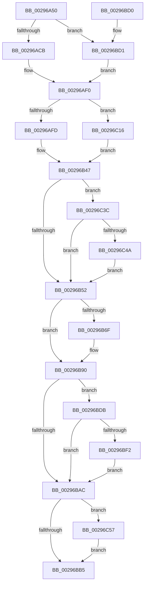

# MiRemoveMappedPtes

- RVA: `0x00296A50`–`0x00296C6E` (길이 `542` bytes)
- VA: `0x0000000140296A50`
- 실행 섹션: `.text`
- PDB 이름 있음: `예`; PDB Function 태그: `아니요`
- unwind 정보 RVA: `0x00067920`
- 디코드: `141`개 명령, `542/542` bytes 표시
- 미해석 바이트: `0` (있으면 어셈블리에 `.byte`로 보존)

> 이 문서는 커널 이미지의 기계어와 PDB 기호를 분석해 생성했습니다. 4번과 5번은 함수 원형과 자료형을 바이너리 사용 방식에서 추정한 C 해석이며 원본 소스 복구 결과는 아닙니다.

## 1. Dependencies

- 직접 호출 지점: **10**; 고유 호출 대상: **10**
- 직접 호출자로 확인된 함수: **1**
- RIP 상대 이미지 참조: **1**

### Outgoing calls
- `0x00296ADD` → [MiOffsetToProtos](../24/MiOffsetToProtos_function_0024D880.md) (function, `0x0024D880`)
- `0x00296B42` → [MiDecommitPages](../24/MiDecommitPages_function_00241BD0.md) (function, `0x00241BD0`)
- `0x00296B62` → [ExAcquireSpinLockExclusive](../24/ExAcquireSpinLockExclusive_function_00248690.md) (function, `0x00248690`)
- `0x00296B88` → [MiRemoveViewsFromSection](MiRemoveViewsFromSection_function_00298960.md) (function, `0x00298960`)
- `0x00296B9E` → [MiCheckControlArea](../28/MiCheckControlArea_function_002861B0.md) (function, `0x002861B0`)
- `0x00296C0F` → [MiReturnCommit](../24/MiReturnCommit_function_00248410.md) (function, `0x00248410`)
- `0x00296C27` → [MiLocateSubsectionNode](../2B/MiLocateSubsectionNode_function_002BBEE0.md) (function, `0x002BBEE0`)
- `0x00296C32` → [MiDecrementLargeSubsections](../4D/MiDecrementLargeSubsections_function_004D2BE0.md) (function, `0x004D2BE0`)
- `0x00296C4D` → [MiReturnCrossPartitionControlAreaCharges](../4D/MiReturnCrossPartitionControlAreaCharges_function_004D6184.md) (function, `0x004D6184`)
- `0x00296C64` → [MiReturnCrossPartitionSectionCharges](../4B/MiReturnCrossPartitionSectionCharges_function_004BA61C.md) (function, `0x004BA61C`)

### Direct callers
- [MiRemoveFromSystemSpace](MiRemoveFromSystemSpace_function_002962FC.md) at `0x00296504`

### Static image references
- `0x00296AA3` → RVA `0x00E30088` (`.data`; read)

## 2. Other-region calls and transfers

- 다른 실행 섹션으로 향하는 call: **0**
- 별도 외부 분기/꼬리 이동을 확인하지 못했습니다.

## 3. Assembly (complete function range)

```asm
00296A50  4C 8B DC                        mov r11, rsp
00296A53  49 89 5B 20                     mov qword ptr [r11 + 0x20], rbx
00296A57  49 89 53 10                     mov qword ptr [r11 + 0x10], rdx
00296A5B  55                              push rbp
00296A5C  56                              push rsi
00296A5D  57                              push rdi
00296A5E  41 54                           push r12
00296A60  41 55                           push r13
00296A62  41 56                           push r14
00296A64  41 57                           push r15
00296A66  48 81 EC 80 00 00 00            sub rsp, 0x80
00296A6D  4C 8B 71 30                     mov r14, qword ptr [rcx + 0x30]
00296A71  33 C0                           xor eax, eax
00296A73  4C 8B 79 20                     mov r15, qword ptr [rcx + 0x20]
00296A77  0F 57 C0                        xorps xmm0, xmm0
00296A7A  4C 8B 61 58                     mov r12, qword ptr [rcx + 0x58]
00296A7E  48 8B F1                        mov rsi, rcx
00296A81  49 83 63 08 00                  and qword ptr [r11 + 8], 0
00296A86  0F 11 44 24 40                  movups xmmword ptr [rsp + 0x40], xmm0
00296A8B  49 C1 EF 0C                     shr r15, 0xc
00296A8F  8B 6E 38                        mov ebp, dword ptr [rsi + 0x38]
00296A92  0F 11 44 24 50                  movups xmmword ptr [rsp + 0x50], xmm0
00296A97  0F 11 44 24 60                  movups xmmword ptr [rsp + 0x60], xmm0
00296A9C  49 89 43 B8                     mov qword ptr [r11 - 0x48], rax
00296AA0  49 8B 3E                        mov rdi, qword ptr [r14]
00296AA3  48 8B 05 DE 95 B9 00            mov rax, qword ptr [rip + 0xb995de]
00296AAA  0F B7 4F 3C                     movzx ecx, word ptr [rdi + 0x3c]
00296AAE  81 E1 FF 03 00 00               and ecx, 0x3ff
00296AB4  48 8B 04 C8                     mov rax, qword ptr [rax + rcx*8]
00296AB8  48 89 84 24 D0 00 00 00         mov qword ptr [rsp + 0xd0], rax
00296AC0  8B 47 38                        mov eax, dword ptr [rdi + 0x38]
00296AC3  A8 20                           test al, 0x20
00296AC5  0F 85 06 01 00 00               jne 0x140296bd1
00296ACB  48 8B 5E 18                     mov rbx, qword ptr [rsi + 0x18]
00296ACF  4D 8D 43 08                     lea r8, [r11 + 8]
00296AD3  48 C1 E3 0C                     shl rbx, 0xc
00296AD7  48 8B CF                        mov rcx, rdi
00296ADA  48 8B D3                        mov rdx, rbx
00296ADD  E8 9E 6D FB FF                  call 0x14024d880
00296AE2  4C 8B AC 24 C0 00 00 00         mov r13, qword ptr [rsp + 0xc0]
00296AEA  4C 8B F0                        mov r14, rax
00296AED  4D 03 EF                        add r13, r15
00296AF0  83 E5 18                        and ebp, 0x18
00296AF3  40 80 FD 18                     cmp bpl, 0x18
00296AF7  0F 85 19 01 00 00               jne 0x140296c16
00296AFD  49 C1 EC 09                     shr r12, 9
00296B01  48 B9 F8 FF FF FF 7F 00 00 00   movabs rcx, 0x7ffffffff8
00296B0B  49 23 CC                        and rcx, r12
00296B0E  48 B8 00 00 00 00 80 F6 FF FF   movabs rax, 0xfffff68000000000
00296B18  48 03 C8                        add rcx, rax
00296B1B  45 33 C9                        xor r9d, r9d
00296B1E  48 8D 44 24 40                  lea rax, [rsp + 0x40]
00296B23  4C 8B C7                        mov r8, rdi
00296B26  48 89 44 24 38                  mov qword ptr [rsp + 0x38], rax
00296B2B  49 8B D7                        mov rdx, r15
00296B2E  48 83 64 24 30 00               and qword ptr [rsp + 0x30], 0
00296B34  C7 44 24 28 10 00 00 00         mov dword ptr [rsp + 0x28], 0x10
00296B3C  48 83 64 24 20 00               and qword ptr [rsp + 0x20], 0
00296B42  E8 89 B0 FA FF                  call 0x140241bd0
00296B47  8B 47 38                        mov eax, dword ptr [rdi + 0x38]
00296B4A  A8 20                           test al, 0x20
00296B4C  0F 85 EA 00 00 00               jne 0x140296c3c
00296B52  33 ED                           xor ebp, ebp
00296B54  48 8D 4F 48                     lea rcx, [rdi + 0x48]
00296B58  33 DB                           xor ebx, ebx
00296B5A  48 39 5F 40                     cmp qword ptr [rdi + 0x40], rbx
00296B5E  40 0F 95 C5                     setne bpl
00296B62  E8 29 1B FB FF                  call 0x140248690
00296B67  44 8A F8                        mov r15b, al
00296B6A  4D 85 F6                        test r14, r14
00296B6D  74 21                           je 0x140296b90
00296B6F  8B 4E 38                        mov ecx, dword ptr [rsi + 0x38]
00296B72  49 8B D5                        mov rdx, r13
00296B75  80 E1 04                        and cl, 4
00296B78  F6 D9                           neg cl
00296B7A  49 8B CE                        mov rcx, r14
00296B7D  45 1B C0                        sbb r8d, r8d
00296B80  41 83 E0 14                     and r8d, 0x14
00296B84  41 83 C0 04                     add r8d, 4
00296B88  E8 D3 1D 00 00                  call 0x140298960
00296B8D  48 8B D8                        mov rbx, rax
00296B90  48 FF 4F 30                     dec qword ptr [rdi + 0x30]
00296B94  41 8A D7                        mov dl, r15b
00296B97  48 FF 4F 28                     dec qword ptr [rdi + 0x28]
00296B9B  48 8B CF                        mov rcx, rdi
00296B9E  E8 0D F6 FE FF                  call 0x1402861b0
00296BA3  48 8B 4E 28                     mov rcx, qword ptr [rsi + 0x28]
00296BA7  48 85 C9                        test rcx, rcx
00296BAA  75 2F                           jne 0x140296bdb
00296BAC  48 85 DB                        test rbx, rbx
00296BAF  0F 85 A2 00 00 00               jne 0x140296c57
00296BB5  48 8B 9C 24 D8 00 00 00         mov rbx, qword ptr [rsp + 0xd8]
00296BBD  48 81 C4 80 00 00 00            add rsp, 0x80
00296BC4  41 5F                           pop r15
00296BC6  41 5E                           pop r14
00296BC8  41 5D                           pop r13
00296BCA  41 5C                           pop r12
00296BCC  5F                              pop rdi
00296BCD  5E                              pop rsi
00296BCE  5D                              pop rbp
00296BCF  C3                              ret
00296BD0  CC                              int3
00296BD1  33 DB                           xor ebx, ebx
00296BD3  45 33 ED                        xor r13d, r13d
00296BD6  E9 15 FF FF FF                  jmp 0x140296af0
00296BDB  48 8B 44 24 48                  mov rax, qword ptr [rsp + 0x48]
00296BE0  48 8B D1                        mov rdx, rcx
00296BE3  48 2B D0                        sub rdx, rax
00296BE6  48 85 C0                        test rax, rax
00296BE9  48 0F 44 D1                     cmove rdx, rcx
00296BED  48 85 D2                        test rdx, rdx
00296BF0  74 BA                           je 0x140296bac
00296BF2  48 8B 0D 8F 94 B9 00            mov rcx, qword ptr [rip + 0xb9948f]
00296BF9  45 33 C0                        xor r8d, r8d
00296BFC  48 8B 84 24 C8 00 00 00         mov rax, qword ptr [rsp + 0xc8]
00296C04  0F B7 80 AE 00 00 00            movzx eax, word ptr [rax + 0xae]
00296C0B  48 8B 0C C1                     mov rcx, qword ptr [rcx + rax*8]
00296C0F  E8 FC 17 FB FF                  call 0x140248410
00296C14  EB 96                           jmp 0x140296bac
00296C16  49 C1 E7 0C                     shl r15, 0xc
00296C1A  45 33 C0                        xor r8d, r8d
00296C1D  48 8B CF                        mov rcx, rdi
00296C20  49 8D 57 FF                     lea rdx, [r15 - 1]
00296C24  48 03 D3                        add rdx, rbx
00296C27  E8 B4 52 02 00                  call 0x1402bbee0
00296C2C  48 8B D0                        mov rdx, rax
00296C2F  49 8B CE                        mov rcx, r14
00296C32  E8 A9 BF 23 00                  call 0x1404d2be0
00296C37  E9 0B FF FF FF                  jmp 0x140296b47
00296C3C  8B 46 38                        mov eax, dword ptr [rsi + 0x38]
00296C3F  45 33 F6                        xor r14d, r14d
00296C42  A8 04                           test al, 4
00296C44  0F 84 08 FF FF FF               je 0x140296b52
00296C4A  48 8B CF                        mov rcx, rdi
00296C4D  E8 32 F5 23 00                  call 0x1404d6184
00296C52  E9 FB FE FF FF                  jmp 0x140296b52
00296C57  48 8B 8C 24 D0 00 00 00         mov rcx, qword ptr [rsp + 0xd0]
00296C5F  4C 8B C3                        mov r8, rbx
00296C62  8B D5                           mov edx, ebp
00296C64  E8 B3 39 22 00                  call 0x1404ba61c
00296C69  E9 47 FF FF FF                  jmp 0x140296bb5
```

## 4. C-style interpretation (structured pseudocode)

```c
__int64 __fastcall MiRemoveMappedPtes(__int64 a1, __int64 a2, __int64 a3, int a4)
{
    __int64 result;
    __int64 v_r12;
    __int64 v_r13;
    __int64 v_r14;
    __int64 v_r15;
    __int64 v_rbp;
    __int64 v_rbx;
    __int64 v_rsp;
    unsigned __int64 v_stack_m58;
    unsigned __int64 v_stack_m68;
    unsigned __int64 v_stack_m78;
    unsigned __int64 v_stack_m80;
    unsigned __int64 v_stack_m88;
    unsigned int v_stack_m90;
    unsigned __int64 v_stack_m98;
    unsigned __int64 v_stack_p18;
    unsigned __int64 v_stack_p20;
    unsigned __int64 v_stack_p48;
    unsigned __int64 v_stack_p8;
    unsigned __int64 v_stack_pC8;
    unsigned __int64 v_stack_pD0;

    *(unsigned __int64 *)(v_rsp + 32) = v_rbx;
    *(unsigned __int64 *)(v_rsp + 16) = a2;
    v_rsp = (v_rsp) - (128);
    result = 0;
    v_stack_m78 = v_xmm0;
    v_r15 = (*(unsigned __int64 *)(a1 + 32)) >> (12);
    v_stack_m68 = v_xmm0;
    v_stack_m58 = v_xmm0;
    *(unsigned __int64 *)(v_rsp - 72) = 0;
    a1 = (unsigned int)((*(unsigned __int16 *)(*(unsigned __int64 *)(*(unsigned __int64 *)(a1 + 48)) + 60)) & (0x3FFULL));
    v_stack_p18 = *(unsigned __int64 *)(*(unsigned __int64 *)(v_rip + 12162526) + a1 * 8);
    if ((((unsigned __int8)((unsigned int)(*(unsigned int *)(*(unsigned __int64 *)(*(unsigned __int64 *)(a1 + 48)) + 56)))) & (32)) != 0) goto loc_00296BD1;
    v_rbx = (*(unsigned __int64 *)(a1 + 24)) << (12);
    result = MiOffsetToProtos(*(unsigned __int64 *)(*(unsigned __int64 *)(a1 + 48)), v_rbx, v_rsp + 8, a4);
    v_r13 = (v_stack_p8) + (v_r15);
loc_00296AF0:
    v_rbp = (unsigned int)(((unsigned int)(*(unsigned int *)(a1 + 56))) & (24));
    if (((unsigned __int8)(v_rbp)) != 24) goto loc_00296C16;
    v_r12 = (*(unsigned __int64 *)(a1 + 88)) >> (9);
    a1 = (*(unsigned __int64 *)(*(unsigned __int64 *)(a1 + 48))) & (v_r12);
    a1 = (a1) + (result);
    a4 = 0;
    v_stack_m80 = v_stack_m78;
    v_stack_m90 = 16;
    result = MiDecommitPages(a1, v_r15, *(unsigned __int64 *)(*(unsigned __int64 *)(a1 + 48)), a4);
loc_00296B47:
    if ((((unsigned __int8)((unsigned int)(*(unsigned int *)(*(unsigned __int64 *)(*(unsigned __int64 *)(a1 + 48)) + 56)))) & (32)) != 0) goto loc_00296C3C;
loc_00296B52:
    v_rbp = 0;
    v_rbx = 0;
    v_rbp = ((*(unsigned __int64 *)(*(unsigned __int64 *)(*(unsigned __int64 *)(a1 + 48)) + 64)) != 0) ? 1 : 0;
    result = ExAcquireSpinLockExclusive(*(unsigned __int64 *)(*(unsigned __int64 *)(a1 + 48)) + 72, v_r15, *(unsigned __int64 *)(*(unsigned __int64 *)(a1 + 48)), a4);
    if (result != 0) {
        a1 = *(unsigned int *)(a1 + 56);
        a2 = v_r13;
        a1 = (unsigned __int8)((a1) & (4));
        a1 = (unsigned __int8)(-(a1));
        a1 = result;
        a3 = (unsigned int)((*(unsigned __int64 *)(*(unsigned __int64 *)(a1 + 48))) & (20));
        a3 = (unsigned int)((a3) + (4));
        result = MiRemoveViewsFromSection(a1, a2, a3, a4);
        v_rbx = result;
    }
    result = MiCheckControlArea(*(unsigned __int64 *)(*(unsigned __int64 *)(a1 + 48)), (unsigned __int8)((unsigned __int8)(result)), a3, a4);
    if (*(unsigned __int64 *)(a1 + 40) != 0) goto loc_00296BDB;
loc_00296BAC:
    if (v_rbx != 0) goto loc_00296C57;
loc_00296BB5:
    v_rsp = (v_rsp) + (128);
    return result;
loc_00296BD1:
    v_rbx = 0;
    v_r13 = 0;
    goto loc_00296AF0;
loc_00296BDB:
    a2 = (*(unsigned __int64 *)(a1 + 40)) - (v_stack_p48);
    if (v_stack_p48 == 0) { a2 = *(unsigned __int64 *)(a1 + 40); }
    if (a2 == 0) goto loc_00296BAC;
    a3 = 0;
    result = MiReturnCommit(*(unsigned __int64 *)(*(unsigned __int64 *)(v_rip + 12162191) + *(unsigned __int16 *)(v_stack_pC8 + 174) * 8), a2, a3, a4);
    goto loc_00296BAC;
loc_00296C16:
    v_r15 = ((unsigned __int8)(result)) << (12);
    a3 = 0;
    a2 = (v_r15 - 1) + (0);
    result = MiLocateSubsectionNode(*(unsigned __int64 *)(*(unsigned __int64 *)(a1 + 48)), a2, a3, a4);
    result = MiDecrementLargeSubsections(result, result, a3, a4);
    goto loc_00296B47;
loc_00296C3C:
    v_r14 = 0;
    if ((((unsigned __int8)((unsigned int)(*(unsigned int *)(a1 + 56)))) & (4)) == 0) goto loc_00296B52;
    result = MiReturnCrossPartitionControlAreaCharges(*(unsigned __int64 *)(*(unsigned __int64 *)(a1 + 48)), result, a3, a4);
    goto loc_00296B52;
loc_00296C57:
    result = MiReturnCrossPartitionSectionCharges(v_stack_pD0, (unsigned int)((unsigned int)(v_rbp)), 0, a4);
    goto loc_00296BB5;
}
```

## 5. (Beta) C Style

```c
int64_t MiRemoveMappedPtes(void *Arg1, int64_t Arg2, int64_t Arg3, int32_t Arg4)
{
    uint8_t *arg1 = (uint8_t *)Arg1;

    int64_t result;
    int64_t local_r12;
    int64_t local_r13;
    int64_t local_r14;
    int64_t local_r15;
    int64_t local_rbp;
    int64_t local_rbx;
    int64_t local_rsp;
    uint64_t v_stack_m58;
    uint64_t v_stack_m68;
    uint64_t v_stack_m78;
    uint64_t v_stack_m80;
    uint64_t v_stack_m88;
    uint32_t v_stack_m90;
    uint64_t v_stack_m98;
    uint64_t v_stack_p18;
    uint64_t v_stack_p20;
    uint64_t v_stack_p48;
    uint64_t v_stack_p8;
    uint64_t v_stack_pC8;
    uint64_t v_stack_pD0;

    *(uint64_t *)(local_rsp + 0x20) = local_rbx;
    *(uint64_t *)(local_rsp + 0x10) = Arg2;
    local_rsp = (local_rsp) - (128);
    result = 0;
    v_stack_m78 = v_xmm0;
    local_r15 = (*(uint64_t *)(arg1 + 0x20)) >> (12);
    v_stack_m68 = v_xmm0;
    v_stack_m58 = v_xmm0;
    *(uint64_t *)(local_rsp - 0x48) = 0;
    Arg1 = (uint32_t)((*(uint16_t *)(*(uint64_t *)(*(uint64_t *)(arg1 + 0x30)) + 0x3C)) & (0x3FFULL));
    v_stack_p18 = *(uint64_t *)(*(uint64_t *)(v_rip + 0xB995DE) + arg1 * 8);
    if ((((uint8_t)((uint32_t)(*(uint32_t *)(*(uint64_t *)(*(uint64_t *)(arg1 + 0x30)) + 0x38)))) & (32)) != 0) goto loc_00296BD1;
    local_rbx = (*(uint64_t *)(arg1 + 0x18)) << (12);
    result = MiOffsetToProtos(*(uint64_t *)(*(uint64_t *)(arg1 + 0x30)), local_rbx, local_rsp + 8, Arg4);
    local_r13 = (v_stack_p8) + (local_r15);
loc_00296AF0:
    local_rbp = (uint32_t)(((uint32_t)(*(uint32_t *)(arg1 + 0x38))) & (24));
    if (((uint8_t)(local_rbp)) != 24) goto loc_00296C16;
    local_r12 = (*(uint64_t *)(arg1 + 0x58)) >> (9);
    Arg1 = (*(uint64_t *)(*(uint64_t *)(arg1 + 0x30))) & (local_r12);
    Arg1 = (Arg1) + (result);
    Arg4 = 0;
    v_stack_m80 = v_stack_m78;
    v_stack_m90 = 16;
    result = MiDecommitPages(Arg1, local_r15, *(uint64_t *)(*(uint64_t *)(arg1 + 0x30)), Arg4);
loc_00296B47:
    if ((((uint8_t)((uint32_t)(*(uint32_t *)(*(uint64_t *)(*(uint64_t *)(arg1 + 0x30)) + 0x38)))) & (32)) != 0) goto loc_00296C3C;
loc_00296B52:
    local_rbp = 0;
    local_rbx = 0;
    local_rbp = ((*(uint64_t *)(*(uint64_t *)(*(uint64_t *)(arg1 + 0x30)) + 0x40)) != 0) ? 1 : 0;
    result = ExAcquireSpinLockExclusive(*(uint64_t *)(*(uint64_t *)(arg1 + 0x30)) + 72, local_r15, *(uint64_t *)(*(uint64_t *)(arg1 + 0x30)), Arg4);
    if (result != 0) {
        Arg1 = *(uint32_t *)(arg1 + 0x38);
        Arg2 = local_r13;
        Arg1 = (uint8_t)((Arg1) & (4));
        Arg1 = (uint8_t)(-(Arg1));
        Arg1 = result;
        Arg3 = (uint32_t)((*(uint64_t *)(*(uint64_t *)(arg1 + 0x30))) & (20));
        Arg3 = (uint32_t)((Arg3) + (4));
        result = MiRemoveViewsFromSection(Arg1, Arg2, Arg3, Arg4);
        local_rbx = result;
    }
    result = MiCheckControlArea(*(uint64_t *)(*(uint64_t *)(arg1 + 0x30)), (uint8_t)((uint8_t)(result)), Arg3, Arg4);
    if (*(uint64_t *)(arg1 + 0x28) != 0) goto loc_00296BDB;
loc_00296BAC:
    if (local_rbx != 0) goto loc_00296C57;
loc_00296BB5:
    local_rsp = (local_rsp) + (128);
    return result;
loc_00296BD1:
    local_rbx = 0;
    local_r13 = 0;
    goto loc_00296AF0;
loc_00296BDB:
    Arg2 = (*(uint64_t *)(arg1 + 0x28)) - (v_stack_p48);
    if (v_stack_p48 == 0) { Arg2 = *(uint64_t *)(arg1 + 0x28); }
    if (Arg2 == 0) goto loc_00296BAC;
    Arg3 = 0;
    result = MiReturnCommit(*(uint64_t *)(*(uint64_t *)(v_rip + 0xB9948F) + *(uint16_t *)(v_stack_pC8 + 0xAE) * 8), Arg2, Arg3, Arg4);
    goto loc_00296BAC;
loc_00296C16:
    local_r15 = ((uint8_t)(result)) << (12);
    Arg3 = 0;
    Arg2 = (local_r15 - 1) + (0);
    result = MiLocateSubsectionNode(*(uint64_t *)(*(uint64_t *)(arg1 + 0x30)), Arg2, Arg3, Arg4);
    result = MiDecrementLargeSubsections(result, result, Arg3, Arg4);
    goto loc_00296B47;
loc_00296C3C:
    local_r14 = 0;
    if ((((uint8_t)((uint32_t)(*(uint32_t *)(arg1 + 0x38)))) & (4)) == 0) goto loc_00296B52;
    result = MiReturnCrossPartitionControlAreaCharges(*(uint64_t *)(*(uint64_t *)(arg1 + 0x30)), result, Arg3, Arg4);
    goto loc_00296B52;
loc_00296C57:
    result = MiReturnCrossPartitionSectionCharges(v_stack_pD0, (uint32_t)((uint32_t)(local_rbp)), 0, Arg4);
    goto loc_00296BB5;
}
```

### 관측된 메모리 오프셋

구조체 형식이 확인되지 않은 접근은 인자 기준의 오프셋으로만 기록했습니다.

| 기준 인자 | 오프셋 표현 | 폭 (bit) | 접근 |
|---|---:|---:|---|
| `Arg1` | `+ 0x18` | `64` | `R` |
| `Arg1` | `+ 0x20` | `64` | `R` |
| `Arg1` | `+ 0x28` | `64` | `R` |
| `Arg1` | `+ 0x30` | `64` | `R` |
| `Arg1` | `+ 0x38` | `32` | `R` |
| `Arg1` | `+ 0x58` | `64` | `R` |

## 6. Execution-region graph

[열기: 2D/3D 그래프와 함수 탐색 컨트롤 패널](../../../control-panel.html?section=text&rva=0x00296A50&view=graph)

- 2D 그래프는 위에서 아래로 흐르고, 3D 그래프는 빈 공간을 드래그해 회전합니다. Shift+드래그는 이동, 휠은 확대·축소, 함수 노드 선택은 대상 보고서 이동입니다.

### Static fallback


