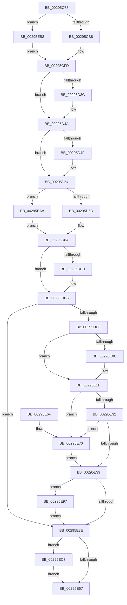

# MiRemoveVad

- RVA: `0x00295C78`–`0x00295ECF` (길이 `599` bytes)
- VA: `0x0000000140295C78`
- 실행 섹션: `.text`
- PDB 이름 있음: `예`; PDB Function 태그: `아니요`
- unwind 정보 RVA: `0x00067880`
- 디코드: `150`개 명령, `599/599` bytes 표시
- 미해석 바이트: `0` (있으면 어셈블리에 `.byte`로 보존)

> 이 문서는 커널 이미지의 기계어와 PDB 기호를 분석해 생성했습니다. 4번과 5번은 함수 원형과 자료형을 바이너리 사용 방식에서 추정한 C 해석이며 원본 소스 복구 결과는 아닙니다.

## 1. Dependencies

- 직접 호출 지점: **16**; 고유 호출 대상: **16**
- 직접 호출자로 확인된 함수: **3**
- RIP 상대 이미지 참조: **0**

### Outgoing calls
- `0x00295CE6` → [MiGetPreviousVad](MiGetPreviousVad_function_00297268.md) (function, `0x00297268`)
- `0x00295CF3` → [MiGetNextVad](MiGetNextVad_function_00297224.md) (function, `0x00297224`)
- `0x00295D2B` → [KeAbPreAcquire](../21/KeAbPreAcquire_function_00210230.md) (function, `0x00210230`)
- `0x00295D45` → [ExfAcquirePushLockExclusiveEx](../20/ExfAcquirePushLockExclusiveEx_function_0020FC90.md) (function, `0x0020FC90`)
- `0x00295D6F` → [MiLockWorkingSetShared](../27/MiLockWorkingSetShared_function_0027CBF0.md) (function, `0x0027CBF0`)
- `0x00295D85` → [MiCaptureDeleteHierarchy](../27/MiCaptureDeleteHierarchy_function_0027F5F0.md) (function, `0x0027F5F0`)
- `0x00295D91` → [MiLockVadTree](../27/MiLockVadTree_function_0027C0F0.md) (function, `0x0027C0F0`)
- `0x00295DAA` → [RtlAvlRemoveNode](RtlAvlRemoveNode_function_00296650.md) (function, `0x00296650`)
- `0x00295DD1` → [MiDereferenceVad](MiDereferenceVad_function_00295EE0.md) (function, `0x00295EE0`)
- `0x00295DE4` → [MiUnlockVadTree](MiUnlockVadTree_function_00297020.md) (function, `0x00297020`)
- `0x00295DF8` → [MiUnlockWorkingSetShared](../27/MiUnlockWorkingSetShared_function_0027D690.md) (function, `0x0027D690`)
- `0x00295E18` → [MiClearVadBits](MiClearVadBits_function_00297424.md) (function, `0x00297424`)
- `0x00295E46` → [UNLOCK_PAGE_TABLE_COMMITMENT](../2E/UNLOCK_PAGE_TABLE_COMMITMENT_function_002E27D0.md) (function, `0x002E27D0`)
- `0x00295E4E` → [MiIsVadLargePrivate](../32/MiIsVadLargePrivate_function_0032F720.md) (function, `0x0032F720`)
- `0x00295E90` → [MiReturnPageTablePageCommitment](../../page/9E/MiReturnPageTablePageCommitment_function_009E5750.md) (function, `0x009E5750`)
- `0x00295EA3` → [MiInsertVad](../26/MiInsertVad_function_00265540.md) (function, `0x00265540`)

### Direct callers
- [MiCoalescePlaceholderAllocations](../../page/88/MiCoalescePlaceholderAllocations_function_0088095C.md) at `0x00880A31`
- [MiCoalescePlaceholderAllocations](../../page/88/MiCoalescePlaceholderAllocations_function_0088095C.md) at `0x00880A6C`
- [MiDeleteVad](../../page/88/MiDeleteVad_function_00888C80.md) at `0x00888EFD`
- [MiPreparePlaceholderVadReplacement](../../page/A7/MiPreparePlaceholderVadReplacement_function_00A7E998.md) at `0x00A7E9BD`

### Static image references
- 디코드된 RIP-relative 메모리 참조가 없습니다.

## 2. Other-region calls and transfers

- 다른 실행 섹션으로 향하는 call: **1**
  - `0x00295E90` → [MiReturnPageTablePageCommitment](../../page/9E/MiReturnPageTablePageCommitment_function_009E5750.md) (`.text` → `PAGE`)
- 별도 외부 분기/꼬리 이동을 확인하지 못했습니다.

## 3. Assembly (complete function range)

```asm
00295C78  48 89 5C 24 08                  mov qword ptr [rsp + 8], rbx
00295C7D  55                              push rbp
00295C7E  56                              push rsi
00295C7F  57                              push rdi
00295C80  41 54                           push r12
00295C82  41 55                           push r13
00295C84  41 56                           push r14
00295C86  41 57                           push r15
00295C88  48 83 EC 60                     sub rsp, 0x60
00295C8C  4D 8B F0                        mov r14, r8
00295C8F  48 8B F1                        mov rsi, rcx
00295C92  65 4C 8B 04 25 88 01 00 00      mov r8, qword ptr gs:[0x188]
00295C9B  33 C9                           xor ecx, ecx
00295C9D  89 4C 24 40                     mov dword ptr [rsp + 0x40], ecx
00295CA1  44 8B FA                        mov r15d, edx
00295CA4  4C 89 44 24 58                  mov qword ptr [rsp + 0x58], r8
00295CA9  49 8B 98 B8 00 00 00            mov rbx, qword ptr [r8 + 0xb8]
00295CB0  85 D2                           test edx, edx
00295CB2  0F 84 FA 01 00 00               je 0x140295eb2
00295CB8  8B 46 18                        mov eax, dword ptr [rsi + 0x18]
00295CBB  48 8B CE                        mov rcx, rsi
00295CBE  0F B6 6E 20                     movzx ebp, byte ptr [rsi + 0x20]
00295CC2  0F B6 7E 21                     movzx edi, byte ptr [rsi + 0x21]
00295CC6  48 C1 E7 20                     shl rdi, 0x20
00295CCA  48 C1 E5 20                     shl rbp, 0x20
00295CCE  48 0B E8                        or rbp, rax
00295CD1  8B 46 1C                        mov eax, dword ptr [rsi + 0x1c]
00295CD4  48 0B F8                        or rdi, rax
00295CD7  48 C1 E5 0C                     shl rbp, 0xc
00295CDB  48 C1 E7 0C                     shl rdi, 0xc
00295CDF  48 81 CF FF 0F 00 00            or rdi, 0xfff
00295CE6  E8 7D 15 00 00                  call 0x140297268
00295CEB  48 8B CE                        mov rcx, rsi
00295CEE  48 89 44 24 48                  mov qword ptr [rsp + 0x48], rax
00295CF3  E8 2C 15 00 00                  call 0x140297224
00295CF8  48 89 44 24 50                  mov qword ptr [rsp + 0x50], rax
00295CFD  48 83 C8 FF                     or rax, 0xffffffffffffffff
00295D01  C7 84 24 B8 00 00 00 02 00 00 00  mov dword ptr [rsp + 0xb8], 2
00295D0C  48 01 83 68 05 00 00            add qword ptr [rbx + 0x568], rax
00295D13  4C 8D A3 60 02 00 00            lea r12, [rbx + 0x260]
00295D1A  66 41 01 80 E6 01 00 00         add word ptr [r8 + 0x1e6], ax
00295D22  33 D2                           xor edx, edx
00295D24  45 33 C0                        xor r8d, r8d
00295D27  49 8B CC                        mov rcx, r12
00295D2A  90                              nop
00295D2B  E8 00 A5 F7 FF                  call 0x140210230
00295D30  F0 49 0F BA 2C 24 00            lock bts qword ptr [r12], 0
00295D37  4C 8B E8                        mov r13, rax
00295D3A  73 0E                           jae 0x140295d4a
00295D3C  4D 8B C4                        mov r8, r12
00295D3F  48 8B D0                        mov rdx, rax
00295D42  49 8B CC                        mov rcx, r12
00295D45  E8 46 9F F7 FF                  call 0x14020fc90
00295D4A  4D 85 ED                        test r13, r13
00295D4D  74 05                           je 0x140295d54
00295D4F  41 C6 45 0A 01                  mov byte ptr [r13 + 0xa], 1
00295D54  45 85 FF                        test r15d, r15d
00295D57  0F 84 4D 01 00 00               je 0x140295eaa
00295D5D  48 8D 8B 00 04 00 00            lea rcx, [rbx + 0x400]
00295D64  C7 84 24 B8 00 00 00 03 00 00 00  mov dword ptr [rsp + 0xb8], 3
00295D6F  E8 7C 6E FE FF                  call 0x14027cbf0
00295D74  4C 8D 4C 24 40                  lea r9, [rsp + 0x40]
00295D79  44 8A C0                        mov r8b, al
00295D7C  48 8B D7                        mov rdx, rdi
00295D7F  48 8B CD                        mov rcx, rbp
00295D82  44 8A E8                        mov r13b, al
00295D85  E8 66 98 FE FF                  call 0x14027f5f0
00295D8A  8B 8C 24 B8 00 00 00            mov ecx, dword ptr [rsp + 0xb8]
00295D91  E8 5A 63 FE FF                  call 0x14027c0f0
00295D96  4C 8D A3 58 05 00 00            lea r12, [rbx + 0x558]
00295D9D  88 84 24 A8 00 00 00            mov byte ptr [rsp + 0xa8], al
00295DA4  49 8B CC                        mov rcx, r12
00295DA7  48 8B D6                        mov rdx, rsi
00295DAA  E8 A1 08 00 00                  call 0x140296650
00295DAF  48 8B 93 60 05 00 00            mov rdx, qword ptr [rbx + 0x560]
00295DB6  48 3B D6                        cmp rdx, rsi
00295DB9  75 0B                           jne 0x140295dc6
00295DBB  49 8B 14 24                     mov rdx, qword ptr [r12]
00295DBF  48 89 93 60 05 00 00            mov qword ptr [rbx + 0x560], rdx
00295DC6  48 8B CE                        mov rcx, rsi
00295DC9  48 C7 46 10 FE FF FF FF         mov qword ptr [rsi + 0x10], 0xfffffffffffffffe
00295DD1  E8 0A 01 00 00                  call 0x140295ee0
00295DD6  8B 8C 24 B8 00 00 00            mov ecx, dword ptr [rsp + 0xb8]
00295DDD  8A 94 24 A8 00 00 00            mov dl, byte ptr [rsp + 0xa8]
00295DE4  E8 37 12 00 00                  call 0x140297020
00295DE9  45 85 FF                        test r15d, r15d
00295DEC  74 50                           je 0x140295e3e
00295DEE  41 8A D5                        mov dl, r13b
00295DF1  48 8D 8B 00 04 00 00            lea rcx, [rbx + 0x400]
00295DF8  E8 93 78 FE FF                  call 0x14027d690
00295DFD  4C 8B 64 24 50                  mov r12, qword ptr [rsp + 0x50]
00295E02  4C 8B 7C 24 48                  mov r15, qword ptr [rsp + 0x48]
00295E07  4D 85 F6                        test r14, r14
00295E0A  75 11                           jne 0x140295e1d
00295E0C  4D 8B CC                        mov r9, r12
00295E0F  4D 8B C7                        mov r8, r15
00295E12  48 8B D7                        mov rdx, rdi
00295E15  48 8B CD                        mov rcx, rbp
00295E18  E8 07 16 00 00                  call 0x140297424
00295E1D  48 8B C7                        mov rax, rdi
00295E20  48 B9 00 00 E0 FF FF FF 00 00   movabs rcx, 0xffffffe00000
00295E2A  48 33 C5                        xor rax, rbp
00295E2D  48 85 C1                        test rcx, rax
00295E30  75 3E                           jne 0x140295e70
00295E32  83 7C 24 40 00                  cmp dword ptr [rsp + 0x40], 0
00295E37  75 37                           jne 0x140295e70
00295E39  4D 85 F6                        test r14, r14
00295E3C  75 59                           jne 0x140295e97
00295E3E  48 8B 4C 24 58                  mov rcx, qword ptr [rsp + 0x58]
00295E43  48 8B D3                        mov rdx, rbx
00295E46  E8 85 C9 04 00                  call 0x1402e27d0
00295E4B  48 8B CE                        mov rcx, rsi
00295E4E  E8 CD 98 09 00                  call 0x14032f720
00295E53  85 C0                           test eax, eax
00295E55  75 70                           jne 0x140295ec7
00295E57  48 8B 9C 24 A0 00 00 00         mov rbx, qword ptr [rsp + 0xa0]
00295E5F  48 83 C4 60                     add rsp, 0x60
00295E63  41 5F                           pop r15
00295E65  41 5E                           pop r14
00295E67  41 5D                           pop r13
00295E69  41 5C                           pop r12
00295E6B  5F                              pop rdi
00295E6C  5E                              pop rsi
00295E6D  5D                              pop rbp
00295E6E  C3                              ret
00295E6F  CC                              int3
00295E70  48 8D 44 24 40                  lea rax, [rsp + 0x40]
00295E75  4D 8B CF                        mov r9, r15
00295E78  48 89 44 24 30                  mov qword ptr [rsp + 0x30], rax
00295E7D  4C 8B C3                        mov r8, rbx
00295E80  48 89 74 24 28                  mov qword ptr [rsp + 0x28], rsi
00295E85  48 8B D7                        mov rdx, rdi
00295E88  48 8B CD                        mov rcx, rbp
00295E8B  4C 89 64 24 20                  mov qword ptr [rsp + 0x20], r12
00295E90  E8 BB F8 74 00                  call 0x1409e5750
00295E95  EB A2                           jmp 0x140295e39
00295E97  41 B8 02 00 00 00               mov r8d, 2
00295E9D  48 8B D3                        mov rdx, rbx
00295EA0  49 8B CE                        mov rcx, r14
00295EA3  E8 98 F6 FC FF                  call 0x140265540
00295EA8  EB 94                           jmp 0x140295e3e
00295EAA  41 B5 11                        mov r13b, 0x11
00295EAD  E9 D8 FE FF FF                  jmp 0x140295d8a
00295EB2  48 8B E9                        mov rbp, rcx
00295EB5  48 89 4C 24 48                  mov qword ptr [rsp + 0x48], rcx
00295EBA  48 8B F9                        mov rdi, rcx
00295EBD  48 89 4C 24 50                  mov qword ptr [rsp + 0x50], rcx
00295EC2  E9 36 FE FF FF                  jmp 0x140295cfd
00295EC7  FF 8B DC 05 00 00               dec dword ptr [rbx + 0x5dc]
00295ECD  EB 88                           jmp 0x140295e57
```

## 4. C-style interpretation (structured pseudocode)

```c
__int64 __fastcall MiRemoveVad(__int64 a1, int a2, __int64 a3)
{
    __int64 result;
    __int64 v_rbp;
    __int64 v_rdi;
    __int64 v_rsp;
    unsigned __int64 v_stack_m40;
    unsigned __int64 v_stack_m48;
    unsigned __int64 v_stack_m50;
    unsigned int v_stack_m58;
    unsigned __int8 v_stack_p10;
    unsigned int v_stack_p20;
    unsigned __int64 v_stack_p28;
    unsigned __int64 v_stack_p30;
    unsigned __int64 v_stack_p40;
    unsigned __int64 v_stack_p48;
    unsigned __int64 v_stack_p50;
    unsigned __int64 v_stack_p8;

    v_stack_p8 = v_rbx;
    v_rsp = (v_rsp) - (96);
    a1 = 0;
    v_stack_m58 = 0;
    v_stack_m40 = *(unsigned __int64 *)(gs_base + (0 + 392));
    if (a2 == 0) goto loc_00295EB2;
    v_rdi = (*(unsigned __int8 *)(a1 + 33)) << (32);
    v_rbp = (*(unsigned __int8 *)(a1 + 32)) << (32);
    v_rbp = (v_rbp) | ((unsigned int)(*(unsigned int *)(a1 + 24)));
    v_rdi = (v_rdi) | ((unsigned int)(*(unsigned int *)(a1 + 28)));
    v_rbp = (v_rbp) << (12);
    v_rdi = (v_rdi) << (12);
    v_rdi = (v_rdi) | (0xFFFULL);
    result = MiGetPreviousVad(0, a2, *(unsigned __int64 *)(gs_base + (0 + 392)), a4);
    v_stack_m50 = result;
    result = MiGetNextVad(0, a2, *(unsigned __int64 *)(gs_base + (0 + 392)), a4);
    v_stack_m48 = result;
loc_00295CFD:
    result = (result) | (-1);
    v_stack_p20 = 2;
    a2 = 0;
    a3 = 0;
    result = KeAbPreAcquire(*(unsigned __int64 *)(*(unsigned __int64 *)(gs_base + (0 + 392)) + 184) + 608, a2, a3, a4);
    if (!(condition_is_above_or_equal)) {
        a3 = *(unsigned __int64 *)(*(unsigned __int64 *)(gs_base + (0 + 392)) + 184) + 608;
        a2 = result;
        a1 = *(unsigned __int64 *)(*(unsigned __int64 *)(gs_base + (0 + 392)) + 184) + 608;
        result = ExfAcquirePushLockExclusiveEx(a1, a2, a3, a4);
    }
    if (result != 0) {
        *(unsigned __int8 *)(result + 10) = 1;
    }
    if ((unsigned int)((unsigned int)(a2)) == 0) goto loc_00295EAA;
    v_stack_p20 = 3;
    result = MiLockWorkingSetShared(*(unsigned __int64 *)(*(unsigned __int64 *)(gs_base + (0 + 392)) + 184) + 1024, a2, a3, a4);
    result = MiCaptureDeleteHierarchy(v_rbp, v_rdi, (unsigned __int8)(result), v_stack_m58);
loc_00295D8A:
    result = MiLockVadTree((unsigned int)(v_stack_p20), v_rdi, (unsigned __int8)(result), v_stack_m58);
    v_stack_p10 = (unsigned __int8)(result);
    result = RtlAvlRemoveNode(*(unsigned __int64 *)(*(unsigned __int64 *)(gs_base + (0 + 392)) + 184) + 1368, a1, (unsigned __int8)(result), v_stack_m58);
    if ((*(unsigned __int64 *)(*(unsigned __int64 *)(*(unsigned __int64 *)(gs_base + (0 + 392)) + 184) + 1376)) == a1) {
        a2 = *(unsigned __int64 *)(*(unsigned __int64 *)(*(unsigned __int64 *)(gs_base + (0 + 392)) + 184) + 1368);
        *(unsigned __int64 *)(*(unsigned __int64 *)(*(unsigned __int64 *)(gs_base + (0 + 392)) + 184) + 1376) = a2;
    }
    *(unsigned __int64 *)(a1 + 16) = -2;
    result = MiDereferenceVad(a1, a2, (unsigned __int8)(result), v_stack_m58);
    result = MiUnlockVadTree((unsigned int)(v_stack_p20), v_stack_p10, (unsigned __int8)(result), v_stack_m58);
    if ((unsigned int)((unsigned int)(a2)) == 0) goto loc_00295E3E;
    result = MiUnlockWorkingSetShared(*(unsigned __int64 *)(*(unsigned __int64 *)(gs_base + (0 + 392)) + 184) + 1024, (unsigned __int8)((unsigned __int8)(result)), (unsigned __int8)(result), v_stack_m58);
    if (a3 == 0) {
        a4 = v_stack_m48;
        a3 = v_stack_m50;
        a2 = v_rdi;
        a1 = v_rbp;
        result = MiClearVadBits(a1, a2, a3, a4);
    }
    result = (v_rdi) ^ (v_rbp);
    if (((a1) & (result)) != 0) goto loc_00295E70;
    if (v_stack_m58 != 0) goto loc_00295E70;
loc_00295E39:
    if (a3 != 0) goto loc_00295E97;
loc_00295E3E:
    result = UNLOCK_PAGE_TABLE_COMMITMENT(v_stack_m40, *(unsigned __int64 *)(*(unsigned __int64 *)(gs_base + (0 + 392)) + 184), a3, a4);
    result = MiIsVadLargePrivate(a1, *(unsigned __int64 *)(*(unsigned __int64 *)(gs_base + (0 + 392)) + 184), a3, a4);
    if ((unsigned int)(result) != 0) goto loc_00295EC7;
loc_00295E57:
    v_rsp = (v_rsp) + (96);
    return result;
loc_00295E70:
    v_stack_p30 = v_stack_p40;
    v_stack_p28 = a1;
    v_stack_p20 = v_stack_m48;
    result = MiReturnPageTablePageCommitment(v_rbp, v_rdi, v_stack_p8, v_stack_m50);
    goto loc_00295E39;
loc_00295E97:
    result = MiInsertVad(a3, v_stack_p8, 2, v_stack_m50);
    goto loc_00295E3E;
loc_00295EAA:
    goto loc_00295D8A;
loc_00295EB2:
    v_stack_p48 = a3;
    v_stack_p50 = a3;
    goto loc_00295CFD;
loc_00295EC7:
    goto loc_00295E57;
}
```

## 5. (Beta) C Style

```c
int64_t MiRemoveVad(void *Arg1, int32_t Arg2, int64_t Arg3)
{
    uint8_t *arg1 = (uint8_t *)Arg1;

    int64_t result;
    int64_t local_rbp;
    int64_t local_rdi;
    int64_t local_rsp;
    uint64_t v_stack_m40;
    uint64_t v_stack_m48;
    uint64_t v_stack_m50;
    uint32_t v_stack_m58;
    uint8_t v_stack_p10;
    uint32_t v_stack_p20;
    uint64_t v_stack_p28;
    uint64_t v_stack_p30;
    uint64_t v_stack_p40;
    uint64_t v_stack_p48;
    uint64_t v_stack_p50;
    uint64_t v_stack_p8;

    v_stack_p8 = local_rbx;
    local_rsp = (local_rsp) - (96);
    Arg1 = 0;
    v_stack_m58 = 0;
    v_stack_m40 = *(uint64_t *)(gs_base + (0 + 0x188));
    if (Arg2 == 0) goto loc_00295EB2;
    local_rdi = (*(uint8_t *)(arg1 + 0x21)) << (32);
    local_rbp = (*(uint8_t *)(arg1 + 0x20)) << (32);
    local_rbp = (local_rbp) | ((uint32_t)(*(uint32_t *)(arg1 + 0x18)));
    local_rdi = (local_rdi) | ((uint32_t)(*(uint32_t *)(arg1 + 0x1C)));
    local_rbp = (local_rbp) << (12);
    local_rdi = (local_rdi) << (12);
    local_rdi = (local_rdi) | (0xFFFULL);
    result = MiGetPreviousVad(0, Arg2, *(uint64_t *)(gs_base + (0 + 0x188)), a4);
    v_stack_m50 = result;
    result = MiGetNextVad(0, Arg2, *(uint64_t *)(gs_base + (0 + 0x188)), a4);
    v_stack_m48 = result;
loc_00295CFD:
    result = (result) | (-1);
    v_stack_p20 = 2;
    Arg2 = 0;
    Arg3 = 0;
    result = KeAbPreAcquire(*(uint64_t *)(*(uint64_t *)(gs_base + (0 + 0x188)) + 0xB8) + 608, Arg2, Arg3, a4);
    if (!(condition_is_above_or_equal)) {
        Arg3 = *(uint64_t *)(*(uint64_t *)(gs_base + (0 + 0x188)) + 0xB8) + 608;
        Arg2 = result;
        Arg1 = *(uint64_t *)(*(uint64_t *)(gs_base + (0 + 0x188)) + 0xB8) + 608;
        result = ExfAcquirePushLockExclusiveEx(Arg1, Arg2, Arg3, a4);
    }
    if (result != 0) {
        *(uint8_t *)(result + 0xA) = 1;
    }
    if ((uint32_t)((uint32_t)(Arg2)) == 0) goto loc_00295EAA;
    v_stack_p20 = 3;
    result = MiLockWorkingSetShared(*(uint64_t *)(*(uint64_t *)(gs_base + (0 + 0x188)) + 0xB8) + 1024, Arg2, Arg3, a4);
    result = MiCaptureDeleteHierarchy(local_rbp, local_rdi, (uint8_t)(result), v_stack_m58);
loc_00295D8A:
    result = MiLockVadTree((uint32_t)(v_stack_p20), local_rdi, (uint8_t)(result), v_stack_m58);
    v_stack_p10 = (uint8_t)(result);
    result = RtlAvlRemoveNode(*(uint64_t *)(*(uint64_t *)(gs_base + (0 + 0x188)) + 0xB8) + 1368, Arg1, (uint8_t)(result), v_stack_m58);
    if ((*(uint64_t *)(*(uint64_t *)(*(uint64_t *)(gs_base + (0 + 0x188)) + 0xB8) + 0x560)) == Arg1) {
        Arg2 = *(uint64_t *)(*(uint64_t *)(*(uint64_t *)(gs_base + (0 + 0x188)) + 0xB8) + 0x558);
        *(uint64_t *)(*(uint64_t *)(*(uint64_t *)(gs_base + (0 + 0x188)) + 0xB8) + 0x560) = Arg2;
    }
    *(uint64_t *)(arg1 + 0x10) = -2;
    result = MiDereferenceVad(Arg1, Arg2, (uint8_t)(result), v_stack_m58);
    result = MiUnlockVadTree((uint32_t)(v_stack_p20), v_stack_p10, (uint8_t)(result), v_stack_m58);
    if ((uint32_t)((uint32_t)(Arg2)) == 0) goto loc_00295E3E;
    result = MiUnlockWorkingSetShared(*(uint64_t *)(*(uint64_t *)(gs_base + (0 + 0x188)) + 0xB8) + 1024, (uint8_t)((uint8_t)(result)), (uint8_t)(result), v_stack_m58);
    if (Arg3 == 0) {
        a4 = v_stack_m48;
        Arg3 = v_stack_m50;
        Arg2 = local_rdi;
        Arg1 = local_rbp;
        result = MiClearVadBits(Arg1, Arg2, Arg3, a4);
    }
    result = (local_rdi) ^ (local_rbp);
    if (((Arg1) & (result)) != 0) goto loc_00295E70;
    if (v_stack_m58 != 0) goto loc_00295E70;
loc_00295E39:
    if (Arg3 != 0) goto loc_00295E97;
loc_00295E3E:
    result = UNLOCK_PAGE_TABLE_COMMITMENT(v_stack_m40, *(uint64_t *)(*(uint64_t *)(gs_base + (0 + 0x188)) + 0xB8), Arg3, a4);
    result = MiIsVadLargePrivate(Arg1, *(uint64_t *)(*(uint64_t *)(gs_base + (0 + 0x188)) + 0xB8), Arg3, a4);
    if ((uint32_t)(result) != 0) goto loc_00295EC7;
loc_00295E57:
    local_rsp = (local_rsp) + (96);
    return result;
loc_00295E70:
    v_stack_p30 = v_stack_p40;
    v_stack_p28 = Arg1;
    v_stack_p20 = v_stack_m48;
    result = MiReturnPageTablePageCommitment(local_rbp, local_rdi, v_stack_p8, v_stack_m50);
    goto loc_00295E39;
loc_00295E97:
    result = MiInsertVad(Arg3, v_stack_p8, 2, v_stack_m50);
    goto loc_00295E3E;
loc_00295EAA:
    goto loc_00295D8A;
loc_00295EB2:
    v_stack_p48 = Arg3;
    v_stack_p50 = Arg3;
    goto loc_00295CFD;
loc_00295EC7:
    goto loc_00295E57;
}
```

### 관측된 메모리 오프셋

구조체 형식이 확인되지 않은 접근은 인자 기준의 오프셋으로만 기록했습니다.

| 기준 인자 | 오프셋 표현 | 폭 (bit) | 접근 |
|---|---:|---:|---|
| `Arg1` | `+ 0x10` | `64` | `W` |
| `Arg1` | `+ 0x18` | `32` | `R` |
| `Arg1` | `+ 0x1C` | `32` | `R` |
| `Arg1` | `+ 0x20` | `8` | `R` |
| `Arg1` | `+ 0x21` | `8` | `R` |

## 6. Execution-region graph

[열기: 2D/3D 그래프와 함수 탐색 컨트롤 패널](../../../control-panel.html?section=text&rva=0x00295C78&view=graph)

- 2D 그래프는 위에서 아래로 흐르고, 3D 그래프는 빈 공간을 드래그해 회전합니다. Shift+드래그는 이동, 휠은 확대·축소, 함수 노드 선택은 대상 보고서 이동입니다.

### Static fallback


