# MiRemoveViewsFromSectionWithPfn

- RVA: `0x002986D4`–`0x00298928` (길이 `596` bytes)
- VA: `0x00000001402986D4`
- 실행 섹션: `.text`
- PDB 이름 있음: `예`; PDB Function 태그: `아니요`
- unwind 정보 RVA: `0x00067AE8`
- 디코드: `164`개 명령, `596/596` bytes 표시
- 미해석 바이트: `0` (있으면 어셈블리에 `.byte`로 보존)

> 이 문서는 커널 이미지의 기계어와 PDB 기호를 분석해 생성했습니다. 4번과 5번은 함수 원형과 자료형을 바이너리 사용 방식에서 추정한 C 해석이며 원본 소스 복구 결과는 아닙니다.

## 1. Dependencies

- 직접 호출 지점: **12**; 고유 호출 대상: **10**
- 직접 호출자로 확인된 함수: **5**
- RIP 상대 이미지 참조: **3**

### Outgoing calls
- `0x00298710` → [ExAcquireSpinLockExclusive](../24/ExAcquireSpinLockExclusive_function_00248690.md) (function, `0x00248690`)
- `0x00298756` → [KeBugCheckEx](../4F/KeBugCheckEx_function_004FD660.md) (function, `0x004FD660`)
- `0x0029876A` → [MiControlAreaExemptFromCrossPartitionCharges](MiControlAreaExemptFromCrossPartitionCharges_function_00298930.md) (function, `0x00298930`)
- `0x002987F9` → [KeBugCheckEx](../4F/KeBugCheckEx_function_004FD660.md) (function, `0x004FD660`)
- `0x00298825` → [ExReleaseSpinLockExclusiveFromDpcLevel](../24/ExReleaseSpinLockExclusiveFromDpcLevel_function_002497E0.md) (function, `0x002497E0`)
- `0x00298840` → [KiLowerIrqlProcessIrqlFlags](../4F/KiLowerIrqlProcessIrqlFlags_function_004F5698.md) (function, `0x004F5698`)
- `0x0029887C` → [MiInsertUnusedSubsection](MiInsertUnusedSubsection_function_00298D50.md) (function, `0x00298D50`)
- `0x002988B5` → [MiGetSubsectionHoldingCrossPartitionReferences](../45/MiGetSubsectionHoldingCrossPartitionReferences_function_004589E4.md) (function, `0x004589E4`)
- `0x002988C0` → [MiGetSubsectionHoldingCrossPartitionReferences](../45/MiGetSubsectionHoldingCrossPartitionReferences_function_004589E4.md) (function, `0x004589E4`)
- `0x002988E1` → [MiUpdateSubsectionCrossPartitionRefs](../4F/MiUpdateSubsectionCrossPartitionRefs_function_004FB5DC.md) (function, `0x004FB5DC`)
- `0x002988F0` → [MiComputeCrossPartitionSectionCharges](../32/MiComputeCrossPartitionSectionCharges_function_00325BBC.md) (function, `0x00325BBC`)
- `0x0029891E` → [MiReturnCrossPartitionSectionCharges](../4B/MiReturnCrossPartitionSectionCharges_function_004BA61C.md) (function, `0x004BA61C`)

### Direct callers
- [MiDereferenceDataSubsections](../69/MiDereferenceDataSubsections_function_00692530.md) at `0x006925A3`
- [sub_0088535F](../../page/88/Unknown_function_0088535F.md) at `0x008854C4`
- [MiPfPrepareReadList](../../page/93/MiPfPrepareReadList_function_0093CD5C.md) at `0x0093D4DE`
- [MiReleaseReadListResources](../../page/93/MiReleaseReadListResources_function_0093D570.md) at `0x0093D5C9`
- [MiPfPrepareSequentialReadList](../../page/93/MiPfPrepareSequentialReadList_function_0093D8E8.md) at `0x0093DF91`

### Static image references
- `0x00298778` → RVA `0x00E30088` (`.data`; read)
- `0x00298830` → RVA `0x00FC6D20` (`ALMOSTRO`; read)
- `0x002988A6` → RVA `0x00E38D00` (`.data`; read)

## 2. Other-region calls and transfers

- 다른 실행 섹션으로 향하는 call: **0**
- 별도 외부 분기/꼬리 이동을 확인하지 못했습니다.

## 3. Assembly (complete function range)

```asm
002986D4  48 89 5C 24 08                  mov qword ptr [rsp + 8], rbx
002986D9  48 89 6C 24 10                  mov qword ptr [rsp + 0x10], rbp
002986DE  48 89 74 24 20                  mov qword ptr [rsp + 0x20], rsi
002986E3  57                              push rdi
002986E4  41 54                           push r12
002986E6  41 55                           push r13
002986E8  41 56                           push r14
002986EA  41 57                           push r15
002986EC  48 83 EC 30                     sub rsp, 0x30
002986F0  4C 8B 29                        mov r13, qword ptr [rcx]
002986F3  33 C0                           xor eax, eax
002986F5  48 8B D9                        mov rbx, rcx
002986F8  41 8B F0                        mov esi, r8d
002986FB  48 8B EA                        mov rbp, rdx
002986FE  49 39 45 40                     cmp qword ptr [r13 + 0x40], rax
00298702  4D 8D 7D 48                     lea r15, [r13 + 0x48]
00298706  49 8B CF                        mov rcx, r15
00298709  0F 95 C0                        setne al
0029870C  89 44 24 70                     mov dword ptr [rsp + 0x70], eax
00298710  E8 7B FF FA FF                  call 0x140248690
00298715  4C 8B 0B                        mov r9, qword ptr [rbx]
00298718  33 FF                           xor edi, edi
0029871A  44 0F B6 F0                     movzx r14d, al
0029871E  4D 8B 61 40                     mov r12, qword ptr [r9 + 0x40]
00298722  49 83 79 40 00                  cmp qword ptr [r9 + 0x40], 0
00298727  4C 8B C3                        mov r8, rbx
0029872A  74 30                           je 0x14029875c
0029872C  41 8B 41 38                     mov eax, dword ptr [r9 + 0x38]
00298730  A8 20                           test al, 0x20
00298732  75 28                           jne 0x14029875c
00298734  8B 43 20                        mov eax, dword ptr [rbx + 0x20]
00298737  0F BA E0 10                     bt eax, 0x10
0029873B  72 1F                           jb 0x14029875c
0029873D  48 83 7B 50 00                  cmp qword ptr [rbx + 0x50], 0
00298742  75 18                           jne 0x14029875c
00298744  48 83 64 24 20 00               and qword ptr [rsp + 0x20], 0
0029874A  45 33 C9                        xor r9d, r9d
0029874D  BA 01 20 04 00                  mov edx, 0x42001
00298752  41 8D 49 1A                     lea ecx, [r9 + 0x1a]
00298756  E8 05 4F 26 00                  call 0x1404fd660
0029875B  CC                              int3
0029875C  8B C6                           mov eax, esi
0029875E  45 33 DB                        xor r11d, r11d
00298761  24 0C                           and al, 0xc
00298763  3C 08                           cmp al, 8
00298765  75 5F                           jne 0x1402987c6
00298767  49 8B C9                        mov rcx, r9
0029876A  E8 C1 01 00 00                  call 0x140298930
0029876F  85 C0                           test eax, eax
00298771  75 53                           jne 0x1402987c6
00298773  41 0F B7 41 3C                  movzx eax, word ptr [r9 + 0x3c]
00298778  48 8B 0D 09 79 B9 00            mov rcx, qword ptr [rip + 0xb97909]
0029877F  25 FF 03 00 00                  and eax, 0x3ff
00298784  48 8B 14 C1                     mov rdx, qword ptr [rcx + rax*8]
00298788  40 F6 C6 10                     test sil, 0x10
0029878C  0F 85 F4 00 00 00               jne 0x140298886
00298792  40 84 F6                        test sil, sil
00298795  0F 88 0B 01 00 00               js 0x1402988a6
0029879B  65 48 8B 04 25 88 01 00 00      mov rax, qword ptr gs:[0x188]
002987A4  48 8B 88 B8 00 00 00            mov rcx, qword ptr [rax + 0xb8]
002987AB  0F B7 81 AE 04 00 00            movzx eax, word ptr [rcx + 0x4ae]
002987B2  48 8B 0D CF 78 B9 00            mov rcx, qword ptr [rip + 0xb978cf]
002987B9  48 8B 04 C1                     mov rax, qword ptr [rcx + rax*8]
002987BD  48 3B C2                        cmp rax, rdx
002987C0  0F 85 EC 00 00 00               jne 0x1402988b2
002987C6  49 83 79 40 00                  cmp qword ptr [r9 + 0x40], 0
002987CB  74 39                           je 0x140298806
002987CD  41 8B 49 38                     mov ecx, dword ptr [r9 + 0x38]
002987D1  F6 C1 20                        test cl, 0x20
002987D4  75 30                           jne 0x140298806
002987D6  41 8B 48 20                     mov ecx, dword ptr [r8 + 0x20]
002987DA  0F BA E1 10                     bt ecx, 0x10
002987DE  72 26                           jb 0x140298806
002987E0  49 8B 40 50                     mov rax, qword ptr [r8 + 0x50]
002987E4  48 85 C0                        test rax, rax
002987E7  75 16                           jne 0x1402987ff
002987E9  48 21 44 24 20                  and qword ptr [rsp + 0x20], rax
002987EE  8D 48 1A                        lea ecx, [rax + 0x1a]
002987F1  45 33 C9                        xor r9d, r9d
002987F4  BA 01 20 04 00                  mov edx, 0x42001
002987F9  E8 62 4E 26 00                  call 0x1404fd660
002987FE  CC                              int3
002987FF  48 FF C8                        dec rax
00298802  49 89 40 50                     mov qword ptr [r8 + 0x50], rax
00298806  49 03 FB                        add rdi, r11
00298809  4D 85 E4                        test r12, r12
0029880C  74 07                           je 0x140298815
0029880E  48 83 7B 50 00                  cmp qword ptr [rbx + 0x50], 0
00298813  74 5B                           je 0x140298870
00298815  48 85 ED                        test rbp, rbp
00298818  74 76                           je 0x140298890
0029881A  8B 43 2C                        mov eax, dword ptr [rbx + 0x2c]
0029881D  48 3B E8                        cmp rbp, rax
00298820  77 6B                           ja 0x14029888d
00298822  49 8B CF                        mov rcx, r15
00298825  E8 B6 0F FB FF                  call 0x1402497e0
0029882A  41 80 FE 11                     cmp r14b, 0x11
0029882E  74 19                           je 0x140298849
00298830  83 3D E9 E4 D2 00 00            cmp dword ptr [rip + 0xd2e4e9], 0
00298837  74 0C                           je 0x140298845
00298839  44 0F 20 C1                     mov rcx, cr8
0029883D  41 8A D6                        mov dl, r14b
00298840  E8 53 CE 25 00                  call 0x1404f5698
00298845  45 0F 22 C6                     mov cr8, r14
00298849  48 85 FF                        test rdi, rdi
0029884C  0F 85 B0 00 00 00               jne 0x140298902
00298852  48 8B 5C 24 60                  mov rbx, qword ptr [rsp + 0x60]
00298857  48 8B 6C 24 68                  mov rbp, qword ptr [rsp + 0x68]
0029885C  48 8B 74 24 78                  mov rsi, qword ptr [rsp + 0x78]
00298861  48 83 C4 30                     add rsp, 0x30
00298865  41 5F                           pop r15
00298867  41 5E                           pop r14
00298869  41 5D                           pop r13
0029886B  41 5C                           pop r12
0029886D  5F                              pop rdi
0029886E  C3                              ret
0029886F  CC                              int3
00298870  8B 43 20                        mov eax, dword ptr [rbx + 0x20]
00298873  0F BA E0 10                     bt eax, 0x10
00298877  72 9C                           jb 0x140298815
00298879  48 8B CB                        mov rcx, rbx
0029887C  E8 CF 04 00 00                  call 0x140298d50
00298881  48 03 F8                        add rdi, rax
00298884  EB 8F                           jmp 0x140298815
00298886  33 C0                           xor eax, eax
00298888  E9 30 FF FF FF                  jmp 0x1402987bd
0029888D  48 2B E8                        sub rbp, rax
00298890  48 8B 5B 10                     mov rbx, qword ptr [rbx + 0x10]
00298894  4D 85 E4                        test r12, r12
00298897  74 64                           je 0x1402988fd
00298899  48 85 DB                        test rbx, rbx
0029889C  74 84                           je 0x140298822
0029889E  4C 8B 0B                        mov r9, qword ptr [rbx]
002988A1  E9 7C FE FF FF                  jmp 0x140298722
002988A6  48 8D 05 53 04 BA 00            lea rax, [rip + 0xba0453]
002988AD  E9 0B FF FF FF                  jmp 0x1402987bd
002988B2  48 8B CB                        mov rcx, rbx
002988B5  E8 2A 01 1C 00                  call 0x1404589e4
002988BA  48 8B C8                        mov rcx, rax
002988BD  4C 8B C0                        mov r8, rax
002988C0  E8 1F 01 1C 00                  call 0x1404589e4
002988C5  B9 FF FF FF 3F                  mov ecx, 0x3fffffff
002988CA  44 8B 50 30                     mov r10d, dword ptr [rax + 0x30]
002988CE  44 23 D1                        and r10d, ecx
002988D1  44 3B D1                        cmp r10d, ecx
002988D4  0F 84 EC FE FF FF               je 0x1402987c6
002988DA  41 8D 52 FF                     lea edx, [r10 - 1]
002988DE  49 8B C8                        mov rcx, r8
002988E1  E8 F6 2C 26 00                  call 0x1404fb5dc
002988E6  41 83 FA 01                     cmp r10d, 1
002988EA  0F 85 D6 FE FF FF               jne 0x1402987c6
002988F0  E8 C7 D2 08 00                  call 0x140325bbc
002988F5  4C 8B D8                        mov r11, rax
002988F8  E9 C9 FE FF FF                  jmp 0x1402987c6
002988FD  83 E6 F7                        and esi, 0xfffffff7
00298900  EB 97                           jmp 0x140298899
00298902  41 0F B7 45 3C                  movzx eax, word ptr [r13 + 0x3c]
00298907  4C 8B C7                        mov r8, rdi
0029890A  48 8B 0D 77 77 B9 00            mov rcx, qword ptr [rip + 0xb97777]
00298911  25 FF 03 00 00                  and eax, 0x3ff
00298916  8B 54 24 70                     mov edx, dword ptr [rsp + 0x70]
0029891A  48 8B 0C C1                     mov rcx, qword ptr [rcx + rax*8]
0029891E  E8 F9 1C 22 00                  call 0x1404ba61c
00298923  E9 2A FF FF FF                  jmp 0x140298852
```

## 4. C-style interpretation (structured pseudocode)

```c
__int64 __fastcall MiRemoveViewsFromSectionWithPfn(__int64 a1, __int64 a2, int a3)
{
    __int64 result;
    __int64 v_r10;
    __int64 v_r11;
    __int64 v_rbp;
    __int64 v_rdi;
    __int64 v_rsi;
    __int64 v_rsp;
    unsigned __int64 v_stack_m38;
    unsigned __int64 v_stack_p10;
    unsigned int v_stack_p18;
    unsigned __int64 v_stack_p20;
    unsigned int v_stack_p70;
    unsigned __int64 v_stack_p8;

    v_stack_p8 = v_rbx;
    v_stack_p10 = v_rbp;
    v_stack_p20 = v_rsi;
    v_rsp = (v_rsp) - (48);
    result = 0;
    result = ((*(unsigned __int64 *)(*(unsigned __int64 *)(a1) + 64)) != 0) ? 1 : 0;
    v_stack_p18 = (unsigned int)(result);
    result = ExAcquireSpinLockExclusive(*(unsigned __int64 *)(a1) + 72, a2, a3, a4);
    v_rdi = 0;
loc_00298722:
    if ((*(unsigned __int64 *)(*(unsigned __int64 *)(a1) + 64)) == 0) goto loc_0029875C;
    if ((((unsigned __int8)((unsigned int)(*(unsigned int *)(*(unsigned __int64 *)(a1) + 56)))) & (32)) != 0) goto loc_0029875C;
    if (condition_is_below) goto loc_0029875C;
    result = (unsigned int)(*(unsigned int *)(a1 + 32));
    if ((*(unsigned __int64 *)(a1 + 80)) == 0) {
        a4 = 0;
        a2 = 0x42001ULL;
        a1 = a4 + 26;
        result = KeBugCheckEx(a1, a2, a1, a4);
    }
    v_r11 = 0;
    result = (unsigned __int8)(((unsigned int)((unsigned int)((unsigned int)(a3)))) & (12));
    if (((unsigned __int8)(result)) != 8) goto loc_002987C6;
    result = MiControlAreaExemptFromCrossPartitionCharges(0, a2, a1, a4);
    if ((unsigned int)(result) != 0) goto loc_002987C6;
    result = (unsigned int)((*(unsigned __int16 *)(a4 + 60)) & (0x3FFULL));
    if ((((unsigned __int8)((unsigned int)(a3))) & (16)) != 0) goto loc_00298886;
    if (sign_flag) goto loc_002988A6;
loc_002987BD:
    if ((*(unsigned __int64 *)(*(unsigned __int64 *)(v_rip + 12155087) + *(unsigned __int16 *)(*(unsigned __int64 *)(*(unsigned __int64 *)(gs_base + (0 + 392)) + 184) + 1198) * 8)) != (*(unsigned __int64 *)(*(unsigned __int64 *)(v_rip + 12155145) + result * 8))) goto loc_002988B2;
loc_002987C6:
    if ((*(unsigned __int64 *)(a4 + 64)) == 0) goto loc_00298806;
    if ((((unsigned __int8)((unsigned int)(*(unsigned int *)(a4 + 56)))) & (32)) != 0) goto loc_00298806;
    if (condition_is_below) goto loc_00298806;
    result = *(unsigned __int64 *)(a1 + 80);
    if (*(unsigned __int64 *)(a1 + 80) == 0) {
        a1 = *(unsigned __int64 *)(a1 + 80) + 26;
        a4 = 0;
        a2 = 0x42001ULL;
        result = KeBugCheckEx(a1, a2, a1, a4);
    }
    result = (result) - 1;
    *(unsigned __int64 *)(a1 + 80) = result;
loc_00298806:
    v_rdi = (v_rdi) + (0);
    if (*(unsigned __int64 *)(*(unsigned __int64 *)(a1) + 64) == 0) goto loc_00298815;
    if ((*(unsigned __int64 *)(a1 + 80)) == 0) goto loc_00298870;
loc_00298815:
    if (a2 == 0) goto loc_00298890;
    if (a2 > ((unsigned int)(*(unsigned int *)(a1 + 44)))) goto loc_0029888D;
loc_00298822:
    result = ExReleaseSpinLockExclusiveFromDpcLevel(*(unsigned __int64 *)(a1) + 72, a2, a1, a4);
    if (((unsigned __int8)((unsigned __int8)(result))) == 17) goto loc_00298849;
    if ((*(unsigned int *)(v_rip + 13821161)) != 0) {
        a1 = v_cr8;
        a2 = (unsigned __int8)((unsigned __int8)(result));
        result = KiLowerIrqlProcessIrqlFlags(a1, a2, a1, a4);
    }
loc_00298849:
    if (v_rdi != 0) goto loc_00298902;
loc_00298852:
    v_rsp = (v_rsp) + (48);
    return result;
loc_00298870:
    if (condition_is_below) goto loc_00298815;
    result = MiInsertUnusedSubsection(v_stack_p8, a2, a1, a4);
    v_rdi = (v_rdi) + (result);
    goto loc_00298815;
loc_00298886:
    result = 0;
    goto loc_002987BD;
loc_0029888D:
    v_rbp = (v_stack_p10) - (0);
loc_00298890:
    if (*(unsigned __int64 *)(*(unsigned __int64 *)(a1) + 64) == 0) goto loc_002988FD;
loc_00298899:
    if (*(unsigned __int64 *)(v_stack_p8 + 16) == 0) goto loc_00298822;
    goto loc_00298722;
loc_002988A6:
    goto loc_002987BD;
loc_002988B2:
    result = MiGetSubsectionHoldingCrossPartitionReferences(*(unsigned __int64 *)(v_stack_p8 + 16), a2, a1, *(unsigned __int64 *)(*(unsigned __int64 *)(v_stack_p8 + 16)));
    result = MiGetSubsectionHoldingCrossPartitionReferences(result, a2, result, *(unsigned __int64 *)(*(unsigned __int64 *)(v_stack_p8 + 16)));
    v_r10 = (unsigned int)(((unsigned int)(*(unsigned int *)(result + 48))) & ((unsigned int)((unsigned int)(0x3FFFFFFFULL))));
    if (((unsigned int)(v_r10)) == ((unsigned int)((unsigned int)(0x3FFFFFFFULL)))) goto loc_002987C6;
    result = MiUpdateSubsectionCrossPartitionRefs(result, v_r10 - 1, result, *(unsigned __int64 *)(*(unsigned __int64 *)(v_stack_p8 + 16)));
    if (((unsigned int)(v_r10)) != 1) goto loc_002987C6;
    result = MiComputeCrossPartitionSectionCharges(result, v_r10 - 1, result, *(unsigned __int64 *)(*(unsigned __int64 *)(v_stack_p8 + 16)));
    goto loc_002987C6;
loc_002988FD:
    v_rsi = (unsigned int)((v_stack_p20) & (0xFFFFFFF7ULL));
    goto loc_00298899;
loc_00298902:
    result = (unsigned int)((*(unsigned __int16 *)(*(unsigned __int64 *)(a1) + 60)) & (0x3FFULL));
    result = MiReturnCrossPartitionSectionCharges(*(unsigned __int64 *)(*(unsigned __int64 *)(v_rip + 12154743) + result * 8), (unsigned int)(v_stack_p70), v_rdi, *(unsigned __int64 *)(*(unsigned __int64 *)(v_stack_p8 + 16)));
    goto loc_00298852;
}
```

## 5. (Beta) C Style

```c
int64_t MiRemoveViewsFromSectionWithPfn(void *Arg1, int64_t Arg2, int32_t Arg3)
{
    uint8_t *arg1 = (uint8_t *)Arg1;

    int64_t result;
    int64_t local_r10;
    int64_t local_r11;
    int64_t local_rbp;
    int64_t local_rdi;
    int64_t local_rsi;
    int64_t local_rsp;
    uint64_t v_stack_m38;
    uint64_t v_stack_p10;
    uint32_t v_stack_p18;
    uint64_t v_stack_p20;
    uint32_t v_stack_p70;
    uint64_t v_stack_p8;

    v_stack_p8 = local_rbx;
    v_stack_p10 = local_rbp;
    v_stack_p20 = local_rsi;
    local_rsp = (local_rsp) - (48);
    result = 0;
    result = ((*(uint64_t *)(*(uint64_t *)(arg1) + 0x40)) != 0) ? 1 : 0;
    v_stack_p18 = (uint32_t)(result);
    result = ExAcquireSpinLockExclusive(*(uint64_t *)(arg1) + 72, Arg2, Arg3, a4);
    local_rdi = 0;
loc_00298722:
    if ((*(uint64_t *)(*(uint64_t *)(arg1) + 0x40)) == 0) goto loc_0029875C;
    if ((((uint8_t)((uint32_t)(*(uint32_t *)(*(uint64_t *)(arg1) + 0x38)))) & (32)) != 0) goto loc_0029875C;
    if (condition_is_below) goto loc_0029875C;
    result = (uint32_t)(*(uint32_t *)(arg1 + 0x20));
    if ((*(uint64_t *)(arg1 + 0x50)) == 0) {
        a4 = 0;
        Arg2 = 0x42001ULL;
        Arg1 = a4 + 26;
        result = KeBugCheckEx(Arg1, Arg2, Arg1, a4);
    }
    local_r11 = 0;
    result = (uint8_t)(((uint32_t)((uint32_t)((uint32_t)(Arg3)))) & (12));
    if (((uint8_t)(result)) != 8) goto loc_002987C6;
    result = MiControlAreaExemptFromCrossPartitionCharges(0, Arg2, Arg1, a4);
    if ((uint32_t)(result) != 0) goto loc_002987C6;
    result = (uint32_t)((*(uint16_t *)(a4 + 0x3C)) & (0x3FFULL));
    if ((((uint8_t)((uint32_t)(Arg3))) & (16)) != 0) goto loc_00298886;
    if (sign_flag) goto loc_002988A6;
loc_002987BD:
    if ((*(uint64_t *)(*(uint64_t *)(v_rip + 0xB978CF) + *(uint16_t *)(*(uint64_t *)(*(uint64_t *)(gs_base + (0 + 0x188)) + 0xB8) + 0x4AE) * 8)) != (*(uint64_t *)(*(uint64_t *)(v_rip + 0xB97909) + result * 8))) goto loc_002988B2;
loc_002987C6:
    if ((*(uint64_t *)(a4 + 0x40)) == 0) goto loc_00298806;
    if ((((uint8_t)((uint32_t)(*(uint32_t *)(a4 + 0x38)))) & (32)) != 0) goto loc_00298806;
    if (condition_is_below) goto loc_00298806;
    result = *(uint64_t *)(arg1 + 0x50);
    if (*(uint64_t *)(arg1 + 0x50) == 0) {
        Arg1 = *(uint64_t *)(arg1 + 0x50) + 26;
        a4 = 0;
        Arg2 = 0x42001ULL;
        result = KeBugCheckEx(Arg1, Arg2, Arg1, a4);
    }
    result = (result) - 1;
    *(uint64_t *)(arg1 + 0x50) = result;
loc_00298806:
    local_rdi = (local_rdi) + (0);
    if (*(uint64_t *)(*(uint64_t *)(arg1) + 0x40) == 0) goto loc_00298815;
    if ((*(uint64_t *)(arg1 + 0x50)) == 0) goto loc_00298870;
loc_00298815:
    if (Arg2 == 0) goto loc_00298890;
    if (Arg2 > ((uint32_t)(*(uint32_t *)(arg1 + 0x2C)))) goto loc_0029888D;
loc_00298822:
    result = ExReleaseSpinLockExclusiveFromDpcLevel(*(uint64_t *)(arg1) + 72, Arg2, Arg1, a4);
    if (((uint8_t)((uint8_t)(result))) == 17) goto loc_00298849;
    if ((*(uint32_t *)(v_rip + 0xD2E4E9)) != 0) {
        Arg1 = v_cr8;
        Arg2 = (uint8_t)((uint8_t)(result));
        result = KiLowerIrqlProcessIrqlFlags(Arg1, Arg2, Arg1, a4);
    }
loc_00298849:
    if (local_rdi != 0) goto loc_00298902;
loc_00298852:
    local_rsp = (local_rsp) + (48);
    return result;
loc_00298870:
    if (condition_is_below) goto loc_00298815;
    result = MiInsertUnusedSubsection(v_stack_p8, Arg2, Arg1, a4);
    local_rdi = (local_rdi) + (result);
    goto loc_00298815;
loc_00298886:
    result = 0;
    goto loc_002987BD;
loc_0029888D:
    local_rbp = (v_stack_p10) - (0);
loc_00298890:
    if (*(uint64_t *)(*(uint64_t *)(arg1) + 0x40) == 0) goto loc_002988FD;
loc_00298899:
    if (*(uint64_t *)(v_stack_p8 + 0x10) == 0) goto loc_00298822;
    goto loc_00298722;
loc_002988A6:
    goto loc_002987BD;
loc_002988B2:
    result = MiGetSubsectionHoldingCrossPartitionReferences(*(uint64_t *)(v_stack_p8 + 0x10), Arg2, Arg1, *(uint64_t *)(*(uint64_t *)(v_stack_p8 + 0x10)));
    result = MiGetSubsectionHoldingCrossPartitionReferences(result, Arg2, result, *(uint64_t *)(*(uint64_t *)(v_stack_p8 + 0x10)));
    local_r10 = (uint32_t)(((uint32_t)(*(uint32_t *)(result + 0x30))) & ((uint32_t)((uint32_t)(0x3FFFFFFFULL))));
    if (((uint32_t)(local_r10)) == ((uint32_t)((uint32_t)(0x3FFFFFFFULL)))) goto loc_002987C6;
    result = MiUpdateSubsectionCrossPartitionRefs(result, local_r10 - 1, result, *(uint64_t *)(*(uint64_t *)(v_stack_p8 + 0x10)));
    if (((uint32_t)(local_r10)) != 1) goto loc_002987C6;
    result = MiComputeCrossPartitionSectionCharges(result, local_r10 - 1, result, *(uint64_t *)(*(uint64_t *)(v_stack_p8 + 0x10)));
    goto loc_002987C6;
loc_002988FD:
    local_rsi = (uint32_t)((v_stack_p20) & (0xFFFFFFF7ULL));
    goto loc_00298899;
loc_00298902:
    result = (uint32_t)((*(uint16_t *)(*(uint64_t *)(arg1) + 0x3C)) & (0x3FFULL));
    result = MiReturnCrossPartitionSectionCharges(*(uint64_t *)(*(uint64_t *)(v_rip + 0xB97777) + result * 8), (uint32_t)(v_stack_p70), local_rdi, *(uint64_t *)(*(uint64_t *)(v_stack_p8 + 0x10)));
    goto loc_00298852;
}
```

### 관측된 메모리 오프셋

구조체 형식이 확인되지 않은 접근은 인자 기준의 오프셋으로만 기록했습니다.

| 기준 인자 | 오프셋 표현 | 폭 (bit) | 접근 |
|---|---:|---:|---|
| `Arg1` | `+ 0x0` | `64` | `R` |

## 6. Execution-region graph

[열기: 2D/3D 그래프와 함수 탐색 컨트롤 패널](../../../control-panel.html?section=text&rva=0x002986D4&view=graph)

- 2D 그래프는 위에서 아래로 흐르고, 3D 그래프는 빈 공간을 드래그해 회전합니다. Shift+드래그는 이동, 휠은 확대·축소, 함수 노드 선택은 대상 보고서 이동입니다.

### Static fallback

```mermaid
flowchart TD
  bb_002986D4[BB_002986D4]
  bb_00298722[BB_00298722]
  bb_0029872C[BB_0029872C]
  bb_00298734[BB_00298734]
  bb_0029873D[BB_0029873D]
  bb_00298744[BB_00298744]
  bb_0029875C[BB_0029875C]
  bb_00298767[BB_00298767]
  bb_00298773[BB_00298773]
  bb_00298792[BB_00298792]
  bb_0029879B[BB_0029879B]
  bb_002987BD[BB_002987BD]
  bb_002987C6[BB_002987C6]
  bb_002987CD[BB_002987CD]
  bb_002987D6[BB_002987D6]
  bb_002987E0[BB_002987E0]
  bb_002987E9[BB_002987E9]
  bb_002987FF[BB_002987FF]
  bb_00298806[BB_00298806]
  bb_0029880E[BB_0029880E]
  bb_00298815[BB_00298815]
  bb_0029881A[BB_0029881A]
  bb_00298822[BB_00298822]
  bb_00298830[BB_00298830]
  bb_00298839[BB_00298839]
  bb_00298845[BB_00298845]
  bb_00298849[BB_00298849]
  bb_00298852[BB_00298852]
  bb_0029886F[BB_0029886F]
  bb_00298870[BB_00298870]
  bb_00298879[BB_00298879]
  bb_00298886[BB_00298886]
  bb_0029888D[BB_0029888D]
  bb_00298890[BB_00298890]
  bb_00298899[BB_00298899]
  bb_0029889E[BB_0029889E]
  bb_002988A6[BB_002988A6]
  bb_002988B2[BB_002988B2]
  bb_002988DA[BB_002988DA]
  bb_002988F0[BB_002988F0]
  bb_002988FD[BB_002988FD]
  bb_00298902[BB_00298902]
  bb_002986D4 -->|flow| bb_00298722
  bb_00298722 -->|branch| bb_0029875C
  bb_00298722 -->|fallthrough| bb_0029872C
  bb_0029872C -->|branch| bb_0029875C
  bb_0029872C -->|fallthrough| bb_00298734
  bb_00298734 -->|branch| bb_0029875C
  bb_00298734 -->|fallthrough| bb_0029873D
  bb_0029873D -->|branch| bb_0029875C
  bb_0029873D -->|fallthrough| bb_00298744
  bb_00298744 -->|flow| bb_0029875C
  bb_0029875C -->|branch| bb_002987C6
  bb_0029875C -->|fallthrough| bb_00298767
  bb_00298767 -->|branch| bb_002987C6
  bb_00298767 -->|fallthrough| bb_00298773
  bb_00298773 -->|branch| bb_00298886
  bb_00298773 -->|fallthrough| bb_00298792
  bb_00298792 -->|branch| bb_002988A6
  bb_00298792 -->|fallthrough| bb_0029879B
  bb_0029879B -->|flow| bb_002987BD
  bb_002987BD -->|branch| bb_002988B2
  bb_002987BD -->|fallthrough| bb_002987C6
  bb_002987C6 -->|branch| bb_00298806
  bb_002987C6 -->|fallthrough| bb_002987CD
  bb_002987CD -->|branch| bb_00298806
  bb_002987CD -->|fallthrough| bb_002987D6
  bb_002987D6 -->|branch| bb_00298806
  bb_002987D6 -->|fallthrough| bb_002987E0
  bb_002987E0 -->|branch| bb_002987FF
  bb_002987E0 -->|fallthrough| bb_002987E9
  bb_002987E9 -->|flow| bb_002987FF
  bb_002987FF -->|flow| bb_00298806
  bb_00298806 -->|branch| bb_00298815
  bb_00298806 -->|fallthrough| bb_0029880E
  bb_0029880E -->|branch| bb_00298870
  bb_0029880E -->|fallthrough| bb_00298815
  bb_00298815 -->|branch| bb_00298890
  bb_00298815 -->|fallthrough| bb_0029881A
  bb_0029881A -->|branch| bb_0029888D
  bb_0029881A -->|fallthrough| bb_00298822
  bb_00298822 -->|branch| bb_00298849
  bb_00298822 -->|fallthrough| bb_00298830
  bb_00298830 -->|branch| bb_00298845
  bb_00298830 -->|fallthrough| bb_00298839
  bb_00298839 -->|flow| bb_00298845
  bb_00298845 -->|flow| bb_00298849
  bb_00298849 -->|branch| bb_00298902
  bb_00298849 -->|fallthrough| bb_00298852
  bb_0029886F -->|flow| bb_00298870
  bb_00298870 -->|branch| bb_00298815
  bb_00298870 -->|fallthrough| bb_00298879
  bb_00298879 -->|branch| bb_00298815
  bb_00298886 -->|branch| bb_002987BD
  bb_0029888D -->|flow| bb_00298890
  bb_00298890 -->|branch| bb_002988FD
  bb_00298890 -->|fallthrough| bb_00298899
  bb_00298899 -->|branch| bb_00298822
  bb_00298899 -->|fallthrough| bb_0029889E
  bb_0029889E -->|branch| bb_00298722
  bb_002988A6 -->|branch| bb_002987BD
  bb_002988B2 -->|branch| bb_002987C6
  bb_002988B2 -->|fallthrough| bb_002988DA
  bb_002988DA -->|branch| bb_002987C6
  bb_002988DA -->|fallthrough| bb_002988F0
  bb_002988F0 -->|branch| bb_002987C6
  bb_002988FD -->|branch| bb_00298899
  bb_00298902 -->|branch| bb_00298852
```


