# MiRemoveViewsFromSection

- RVA: `0x00298960`–`0x00298B46` (길이 `486` bytes)
- VA: `0x0000000140298960`
- 실행 섹션: `.text`
- PDB 이름 있음: `예`; PDB Function 태그: `아니요`
- unwind 정보 RVA: `0x00067B08`
- 디코드: `134`개 명령, `486/486` bytes 표시
- 미해석 바이트: `0` (있으면 어셈블리에 `.byte`로 보존)

> 이 문서는 커널 이미지의 기계어와 PDB 기호를 분석해 생성했습니다. 4번과 5번은 함수 원형과 자료형을 바이너리 사용 방식에서 추정한 C 해석이며 원본 소스 복구 결과는 아닙니다.

## 1. Dependencies

- 직접 호출 지점: **7**; 고유 호출 대상: **5**
- 직접 호출자로 확인된 함수: **4**
- RIP 상대 이미지 참조: **2**

### Outgoing calls
- `0x002989BF` → [KeBugCheckEx](../4F/KeBugCheckEx_function_004FD660.md) (function, `0x004FD660`)
- `0x00298A6B` → [KeBugCheckEx](../4F/KeBugCheckEx_function_004FD660.md) (function, `0x004FD660`)
- `0x00298ABC` → [MiInsertUnusedSubsection](MiInsertUnusedSubsection_function_00298D50.md) (function, `0x00298D50`)
- `0x00298AF6` → [MiGetSubsectionHoldingCrossPartitionReferences](../45/MiGetSubsectionHoldingCrossPartitionReferences_function_004589E4.md) (function, `0x004589E4`)
- `0x00298B01` → [MiGetSubsectionHoldingCrossPartitionReferences](../45/MiGetSubsectionHoldingCrossPartitionReferences_function_004589E4.md) (function, `0x004589E4`)
- `0x00298B25` → [MiUpdateSubsectionCrossPartitionRefs](../4F/MiUpdateSubsectionCrossPartitionRefs_function_004FB5DC.md) (function, `0x004FB5DC`)
- `0x00298B34` → [MiComputeCrossPartitionSectionCharges](../32/MiComputeCrossPartitionSectionCharges_function_00325BBC.md) (function, `0x00325BBC`)

### Direct callers
- [sub_00293C9B](Unknown_function_00293C9B.md) at `0x00293EFD`
- [MiRemoveMappedPtes](MiRemoveMappedPtes_function_00296A50.md) at `0x00296B88`
- [MiConvertStaticSubsections](../44/MiConvertStaticSubsections_function_004445C8.md) at `0x00444651`
- [MiRemoveSystemCacheReferences](../4C/MiRemoveSystemCacheReferences_function_004CFE50.md) at `0x004CFEA0`

### Static image references
- `0x002989EC` → RVA `0x00E30088` (`.data`; read)
- `0x00298AE7` → RVA `0x00E38D00` (`.data`; read)

## 2. Other-region calls and transfers

- 다른 실행 섹션으로 향하는 call: **0**
- 별도 외부 분기/꼬리 이동을 확인하지 못했습니다.

## 3. Assembly (complete function range)

```asm
00298960  48 89 5C 24 08                  mov qword ptr [rsp + 8], rbx
00298965  48 89 6C 24 10                  mov qword ptr [rsp + 0x10], rbp
0029896A  48 89 74 24 18                  mov qword ptr [rsp + 0x18], rsi
0029896F  57                              push rdi
00298970  41 56                           push r14
00298972  41 57                           push r15
00298974  48 83 EC 30                     sub rsp, 0x30
00298978  4C 8B 09                        mov r9, qword ptr [rcx]
0029897B  45 33 FF                        xor r15d, r15d
0029897E  41 8B E8                        mov ebp, r8d
00298981  48 8B F2                        mov rsi, rdx
00298984  48 8B D9                        mov rbx, rcx
00298987  41 8B FF                        mov edi, r15d
0029898A  4D 8B 71 40                     mov r14, qword ptr [r9 + 0x40]
0029898E  4C 8B C3                        mov r8, rbx
00298991  4D 39 79 40                     cmp qword ptr [r9 + 0x40], r15
00298995  74 2E                           je 0x1402989c5
00298997  41 8B 41 38                     mov eax, dword ptr [r9 + 0x38]
0029899B  A8 20                           test al, 0x20
0029899D  75 26                           jne 0x1402989c5
0029899F  8B 43 20                        mov eax, dword ptr [rbx + 0x20]
002989A2  0F BA E0 10                     bt eax, 0x10
002989A6  72 1D                           jb 0x1402989c5
002989A8  4C 39 7B 50                     cmp qword ptr [rbx + 0x50], r15
002989AC  75 17                           jne 0x1402989c5
002989AE  45 33 C9                        xor r9d, r9d
002989B1  4C 89 7C 24 20                  mov qword ptr [rsp + 0x20], r15
002989B6  BA 01 20 04 00                  mov edx, 0x42001
002989BB  41 8D 49 1A                     lea ecx, [r9 + 0x1a]
002989BF  E8 9C 4C 26 00                  call 0x1404fd660
002989C4  CC                              int3
002989C5  8B C5                           mov eax, ebp
002989C7  4D 8B D7                        mov r10, r15
002989CA  24 0C                           and al, 0xc
002989CC  3C 08                           cmp al, 8
002989CE  75 6A                           jne 0x140298a3a
002989D0  41 F6 41 3E 0C                  test byte ptr [r9 + 0x3e], 0xc
002989D5  75 63                           jne 0x140298a3a
002989D7  4D 39 79 40                     cmp qword ptr [r9 + 0x40], r15
002989DB  75 0A                           jne 0x1402989e7
002989DD  41 F7 41 5C 00 00 01 00         test dword ptr [r9 + 0x5c], 0x10000
002989E5  75 53                           jne 0x140298a3a
002989E7  41 0F B7 41 3C                  movzx eax, word ptr [r9 + 0x3c]
002989EC  48 8B 0D 95 76 B9 00            mov rcx, qword ptr [rip + 0xb97695]
002989F3  25 FF 03 00 00                  and eax, 0x3ff
002989F8  48 8B 14 C1                     mov rdx, qword ptr [rcx + rax*8]
002989FC  40 F6 C5 10                     test bpl, 0x10
00298A00  0F 85 C0 00 00 00               jne 0x140298ac6
00298A06  40 84 ED                        test bpl, bpl
00298A09  0F 88 D8 00 00 00               js 0x140298ae7
00298A0F  65 48 8B 04 25 88 01 00 00      mov rax, qword ptr gs:[0x188]
00298A18  48 8B 88 B8 00 00 00            mov rcx, qword ptr [rax + 0xb8]
00298A1F  0F B7 81 AE 04 00 00            movzx eax, word ptr [rcx + 0x4ae]
00298A26  48 8B 0D 5B 76 B9 00            mov rcx, qword ptr [rip + 0xb9765b]
00298A2D  48 8B 04 C1                     mov rax, qword ptr [rcx + rax*8]
00298A31  48 3B C2                        cmp rax, rdx
00298A34  0F 85 B9 00 00 00               jne 0x140298af3
00298A3A  4D 39 79 40                     cmp qword ptr [r9 + 0x40], r15
00298A3E  74 38                           je 0x140298a78
00298A40  41 8B 41 38                     mov eax, dword ptr [r9 + 0x38]
00298A44  A8 20                           test al, 0x20
00298A46  75 30                           jne 0x140298a78
00298A48  41 8B 40 20                     mov eax, dword ptr [r8 + 0x20]
00298A4C  0F BA E0 10                     bt eax, 0x10
00298A50  72 26                           jb 0x140298a78
00298A52  49 8B 40 50                     mov rax, qword ptr [r8 + 0x50]
00298A56  48 85 C0                        test rax, rax
00298A59  75 16                           jne 0x140298a71
00298A5B  45 33 C9                        xor r9d, r9d
00298A5E  4C 89 7C 24 20                  mov qword ptr [rsp + 0x20], r15
00298A63  BA 01 20 04 00                  mov edx, 0x42001
00298A68  8D 48 1A                        lea ecx, [rax + 0x1a]
00298A6B  E8 F0 4B 26 00                  call 0x1404fd660
00298A70  CC                              int3
00298A71  48 FF C8                        dec rax
00298A74  49 89 40 50                     mov qword ptr [r8 + 0x50], rax
00298A78  49 03 FA                        add rdi, r10
00298A7B  4D 85 F6                        test r14, r14
00298A7E  74 06                           je 0x140298a86
00298A80  4C 39 7B 50                     cmp qword ptr [rbx + 0x50], r15
00298A84  74 2A                           je 0x140298ab0
00298A86  48 85 F6                        test rsi, rsi
00298A89  74 46                           je 0x140298ad1
00298A8B  8B 43 2C                        mov eax, dword ptr [rbx + 0x2c]
00298A8E  48 3B F0                        cmp rsi, rax
00298A91  77 3B                           ja 0x140298ace
00298A93  48 8B 5C 24 50                  mov rbx, qword ptr [rsp + 0x50]
00298A98  48 8B C7                        mov rax, rdi
00298A9B  48 8B 6C 24 58                  mov rbp, qword ptr [rsp + 0x58]
00298AA0  48 8B 74 24 60                  mov rsi, qword ptr [rsp + 0x60]
00298AA5  48 83 C4 30                     add rsp, 0x30
00298AA9  41 5F                           pop r15
00298AAB  41 5E                           pop r14
00298AAD  5F                              pop rdi
00298AAE  C3                              ret
00298AAF  CC                              int3
00298AB0  8B 43 20                        mov eax, dword ptr [rbx + 0x20]
00298AB3  0F BA E0 10                     bt eax, 0x10
00298AB7  72 CD                           jb 0x140298a86
00298AB9  48 8B CB                        mov rcx, rbx
00298ABC  E8 8F 02 00 00                  call 0x140298d50
00298AC1  48 03 F8                        add rdi, rax
00298AC4  EB C0                           jmp 0x140298a86
00298AC6  49 8B C7                        mov rax, r15
00298AC9  E9 63 FF FF FF                  jmp 0x140298a31
00298ACE  48 2B F0                        sub rsi, rax
00298AD1  48 8B 5B 10                     mov rbx, qword ptr [rbx + 0x10]
00298AD5  4D 85 F6                        test r14, r14
00298AD8  74 67                           je 0x140298b41
00298ADA  48 85 DB                        test rbx, rbx
00298ADD  74 B4                           je 0x140298a93
00298ADF  4C 8B 0B                        mov r9, qword ptr [rbx]
00298AE2  E9 A7 FE FF FF                  jmp 0x14029898e
00298AE7  48 8D 05 12 02 BA 00            lea rax, [rip + 0xba0212]
00298AEE  E9 3E FF FF FF                  jmp 0x140298a31
00298AF3  48 8B CB                        mov rcx, rbx
00298AF6  E8 E9 FE 1B 00                  call 0x1404589e4
00298AFB  48 8B C8                        mov rcx, rax
00298AFE  4C 8B C0                        mov r8, rax
00298B01  E8 DE FE 1B 00                  call 0x1404589e4
00298B06  44 8B 58 30                     mov r11d, dword ptr [rax + 0x30]
00298B0A  41 81 E3 FF FF FF 3F            and r11d, 0x3fffffff
00298B11  41 81 FB FF FF FF 3F            cmp r11d, 0x3fffffff
00298B18  0F 84 1C FF FF FF               je 0x140298a3a
00298B1E  41 8D 53 FF                     lea edx, [r11 - 1]
00298B22  49 8B C8                        mov rcx, r8
00298B25  E8 B2 2A 26 00                  call 0x1404fb5dc
00298B2A  41 83 FB 01                     cmp r11d, 1
00298B2E  0F 85 06 FF FF FF               jne 0x140298a3a
00298B34  E8 83 D0 08 00                  call 0x140325bbc
00298B39  4C 8B D0                        mov r10, rax
00298B3C  E9 F9 FE FF FF                  jmp 0x140298a3a
00298B41  83 E5 F7                        and ebp, 0xfffffff7
00298B44  EB 94                           jmp 0x140298ada
```

## 4. C-style interpretation (structured pseudocode)

```c
__int64 __fastcall MiRemoveViewsFromSection(__int64 a1, __int64 a2, int a3)
{
    __int64 result;
    __int64 v_r11;
    __int64 v_r15;
    __int64 v_rbp;
    __int64 v_rdi;
    __int64 v_rsi;
    __int64 v_rsp;
    unsigned __int64 v_stack_m28;
    unsigned __int64 v_stack_p10;
    unsigned __int64 v_stack_p18;
    unsigned __int64 v_stack_p8;

    v_stack_p8 = v_rbx;
    v_stack_p10 = v_rbp;
    v_stack_p18 = v_rsi;
    v_rsp = (v_rsp) - (48);
    v_r15 = 0;
loc_0029898E:
    if ((*(unsigned __int64 *)(*(unsigned __int64 *)(a1) + 64)) == 0) goto loc_002989C5;
    if ((((unsigned __int8)((unsigned int)(*(unsigned int *)(*(unsigned __int64 *)(a1) + 56)))) & (32)) != 0) goto loc_002989C5;
    if (condition_is_below) goto loc_002989C5;
    result = (unsigned int)(*(unsigned int *)(a1 + 32));
    if ((*(unsigned __int64 *)(a1 + 80)) == 0) {
        a4 = 0;
        v_stack_m28 = 0;
        a2 = 0x42001ULL;
        a1 = a4 + 26;
        result = KeBugCheckEx(a1, a2, a1, a4);
    }
    result = (unsigned __int8)(((unsigned int)((unsigned int)((unsigned int)(a3)))) & (12));
    if (((unsigned __int8)(result)) != 8) goto loc_00298A3A;
    if (((*(unsigned __int8 *)(a4 + 62)) & (12)) != 0) goto loc_00298A3A;
    if ((*(unsigned __int64 *)(a4 + 64)) != 0) goto loc_002989E7;
    if (((*(unsigned int *)(a4 + 92)) & (0x10000ULL)) != 0) goto loc_00298A3A;
loc_002989E7:
    result = (unsigned int)((*(unsigned __int16 *)(a4 + 60)) & (0x3FFULL));
    if ((((unsigned __int8)((unsigned int)(a3))) & (16)) != 0) goto loc_00298AC6;
    if (sign_flag) goto loc_00298AE7;
loc_00298A31:
    if ((*(unsigned __int64 *)(*(unsigned __int64 *)(v_rip + 12154459) + *(unsigned __int16 *)(*(unsigned __int64 *)(*(unsigned __int64 *)(gs_base + (0 + 392)) + 184) + 1198) * 8)) != (*(unsigned __int64 *)(*(unsigned __int64 *)(v_rip + 12154517) + result * 8))) goto loc_00298AF3;
loc_00298A3A:
    if ((*(unsigned __int64 *)(a4 + 64)) == 0) goto loc_00298A78;
    if ((((unsigned __int8)((unsigned int)(*(unsigned int *)(a4 + 56)))) & (32)) != 0) goto loc_00298A78;
    if (condition_is_below) goto loc_00298A78;
    result = *(unsigned __int64 *)(a1 + 80);
    if (*(unsigned __int64 *)(a1 + 80) == 0) {
        a4 = 0;
        v_stack_m28 = 0;
        a2 = 0x42001ULL;
        a1 = *(unsigned __int64 *)(a1 + 80) + 26;
        result = KeBugCheckEx(a1, a2, a1, a4);
    }
    result = (result) - 1;
    *(unsigned __int64 *)(a1 + 80) = result;
loc_00298A78:
    v_rdi = (0) + (0);
    if (*(unsigned __int64 *)(*(unsigned __int64 *)(a1) + 64) == 0) goto loc_00298A86;
    if ((*(unsigned __int64 *)(a1 + 80)) == 0) goto loc_00298AB0;
loc_00298A86:
    if (a2 == 0) goto loc_00298AD1;
    if (a2 > ((unsigned int)(*(unsigned int *)(a1 + 44)))) goto loc_00298ACE;
loc_00298A93:
    v_rsp = (v_rsp) + (48);
    return v_rdi;
loc_00298AB0:
    if (condition_is_below) goto loc_00298A86;
    result = MiInsertUnusedSubsection(v_stack_p8, a2, a1, a4);
    v_rdi = (v_rdi) + (result);
    goto loc_00298A86;
loc_00298AC6:
    goto loc_00298A31;
loc_00298ACE:
    v_rsi = (v_stack_p18) - (0);
loc_00298AD1:
    if (*(unsigned __int64 *)(*(unsigned __int64 *)(a1) + 64) == 0) goto loc_00298B41;
loc_00298ADA:
    if (*(unsigned __int64 *)(v_stack_p8 + 16) == 0) goto loc_00298A93;
    goto loc_0029898E;
loc_00298AE7:
    goto loc_00298A31;
loc_00298AF3:
    result = MiGetSubsectionHoldingCrossPartitionReferences(*(unsigned __int64 *)(v_stack_p8 + 16), a2, a1, *(unsigned __int64 *)(*(unsigned __int64 *)(v_stack_p8 + 16)));
    result = MiGetSubsectionHoldingCrossPartitionReferences(result, a2, result, *(unsigned __int64 *)(*(unsigned __int64 *)(v_stack_p8 + 16)));
    v_r11 = (unsigned int)(((unsigned int)(*(unsigned int *)(result + 48))) & (0x3FFFFFFFULL));
    if (((unsigned int)(v_r11)) == 0x3FFFFFFFULL) goto loc_00298A3A;
    result = MiUpdateSubsectionCrossPartitionRefs(result, v_r11 - 1, result, *(unsigned __int64 *)(*(unsigned __int64 *)(v_stack_p8 + 16)));
    if (((unsigned int)(v_r11)) != 1) goto loc_00298A3A;
    result = MiComputeCrossPartitionSectionCharges(result, v_r11 - 1, result, *(unsigned __int64 *)(*(unsigned __int64 *)(v_stack_p8 + 16)));
    goto loc_00298A3A;
loc_00298B41:
    v_rbp = (unsigned int)((v_stack_p10) & (0xFFFFFFF7ULL));
    goto loc_00298ADA;
}
```

## 5. (Beta) C Style

```c
int64_t MiRemoveViewsFromSection(void *Arg1, int64_t Arg2, int32_t Arg3)
{
    uint8_t *arg1 = (uint8_t *)Arg1;

    int64_t result;
    int64_t local_r11;
    int64_t local_r15;
    int64_t local_rbp;
    int64_t local_rdi;
    int64_t local_rsi;
    int64_t local_rsp;
    uint64_t v_stack_m28;
    uint64_t v_stack_p10;
    uint64_t v_stack_p18;
    uint64_t v_stack_p8;

    v_stack_p8 = local_rbx;
    v_stack_p10 = local_rbp;
    v_stack_p18 = local_rsi;
    local_rsp = (local_rsp) - (48);
    local_r15 = 0;
loc_0029898E:
    if ((*(uint64_t *)(*(uint64_t *)(arg1) + 0x40)) == 0) goto loc_002989C5;
    if ((((uint8_t)((uint32_t)(*(uint32_t *)(*(uint64_t *)(arg1) + 0x38)))) & (32)) != 0) goto loc_002989C5;
    if (condition_is_below) goto loc_002989C5;
    result = (uint32_t)(*(uint32_t *)(arg1 + 0x20));
    if ((*(uint64_t *)(arg1 + 0x50)) == 0) {
        a4 = 0;
        v_stack_m28 = 0;
        Arg2 = 0x42001ULL;
        Arg1 = a4 + 26;
        result = KeBugCheckEx(Arg1, Arg2, Arg1, a4);
    }
    result = (uint8_t)(((uint32_t)((uint32_t)((uint32_t)(Arg3)))) & (12));
    if (((uint8_t)(result)) != 8) goto loc_00298A3A;
    if (((*(uint8_t *)(a4 + 0x3E)) & (12)) != 0) goto loc_00298A3A;
    if ((*(uint64_t *)(a4 + 0x40)) != 0) goto loc_002989E7;
    if (((*(uint32_t *)(a4 + 0x5C)) & (0x10000ULL)) != 0) goto loc_00298A3A;
loc_002989E7:
    result = (uint32_t)((*(uint16_t *)(a4 + 0x3C)) & (0x3FFULL));
    if ((((uint8_t)((uint32_t)(Arg3))) & (16)) != 0) goto loc_00298AC6;
    if (sign_flag) goto loc_00298AE7;
loc_00298A31:
    if ((*(uint64_t *)(*(uint64_t *)(v_rip + 0xB9765B) + *(uint16_t *)(*(uint64_t *)(*(uint64_t *)(gs_base + (0 + 0x188)) + 0xB8) + 0x4AE) * 8)) != (*(uint64_t *)(*(uint64_t *)(v_rip + 0xB97695) + result * 8))) goto loc_00298AF3;
loc_00298A3A:
    if ((*(uint64_t *)(a4 + 0x40)) == 0) goto loc_00298A78;
    if ((((uint8_t)((uint32_t)(*(uint32_t *)(a4 + 0x38)))) & (32)) != 0) goto loc_00298A78;
    if (condition_is_below) goto loc_00298A78;
    result = *(uint64_t *)(arg1 + 0x50);
    if (*(uint64_t *)(arg1 + 0x50) == 0) {
        a4 = 0;
        v_stack_m28 = 0;
        Arg2 = 0x42001ULL;
        Arg1 = *(uint64_t *)(arg1 + 0x50) + 26;
        result = KeBugCheckEx(Arg1, Arg2, Arg1, a4);
    }
    result = (result) - 1;
    *(uint64_t *)(arg1 + 0x50) = result;
loc_00298A78:
    local_rdi = (0) + (0);
    if (*(uint64_t *)(*(uint64_t *)(arg1) + 0x40) == 0) goto loc_00298A86;
    if ((*(uint64_t *)(arg1 + 0x50)) == 0) goto loc_00298AB0;
loc_00298A86:
    if (Arg2 == 0) goto loc_00298AD1;
    if (Arg2 > ((uint32_t)(*(uint32_t *)(arg1 + 0x2C)))) goto loc_00298ACE;
loc_00298A93:
    local_rsp = (local_rsp) + (48);
    return local_rdi;
loc_00298AB0:
    if (condition_is_below) goto loc_00298A86;
    result = MiInsertUnusedSubsection(v_stack_p8, Arg2, Arg1, a4);
    local_rdi = (local_rdi) + (result);
    goto loc_00298A86;
loc_00298AC6:
    goto loc_00298A31;
loc_00298ACE:
    local_rsi = (v_stack_p18) - (0);
loc_00298AD1:
    if (*(uint64_t *)(*(uint64_t *)(arg1) + 0x40) == 0) goto loc_00298B41;
loc_00298ADA:
    if (*(uint64_t *)(v_stack_p8 + 0x10) == 0) goto loc_00298A93;
    goto loc_0029898E;
loc_00298AE7:
    goto loc_00298A31;
loc_00298AF3:
    result = MiGetSubsectionHoldingCrossPartitionReferences(*(uint64_t *)(v_stack_p8 + 0x10), Arg2, Arg1, *(uint64_t *)(*(uint64_t *)(v_stack_p8 + 0x10)));
    result = MiGetSubsectionHoldingCrossPartitionReferences(result, Arg2, result, *(uint64_t *)(*(uint64_t *)(v_stack_p8 + 0x10)));
    local_r11 = (uint32_t)(((uint32_t)(*(uint32_t *)(result + 0x30))) & (0x3FFFFFFFULL));
    if (((uint32_t)(local_r11)) == 0x3FFFFFFFULL) goto loc_00298A3A;
    result = MiUpdateSubsectionCrossPartitionRefs(result, local_r11 - 1, result, *(uint64_t *)(*(uint64_t *)(v_stack_p8 + 0x10)));
    if (((uint32_t)(local_r11)) != 1) goto loc_00298A3A;
    result = MiComputeCrossPartitionSectionCharges(result, local_r11 - 1, result, *(uint64_t *)(*(uint64_t *)(v_stack_p8 + 0x10)));
    goto loc_00298A3A;
loc_00298B41:
    local_rbp = (uint32_t)((v_stack_p10) & (0xFFFFFFF7ULL));
    goto loc_00298ADA;
}
```

### 관측된 메모리 오프셋

구조체 형식이 확인되지 않은 접근은 인자 기준의 오프셋으로만 기록했습니다.

| 기준 인자 | 오프셋 표현 | 폭 (bit) | 접근 |
|---|---:|---:|---|
| `Arg1` | `+ 0x0` | `64` | `R` |

## 6. Execution-region graph

[열기: 2D/3D 그래프와 함수 탐색 컨트롤 패널](../../../control-panel.html?section=text&rva=0x00298960&view=graph)

- 2D 그래프는 위에서 아래로 흐르고, 3D 그래프는 빈 공간을 드래그해 회전합니다. Shift+드래그는 이동, 휠은 확대·축소, 함수 노드 선택은 대상 보고서 이동입니다.

### Static fallback

```mermaid
flowchart TD
  bb_00298960[BB_00298960]
  bb_0029898E[BB_0029898E]
  bb_00298997[BB_00298997]
  bb_0029899F[BB_0029899F]
  bb_002989A8[BB_002989A8]
  bb_002989AE[BB_002989AE]
  bb_002989C5[BB_002989C5]
  bb_002989D0[BB_002989D0]
  bb_002989D7[BB_002989D7]
  bb_002989DD[BB_002989DD]
  bb_002989E7[BB_002989E7]
  bb_00298A06[BB_00298A06]
  bb_00298A0F[BB_00298A0F]
  bb_00298A31[BB_00298A31]
  bb_00298A3A[BB_00298A3A]
  bb_00298A40[BB_00298A40]
  bb_00298A48[BB_00298A48]
  bb_00298A52[BB_00298A52]
  bb_00298A5B[BB_00298A5B]
  bb_00298A71[BB_00298A71]
  bb_00298A78[BB_00298A78]
  bb_00298A80[BB_00298A80]
  bb_00298A86[BB_00298A86]
  bb_00298A8B[BB_00298A8B]
  bb_00298A93[BB_00298A93]
  bb_00298AAF[BB_00298AAF]
  bb_00298AB0[BB_00298AB0]
  bb_00298AB9[BB_00298AB9]
  bb_00298AC6[BB_00298AC6]
  bb_00298ACE[BB_00298ACE]
  bb_00298AD1[BB_00298AD1]
  bb_00298ADA[BB_00298ADA]
  bb_00298ADF[BB_00298ADF]
  bb_00298AE7[BB_00298AE7]
  bb_00298AF3[BB_00298AF3]
  bb_00298B1E[BB_00298B1E]
  bb_00298B34[BB_00298B34]
  bb_00298B41[BB_00298B41]
  bb_00298960 -->|flow| bb_0029898E
  bb_0029898E -->|branch| bb_002989C5
  bb_0029898E -->|fallthrough| bb_00298997
  bb_00298997 -->|branch| bb_002989C5
  bb_00298997 -->|fallthrough| bb_0029899F
  bb_0029899F -->|branch| bb_002989C5
  bb_0029899F -->|fallthrough| bb_002989A8
  bb_002989A8 -->|branch| bb_002989C5
  bb_002989A8 -->|fallthrough| bb_002989AE
  bb_002989AE -->|flow| bb_002989C5
  bb_002989C5 -->|branch| bb_00298A3A
  bb_002989C5 -->|fallthrough| bb_002989D0
  bb_002989D0 -->|branch| bb_00298A3A
  bb_002989D0 -->|fallthrough| bb_002989D7
  bb_002989D7 -->|branch| bb_002989E7
  bb_002989D7 -->|fallthrough| bb_002989DD
  bb_002989DD -->|branch| bb_00298A3A
  bb_002989DD -->|fallthrough| bb_002989E7
  bb_002989E7 -->|branch| bb_00298AC6
  bb_002989E7 -->|fallthrough| bb_00298A06
  bb_00298A06 -->|branch| bb_00298AE7
  bb_00298A06 -->|fallthrough| bb_00298A0F
  bb_00298A0F -->|flow| bb_00298A31
  bb_00298A31 -->|branch| bb_00298AF3
  bb_00298A31 -->|fallthrough| bb_00298A3A
  bb_00298A3A -->|branch| bb_00298A78
  bb_00298A3A -->|fallthrough| bb_00298A40
  bb_00298A40 -->|branch| bb_00298A78
  bb_00298A40 -->|fallthrough| bb_00298A48
  bb_00298A48 -->|branch| bb_00298A78
  bb_00298A48 -->|fallthrough| bb_00298A52
  bb_00298A52 -->|branch| bb_00298A71
  bb_00298A52 -->|fallthrough| bb_00298A5B
  bb_00298A5B -->|flow| bb_00298A71
  bb_00298A71 -->|flow| bb_00298A78
  bb_00298A78 -->|branch| bb_00298A86
  bb_00298A78 -->|fallthrough| bb_00298A80
  bb_00298A80 -->|branch| bb_00298AB0
  bb_00298A80 -->|fallthrough| bb_00298A86
  bb_00298A86 -->|branch| bb_00298AD1
  bb_00298A86 -->|fallthrough| bb_00298A8B
  bb_00298A8B -->|branch| bb_00298ACE
  bb_00298A8B -->|fallthrough| bb_00298A93
  bb_00298AAF -->|flow| bb_00298AB0
  bb_00298AB0 -->|branch| bb_00298A86
  bb_00298AB0 -->|fallthrough| bb_00298AB9
  bb_00298AB9 -->|branch| bb_00298A86
  bb_00298AC6 -->|branch| bb_00298A31
  bb_00298ACE -->|flow| bb_00298AD1
  bb_00298AD1 -->|branch| bb_00298B41
  bb_00298AD1 -->|fallthrough| bb_00298ADA
  bb_00298ADA -->|branch| bb_00298A93
  bb_00298ADA -->|fallthrough| bb_00298ADF
  bb_00298ADF -->|branch| bb_0029898E
  bb_00298AE7 -->|branch| bb_00298A31
  bb_00298AF3 -->|branch| bb_00298A3A
  bb_00298AF3 -->|fallthrough| bb_00298B1E
  bb_00298B1E -->|branch| bb_00298A3A
  bb_00298B1E -->|fallthrough| bb_00298B34
  bb_00298B34 -->|branch| bb_00298A3A
  bb_00298B41 -->|branch| bb_00298ADA
```


