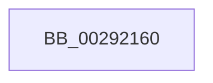

# MiRemoveWsleList

- RVA: `0x00292160`–`0x00292218` (길이 `184` bytes)
- VA: `0x0000000140292160`
- 실행 섹션: `.text`
- PDB 이름 있음: `예`; PDB Function 태그: `예`
- unwind 정보 RVA: `0x00067538`
- 디코드: `43`개 명령, `184/184` bytes 표시
- 미해석 바이트: `0` (있으면 어셈블리에 `.byte`로 보존)

> 이 문서는 커널 이미지의 기계어와 PDB 기호를 분석해 생성했습니다. 4번과 5번은 함수 원형과 자료형을 바이너리 사용 방식에서 추정한 C 해석이며 원본 소스 복구 결과는 아닙니다.

## 1. Dependencies

- 직접 호출 지점: **0**; 고유 호출 대상: **0**
- 직접 호출자로 확인된 함수: **3**
- RIP 상대 이미지 참조: **2**

### Outgoing calls
- 직접 디코드된 call 명령이 없습니다.

### Direct callers
- [MiFreeWsleList](../24/MiFreeWsleList_function_00241168.md) at `0x00241331`
- [MiDecommitPagesTail](../27/MiDecommitPagesTail_function_002790FC.md) at `0x00279186`
- [sub_00293C9B](Unknown_function_00293C9B.md) at `0x00293DB7`

### Static image references
- `0x00292173` → RVA `0x00E0A740` (`.data`; read)
- `0x002921AC` → RVA `0x00E388C0` (`.data`; read)

## 2. Other-region calls and transfers

- 다른 실행 섹션으로 향하는 call: **0**
- call이 아닌 외부 분기/꼬리 이동: **1**
  - `0x00292212` → [sub_0029271B](Unknown_function_0029271B.md) (`tail-transfer`)

## 3. Assembly (complete function range)

```asm
00292160  40 53                           push rbx
00292162  56                              push rsi
00292163  57                              push rdi
00292164  41 54                           push r12
00292166  41 55                           push r13
00292168  41 56                           push r14
0029216A  41 57                           push r15
0029216C  48 81 EC 90 00 00 00            sub rsp, 0x90
00292173  48 8B 05 C6 85 B7 00            mov rax, qword ptr [rip + 0xb785c6]
0029217A  48 33 C4                        xor rax, rsp
0029217D  48 89 84 24 88 00 00 00         mov qword ptr [rsp + 0x88], rax
00292185  8B 81 B8 00 00 00               mov eax, dword ptr [rcx + 0xb8]
0029218B  4C 8B F1                        mov r14, rcx
0029218E  44 8B 82 68 40 00 00            mov r8d, dword ptr [rdx + 0x4068]
00292195  24 0F                           and al, 0xf
00292197  33 FF                           xor edi, edi
00292199  48 89 4C 24 58                  mov qword ptr [rsp + 0x58], rcx
0029219E  3C 01                           cmp al, 1
002921A0  48 89 54 24 28                  mov qword ptr [rsp + 0x28], rdx
002921A5  41 8B B6 B8 00 00 00            mov esi, dword ptr [r14 + 0xb8]
002921AC  48 8D 0D 0D 67 BA 00            lea rcx, [rip + 0xba670d]
002921B3  4C 8B 8A 60 40 00 00            mov r9, qword ptr [rdx + 0x4060]
002921BA  48 0F 45 CF                     cmovne rcx, rdi
002921BE  49 C1 E9 09                     shr r9, 9
002921C2  48 B8 F8 FF FF FF 7F 00 00 00   movabs rax, 0x7ffffffff8
002921CC  4C 23 C8                        and r9, rax
002921CF  4C 89 44 24 50                  mov qword ptr [rsp + 0x50], r8
002921D4  4C 8B FA                        mov r15, rdx
002921D7  48 89 4C 24 60                  mov qword ptr [rsp + 0x60], rcx
002921DC  89 74 24 48                     mov dword ptr [rsp + 0x48], esi
002921E0  49 BA 00 00 00 00 80 F6 FF FF   movabs r10, 0xfffff68000000000
002921EA  49 8B C2                        mov rax, r10
002921ED  4C 03 C8                        add r9, rax
002921F0  8B D7                           mov edx, edi
002921F2  49 81 E1 00 F0 FF FF            and r9, 0xfffffffffffff000
002921F9  48 89 54 24 30                  mov qword ptr [rsp + 0x30], rdx
002921FE  4C 89 4C 24 40                  mov qword ptr [rsp + 0x40], r9
00292203  8B DF                           mov ebx, edi
00292205  89 5C 24 20                     mov dword ptr [rsp + 0x20], ebx
00292209  44 8B EF                        mov r13d, edi
0029220C  44 8B E7                        mov r12d, edi
0029220F  4D 85 C0                        test r8, r8
00292212  0F 84 03 05 00 00               je 0x14029271b
```

## 4. C-style interpretation (structured pseudocode)

```c
__int64 __fastcall MiRemoveWsleList(__int64 a1, __int64 a2)
{
    __int64 result;
    __int64 v_rdi;
    __int64 v_rsp;
    unsigned __int64 v_stack_m40;
    unsigned __int64 v_stack_m68;
    unsigned __int64 v_stack_m70;
    unsigned __int64 v_stack_m78;
    unsigned int v_stack_m80;
    unsigned __int64 v_stack_m88;
    unsigned __int64 v_stack_m98;
    unsigned __int64 v_stack_mA0;
    unsigned int v_stack_mA8;

    v_rsp = (v_rsp) - (144);
    result = (*(unsigned __int64 *)(v_rip + 12027334)) ^ (v_rsp);
    v_stack_m40 = result;
    result = (unsigned __int8)(((unsigned int)(*(unsigned int *)(a1 + 184))) & (15));
    v_rdi = 0;
    v_stack_m70 = a1;
    v_stack_mA0 = a2;
    a1 = v_rip + 12216077;
    if (((unsigned __int8)(result)) != 1) { a1 = 0; }
    a4 = (*(unsigned __int64 *)(a2 + 16480)) >> (9);
    a4 = (a4) & (result);
    v_stack_m78 = (unsigned int)(*(unsigned int *)(a2 + 16488));
    v_stack_m68 = a1;
    v_stack_m80 = (unsigned int)((unsigned int)(*(unsigned int *)(a1 + 184)));
    a4 = (a4) + (v_r10);
    a4 = (a4) & (0xFFFFFFFFFFFFF000ULL);
    v_stack_m98 = 0;
    v_stack_m88 = a4;
    v_stack_mA8 = 0;
}
```

## 5. (Beta) C Style

```c
int64_t MiRemoveWsleList(void *Arg1, void *Arg2)
{
    uint8_t *arg1 = (uint8_t *)Arg1;
    uint8_t *arg2 = (uint8_t *)Arg2;

    int64_t result;
    int64_t local_rdi;
    int64_t local_rsp;
    uint64_t v_stack_m40;
    uint64_t v_stack_m68;
    uint64_t v_stack_m70;
    uint64_t v_stack_m78;
    uint32_t v_stack_m80;
    uint64_t v_stack_m88;
    uint64_t v_stack_m98;
    uint64_t v_stack_mA0;
    uint32_t v_stack_mA8;

    local_rsp = (local_rsp) - (144);
    result = (*(uint64_t *)(v_rip + 0xB785C6)) ^ (local_rsp);
    v_stack_m40 = result;
    result = (uint8_t)(((uint32_t)(*(uint32_t *)(arg1 + 0xB8))) & (15));
    local_rdi = 0;
    v_stack_m70 = Arg1;
    v_stack_mA0 = Arg2;
    Arg1 = v_rip + 12216077;
    if (((uint8_t)(result)) != 1) { Arg1 = 0; }
    a4 = (*(uint64_t *)(arg2 + 0x4060)) >> (9);
    a4 = (a4) & (result);
    v_stack_m78 = (uint32_t)(*(uint32_t *)(arg2 + 0x4068));
    v_stack_m68 = Arg1;
    v_stack_m80 = (uint32_t)((uint32_t)(*(uint32_t *)(arg1 + 0xB8)));
    a4 = (a4) + (local_r10);
    a4 = (a4) & (0xFFFFFFFFFFFFF000ULL);
    v_stack_m98 = 0;
    v_stack_m88 = a4;
    v_stack_mA8 = 0;
}
```

### 관측된 메모리 오프셋

구조체 형식이 확인되지 않은 접근은 인자 기준의 오프셋으로만 기록했습니다.

| 기준 인자 | 오프셋 표현 | 폭 (bit) | 접근 |
|---|---:|---:|---|
| `Arg1` | `+ 0xB8` | `32` | `R` |
| `Arg2` | `+ 0x4060` | `64` | `R` |
| `Arg2` | `+ 0x4068` | `32` | `R` |

## 6. Execution-region graph

[열기: 2D/3D 그래프와 함수 탐색 컨트롤 패널](../../../control-panel.html?section=text&rva=0x00292160&view=graph)

- 2D 그래프는 위에서 아래로 흐르고, 3D 그래프는 빈 공간을 드래그해 회전합니다. Shift+드래그는 이동, 휠은 확대·축소, 함수 노드 선택은 대상 보고서 이동입니다.

### Static fallback


