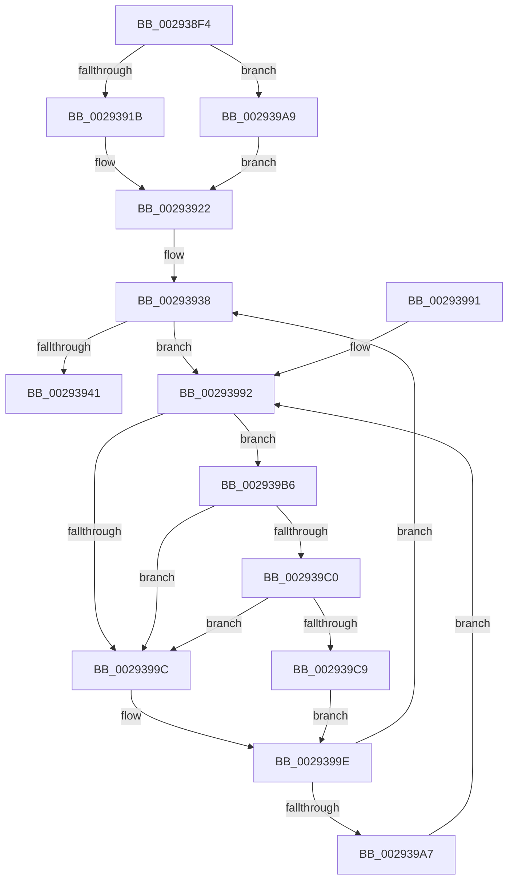

# MiRevertPfnActivePageTable

- RVA: `0x002938F4`–`0x002939D2` (길이 `222` bytes)
- VA: `0x00000001402938F4`
- 실행 섹션: `.text`
- PDB 이름 있음: `예`; PDB Function 태그: `아니요`
- unwind 정보 RVA: `0x000676D8`
- 디코드: `60`개 명령, `222/222` bytes 표시
- 미해석 바이트: `0` (있으면 어셈블리에 `.byte`로 보존)

> 이 문서는 커널 이미지의 기계어와 PDB 기호를 분석해 생성했습니다. 4번과 5번은 함수 원형과 자료형을 바이너리 사용 방식에서 추정한 C 해석이며 원본 소스 복구 결과는 아닙니다.

## 1. Dependencies

- 직접 호출 지점: **3**; 고유 호출 대상: **3**
- 직접 호출자로 확인된 함수: **2**
- RIP 상대 이미지 참조: **2**

### Outgoing calls
- `0x0029392E` → [MiMakeDemandZeroPte](../33/MiMakeDemandZeroPte_function_00337A00.md) (function, `0x00337A00`)
- `0x002939C0` → [KiCheckVpBackingLongSpinWaitHypercall](../30/KiCheckVpBackingLongSpinWaitHypercall_function_0030F490.md) (function, `0x0030F490`)
- `0x002939CB` → [HvlNotifyLongSpinWait](../30/HvlNotifyLongSpinWait_function_0030F460.md) (function, `0x0030F460`)

### Direct callers
- [MiRemoveActivePageTableLinks](MiRemoveActivePageTableLinks_function_00291FA8.md) at `0x002920CC`
- [MiStealPage](../2B/MiStealPage_function_002B28D0.md) at `0x002B3E9D`

### Static image references
- `0x00293994` → RVA `0x00FC52AC` (`ALMOSTRO`; reference)
- `0x002939B6` → RVA `0x00FC6AB8` (`ALMOSTRO`; read)

## 2. Other-region calls and transfers

- 다른 실행 섹션으로 향하는 call: **0**
- 별도 외부 분기/꼬리 이동을 확인하지 못했습니다.

## 3. Assembly (complete function range)

```asm
002938F4  48 89 5C 24 08                  mov qword ptr [rsp + 8], rbx
002938F9  48 89 6C 24 10                  mov qword ptr [rsp + 0x10], rbp
002938FE  48 89 74 24 18                  mov qword ptr [rsp + 0x18], rsi
00293903  57                              push rdi
00293904  48 83 EC 20                     sub rsp, 0x20
00293908  8B 51 24                        mov edx, dword ptr [rcx + 0x24]
0029390B  48 8B D9                        mov rbx, rcx
0029390E  8B 41 24                        mov eax, dword ptr [rcx + 0x24]
00293911  0F BA E0 1A                     bt eax, 0x1a
00293915  0F 83 8E 00 00 00               jae 0x1402939a9
0029391B  48 8B 39                        mov rdi, qword ptr [rcx]
0029391E  48 C1 EF 20                     shr rdi, 0x20
00293922  0F BA F2 1A                     btr edx, 0x1a
00293926  89 51 24                        mov dword ptr [rcx + 0x24], edx
00293929  B9 04 00 00 00                  mov ecx, 4
0029392E  E8 CD 40 0A 00                  call 0x140337a00
00293933  48 8B E8                        mov rbp, rax
00293936  33 F6                           xor esi, esi
00293938  F0 48 0F BA 6B 18 3F            lock bts qword ptr [rbx + 0x18], 0x3f
0029393F  72 51                           jb 0x140293992
00293941  8B CF                           mov ecx, edi
00293943  48 C1 E1 10                     shl rcx, 0x10
00293947  48 8B C1                        mov rax, rcx
0029394A  48 33 C5                        xor rax, rbp
0029394D  48 25 FF FF 00 FC               and rax, 0xfffffffffc00ffff
00293953  48 33 C1                        xor rax, rcx
00293956  48 B9 FF FF FF FF FF FF 7F FC   movabs rcx, 0xfc7fffffffffffff
00293960  48 89 43 10                     mov qword ptr [rbx + 0x10], rax
00293964  48 8B 03                        mov rax, qword ptr [rbx]
00293967  48 23 C1                        and rax, rcx
0029396A  48 89 03                        mov qword ptr [rbx], rax
0029396D  48 B8 FF FF FF FF FF FF FF 7F   movabs rax, 0x7fffffffffffffff
00293977  F0 48 21 43 18                  lock and qword ptr [rbx + 0x18], rax
0029397C  48 8B 5C 24 30                  mov rbx, qword ptr [rsp + 0x30]
00293981  48 8B 6C 24 38                  mov rbp, qword ptr [rsp + 0x38]
00293986  48 8B 74 24 40                  mov rsi, qword ptr [rsp + 0x40]
0029398B  48 83 C4 20                     add rsp, 0x20
0029398F  5F                              pop rdi
00293990  C3                              ret
00293991  CC                              int3
00293992  FF C6                           inc esi
00293994  85 35 12 19 D3 00               test dword ptr [rip + 0xd31912], esi
0029399A  74 1A                           je 0x1402939b6
0029399C  F3 90                           pause
0029399E  48 8B 43 18                     mov rax, qword ptr [rbx + 0x18]
002939A2  48 85 C0                        test rax, rax
002939A5  79 91                           jns 0x140293938
002939A7  EB E9                           jmp 0x140293992
002939A9  48 8B 79 10                     mov rdi, qword ptr [rcx + 0x10]
002939AD  48 C1 EF 10                     shr rdi, 0x10
002939B1  E9 6C FF FF FF                  jmp 0x140293922
002939B6  8B 05 FC 30 D3 00               mov eax, dword ptr [rip + 0xd330fc]
002939BC  A8 40                           test al, 0x40
002939BE  74 DC                           je 0x14029399c
002939C0  E8 CB BA 07 00                  call 0x14030f490
002939C5  84 C0                           test al, al
002939C7  74 D3                           je 0x14029399c
002939C9  8B CE                           mov ecx, esi
002939CB  E8 90 BA 07 00                  call 0x14030f460
002939D0  EB CC                           jmp 0x14029399e
```

## 4. C-style interpretation (structured pseudocode)

```c
__int64 __fastcall MiRevertPfnActivePageTable(__int64 a1)
{
    __int64 result;
    __int64 v_rdi;
    __int64 v_rsi;
    __int64 v_rsp;
    unsigned __int64 v_stack_p10;
    unsigned __int64 v_stack_p18;
    unsigned __int64 v_stack_p8;

    v_stack_p8 = v_rbx;
    v_stack_p10 = v_rbp;
    v_stack_p18 = v_rsi;
    v_rsp = (v_rsp) - (32);
    if (condition_is_above_or_equal) goto loc_002939A9;
    v_rdi = (*(unsigned __int64 *)(a1)) >> (32);
loc_00293922:
    *(unsigned int *)(a1 + 36) = (unsigned int)((unsigned int)(*(unsigned int *)(a1 + 36)));
    result = MiMakeDemandZeroPte(4, (unsigned int)(*(unsigned int *)(a1 + 36)), a3, a4);
    v_rsi = 0;
loc_00293938:
    if (condition_is_below) goto loc_00293992;
    a1 = ((unsigned int)((unsigned int)(v_rdi))) << (16);
    result = (a1) ^ (result);
    result = (result) & (0xFFFFFFFFFC00FFFFULL);
    result = (result) ^ (a1);
    *(unsigned __int64 *)(a1 + 16) = result;
    result = (*(unsigned __int64 *)(a1)) & (a1);
    *(unsigned __int64 *)(a1) = result;
    v_rsp = (v_rsp) + (32);
    return result;
loc_00293992:
    v_rsi = (unsigned int)((v_stack_p18) + 1);
    if (((*(unsigned int *)(v_rip + 13834514)) & ((unsigned int)(v_rsi))) == 0) goto loc_002939B6;
loc_0029399C:
loc_0029399E:
    if (!sign_flag) goto loc_00293938;
    goto loc_00293992;
loc_002939A9:
    v_rdi = (*(unsigned __int64 *)(a1 + 16)) >> (16);
    goto loc_00293922;
loc_002939B6:
    if ((((unsigned __int8)((unsigned int)(*(unsigned int *)(v_rip + 13840636)))) & (64)) == 0) goto loc_0029399C;
    result = KiCheckVpBackingLongSpinWaitHypercall(a1, (unsigned int)(*(unsigned int *)(a1 + 36)), a3, a4);
    if ((unsigned __int8)(result) == 0) goto loc_0029399C;
    result = HvlNotifyLongSpinWait((unsigned int)((unsigned int)(v_rsi)), (unsigned int)(*(unsigned int *)(a1 + 36)), a3, a4);
    goto loc_0029399E;
}
```

## 5. (Beta) C Style

```c
int64_t MiRevertPfnActivePageTable(void *Arg1)
{
    uint8_t *arg1 = (uint8_t *)Arg1;

    int64_t result;
    int64_t local_rdi;
    int64_t local_rsi;
    int64_t local_rsp;
    uint64_t v_stack_p10;
    uint64_t v_stack_p18;
    uint64_t v_stack_p8;

    v_stack_p8 = local_rbx;
    v_stack_p10 = local_rbp;
    v_stack_p18 = local_rsi;
    local_rsp = (local_rsp) - (32);
    if (condition_is_above_or_equal) goto loc_002939A9;
    local_rdi = (*(uint64_t *)(arg1)) >> (32);
loc_00293922:
    *(uint32_t *)(arg1 + 0x24) = (uint32_t)((uint32_t)(*(uint32_t *)(arg1 + 0x24)));
    result = MiMakeDemandZeroPte(4, (uint32_t)(*(uint32_t *)(arg1 + 0x24)), a3, a4);
    local_rsi = 0;
loc_00293938:
    if (condition_is_below) goto loc_00293992;
    Arg1 = ((uint32_t)((uint32_t)(local_rdi))) << (16);
    result = (Arg1) ^ (result);
    result = (result) & (0xFFFFFFFFFC00FFFFULL);
    result = (result) ^ (Arg1);
    *(uint64_t *)(arg1 + 0x10) = result;
    result = (*(uint64_t *)(arg1)) & (Arg1);
    *(uint64_t *)(arg1) = result;
    local_rsp = (local_rsp) + (32);
    return result;
loc_00293992:
    local_rsi = (uint32_t)((v_stack_p18) + 1);
    if (((*(uint32_t *)(v_rip + 0xD31912)) & ((uint32_t)(local_rsi))) == 0) goto loc_002939B6;
loc_0029399C:
loc_0029399E:
    if (!sign_flag) goto loc_00293938;
    goto loc_00293992;
loc_002939A9:
    local_rdi = (*(uint64_t *)(arg1 + 0x10)) >> (16);
    goto loc_00293922;
loc_002939B6:
    if ((((uint8_t)((uint32_t)(*(uint32_t *)(v_rip + 0xD330FC)))) & (64)) == 0) goto loc_0029399C;
    result = KiCheckVpBackingLongSpinWaitHypercall(Arg1, (uint32_t)(*(uint32_t *)(arg1 + 0x24)), a3, a4);
    if ((uint8_t)(result) == 0) goto loc_0029399C;
    result = HvlNotifyLongSpinWait((uint32_t)((uint32_t)(local_rsi)), (uint32_t)(*(uint32_t *)(arg1 + 0x24)), a3, a4);
    goto loc_0029399E;
}
```

### 관측된 메모리 오프셋

구조체 형식이 확인되지 않은 접근은 인자 기준의 오프셋으로만 기록했습니다.

| 기준 인자 | 오프셋 표현 | 폭 (bit) | 접근 |
|---|---:|---:|---|
| `Arg1` | `+ 0x0` | `64` | `R` |
| `Arg1` | `+ 0x0` | `64` | `W` |
| `Arg1` | `+ 0x10` | `64` | `R` |
| `Arg1` | `+ 0x10` | `64` | `W` |
| `Arg1` | `+ 0x18` | `64` | `R` |
| `Arg1` | `+ 0x18` | `64` | `R/W` |
| `Arg1` | `+ 0x24` | `32` | `R` |
| `Arg1` | `+ 0x24` | `32` | `W` |

## 6. Execution-region graph

[열기: 2D/3D 그래프와 함수 탐색 컨트롤 패널](../../../control-panel.html?section=text&rva=0x002938F4&view=graph)

- 2D 그래프는 위에서 아래로 흐르고, 3D 그래프는 빈 공간을 드래그해 회전합니다. Shift+드래그는 이동, 휠은 확대·축소, 함수 노드 선택은 대상 보고서 이동입니다.

### Static fallback


