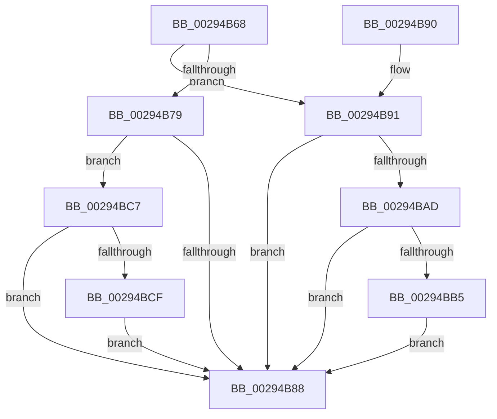

# MiSanitizeShadowPxe

- RVA: `0x00294B68`–`0x00294BE1` (길이 `121` bytes)
- VA: `0x0000000140294B68`
- 실행 섹션: `.text`
- PDB 이름 있음: `예`; PDB Function 태그: `아니요`
- unwind 정보 RVA: `0x000677BC`
- 디코드: `30`개 명령, `121/121` bytes 표시
- 미해석 바이트: `0` (있으면 어셈블리에 `.byte`로 보존)

> 이 문서는 커널 이미지의 기계어와 PDB 기호를 분석해 생성했습니다. 4번과 5번은 함수 원형과 자료형을 바이너리 사용 방식에서 추정한 C 해석이며 원본 소스 복구 결과는 아닙니다.

## 1. Dependencies

- 직접 호출 지점: **1**; 고유 호출 대상: **1**
- 직접 호출자로 확인된 함수: **41**
- RIP 상대 이미지 참조: **1**

### Outgoing calls
- `0x00294B6F` → [MiPteHasShadow](../32/MiPteHasShadow_function_0032B998.md) (function, `0x0032B998`)

### Direct callers
- [MmSetAddressRangeModifiedEx](../23/MmSetAddressRangeModifiedEx_function_00236F20.md) at `0x0023751F`
- [sub_0023F124](../23/Unknown_function_0023F124.md) at `0x0023F360`
- [MiUnlockNestedPageTableWritePte](../23/MiUnlockNestedPageTableWritePte_function_0023F4E4.md) at `0x0023F746`
- [sub_002401BF](../24/Unknown_function_002401BF.md) at `0x0024030F`
- [MiWriteValidPteNewProtection](../28/MiWriteValidPteNewProtection_function_00281810.md) at `0x00281972`
- [MiResolveTransitionFault](../28/MiResolveTransitionFault_function_00282940.md) at `0x00283607`
- [MiMigratePfn](../28/MiMigratePfn_function_0028DBB0.md) at `0x0028E23F`
- [MiMakePteClean](../2A/MiMakePteClean_function_002A901C.md) at `0x002A9339`
- [MiReplaceTransitionPage](../2B/MiReplaceTransitionPage_function_002B1120.md) at `0x002B1A55`
- [MiStealPage](../2B/MiStealPage_function_002B28D0.md) at `0x002B3BD9`
- [MiStealPage](../2B/MiStealPage_function_002B28D0.md) at `0x002B3C12`
- [MiResolveProtoPteFault](../32/MiResolveProtoPteFault_function_00321750.md) at `0x003224BB`
- [MiRewritePteWithLockBit](../32/MiRewritePteWithLockBit_function_00322FEC.md) at `0x0032316F`
- [MiRewritePteWithLockBit](../32/MiRewritePteWithLockBit_function_00322FEC.md) at `0x00323231`
- [MiCompletePrivateZeroFault](../33/MiCompletePrivateZeroFault_function_00330CC0.md) at `0x00331C6A`
- [MiCompletePrivateZeroFault](../33/MiCompletePrivateZeroFault_function_00330CC0.md) at `0x00331D38`
- [MiAllocateWsle](../33/MiAllocateWsle_function_003332C0.md) at `0x00333C7F`
- [MiRestoreTransitionPte](../33/MiRestoreTransitionPte_function_0033DD90.md) at `0x0033E1A1`
- [MiMakeFaultPfnActive](../36/MiMakeFaultPfnActive_function_00361D00.md) at `0x00361ED5`
- [MiWriteEnclavePte](../36/MiWriteEnclavePte_function_00368570.md) at `0x003686EF`
- [MiOutSwapWorkingSetPte](../37/MiOutSwapWorkingSetPte_function_00372190.md) at `0x0037286F`
- [MiTradeActivePage](../37/MiTradeActivePage_function_00374424.md) at `0x0037479A`
- [MiTradeActivePage](../37/MiTradeActivePage_function_00374424.md) at `0x003747B1`
- [MiWriteValidPteNewPage](../37/MiWriteValidPteNewPage_function_00376068.md) at `0x0037617C`
- [MiRewriteTrimPteAsDemandZero](../38/MiRewriteTrimPteAsDemandZero_function_003823F4.md) at `0x003825AD`
- [MiSwapNumaStandbyPage](../38/MiSwapNumaStandbyPage_function_00385144.md) at `0x003855D6`
- [MiSwapHardFaultPage](../38/MiSwapHardFaultPage_function_00385F34.md) at `0x00385FA0`
- [MiInvalidateCollidedIos](../38/MiInvalidateCollidedIos_function_00386110.md) at `0x003863A0`
- [MiInsertLargeVadMapping](../3F/MiInsertLargeVadMapping_function_003F0498.md) at `0x003F0576`
- [MiShadowTopLevelPxes](../46/MiShadowTopLevelPxes_function_0046C6B0.md) at `0x0046C81F`
- [MiWriteRepurposedTransitionPte](../4B/MiWriteRepurposedTransitionPte_function_004B0EC8.md) at `0x004B0F20`
- [MiProtectAweRegion](../4C/MiProtectAweRegion_function_004CE62C.md) at `0x004CED21`
- [MiSplitDirectMapPage](../4D/MiSplitDirectMapPage_function_004DAAA0.md) at `0x004DACCA`
- [MiDbgReleaseAddress](../68/MiDbgReleaseAddress_function_00685630.md) at `0x006856BF`
- [MiDbgWriteCheck](../68/MiDbgWriteCheck_function_00685BE4.md) at `0x00685E95`
- [sub_006D7BDC](../6D/Unknown_function_006D7BDC.md) at `0x006D7BF1`
- [sub_006DC4D4](../6D/Unknown_function_006DC4D4.md) at `0x006DC63A`
- [sub_006EE9B6](../6E/Unknown_function_006EE9B6.md) at `0x006EE9CD`
- [sub_006EE9B6](../6E/Unknown_function_006EE9B6.md) at `0x006EEA32`
- [MiCreateHardwareEnclave](../../page/80/MiCreateHardwareEnclave_function_00808500.md) at `0x0080878B`
- [MiUpdateUserMappings](../../pagelk/B7/MiUpdateUserMappings_function_00B7966C.md) at `0x00B796F3`
- [MiUpdateUserMappings](../../pagelk/B7/MiUpdateUserMappings_function_00B7966C.md) at `0x00B79728`
- [MiMapDummyPages](../../init/C6/MiMapDummyPages_function_00C60A58.md) at `0x00C60AFB`
- [MxZeroBootMappings](../../init/C6/MxZeroBootMappings_function_00C61344.md) at `0x00C613FB`
- [MiClearStaleSecurePageMapping](../../init/C6/MiClearStaleSecurePageMapping_function_00C61CD8.md) at `0x00C61D0A`
- [MiFillGapPtes](../../init/C6/MiFillGapPtes_function_00C65AC0.md) at `0x00C65B61`
- [MiInitializeBootShadowStackPage](../../init/C6/MiInitializeBootShadowStackPage_function_00C67D8C.md) at `0x00C67FA4`
- [MiInitializeBootShadowStackPage](../../init/C6/MiInitializeBootShadowStackPage_function_00C67D8C.md) at `0x00C6802F`

### Static image references
- `0x00294B79` → RVA `0x00E2EE85` (`.data`; read)

## 2. Other-region calls and transfers

- 다른 실행 섹션으로 향하는 call: **0**
- 별도 외부 분기/꼬리 이동을 확인하지 못했습니다.

## 3. Assembly (complete function range)

```asm
00294B68  48 83 EC 28                     sub rsp, 0x28
00294B6C  45 33 C9                        xor r9d, r9d
00294B6F  E8 24 6E 09 00                  call 0x14032b998
00294B74  48 85 C0                        test rax, rax
00294B77  74 18                           je 0x140294b91
00294B79  80 3D 05 A3 B9 00 00            cmp byte ptr [rip + 0xb9a305], 0
00294B80  41 B9 01 00 00 00               mov r9d, 1
00294B86  74 3F                           je 0x140294bc7
00294B88  41 8B C1                        mov eax, r9d
00294B8B  48 83 C4 28                     add rsp, 0x28
00294B8F  C3                              ret
00294B90  CC                              int3
00294B91  65 48 8B 04 25 88 01 00 00      mov rax, qword ptr gs:[0x188]
00294B9A  48 8B 88 B8 00 00 00            mov rcx, qword ptr [rax + 0xb8]
00294BA1  F7 81 FC 05 00 00 00 10 00 00   test dword ptr [rcx + 0x5fc], 0x1000
00294BAB  74 DB                           je 0x140294b88
00294BAD  48 8B 0A                        mov rcx, qword ptr [rdx]
00294BB0  F6 C1 01                        test cl, 1
00294BB3  74 D3                           je 0x140294b88
00294BB5  49 B8 00 00 00 00 00 00 00 80   movabs r8, 0x8000000000000000
00294BBF  49 0B C8                        or rcx, r8
00294BC2  48 89 0A                        mov qword ptr [rdx], rcx
00294BC5  EB C1                           jmp 0x140294b88
00294BC7  48 8B 02                        mov rax, qword ptr [rdx]
00294BCA  41 84 C1                        test r9b, al
00294BCD  74 B9                           je 0x140294b88
00294BCF  49 B8 00 00 00 00 00 00 00 80   movabs r8, 0x8000000000000000
00294BD9  49 0B C0                        or rax, r8
00294BDC  48 89 02                        mov qword ptr [rdx], rax
00294BDF  EB A7                           jmp 0x140294b88
```

## 4. C-style interpretation (structured pseudocode)

```c
__int64 __fastcall MiSanitizeShadowPxe(__int64 a1, __int64 a2, __int64 a3, int a4)
{
    __int64 result;
    __int64 v_rsp;

    v_rsp = (v_rsp) - (40);
    a4 = 0;
    result = MiPteHasShadow(a1, a2, a3, a4);
    if (result == 0) goto loc_00294B91;
    if ((*(unsigned __int8 *)(v_rip + 12165893)) == 0) goto loc_00294BC7;
loc_00294B88:
    v_rsp = (v_rsp) + (40);
    return 1;
loc_00294B91:
    if (((*(unsigned int *)(*(unsigned __int64 *)(*(unsigned __int64 *)(gs_base + (0 + 392)) + 184) + 1532)) & (0x1000ULL)) == 0) goto loc_00294B88;
    if ((((unsigned __int8)(*(unsigned __int64 *)(a2))) & (1)) == 0) goto loc_00294B88;
    a1 = (*(unsigned __int64 *)(a2)) | (a3);
    *(unsigned __int64 *)(a2) = a1;
    goto loc_00294B88;
loc_00294BC7:
    if (((1) & ((unsigned __int8)(*(unsigned __int64 *)(a2)))) == 0) goto loc_00294B88;
    result = (*(unsigned __int64 *)(a2)) | (a3);
    *(unsigned __int64 *)(a2) = result;
    goto loc_00294B88;
}
```

## 5. (Beta) C Style

```c
int64_t MiSanitizeShadowPxe(int64_t Arg1, int64_t Arg2, int64_t Arg3, int32_t Arg4)
{
    int64_t result;
    int64_t local_rsp;

    local_rsp = (local_rsp) - (40);
    Arg4 = 0;
    result = MiPteHasShadow(Arg1, Arg2, Arg3, Arg4);
    if (result == 0) goto loc_00294B91;
    if ((*(uint8_t *)(v_rip + 0xB9A305)) == 0) goto loc_00294BC7;
loc_00294B88:
    local_rsp = (local_rsp) + (40);
    return 1;
loc_00294B91:
    if (((*(uint32_t *)(*(uint64_t *)(*(uint64_t *)(gs_base + (0 + 0x188)) + 0xB8) + 0x5FC)) & (0x1000ULL)) == 0) goto loc_00294B88;
    if ((((uint8_t)(*(uint64_t *)(Arg2))) & (1)) == 0) goto loc_00294B88;
    Arg1 = (*(uint64_t *)(Arg2)) | (Arg3);
    *(uint64_t *)(Arg2) = Arg1;
    goto loc_00294B88;
loc_00294BC7:
    if (((1) & ((uint8_t)(*(uint64_t *)(Arg2)))) == 0) goto loc_00294B88;
    result = (*(uint64_t *)(Arg2)) | (Arg3);
    *(uint64_t *)(Arg2) = result;
    goto loc_00294B88;
}
```

## 6. Execution-region graph

[열기: 2D/3D 그래프와 함수 탐색 컨트롤 패널](../../../control-panel.html?section=text&rva=0x00294B68&view=graph)

- 2D 그래프는 위에서 아래로 흐르고, 3D 그래프는 빈 공간을 드래그해 회전합니다. Shift+드래그는 이동, 휠은 확대·축소, 함수 노드 선택은 대상 보고서 이동입니다.

### Static fallback


