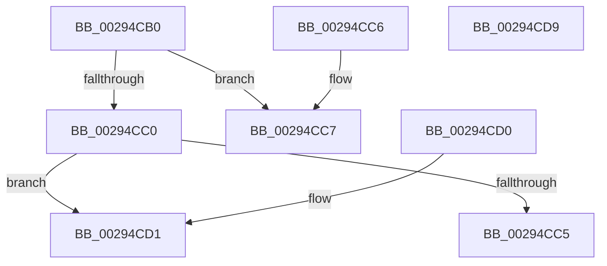

# MiSectionControlArea

- RVA: `0x00294CB0`–`0x00294CDA` (길이 `42` bytes)
- VA: `0x0000000140294CB0`
- 실행 섹션: `.text`
- PDB 이름 있음: `예`; PDB Function 태그: `아니요`
- unwind 정보 RVA: `0x000DB714`
- 디코드: `17`개 명령, `42/42` bytes 표시
- 미해석 바이트: `0` (있으면 어셈블리에 `.byte`로 보존)

> 이 문서는 커널 이미지의 기계어와 PDB 기호를 분석해 생성했습니다. 4번과 5번은 함수 원형과 자료형을 바이너리 사용 방식에서 추정한 C 해석이며 원본 소스 복구 결과는 아닙니다.

## 1. Dependencies

- 직접 호출 지점: **0**; 고유 호출 대상: **0**
- 직접 호출자로 확인된 함수: **66**
- RIP 상대 이미지 참조: **0**

### Outgoing calls
- 직접 디코드된 call 명령이 없습니다.

### Direct callers
- [MmMapViewInSystemCache](../27/MmMapViewInSystemCache_function_00273094.md) at `0x002730CA`
- [MmUnmapViewInSystemCache](MmUnmapViewInSystemCache_function_00293B70.md) at `0x00293BF6`
- [MiSetSystemCodeProtection](../38/MiSetSystemCodeProtection_function_00384420.md) at `0x003847B9`
- [MiInsertInSystemSpace](../3B/MiInsertInSystemSpace_function_003B2F5C.md) at `0x003B2FE4`
- [MiCreateSystemSection](../45/MiCreateSystemSection_function_00453158.md) at `0x00453214`
- [MiReferenceAweHandle](../4E/MiReferenceAweHandle_function_004E00A4.md) at `0x004E0118`
- [MiReapplyImportOptimizationForDriverVerifier](../68/MiReapplyImportOptimizationForDriverVerifier_function_00682268.md) at `0x0068234D`
- [MmGetSectionStrongImageReference](../../page/70/MmGetSectionStrongImageReference_function_00701DF0.md) at `0x00701E4C`
- [MiDriverLoadSucceeded](../../page/70/MiDriverLoadSucceeded_function_00702F08.md) at `0x00702F4A`
- [PspLocateSystemDll](../../page/77/PspLocateSystemDll_function_0077F0D0.md) at `0x0077F2B5`
- [MiRestoreImportTableProtection](../../page/7F/MiRestoreImportTableProtection_function_007F81FC.md) at `0x007F8215`
- [MiFreeInitializationCode](../../page/7F/MiFreeInitializationCode_function_007F88A0.md) at `0x007F8AAC`
- [MiWriteProtectSystemImages](../../page/7F/MiWriteProtectSystemImages_function_007F8F50.md) at `0x007F8F60`
- [MiLogSectionObjectEvent](../../page/7F/MiLogSectionObjectEvent_function_007FCF28.md) at `0x007FCF2F`
- [MiApplyHotPatchToLoadedDriver](../../page/80/MiApplyHotPatchToLoadedDriver_function_00802078.md) at `0x008022B2`
- [MiApplyImageHotPatchRequest](../../page/80/MiApplyImageHotPatchRequest_function_008025AC.md) at `0x0080296F`
- [MiAllocateUserPhysicalPages](../../page/80/MiAllocateUserPhysicalPages_function_00809828.md) at `0x00809A7E`
- [NtFreeUserPhysicalPages](../../page/80/NtFreeUserPhysicalPages_function_0080AF30.md) at `0x0080B066`
- [MiCompactServiceTable](../../page/80/MiCompactServiceTable_function_0080C63C.md) at `0x0080C780`
- [MiSectionOpen](../../page/88/MiSectionOpen_function_008871E0.md) at `0x008871EA`
- [MiSectionClose](../../page/88/MiSectionClose_function_00888970.md) at `0x0088897A`
- [AlpcpCreateView](../../page/88/AlpcpCreateView_function_0088A9B8.md) at `0x0088AACC`
- [AlpcpCreateView](../../page/88/AlpcpCreateView_function_0088A9B8.md) at `0x0088ACF9`
- [AlpcpCreateView](../../page/88/AlpcpCreateView_function_0088A9B8.md) at `0x0088ADEB`
- [NtMapViewOfSection](../../page/89/NtMapViewOfSection_function_008986E0.md) at `0x00898796`
- [MiMapViewOfSection](../../page/89/MiMapViewOfSection_function_00898F10.md) at `0x00898F77`
- [MiCreateSectionCommon](../../page/8A/MiCreateSectionCommon_function_008A9AA4.md) at `0x008A9D8C`
- [MiUpdateCfgSystemWideBitmapWorker](../../page/8C/MiUpdateCfgSystemWideBitmapWorker_function_008CE650.md) at `0x008CE6E2`
- [MiUpdateCfgSystemWideBitmapWorker](../../page/8C/MiUpdateCfgSystemWideBitmapWorker_function_008CE650.md) at `0x008CE770`
- [MiComputeProcessUserVa](../../page/8C/MiComputeProcessUserVa_function_008CFB8C.md) at `0x008CFC02`
- [MmGetFileObjectForSection](../../page/8D/MmGetFileObjectForSection_function_008D68E0.md) at `0x008D68E4`
- [MmSectionToSectionObjectPointers](../../page/91/MmSectionToSectionObjectPointers_function_0091DF04.md) at `0x0091DF0E`
- [MmGetSectionInformation](../../page/92/MmGetSectionInformation_function_00921910.md) at `0x00921950`
- [MiMapImageInSystemSpace](../../page/94/MiMapImageInSystemSpace_function_00941DD8.md) at `0x00941EC7`
- [KsepSdbMapToMemory](../../page/95/KsepSdbMapToMemory_function_0095B81C.md) at `0x0095B94A`
- [MiInitializeWowPeb](../../page/98/MiInitializeWowPeb_function_0098079C.md) at `0x00980B15`
- [MmMapViewOfSection](../../page/98/MmMapViewOfSection_function_00981680.md) at `0x009816B7`
- [MiMapViewInSystemSpace](../../page/98/MiMapViewInSystemSpace_function_009824D8.md) at `0x00982515`
- [MmExtendSection](../../page/98/MmExtendSection_function_00982C38.md) at `0x00982C6E`
- [PspLocateInPEManifest](../../page/98/PspLocateInPEManifest_function_0098F568.md) at `0x0098F640`
- [MmLoadSystemImageEx](../../page/99/MmLoadSystemImageEx_function_00999B8C.md) at `0x00999D76`
- [MmLoadSystemImageEx](../../page/99/MmLoadSystemImageEx_function_00999B8C.md) at `0x0099A141`
- [MiMapParametersInitialize](../../page/9A/MiMapParametersInitialize_function_009A1F70.md) at `0x009A1F86`
- [MiMapExParametersInitialize](../../page/9A/MiMapExParametersInitialize_function_009A2424.md) at `0x009A243D`
- [PspAllocateProcess](../../page/A1/PspAllocateProcess_function_00A13B3C.md) at `0x00A15BFA`
- [NtGetNlsSectionPtr](../../page/A1/NtGetNlsSectionPtr_function_00A195B0.md) at `0x00A197A5`
- [NtGetNlsSectionPtr](../../page/A1/NtGetNlsSectionPtr_function_00A195B0.md) at `0x00A19A30`
- [MiObtainSectionForDriver](../../page/A2/MiObtainSectionForDriver_function_00A24494.md) at `0x00A2454C`
- [MiObtainSectionForDriver](../../page/A2/MiObtainSectionForDriver_function_00A24494.md) at `0x00A24681`
- [MiObtainSectionForDriver](../../page/A2/MiObtainSectionForDriver_function_00A24494.md) at `0x00A246E4`
- [MiSectionDelete](../../page/A2/MiSectionDelete_function_00A2ECA0.md) at `0x00A2ECCE`
- [PsQuerySectionSignatureInformation](../../page/A2/PsQuerySectionSignatureInformation_function_00A2FB40.md) at `0x00A2FB7D`
- [PspGetProcessProtectionRequirementsFromImage](../../page/A6/PspGetProcessProtectionRequirementsFromImage_function_00A6DCF4.md) at `0x00A6DCFF`
- [MiGetSystemAddressForImage](../../page/A7/MiGetSystemAddressForImage_function_00A74EEC.md) at `0x00A74F49`
- [MiProcessKernelCfgImageLoadConfig](../../page/A7/MiProcessKernelCfgImageLoadConfig_function_00A7FE40.md) at `0x00A7FE76`
- [MmGetFileNameForSection](../../page/A9/MmGetFileNameForSection_function_00A9AEBC.md) at `0x00A9AF0C`
- [MiUnloadSystemImage](../../page/AA/MiUnloadSystemImage_function_00AA2FD4.md) at `0x00AA3092`
- [MiMapSystemImage](../../page/AA/MiMapSystemImage_function_00AA3558.md) at `0x00AA3577`
- [MiMapSystemImage](../../page/AA/MiMapSystemImage_function_00AA3558.md) at `0x00AA3586`
- [MiReturnSystemImageCommitment](../../page/AA/MiReturnSystemImageCommitment_function_00AA6BE8.md) at `0x00AA6C04`
- [MiConstructLoaderEntry](../../page/AA/MiConstructLoaderEntry_function_00AAA264.md) at `0x00AAA3C8`
- [MiConstructLoaderEntry](../../page/AA/MiConstructLoaderEntry_function_00AAA264.md) at `0x00AAA63B`
- [MiFreeRetpolineImportInfo](../../page/AA/MiFreeRetpolineImportInfo_function_00AAFF1C.md) at `0x00AAFF42`
- [MiIsImageFullyRetpolined](../../page/AB/MiIsImageFullyRetpolined_function_00AB01D4.md) at `0x00AB01E4`
- [MiMapImageForEnclaveUse](../../page/AB/MiMapImageForEnclaveUse_function_00AB213C.md) at `0x00AB21C1`
- [MiLoadHotPatch](../../page/AB/MiLoadHotPatch_function_00AB521C.md) at `0x00AB543D`
- [MiOpenHotPatchFile](../../page/AB/MiOpenHotPatchFile_function_00AB5684.md) at `0x00AB5930`
- [MiChargeSystemImageCommitment](../../page/AB/MiChargeSystemImageCommitment_function_00AB5BA4.md) at `0x00AB5BAB`
- [MmCreateSpecialImageSection](../../page/AB/MmCreateSpecialImageSection_function_00AB7360.md) at `0x00AB7456`
- [MiCreateUserPhysicalView](../../page/AD/MiCreateUserPhysicalView_function_00ADA4B4.md) at `0x00ADA572`
- [MiCallImageNotify](../../page/AD/MiCallImageNotify_function_00ADB9CC.md) at `0x00ADBA02`
- [sub_00B314C0](../../page/B3/Unknown_function_00B314C0.md) at `0x00B314FA`
- [VfDriverLoadImage](../../pagevrfy/BB/VfDriverLoadImage_function_00BB7DE4.md) at `0x00BB7E4B`
- [MiInitializeCfg](../../init/C6/MiInitializeCfg_function_00C69958.md) at `0x00C699BB`
- [MiInitializeCfg](../../init/C6/MiInitializeCfg_function_00C69958.md) at `0x00C69A29`
- [MiFreeBootDriverPages](../../init/C7/MiFreeBootDriverPages_function_00C7695C.md) at `0x00C76BCB`

### Static image references
- 디코드된 RIP-relative 메모리 참조가 없습니다.

## 2. Other-region calls and transfers

- 다른 실행 섹션으로 향하는 call: **0**
- 별도 외부 분기/꼬리 이동을 확인하지 못했습니다.

## 3. Assembly (complete function range)

```asm
00294CB0  48 8B 51 28                     mov rdx, qword ptr [rcx + 0x28]
00294CB4  48 8B C2                        mov rax, rdx
00294CB7  48 83 E0 FC                     and rax, 0xfffffffffffffffc
00294CBB  F6 C2 01                        test dl, 1
00294CBE  75 07                           jne 0x140294cc7
00294CC0  F6 C2 02                        test dl, 2
00294CC3  75 0C                           jne 0x140294cd1
00294CC5  C3                              ret
00294CC6  CC                              int3
00294CC7  48 8B 40 28                     mov rax, qword ptr [rax + 0x28]
00294CCB  48 8B 40 10                     mov rax, qword ptr [rax + 0x10]
00294CCF  C3                              ret
00294CD0  CC                              int3
00294CD1  48 8B 40 28                     mov rax, qword ptr [rax + 0x28]
00294CD5  48 8B 00                        mov rax, qword ptr [rax]
00294CD8  C3                              ret
00294CD9  CC                              int3
```

## 4. C-style interpretation (structured pseudocode)

```c
__int64 __fastcall MiSectionControlArea(__int64 a1)
{
    __int64 result;

    result = (*(unsigned __int64 *)(a1 + 40)) & (-4);
    if ((((unsigned __int8)(*(unsigned __int64 *)(a1 + 40))) & (1)) != 0) goto loc_00294CC7;
    if ((((unsigned __int8)(*(unsigned __int64 *)(a1 + 40))) & (2)) != 0) goto loc_00294CD1;
    return result;
loc_00294CC7:
    return *(unsigned __int64 *)(*(unsigned __int64 *)(result + 40) + 16);
loc_00294CD1:
    return *(unsigned __int64 *)(*(unsigned __int64 *)(*(unsigned __int64 *)(*(unsigned __int64 *)(result + 40) + 16) + 40));
}
```

## 5. (Beta) C Style

```c
int64_t MiSectionControlArea(void *Arg1)
{
    uint8_t *arg1 = (uint8_t *)Arg1;

    int64_t result;

    result = (*(uint64_t *)(arg1 + 0x28)) & (-4);
    if ((((uint8_t)(*(uint64_t *)(arg1 + 0x28))) & (1)) != 0) goto loc_00294CC7;
    if ((((uint8_t)(*(uint64_t *)(arg1 + 0x28))) & (2)) != 0) goto loc_00294CD1;
    return result;
loc_00294CC7:
    return *(uint64_t *)(*(uint64_t *)(result + 0x28) + 0x10);
loc_00294CD1:
    return *(uint64_t *)(*(uint64_t *)(*(uint64_t *)(*(uint64_t *)(result + 0x28) + 0x10) + 0x28));
}
```

### 관측된 메모리 오프셋

구조체 형식이 확인되지 않은 접근은 인자 기준의 오프셋으로만 기록했습니다.

| 기준 인자 | 오프셋 표현 | 폭 (bit) | 접근 |
|---|---:|---:|---|
| `Arg1` | `+ 0x28` | `64` | `R` |

## 6. Execution-region graph

[열기: 2D/3D 그래프와 함수 탐색 컨트롤 패널](../../../control-panel.html?section=text&rva=0x00294CB0&view=graph)

- 2D 그래프는 위에서 아래로 흐르고, 3D 그래프는 빈 공간을 드래그해 회전합니다. Shift+드래그는 이동, 휠은 확대·축소, 함수 노드 선택은 대상 보고서 이동입니다.

### Static fallback


