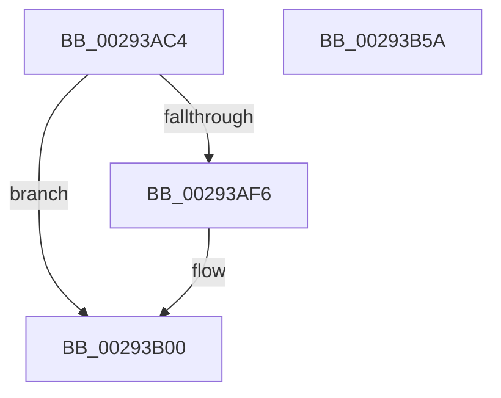

# MiSetPfnOldestWsleLeafAge

- RVA: `0x00293AC4`–`0x00293B5B` (길이 `151` bytes)
- VA: `0x0000000140293AC4`
- 실행 섹션: `.text`
- PDB 이름 있음: `예`; PDB Function 태그: `아니요`
- unwind 정보 RVA: `0x0005E6B4`
- 디코드: `41`개 명령, `151/151` bytes 표시
- 미해석 바이트: `0` (있으면 어셈블리에 `.byte`로 보존)

> 이 문서는 커널 이미지의 기계어와 PDB 기호를 분석해 생성했습니다. 4번과 5번은 함수 원형과 자료형을 바이너리 사용 방식에서 추정한 C 해석이며 원본 소스 복구 결과는 아닙니다.

## 1. Dependencies

- 직접 호출 지점: **2**; 고유 호출 대상: **2**
- 직접 호출자로 확인된 함수: **2**
- RIP 상대 이미지 참조: **0**

### Outgoing calls
- `0x00293AFB` → [MiRemoveActivePageTableLinks](MiRemoveActivePageTableLinks_function_00291FA8.md) (function, `0x00291FA8`)
- `0x00293B3A` → [MiInsertActivePageTableLinksTail](MiInsertActivePageTableLinksTail_function_00291D98.md) (function, `0x00291D98`)

### Direct callers
- [MiLockActivePageTableInList](../2A/MiLockActivePageTableInList_function_002AD86C.md) at `0x002AD8F7`
- [MiRebuildPageTableAges](../40/MiRebuildPageTableAges_function_0040D4E0.md) at `0x0040D58F`

### Static image references
- 디코드된 RIP-relative 메모리 참조가 없습니다.

## 2. Other-region calls and transfers

- 다른 실행 섹션으로 향하는 call: **0**
- 별도 외부 분기/꼬리 이동을 확인하지 못했습니다.

## 3. Assembly (complete function range)

```asm
00293AC4  48 8B C4                        mov rax, rsp
00293AC7  48 89 58 08                     mov qword ptr [rax + 8], rbx
00293ACB  48 89 68 10                     mov qword ptr [rax + 0x10], rbp
00293ACF  48 89 70 18                     mov qword ptr [rax + 0x18], rsi
00293AD3  48 89 78 20                     mov qword ptr [rax + 0x20], rdi
00293AD7  41 56                           push r14
00293AD9  48 83 EC 20                     sub rsp, 0x20
00293ADD  48 8B 1A                        mov rbx, qword ptr [rdx]
00293AE0  45 8B F1                        mov r14d, r9d
00293AE3  8B 42 24                        mov eax, dword ptr [rdx + 0x24]
00293AE6  48 8B FA                        mov rdi, rdx
00293AE9  41 0F B6 E8                     movzx ebp, r8b
00293AED  48 8B F1                        mov rsi, rcx
00293AF0  0F BA E0 1A                     bt eax, 0x1a
00293AF4  73 0A                           jae 0x140293b00
00293AF6  44 8B 44 24 50                  mov r8d, dword ptr [rsp + 0x50]
00293AFB  E8 A8 E4 FF FF                  call 0x140291fa8
00293B00  44 8B 4C 24 50                  mov r9d, dword ptr [rsp + 0x50]
00293B05  41 8B C6                        mov eax, r14d
00293B08  25 FF 03 00 00                  and eax, 0x3ff
00293B0D  48 8B CD                        mov rcx, rbp
00293B10  83 E1 07                        and ecx, 7
00293B13  44 8A C5                        mov r8b, bpl
00293B16  48 C1 E1 0A                     shl rcx, 0xa
00293B1A  48 8B D7                        mov rdx, rdi
00293B1D  48 0B C8                        or rcx, rax
00293B20  48 B8 FF FF FF FF FF 1F 00 FC   movabs rax, 0xfc001fffffffffff
00293B2A  48 C1 E1 2D                     shl rcx, 0x2d
00293B2E  48 23 D8                        and rbx, rax
00293B31  48 0B CB                        or rcx, rbx
00293B34  48 89 0F                        mov qword ptr [rdi], rcx
00293B37  48 8B CE                        mov rcx, rsi
00293B3A  E8 59 E2 FF FF                  call 0x140291d98
00293B3F  48 8B 5C 24 30                  mov rbx, qword ptr [rsp + 0x30]
00293B44  48 8B 6C 24 38                  mov rbp, qword ptr [rsp + 0x38]
00293B49  48 8B 74 24 40                  mov rsi, qword ptr [rsp + 0x40]
00293B4E  48 8B 7C 24 48                  mov rdi, qword ptr [rsp + 0x48]
00293B53  48 83 C4 20                     add rsp, 0x20
00293B57  41 5E                           pop r14
00293B59  C3                              ret
00293B5A  CC                              int3
```

## 4. C-style interpretation (structured pseudocode)

```c
__int64 __fastcall MiSetPfnOldestWsleLeafAge(__int64 a1, __int64 a2, unsigned __int8 a3, int a4, unsigned int a5)
{
    __int64 result;
    __int64 v_rbx;
    __int64 v_rsp;
    unsigned __int64 v_stack_p10;
    unsigned __int64 v_stack_p18;
    unsigned __int64 v_stack_p20;
    unsigned __int64 v_stack_p8;

    *(unsigned __int64 *)(v_rsp + 8) = v_rbx;
    *(unsigned __int64 *)(v_rsp + 16) = v_rbp;
    *(unsigned __int64 *)(v_rsp + 24) = v_rsi;
    *(unsigned __int64 *)(v_rsp + 32) = v_rdi;
    v_rsp = (v_rsp) - (32);
    result = (unsigned int)(*(unsigned int *)(a2 + 36));
    if (!(condition_is_above_or_equal)) {
        a3 = a5;
        result = MiRemoveActivePageTableLinks(a1, a2, a3, a4);
    }
    result = (unsigned int)(((unsigned int)((unsigned int)((unsigned int)(a4)))) & (0x3FFULL));
    a1 = (unsigned int)((a3) & (7));
    a1 = (a1) << (10);
    a1 = (a1) | (result);
    a1 = (a1) << (45);
    v_rbx = (*(unsigned __int64 *)(a2)) & (result);
    a1 = (a1) | (v_rbx);
    *(unsigned __int64 *)(a2) = a1;
    result = MiInsertActivePageTableLinksTail(a1, a2, a3, (unsigned int)(a5));
    v_rsp = (v_rsp) + (32);
    return result;
}
```

## 5. (Beta) C Style

```c
int64_t MiSetPfnOldestWsleLeafAge(int64_t Arg1, void *Arg2, uint8_t Arg3, int32_t Arg4, uint32_t Arg5)
{
    uint8_t *arg2 = (uint8_t *)Arg2;

    int64_t result;
    int64_t local_rbx;
    int64_t local_rsp;
    uint64_t v_stack_p10;
    uint64_t v_stack_p18;
    uint64_t v_stack_p20;
    uint64_t v_stack_p8;

    *(uint64_t *)(local_rsp + 0x8) = local_rbx;
    *(uint64_t *)(local_rsp + 0x10) = local_rbp;
    *(uint64_t *)(local_rsp + 0x18) = local_rsi;
    *(uint64_t *)(local_rsp + 0x20) = local_rdi;
    local_rsp = (local_rsp) - (32);
    result = (uint32_t)(*(uint32_t *)(arg2 + 0x24));
    if (!(condition_is_above_or_equal)) {
        Arg3 = Arg5;
        result = MiRemoveActivePageTableLinks(Arg1, Arg2, Arg3, Arg4);
    }
    result = (uint32_t)(((uint32_t)((uint32_t)((uint32_t)(Arg4)))) & (0x3FFULL));
    Arg1 = (uint32_t)((Arg3) & (7));
    Arg1 = (Arg1) << (10);
    Arg1 = (Arg1) | (result);
    Arg1 = (Arg1) << (45);
    local_rbx = (*(uint64_t *)(arg2)) & (result);
    Arg1 = (Arg1) | (local_rbx);
    *(uint64_t *)(arg2) = Arg1;
    result = MiInsertActivePageTableLinksTail(Arg1, Arg2, Arg3, (uint32_t)(Arg5));
    local_rsp = (local_rsp) + (32);
    return result;
}
```

### 관측된 메모리 오프셋

구조체 형식이 확인되지 않은 접근은 인자 기준의 오프셋으로만 기록했습니다.

| 기준 인자 | 오프셋 표현 | 폭 (bit) | 접근 |
|---|---:|---:|---|
| `Arg2` | `+ 0x0` | `64` | `R` |
| `Arg2` | `+ 0x0` | `64` | `W` |
| `Arg2` | `+ 0x24` | `32` | `R` |

## 6. Execution-region graph

[열기: 2D/3D 그래프와 함수 탐색 컨트롤 패널](../../../control-panel.html?section=text&rva=0x00293AC4&view=graph)

- 2D 그래프는 위에서 아래로 흐르고, 3D 그래프는 빈 공간을 드래그해 회전합니다. Shift+드래그는 이동, 휠은 확대·축소, 함수 노드 선택은 대상 보고서 이동입니다.

### Static fallback


