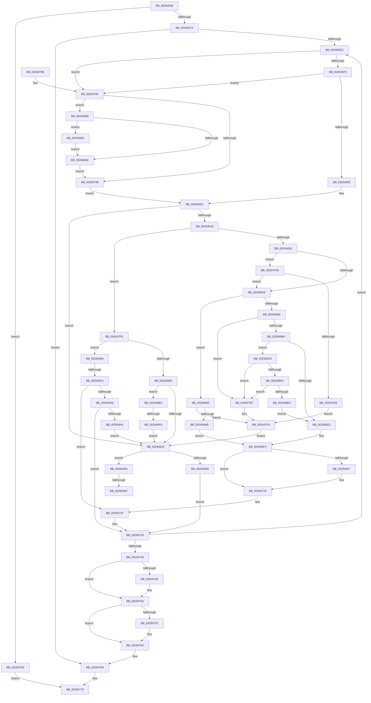

# MiSetReadOnlyOnSectionView

- RVA: `0x00294538`–`0x00294964` (길이 `1,068` bytes)
- VA: `0x0000000140294538`
- 실행 섹션: `.text`
- PDB 이름 있음: `예`; PDB Function 태그: `예`
- unwind 정보 RVA: `0x00067780`
- 디코드: `261`개 명령, `1,068/1,068` bytes 표시
- 미해석 바이트: `0` (있으면 어셈블리에 `.byte`로 보존)

> 이 문서는 커널 이미지의 기계어와 PDB 기호를 분석해 생성했습니다. 4번과 5번은 함수 원형과 자료형을 바이너리 사용 방식에서 추정한 C 해석이며 원본 소스 복구 결과는 아닙니다.

## 1. Dependencies

- 직접 호출 지점: **23**; 고유 호출 대상: **18**
- 직접 호출자로 확인된 함수: **1**
- RIP 상대 이미지 참조: **0**

### Outgoing calls
- `0x00294567` → [MiVadPureReserve](../2C/MiVadPureReserve_function_002C34C0.md) (function, `0x002C34C0`)
- `0x002945DA` → [MiLockWorkingSetShared](../27/MiLockWorkingSetShared_function_0027CBF0.md) (function, `0x0027CBF0`)
- `0x00294699` → [MiGetProtoPteAddress](../32/MiGetProtoPteAddress_function_0032E970.md) (function, `0x0032E970`)
- `0x002946B7` → [MiGetWsleContents](../31/MiGetWsleContents_function_00316540.md) (function, `0x00316540`)
- `0x002946C1` → [MiGetWsleProtection](MiGetWsleProtection_function_00294A80.md) (function, `0x00294A80`)
- `0x002946D8` → [MiSetWsleProtection](MiSetWsleProtection_function_002939D8.md) (function, `0x002939D8`)
- `0x002946F7` → [MiGetProcessorFlushList](../24/MiGetProcessorFlushList_function_00242C90.md) (function, `0x00242C90`)
- `0x00294714` → [MiInitializeTbFlushList](MiInitializeTbFlushList_function_00294F00.md) (function, `0x00294F00`)
- `0x0029472A` → [MiRevertValidPte](../2C/MiRevertValidPte_function_002C5160.md) (function, `0x002C5160`)
- `0x00294748` → [MiFlushTbList](../31/MiFlushTbList_function_00311FC0.md) (function, `0x00311FC0`)
- `0x0029474D` → [MiReleaseProcessorFlushList](../31/MiReleaseProcessorFlushList_function_00313C70.md) (function, `0x00313C70`)
- `0x0029475D` → [MiUnlockPageTable](../21/MiUnlockPageTable_function_00216EC0.md) (function, `0x00216EC0`)
- `0x0029476F` → [MiUnlockWorkingSetShared](../27/MiUnlockWorkingSetShared_function_0027D690.md) (function, `0x0027D690`)
- `0x002947AB` → [MiMakeSystemAddressValid](../27/MiMakeSystemAddressValid_function_0027FF70.md) (function, `0x0027FF70`)
- `0x00294874` → [MiUnlockPageTable](../21/MiUnlockPageTable_function_00216EC0.md) (function, `0x00216EC0`)
- `0x00294885` → [MiFlushTbList](../31/MiFlushTbList_function_00311FC0.md) (function, `0x00311FC0`)
- `0x0029488C` → [MiReleaseProcessorFlushList](../31/MiReleaseProcessorFlushList_function_00313C70.md) (function, `0x00313C70`)
- `0x002948BC` → [MiUpdatePfnProtection](../2C/MiUpdatePfnProtection_function_002C5AD0.md) (function, `0x002C5AD0`)
- `0x002948EC` → [MiIsPrototypePteVadLookup](../32/MiIsPrototypePteVadLookup_function_00328B70.md) (function, `0x00328B70`)
- `0x002948FC` → [MiMakePrototypePteVadLookup](../2C/MiMakePrototypePteVadLookup_function_002C3480.md) (function, `0x002C3480`)
- `0x0029492B` → [MiSetProtectionOnTransitionPte](../2C/MiSetProtectionOnTransitionPte_function_002C586C.md) (function, `0x002C586C`)
- `0x00294952` → [MiFlushTbList](../31/MiFlushTbList_function_00311FC0.md) (function, `0x00311FC0`)
- `0x00294959` → [MiReleaseProcessorFlushList](../31/MiReleaseProcessorFlushList_function_00313C70.md) (function, `0x00313C70`)

### Direct callers
- [MmSecureVirtualMemoryAgainstWrites](../../page/89/MmSecureVirtualMemoryAgainstWrites_function_00890164.md) at `0x008902AD`

### Static image references
- 디코드된 RIP-relative 메모리 참조가 없습니다.

## 2. Other-region calls and transfers

- 다른 실행 섹션으로 향하는 call: **0**
- call이 아닌 외부 분기/꼬리 이동: **4**
  - `0x002948F3` → [sub_006DA600 + 0x17](../6D/Unknown_function_006DA600.md) (`tail-transfer`)
  - `0x0029490E` → [sub_006DA600](../6D/Unknown_function_006DA600.md) (`tail-transfer`)
  - `0x00294949` → [sub_006DA600 + 0x35](../6D/Unknown_function_006DA600.md) (`tail-transfer`)
  - `0x0029495F` → [sub_006DA600 + 0x35](../6D/Unknown_function_006DA600.md) (`tail-transfer`)

## 3. Assembly (complete function range)

```asm
00294538  48 8B C4                        mov rax, rsp
0029453B  48 89 58 08                     mov qword ptr [rax + 8], rbx
0029453F  4C 89 40 18                     mov qword ptr [rax + 0x18], r8
00294543  48 89 50 10                     mov qword ptr [rax + 0x10], rdx
00294547  55                              push rbp
00294548  56                              push rsi
00294549  57                              push rdi
0029454A  41 54                           push r12
0029454C  41 55                           push r13
0029454E  41 56                           push r14
00294550  41 57                           push r15
00294552  48 83 EC 70                     sub rsp, 0x70
00294556  48 83 60 A0 00                  and qword ptr [rax - 0x60], 0
0029455B  49 8B D9                        mov rbx, r9
0029455E  4C 8B C9                        mov r9, rcx
00294561  4C 8B EA                        mov r13, rdx
00294564  48 8B CA                        mov rcx, rdx
00294567  E8 54 EF 02 00                  call 0x1402c34c0
0029456C  85 C0                           test eax, eax
0029456E  0F 85 74 02 00 00               jne 0x1402947e8
00294574  49 8B C8                        mov rcx, r8
00294577  C7 44 24 34 04 00 00 00         mov dword ptr [rsp + 0x34], 4
0029457F  48 C1 E9 09                     shr rcx, 9
00294583  44 8D 78 01                     lea r15d, [rax + 1]
00294587  33 FF                           xor edi, edi
00294589  48 BA 00 00 00 00 80 F6 FF FF   movabs rdx, 0xfffff68000000000
00294593  49 B8 F8 FF FF FF 7F 00 00 00   movabs r8, 0x7ffffffff8
0029459D  89 7C 24 38                     mov dword ptr [rsp + 0x38], edi
002945A1  49 23 C8                        and rcx, r8
002945A4  33 ED                           xor ebp, ebp
002945A6  33 F6                           xor esi, esi
002945A8  48 8B C2                        mov rax, rdx
002945AB  48 03 C1                        add rax, rcx
002945AE  48 C1 EB 09                     shr rbx, 9
002945B2  48 89 44 24 50                  mov qword ptr [rsp + 0x50], rax
002945B7  4C 8B F0                        mov r14, rax
002945BA  49 23 D8                        and rbx, r8
002945BD  48 8B C2                        mov rax, rdx
002945C0  4D 8D A1 00 04 00 00            lea r12, [r9 + 0x400]
002945C7  48 03 D8                        add rbx, rax
002945CA  49 8B CC                        mov rcx, r12
002945CD  48 89 9C 24 C8 00 00 00         mov qword ptr [rsp + 0xc8], rbx
002945D5  4C 89 64 24 40                  mov qword ptr [rsp + 0x40], r12
002945DA  E8 11 86 FE FF                  call 0x14027cbf0
002945DF  88 44 24 30                     mov byte ptr [rsp + 0x30], al
002945E3  4C 3B F3                        cmp r14, rbx
002945E6  0F 87 7E 01 00 00               ja 0x14029476a
002945EC  49 F7 C6 FF 0F 00 00            test r14, 0xfff
002945F3  0F 84 96 01 00 00               je 0x14029478f
002945F9  48 85 F6                        test rsi, rsi
002945FC  0F 84 8D 01 00 00               je 0x14029478f
00294602  48 BA 00 00 00 00 80 F6 FF FF   movabs rdx, 0xfffff68000000000
0029460C  49 8B 3E                        mov rdi, qword ptr [r14]
0029460F  48 85 FF                        test rdi, rdi
00294612  0F 84 FE 01 00 00               je 0x140294816
00294618  B9 01 00 00 00                  mov ecx, 1
0029461D  40 84 F9                        test cl, dil
00294620  0F 84 D8 01 00 00               je 0x1402947fe
00294626  48 C1 EF 0C                     shr rdi, 0xc
0029462A  48 B8 FF FF FF FF FF 00 00 00   movabs rax, 0xffffffffff
00294634  48 23 F8                        and rdi, rax
00294637  4C 8D 2C 7F                     lea r13, [rdi + rdi*2]
0029463B  49 C1 E5 04                     shl r13, 4
0029463F  48 B8 00 00 00 00 00 DE FF FF   movabs rax, 0xffffde0000000000
00294649  4C 03 E8                        add r13, rax
0029464C  41 8B 45 20                     mov eax, dword ptr [r13 + 0x20]
00294650  66 3B C1                        cmp ax, cx
00294653  0F 87 80 01 00 00               ja 0x1402947d9
00294659  49 8B 45 28                     mov rax, qword ptr [r13 + 0x28]
0029465D  48 85 C0                        test rax, rax
00294660  0F 89 2D 02 00 00               jns 0x140294893
00294666  4D 8B E6                        mov r12, r14
00294669  49 C1 E4 19                     shl r12, 0x19
0029466D  48 8B C2                        mov rax, rdx
00294670  48 8B 8C 24 B8 00 00 00         mov rcx, qword ptr [rsp + 0xb8]
00294678  4C 8D 4C 24 48                  lea r9, [rsp + 0x48]
0029467D  49 8B 5D 08                     mov rbx, qword ptr [r13 + 8]
00294681  41 B8 08 00 00 00               mov r8d, 8
00294687  48 C1 E0 19                     shl rax, 0x19
0029468B  4C 2B E0                        sub r12, rax
0029468E  49 C1 FC 10                     sar r12, 0x10
00294692  49 8B D4                        mov rdx, r12
00294695  48 C1 EA 0C                     shr rdx, 0xc
00294699  E8 D2 A2 09 00                  call 0x14032e970
0029469E  48 B9 00 00 00 00 00 00 00 80   movabs rcx, 0x8000000000000000
002946A8  48 0B D9                        or rbx, rcx
002946AB  48 3B D8                        cmp rbx, rax
002946AE  0F 85 3B 01 00 00               jne 0x1402947ef
002946B4  49 8B D4                        mov rdx, r12
002946B7  E8 84 1E 08 00                  call 0x140316540
002946BC  8A D0                           mov dl, al
002946BE  49 8B CC                        mov rcx, r12
002946C1  E8 BA 03 00 00                  call 0x140294a80
002946C6  8B 4C 24 34                     mov ecx, dword ptr [rsp + 0x34]
002946CA  3B C1                           cmp eax, ecx
002946CC  0F 85 F7 01 00 00               jne 0x1402948c9
002946D2  45 8B C7                        mov r8d, r15d
002946D5  49 8B D4                        mov rdx, r12
002946D8  E8 FB F2 FF FF                  call 0x1402939d8
002946DD  48 8B 9C 24 C8 00 00 00         mov rbx, qword ptr [rsp + 0xc8]
002946E5  4C 8B 64 24 40                  mov r12, qword ptr [rsp + 0x40]
002946EA  4C 8B AC 24 B8 00 00 00         mov r13, qword ptr [rsp + 0xb8]
002946F2  48 85 ED                        test rbp, rbp
002946F5  75 22                           jne 0x140294719
002946F7  E8 94 E5 FA FF                  call 0x140242c90
002946FC  45 33 C9                        xor r9d, r9d
002946FF  C7 44 24 20 20 00 00 00         mov dword ptr [rsp + 0x20], 0x20
00294707  49 8B D4                        mov rdx, r12
0029470A  48 8B C8                        mov rcx, rax
0029470D  48 8B E8                        mov rbp, rax
00294710  44 8B 40 0C                     mov r8d, dword ptr [rax + 0xc]
00294714  E8 E7 07 00 00                  call 0x140294f00
00294719  4C 8B CF                        mov r9, rdi
0029471C  48 89 6C 24 20                  mov qword ptr [rsp + 0x20], rbp
00294721  45 8B C7                        mov r8d, r15d
00294724  49 8B D6                        mov rdx, r14
00294727  49 8B CD                        mov rcx, r13
0029472A  E8 31 0A 03 00                  call 0x1402c5160
0029472F  49 83 C6 08                     add r14, 8
00294733  8A 44 24 30                     mov al, byte ptr [rsp + 0x30]
00294737  4C 3B F3                        cmp r14, rbx
0029473A  0F 86 AC FE FF FF               jbe 0x1402945ec
00294740  48 85 ED                        test rbp, rbp
00294743  74 0D                           je 0x140294752
00294745  48 8B CD                        mov rcx, rbp
00294748  E8 73 D8 07 00                  call 0x140311fc0
0029474D  E8 1E F5 07 00                  call 0x140313c70
00294752  48 85 F6                        test rsi, rsi
00294755  74 0B                           je 0x140294762
00294757  48 8B D6                        mov rdx, rsi
0029475A  49 8B CC                        mov rcx, r12
0029475D  E8 5E 27 F8 FF                  call 0x140216ec0
00294762  8A 44 24 30                     mov al, byte ptr [rsp + 0x30]
00294766  8B 7C 24 38                     mov edi, dword ptr [rsp + 0x38]
0029476A  8A D0                           mov dl, al
0029476C  49 8B CC                        mov rcx, r12
0029476F  E8 1C 8F FE FF                  call 0x14027d690
00294774  8B C7                           mov eax, edi
00294776  48 8B 9C 24 B0 00 00 00         mov rbx, qword ptr [rsp + 0xb0]
0029477E  48 83 C4 70                     add rsp, 0x70
00294782  41 5F                           pop r15
00294784  41 5E                           pop r14
00294786  41 5D                           pop r13
00294788  41 5C                           pop r12
0029478A  5F                              pop rdi
0029478B  5E                              pop rsi
0029478C  5D                              pop rbp
0029478D  C3                              ret
0029478E  CC                              int3
0029478F  48 85 F6                        test rsi, rsi
00294792  0F 85 D1 00 00 00               jne 0x140294869
00294798  41 8B 55 30                     mov edx, dword ptr [r13 + 0x30]
0029479C  45 33 C9                        xor r9d, r9d
0029479F  C1 EA 0C                        shr edx, 0xc
002947A2  44 8A C0                        mov r8b, al
002947A5  83 E2 7F                        and edx, 0x7f
002947A8  49 8B CE                        mov rcx, r14
002947AB  E8 C0 B7 FE FF                  call 0x14027ff70
002947B0  49 8B F6                        mov rsi, r14
002947B3  48 BA 00 00 00 00 80 F6 FF FF   movabs rdx, 0xfffff68000000000
002947BD  48 C1 EE 09                     shr rsi, 9
002947C1  48 B8 F8 FF FF FF 7F 00 00 00   movabs rax, 0x7ffffffff8
002947CB  48 23 F0                        and rsi, rax
002947CE  48 8B C2                        mov rax, rdx
002947D1  48 03 F0                        add rsi, rax
002947D4  E9 33 FE FF FF                  jmp 0x14029460c
002947D9  41 8B C7                        mov eax, r15d
002947DC  24 07                           and al, 7
002947DE  3C 04                           cmp al, 4
002947E0  0F 84 73 FE FF FF               je 0x140294659
002947E6  EB 0C                           jmp 0x1402947f4
002947E8  B8 45 00 00 C0                  mov eax, 0xc0000045
002947ED  EB 87                           jmp 0x140294776
002947EF  4C 8B 64 24 40                  mov r12, qword ptr [rsp + 0x40]
002947F4  4C 8B AC 24 B8 00 00 00         mov r13, qword ptr [rsp + 0xb8]
002947FC  EB 18                           jmp 0x140294816
002947FE  48 0F BA E7 0A                  bt rdi, 0xa
00294803  0F 83 00 01 00 00               jae 0x140294909
00294809  41 8B C7                        mov eax, r15d
0029480C  24 07                           and al, 7
0029480E  3C 04                           cmp al, 4
00294810  0F 84 D3 00 00 00               je 0x1402948e9
00294816  48 8B 84 24 C0 00 00 00         mov rax, qword ptr [rsp + 0xc0]
0029481E  48 C1 E8 12                     shr rax, 0x12
00294822  25 F8 FF FF 3F                  and eax, 0x3ffffff8
00294827  48 B9 00 00 00 40 FB F6 FF FF   movabs rcx, 0xfffff6fb40000000
00294831  48 03 C1                        add rax, rcx
00294834  48 3B F0                        cmp rsi, rax
00294837  0F 85 09 01 00 00               jne 0x140294946
0029483D  49 8D 5E F8                     lea rbx, [r14 - 8]
00294841  C7 44 24 34 01 00 00 00         mov dword ptr [rsp + 0x34], 1
00294849  4C 8B 74 24 50                  mov r14, qword ptr [rsp + 0x50]
0029484E  41 BF 04 00 00 00               mov r15d, 4
00294854  48 89 9C 24 C8 00 00 00         mov qword ptr [rsp + 0xc8], rbx
0029485C  C7 44 24 38 45 00 00 C0         mov dword ptr [rsp + 0x38], 0xc0000045
00294864  E9 CA FE FF FF                  jmp 0x140294733
00294869  48 85 ED                        test rbp, rbp
0029486C  75 14                           jne 0x140294882
0029486E  48 8B D6                        mov rdx, rsi
00294871  49 8B CC                        mov rcx, r12
00294874  E8 47 26 F8 FF                  call 0x140216ec0
00294879  8A 44 24 30                     mov al, byte ptr [rsp + 0x30]
0029487D  E9 16 FF FF FF                  jmp 0x140294798
00294882  48 8B CD                        mov rcx, rbp
00294885  E8 36 D7 07 00                  call 0x140311fc0
0029488A  33 ED                           xor ebp, ebp
0029488C  E8 DF F3 07 00                  call 0x140313c70
00294891  EB DB                           jmp 0x14029486e
00294893  41 8B 4D 10                     mov ecx, dword ptr [r13 + 0x10]
00294897  8B 44 24 34                     mov eax, dword ptr [rsp + 0x34]
0029489B  48 C1 E9 05                     shr rcx, 5
0029489F  83 E1 1F                        and ecx, 0x1f
002948A2  48 3B C8                        cmp rcx, rax
002948A5  0F 85 49 FF FF FF               jne 0x1402947f4
002948AB  49 8B D5                        mov rdx, r13
002948AE  45 8B C7                        mov r8d, r15d
002948B1  4C 8B AC 24 B8 00 00 00         mov r13, qword ptr [rsp + 0xb8]
002948B9  49 8B CD                        mov rcx, r13
002948BC  E8 0F 12 03 00                  call 0x1402c5ad0
002948C1  44 8B F8                        mov r15d, eax
002948C4  E9 29 FE FF FF                  jmp 0x1402946f2
002948C9  85 C0                           test eax, eax
002948CB  0F 85 1E FF FF FF               jne 0x1402947ef
002948D1  41 8B 45 10                     mov eax, dword ptr [r13 + 0x10]
002948D5  48 C1 E8 05                     shr rax, 5
002948D9  83 E0 1F                        and eax, 0x1f
002948DC  3B C1                           cmp eax, ecx
002948DE  0F 85 0B FF FF FF               jne 0x1402947ef
002948E4  E9 E9 FD FF FF                  jmp 0x1402946d2
002948E9  48 8B CF                        mov rcx, rdi
002948EC  E8 7F 42 09 00                  call 0x140328b70
002948F1  85 C0                           test eax, eax
002948F3  0F 85 1E 5D 44 00               jne 0x1406da617
002948F9  41 8B CF                        mov ecx, r15d
002948FC  E8 7F EB 02 00                  call 0x1402c3480
00294901  49 89 06                        mov qword ptr [r14], rax
00294904  E9 0D FF FF FF                  jmp 0x140294816
00294909  48 0F BA E7 0B                  bt rdi, 0xb
0029490E  0F 83 EC 5C 44 00               jae 0x1406da600
00294914  45 33 C9                        xor r9d, r9d
00294917  41 8B C7                        mov eax, r15d
0029491A  24 07                           and al, 7
0029491C  45 8B C7                        mov r8d, r15d
0029491F  3C 04                           cmp al, 4
00294921  49 8B D6                        mov rdx, r14
00294924  49 8B CD                        mov rcx, r13
00294927  41 0F 94 C1                     sete r9b
0029492B  E8 3C 0F 03 00                  call 0x1402c586c
00294930  85 C0                           test eax, eax
00294932  0F 84 F7 FD FF FF               je 0x14029472f
00294938  83 F8 02                        cmp eax, 2
0029493B  0F 84 F2 FD FF FF               je 0x140294733
00294941  E9 D0 FE FF FF                  jmp 0x140294816
00294946  48 85 ED                        test rbp, rbp
00294949  0F 84 E6 5C 44 00               je 0x1406da635
0029494F  48 8B CD                        mov rcx, rbp
00294952  E8 69 D6 07 00                  call 0x140311fc0
00294957  33 ED                           xor ebp, ebp
00294959  E8 12 F3 07 00                  call 0x140313c70
0029495E  90                              nop
0029495F  E9 D1 5C 44 00                  jmp 0x1406da635
```

## 4. C-style interpretation (structured pseudocode)

```c
__int64 __fastcall MiSetReadOnlyOnSectionView(__int64 a1, __int64 a2, __int64 a3, __int64 a4)
{
    __int64 result;
    __int64 v_r12;
    __int64 v_r13;
    __int64 v_r14;
    __int64 v_rbp;
    __int64 v_rbx;
    __int64 v_rdi;
    __int64 v_rsi;
    __int64 v_rsp;
    unsigned __int64 v_stack_m58;
    unsigned __int64 v_stack_m60;
    unsigned __int64 v_stack_m68;
    unsigned int v_stack_m70;
    unsigned int v_stack_m74;
    unsigned __int8 v_stack_m78;
    unsigned int v_stack_m88;
    unsigned __int64 v_stack_p10;
    unsigned __int64 v_stack_p20;
    unsigned __int8 v_stack_p30;
    unsigned int v_stack_p34;
    unsigned int v_stack_p38;
    unsigned __int64 v_stack_p40;
    unsigned __int64 v_stack_p50;
    unsigned __int64 v_stack_p8;
    unsigned __int64 v_stack_pB8;
    unsigned __int64 v_stack_pC0;
    unsigned __int64 v_stack_pC8;

    *(unsigned __int64 *)(v_rsp + 8) = v_rbx;
    *(unsigned __int64 *)(v_rsp + 24) = a3;
    *(unsigned __int64 *)(v_rsp + 16) = a2;
    v_rsp = (v_rsp) - (112);
    result = MiVadPureReserve(a2, a2, a3, a1);
    if ((unsigned int)(result) != 0) goto loc_002947E8;
    v_stack_m74 = 4;
    a1 = (a3) >> (9);
    v_rdi = 0;
    v_stack_m70 = 0;
    a1 = (a1) & (a3);
    v_rbp = 0;
    v_rsi = 0;
    result = (a2) + (a1);
    v_rbx = (a4) >> (9);
    v_stack_m58 = result;
    v_rbx = (v_rbx) & (a3);
    v_rbx = (v_rbx) + (a2);
    v_stack_p20 = v_rbx;
    v_stack_m68 = a1 + 1024;
    result = MiLockWorkingSetShared(a1 + 1024, a2, a3, a1);
    v_stack_m78 = (unsigned __int8)(result);
    if (result > v_rbx) goto loc_0029476A;
loc_002945EC:
    if (((result) & (0xFFFULL)) == 0) goto loc_0029478F;
    if (0 == 0) goto loc_0029478F;
loc_0029460C:
    if (*(unsigned __int64 *)(result) == 0) goto loc_00294816;
    if (((1) & ((unsigned __int8)(*(unsigned __int64 *)(result)))) == 0) goto loc_002947FE;
    v_rdi = (*(unsigned __int64 *)(result)) >> (12);
    v_rdi = (v_rdi) & (result);
    v_r13 = (v_rdi + v_rdi * 2) << (4);
    v_r13 = (v_r13) + (result);
    if (((unsigned __int16)((unsigned int)(*(unsigned int *)(v_r13 + 32)))) > 1) goto loc_002947D9;
loc_00294659:
    if (!sign_flag) goto loc_00294893;
    v_r12 = (result) << (25);
    result = (a2) << (25);
    v_r12 = (v_r12) - (result);
    v_r12 = (v_r12) >> (16);
    a2 = (v_r12) >> (12);
    result = MiGetProtoPteAddress(v_stack_p10, a2, 8, v_stack_m60);
    v_rbx = (*(unsigned __int64 *)(v_r13 + 8)) | (v_stack_p10);
    if (v_rbx != result) goto loc_002947EF;
    result = MiGetWsleContents(v_stack_p10, v_r12, 8, v_stack_m60);
    result = MiGetWsleProtection(v_r12, (unsigned __int8)(result), 8, v_stack_m60);
    if (((unsigned int)(result)) != ((unsigned int)((unsigned int)(v_stack_m74)))) goto loc_002948C9;
loc_002946D2:
    result = MiSetWsleProtection((unsigned int)(v_stack_m74), v_r12, (unsigned int)((unsigned int)(result + 1)), v_stack_m60);
loc_002946F2:
    if (0 == 0) {
        result = MiGetProcessorFlushList((unsigned int)(v_stack_m74), v_r12, (unsigned int)((unsigned int)(result + 1)), v_stack_m60);
        a4 = 0;
        v_stack_m88 = 32;
        a2 = v_stack_m68;
        a1 = result;
        v_rbp = result;
        a3 = *(unsigned int *)(result + 12);
        result = MiInitializeTbFlushList(a1, a2, a3, a4);
    }
    v_stack_m88 = v_rbp;
    result = MiRevertValidPte(v_stack_p10, result, (unsigned int)((unsigned int)(result + 1)), v_rdi);
loc_0029472F:
    v_r14 = (result) + (8);
loc_00294733:
    if (v_r14 <= v_stack_p20) goto loc_002945EC;
    result = v_stack_m78;
    if (v_rbp != 0) {
        a1 = v_rbp;
        result = MiFlushTbList(a1, result, (unsigned int)((unsigned int)(result + 1)), v_rdi);
        result = MiReleaseProcessorFlushList(a1, result, (unsigned int)((unsigned int)(result + 1)), v_rdi);
    }
    if (0 != 0) {
        a2 = 0;
        a1 = v_stack_m68;
        result = MiUnlockPageTable(a1, a2, (unsigned int)((unsigned int)(result + 1)), v_rdi);
    }
loc_0029476A:
    result = MiUnlockWorkingSetShared(v_stack_m68, (unsigned __int8)(v_stack_m78), (unsigned int)((unsigned int)(result + 1)), v_rdi);
loc_00294776:
    v_rsp = (v_rsp) + (112);
    return (unsigned int)((unsigned int)((unsigned int)(v_stack_m70)));
loc_0029478F:
    if (0 != 0) goto loc_00294869;
loc_00294798:
    a4 = 0;
    a2 = (unsigned int)(((unsigned int)(*(unsigned int *)(v_stack_p10 + 48))) >> (12));
    a2 = (unsigned int)((a2) & (127));
    result = MiMakeSystemAddressValid(v_r14, a2, (unsigned __int8)((unsigned int)((unsigned int)((unsigned int)(v_stack_m70)))), a4);
    v_rsi = (v_r14) >> (9);
    v_rsi = (v_rsi) & (result);
    v_rsi = (v_rsi) + (a2);
    goto loc_0029460C;
loc_002947D9:
    result = (unsigned __int8)(((unsigned int)((unsigned int)(result + 1))) & (7));
    if (((unsigned __int8)(result)) == 4) goto loc_00294659;
    goto loc_002947F4;
loc_002947E8:
    goto loc_00294776;
loc_002947EF:
loc_002947F4:
    goto loc_00294816;
loc_002947FE:
    if (((unsigned __int8)(result)) >= 4) goto loc_00294909;
    result = (unsigned __int8)(((unsigned int)((unsigned int)(result + 1))) & (7));
    if (((unsigned __int8)(result)) == 4) goto loc_002948E9;
loc_00294816:
    result = (v_stack_pC0) >> (18);
    result = (unsigned int)((result) & (0x3FFFFFF8ULL));
    result = (result) + (v_r14);
    if (v_rsi != result) goto loc_00294946;
    v_stack_p34 = 1;
    v_stack_pC8 = v_r14 - 8;
    v_stack_p38 = 0xC0000045ULL;
    goto loc_00294733;
loc_00294869:
    if (v_rbp != 0) goto loc_00294882;
loc_0029486E:
    result = MiUnlockPageTable(v_stack_p40, v_rsi, (unsigned __int8)((unsigned int)((unsigned int)((unsigned int)(v_stack_m70)))), a4);
    goto loc_00294798;
loc_00294882:
    result = MiFlushTbList(v_rbp, v_rsi, (unsigned __int8)((unsigned int)((unsigned int)((unsigned int)(v_stack_m70)))), a4);
    v_rbp = 0;
    result = MiReleaseProcessorFlushList(v_rbp, v_rsi, (unsigned __int8)((unsigned int)((unsigned int)((unsigned int)(v_stack_m70)))), a4);
    goto loc_0029486E;
loc_00294893:
    a1 = ((unsigned int)(*(unsigned int *)(v_stack_pB8 + 16))) >> (5);
    a1 = (unsigned int)((a1) & (31));
    if (a1 != ((unsigned int)(v_stack_p34))) goto loc_002947F4;
    result = MiUpdatePfnProtection(v_stack_pB8, v_stack_pB8, 4, a4);
    goto loc_002946F2;
loc_002948C9:
    if ((unsigned int)(result) != 0) goto loc_002947EF;
    result = ((unsigned int)(*(unsigned int *)(v_stack_pB8 + 16))) >> (5);
    result = (unsigned int)((result) & (31));
    if (((unsigned int)(result)) != ((unsigned int)(v_stack_pB8))) goto loc_002947EF;
    goto loc_002946D2;
loc_002948E9:
    result = MiIsPrototypePteVadLookup((unsigned int)(v_stack_m70), v_stack_pB8, 4, a4);
    result = MiMakePrototypePteVadLookup((unsigned int)((unsigned int)((unsigned int)((unsigned int)(result)))), v_stack_pB8, 4, a4);
    *(unsigned __int64 *)(v_stack_p50) = result;
    goto loc_00294816;
loc_00294909:
    a4 = 0;
    result = (unsigned __int8)(((unsigned int)((unsigned int)((unsigned int)((unsigned int)(result))))) & (7));
    a4 = (((unsigned __int8)(result)) == 4) ? 1 : 0;
    result = MiSetProtectionOnTransitionPte(v_stack_pB8, v_stack_p50, (unsigned int)((unsigned int)((unsigned int)((unsigned int)(result)))), a4);
    if ((unsigned int)(result) == 0) goto loc_0029472F;
    if (((unsigned int)(result)) == 2) goto loc_00294733;
    goto loc_00294816;
loc_00294946:
    result = MiFlushTbList(0, v_stack_p50, (unsigned int)((unsigned int)((unsigned int)((unsigned int)(result)))), a4);
    v_rbp = 0;
    result = MiReleaseProcessorFlushList(0, v_stack_p50, (unsigned int)((unsigned int)((unsigned int)((unsigned int)(result)))), a4);
}
```

## 5. (Beta) C Style

```c
int64_t MiSetReadOnlyOnSectionView(int64_t Arg1, int64_t Arg2, int64_t Arg3, int64_t Arg4)
{
    int64_t result;
    int64_t local_r12;
    int64_t local_r13;
    int64_t local_r14;
    int64_t local_rbp;
    int64_t local_rbx;
    int64_t local_rdi;
    int64_t local_rsi;
    int64_t local_rsp;
    uint64_t v_stack_m58;
    uint64_t v_stack_m60;
    uint64_t v_stack_m68;
    uint32_t v_stack_m70;
    uint32_t v_stack_m74;
    uint8_t v_stack_m78;
    uint32_t v_stack_m88;
    uint64_t v_stack_p10;
    uint64_t v_stack_p20;
    uint8_t v_stack_p30;
    uint32_t v_stack_p34;
    uint32_t v_stack_p38;
    uint64_t v_stack_p40;
    uint64_t v_stack_p50;
    uint64_t v_stack_p8;
    uint64_t v_stack_pB8;
    uint64_t v_stack_pC0;
    uint64_t v_stack_pC8;

    *(uint64_t *)(local_rsp + 0x8) = local_rbx;
    *(uint64_t *)(local_rsp + 0x18) = Arg3;
    *(uint64_t *)(local_rsp + 0x10) = Arg2;
    local_rsp = (local_rsp) - (112);
    result = MiVadPureReserve(Arg2, Arg2, Arg3, Arg1);
    if ((uint32_t)(result) != 0) goto loc_002947E8;
    v_stack_m74 = 4;
    Arg1 = (Arg3) >> (9);
    local_rdi = 0;
    v_stack_m70 = 0;
    Arg1 = (Arg1) & (Arg3);
    local_rbp = 0;
    local_rsi = 0;
    result = (Arg2) + (Arg1);
    local_rbx = (Arg4) >> (9);
    v_stack_m58 = result;
    local_rbx = (local_rbx) & (Arg3);
    local_rbx = (local_rbx) + (Arg2);
    v_stack_p20 = local_rbx;
    v_stack_m68 = Arg1 + 1024;
    result = MiLockWorkingSetShared(Arg1 + 1024, Arg2, Arg3, Arg1);
    v_stack_m78 = (uint8_t)(result);
    if (result > local_rbx) goto loc_0029476A;
loc_002945EC:
    if (((result) & (0xFFFULL)) == 0) goto loc_0029478F;
    if (0 == 0) goto loc_0029478F;
loc_0029460C:
    if (*(uint64_t *)(result) == 0) goto loc_00294816;
    if (((1) & ((uint8_t)(*(uint64_t *)(result)))) == 0) goto loc_002947FE;
    local_rdi = (*(uint64_t *)(result)) >> (12);
    local_rdi = (local_rdi) & (result);
    local_r13 = (local_rdi + local_rdi * 2) << (4);
    local_r13 = (local_r13) + (result);
    if (((uint16_t)((uint32_t)(*(uint32_t *)(local_r13 + 0x20)))) > 1) goto loc_002947D9;
loc_00294659:
    if (!sign_flag) goto loc_00294893;
    local_r12 = (result) << (25);
    result = (Arg2) << (25);
    local_r12 = (local_r12) - (result);
    local_r12 = (local_r12) >> (16);
    Arg2 = (local_r12) >> (12);
    result = MiGetProtoPteAddress(v_stack_p10, Arg2, 8, v_stack_m60);
    local_rbx = (*(uint64_t *)(local_r13 + 0x8)) | (v_stack_p10);
    if (local_rbx != result) goto loc_002947EF;
    result = MiGetWsleContents(v_stack_p10, local_r12, 8, v_stack_m60);
    result = MiGetWsleProtection(local_r12, (uint8_t)(result), 8, v_stack_m60);
    if (((uint32_t)(result)) != ((uint32_t)((uint32_t)(v_stack_m74)))) goto loc_002948C9;
loc_002946D2:
    result = MiSetWsleProtection((uint32_t)(v_stack_m74), local_r12, (uint32_t)((uint32_t)(result + 1)), v_stack_m60);
loc_002946F2:
    if (0 == 0) {
        result = MiGetProcessorFlushList((uint32_t)(v_stack_m74), local_r12, (uint32_t)((uint32_t)(result + 1)), v_stack_m60);
        Arg4 = 0;
        v_stack_m88 = 32;
        Arg2 = v_stack_m68;
        Arg1 = result;
        local_rbp = result;
        Arg3 = *(uint32_t *)(result + 0xC);
        result = MiInitializeTbFlushList(Arg1, Arg2, Arg3, Arg4);
    }
    v_stack_m88 = local_rbp;
    result = MiRevertValidPte(v_stack_p10, result, (uint32_t)((uint32_t)(result + 1)), local_rdi);
loc_0029472F:
    local_r14 = (result) + (8);
loc_00294733:
    if (local_r14 <= v_stack_p20) goto loc_002945EC;
    result = v_stack_m78;
    if (local_rbp != 0) {
        Arg1 = local_rbp;
        result = MiFlushTbList(Arg1, result, (uint32_t)((uint32_t)(result + 1)), local_rdi);
        result = MiReleaseProcessorFlushList(Arg1, result, (uint32_t)((uint32_t)(result + 1)), local_rdi);
    }
    if (0 != 0) {
        Arg2 = 0;
        Arg1 = v_stack_m68;
        result = MiUnlockPageTable(Arg1, Arg2, (uint32_t)((uint32_t)(result + 1)), local_rdi);
    }
loc_0029476A:
    result = MiUnlockWorkingSetShared(v_stack_m68, (uint8_t)(v_stack_m78), (uint32_t)((uint32_t)(result + 1)), local_rdi);
loc_00294776:
    local_rsp = (local_rsp) + (112);
    return (uint32_t)((uint32_t)((uint32_t)(v_stack_m70)));
loc_0029478F:
    if (0 != 0) goto loc_00294869;
loc_00294798:
    Arg4 = 0;
    Arg2 = (uint32_t)(((uint32_t)(*(uint32_t *)(v_stack_p10 + 0x30))) >> (12));
    Arg2 = (uint32_t)((Arg2) & (127));
    result = MiMakeSystemAddressValid(local_r14, Arg2, (uint8_t)((uint32_t)((uint32_t)((uint32_t)(v_stack_m70)))), Arg4);
    local_rsi = (local_r14) >> (9);
    local_rsi = (local_rsi) & (result);
    local_rsi = (local_rsi) + (Arg2);
    goto loc_0029460C;
loc_002947D9:
    result = (uint8_t)(((uint32_t)((uint32_t)(result + 1))) & (7));
    if (((uint8_t)(result)) == 4) goto loc_00294659;
    goto loc_002947F4;
loc_002947E8:
    goto loc_00294776;
loc_002947EF:
loc_002947F4:
    goto loc_00294816;
loc_002947FE:
    if (((uint8_t)(result)) >= 4) goto loc_00294909;
    result = (uint8_t)(((uint32_t)((uint32_t)(result + 1))) & (7));
    if (((uint8_t)(result)) == 4) goto loc_002948E9;
loc_00294816:
    result = (v_stack_pC0) >> (18);
    result = (uint32_t)((result) & (0x3FFFFFF8ULL));
    result = (result) + (local_r14);
    if (local_rsi != result) goto loc_00294946;
    v_stack_p34 = 1;
    v_stack_pC8 = local_r14 - 8;
    v_stack_p38 = 0xC0000045ULL;
    goto loc_00294733;
loc_00294869:
    if (local_rbp != 0) goto loc_00294882;
loc_0029486E:
    result = MiUnlockPageTable(v_stack_p40, local_rsi, (uint8_t)((uint32_t)((uint32_t)((uint32_t)(v_stack_m70)))), Arg4);
    goto loc_00294798;
loc_00294882:
    result = MiFlushTbList(local_rbp, local_rsi, (uint8_t)((uint32_t)((uint32_t)((uint32_t)(v_stack_m70)))), Arg4);
    local_rbp = 0;
    result = MiReleaseProcessorFlushList(local_rbp, local_rsi, (uint8_t)((uint32_t)((uint32_t)((uint32_t)(v_stack_m70)))), Arg4);
    goto loc_0029486E;
loc_00294893:
    Arg1 = ((uint32_t)(*(uint32_t *)(v_stack_pB8 + 0x10))) >> (5);
    Arg1 = (uint32_t)((Arg1) & (31));
    if (Arg1 != ((uint32_t)(v_stack_p34))) goto loc_002947F4;
    result = MiUpdatePfnProtection(v_stack_pB8, v_stack_pB8, 4, Arg4);
    goto loc_002946F2;
loc_002948C9:
    if ((uint32_t)(result) != 0) goto loc_002947EF;
    result = ((uint32_t)(*(uint32_t *)(v_stack_pB8 + 0x10))) >> (5);
    result = (uint32_t)((result) & (31));
    if (((uint32_t)(result)) != ((uint32_t)(v_stack_pB8))) goto loc_002947EF;
    goto loc_002946D2;
loc_002948E9:
    result = MiIsPrototypePteVadLookup((uint32_t)(v_stack_m70), v_stack_pB8, 4, Arg4);
    result = MiMakePrototypePteVadLookup((uint32_t)((uint32_t)((uint32_t)((uint32_t)(result)))), v_stack_pB8, 4, Arg4);
    *(uint64_t *)(v_stack_p50) = result;
    goto loc_00294816;
loc_00294909:
    Arg4 = 0;
    result = (uint8_t)(((uint32_t)((uint32_t)((uint32_t)((uint32_t)(result))))) & (7));
    Arg4 = (((uint8_t)(result)) == 4) ? 1 : 0;
    result = MiSetProtectionOnTransitionPte(v_stack_pB8, v_stack_p50, (uint32_t)((uint32_t)((uint32_t)((uint32_t)(result)))), Arg4);
    if ((uint32_t)(result) == 0) goto loc_0029472F;
    if (((uint32_t)(result)) == 2) goto loc_00294733;
    goto loc_00294816;
loc_00294946:
    result = MiFlushTbList(0, v_stack_p50, (uint32_t)((uint32_t)((uint32_t)((uint32_t)(result)))), Arg4);
    local_rbp = 0;
    result = MiReleaseProcessorFlushList(0, v_stack_p50, (uint32_t)((uint32_t)((uint32_t)((uint32_t)(result)))), Arg4);
}
```

## 6. Execution-region graph

[열기: 2D/3D 그래프와 함수 탐색 컨트롤 패널](../../../control-panel.html?section=text&rva=0x00294538&view=graph)

- 2D 그래프는 위에서 아래로 흐르고, 3D 그래프는 빈 공간을 드래그해 회전합니다. Shift+드래그는 이동, 휠은 확대·축소, 함수 노드 선택은 대상 보고서 이동입니다.

### Static fallback


