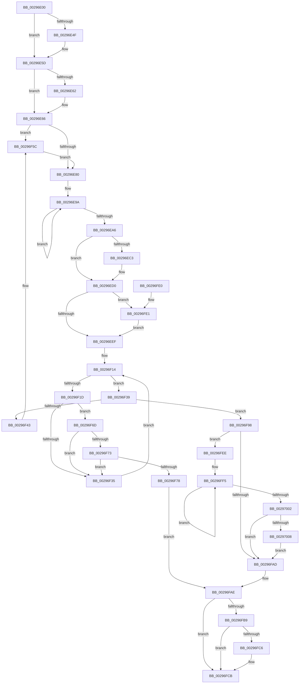

# MiSetVadDeleted

- RVA: `0x00296E00`–`0x0029700F` (길이 `527` bytes)
- VA: `0x0000000140296E00`
- 실행 섹션: `.text`
- PDB 이름 있음: `예`; PDB Function 태그: `아니요`
- unwind 정보 RVA: `0x00067950`
- 디코드: `136`개 명령, `527/527` bytes 표시
- 미해석 바이트: `0` (있으면 어셈블리에 `.byte`로 보존)

> 이 문서는 커널 이미지의 기계어와 PDB 기호를 분석해 생성했습니다. 4번과 5번은 함수 원형과 자료형을 바이너리 사용 방식에서 추정한 C 해석이며 원본 소스 복구 결과는 아닙니다.

## 1. Dependencies

- 직접 호출 지점: **12**; 고유 호출 대상: **12**
- 직접 호출자로 확인된 함수: **5**
- RIP 상대 이미지 참조: **1**

### Outgoing calls
- `0x00296E3E` → [KeAbPreAcquire](../21/KeAbPreAcquire_function_00210230.md) (function, `0x00210230`)
- `0x00296E58` → [ExfAcquirePushLockExclusiveEx](../20/ExfAcquirePushLockExclusiveEx_function_0020FC90.md) (function, `0x0020FC90`)
- `0x00296E85` → [MiLockVadTree](../27/MiLockVadTree_function_0027C0F0.md) (function, `0x0027C0F0`)
- `0x00296E92` → [MiLockVadCore](MiLockVadCore_function_00297170.md) (function, `0x00297170`)
- `0x00296EB5` → [MiUnlockVadTree](MiUnlockVadTree_function_00297020.md) (function, `0x00297020`)
- `0x00296ECB` → [KiLowerIrqlProcessIrqlFlags](../4F/KiLowerIrqlProcessIrqlFlags_function_004F5698.md) (function, `0x004F5698`)
- `0x00296F56` → [KeBugCheckEx](../4F/KeBugCheckEx_function_004FD660.md) (function, `0x004FD660`)
- `0x00296F63` → [KiRaiseIrqlProcessIrqlFlags](../4F/KiRaiseIrqlProcessIrqlFlags_function_004F56FC.md) (function, `0x004F56FC`)
- `0x00296F91` → [KiAbEntryFreeAndEnableInterrupts](../26/KiAbEntryFreeAndEnableInterrupts_function_002622D0.md) (function, `0x002622D0`)
- `0x00296FC6` → [KiCheckForKernelApcDelivery](../2E/KiCheckForKernelApcDelivery_function_002E2C80.md) (function, `0x002E2C80`)
- `0x00296FE4` → [ExfTryToWakePushLock](../26/ExfTryToWakePushLock_function_00265DD0.md) (function, `0x00265DD0`)
- `0x00297008` → [KiRemoveSystemWorkPriorityKick](../26/KiRemoveSystemWorkPriorityKick_function_002631D0.md) (function, `0x002631D0`)

### Direct callers
- [MiCoalescePlaceholderAllocations](../../page/88/MiCoalescePlaceholderAllocations_function_0088095C.md) at `0x00880A39`
- [MiCoalescePlaceholderAllocations](../../page/88/MiCoalescePlaceholderAllocations_function_0088095C.md) at `0x00880A74`
- [MiReserveUserMemory](../../page/88/MiReserveUserMemory_function_00884498.md) at `0x00884B7C`
- [sub_00885634](../../page/88/Unknown_function_00885634.md) at `0x00885792`
- [MiDeleteVad](../../page/88/MiDeleteVad_function_00888C80.md) at `0x00888D78`
- [MiFinishPlaceholderVadReplacement](../../page/A8/MiFinishPlaceholderVadReplacement_function_00A87630.md) at `0x00A87661`

### Static image references
- `0x00296E73` → RVA `0x00FC6D20` (`ALMOSTRO`; read)

## 2. Other-region calls and transfers

- 다른 실행 섹션으로 향하는 call: **0**
- 별도 외부 분기/꼬리 이동을 확인하지 못했습니다.

## 3. Assembly (complete function range)

```asm
00296E00  48 89 5C 24 08                  mov qword ptr [rsp + 8], rbx
00296E05  48 89 6C 24 10                  mov qword ptr [rsp + 0x10], rbp
00296E0A  48 89 74 24 18                  mov qword ptr [rsp + 0x18], rsi
00296E0F  57                              push rdi
00296E10  48 83 EC 30                     sub rsp, 0x30
00296E14  65 48 8B 3C 25 88 01 00 00      mov rdi, qword ptr gs:[0x188]
00296E1D  48 8B D9                        mov rbx, rcx
00296E20  45 33 C0                        xor r8d, r8d
00296E23  33 D2                           xor edx, edx
00296E25  48 8B AF B8 00 00 00            mov rbp, qword ptr [rdi + 0xb8]
00296E2C  66 FF 8F E6 01 00 00            dec word ptr [rdi + 0x1e6]
00296E33  48 81 C5 60 02 00 00            add rbp, 0x260
00296E3A  48 8B CD                        mov rcx, rbp
00296E3D  90                              nop
00296E3E  E8 ED 93 F7 FF                  call 0x140210230
00296E43  F0 48 0F BA 6D 00 00            lock bts qword ptr [rbp], 0
00296E4A  48 8B F0                        mov rsi, rax
00296E4D  73 0E                           jae 0x140296e5d
00296E4F  4C 8B C5                        mov r8, rbp
00296E52  48 8B D0                        mov rdx, rax
00296E55  48 8B CD                        mov rcx, rbp
00296E58  E8 33 8E F7 FF                  call 0x14020fc90
00296E5D  48 85 F6                        test rsi, rsi
00296E60  74 04                           je 0x140296e66
00296E62  C6 46 0A 01                     mov byte ptr [rsi + 0xa], 1
00296E66  44 0F 20 C6                     mov rsi, cr8
00296E6A  B8 02 00 00 00                  mov eax, 2
00296E6F  44 0F 22 C0                     mov cr8, rax
00296E73  83 3D A6 FE D2 00 00            cmp dword ptr [rip + 0xd2fea6], 0
00296E7A  0F 85 DC 00 00 00               jne 0x140296f5c
00296E80  B9 03 00 00 00                  mov ecx, 3
00296E85  E8 66 52 FE FF                  call 0x14027c0f0
00296E8A  BA 01 00 00 00                  mov edx, 1
00296E8F  48 8B CB                        mov rcx, rbx
00296E92  E8 D9 02 00 00                  call 0x140297170
00296E97  8B 43 30                        mov eax, dword ptr [rbx + 0x30]
00296E9A  8B C8                           mov ecx, eax
00296E9C  83 C9 04                        or ecx, 4
00296E9F  F0 0F B1 4B 30                  lock cmpxchg dword ptr [rbx + 0x30], ecx
00296EA4  75 F4                           jne 0x140296e9a
00296EA6  F0 81 63 30 FC FF FF 7F         lock and dword ptr [rbx + 0x30], 0x7ffffffc
00296EAE  B2 11                           mov dl, 0x11
00296EB0  B9 03 00 00 00                  mov ecx, 3
00296EB5  E8 66 01 00 00                  call 0x140297020
00296EBA  83 3D 5F FE D2 00 00            cmp dword ptr [rip + 0xd2fe5f], 0
00296EC1  74 0D                           je 0x140296ed0
00296EC3  44 0F 20 C1                     mov rcx, cr8
00296EC7  40 0F B6 D6                     movzx edx, sil
00296ECB  E8 C8 E7 25 00                  call 0x1404f5698
00296ED0  40 0F B6 C6                     movzx eax, sil
00296ED4  44 0F 22 C0                     mov cr8, rax
00296ED8  48 C7 C0 FF FF FF FF            mov rax, 0xffffffffffffffff
00296EDF  F0 48 0F C1 45 00               lock xadd qword ptr [rbp], rax
00296EE5  24 06                           and al, 6
00296EE7  3C 02                           cmp al, 2
00296EE9  0F 84 F2 00 00 00               je 0x140296fe1
00296EEF  65 4C 8B 1C 25 88 01 00 00      mov r11, qword ptr gs:[0x188]
00296EF8  FA                              cli
00296EF9  4D 8B 83 70 04 00 00            mov r8, qword ptr [r11 + 0x470]
00296F00  4C 8B CD                        mov r9, rbp
00296F03  48 BB FC FF FF FF FF FF FF 7F   movabs rbx, 0x7ffffffffffffffc
00296F0D  4C 23 CB                        and r9, rbx
00296F10  33 F6                           xor esi, esi
00296F12  8B C6                           mov eax, esi
00296F14  41 0F B6 48 0C                  movzx ecx, byte ptr [r8 + 0xc]
00296F19  3B C1                           cmp eax, ecx
00296F1B  73 1C                           jae 0x140296f39
00296F1D  8B C8                           mov ecx, eax
00296F1F  4C 6B D1 58                     imul r10, rcx, 0x58
00296F23  4D 03 D0                        add r10, r8
00296F26  49 8B 52 10                     mov rdx, qword ptr [r10 + 0x10]
00296F2A  48 8B CA                        mov rcx, rdx
00296F2D  48 23 CB                        and rcx, rbx
00296F30  49 3B C9                        cmp rcx, r9
00296F33  74 38                           je 0x140296f6d
00296F35  FF C0                           inc eax
00296F37  EB DB                           jmp 0x140296f14
00296F39  41 8B 43 78                     mov eax, dword ptr [r11 + 0x78]
00296F3D  0F BA E0 10                     bt eax, 0x10
00296F41  72 55                           jb 0x140296f98
00296F43  45 33 C9                        xor r9d, r9d
00296F46  48 89 74 24 20                  mov qword ptr [rsp + 0x20], rsi
00296F4B  4C 8B C5                        mov r8, rbp
00296F4E  49 8B D3                        mov rdx, r11
00296F51  B9 62 01 00 00                  mov ecx, 0x162
00296F56  E8 05 67 26 00                  call 0x1404fd660
00296F5B  CC                              int3
00296F5C  0F B6 D0                        movzx edx, al
00296F5F  40 0F B6 CE                     movzx ecx, sil
00296F63  E8 94 E7 25 00                  call 0x1404f56fc
00296F68  E9 13 FF FF FF                  jmp 0x140296e80
00296F6D  41 38 72 1A                     cmp byte ptr [r10 + 0x1a], sil
00296F71  74 C2                           je 0x140296f35
00296F73  F6 C2 01                        test dl, 1
00296F76  75 BD                           jne 0x140296f35
00296F78  41 B9 01 00 00 00               mov r9d, 1
00296F7E  41 88 72 1A                     mov byte ptr [r10 + 0x1a], sil
00296F82  4C 8B C5                        mov r8, rbp
00296F85  48 89 74 24 20                  mov qword ptr [rsp + 0x20], rsi
00296F8A  49 8B D3                        mov rdx, r11
00296F8D  49 8D 4A 10                     lea rcx, [r10 + 0x10]
00296F91  E8 3A B3 FC FF                  call 0x1402622d0
00296F96  EB 16                           jmp 0x140296fae
00296F98  65 48 8B 0C 25 20 00 00 00      mov rcx, qword ptr gs:[0x20]
00296FA1  4C 8B 81 B8 8E 00 00            mov r8, qword ptr [rcx + 0x8eb8]
00296FA8  4D 85 C0                        test r8, r8
00296FAB  75 41                           jne 0x140296fee
00296FAD  FB                              sti
00296FAE  90                              nop
00296FAF  66 83 87 E6 01 00 00 01         add word ptr [rdi + 0x1e6], 1
00296FB7  75 12                           jne 0x140296fcb
00296FB9  48 8D 87 98 00 00 00            lea rax, [rdi + 0x98]
00296FC0  90                              nop
00296FC1  48 39 00                        cmp qword ptr [rax], rax
00296FC4  74 05                           je 0x140296fcb
00296FC6  E8 B5 BC 04 00                  call 0x1402e2c80
00296FCB  48 8B 5C 24 40                  mov rbx, qword ptr [rsp + 0x40]
00296FD0  48 8B 6C 24 48                  mov rbp, qword ptr [rsp + 0x48]
00296FD5  48 8B 74 24 50                  mov rsi, qword ptr [rsp + 0x50]
00296FDA  48 83 C4 30                     add rsp, 0x30
00296FDE  5F                              pop rdi
00296FDF  C3                              ret
00296FE0  CC                              int3
00296FE1  48 8B CD                        mov rcx, rbp
00296FE4  E8 E7 ED FC FF                  call 0x140265dd0
00296FE9  E9 01 FF FF FF                  jmp 0x140296eef
00296FEE  41 0F 0D 08                     prefetchw byte ptr [r8]
00296FF2  41 8B 00                        mov eax, dword ptr [r8]
00296FF5  8B D0                           mov edx, eax
00296FF7  0F BA F2 15                     btr edx, 0x15
00296FFB  F0 41 0F B1 10                  lock cmpxchg dword ptr [r8], edx
00297000  75 F3                           jne 0x140296ff5
00297002  0F BA E0 15                     bt eax, 0x15
00297006  73 A5                           jae 0x140296fad
00297008  E8 C3 C1 FC FF                  call 0x1402631d0
0029700D  EB 9E                           jmp 0x140296fad
```

## 4. C-style interpretation (structured pseudocode)

```c
__int64 __fastcall MiSetVadDeleted(__int64 a1, int a2, int a3)
{
    __int64 result;
    __int64 v_r10;
    __int64 v_rbp;
    __int64 v_rsi;
    __int64 v_rsp;
    unsigned __int64 v_stack_m18;
    unsigned __int64 v_stack_p10;
    unsigned __int64 v_stack_p18;
    unsigned __int64 v_stack_p8;

    v_stack_p8 = v_rbx;
    v_stack_p10 = v_rbp;
    v_stack_p18 = v_rsi;
    v_rsp = (v_rsp) - (48);
    a3 = 0;
    a2 = 0;
    v_rbp = (*(unsigned __int64 *)(*(unsigned __int64 *)(gs_base + (0 + 392)) + 184)) + (608);
    result = KeAbPreAcquire(v_rbp, a2, a3, a4);
    if (!(condition_is_above_or_equal)) {
        a3 = v_rbp;
        a2 = result;
        a1 = v_rbp;
        result = ExfAcquirePushLockExclusiveEx(a1, a2, a3, a4);
    }
    if (result != 0) {
        *(unsigned __int8 *)(result + 10) = 1;
    }
    if ((*(unsigned int *)(v_rip + 13827750)) != 0) goto loc_00296F5C;
loc_00296E80:
    result = MiLockVadTree(3, a2, a3, a4);
    result = MiLockVadCore(a1, 1, a3, a4);
loc_00296E9A:
    a1 = (unsigned int)(((unsigned int)((unsigned int)((unsigned int)(*(unsigned int *)(a1 + 48))))) | (4));
    if (condition_is_not_equal) goto loc_00296E9A;
    result = MiUnlockVadTree(3, 17, a3, a4);
    if ((*(unsigned int *)(v_rip + 13827679)) != 0) {
        a1 = 2;
        a2 = (unsigned __int8)(v_cr8);
        result = KiLowerIrqlProcessIrqlFlags(a1, a2, a3, a4);
    }
    result = (unsigned __int8)((-1) & (6));
    if (((unsigned __int8)(result)) == 2) goto loc_00296FE1;
loc_00296EEF:
    a4 = (v_rbp) & (a1);
    v_rsi = 0;
loc_00296F14:
    if (0 >= ((unsigned int)(*(unsigned __int8 *)(*(unsigned __int64 *)(*(unsigned __int64 *)(gs_base + (0 + 392)) + 1136) + 12)))) goto loc_00296F39;
    v_r10 = (v_r10) * (0);
    v_r10 = (v_r10) + (*(unsigned __int64 *)(*(unsigned __int64 *)(gs_base + (0 + 392)) + 1136));
    a1 = (*(unsigned __int64 *)(v_r10 + 16)) & (a1);
    if (a1 == a4) goto loc_00296F6D;
loc_00296F35:
    result = (unsigned int)((0) + 1);
    goto loc_00296F14;
loc_00296F39:
    if (a1 < a4) goto loc_00296F98;
    a4 = 0;
    v_stack_m18 = 0;
    result = KeBugCheckEx(354, *(unsigned __int64 *)(gs_base + (0 + 392)), v_rbp, a4);
loc_00296F5C:
    result = KiRaiseIrqlProcessIrqlFlags(0, (unsigned __int8)(result), v_rbp, a4);
    goto loc_00296E80;
loc_00296F6D:
    if ((*(unsigned __int8 *)(v_r10 + 26)) == 0) goto loc_00296F35;
    if ((((unsigned __int8)((unsigned __int8)(result))) & (1)) != 0) goto loc_00296F35;
    *(unsigned __int8 *)(v_r10 + 26) = 0;
    v_stack_m18 = 0;
    result = KiAbEntryFreeAndEnableInterrupts(v_r10 + 16, *(unsigned __int64 *)(gs_base + (0 + 392)), v_rbp, 1);
    goto loc_00296FAE;
loc_00296F98:
    if (*(unsigned __int64 *)(*(unsigned __int64 *)(gs_base + (0 + 32)) + 36536) != 0) goto loc_00296FEE;
loc_00296FAD:
loc_00296FAE:
    if (*(unsigned __int64 *)(*(unsigned __int64 *)(gs_base + (0 + 32)) + 36536) != 0) goto loc_00296FCB;
    result = *(unsigned __int64 *)(gs_base + (0 + 392)) + 152;
    if ((*(unsigned __int64 *)(*(unsigned __int64 *)(gs_base + (0 + 392)) + 152)) != (*(unsigned __int64 *)(gs_base + (0 + 392)) + 152)) {
        result = KiCheckForKernelApcDelivery(*(unsigned __int64 *)(gs_base + (0 + 32)), *(unsigned __int64 *)(gs_base + (0 + 392)), *(unsigned __int64 *)(*(unsigned __int64 *)(gs_base + (0 + 32)) + 36536), 1);
    }
    v_rsp = (v_rsp) + (48);
    return result;
loc_00296FE1:
    result = ExfTryToWakePushLock(v_stack_p10, *(unsigned __int64 *)(gs_base + (0 + 392)), *(unsigned __int64 *)(*(unsigned __int64 *)(gs_base + (0 + 32)) + 36536), 1);
    goto loc_00296EEF;
loc_00296FEE:
loc_00296FF5:
    if (condition_is_not_equal) goto loc_00296FF5;
    if (condition_is_above_or_equal) goto loc_00296FAD;
    result = KiRemoveSystemWorkPriorityKick(v_stack_p10, (unsigned int)((unsigned int)((unsigned int)(*(unsigned int *)(*(unsigned __int64 *)(*(unsigned __int64 *)(gs_base + (0 + 32)) + 36536))))), *(unsigned __int64 *)(*(unsigned __int64 *)(gs_base + (0 + 32)) + 36536), 1);
    goto loc_00296FAD;
}
```

## 5. (Beta) C Style

```c
int64_t MiSetVadDeleted(int64_t Arg1, int32_t Arg2, int32_t Arg3)
{
    int64_t result;
    int64_t local_r10;
    int64_t local_rbp;
    int64_t local_rsi;
    int64_t local_rsp;
    uint64_t v_stack_m18;
    uint64_t v_stack_p10;
    uint64_t v_stack_p18;
    uint64_t v_stack_p8;

    v_stack_p8 = local_rbx;
    v_stack_p10 = local_rbp;
    v_stack_p18 = local_rsi;
    local_rsp = (local_rsp) - (48);
    Arg3 = 0;
    Arg2 = 0;
    local_rbp = (*(uint64_t *)(*(uint64_t *)(gs_base + (0 + 0x188)) + 0xB8)) + (608);
    result = KeAbPreAcquire(local_rbp, Arg2, Arg3, a4);
    if (!(condition_is_above_or_equal)) {
        Arg3 = local_rbp;
        Arg2 = result;
        Arg1 = local_rbp;
        result = ExfAcquirePushLockExclusiveEx(Arg1, Arg2, Arg3, a4);
    }
    if (result != 0) {
        *(uint8_t *)(result + 0xA) = 1;
    }
    if ((*(uint32_t *)(v_rip + 0xD2FEA6)) != 0) goto loc_00296F5C;
loc_00296E80:
    result = MiLockVadTree(3, Arg2, Arg3, a4);
    result = MiLockVadCore(Arg1, 1, Arg3, a4);
loc_00296E9A:
    Arg1 = (uint32_t)(((uint32_t)((uint32_t)((uint32_t)(*(uint32_t *)(Arg1 + 0x30))))) | (4));
    if (condition_is_not_equal) goto loc_00296E9A;
    result = MiUnlockVadTree(3, 17, Arg3, a4);
    if ((*(uint32_t *)(v_rip + 0xD2FE5F)) != 0) {
        Arg1 = 2;
        Arg2 = (uint8_t)(v_cr8);
        result = KiLowerIrqlProcessIrqlFlags(Arg1, Arg2, Arg3, a4);
    }
    result = (uint8_t)((-1) & (6));
    if (((uint8_t)(result)) == 2) goto loc_00296FE1;
loc_00296EEF:
    a4 = (local_rbp) & (Arg1);
    local_rsi = 0;
loc_00296F14:
    if (0 >= ((uint32_t)(*(uint8_t *)(*(uint64_t *)(*(uint64_t *)(gs_base + (0 + 0x188)) + 0x470) + 0xC)))) goto loc_00296F39;
    local_r10 = (local_r10) * (0);
    local_r10 = (local_r10) + (*(uint64_t *)(*(uint64_t *)(gs_base + (0 + 0x188)) + 0x470));
    Arg1 = (*(uint64_t *)(local_r10 + 0x10)) & (Arg1);
    if (Arg1 == a4) goto loc_00296F6D;
loc_00296F35:
    result = (uint32_t)((0) + 1);
    goto loc_00296F14;
loc_00296F39:
    if (Arg1 < a4) goto loc_00296F98;
    a4 = 0;
    v_stack_m18 = 0;
    result = KeBugCheckEx(354, *(uint64_t *)(gs_base + (0 + 0x188)), local_rbp, a4);
loc_00296F5C:
    result = KiRaiseIrqlProcessIrqlFlags(0, (uint8_t)(result), local_rbp, a4);
    goto loc_00296E80;
loc_00296F6D:
    if ((*(uint8_t *)(local_r10 + 0x1A)) == 0) goto loc_00296F35;
    if ((((uint8_t)((uint8_t)(result))) & (1)) != 0) goto loc_00296F35;
    *(uint8_t *)(local_r10 + 0x1A) = 0;
    v_stack_m18 = 0;
    result = KiAbEntryFreeAndEnableInterrupts(local_r10 + 16, *(uint64_t *)(gs_base + (0 + 0x188)), local_rbp, 1);
    goto loc_00296FAE;
loc_00296F98:
    if (*(uint64_t *)(*(uint64_t *)(gs_base + (0 + 0x20)) + 0x8EB8) != 0) goto loc_00296FEE;
loc_00296FAD:
loc_00296FAE:
    if (*(uint64_t *)(*(uint64_t *)(gs_base + (0 + 0x20)) + 0x8EB8) != 0) goto loc_00296FCB;
    result = *(uint64_t *)(gs_base + (0 + 0x188)) + 152;
    if ((*(uint64_t *)(*(uint64_t *)(gs_base + (0 + 0x188)) + 0x98)) != (*(uint64_t *)(gs_base + (0 + 0x188)) + 152)) {
        result = KiCheckForKernelApcDelivery(*(uint64_t *)(gs_base + (0 + 0x20)), *(uint64_t *)(gs_base + (0 + 0x188)), *(uint64_t *)(*(uint64_t *)(gs_base + (0 + 0x20)) + 0x8EB8), 1);
    }
    local_rsp = (local_rsp) + (48);
    return result;
loc_00296FE1:
    result = ExfTryToWakePushLock(v_stack_p10, *(uint64_t *)(gs_base + (0 + 0x188)), *(uint64_t *)(*(uint64_t *)(gs_base + (0 + 0x20)) + 0x8EB8), 1);
    goto loc_00296EEF;
loc_00296FEE:
loc_00296FF5:
    if (condition_is_not_equal) goto loc_00296FF5;
    if (condition_is_above_or_equal) goto loc_00296FAD;
    result = KiRemoveSystemWorkPriorityKick(v_stack_p10, (uint32_t)((uint32_t)((uint32_t)(*(uint32_t *)(*(uint64_t *)(*(uint64_t *)(gs_base + (0 + 0x20)) + 0x8EB8))))), *(uint64_t *)(*(uint64_t *)(gs_base + (0 + 0x20)) + 0x8EB8), 1);
    goto loc_00296FAD;
}
```

## 6. Execution-region graph

[열기: 2D/3D 그래프와 함수 탐색 컨트롤 패널](../../../control-panel.html?section=text&rva=0x00296E00&view=graph)

- 2D 그래프는 위에서 아래로 흐르고, 3D 그래프는 빈 공간을 드래그해 회전합니다. Shift+드래그는 이동, 휠은 확대·축소, 함수 노드 선택은 대상 보고서 이동입니다.

### Static fallback


