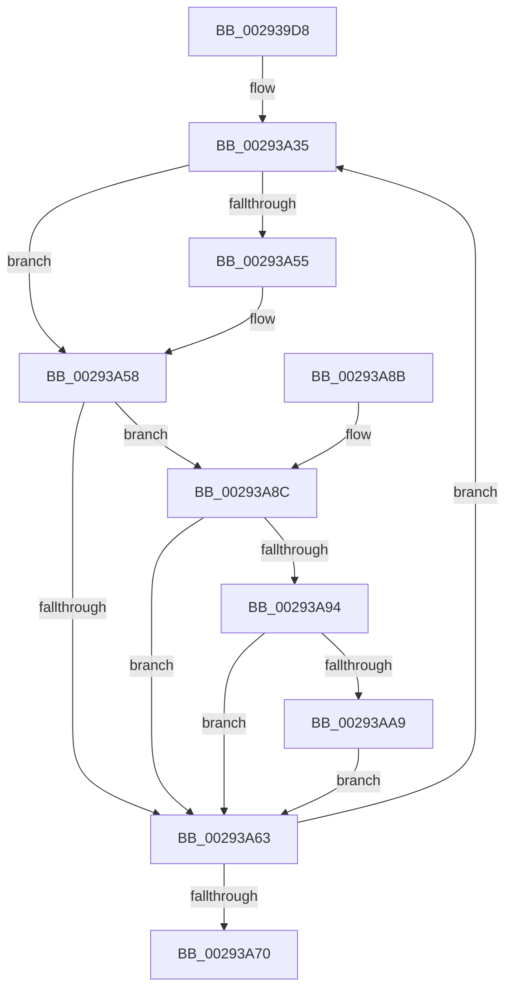

# MiSetWsleProtection

- RVA: `0x002939D8`–`0x00293ABC` (길이 `228` bytes)
- VA: `0x00000001402939D8`
- 실행 섹션: `.text`
- PDB 이름 있음: `예`; PDB Function 태그: `아니요`
- unwind 정보 RVA: `0x0005CA74`
- 디코드: `59`개 명령, `228/228` bytes 표시
- 미해석 바이트: `0` (있으면 어셈블리에 `.byte`로 보존)

> 이 문서는 커널 이미지의 기계어와 PDB 기호를 분석해 생성했습니다. 4번과 5번은 함수 원형과 자료형을 바이너리 사용 방식에서 추정한 C 해석이며 원본 소스 복구 결과는 아닙니다.

## 1. Dependencies

- 직접 호출 지점: **2**; 고유 호출 대상: **2**
- 직접 호출자로 확인된 함수: **5**
- RIP 상대 이미지 참조: **1**

### Outgoing calls
- `0x00293A18` → [MI_READ_PTE_LOCK_FREE](../28/MI_READ_PTE_LOCK_FREE_function_002828A0.md) (function, `0x002828A0`)
- `0x00293AB5` → [MiCheckLinearProtectedPteAccessedBit](MiCheckLinearProtectedPteAccessedBit_function_00292D80.md) (function, `0x00292D80`)

### Direct callers
- [MiCombineInitialInstance](../22/MiCombineInitialInstance_function_0022BC0C.md) at `0x0022C32B`
- [MiBuildForkPte](../22/MiBuildForkPte_function_0022E32C.md) at `0x0022E6C6`
- [MiSetReadOnlyOnSectionView](MiSetReadOnlyOnSectionView_function_00294538.md) at `0x002946D8`
- [sub_002C3A7C](../2C/Unknown_function_002C3A7C.md) at `0x002C3EF8`
- [MiCopyOnWrite](../36/MiCopyOnWrite_function_00362A0C.md) at `0x00362D77`

### Static image references
- `0x00293A48` → RVA `0x00FC6A88` (`ALMOSTRO`; read)

## 2. Other-region calls and transfers

- 다른 실행 섹션으로 향하는 call: **0**
- 별도 외부 분기/꼬리 이동을 확인하지 못했습니다.

## 3. Assembly (complete function range)

```asm
002939D8  48 8B C4                        mov rax, rsp
002939DB  48 89 58 08                     mov qword ptr [rax + 8], rbx
002939DF  48 89 68 10                     mov qword ptr [rax + 0x10], rbp
002939E3  48 89 70 18                     mov qword ptr [rax + 0x18], rsi
002939E7  48 89 78 20                     mov qword ptr [rax + 0x20], rdi
002939EB  41 56                           push r14
002939ED  48 83 EC 20                     sub rsp, 0x20
002939F1  48 C1 EA 09                     shr rdx, 9
002939F5  48 BE F8 FF FF FF 7F 00 00 00   movabs rsi, 0x7ffffffff8
002939FF  48 23 F2                        and rsi, rdx
00293A02  49 BE 00 00 00 00 80 F6 FF FF   movabs r14, 0xfffff68000000000
00293A0C  41 8B D8                        mov ebx, r8d
00293A0F  49 8B C6                        mov rax, r14
00293A12  48 03 F0                        add rsi, rax
00293A15  48 8B CE                        mov rcx, rsi
00293A18  E8 83 EE FE FF                  call 0x1402828a0
00293A1D  48 8B 3E                        mov rdi, qword ptr [rsi]
00293A20  80 E3 07                        and bl, 7
00293A23  48 C1 E8 38                     shr rax, 0x38
00293A27  24 0F                           and al, 0xf
00293A29  C0 E3 04                        shl bl, 4
00293A2C  0A C3                           or al, bl
00293A2E  0F B6 E8                        movzx ebp, al
00293A31  48 C1 E5 38                     shl rbp, 0x38
00293A35  48 8B DF                        mov rbx, rdi
00293A38  48 B8 FF FF FF FF FF FF FF 80   movabs rax, 0x80ffffffffffffff
00293A42  48 23 D8                        and rbx, rax
00293A45  48 0B DD                        or rbx, rbp
00293A48  48 F7 05 35 30 D3 00 00 00 00 02  test qword ptr [rip + 0xd33035], 0x2000000
00293A53  74 03                           je 0x140293a58
00293A55  0F AE E8                        lfence
00293A58  48 0F BA 25 27 30 D3 00 24      bt qword ptr [rip + 0xd33027], 0x24
00293A61  72 29                           jb 0x140293a8c
00293A63  48 8B C7                        mov rax, rdi
00293A66  F0 48 0F B1 1E                  lock cmpxchg qword ptr [rsi], rbx
00293A6B  48 8B F8                        mov rdi, rax
00293A6E  75 C5                           jne 0x140293a35
00293A70  48 8B 5C 24 30                  mov rbx, qword ptr [rsp + 0x30]
00293A75  48 8B 6C 24 38                  mov rbp, qword ptr [rsp + 0x38]
00293A7A  48 8B 74 24 40                  mov rsi, qword ptr [rsp + 0x40]
00293A7F  48 8B 7C 24 48                  mov rdi, qword ptr [rsp + 0x48]
00293A84  48 83 C4 20                     add rsp, 0x20
00293A88  41 5E                           pop r14
00293A8A  C3                              ret
00293A8B  CC                              int3
00293A8C  8A C3                           mov al, bl
00293A8E  24 21                           and al, 0x21
00293A90  3C 01                           cmp al, 1
00293A92  75 CF                           jne 0x140293a63
00293A94  49 8B C6                        mov rax, r14
00293A97  48 B9 00 00 00 00 40 00 00 00   movabs rcx, 0x4000000000
00293AA1  48 03 C1                        add rax, rcx
00293AA4  48 3B F0                        cmp rsi, rax
00293AA7  72 BA                           jb 0x140293a63
00293AA9  41 B8 80 00 00 00               mov r8d, 0x80
00293AAF  48 8B D3                        mov rdx, rbx
00293AB2  48 8B CE                        mov rcx, rsi
00293AB5  E8 C6 F2 FF FF                  call 0x140292d80
00293ABA  EB A7                           jmp 0x140293a63
```

## 4. C-style interpretation (structured pseudocode)

```c
__int64 __fastcall MiSetWsleProtection(__int64 a1, __int64 a2, int a3)
{
    __int64 result;
    __int64 v_rbp;
    __int64 v_rbx;
    __int64 v_rsi;
    __int64 v_rsp;
    unsigned __int64 v_stack_p10;
    unsigned __int64 v_stack_p18;
    unsigned __int64 v_stack_p20;
    unsigned __int64 v_stack_p8;

    *(unsigned __int64 *)(v_rsp + 8) = v_rbx;
    *(unsigned __int64 *)(v_rsp + 16) = v_rbp;
    *(unsigned __int64 *)(v_rsp + 24) = v_rsi;
    *(unsigned __int64 *)(v_rsp + 32) = v_rdi;
    v_rsp = (v_rsp) - (32);
    a2 = (a2) >> (9);
    v_rsi = (v_rsi) & (a2);
    v_rsi = (v_rsi) + (v_r14);
    result = MI_READ_PTE_LOCK_FREE(v_rsi, a2, a3, a4);
    v_rbx = (unsigned __int8)(((unsigned int)(a3)) & (7));
    result = (result) >> (56);
    result = (unsigned __int8)((result) & (15));
    v_rbx = (unsigned __int8)((v_rbx) << (4));
    result = (unsigned __int8)((result) | ((unsigned __int8)(v_rbx)));
    v_rbp = ((unsigned __int8)(result)) << (56);
loc_00293A35:
    v_rbx = (*(unsigned __int64 *)(v_rsi)) & (result);
    v_rbx = (v_rbx) | (v_rbp);
    if (((*(unsigned __int64 *)(v_rip + 13840437)) & (0x2000000ULL)) != 0) {
    }
    if (condition_is_below) goto loc_00293A8C;
loc_00293A63:
    if (((*(unsigned __int64 *)(v_rip + 13840437)) & (0x2000000ULL)) != 0) goto loc_00293A35;
    v_rsp = (v_rsp) + (32);
    return *(unsigned __int64 *)(v_rsi);
loc_00293A8C:
    result = (unsigned __int8)(((unsigned __int8)(v_stack_p8)) & (33));
    if (((unsigned __int8)(result)) != 1) goto loc_00293A63;
    result = (v_r14) + (v_rsi);
    if (v_stack_p18 < result) goto loc_00293A63;
    result = MiCheckLinearProtectedPteAccessedBit(v_stack_p18, v_stack_p8, 128, a4);
    goto loc_00293A63;
}
```

## 5. (Beta) C Style

```c
int64_t MiSetWsleProtection(int64_t Arg1, int64_t Arg2, int32_t Arg3)
{
    int64_t result;
    int64_t local_rbp;
    int64_t local_rbx;
    int64_t local_rsi;
    int64_t local_rsp;
    uint64_t v_stack_p10;
    uint64_t v_stack_p18;
    uint64_t v_stack_p20;
    uint64_t v_stack_p8;

    *(uint64_t *)(local_rsp + 0x8) = local_rbx;
    *(uint64_t *)(local_rsp + 0x10) = local_rbp;
    *(uint64_t *)(local_rsp + 0x18) = local_rsi;
    *(uint64_t *)(local_rsp + 0x20) = local_rdi;
    local_rsp = (local_rsp) - (32);
    Arg2 = (Arg2) >> (9);
    local_rsi = (local_rsi) & (Arg2);
    local_rsi = (local_rsi) + (local_r14);
    result = MI_READ_PTE_LOCK_FREE(local_rsi, Arg2, Arg3, a4);
    local_rbx = (uint8_t)(((uint32_t)(Arg3)) & (7));
    result = (result) >> (56);
    result = (uint8_t)((result) & (15));
    local_rbx = (uint8_t)((local_rbx) << (4));
    result = (uint8_t)((result) | ((uint8_t)(local_rbx)));
    local_rbp = ((uint8_t)(result)) << (56);
loc_00293A35:
    local_rbx = (*(uint64_t *)(local_rsi)) & (result);
    local_rbx = (local_rbx) | (local_rbp);
    if (((*(uint64_t *)(v_rip + 0xD33035)) & (0x2000000ULL)) != 0) {
    }
    if (condition_is_below) goto loc_00293A8C;
loc_00293A63:
    if (((*(uint64_t *)(v_rip + 0xD33035)) & (0x2000000ULL)) != 0) goto loc_00293A35;
    local_rsp = (local_rsp) + (32);
    return *(uint64_t *)(local_rsi);
loc_00293A8C:
    result = (uint8_t)(((uint8_t)(v_stack_p8)) & (33));
    if (((uint8_t)(result)) != 1) goto loc_00293A63;
    result = (local_r14) + (local_rsi);
    if (v_stack_p18 < result) goto loc_00293A63;
    result = MiCheckLinearProtectedPteAccessedBit(v_stack_p18, v_stack_p8, 128, a4);
    goto loc_00293A63;
}
```

## 6. Execution-region graph

[열기: 2D/3D 그래프와 함수 탐색 컨트롤 패널](../../../control-panel.html?section=text&rva=0x002939D8&view=graph)

- 2D 그래프는 위에서 아래로 흐르고, 3D 그래프는 빈 공간을 드래그해 회전합니다. Shift+드래그는 이동, 휠은 확대·축소, 함수 노드 선택은 대상 보고서 이동입니다.

### Static fallback


