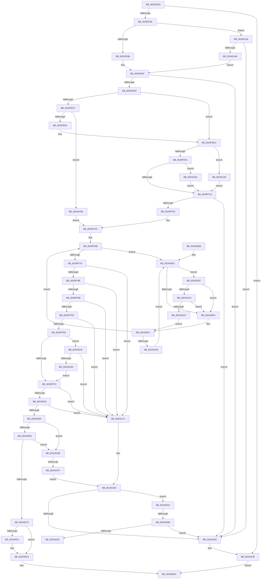

# MiSwapStackPage

- RVA: `0x0029FDE0`–`0x002A026A` (길이 `1,162` bytes)
- VA: `0x000000014029FDE0`
- 실행 섹션: `.text`
- PDB 이름 있음: `예`; PDB Function 태그: `예`
- unwind 정보 RVA: `0x0006837C`
- 디코드: `271`개 명령, `1,162/1,162` bytes 표시
- 미해석 바이트: `0` (있으면 어셈블리에 `.byte`로 보존)

> 이 문서는 커널 이미지의 기계어와 PDB 기호를 분석해 생성했습니다. 4번과 5번은 함수 원형과 자료형을 바이너리 사용 방식에서 추정한 C 해석이며 원본 소스 복구 결과는 아닙니다.

## 1. Dependencies

- 직접 호출 지점: **24**; 고유 호출 대상: **18**
- 직접 호출자로 확인된 함수: **1**
- RIP 상대 이미지 참조: **9**

### Outgoing calls
- `0x0029FE2D` → [MiAllocatePool](../35/MiAllocatePool_function_0035B540.md) (function, `0x0035B540`)
- `0x0029FE76` → [MiGetSystemRegionType](../28/MiGetSystemRegionType_function_0028EC80.md) (function, `0x0028EC80`)
- `0x0029FEF9` → [MI_PAGE_TO_FULL_COLOR](../33/MI_PAGE_TO_FULL_COLOR_function_00337820.md) (function, `0x00337820`)
- `0x0029FF1B` → [MiGetPage](../28/MiGetPage_function_002884C0.md) (function, `0x002884C0`)
- `0x0029FF54` → [MiSetPfnTbFlushStamp](../2B/MiSetPfnTbFlushStamp_function_002B7A70.md) (function, `0x002B7A70`)
- `0x0029FF62` → [MiLockWorkingSetShared](../27/MiLockWorkingSetShared_function_0027CBF0.md) (function, `0x0027CBF0`)
- `0x0029FFBC` → [MiGetSystemRegionType](../28/MiGetSystemRegionType_function_0028EC80.md) (function, `0x0028EC80`)
- `0x0029FFD7` → [MiCanStealKernelStack](MiCanStealKernelStack_function_0029FD2C.md) (function, `0x0029FD2C`)
- `0x0029FFF7` → [MiGetPfnSlabType](../28/MiGetPfnSlabType_function_0028E2D0.md) (function, `0x0028E2D0`)
- `0x002A0002` → [MiGetPfnSlabType](../28/MiGetPfnSlabType_function_0028E2D0.md) (function, `0x0028E2D0`)
- `0x002A0014` → [MiCheckSameSlabType](MiCheckSameSlabType_function_0029FC90.md) (function, `0x0029FC90`)
- `0x002A0048` → [MiTryLockPageTableUnordered](../2A/MiTryLockPageTableUnordered_function_002AD9D4.md) (function, `0x002AD9D4`)
- `0x002A0068` → [MiSwapStackPageNoDpc](../2A/MiSwapStackPageNoDpc_function_002A0270.md) (function, `0x002A0270`)
- `0x002A009D` → [MiUnlockPageTable](../21/MiUnlockPageTable_function_00216EC0.md) (function, `0x00216EC0`)
- `0x002A00A9` → [MiUnlockWorkingSetShared](../27/MiUnlockWorkingSetShared_function_0027D690.md) (function, `0x0027D690`)
- `0x002A00C9` → [ExFreePoolWithTag](../../poolcode/B8/ExFreePoolWithTag_function_00B82870.md) (function, `0x00B82870`)
- `0x002A012C` → [MiFinalizePageAttribute](../33/MiFinalizePageAttribute_function_00332E30.md) (function, `0x00332E30`)
- `0x002A0187` → [MiUnlockWorkingSetShared](../27/MiUnlockWorkingSetShared_function_0027D690.md) (function, `0x0027D690`)
- `0x002A019A` → [ExFreePoolWithTag](../../poolcode/B8/ExFreePoolWithTag_function_00B82870.md) (function, `0x00B82870`)
- `0x002A01C5` → [KiCheckVpBackingLongSpinWaitHypercall](../30/KiCheckVpBackingLongSpinWaitHypercall_function_0030F490.md) (function, `0x0030F490`)
- `0x002A01D4` → [HvlNotifyLongSpinWait](../30/HvlNotifyLongSpinWait_function_0030F460.md) (function, `0x0030F460`)
- `0x002A01E6` → [MiGetPfnKernelStack](../44/MiGetPfnKernelStack_function_0044EFB8.md) (function, `0x0044EFB8`)
- `0x002A0214` → [MiUnlockPageTable](../21/MiUnlockPageTable_function_00216EC0.md) (function, `0x00216EC0`)
- `0x002A0220` → [MiUnlockWorkingSetShared](../27/MiUnlockWorkingSetShared_function_0027D690.md) (function, `0x0027D690`)

### Direct callers
- [MiTradePage](../28/MiTradePage_function_0028D160.md) at `0x0028D6C9`

### Static image references
- `0x0029FE88` → RVA `0x00E38340` (`.data`; read)
- `0x0029FE93` → RVA `0x00E37614` (`.data`; read)
- `0x0029FF7C` → RVA `0x00E30088` (`.data`; read)
- `0x002A0055` → RVA `0x00E2DBC9` (`.data`; read)
- `0x002A00EE` → RVA `0x00FC52AC` (`ALMOSTRO`; reference)
- `0x002A0136` → RVA `0x00E2DCCC` (`.data`; read)
- `0x002A013C` → RVA `0x00E2DCC0` (`.data`; read)
- `0x002A01AB` → RVA `0x00E37E40` (`.data`; read)
- `0x002A01B7` → RVA `0x00FC6AB8` (`ALMOSTRO`; read)

## 2. Other-region calls and transfers

- 다른 실행 섹션으로 향하는 call: **2**
  - `0x002A00C9` → [ExFreePoolWithTag](../../poolcode/B8/ExFreePoolWithTag_function_00B82870.md) (`.text` → `POOLCODE`)
  - `0x002A019A` → [ExFreePoolWithTag](../../poolcode/B8/ExFreePoolWithTag_function_00B82870.md) (`.text` → `POOLCODE`)
- call이 아닌 외부 분기/꼬리 이동: **3**
  - `0x002A01F9` → [sub_006DAAE6](../6D/Unknown_function_006DAAE6.md) (`tail-transfer`)
  - `0x002A0255` → [sub_006DAAE6 + 0x26E](../6D/Unknown_function_006DAAE6.md) (`tail-transfer`)
  - `0x002A0265` → [sub_006DAAE6 + 0x26E](../6D/Unknown_function_006DAAE6.md) (`tail-transfer`)

## 3. Assembly (complete function range)

```asm
0029FDE0  48 8B C4                        mov rax, rsp
0029FDE3  48 89 58 10                     mov qword ptr [rax + 0x10], rbx
0029FDE7  44 89 48 20                     mov dword ptr [rax + 0x20], r9d
0029FDEB  48 89 48 08                     mov qword ptr [rax + 8], rcx
0029FDEF  55                              push rbp
0029FDF0  56                              push rsi
0029FDF1  57                              push rdi
0029FDF2  41 54                           push r12
0029FDF4  41 55                           push r13
0029FDF6  41 56                           push r14
0029FDF8  41 57                           push r15
0029FDFA  48 83 EC 60                     sub rsp, 0x60
0029FDFE  45 33 FF                        xor r15d, r15d
0029FE01  41 8B D8                        mov ebx, r8d
0029FE04  4C 89 78 A8                     mov qword ptr [rax - 0x58], r15
0029FE08  48 8B FA                        mov rdi, rdx
0029FE0B  65 48 8B 04 25 88 01 00 00      mov rax, qword ptr gs:[0x188]
0029FE14  4C 8B E9                        mov r13, rcx
0029FE17  48 89 44 24 48                  mov qword ptr [rsp + 0x48], rax
0029FE1C  41 B8 4D 69 4B 73               mov r8d, 0x734b694d
0029FE22  41 8D 47 40                     lea eax, [r15 + 0x40]
0029FE26  41 8B E9                        mov ebp, r9d
0029FE29  8B D0                           mov edx, eax
0029FE2B  8B C8                           mov ecx, eax
0029FE2D  E8 0E B7 0B 00                  call 0x14035b540
0029FE32  48 8B F0                        mov rsi, rax
0029FE35  48 85 C0                        test rax, rax
0029FE38  0F 84 61 03 00 00               je 0x1402a019f
0029FE3E  4C 89 68 18                     mov qword ptr [rax + 0x18], r13
0029FE42  48 B8 00 00 00 00 00 00 00 80   movabs rax, 0x8000000000000000
0029FE4C  4C 8B 67 08                     mov r12, qword ptr [rdi + 8]
0029FE50  4C 0B E0                        or r12, rax
0029FE53  48 B8 00 00 00 00 80 F6 FF FF   movabs rax, 0xfffff68000000000
0029FE5D  49 8B CC                        mov rcx, r12
0029FE60  48 C1 E1 19                     shl rcx, 0x19
0029FE64  48 8B C0                        mov rax, rax
0029FE67  48 C1 E0 19                     shl rax, 0x19
0029FE6B  48 2B C8                        sub rcx, rax
0029FE6E  48 C1 F9 10                     sar rcx, 0x10
0029FE72  48 89 4E 28                     mov qword ptr [rsi + 0x28], rcx
0029FE76  E8 05 EE FE FF                  call 0x14028ec80
0029FE7B  89 44 24 34                     mov dword ptr [rsp + 0x34], eax
0029FE7F  83 F8 0D                        cmp eax, 0xd
0029FE82  0F 85 1E 03 00 00               jne 0x1402a01a6
0029FE88  4C 8D 35 B1 84 B9 00            lea r14, [rip + 0xb984b1]
0029FE8F  4C 89 76 38                     mov qword ptr [rsi + 0x38], r14
0029FE93  44 38 3D 7A 77 B9 00            cmp byte ptr [rip + 0xb9777a], r15b
0029FE9A  0F 84 F5 02 00 00               je 0x1402a0195
0029FEA0  48 B9 00 00 00 00 00 DE FF FF   movabs rcx, 0xffffde0000000000
0029FEAA  48 8B C1                        mov rax, rcx
0029FEAD  4C 8B BC 24 C0 00 00 00         mov r15, qword ptr [rsp + 0xc0]
0029FEB5  4C 8B CF                        mov r9, rdi
0029FEB8  4C 2B C8                        sub r9, rax
0029FEBB  48 B8 AB AA AA AA AA AA AA AA   movabs rax, 0xaaaaaaaaaaaaaaab
0029FEC5  49 C1 F9 04                     sar r9, 4
0029FEC9  4C 0F AF C8                     imul r9, rax
0029FECD  4C 89 4C 24 58                  mov qword ptr [rsp + 0x58], r9
0029FED2  4D 85 FF                        test r15, r15
0029FED5  74 15                           je 0x14029feec
0029FED7  4D 8B 2F                        mov r13, qword ptr [r15]
0029FEDA  49 83 FD FF                     cmp r13, -1
0029FEDE  0F 85 27 02 00 00               jne 0x1402a010b
0029FEE4  4C 8B AC 24 A0 00 00 00         mov r13, qword ptr [rsp + 0xa0]
0029FEEC  0F BA E5 0E                     bt ebp, 0xe
0029FEF0  0F 82 40 02 00 00               jb 0x1402a0136
0029FEF6  49 8B C9                        mov rcx, r9
0029FEF9  E8 22 79 09 00                  call 0x140337820
0029FEFE  44 8B C5                        mov r8d, ebp
0029FF01  41 C1 E8 09                     shr r8d, 9
0029FF05  41 81 E0 00 80 00 00            and r8d, 0x8000
0029FF0C  0F BA E5 19                     bt ebp, 0x19
0029FF10  0F 82 1C 03 00 00               jb 0x1402a0232
0029FF16  8B D0                           mov edx, eax
0029FF18  49 8B CD                        mov rcx, r13
0029FF1B  E8 A0 85 FE FF                  call 0x1402884c0
0029FF20  4C 8B E8                        mov r13, rax
0029FF23  48 83 F8 FF                     cmp rax, -1
0029FF27  0F 84 68 02 00 00               je 0x1402a0195
0029FF2D  48 8D 2C 45 00 00 00 00         lea rbp, [rax*2]
0029FF35  48 03 E8                        add rbp, rax
0029FF38  48 B8 00 00 00 00 00 DE FF FF   movabs rax, 0xffffde0000000000
0029FF42  48 C1 E5 04                     shl rbp, 4
0029FF46  48 8B C8                        mov rcx, rax
0029FF49  48 03 E9                        add rbp, rcx
0029FF4C  45 33 C0                        xor r8d, r8d
0029FF4F  33 D2                           xor edx, edx
0029FF51  48 8B CD                        mov rcx, rbp
0029FF54  E8 17 7B 01 00                  call 0x1402b7a70
0029FF59  33 DB                           xor ebx, ebx
0029FF5B  49 8B CE                        mov rcx, r14
0029FF5E  48 89 5E 30                     mov qword ptr [rsi + 0x30], rbx
0029FF62  E8 89 CC FD FF                  call 0x14027cbf0
0029FF67  88 44 24 30                     mov byte ptr [rsp + 0x30], al
0029FF6B  F0 48 0F BA 6F 18 3F            lock bts qword ptr [rdi + 0x18], 0x3f
0029FF72  0F 82 74 01 00 00               jb 0x1402a00ec
0029FF78  48 8B 47 28                     mov rax, qword ptr [rdi + 0x28]
0029FF7C  48 8B 0D 05 01 B9 00            mov rcx, qword ptr [rip + 0xb90105]
0029FF83  48 8B 94 24 A0 00 00 00         mov rdx, qword ptr [rsp + 0xa0]
0029FF8B  48 C1 E8 2B                     shr rax, 0x2b
0029FF8F  25 FF 03 00 00                  and eax, 0x3ff
0029FF94  48 39 14 C1                     cmp qword ptr [rcx + rax*8], rdx
0029FF98  0F 85 D3 01 00 00               jne 0x1402a0171
0029FF9E  48 8B 47 08                     mov rax, qword ptr [rdi + 8]
0029FFA2  48 B9 00 00 00 00 00 00 00 80   movabs rcx, 0x8000000000000000
0029FFAC  48 0B C1                        or rax, rcx
0029FFAF  4C 3B E0                        cmp r12, rax
0029FFB2  0F 85 B9 01 00 00               jne 0x1402a0171
0029FFB8  48 8B 4E 28                     mov rcx, qword ptr [rsi + 0x28]
0029FFBC  E8 BF EC FE FF                  call 0x14028ec80
0029FFC1  39 44 24 34                     cmp dword ptr [rsp + 0x34], eax
0029FFC5  0F 85 A6 01 00 00               jne 0x1402a0171
0029FFCB  41 BB 01 00 00 00               mov r11d, 1
0029FFD1  48 8B CF                        mov rcx, rdi
0029FFD4  41 8B D3                        mov edx, r11d
0029FFD7  E8 50 FD FF FF                  call 0x14029fd2c
0029FFDC  33 DB                           xor ebx, ebx
0029FFDE  85 C0                           test eax, eax
0029FFE0  0F 84 8B 01 00 00               je 0x1402a0171
0029FFE6  8B 47 20                        mov eax, dword ptr [rdi + 0x20]
0029FFE9  C1 E8 18                        shr eax, 0x18
0029FFEC  A8 40                           test al, 0x40
0029FFEE  0F 85 48 02 00 00               jne 0x1402a023c
0029FFF4  48 8B CD                        mov rcx, rbp
0029FFF7  E8 D4 E2 FE FF                  call 0x14028e2d0
0029FFFC  48 8B CF                        mov rcx, rdi
0029FFFF  44 8B C8                        mov r9d, eax
002A0002  E8 C9 E2 FE FF                  call 0x14028e2d0
002A0007  8B D0                           mov edx, eax
002A0009  44 89 5C 24 20                  mov dword ptr [rsp + 0x20], r11d
002A000E  48 8B CF                        mov rcx, rdi
002A0011  4C 8B C5                        mov r8, rbp
002A0014  E8 77 FC FF FF                  call 0x14029fc90
002A0019  85 C0                           test eax, eax
002A001B  0F 84 50 01 00 00               je 0x1402a0171
002A0021  48 B8 F8 FF FF FF 7F 00 00 00   movabs rax, 0x7ffffffff8
002A002B  49 C1 EC 09                     shr r12, 9
002A002F  4C 23 E0                        and r12, rax
002A0032  48 B8 00 00 00 00 80 F6 FF FF   movabs rax, 0xfffff68000000000
002A003C  48 8B C0                        mov rax, rax
002A003F  4C 03 E0                        add r12, rax
002A0042  49 8B CE                        mov rcx, r14
002A0045  49 8B D4                        mov rdx, r12
002A0048  E8 87 D9 00 00                  call 0x1402ad9d4
002A004D  85 C0                           test eax, eax
002A004F  0F 84 1C 01 00 00               je 0x1402a0171
002A0055  F6 05 6D DB B8 00 01            test byte ptr [rip + 0xb8db6d], 1
002A005C  0F 84 7C 01 00 00               je 0x1402a01de
002A0062  48 8B D5                        mov rdx, rbp
002A0065  48 8B CF                        mov rcx, rdi
002A0068  E8 03 02 00 00                  call 0x1402a0270
002A006D  85 C0                           test eax, eax
002A006F  0F 84 69 01 00 00               je 0x1402a01de
002A0075  8B 47 20                        mov eax, dword ptr [rdi + 0x20]
002A0078  49 B9 FF FF FF FF FF FF FF 7F   movabs r9, 0x7fffffffffffffff
002A0082  89 44 24 34                     mov dword ptr [rsp + 0x34], eax
002A0086  66 89 5C 24 34                  mov word ptr [rsp + 0x34], bx
002A008B  8B 44 24 34                     mov eax, dword ptr [rsp + 0x34]
002A008F  89 47 20                        mov dword ptr [rdi + 0x20], eax
002A0092  F0 4C 21 4F 18                  lock and qword ptr [rdi + 0x18], r9
002A0097  49 8B D4                        mov rdx, r12
002A009A  49 8B CE                        mov rcx, r14
002A009D  E8 1E 6E F7 FF                  call 0x140216ec0
002A00A2  8A 54 24 30                     mov dl, byte ptr [rsp + 0x30]
002A00A6  49 8B CE                        mov rcx, r14
002A00A9  E8 E2 D5 FD FF                  call 0x14027d690
002A00AE  48 8B 84 24 C8 00 00 00         mov rax, qword ptr [rsp + 0xc8]
002A00B6  C7 00 01 00 00 00               mov dword ptr [rax], 1
002A00BC  4D 85 FF                        test r15, r15
002A00BF  74 03                           je 0x1402a00c4
002A00C1  4D 89 2F                        mov qword ptr [r15], r13
002A00C4  33 D2                           xor edx, edx
002A00C6  48 8B CE                        mov rcx, rsi
002A00C9  E8 A2 27 8E 00                  call 0x140b82870
002A00CE  B8 01 00 00 00                  mov eax, 1
002A00D3  48 8B 9C 24 A8 00 00 00         mov rbx, qword ptr [rsp + 0xa8]
002A00DB  48 83 C4 60                     add rsp, 0x60
002A00DF  41 5F                           pop r15
002A00E1  41 5E                           pop r14
002A00E3  41 5D                           pop r13
002A00E5  41 5C                           pop r12
002A00E7  5F                              pop rdi
002A00E8  5E                              pop rsi
002A00E9  5D                              pop rbp
002A00EA  C3                              ret
002A00EB  CC                              int3
002A00EC  FF C3                           inc ebx
002A00EE  85 1D B8 51 D2 00               test dword ptr [rip + 0xd251b8], ebx
002A00F4  0F 84 BD 00 00 00               je 0x1402a01b7
002A00FA  F3 90                           pause
002A00FC  48 8B 47 18                     mov rax, qword ptr [rdi + 0x18]
002A0100  48 85 C0                        test rax, rax
002A0103  0F 89 62 FE FF FF               jns 0x14029ff6b
002A0109  EB E1                           jmp 0x1402a00ec
002A010B  4A 8D 2C 6D 00 00 00 00         lea rbp, [r13*2]
002A0113  49 03 ED                        add rbp, r13
002A0116  48 C1 E5 04                     shl rbp, 4
002A011A  48 8B C1                        mov rax, rcx
002A011D  BA 01 00 00 00                  mov edx, 1
002A0122  48 03 E8                        add rbp, rax
002A0125  48 8B CD                        mov rcx, rbp
002A0128  44 8D 42 07                     lea r8d, [rdx + 7]
002A012C  E8 FF 2C 09 00                  call 0x140332e30
002A0131  E9 16 FE FF FF                  jmp 0x14029ff4c
002A0136  8B 0D 90 DB B8 00               mov ecx, dword ptr [rip + 0xb8db90]
002A013C  4C 8D 15 7D DB B8 00            lea r10, [rip + 0xb8db7d]
002A0143  33 D2                           xor edx, edx
002A0145  49 8B C1                        mov rax, r9
002A0148  48 F7 F1                        div rcx
002A014B  44 8B C3                        mov r8d, ebx
002A014E  49 C1 E8 10                     shr r8, 0x10
002A0152  48 8B C2                        mov rax, rdx
002A0155  41 83 E0 03                     and r8d, 3
002A0159  33 D2                           xor edx, edx
002A015B  43 F7 34 82                     div dword ptr [r10 + r8*4]
002A015F  41 B8 00 30 00 00               mov r8d, 0x3000
002A0165  33 D3                           xor edx, ebx
002A0167  0F B6 C2                        movzx eax, dl
002A016A  33 C3                           xor eax, ebx
002A016C  E9 A5 FD FF FF                  jmp 0x14029ff16
002A0171  49 B9 FF FF FF FF FF FF FF 7F   movabs r9, 0x7fffffffffffffff
002A017B  F0 4C 21 4F 18                  lock and qword ptr [rdi + 0x18], r9
002A0180  8A 54 24 30                     mov dl, byte ptr [rsp + 0x30]
002A0184  49 8B CE                        mov rcx, r14
002A0187  E8 04 D5 FD FF                  call 0x14027d690
002A018C  48 85 ED                        test rbp, rbp
002A018F  0F 85 BD 00 00 00               jne 0x1402a0252
002A0195  33 D2                           xor edx, edx
002A0197  48 8B CE                        mov rcx, rsi
002A019A  E8 D1 26 8E 00                  call 0x140b82870
002A019F  33 C0                           xor eax, eax
002A01A1  E9 2D FF FF FF                  jmp 0x1402a00d3
002A01A6  83 F8 0B                        cmp eax, 0xb
002A01A9  75 EA                           jne 0x1402a0195
002A01AB  4C 8D 35 8E 7C B9 00            lea r14, [rip + 0xb97c8e]
002A01B2  E9 D8 FC FF FF                  jmp 0x14029fe8f
002A01B7  8B 05 FB 68 D2 00               mov eax, dword ptr [rip + 0xd268fb]
002A01BD  A8 40                           test al, 0x40
002A01BF  0F 84 35 FF FF FF               je 0x1402a00fa
002A01C5  E8 C6 F2 06 00                  call 0x14030f490
002A01CA  84 C0                           test al, al
002A01CC  0F 84 28 FF FF FF               je 0x1402a00fa
002A01D2  8B CB                           mov ecx, ebx
002A01D4  E8 87 F2 06 00                  call 0x14030f460
002A01D9  E9 1E FF FF FF                  jmp 0x1402a00fc
002A01DE  BA 01 00 00 00                  mov edx, 1
002A01E3  48 8B CF                        mov rcx, rdi
002A01E6  E8 CD ED 1A 00                  call 0x14044efb8
002A01EB  4C 8B F8                        mov r15, rax
002A01EE  48 8D 48 20                     lea rcx, [rax + 0x20]
002A01F2  48 F7 C1 DF FF FF FF            test rcx, -0x21
002A01F9  0F 85 E7 A8 43 00               jne 0x1406daae6
002A01FF  49 B9 FF FF FF FF FF FF FF 7F   movabs r9, 0x7fffffffffffffff
002A0209  F0 4C 21 4F 18                  lock and qword ptr [rdi + 0x18], r9
002A020E  49 8B D4                        mov rdx, r12
002A0211  49 8B CE                        mov rcx, r14
002A0214  E8 A7 6C F7 FF                  call 0x140216ec0
002A0219  8A 54 24 30                     mov dl, byte ptr [rsp + 0x30]
002A021D  49 8B CE                        mov rcx, r14
002A0220  E8 6B D4 FD FF                  call 0x14027d690
002A0225  4C 8B BC 24 C0 00 00 00         mov r15, qword ptr [rsp + 0xc0]
002A022D  E9 5A FF FF FF                  jmp 0x1402a018c
002A0232  41 0F BA E8 0B                  bts r8d, 0xb
002A0237  E9 DA FC FF FF                  jmp 0x14029ff16
002A023C  F7 84 24 B8 00 00 00 00 00 00 10  test dword ptr [rsp + 0xb8], 0x10000000
002A0247  0F 84 24 FF FF FF               je 0x1402a0171
002A024D  E9 A2 FD FF FF                  jmp 0x14029fff4
002A0252  4D 85 FF                        test r15, r15
002A0255  0F 84 F9 AA 43 00               je 0x1406dad54
002A025B  49 83 3F FF                     cmp qword ptr [r15], -1
002A025F  0F 85 30 FF FF FF               jne 0x1402a0195
002A0265  E9 EA AA 43 00                  jmp 0x1406dad54
```

## 4. C-style interpretation (structured pseudocode)

```c
__int64 __fastcall MiSwapStackPage(__int64 a1, __int64 a2, int a3, int a4, __int64 a5, __int64 a6)
{
    __int64 result;
    __int64 v_r12;
    __int64 v_r15;
    __int64 v_rbp;
    __int64 v_rbx;
    __int64 v_rsp;
    unsigned __int64 v_stack_m40;
    unsigned __int64 v_stack_m50;
    unsigned int v_stack_m64;
    unsigned __int8 v_stack_m68;
    unsigned int v_stack_m78;
    unsigned __int64 v_stack_p10;
    unsigned __int8 v_stack_p30;
    unsigned __int64 v_stack_p8;
    unsigned int v_stack_pB8;

    *(unsigned __int64 *)(v_rsp + 16) = v_rbx;
    *(unsigned int *)(v_rsp + 32) = a4;
    *(unsigned __int64 *)(v_rsp + 8) = a1;
    v_rsp = (v_rsp) - (96);
    v_r15 = 0;
    *(unsigned __int64 *)(v_rsp - 88) = 0;
    v_stack_m50 = *(unsigned __int64 *)(gs_base + (0 + 392));
    result = MiAllocatePool((unsigned int)((unsigned int)(v_r15 + 64)), (unsigned int)((unsigned int)(v_r15 + 64)), (unsigned int)(0x734B694DULL), a4);
    if (result == 0) goto loc_002A019F;
    *(unsigned __int64 *)(result + 24) = a1;
    v_r12 = (*(unsigned __int64 *)(a2 + 8)) | (result);
    a1 = (v_r12) << (25);
    result = (result) << (25);
    a1 = (a1) - (result);
    a1 = (a1) >> (16);
    *(unsigned __int64 *)(result + 40) = a1;
    result = MiGetSystemRegionType(a1, (unsigned int)((unsigned int)(v_r15 + 64)), (unsigned int)(0x734B694DULL), a4);
    v_stack_m64 = (unsigned int)(result);
    if (((unsigned int)(result)) != 13) goto loc_002A01A6;
loc_0029FE8F:
    *(unsigned __int64 *)(result + 56) = v_rip + 12158129;
    if ((*(unsigned __int8 *)(v_rip + 12154746)) == 0) goto loc_002A0195;
    a4 = (a2) - (a1);
    a4 = (a4) >> (4);
    a4 = (a4) * (a1);
    v_stack_m40 = a4;
    if (a5 == 0) goto loc_0029FEEC;
    if ((*(unsigned __int64 *)(a5)) != -1) goto loc_002A010B;
loc_0029FEEC:
    if ((*(unsigned __int64 *)(a5)) < -1) goto loc_002A0136;
    result = MI_PAGE_TO_FULL_COLOR(a4, (unsigned int)((unsigned int)(v_r15 + 64)), (unsigned int)(0x734B694DULL), a4);
    a3 = (unsigned int)(((unsigned int)((unsigned int)((unsigned int)(a4)))) >> (9));
    a3 = (unsigned int)((a3) & (0x8000ULL));
    if (condition_is_below) goto loc_002A0232;
loc_0029FF16:
    result = MiGetPage(v_stack_p8, (unsigned int)((unsigned int)(result)), a3, a4);
    if (result == -1) goto loc_002A0195;
    v_rbp = (result * 2) + (result);
    v_rbp = (v_rbp) << (4);
    v_rbp = (v_rbp) + (result);
loc_0029FF4C:
    a3 = 0;
    a2 = 0;
    result = MiSetPfnTbFlushStamp(v_rbp, a2, a3, a4);
    v_rbx = 0;
    *(unsigned __int64 *)(result + 48) = 0;
    result = MiLockWorkingSetShared(v_rip + 12158129, a2, a3, a4);
    v_stack_m68 = (unsigned __int8)(result);
loc_0029FF6B:
    if (condition_is_below) goto loc_002A00EC;
    result = (*(unsigned __int64 *)(a2 + 40)) >> (43);
    result = (unsigned int)((result) & (0x3FFULL));
    if ((*(unsigned __int64 *)(*(unsigned __int64 *)(v_rip + 12124421) + result * 8)) != v_stack_p8) goto loc_002A0171;
    result = (*(unsigned __int64 *)(a2 + 8)) | (*(unsigned __int64 *)(v_rip + 12124421));
    if (v_r12 != result) goto loc_002A0171;
    result = MiGetSystemRegionType(*(unsigned __int64 *)(result + 40), v_stack_p8, a3, a4);
    if (v_stack_m64 != ((unsigned int)(result))) goto loc_002A0171;
    result = MiCanStealKernelStack(0, 1, a3, a4);
    v_rbx = 0;
    if ((unsigned int)(result) == 0) goto loc_002A0171;
    result = (unsigned int)(((unsigned int)(*(unsigned int *)(a2 + 32))) >> (24));
    if ((((unsigned __int8)(result)) & (64)) != 0) goto loc_002A023C;
loc_0029FFF4:
    result = MiGetPfnSlabType(v_rbp, 1, a3, a4);
    result = MiGetPfnSlabType(0, 1, a3, (unsigned int)((unsigned int)(result)));
    v_stack_m78 = 1;
    result = MiCheckSameSlabType(0, (unsigned int)((unsigned int)(result)), v_rbp, (unsigned int)((unsigned int)(result)));
    if ((unsigned int)(result) == 0) goto loc_002A0171;
    v_r12 = (v_r12) >> (9);
    v_r12 = (v_r12) & (result);
    v_r12 = (v_r12) + (result);
    result = MiTryLockPageTableUnordered(v_rip + 12158129, v_r12, v_rbp, (unsigned int)((unsigned int)(result)));
    if ((unsigned int)(result) == 0) goto loc_002A0171;
    if (((*(unsigned __int8 *)(v_rip + 12114797)) & (1)) == 0) goto loc_002A01DE;
    result = MiSwapStackPageNoDpc(0, v_rbp, v_rbp, (unsigned int)((unsigned int)(result)));
    if ((unsigned int)(result) == 0) goto loc_002A01DE;
    v_stack_m64 = (unsigned int)((unsigned int)(*(unsigned int *)(a2 + 32)));
    v_stack_m64 = 0;
    *(unsigned int *)(a2 + 32) = (unsigned int)((unsigned int)(v_stack_m64));
    result = MiUnlockPageTable(v_rip + 12158129, v_r12, v_rbp, (unsigned int)((unsigned int)(result)));
    result = MiUnlockWorkingSetShared(v_rip + 12158129, v_stack_m68, v_rbp, (unsigned int)((unsigned int)(result)));
    *(unsigned int *)(a6) = 1;
    if (a5 != 0) {
        *(unsigned __int64 *)(a5) = result;
    }
    a2 = 0;
    result = ExFreePoolWithTag(result, a2, v_rbp, (unsigned int)((unsigned int)(result)));
loc_002A00D3:
    v_rsp = (v_rsp) + (96);
    return 1;
loc_002A00EC:
    v_rbx = (unsigned int)((v_stack_p10) + 1);
    if (((*(unsigned int *)(v_rip + 13783480)) & ((unsigned int)(v_rbx))) == 0) goto loc_002A01B7;
loc_002A00FA:
loc_002A00FC:
    if (!sign_flag) goto loc_0029FF6B;
    goto loc_002A00EC;
loc_002A010B:
    v_rbp = (result * 2) + (result);
    v_rbp = (v_rbp) << (4);
    v_rbp = (v_rbp) + (result);
    result = MiFinalizePageAttribute(v_rbp, 1, 1 + 7, (unsigned int)((unsigned int)(result)));
    goto loc_0029FF4C;
loc_002A0136:
    a2 = 0;
    a3 = ((unsigned int)((unsigned int)(v_rbx))) >> (16);
    a3 = (unsigned int)((a3) & (3));
    a2 = 0;
    a2 = (unsigned int)((a2) ^ ((unsigned int)(v_rbx)));
    result = (unsigned int)(((unsigned __int8)(a2)) ^ ((unsigned int)(v_rbx)));
    goto loc_0029FF16;
loc_002A0171:
    result = MiUnlockWorkingSetShared(v_rip + 12158129, v_stack_p30, (unsigned int)(0x3000ULL), (unsigned int)((unsigned int)(result)));
loc_002A018C:
    if (v_rbp != 0) goto loc_002A0252;
loc_002A0195:
    a2 = 0;
    result = ExFreePoolWithTag(result, a2, (unsigned int)(0x3000ULL), (unsigned int)((unsigned int)(result)));
loc_002A019F:
    result = 0;
    goto loc_002A00D3;
loc_002A01A6:
    if (0 != 11) goto loc_002A0195;
    goto loc_0029FE8F;
loc_002A01B7:
    if ((((unsigned __int8)((unsigned int)(*(unsigned int *)(v_rip + 13789435)))) & (64)) == 0) goto loc_002A00FA;
    result = KiCheckVpBackingLongSpinWaitHypercall(result, a2, (unsigned int)(0x3000ULL), (unsigned int)((unsigned int)(result)));
    if ((unsigned __int8)(result) == 0) goto loc_002A00FA;
    result = HvlNotifyLongSpinWait((unsigned int)((unsigned int)(v_rbx)), a2, (unsigned int)(0x3000ULL), (unsigned int)((unsigned int)(result)));
    goto loc_002A00FC;
loc_002A01DE:
    result = MiGetPfnKernelStack(0, 1, (unsigned int)(0x3000ULL), (unsigned int)((unsigned int)(result)));
    result = MiUnlockPageTable(v_rip + 12156046, v_r12, (unsigned int)(0x3000ULL), (unsigned int)((unsigned int)(result)));
    result = MiUnlockWorkingSetShared(v_rip + 12156046, v_stack_p30, (unsigned int)(0x3000ULL), (unsigned int)((unsigned int)(result)));
    goto loc_002A018C;
loc_002A0232:
    goto loc_0029FF16;
loc_002A023C:
    if (((v_stack_pB8) & (0x10000000ULL)) == 0) goto loc_002A0171;
    goto loc_0029FFF4;
loc_002A0252:
    if ((*(unsigned __int64 *)(a5)) != -1) goto loc_002A0195;
}
```

## 5. (Beta) C Style

```c
int64_t MiSwapStackPage(int64_t Arg1, void *Arg2, int32_t Arg3, int32_t Arg4, int64_t Arg5, void *Arg6)
{
    uint8_t *arg2 = (uint8_t *)Arg2;
    uint8_t *arg6 = (uint8_t *)Arg6;

    int64_t result;
    int64_t local_r12;
    int64_t local_r15;
    int64_t local_rbp;
    int64_t local_rbx;
    int64_t local_rsp;
    uint64_t v_stack_m40;
    uint64_t v_stack_m50;
    uint32_t v_stack_m64;
    uint8_t v_stack_m68;
    uint32_t v_stack_m78;
    uint64_t v_stack_p10;
    uint8_t v_stack_p30;
    uint64_t v_stack_p8;
    uint32_t v_stack_pB8;

    *(uint64_t *)(local_rsp + 0x10) = local_rbx;
    *(uint32_t *)(local_rsp + 0x20) = Arg4;
    *(uint64_t *)(local_rsp + 0x8) = Arg1;
    local_rsp = (local_rsp) - (96);
    local_r15 = 0;
    *(uint64_t *)(local_rsp - 0x58) = 0;
    v_stack_m50 = *(uint64_t *)(gs_base + (0 + 0x188));
    result = MiAllocatePool((uint32_t)((uint32_t)(local_r15 + 64)), (uint32_t)((uint32_t)(local_r15 + 64)), (uint32_t)(0x734B694DULL), Arg4);
    if (result == 0) goto loc_002A019F;
    *(uint64_t *)(result + 0x18) = Arg1;
    local_r12 = (*(uint64_t *)(arg2 + 0x8)) | (result);
    Arg1 = (local_r12) << (25);
    result = (result) << (25);
    Arg1 = (Arg1) - (result);
    Arg1 = (Arg1) >> (16);
    *(uint64_t *)(result + 0x28) = Arg1;
    result = MiGetSystemRegionType(Arg1, (uint32_t)((uint32_t)(local_r15 + 64)), (uint32_t)(0x734B694DULL), Arg4);
    v_stack_m64 = (uint32_t)(result);
    if (((uint32_t)(result)) != 13) goto loc_002A01A6;
loc_0029FE8F:
    *(uint64_t *)(result + 0x38) = v_rip + 12158129;
    if ((*(uint8_t *)(v_rip + 0xB9777A)) == 0) goto loc_002A0195;
    Arg4 = (Arg2) - (Arg1);
    Arg4 = (Arg4) >> (4);
    Arg4 = (Arg4) * (Arg1);
    v_stack_m40 = Arg4;
    if (Arg5 == 0) goto loc_0029FEEC;
    if ((*(uint64_t *)(Arg5)) != -1) goto loc_002A010B;
loc_0029FEEC:
    if ((*(uint64_t *)(Arg5)) < -1) goto loc_002A0136;
    result = MI_PAGE_TO_FULL_COLOR(Arg4, (uint32_t)((uint32_t)(local_r15 + 64)), (uint32_t)(0x734B694DULL), Arg4);
    Arg3 = (uint32_t)(((uint32_t)((uint32_t)((uint32_t)(Arg4)))) >> (9));
    Arg3 = (uint32_t)((Arg3) & (0x8000ULL));
    if (condition_is_below) goto loc_002A0232;
loc_0029FF16:
    result = MiGetPage(v_stack_p8, (uint32_t)((uint32_t)(result)), Arg3, Arg4);
    if (result == -1) goto loc_002A0195;
    local_rbp = (result * 2) + (result);
    local_rbp = (local_rbp) << (4);
    local_rbp = (local_rbp) + (result);
loc_0029FF4C:
    Arg3 = 0;
    Arg2 = 0;
    result = MiSetPfnTbFlushStamp(local_rbp, Arg2, Arg3, Arg4);
    local_rbx = 0;
    *(uint64_t *)(result + 0x30) = 0;
    result = MiLockWorkingSetShared(v_rip + 12158129, Arg2, Arg3, Arg4);
    v_stack_m68 = (uint8_t)(result);
loc_0029FF6B:
    if (condition_is_below) goto loc_002A00EC;
    result = (*(uint64_t *)(arg2 + 0x28)) >> (43);
    result = (uint32_t)((result) & (0x3FFULL));
    if ((*(uint64_t *)(*(uint64_t *)(v_rip + 0xB90105) + result * 8)) != v_stack_p8) goto loc_002A0171;
    result = (*(uint64_t *)(arg2 + 0x8)) | (*(uint64_t *)(v_rip + 0xB90105));
    if (local_r12 != result) goto loc_002A0171;
    result = MiGetSystemRegionType(*(uint64_t *)(result + 0x28), v_stack_p8, Arg3, Arg4);
    if (v_stack_m64 != ((uint32_t)(result))) goto loc_002A0171;
    result = MiCanStealKernelStack(0, 1, Arg3, Arg4);
    local_rbx = 0;
    if ((uint32_t)(result) == 0) goto loc_002A0171;
    result = (uint32_t)(((uint32_t)(*(uint32_t *)(arg2 + 0x20))) >> (24));
    if ((((uint8_t)(result)) & (64)) != 0) goto loc_002A023C;
loc_0029FFF4:
    result = MiGetPfnSlabType(local_rbp, 1, Arg3, Arg4);
    result = MiGetPfnSlabType(0, 1, Arg3, (uint32_t)((uint32_t)(result)));
    v_stack_m78 = 1;
    result = MiCheckSameSlabType(0, (uint32_t)((uint32_t)(result)), local_rbp, (uint32_t)((uint32_t)(result)));
    if ((uint32_t)(result) == 0) goto loc_002A0171;
    local_r12 = (local_r12) >> (9);
    local_r12 = (local_r12) & (result);
    local_r12 = (local_r12) + (result);
    result = MiTryLockPageTableUnordered(v_rip + 12158129, local_r12, local_rbp, (uint32_t)((uint32_t)(result)));
    if ((uint32_t)(result) == 0) goto loc_002A0171;
    if (((*(uint8_t *)(v_rip + 0xB8DB6D)) & (1)) == 0) goto loc_002A01DE;
    result = MiSwapStackPageNoDpc(0, local_rbp, local_rbp, (uint32_t)((uint32_t)(result)));
    if ((uint32_t)(result) == 0) goto loc_002A01DE;
    v_stack_m64 = (uint32_t)((uint32_t)(*(uint32_t *)(arg2 + 0x20)));
    v_stack_m64 = 0;
    *(uint32_t *)(arg2 + 0x20) = (uint32_t)((uint32_t)(v_stack_m64));
    result = MiUnlockPageTable(v_rip + 12158129, local_r12, local_rbp, (uint32_t)((uint32_t)(result)));
    result = MiUnlockWorkingSetShared(v_rip + 12158129, v_stack_m68, local_rbp, (uint32_t)((uint32_t)(result)));
    *(uint32_t *)(arg6) = 1;
    if (Arg5 != 0) {
        *(uint64_t *)(Arg5) = result;
    }
    Arg2 = 0;
    result = ExFreePoolWithTag(result, Arg2, local_rbp, (uint32_t)((uint32_t)(result)));
loc_002A00D3:
    local_rsp = (local_rsp) + (96);
    return 1;
loc_002A00EC:
    local_rbx = (uint32_t)((v_stack_p10) + 1);
    if (((*(uint32_t *)(v_rip + 0xD251B8)) & ((uint32_t)(local_rbx))) == 0) goto loc_002A01B7;
loc_002A00FA:
loc_002A00FC:
    if (!sign_flag) goto loc_0029FF6B;
    goto loc_002A00EC;
loc_002A010B:
    local_rbp = (result * 2) + (result);
    local_rbp = (local_rbp) << (4);
    local_rbp = (local_rbp) + (result);
    result = MiFinalizePageAttribute(local_rbp, 1, 1 + 7, (uint32_t)((uint32_t)(result)));
    goto loc_0029FF4C;
loc_002A0136:
    Arg2 = 0;
    Arg3 = ((uint32_t)((uint32_t)(local_rbx))) >> (16);
    Arg3 = (uint32_t)((Arg3) & (3));
    Arg2 = 0;
    Arg2 = (uint32_t)((Arg2) ^ ((uint32_t)(local_rbx)));
    result = (uint32_t)(((uint8_t)(Arg2)) ^ ((uint32_t)(local_rbx)));
    goto loc_0029FF16;
loc_002A0171:
    result = MiUnlockWorkingSetShared(v_rip + 12158129, v_stack_p30, (uint32_t)(0x3000ULL), (uint32_t)((uint32_t)(result)));
loc_002A018C:
    if (local_rbp != 0) goto loc_002A0252;
loc_002A0195:
    Arg2 = 0;
    result = ExFreePoolWithTag(result, Arg2, (uint32_t)(0x3000ULL), (uint32_t)((uint32_t)(result)));
loc_002A019F:
    result = 0;
    goto loc_002A00D3;
loc_002A01A6:
    if (0 != 11) goto loc_002A0195;
    goto loc_0029FE8F;
loc_002A01B7:
    if ((((uint8_t)((uint32_t)(*(uint32_t *)(v_rip + 0xD268FB)))) & (64)) == 0) goto loc_002A00FA;
    result = KiCheckVpBackingLongSpinWaitHypercall(result, Arg2, (uint32_t)(0x3000ULL), (uint32_t)((uint32_t)(result)));
    if ((uint8_t)(result) == 0) goto loc_002A00FA;
    result = HvlNotifyLongSpinWait((uint32_t)((uint32_t)(local_rbx)), Arg2, (uint32_t)(0x3000ULL), (uint32_t)((uint32_t)(result)));
    goto loc_002A00FC;
loc_002A01DE:
    result = MiGetPfnKernelStack(0, 1, (uint32_t)(0x3000ULL), (uint32_t)((uint32_t)(result)));
    result = MiUnlockPageTable(v_rip + 12156046, local_r12, (uint32_t)(0x3000ULL), (uint32_t)((uint32_t)(result)));
    result = MiUnlockWorkingSetShared(v_rip + 12156046, v_stack_p30, (uint32_t)(0x3000ULL), (uint32_t)((uint32_t)(result)));
    goto loc_002A018C;
loc_002A0232:
    goto loc_0029FF16;
loc_002A023C:
    if (((v_stack_pB8) & (0x10000000ULL)) == 0) goto loc_002A0171;
    goto loc_0029FFF4;
loc_002A0252:
    if ((*(uint64_t *)(Arg5)) != -1) goto loc_002A0195;
}
```

### 관측된 메모리 오프셋

구조체 형식이 확인되지 않은 접근은 인자 기준의 오프셋으로만 기록했습니다.

| 기준 인자 | 오프셋 표현 | 폭 (bit) | 접근 |
|---|---:|---:|---|
| `Arg2` | `+ 0x8` | `64` | `R` |
| `Arg2` | `+ 0x18` | `64` | `R` |
| `Arg2` | `+ 0x18` | `64` | `R/W` |
| `Arg2` | `+ 0x20` | `32` | `R` |
| `Arg2` | `+ 0x20` | `32` | `W` |
| `Arg2` | `+ 0x28` | `64` | `R` |
| `Arg6` | `+ 0x0` | `32` | `W` |

## 6. Execution-region graph

[열기: 2D/3D 그래프와 함수 탐색 컨트롤 패널](../../../control-panel.html?section=text&rva=0x0029FDE0&view=graph)

- 2D 그래프는 위에서 아래로 흐르고, 3D 그래프는 빈 공간을 드래그해 회전합니다. Shift+드래그는 이동, 휠은 확대·축소, 함수 노드 선택은 대상 보고서 이동입니다.

### Static fallback


