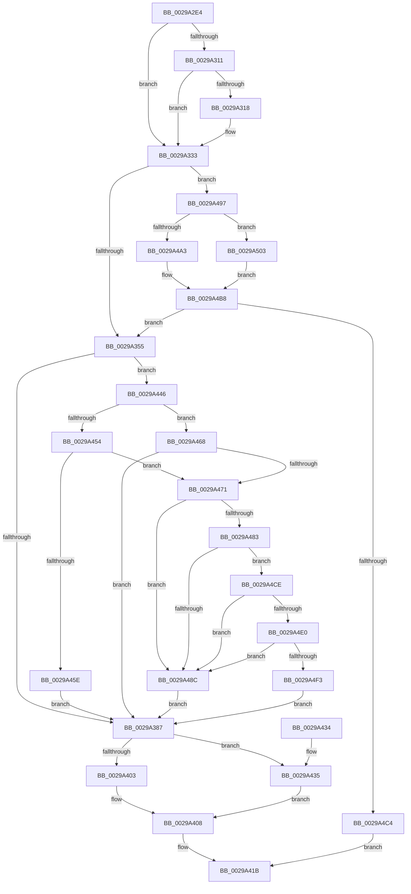

# MiSynchronousPageWrite

- RVA: `0x0029A2E4`–`0x0029A51A` (길이 `566` bytes)
- VA: `0x000000014029A2E4`
- 실행 섹션: `.text`
- PDB 이름 있음: `예`; PDB Function 태그: `아니요`
- unwind 정보 RVA: `0x00067CD4`
- 디코드: `133`개 명령, `566/566` bytes 표시
- 미해석 바이트: `0` (있으면 어셈블리에 `.byte`로 보존)

> 이 문서는 커널 이미지의 기계어와 PDB 기호를 분석해 생성했습니다. 4번과 5번은 함수 원형과 자료형을 바이너리 사용 방식에서 추정한 C 해석이며 원본 소스 복구 결과는 아닙니다.

## 1. Dependencies

- 직접 호출 지점: **10**; 고유 호출 대상: **10**
- 직접 호출자로 확인된 함수: **1**
- RIP 상대 이미지 참조: **4**

### Outgoing calls
- `0x0029A333` → [IoGetRelatedDeviceObject](IoGetRelatedDeviceObject_function_0029B120.md) (function, `0x0029B120`)
- `0x0029A344` → [IopAllocateIrpExReturn](../20/IopAllocateIrpExReturn_function_00207720.md) (function, `0x00207720`)
- `0x0029A377` → [PsGetBaseIoPriorityThread](PsGetBaseIoPriorityThread_function_0029A520.md) (function, `0x0029A520`)
- `0x0029A403` → [IoSetDiskIoAttributionFromThread](IoSetDiskIoAttributionFromThread_function_0029BF20.md) (function, `0x0029BF20`)
- `0x0029A40B` → [IopQueueThreadIrp](../20/IopQueueThreadIrp_function_002075C0.md) (function, `0x002075C0`)
- `0x0029A416` → [IofCallDriver](IofCallDriver_function_0029B4B0.md) (function, `0x0029B4B0`)
- `0x0029A43F` → [IopSetDiskIoAttributionExtension](IopSetDiskIoAttributionExtension_function_0029C0E4.md) (function, `0x0029C0E4`)
- `0x0029A49A` → [MmIsFileObjectAPagingFile](MmIsFileObjectAPagingFile_function_0029BDAC.md) (function, `0x0029BDAC`)
- `0x0029A4B3` → [IopAllocateReserveIrp](IopAllocateReserveIrp_function_0029C218.md) (function, `0x0029C218`)
- `0x0029A513` → [IopAllocateBackpocketIrp](../59/IopAllocateBackpocketIrp_function_00596CE0.md) (function, `0x00596CE0`)

### Direct callers
- [MiZeroPageFileFirstPage](../../page/80/MiZeroPageFileFirstPage_function_00800678.md) at `0x0080070D`

### Static image references
- `0x0029A48C` → RVA `0x00F8D174` (`.data`; read/write)
- `0x0029A4A3` → RVA `0x00F8D8C4` (`.data`; read/write)
- `0x0029A4F3` → RVA `0x00F8D178` (`.data`; read/write)
- `0x0029A503` → RVA `0x00F8D8C0` (`.data`; read/write)

## 2. Other-region calls and transfers

- 다른 실행 섹션으로 향하는 call: **0**
- 별도 외부 분기/꼬리 이동을 확인하지 못했습니다.

## 3. Assembly (complete function range)

```asm
0029A2E4  48 89 5C 24 08                  mov qword ptr [rsp + 8], rbx
0029A2E9  48 89 6C 24 10                  mov qword ptr [rsp + 0x10], rbp
0029A2EE  48 89 74 24 18                  mov qword ptr [rsp + 0x18], rsi
0029A2F3  57                              push rdi
0029A2F4  41 56                           push r14
0029A2F6  41 57                           push r15
0029A2F8  48 83 EC 20                     sub rsp, 0x20
0029A2FC  48 8B 41 28                     mov rax, qword ptr [rcx + 0x28]
0029A300  4D 8B F1                        mov r14, r9
0029A303  4D 8B F8                        mov r15, r8
0029A306  48 8B EA                        mov rbp, rdx
0029A309  48 8B F1                        mov rsi, rcx
0029A30C  48 85 C0                        test rax, rax
0029A30F  74 22                           je 0x14029a333
0029A311  48 83 78 08 00                  cmp qword ptr [rax + 8], 0
0029A316  74 1B                           je 0x14029a333
0029A318  65 FF 04 25 74 89 00 00         inc dword ptr gs:[0x8974]
0029A320  8B 42 28                        mov eax, dword ptr [rdx + 0x28]
0029A323  05 FF 0F 00 00                  add eax, 0xfff
0029A328  C1 E8 0C                        shr eax, 0xc
0029A32B  65 01 04 25 78 89 00 00         add dword ptr gs:[0x8978], eax
0029A333  E8 E8 0D 00 00                  call 0x14029b120
0029A338  45 33 C0                        xor r8d, r8d
0029A33B  48 8B C8                        mov rcx, rax
0029A33E  48 8B F8                        mov rdi, rax
0029A341  8A 50 4C                        mov dl, byte ptr [rax + 0x4c]
0029A344  E8 D7 D3 F6 FF                  call 0x140207720
0029A349  48 8B D8                        mov rbx, rax
0029A34C  48 85 C0                        test rax, rax
0029A34F  0F 84 42 01 00 00               je 0x14029a497
0029A355  80 4B 47 20                     or byte ptr [rbx + 0x47], 0x20
0029A359  4C 8B 8B B8 00 00 00            mov r9, qword ptr [rbx + 0xb8]
0029A360  48 89 6B 08                     mov qword ptr [rbx + 8], rbp
0029A364  C7 43 10 43 00 00 00            mov dword ptr [rbx + 0x10], 0x43
0029A36B  65 4C 8B 04 25 88 01 00 00      mov r8, qword ptr gs:[0x188]
0029A374  49 8B C8                        mov rcx, r8
0029A377  E8 A4 01 00 00                  call 0x14029a520
0029A37C  8B D0                           mov edx, eax
0029A37E  83 F8 02                        cmp eax, 2
0029A381  0F 8C BF 00 00 00               jl 0x14029a446
0029A387  8B 43 10                        mov eax, dword ptr [rbx + 0x10]
0029A38A  48 8B CB                        mov rcx, rbx
0029A38D  25 FF FF F1 FF                  and eax, 0xfff1ffff
0029A392  C6 43 40 00                     mov byte ptr [rbx + 0x40], 0
0029A396  4C 89 73 50                     mov qword ptr [rbx + 0x50], r14
0029A39A  C1 E2 11                        shl edx, 0x11
0029A39D  81 C2 00 00 02 00               add edx, 0x20000
0029A3A3  0B D0                           or edx, eax
0029A3A5  48 8B 44 24 70                  mov rax, qword ptr [rsp + 0x70]
0029A3AA  48 89 43 48                     mov qword ptr [rbx + 0x48], rax
0029A3AE  89 53 10                        mov dword ptr [rbx + 0x10], edx
0029A3B1  8B 45 2C                        mov eax, dword ptr [rbp + 0x2c]
0029A3B4  48 03 45 20                     add rax, qword ptr [rbp + 0x20]
0029A3B8  48 89 43 70                     mov qword ptr [rbx + 0x70], rax
0029A3BC  48 89 B3 C0 00 00 00            mov qword ptr [rbx + 0xc0], rsi
0029A3C3  65 48 8B 04 25 88 01 00 00      mov rax, qword ptr gs:[0x188]
0029A3CC  48 89 83 98 00 00 00            mov qword ptr [rbx + 0x98], rax
0029A3D3  41 C6 41 B8 04                  mov byte ptr [r9 - 0x48], 4
0029A3D8  8B 45 28                        mov eax, dword ptr [rbp + 0x28]
0029A3DB  41 89 41 C0                     mov dword ptr [r9 - 0x40], eax
0029A3DF  49 8B 07                        mov rax, qword ptr [r15]
0029A3E2  49 89 41 D0                     mov qword ptr [r9 - 0x30], rax
0029A3E6  8A 44 24 60                     mov al, byte ptr [rsp + 0x60]
0029A3EA  41 08 41 BA                     or byte ptr [r9 - 0x46], al
0029A3EE  48 8B 44 24 68                  mov rax, qword ptr [rsp + 0x68]
0029A3F3  49 89 71 E8                     mov qword ptr [r9 - 0x18], rsi
0029A3F7  48 8B 93 98 00 00 00            mov rdx, qword ptr [rbx + 0x98]
0029A3FE  48 85 C0                        test rax, rax
0029A401  75 32                           jne 0x14029a435
0029A403  E8 18 1B 00 00                  call 0x14029bf20
0029A408  48 8B CB                        mov rcx, rbx
0029A40B  E8 B0 D1 F6 FF                  call 0x1402075c0
0029A410  48 8B D3                        mov rdx, rbx
0029A413  48 8B CF                        mov rcx, rdi
0029A416  E8 95 10 00 00                  call 0x14029b4b0
0029A41B  48 8B 5C 24 40                  mov rbx, qword ptr [rsp + 0x40]
0029A420  48 8B 6C 24 48                  mov rbp, qword ptr [rsp + 0x48]
0029A425  48 8B 74 24 50                  mov rsi, qword ptr [rsp + 0x50]
0029A42A  48 83 C4 20                     add rsp, 0x20
0029A42E  41 5F                           pop r15
0029A430  41 5E                           pop r14
0029A432  5F                              pop rdi
0029A433  C3                              ret
0029A434  CC                              int3
0029A435  4C 8B C2                        mov r8, rdx
0029A438  45 33 C9                        xor r9d, r9d
0029A43B  48 8B 50 18                     mov rdx, qword ptr [rax + 0x18]
0029A43F  E8 A0 1C 00 00                  call 0x14029c0e4
0029A444  EB C2                           jmp 0x14029a408
0029A446  65 48 8B 0C 25 88 01 00 00      mov rcx, qword ptr gs:[0x188]
0029A44F  4C 3B C1                        cmp r8, rcx
0029A452  75 14                           jne 0x14029a468
0029A454  41 83 B8 E0 05 00 00 00         cmp dword ptr [r8 + 0x5e0], 0
0029A45C  74 13                           je 0x14029a471
0029A45E  BA 02 00 00 00                  mov edx, 2
0029A463  E9 1F FF FF FF                  jmp 0x14029a387
0029A468  83 F8 02                        cmp eax, 2
0029A46B  0F 8D 16 FF FF FF               jge 0x14029a387
0029A471  65 48 8B 0C 25 88 01 00 00      mov rcx, qword ptr gs:[0x188]
0029A47A  F7 41 74 00 04 00 00            test dword ptr [rcx + 0x74], 0x400
0029A481  75 09                           jne 0x14029a48c
0029A483  80 B9 32 02 00 00 01            cmp byte ptr [rcx + 0x232], 1
0029A48A  75 42                           jne 0x14029a4ce
0029A48C  FF 05 E2 2C CF 00               inc dword ptr [rip + 0xcf2ce2]
0029A492  E9 F0 FE FF FF                  jmp 0x14029a387
0029A497  48 8B CE                        mov rcx, rsi
0029A49A  E8 0D 19 00 00                  call 0x14029bdac
0029A49F  85 C0                           test eax, eax
0029A4A1  74 60                           je 0x14029a503
0029A4A3  F0 FF 05 1A 34 CF 00            lock inc dword ptr [rip + 0xcf341a]
0029A4AA  8A 57 4C                        mov dl, byte ptr [rdi + 0x4c]
0029A4AD  41 B8 01 00 00 00               mov r8d, 1
0029A4B3  E8 60 1D 00 00                  call 0x14029c218
0029A4B8  48 8B D8                        mov rbx, rax
0029A4BB  48 85 C0                        test rax, rax
0029A4BE  0F 85 91 FE FF FF               jne 0x14029a355
0029A4C4  B8 9A 00 00 C0                  mov eax, 0xc000009a
0029A4C9  E9 4D FF FF FF                  jmp 0x14029a41b
0029A4CE  65 48 8B 04 25 88 01 00 00      mov rax, qword ptr gs:[0x188]
0029A4D7  F6 80 A8 05 00 00 40            test byte ptr [rax + 0x5a8], 0x40
0029A4DE  75 AC                           jne 0x14029a48c
0029A4E0  65 48 8B 04 25 88 01 00 00      mov rax, qword ptr gs:[0x188]
0029A4E9  48 83 B8 50 05 00 00 02         cmp qword ptr [rax + 0x550], 2
0029A4F1  74 99                           je 0x14029a48c
0029A4F3  FF 05 7F 2C CF 00               inc dword ptr [rip + 0xcf2c7f]
0029A4F9  BA 02 00 00 00                  mov edx, 2
0029A4FE  E9 84 FE FF FF                  jmp 0x14029a387
0029A503  F0 FF 05 B6 33 CF 00            lock inc dword ptr [rip + 0xcf33b6]
0029A50A  8A 57 4C                        mov dl, byte ptr [rdi + 0x4c]
0029A50D  45 33 C0                        xor r8d, r8d
0029A510  48 8B CF                        mov rcx, rdi
0029A513  E8 C8 C7 2F 00                  call 0x140596ce0
0029A518  EB 9E                           jmp 0x14029a4b8
```

## 4. C-style interpretation (structured pseudocode)

```c
__int64 __fastcall MiSynchronousPageWrite(__int64 a1, __int64 a2, __int64 a3, __int64 a4, unsigned __int8 a5, __int64 a6, __int64 a7)
{
    __int64 result;
    __int64 v_rsp;
    unsigned __int64 v_stack_p10;
    unsigned __int64 v_stack_p18;
    unsigned __int64 v_stack_p8;

    v_stack_p8 = v_rbx;
    v_stack_p10 = v_rbp;
    v_stack_p18 = v_rsi;
    v_rsp = (v_rsp) - (32);
    if (*(unsigned __int64 *)(a1 + 40) == 0) goto loc_0029A333;
    result = *(unsigned __int64 *)(a1 + 40);
    if ((*(unsigned __int64 *)(*(unsigned __int64 *)(a1 + 40) + 8)) != 0) {
        result = *(unsigned int *)(a2 + 40);
        result = (unsigned int)((result) + (0xFFFULL));
        result = (unsigned int)((result) >> (12));
    }
    result = IoGetRelatedDeviceObject(a1, a2, a3, a4);
    a3 = 0;
    result = IopAllocateIrpExReturn(result, *(unsigned __int8 *)(result + 76), a3, a4);
    if (result == 0) goto loc_0029A497;
loc_0029A355:
    *(unsigned __int64 *)(result + 8) = a2;
    *(unsigned int *)(result + 16) = 67;
    result = PsGetBaseIoPriorityThread(*(unsigned __int64 *)(gs_base + (0 + 392)), *(unsigned __int8 *)(result + 76), *(unsigned __int64 *)(gs_base + (0 + 392)), *(unsigned __int64 *)(result + 184));
    if (((unsigned int)(result)) < 2) goto loc_0029A446;
loc_0029A387:
    result = (unsigned int)(((unsigned int)(*(unsigned int *)(result + 16))) & (0xFFF1FFFFULL));
    *(unsigned __int8 *)(result + 64) = 0;
    *(unsigned __int64 *)(result + 80) = a4;
    a2 = (unsigned int)(((unsigned int)((unsigned int)(result))) << (17));
    a2 = (unsigned int)((a2) + (0x20000ULL));
    a2 = (unsigned int)((a2) | ((unsigned int)(result)));
    *(unsigned __int64 *)(result + 72) = a7;
    *(unsigned int *)(result + 16) = (unsigned int)(a2);
    result = ((unsigned int)(*(unsigned int *)(a2 + 44))) + (*(unsigned __int64 *)(a2 + 32));
    *(unsigned __int64 *)(result + 112) = result;
    *(unsigned __int64 *)(result + 192) = a1;
    *(unsigned __int64 *)(result + 152) = *(unsigned __int64 *)(gs_base + (0 + 392));
    *(unsigned __int8 *)(*(unsigned __int64 *)(result + 184) - 72) = 4;
    *(unsigned int *)(*(unsigned __int64 *)(result + 184) - 64) = (unsigned int)((unsigned int)(*(unsigned int *)(a2 + 40)));
    *(unsigned __int64 *)(*(unsigned __int64 *)(result + 184) - 48) = *(unsigned __int64 *)(a3);
    *(unsigned __int64 *)(*(unsigned __int64 *)(result + 184) - 24) = a1;
    if (a6 != 0) goto loc_0029A435;
    result = IoSetDiskIoAttributionFromThread(result, *(unsigned __int64 *)(result + 152), *(unsigned __int64 *)(gs_base + (0 + 392)), *(unsigned __int64 *)(result + 184));
loc_0029A408:
    result = IopQueueThreadIrp(result, *(unsigned __int64 *)(result + 152), *(unsigned __int64 *)(gs_base + (0 + 392)), *(unsigned __int64 *)(result + 184));
    result = IofCallDriver(result, result, *(unsigned __int64 *)(gs_base + (0 + 392)), *(unsigned __int64 *)(result + 184));
loc_0029A41B:
    v_rsp = (v_rsp) + (32);
    return result;
loc_0029A435:
    a4 = 0;
    result = IopSetDiskIoAttributionExtension(result, *(unsigned __int64 *)(result + 24), result, a4);
    goto loc_0029A408;
loc_0029A446:
    if (result != (*(unsigned __int64 *)(gs_base + (0 + 392)))) goto loc_0029A468;
    if ((*(unsigned int *)(result + 1504)) == 0) goto loc_0029A471;
    goto loc_0029A387;
loc_0029A468:
    if (((unsigned int)(result)) >= 2) goto loc_0029A387;
loc_0029A471:
    if (((*(unsigned int *)(*(unsigned __int64 *)(gs_base + (0 + 392)) + 116)) & (0x400ULL)) != 0) goto loc_0029A48C;
    if ((*(unsigned __int8 *)(*(unsigned __int64 *)(gs_base + (0 + 392)) + 562)) != 1) goto loc_0029A4CE;
loc_0029A48C:
    goto loc_0029A387;
loc_0029A497:
    result = MmIsFileObjectAPagingFile(v_stack_p18, 2, result, a4);
    if ((unsigned int)(result) == 0) goto loc_0029A503;
    result = IopAllocateReserveIrp(v_stack_p18, *(unsigned __int8 *)(result + 76), 1, a4);
loc_0029A4B8:
    if (result != 0) goto loc_0029A355;
    goto loc_0029A41B;
loc_0029A4CE:
    if (((*(unsigned __int8 *)(*(unsigned __int64 *)(gs_base + (0 + 392)) + 1448)) & (64)) != 0) goto loc_0029A48C;
    if ((*(unsigned __int64 *)(*(unsigned __int64 *)(gs_base + (0 + 392)) + 1360)) == 2) goto loc_0029A48C;
    goto loc_0029A387;
loc_0029A503:
    a3 = 0;
    result = IopAllocateBackpocketIrp(result, *(unsigned __int8 *)(result + 76), a3, a4);
    goto loc_0029A4B8;
}
```

## 5. (Beta) C Style

```c
int64_t MiSynchronousPageWrite(void *Arg1, void *Arg2, void *Arg3, int64_t Arg4, uint8_t Arg5, int64_t Arg6, int64_t Arg7)
{
    uint8_t *arg1 = (uint8_t *)Arg1;
    uint8_t *arg2 = (uint8_t *)Arg2;
    uint8_t *arg3 = (uint8_t *)Arg3;

    int64_t result;
    int64_t local_rsp;
    uint64_t v_stack_p10;
    uint64_t v_stack_p18;
    uint64_t v_stack_p8;

    v_stack_p8 = local_rbx;
    v_stack_p10 = local_rbp;
    v_stack_p18 = local_rsi;
    local_rsp = (local_rsp) - (32);
    if (*(uint64_t *)(arg1 + 0x28) == 0) goto loc_0029A333;
    result = *(uint64_t *)(arg1 + 0x28);
    if ((*(uint64_t *)(*(uint64_t *)(arg1 + 0x28) + 0x8)) != 0) {
        result = *(uint32_t *)(arg2 + 0x28);
        result = (uint32_t)((result) + (0xFFFULL));
        result = (uint32_t)((result) >> (12));
    }
    result = IoGetRelatedDeviceObject(Arg1, Arg2, Arg3, Arg4);
    Arg3 = 0;
    result = IopAllocateIrpExReturn(result, *(uint8_t *)(result + 0x4C), Arg3, Arg4);
    if (result == 0) goto loc_0029A497;
loc_0029A355:
    *(void **)(result + 0x8) = Arg2;
    *(uint32_t *)(result + 0x10) = 67;
    result = PsGetBaseIoPriorityThread(*(uint64_t *)(gs_base + (0 + 0x188)), *(uint8_t *)(result + 0x4C), *(uint64_t *)(gs_base + (0 + 0x188)), *(uint64_t *)(result + 0xB8));
    if (((uint32_t)(result)) < 2) goto loc_0029A446;
loc_0029A387:
    result = (uint32_t)(((uint32_t)(*(uint32_t *)(result + 0x10))) & (0xFFF1FFFFULL));
    *(uint8_t *)(result + 0x40) = 0;
    *(uint64_t *)(result + 0x50) = Arg4;
    Arg2 = (uint32_t)(((uint32_t)((uint32_t)(result))) << (17));
    Arg2 = (uint32_t)((Arg2) + (0x20000ULL));
    Arg2 = (uint32_t)((Arg2) | ((uint32_t)(result)));
    *(uint64_t *)(result + 0x48) = Arg7;
    *(uint32_t *)(result + 0x10) = (uint32_t)(Arg2);
    result = ((uint32_t)(*(uint32_t *)(arg2 + 0x2C))) + (*(uint64_t *)(arg2 + 0x20));
    *(uint64_t *)(result + 0x70) = result;
    *(void **)(result + 0xC0) = Arg1;
    *(uint64_t *)(result + 0x98) = *(uint64_t *)(gs_base + (0 + 0x188));
    *(uint8_t *)(*(uint64_t *)(result + 0xB8) - 0x48) = 4;
    *(uint32_t *)(*(uint64_t *)(result + 0xB8) - 0x40) = (uint32_t)((uint32_t)(*(uint32_t *)(arg2 + 0x28)));
    *(uint64_t *)(*(uint64_t *)(result + 0xB8) - 0x30) = *(uint64_t *)(arg3);
    *(void **)(*(uint64_t *)(result + 0xB8) - 0x18) = Arg1;
    if (Arg6 != 0) goto loc_0029A435;
    result = IoSetDiskIoAttributionFromThread(result, *(uint64_t *)(result + 0x98), *(uint64_t *)(gs_base + (0 + 0x188)), *(uint64_t *)(result + 0xB8));
loc_0029A408:
    result = IopQueueThreadIrp(result, *(uint64_t *)(result + 0x98), *(uint64_t *)(gs_base + (0 + 0x188)), *(uint64_t *)(result + 0xB8));
    result = IofCallDriver(result, result, *(uint64_t *)(gs_base + (0 + 0x188)), *(uint64_t *)(result + 0xB8));
loc_0029A41B:
    local_rsp = (local_rsp) + (32);
    return result;
loc_0029A435:
    Arg4 = 0;
    result = IopSetDiskIoAttributionExtension(result, *(uint64_t *)(result + 0x18), result, Arg4);
    goto loc_0029A408;
loc_0029A446:
    if (result != (*(uint64_t *)(gs_base + (0 + 0x188)))) goto loc_0029A468;
    if ((*(uint32_t *)(result + 0x5E0)) == 0) goto loc_0029A471;
    goto loc_0029A387;
loc_0029A468:
    if (((uint32_t)(result)) >= 2) goto loc_0029A387;
loc_0029A471:
    if (((*(uint32_t *)(*(uint64_t *)(gs_base + (0 + 0x188)) + 0x74)) & (0x400ULL)) != 0) goto loc_0029A48C;
    if ((*(uint8_t *)(*(uint64_t *)(gs_base + (0 + 0x188)) + 0x232)) != 1) goto loc_0029A4CE;
loc_0029A48C:
    goto loc_0029A387;
loc_0029A497:
    result = MmIsFileObjectAPagingFile(v_stack_p18, 2, result, Arg4);
    if ((uint32_t)(result) == 0) goto loc_0029A503;
    result = IopAllocateReserveIrp(v_stack_p18, *(uint8_t *)(result + 0x4C), 1, Arg4);
loc_0029A4B8:
    if (result != 0) goto loc_0029A355;
    goto loc_0029A41B;
loc_0029A4CE:
    if (((*(uint8_t *)(*(uint64_t *)(gs_base + (0 + 0x188)) + 0x5A8)) & (64)) != 0) goto loc_0029A48C;
    if ((*(uint64_t *)(*(uint64_t *)(gs_base + (0 + 0x188)) + 0x550)) == 2) goto loc_0029A48C;
    goto loc_0029A387;
loc_0029A503:
    Arg3 = 0;
    result = IopAllocateBackpocketIrp(result, *(uint8_t *)(result + 0x4C), Arg3, Arg4);
    goto loc_0029A4B8;
}
```

### 관측된 메모리 오프셋

구조체 형식이 확인되지 않은 접근은 인자 기준의 오프셋으로만 기록했습니다.

| 기준 인자 | 오프셋 표현 | 폭 (bit) | 접근 |
|---|---:|---:|---|
| `Arg1` | `+ 0x28` | `64` | `R` |
| `Arg2` | `+ 0x20` | `64` | `R` |
| `Arg2` | `+ 0x28` | `32` | `R` |
| `Arg2` | `+ 0x2C` | `32` | `R` |
| `Arg3` | `+ 0x0` | `64` | `R` |

## 6. Execution-region graph

[열기: 2D/3D 그래프와 함수 탐색 컨트롤 패널](../../../control-panel.html?section=text&rva=0x0029A2E4&view=graph)

- 2D 그래프는 위에서 아래로 흐르고, 3D 그래프는 빈 공간을 드래그해 회전합니다. Shift+드래그는 이동, 휠은 확대·축소, 함수 노드 선택은 대상 보고서 이동입니다.

### Static fallback


