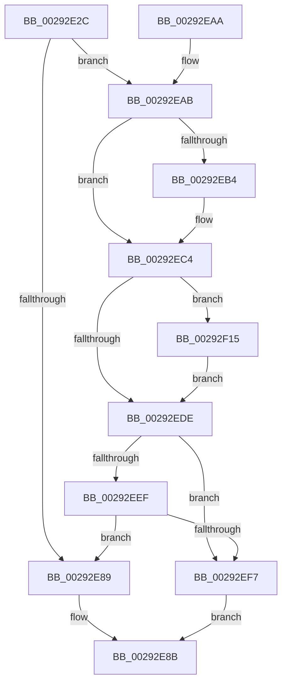

# MiTrimPteWorker

- RVA: `0x00292E2C`–`0x00292F22` (길이 `246` bytes)
- VA: `0x0000000140292E2C`
- 실행 섹션: `.text`
- PDB 이름 있음: `예`; PDB Function 태그: `아니요`
- unwind 정보 RVA: `0x0006761C`
- 디코드: `72`개 명령, `246/246` bytes 표시
- 미해석 바이트: `0` (있으면 어셈블리에 `.byte`로 보존)

> 이 문서는 커널 이미지의 기계어와 PDB 기호를 분석해 생성했습니다. 4번과 5번은 함수 원형과 자료형을 바이너리 사용 방식에서 추정한 C 해석이며 원본 소스 복구 결과는 아닙니다.

## 1. Dependencies

- 직접 호출 지점: **5**; 고유 호출 대상: **5**
- 직접 호출자로 확인된 함수: **1**
- RIP 상대 이미지 참조: **0**

### Outgoing calls
- `0x00292E7E` → [MiTrimThisWsle](MiTrimThisWsle_function_002932E4.md) (function, `0x002932E4`)
- `0x00292EBB` → [MiAcquirePrcbAgeTrimLists](MiAcquirePrcbAgeTrimLists_function_002918B0.md) (function, `0x002918B0`)
- `0x00292ED1` → [MiInsertTbFlushEntry](MiInsertTbFlushEntry_function_00293670.md) (function, `0x00293670`)
- `0x00292EFD` → [MiTrimWorkingSetBuildup](../3E/MiTrimWorkingSetBuildup_function_003E03FC.md) (function, `0x003E03FC`)
- `0x00292F1B` → [MI_WSLE_LOG_ACCESS](MI_WSLE_LOG_ACCESS_function_00294400.md) (function, `0x00294400`)

### Direct callers
- [MiTrimWorkingSetVpabCallback](../40/MiTrimWorkingSetVpabCallback_function_0040FCD0.md) at `0x0040FD65`

### Static image references
- 디코드된 RIP-relative 메모리 참조가 없습니다.

## 2. Other-region calls and transfers

- 다른 실행 섹션으로 향하는 call: **0**
- 별도 외부 분기/꼬리 이동을 확인하지 못했습니다.

## 3. Assembly (complete function range)

```asm
00292E2C  4C 8B DC                        mov r11, rsp
00292E2F  49 89 5B 08                     mov qword ptr [r11 + 8], rbx
00292E33  49 89 6B 10                     mov qword ptr [r11 + 0x10], rbp
00292E37  49 89 73 18                     mov qword ptr [r11 + 0x18], rsi
00292E3B  49 89 7B 20                     mov qword ptr [r11 + 0x20], rdi
00292E3F  41 55                           push r13
00292E41  41 56                           push r14
00292E43  41 57                           push r15
00292E45  48 83 EC 30                     sub rsp, 0x30
00292E49  48 8B 84 24 80 00 00 00         mov rax, qword ptr [rsp + 0x80]
00292E51  4D 8B D1                        mov r10, r9
00292E54  48 8B 69 20                     mov rbp, qword ptr [rcx + 0x20]
00292E58  4D 8B F0                        mov r14, r8
00292E5B  48 8B 5C 24 70                  mov rbx, qword ptr [rsp + 0x70]
00292E60  4C 8B FA                        mov r15, rdx
00292E63  49 89 43 E0                     mov qword ptr [r11 - 0x20], rax
00292E67  4C 8B E9                        mov r13, rcx
00292E6A  8B 44 24 78                     mov eax, dword ptr [rsp + 0x78]
00292E6E  4C 8B CB                        mov r9, rbx
00292E71  4D 8B C2                        mov r8, r10
00292E74  89 44 24 20                     mov dword ptr [rsp + 0x20], eax
00292E78  49 8B D6                        mov rdx, r14
00292E7B  48 8B CD                        mov rcx, rbp
00292E7E  E8 61 04 00 00                  call 0x1402932e4
00292E83  33 F6                           xor esi, esi
00292E85  85 C0                           test eax, eax
00292E87  75 22                           jne 0x140292eab
00292E89  33 C0                           xor eax, eax
00292E8B  48 8B 5C 24 50                  mov rbx, qword ptr [rsp + 0x50]
00292E90  48 8B 6C 24 58                  mov rbp, qword ptr [rsp + 0x58]
00292E95  48 8B 74 24 60                  mov rsi, qword ptr [rsp + 0x60]
00292E9A  48 8B 7C 24 68                  mov rdi, qword ptr [rsp + 0x68]
00292E9F  48 83 C4 30                     add rsp, 0x30
00292EA3  41 5F                           pop r15
00292EA5  41 5E                           pop r14
00292EA7  41 5D                           pop r13
00292EA9  C3                              ret
00292EAA  CC                              int3
00292EAB  48 8B 7B 48                     mov rdi, qword ptr [rbx + 0x48]
00292EAF  48 85 FF                        test rdi, rdi
00292EB2  75 10                           jne 0x140292ec4
00292EB4  48 8D 53 40                     lea rdx, [rbx + 0x40]
00292EB8  48 8B CD                        mov rcx, rbp
00292EBB  E8 F0 E9 FF FF                  call 0x1402918b0
00292EC0  48 8B 7B 48                     mov rdi, qword ptr [rbx + 0x48]
00292EC4  45 33 C9                        xor r9d, r9d
00292EC7  49 8B D6                        mov rdx, r14
00292ECA  48 8B CF                        mov rcx, rdi
00292ECD  45 8D 41 01                     lea r8d, [r9 + 1]
00292ED1  E8 9A 07 00 00                  call 0x140293670
00292ED6  F7 03 00 01 00 00               test dword ptr [rbx], 0x100
00292EDC  75 37                           jne 0x140292f15
00292EDE  48 8B 43 10                     mov rax, qword ptr [rbx + 0x10]
00292EE2  48 FF C0                        inc rax
00292EE5  48 89 43 10                     mov qword ptr [rbx + 0x10], rax
00292EE9  48 3B 43 08                     cmp rax, qword ptr [rbx + 8]
00292EED  74 08                           je 0x140292ef7
00292EEF  8B 4F 0C                        mov ecx, dword ptr [rdi + 0xc]
00292EF2  39 4F 1C                        cmp dword ptr [rdi + 0x1c], ecx
00292EF5  75 92                           jne 0x140292e89
00292EF7  48 8B D3                        mov rdx, rbx
00292EFA  49 8B CD                        mov rcx, r13
00292EFD  E8 FA D4 14 00                  call 0x1403e03fc
00292F02  48 8B 4B 08                     mov rcx, qword ptr [rbx + 8]
00292F06  48 39 4B 10                     cmp qword ptr [rbx + 0x10], rcx
00292F0A  40 0F 94 C6                     sete sil
00292F0E  8B C6                           mov eax, esi
00292F10  E9 76 FF FF FF                  jmp 0x140292e8b
00292F15  49 8B D7                        mov rdx, r15
00292F18  48 8B CD                        mov rcx, rbp
00292F1B  E8 E0 14 00 00                  call 0x140294400
00292F20  EB BC                           jmp 0x140292ede
```

## 4. C-style interpretation (structured pseudocode)

```c
__int64 __fastcall MiTrimPteWorker(__int64 a1, __int64 a2, __int64 a3, __int64 a4, __int64 a5, unsigned int a6, __int64 a7)
{
    __int64 result;
    __int64 v_rdi;
    __int64 v_rsi;
    __int64 v_rsp;
    unsigned int v_stack_m28;
    unsigned __int64 v_stack_p10;
    unsigned __int64 v_stack_p18;
    unsigned __int64 v_stack_p20;
    unsigned __int64 v_stack_p8;

    *(unsigned __int64 *)(v_rsp + 8) = v_rbx;
    *(unsigned __int64 *)(v_rsp + 16) = v_rbp;
    *(unsigned __int64 *)(v_rsp + 24) = v_rsi;
    *(unsigned __int64 *)(v_rsp + 32) = v_rdi;
    v_rsp = (v_rsp) - (48);
    *(unsigned __int64 *)(v_rsp - 32) = a7;
    v_stack_m28 = (unsigned int)((unsigned int)(a6));
    result = MiTrimThisWsle(*(unsigned __int64 *)(a1 + 32), a3, a4, a5);
    v_rsi = 0;
    if ((unsigned int)(result) != 0) goto loc_00292EAB;
loc_00292E89:
    result = 0;
loc_00292E8B:
    v_rsp = (v_rsp) + (48);
    return result;
loc_00292EAB:
    v_rdi = *(unsigned __int64 *)(v_stack_p8 + 72);
    if (*(unsigned __int64 *)(v_stack_p8 + 72) == 0) {
        a2 = v_stack_p8 + 64;
        a1 = v_stack_p10;
        result = MiAcquirePrcbAgeTrimLists(a1, a2, a4, a5);
        v_rdi = *(unsigned __int64 *)(v_stack_p8 + 72);
    }
    a4 = 0;
    result = MiInsertTbFlushEntry(v_rdi, a3, a4 + 1, a4);
    if (((*(unsigned int *)(v_stack_p8)) & (256)) != 0) goto loc_00292F15;
loc_00292EDE:
    result = (*(unsigned __int64 *)(v_stack_p8 + 16)) + 1;
    *(unsigned __int64 *)(v_stack_p8 + 16) = result;
    if (result == (*(unsigned __int64 *)(v_stack_p8 + 8))) goto loc_00292EF7;
    if ((*(unsigned int *)(v_rdi + 28)) != ((unsigned int)((unsigned int)(*(unsigned int *)(v_rdi + 12))))) goto loc_00292E89;
loc_00292EF7:
    result = MiTrimWorkingSetBuildup(a1, v_stack_p8, a4 + 1, a4);
    v_rsi = ((*(unsigned __int64 *)(v_stack_p8 + 16)) == (*(unsigned __int64 *)(v_stack_p8 + 8))) ? 1 : 0;
    goto loc_00292E8B;
loc_00292F15:
    result = MI_WSLE_LOG_ACCESS(v_stack_p10, a2, a4 + 1, a4);
    goto loc_00292EDE;
}
```

## 5. (Beta) C Style

```c
int64_t MiTrimPteWorker(void *Arg1, int64_t Arg2, int64_t Arg3, int64_t Arg4, void *Arg5, uint32_t Arg6, int64_t Arg7)
{
    uint8_t *arg1 = (uint8_t *)Arg1;
    uint8_t *arg5 = (uint8_t *)Arg5;

    int64_t result;
    int64_t local_rdi;
    int64_t local_rsi;
    int64_t local_rsp;
    uint32_t v_stack_m28;
    uint64_t v_stack_p10;
    uint64_t v_stack_p18;
    uint64_t v_stack_p20;
    uint64_t v_stack_p8;

    *(uint64_t *)(local_rsp + 0x8) = local_rbx;
    *(uint64_t *)(local_rsp + 0x10) = local_rbp;
    *(uint64_t *)(local_rsp + 0x18) = local_rsi;
    *(uint64_t *)(local_rsp + 0x20) = local_rdi;
    local_rsp = (local_rsp) - (48);
    *(uint64_t *)(local_rsp - 0x20) = Arg7;
    v_stack_m28 = (uint32_t)((uint32_t)(Arg6));
    result = MiTrimThisWsle(*(uint64_t *)(arg1 + 0x20), Arg3, Arg4, Arg5);
    local_rsi = 0;
    if ((uint32_t)(result) != 0) goto loc_00292EAB;
loc_00292E89:
    result = 0;
loc_00292E8B:
    local_rsp = (local_rsp) + (48);
    return result;
loc_00292EAB:
    local_rdi = *(uint64_t *)(v_stack_p8 + 0x48);
    if (*(uint64_t *)(v_stack_p8 + 0x48) == 0) {
        Arg2 = v_stack_p8 + 64;
        Arg1 = v_stack_p10;
        result = MiAcquirePrcbAgeTrimLists(Arg1, Arg2, Arg4, Arg5);
        local_rdi = *(uint64_t *)(v_stack_p8 + 0x48);
    }
    Arg4 = 0;
    result = MiInsertTbFlushEntry(local_rdi, Arg3, Arg4 + 1, Arg4);
    if (((*(uint32_t *)(v_stack_p8)) & (256)) != 0) goto loc_00292F15;
loc_00292EDE:
    result = (*(uint64_t *)(v_stack_p8 + 0x10)) + 1;
    *(uint64_t *)(v_stack_p8 + 0x10) = result;
    if (result == (*(uint64_t *)(v_stack_p8 + 0x8))) goto loc_00292EF7;
    if ((*(uint32_t *)(local_rdi + 0x1C)) != ((uint32_t)((uint32_t)(*(uint32_t *)(local_rdi + 0xC))))) goto loc_00292E89;
loc_00292EF7:
    result = MiTrimWorkingSetBuildup(Arg1, v_stack_p8, Arg4 + 1, Arg4);
    local_rsi = ((*(uint64_t *)(v_stack_p8 + 0x10)) == (*(uint64_t *)(v_stack_p8 + 0x8))) ? 1 : 0;
    goto loc_00292E8B;
loc_00292F15:
    result = MI_WSLE_LOG_ACCESS(v_stack_p10, Arg2, Arg4 + 1, Arg4);
    goto loc_00292EDE;
}
```

### 관측된 메모리 오프셋

구조체 형식이 확인되지 않은 접근은 인자 기준의 오프셋으로만 기록했습니다.

| 기준 인자 | 오프셋 표현 | 폭 (bit) | 접근 |
|---|---:|---:|---|
| `Arg1` | `+ 0x20` | `64` | `R` |
| `Arg5` | `+ 0x0` | `32` | `R` |
| `Arg5` | `+ 0x8` | `64` | `R` |
| `Arg5` | `+ 0x10` | `64` | `R` |
| `Arg5` | `+ 0x10` | `64` | `W` |
| `Arg5` | `+ 0x40` | `64` | `R` |
| `Arg5` | `+ 0x48` | `64` | `R` |

## 6. Execution-region graph

[열기: 2D/3D 그래프와 함수 탐색 컨트롤 패널](../../../control-panel.html?section=text&rva=0x00292E2C&view=graph)

- 2D 그래프는 위에서 아래로 흐르고, 3D 그래프는 빈 공간을 드래그해 회전합니다. Shift+드래그는 이동, 휠은 확대·축소, 함수 노드 선택은 대상 보고서 이동입니다.

### Static fallback


