# MiTrimPte

- RVA: `0x00292F30`–`0x002932DC` (길이 `940` bytes)
- VA: `0x0000000140292F30`
- 실행 섹션: `.text`
- PDB 이름 있음: `예`; PDB Function 태그: `아니요`
- unwind 정보 RVA: `0x0006763C`
- 디코드: `228`개 명령, `940/940` bytes 표시
- 미해석 바이트: `0` (있으면 어셈블리에 `.byte`로 보존)

> 이 문서는 커널 이미지의 기계어와 PDB 기호를 분석해 생성했습니다. 4번과 5번은 함수 원형과 자료형을 바이너리 사용 방식에서 추정한 C 해석이며 원본 소스 복구 결과는 아닙니다.

## 1. Dependencies

- 직접 호출 지점: **11**; 고유 호출 대상: **8**
- 직접 호출자로 확인된 함수: **1**
- RIP 상대 이미지 참조: **0**

### Outgoing calls
- `0x00292F7E` → [MI_READ_PTE_LOCK_FREE](../28/MI_READ_PTE_LOCK_FREE_function_002828A0.md) (function, `0x002828A0`)
- `0x00293036` → [MI_READ_PTE_LOCK_FREE](../28/MI_READ_PTE_LOCK_FREE_function_002828A0.md) (function, `0x002828A0`)
- `0x002930C9` → [MiTrimThisWsle](MiTrimThisWsle_function_002932E4.md) (function, `0x002932E4`)
- `0x00293111` → [MiAcquirePrcbAgeTrimLists](MiAcquirePrcbAgeTrimLists_function_002918B0.md) (function, `0x002918B0`)
- `0x00293127` → [MiInsertTbFlushEntry](MiInsertTbFlushEntry_function_00293670.md) (function, `0x00293670`)
- `0x0029315C` → [MiTrimWorkingSetBuildup](../3E/MiTrimWorkingSetBuildup_function_003E03FC.md) (function, `0x003E03FC`)
- `0x002931C2` → [MiDemoteCombinedPte](../22/MiDemoteCombinedPte_function_0022ABAC.md) (function, `0x0022ABAC`)
- `0x002931DD` → [MI_WSLE_LOG_ACCESS](MI_WSLE_LOG_ACCESS_function_00294400.md) (function, `0x00294400`)
- `0x0029320D` → [MI_READ_PTE_LOCK_FREE](../28/MI_READ_PTE_LOCK_FREE_function_002828A0.md) (function, `0x002828A0`)
- `0x00293254` → [MiIsPageTableLocked](../22/MiIsPageTableLocked_function_0022A5B0.md) (function, `0x0022A5B0`)
- `0x002932D5` → [MiAcquirePrcbAgeTrimLists](MiAcquirePrcbAgeTrimLists_function_002918B0.md) (function, `0x002918B0`)

### Direct callers
- [MiFastTrimWorkingSet](../2A/MiFastTrimWorkingSet_function_002AD420.md) at `0x002AD69C`
- [MiFastTrimWorkingSet](../2A/MiFastTrimWorkingSet_function_002AD420.md) at `0x002AD82B`

### Static image references
- 디코드된 RIP-relative 메모리 참조가 없습니다.

## 2. Other-region calls and transfers

- 다른 실행 섹션으로 향하는 call: **0**
- 별도 외부 분기/꼬리 이동을 확인하지 못했습니다.

## 3. Assembly (complete function range)

```asm
00292F30  48 8B C4                        mov rax, rsp
00292F33  44 89 40 18                     mov dword ptr [rax + 0x18], r8d
00292F37  48 89 48 08                     mov qword ptr [rax + 8], rcx
00292F3B  53                              push rbx
00292F3C  55                              push rbp
00292F3D  56                              push rsi
00292F3E  57                              push rdi
00292F3F  41 54                           push r12
00292F41  41 55                           push r13
00292F43  41 56                           push r14
00292F45  41 57                           push r15
00292F47  48 83 EC 38                     sub rsp, 0x38
00292F4B  83 60 10 00                     and dword ptr [rax + 0x10], 0
00292F4F  4C 8B FA                        mov r15, rdx
00292F52  48 B8 00 00 00 00 80 F6 FF FF   movabs rax, 0xfffff68000000000
00292F5C  4C 8B E1                        mov r12, rcx
00292F5F  48 8B E8                        mov rbp, rax
00292F62  4C 8B 69 20                     mov r13, qword ptr [rcx + 0x20]
00292F66  48 8B FA                        mov rdi, rdx
00292F69  48 C1 E7 19                     shl rdi, 0x19
00292F6D  48 8B CA                        mov rcx, rdx
00292F70  48 C1 E5 19                     shl rbp, 0x19
00292F74  48 2B FD                        sub rdi, rbp
00292F77  4C 8B F7                        mov r14, rdi
00292F7A  49 C1 FE 10                     sar r14, 0x10
00292F7E  E8 1D F9 FE FF                  call 0x1402828a0
00292F83  49 8B B4 24 B8 00 00 00         mov rsi, qword ptr [r12 + 0xb8]
00292F8B  48 8B D8                        mov rbx, rax
00292F8E  48 FF 46 20                     inc qword ptr [rsi + 0x20]
00292F92  48 8B 4E 10                     mov rcx, qword ptr [rsi + 0x10]
00292F96  48 3B 4E 08                     cmp rcx, qword ptr [rsi + 8]
00292F9A  0F 84 CF 01 00 00               je 0x14029316f
00292FA0  8B 06                           mov eax, dword ptr [rsi]
00292FA2  0F BA E0 0E                     bt eax, 0xe
00292FA6  73 22                           jae 0x140292fca
00292FA8  0F BA E0 0F                     bt eax, 0xf
00292FAC  0F 82 B4 02 00 00               jb 0x140293266
00292FB2  49 8B 95 90 00 00 00            mov rdx, qword ptr [r13 + 0x90]
00292FB9  48 8B 4E 38                     mov rcx, qword ptr [rsi + 0x38]
00292FBD  48 2B 4E 08                     sub rcx, qword ptr [rsi + 8]
00292FC1  48 3B D1                        cmp rdx, rcx
00292FC4  0F 86 A5 01 00 00               jbe 0x14029316f
00292FCA  83 BC 24 90 00 00 00 00         cmp dword ptr [rsp + 0x90], 0
00292FD2  49 8B 44 24 20                  mov rax, qword ptr [r12 + 0x20]
00292FD7  49 BA FF FF FF FF FF F6 FF FF   movabs r10, 0xfffff6ffffffffff
00292FE1  49 B9 00 00 00 00 80 F6 FF FF   movabs r9, 0xfffff68000000000
00292FEB  4C 8B 40 10                     mov r8, qword ptr [rax + 0x10]
00292FEF  0F 85 83 02 00 00               jne 0x140293278
00292FF5  49 8D 57 08                     lea rdx, [r15 + 8]
00292FF9  49 89 10                        mov qword ptr [r8], rdx
00292FFC  49 8B C1                        mov rax, r9
00292FFF  48 BD 00 00 00 00 00 DE FF FF   movabs rbp, 0xffffde0000000000
00293009  48 BF FF FF FF FF FF 00 00 00   movabs rdi, 0xffffffffff
00293013  4C 3B F0                        cmp r14, rax
00293016  0F 83 CB 01 00 00               jae 0x1402931e7
0029301C  49 8B CE                        mov rcx, r14
0029301F  48 B8 F8 FF FF FF 7F 00 00 00   movabs rax, 0x7ffffffff8
00293029  48 C1 E9 09                     shr rcx, 9
0029302D  48 23 C8                        and rcx, rax
00293030  49 8B C1                        mov rax, r9
00293033  48 03 C8                        add rcx, rax
00293036  E8 65 F8 FE FF                  call 0x1402828a0
0029303B  48 C1 E8 38                     shr rax, 0x38
0029303F  83 E0 0F                        and eax, 0xf
00293042  8B F8                           mov edi, eax
00293044  8B 06                           mov eax, dword ptr [rsi]
00293046  48 B9 FF FF FF FF FF 00 00 00   movabs rcx, 0xffffffffff
00293050  83 E0 0F                        and eax, 0xf
00293053  89 84 24 98 00 00 00            mov dword ptr [rsp + 0x98], eax
0029305A  48 8B C3                        mov rax, rbx
0029305D  48 C1 E8 0C                     shr rax, 0xc
00293061  48 23 C1                        and rax, rcx
00293064  48 8D 2C 40                     lea rbp, [rax + rax*2]
00293068  48 B8 00 00 00 00 00 DE FF FF   movabs rax, 0xffffde0000000000
00293072  48 C1 E5 04                     shl rbp, 4
00293076  48 8B C0                        mov rax, rax
00293079  48 03 E8                        add rbp, rax
0029307C  41 8B 85 B8 00 00 00            mov eax, dword ptr [r13 + 0xb8]
00293083  83 BC 24 90 00 00 00 00         cmp dword ptr [rsp + 0x90], 0
0029308B  0F 85 A2 01 00 00               jne 0x140293233
00293091  48 8B 45 28                     mov rax, qword ptr [rbp + 0x28]
00293095  48 0F BA E0 28                  bt rax, 0x28
0029309A  0F 83 F1 00 00 00               jae 0x140293191
002930A0  4D 8B 64 24 20                  mov r12, qword ptr [r12 + 0x20]
002930A5  48 8D 84 24 88 00 00 00         lea rax, [rsp + 0x88]
002930AD  48 89 44 24 28                  mov qword ptr [rsp + 0x28], rax
002930B2  4C 8B CE                        mov r9, rsi
002930B5  48 C1 EB 05                     shr rbx, 5
002930B9  4C 8B C5                        mov r8, rbp
002930BC  83 E3 01                        and ebx, 1
002930BF  49 8B D6                        mov rdx, r14
002930C2  49 8B CC                        mov rcx, r12
002930C5  89 5C 24 20                     mov dword ptr [rsp + 0x20], ebx
002930C9  E8 16 02 00 00                  call 0x1402932e4
002930CE  85 C0                           test eax, eax
002930D0  75 2F                           jne 0x140293101
002930D2  83 BC 24 88 00 00 00 00         cmp dword ptr [rsp + 0x88], 0
002930DA  0F 85 CE 01 00 00               jne 0x1402932ae
002930E0  3B BC 24 98 00 00 00            cmp edi, dword ptr [rsp + 0x98]
002930E7  0F 83 8C 00 00 00               jae 0x140293179
002930ED  33 C0                           xor eax, eax
002930EF  48 83 C4 38                     add rsp, 0x38
002930F3  41 5F                           pop r15
002930F5  41 5E                           pop r14
002930F7  41 5D                           pop r13
002930F9  41 5C                           pop r12
002930FB  5F                              pop rdi
002930FC  5E                              pop rsi
002930FD  5D                              pop rbp
002930FE  5B                              pop rbx
002930FF  C3                              ret
00293100  CC                              int3
00293101  48 8B 5E 48                     mov rbx, qword ptr [rsi + 0x48]
00293105  48 85 DB                        test rbx, rbx
00293108  75 10                           jne 0x14029311a
0029310A  48 8D 56 40                     lea rdx, [rsi + 0x40]
0029310E  49 8B CC                        mov rcx, r12
00293111  E8 9A E7 FF FF                  call 0x1402918b0
00293116  48 8B 5E 48                     mov rbx, qword ptr [rsi + 0x48]
0029311A  45 33 C9                        xor r9d, r9d
0029311D  49 8B D6                        mov rdx, r14
00293120  48 8B CB                        mov rcx, rbx
00293123  45 8D 41 01                     lea r8d, [r9 + 1]
00293127  E8 44 05 00 00                  call 0x140293670
0029312C  F7 06 00 01 00 00               test dword ptr [rsi], 0x100
00293132  0F 85 9F 00 00 00               jne 0x1402931d7
00293138  48 8B 46 10                     mov rax, qword ptr [rsi + 0x10]
0029313C  48 FF C0                        inc rax
0029313F  48 89 46 10                     mov qword ptr [rsi + 0x10], rax
00293143  48 3B 46 08                     cmp rax, qword ptr [rsi + 8]
00293147  74 08                           je 0x140293151
00293149  8B 43 0C                        mov eax, dword ptr [rbx + 0xc]
0029314C  39 43 1C                        cmp dword ptr [rbx + 0x1c], eax
0029314F  75 81                           jne 0x1402930d2
00293151  48 8B 8C 24 80 00 00 00         mov rcx, qword ptr [rsp + 0x80]
00293159  48 8B D6                        mov rdx, rsi
0029315C  E8 9B D2 14 00                  call 0x1403e03fc
00293161  48 8B 46 08                     mov rax, qword ptr [rsi + 8]
00293165  48 39 46 10                     cmp qword ptr [rsi + 0x10], rax
00293169  0F 85 63 FF FF FF               jne 0x1402930d2
0029316F  B8 04 00 00 00                  mov eax, 4
00293174  E9 76 FF FF FF                  jmp 0x1402930ef
00293179  48 FF 46 28                     inc qword ptr [rsi + 0x28]
0029317D  48 8B 46 28                     mov rax, qword ptr [rsi + 0x28]
00293181  48 3B 46 30                     cmp rax, qword ptr [rsi + 0x30]
00293185  1B C0                           sbb eax, eax
00293187  F7 D0                           not eax
00293189  83 E0 04                        and eax, 4
0029318C  E9 5E FF FF FF                  jmp 0x1402930ef
00293191  48 8B 45 08                     mov rax, qword ptr [rbp + 8]
00293195  48 85 C0                        test rax, rax
00293198  0F 88 02 FF FF FF               js 0x1402930a0
0029319E  48 8B 45 08                     mov rax, qword ptr [rbp + 8]
002931A2  48 85 C0                        test rax, rax
002931A5  0F 84 F5 FE FF FF               je 0x1402930a0
002931AB  4C 8B 45 08                     mov r8, qword ptr [rbp + 8]
002931AF  48 B8 00 00 00 00 00 00 00 80   movabs rax, 0x8000000000000000
002931B9  4C 0B C0                        or r8, rax
002931BC  49 8B D7                        mov rdx, r15
002931BF  49 8B CD                        mov rcx, r13
002931C2  E8 E5 79 F9 FF                  call 0x14022abac
002931C7  85 C0                           test eax, eax
002931C9  0F 84 D1 FE FF FF               je 0x1402930a0
002931CF  49 8B 1F                        mov rbx, qword ptr [r15]
002931D2  E9 C9 FE FF FF                  jmp 0x1402930a0
002931D7  49 8B D7                        mov rdx, r15
002931DA  49 8B CC                        mov rcx, r12
002931DD  E8 1E 12 00 00                  call 0x140294400
002931E2  E9 51 FF FF FF                  jmp 0x140293138
002931E7  49 8B C2                        mov rax, r10
002931EA  4C 3B F0                        cmp r14, rax
002931ED  0F 87 29 FE FF FF               ja 0x14029301c
002931F3  49 8B CE                        mov rcx, r14
002931F6  48 B8 F8 FF FF FF 7F 00 00 00   movabs rax, 0x7ffffffff8
00293200  48 C1 E9 09                     shr rcx, 9
00293204  48 23 C8                        and rcx, rax
00293207  49 8B C1                        mov rax, r9
0029320A  48 03 C8                        add rcx, rax
0029320D  E8 8E F6 FE FF                  call 0x1402828a0
00293212  48 C1 E8 0C                     shr rax, 0xc
00293216  48 23 C7                        and rax, rdi
00293219  48 8D 3C 40                     lea rdi, [rax + rax*2]
0029321D  48 03 FF                        add rdi, rdi
00293220  48 8B C5                        mov rax, rbp
00293223  48 8B 3C F8                     mov rdi, qword ptr [rax + rdi*8]
00293227  48 C1 EF 2A                     shr rdi, 0x2a
0029322B  83 E7 07                        and edi, 7
0029322E  E9 11 FE FF FF                  jmp 0x140293044
00293233  48 8B 45 18                     mov rax, qword ptr [rbp + 0x18]
00293237  48 B9 FF FF FF FF FF FF FF 3F   movabs rcx, 0x3fffffffffffffff
00293241  48 23 C1                        and rax, rcx
00293244  48 83 F8 01                     cmp rax, 1
00293248  0F 85 92 FE FF FF               jne 0x1402930e0
0029324E  49 8B D7                        mov rdx, r15
00293251  49 8B CD                        mov rcx, r13
00293254  E8 57 73 F9 FF                  call 0x14022a5b0
00293259  85 C0                           test eax, eax
0029325B  0F 84 30 FE FF FF               je 0x140293091
00293261  E9 7A FE FF FF                  jmp 0x1402930e0
00293266  48 81 F9 00 01 00 00            cmp rcx, 0x100
0029326D  0F 82 3F FD FF FF               jb 0x140292fb2
00293273  E9 F7 FE FF FF                  jmp 0x14029316f
00293278  48 8D 97 00 00 00 10            lea rdx, [rdi + 0x10000000]
0029327F  48 C1 FA 10                     sar rdx, 0x10
00293283  48 8B CA                        mov rcx, rdx
00293286  48 C1 E1 19                     shl rcx, 0x19
0029328A  48 2B CD                        sub rcx, rbp
0029328D  48 C1 F9 10                     sar rcx, 0x10
00293291  49 8B C1                        mov rax, r9
00293294  48 3B C8                        cmp rcx, rax
00293297  0F 82 5C FD FF FF               jb 0x140292ff9
0029329D  49 8B C2                        mov rax, r10
002932A0  48 3B C8                        cmp rcx, rax
002932A3  0F 87 50 FD FF FF               ja 0x140292ff9
002932A9  48 8B D1                        mov rdx, rcx
002932AC  EB D8                           jmp 0x140293286
002932AE  48 83 7E 50 01                  cmp qword ptr [rsi + 0x50], 1
002932B3  74 19                           je 0x1402932ce
002932B5  48 8B 4E 50                     mov rcx, qword ptr [rsi + 0x50]
002932B9  49 81 E6 00 F0 FF FF            and r14, 0xfffffffffffff000
002932C0  8B 01                           mov eax, dword ptr [rcx]
002932C2  4C 89 74 C1 08                  mov qword ptr [rcx + rax*8 + 8], r14
002932C7  FF 01                           inc dword ptr [rcx]
002932C9  E9 12 FE FF FF                  jmp 0x1402930e0
002932CE  48 8D 56 40                     lea rdx, [rsi + 0x40]
002932D2  49 8B CD                        mov rcx, r13
002932D5  E8 D6 E5 FF FF                  call 0x1402918b0
002932DA  EB D9                           jmp 0x1402932b5
```

## 4. C-style interpretation (structured pseudocode)

```c
__int64 __fastcall MiTrimPte(__int64 a1, __int64 a2, int a3)
{
    __int64 result;
    __int64 v_r14;
    __int64 v_rbp;
    __int64 v_rbx;
    __int64 v_rdi;
    __int64 v_rsp;
    unsigned __int64 v_stack_m50;
    unsigned int v_stack_m58;
    unsigned __int64 v_stack_p10;
    unsigned int v_stack_p18;
    unsigned int v_stack_p20;
    unsigned __int64 v_stack_p80;

    *(unsigned int *)(v_rsp + 24) = a3;
    *(unsigned __int64 *)(v_rsp + 8) = a1;
    v_rsp = (v_rsp) - (56);
    v_rdi = (a2) << (25);
    v_rbp = (v_rsp) << (25);
    v_rdi = (v_rdi) - (v_rbp);
    v_r14 = (v_rdi) >> (16);
    result = MI_READ_PTE_LOCK_FREE(a2, a2, a3, a4);
    if ((*(unsigned __int64 *)(*(unsigned __int64 *)(a1 + 184) + 16)) == (*(unsigned __int64 *)(*(unsigned __int64 *)(a1 + 184) + 8))) goto loc_0029316F;
    if ((*(unsigned __int64 *)(*(unsigned __int64 *)(a1 + 184) + 16)) >= (*(unsigned __int64 *)(*(unsigned __int64 *)(a1 + 184) + 8))) goto loc_00292FCA;
    if ((*(unsigned __int64 *)(*(unsigned __int64 *)(a1 + 184) + 16)) < (*(unsigned __int64 *)(*(unsigned __int64 *)(a1 + 184) + 8))) goto loc_00293266;
loc_00292FB2:
    a1 = (*(unsigned __int64 *)(*(unsigned __int64 *)(a1 + 184) + 56)) - (*(unsigned __int64 *)(*(unsigned __int64 *)(a1 + 184) + 8));
    if ((*(unsigned __int64 *)(*(unsigned __int64 *)(a1 + 32) + 144)) <= a1) goto loc_0029316F;
loc_00292FCA:
    if (v_stack_p18 != 0) goto loc_00293278;
loc_00292FF9:
    *(unsigned __int64 *)(*(unsigned __int64 *)(*(unsigned __int64 *)(a1 + 32) + 16)) = a2 + 8;
    if (v_r14 >= a4) goto loc_002931E7;
loc_0029301C:
    a1 = (v_r14) >> (9);
    a1 = (a1) & (a4);
    a1 = (a1) + (a4);
    result = MI_READ_PTE_LOCK_FREE(a1, a2 + 8, *(unsigned __int64 *)(*(unsigned __int64 *)(a1 + 32) + 16), a4);
    result = (result) >> (56);
    result = (unsigned int)((result) & (15));
loc_00293044:
    result = (unsigned int)(((unsigned int)(*(unsigned int *)(*(unsigned __int64 *)(a1 + 184)))) & (15));
    v_stack_p20 = (unsigned int)(result);
    result = (result) >> (12);
    result = (result) & (a1);
    v_rbp = (result + result * 2) << (4);
    v_rbp = (v_rbp) + (result);
    if (v_stack_p18 != 0) goto loc_00293233;
loc_00293091:
    if (v_stack_p18 >= 0) goto loc_00293191;
loc_002930A0:
    v_stack_m50 = v_stack_p10;
    v_rbx = (result) >> (5);
    v_rbx = (unsigned int)((v_rbx) & (1));
    v_stack_m58 = (unsigned int)(v_rbx);
    result = MiTrimThisWsle(*(unsigned __int64 *)(a1 + 32), v_r14, v_rbp, *(unsigned __int64 *)(a1 + 184));
    if ((unsigned int)(result) != 0) goto loc_00293101;
loc_002930D2:
    if (v_stack_p10 != 0) goto loc_002932AE;
loc_002930E0:
    if (((unsigned int)((unsigned int)((unsigned int)(result)))) >= v_stack_p20) goto loc_00293179;
    result = 0;
loc_002930EF:
    v_rsp = (v_rsp) + (56);
    return result;
loc_00293101:
    v_rbx = *(unsigned __int64 *)(*(unsigned __int64 *)(a1 + 184) + 72);
    if (*(unsigned __int64 *)(*(unsigned __int64 *)(a1 + 184) + 72) == 0) {
        a2 = *(unsigned __int64 *)(a1 + 184) + 64;
        a1 = *(unsigned __int64 *)(a1 + 32);
        result = MiAcquirePrcbAgeTrimLists(a1, a2, v_rbp, *(unsigned __int64 *)(a1 + 184));
        v_rbx = *(unsigned __int64 *)(*(unsigned __int64 *)(a1 + 184) + 72);
    }
    a4 = 0;
    result = MiInsertTbFlushEntry(v_rbx, v_r14, a4 + 1, a4);
    if (((*(unsigned int *)(*(unsigned __int64 *)(a1 + 184))) & (256)) != 0) goto loc_002931D7;
loc_00293138:
    result = (*(unsigned __int64 *)(*(unsigned __int64 *)(a1 + 184) + 16)) + 1;
    *(unsigned __int64 *)(*(unsigned __int64 *)(a1 + 184) + 16) = result;
    if (result == (*(unsigned __int64 *)(*(unsigned __int64 *)(a1 + 184) + 8))) goto loc_00293151;
    if ((*(unsigned int *)(v_rbx + 28)) != ((unsigned int)((unsigned int)(*(unsigned int *)(v_rbx + 12))))) goto loc_002930D2;
loc_00293151:
    result = MiTrimWorkingSetBuildup(v_stack_p80, *(unsigned __int64 *)(a1 + 184), a4 + 1, a4);
    if ((*(unsigned __int64 *)(*(unsigned __int64 *)(a1 + 184) + 16)) != (*(unsigned __int64 *)(*(unsigned __int64 *)(a1 + 184) + 8))) goto loc_002930D2;
loc_0029316F:
    goto loc_002930EF;
loc_00293179:
    result = (unsigned int)(~(*(unsigned __int64 *)(*(unsigned __int64 *)(a1 + 184) + 40)));
    result = (unsigned int)((result) & (4));
    goto loc_002930EF;
loc_00293191:
    if (sign_flag) goto loc_002930A0;
    if (*(unsigned __int64 *)(v_rbp + 8) == 0) goto loc_002930A0;
    a3 = (*(unsigned __int64 *)(v_rbp + 8)) | (*(unsigned __int64 *)(v_rbp + 8));
    result = MiDemoteCombinedPte(*(unsigned __int64 *)(a1 + 32), a2, a3, a4);
    if ((unsigned int)(result) == 0) goto loc_002930A0;
    goto loc_002930A0;
loc_002931D7:
    result = MI_WSLE_LOG_ACCESS(*(unsigned __int64 *)(a1 + 32), a2, a3, a4);
    goto loc_00293138;
loc_002931E7:
    if (v_r14 > v_r10) goto loc_0029301C;
    a1 = (v_r14) >> (9);
    a1 = (a1) & (v_r10);
    a1 = (a1) + (0);
    result = MI_READ_PTE_LOCK_FREE(a1, a2, a3, a4);
    result = (result) >> (12);
    result = (result) & ((unsigned int)((unsigned int)(result)));
    v_rdi = (result + result * 2) + (result + result * 2);
    v_rdi = (*(unsigned __int64 *)(v_rbp + v_rdi * 8)) >> (42);
    v_rdi = (unsigned int)((v_rdi) & (7));
    goto loc_00293044;
loc_00293233:
    result = (*(unsigned __int64 *)(v_rbp + 24)) & (a1);
    if (result != 1) goto loc_002930E0;
    result = MiIsPageTableLocked(*(unsigned __int64 *)(a1 + 32), a2, a3, a4);
    if ((unsigned int)(result) == 0) goto loc_00293091;
    goto loc_002930E0;
loc_00293266:
    if ((*(unsigned __int64 *)(a1 + 32)) < 256) goto loc_00292FB2;
    goto loc_0029316F;
loc_00293278:
    a2 = (v_rdi + 268435456) >> (16);
loc_00293286:
    a1 = (a2) << (25);
    a1 = (a1) - (v_rbp);
    a1 = (a1) >> (16);
    if (a1 < 0) goto loc_00292FF9;
    if (a1 > v_r10) goto loc_00292FF9;
    goto loc_00293286;
loc_002932AE:
    if ((*(unsigned __int64 *)(*(unsigned __int64 *)(a1 + 184) + 80)) == 1) goto loc_002932CE;
loc_002932B5:
    v_r14 = (v_r14) & (0xFFFFFFFFFFFFF000ULL);
    *(unsigned __int64 *)(*(unsigned __int64 *)(*(unsigned __int64 *)(a1 + 184) + 80) + (unsigned int)(*(unsigned int *)(*(unsigned __int64 *)(*(unsigned __int64 *)(a1 + 184) + 80))) * 8 + 8) = v_r14;
    goto loc_002930E0;
loc_002932CE:
    result = MiAcquirePrcbAgeTrimLists(*(unsigned __int64 *)(a1 + 32), *(unsigned __int64 *)(a1 + 184) + 64, a3, a4);
    goto loc_002932B5;
}
```

## 5. (Beta) C Style

```c
int64_t MiTrimPte(void *Arg1, void *Arg2, int32_t Arg3)
{
    uint8_t *arg1 = (uint8_t *)Arg1;
    uint8_t *arg2 = (uint8_t *)Arg2;

    int64_t result;
    int64_t local_r14;
    int64_t local_rbp;
    int64_t local_rbx;
    int64_t local_rdi;
    int64_t local_rsp;
    uint64_t v_stack_m50;
    uint32_t v_stack_m58;
    uint64_t v_stack_p10;
    uint32_t v_stack_p18;
    uint32_t v_stack_p20;
    uint64_t v_stack_p80;

    *(uint32_t *)(local_rsp + 0x18) = Arg3;
    *(void **)(local_rsp + 0x8) = Arg1;
    local_rsp = (local_rsp) - (56);
    local_rdi = (Arg2) << (25);
    local_rbp = (local_rsp) << (25);
    local_rdi = (local_rdi) - (local_rbp);
    local_r14 = (local_rdi) >> (16);
    result = MI_READ_PTE_LOCK_FREE(Arg2, Arg2, Arg3, a4);
    if ((*(uint64_t *)(*(uint64_t *)(arg1 + 0xB8) + 0x10)) == (*(uint64_t *)(*(uint64_t *)(arg1 + 0xB8) + 0x8))) goto loc_0029316F;
    if ((*(uint64_t *)(*(uint64_t *)(arg1 + 0xB8) + 0x10)) >= (*(uint64_t *)(*(uint64_t *)(arg1 + 0xB8) + 0x8))) goto loc_00292FCA;
    if ((*(uint64_t *)(*(uint64_t *)(arg1 + 0xB8) + 0x10)) < (*(uint64_t *)(*(uint64_t *)(arg1 + 0xB8) + 0x8))) goto loc_00293266;
loc_00292FB2:
    Arg1 = (*(uint64_t *)(*(uint64_t *)(arg1 + 0xB8) + 0x38)) - (*(uint64_t *)(*(uint64_t *)(arg1 + 0xB8) + 0x8));
    if ((*(uint64_t *)(*(uint64_t *)(arg1 + 0x20) + 0x90)) <= Arg1) goto loc_0029316F;
loc_00292FCA:
    if (v_stack_p18 != 0) goto loc_00293278;
loc_00292FF9:
    *(void **)(*(uint64_t *)(*(uint64_t *)(arg1 + 0x20) + 0x10)) = Arg2 + 8;
    if (local_r14 >= a4) goto loc_002931E7;
loc_0029301C:
    Arg1 = (local_r14) >> (9);
    Arg1 = (Arg1) & (a4);
    Arg1 = (Arg1) + (a4);
    result = MI_READ_PTE_LOCK_FREE(Arg1, Arg2 + 8, *(uint64_t *)(*(uint64_t *)(arg1 + 0x20) + 0x10), a4);
    result = (result) >> (56);
    result = (uint32_t)((result) & (15));
loc_00293044:
    result = (uint32_t)(((uint32_t)(*(uint32_t *)(*(uint64_t *)(arg1 + 0xB8)))) & (15));
    v_stack_p20 = (uint32_t)(result);
    result = (result) >> (12);
    result = (result) & (Arg1);
    local_rbp = (result + result * 2) << (4);
    local_rbp = (local_rbp) + (result);
    if (v_stack_p18 != 0) goto loc_00293233;
loc_00293091:
    if (v_stack_p18 >= 0) goto loc_00293191;
loc_002930A0:
    v_stack_m50 = v_stack_p10;
    local_rbx = (result) >> (5);
    local_rbx = (uint32_t)((local_rbx) & (1));
    v_stack_m58 = (uint32_t)(local_rbx);
    result = MiTrimThisWsle(*(uint64_t *)(arg1 + 0x20), local_r14, local_rbp, *(uint64_t *)(arg1 + 0xB8));
    if ((uint32_t)(result) != 0) goto loc_00293101;
loc_002930D2:
    if (v_stack_p10 != 0) goto loc_002932AE;
loc_002930E0:
    if (((uint32_t)((uint32_t)((uint32_t)(result)))) >= v_stack_p20) goto loc_00293179;
    result = 0;
loc_002930EF:
    local_rsp = (local_rsp) + (56);
    return result;
loc_00293101:
    local_rbx = *(uint64_t *)(*(uint64_t *)(arg1 + 0xB8) + 0x48);
    if (*(uint64_t *)(*(uint64_t *)(arg1 + 0xB8) + 0x48) == 0) {
        Arg2 = *(uint64_t *)(arg1 + 0xB8) + 64;
        Arg1 = *(uint64_t *)(arg1 + 0x20);
        result = MiAcquirePrcbAgeTrimLists(Arg1, Arg2, local_rbp, *(uint64_t *)(arg1 + 0xB8));
        local_rbx = *(uint64_t *)(*(uint64_t *)(arg1 + 0xB8) + 0x48);
    }
    a4 = 0;
    result = MiInsertTbFlushEntry(local_rbx, local_r14, a4 + 1, a4);
    if (((*(uint32_t *)(*(uint64_t *)(arg1 + 0xB8))) & (256)) != 0) goto loc_002931D7;
loc_00293138:
    result = (*(uint64_t *)(*(uint64_t *)(arg1 + 0xB8) + 0x10)) + 1;
    *(uint64_t *)(*(uint64_t *)(arg1 + 0xB8) + 0x10) = result;
    if (result == (*(uint64_t *)(*(uint64_t *)(arg1 + 0xB8) + 0x8))) goto loc_00293151;
    if ((*(uint32_t *)(local_rbx + 0x1C)) != ((uint32_t)((uint32_t)(*(uint32_t *)(local_rbx + 0xC))))) goto loc_002930D2;
loc_00293151:
    result = MiTrimWorkingSetBuildup(v_stack_p80, *(uint64_t *)(arg1 + 0xB8), a4 + 1, a4);
    if ((*(uint64_t *)(*(uint64_t *)(arg1 + 0xB8) + 0x10)) != (*(uint64_t *)(*(uint64_t *)(arg1 + 0xB8) + 0x8))) goto loc_002930D2;
loc_0029316F:
    goto loc_002930EF;
loc_00293179:
    result = (uint32_t)(~(*(uint64_t *)(*(uint64_t *)(arg1 + 0xB8) + 0x28)));
    result = (uint32_t)((result) & (4));
    goto loc_002930EF;
loc_00293191:
    if (sign_flag) goto loc_002930A0;
    if (*(uint64_t *)(local_rbp + 0x8) == 0) goto loc_002930A0;
    Arg3 = (*(uint64_t *)(local_rbp + 0x8)) | (*(uint64_t *)(local_rbp + 0x8));
    result = MiDemoteCombinedPte(*(uint64_t *)(arg1 + 0x20), Arg2, Arg3, a4);
    if ((uint32_t)(result) == 0) goto loc_002930A0;
    goto loc_002930A0;
loc_002931D7:
    result = MI_WSLE_LOG_ACCESS(*(uint64_t *)(arg1 + 0x20), Arg2, Arg3, a4);
    goto loc_00293138;
loc_002931E7:
    if (local_r14 > local_r10) goto loc_0029301C;
    Arg1 = (local_r14) >> (9);
    Arg1 = (Arg1) & (local_r10);
    Arg1 = (Arg1) + (0);
    result = MI_READ_PTE_LOCK_FREE(Arg1, Arg2, Arg3, a4);
    result = (result) >> (12);
    result = (result) & ((uint32_t)((uint32_t)(result)));
    local_rdi = (result + result * 2) + (result + result * 2);
    local_rdi = (*(uint64_t *)(local_rbp + local_rdi * 8)) >> (42);
    local_rdi = (uint32_t)((local_rdi) & (7));
    goto loc_00293044;
loc_00293233:
    result = (*(uint64_t *)(local_rbp + 0x18)) & (Arg1);
    if (result != 1) goto loc_002930E0;
    result = MiIsPageTableLocked(*(uint64_t *)(arg1 + 0x20), Arg2, Arg3, a4);
    if ((uint32_t)(result) == 0) goto loc_00293091;
    goto loc_002930E0;
loc_00293266:
    if ((*(uint64_t *)(arg1 + 0x20)) < 256) goto loc_00292FB2;
    goto loc_0029316F;
loc_00293278:
    Arg2 = (local_rdi + 268435456) >> (16);
loc_00293286:
    Arg1 = (Arg2) << (25);
    Arg1 = (Arg1) - (local_rbp);
    Arg1 = (Arg1) >> (16);
    if (Arg1 < 0) goto loc_00292FF9;
    if (Arg1 > local_r10) goto loc_00292FF9;
    goto loc_00293286;
loc_002932AE:
    if ((*(uint64_t *)(*(uint64_t *)(arg1 + 0xB8) + 0x50)) == 1) goto loc_002932CE;
loc_002932B5:
    local_r14 = (local_r14) & (0xFFFFFFFFFFFFF000ULL);
    *(uint64_t *)(*(uint64_t *)(*(uint64_t *)(arg1 + 0xB8) + 0x50) + (uint32_t)(*(uint32_t *)(*(uint64_t *)(*(uint64_t *)(arg1 + 0xB8) + 0x50))) * 8 + 0x8) = local_r14;
    goto loc_002930E0;
loc_002932CE:
    result = MiAcquirePrcbAgeTrimLists(*(uint64_t *)(arg1 + 0x20), *(uint64_t *)(arg1 + 0xB8) + 64, Arg3, a4);
    goto loc_002932B5;
}
```

### 관측된 메모리 오프셋

구조체 형식이 확인되지 않은 접근은 인자 기준의 오프셋으로만 기록했습니다.

| 기준 인자 | 오프셋 표현 | 폭 (bit) | 접근 |
|---|---:|---:|---|
| `Arg1` | `+ 0x20` | `64` | `R` |
| `Arg1` | `+ 0xB8` | `64` | `R` |
| `Arg2` | `+ 0x0` | `64` | `R` |
| `Arg2` | `+ 0x8` | `64` | `R` |

## 6. Execution-region graph

[열기: 2D/3D 그래프와 함수 탐색 컨트롤 패널](../../../control-panel.html?section=text&rva=0x00292F30&view=graph)

- 2D 그래프는 위에서 아래로 흐르고, 3D 그래프는 빈 공간을 드래그해 회전합니다. Shift+드래그는 이동, 휠은 확대·축소, 함수 노드 선택은 대상 보고서 이동입니다.

### Static fallback

```mermaid
flowchart TD
  bb_00292F30[BB_00292F30]
  bb_00292FA0[BB_00292FA0]
  bb_00292FA8[BB_00292FA8]
  bb_00292FB2[BB_00292FB2]
  bb_00292FCA[BB_00292FCA]
  bb_00292FF5[BB_00292FF5]
  bb_00292FF9[BB_00292FF9]
  bb_0029301C[BB_0029301C]
  bb_00293044[BB_00293044]
  bb_00293091[BB_00293091]
  bb_002930A0[BB_002930A0]
  bb_002930D2[BB_002930D2]
  bb_002930E0[BB_002930E0]
  bb_002930ED[BB_002930ED]
  bb_002930EF[BB_002930EF]
  bb_00293100[BB_00293100]
  bb_00293101[BB_00293101]
  bb_0029310A[BB_0029310A]
  bb_0029311A[BB_0029311A]
  bb_00293138[BB_00293138]
  bb_00293149[BB_00293149]
  bb_00293151[BB_00293151]
  bb_0029316F[BB_0029316F]
  bb_00293179[BB_00293179]
  bb_00293191[BB_00293191]
  bb_0029319E[BB_0029319E]
  bb_002931AB[BB_002931AB]
  bb_002931CF[BB_002931CF]
  bb_002931D7[BB_002931D7]
  bb_002931E7[BB_002931E7]
  bb_002931F3[BB_002931F3]
  bb_00293233[BB_00293233]
  bb_0029324E[BB_0029324E]
  bb_00293261[BB_00293261]
  bb_00293266[BB_00293266]
  bb_00293273[BB_00293273]
  bb_00293278[BB_00293278]
  bb_00293286[BB_00293286]
  bb_0029329D[BB_0029329D]
  bb_002932A9[BB_002932A9]
  bb_002932AE[BB_002932AE]
  bb_002932B5[BB_002932B5]
  bb_002932CE[BB_002932CE]
  bb_00292F30 -->|branch| bb_0029316F
  bb_00292F30 -->|fallthrough| bb_00292FA0
  bb_00292FA0 -->|branch| bb_00292FCA
  bb_00292FA0 -->|fallthrough| bb_00292FA8
  bb_00292FA8 -->|branch| bb_00293266
  bb_00292FA8 -->|fallthrough| bb_00292FB2
  bb_00292FB2 -->|branch| bb_0029316F
  bb_00292FB2 -->|fallthrough| bb_00292FCA
  bb_00292FCA -->|branch| bb_00293278
  bb_00292FCA -->|fallthrough| bb_00292FF5
  bb_00292FF5 -->|flow| bb_00292FF9
  bb_00292FF9 -->|branch| bb_002931E7
  bb_00292FF9 -->|fallthrough| bb_0029301C
  bb_0029301C -->|flow| bb_00293044
  bb_00293044 -->|branch| bb_00293233
  bb_00293044 -->|fallthrough| bb_00293091
  bb_00293091 -->|branch| bb_00293191
  bb_00293091 -->|fallthrough| bb_002930A0
  bb_002930A0 -->|branch| bb_00293101
  bb_002930A0 -->|fallthrough| bb_002930D2
  bb_002930D2 -->|branch| bb_002932AE
  bb_002930D2 -->|fallthrough| bb_002930E0
  bb_002930E0 -->|branch| bb_00293179
  bb_002930E0 -->|fallthrough| bb_002930ED
  bb_002930ED -->|flow| bb_002930EF
  bb_00293100 -->|flow| bb_00293101
  bb_00293101 -->|branch| bb_0029311A
  bb_00293101 -->|fallthrough| bb_0029310A
  bb_0029310A -->|flow| bb_0029311A
  bb_0029311A -->|branch| bb_002931D7
  bb_0029311A -->|fallthrough| bb_00293138
  bb_00293138 -->|branch| bb_00293151
  bb_00293138 -->|fallthrough| bb_00293149
  bb_00293149 -->|branch| bb_002930D2
  bb_00293149 -->|fallthrough| bb_00293151
  bb_00293151 -->|branch| bb_002930D2
  bb_00293151 -->|fallthrough| bb_0029316F
  bb_0029316F -->|branch| bb_002930EF
  bb_00293179 -->|branch| bb_002930EF
  bb_00293191 -->|branch| bb_002930A0
  bb_00293191 -->|fallthrough| bb_0029319E
  bb_0029319E -->|branch| bb_002930A0
  bb_0029319E -->|fallthrough| bb_002931AB
  bb_002931AB -->|branch| bb_002930A0
  bb_002931AB -->|fallthrough| bb_002931CF
  bb_002931CF -->|branch| bb_002930A0
  bb_002931D7 -->|branch| bb_00293138
  bb_002931E7 -->|branch| bb_0029301C
  bb_002931E7 -->|fallthrough| bb_002931F3
  bb_002931F3 -->|branch| bb_00293044
  bb_00293233 -->|branch| bb_002930E0
  bb_00293233 -->|fallthrough| bb_0029324E
  bb_0029324E -->|branch| bb_00293091
  bb_0029324E -->|fallthrough| bb_00293261
  bb_00293261 -->|branch| bb_002930E0
  bb_00293266 -->|branch| bb_00292FB2
  bb_00293266 -->|fallthrough| bb_00293273
  bb_00293273 -->|branch| bb_0029316F
  bb_00293278 -->|flow| bb_00293286
  bb_00293286 -->|branch| bb_00292FF9
  bb_00293286 -->|fallthrough| bb_0029329D
  bb_0029329D -->|branch| bb_00292FF9
  bb_0029329D -->|fallthrough| bb_002932A9
  bb_002932A9 -->|branch| bb_00293286
  bb_002932AE -->|branch| bb_002932CE
  bb_002932AE -->|fallthrough| bb_002932B5
  bb_002932B5 -->|branch| bb_002930E0
  bb_002932CE -->|branch| bb_002932B5
```


