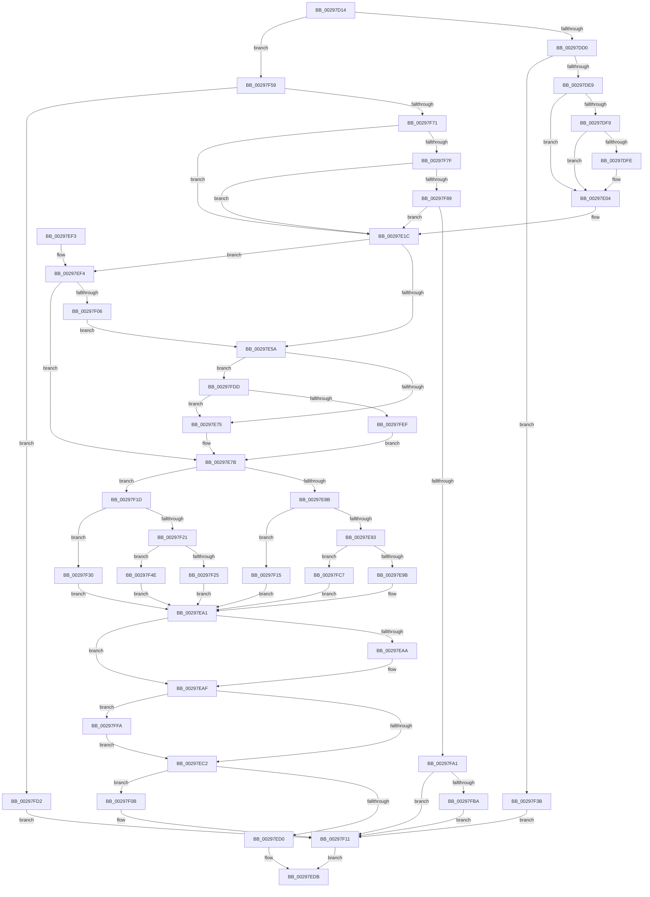

# MiTrimSharedPage

- RVA: `0x00297D14`–`0x00298007` (길이 `755` bytes)
- VA: `0x0000000140297D14`
- 실행 섹션: `.text`
- PDB 이름 있음: `예`; PDB Function 태그: `아니요`
- unwind 정보 RVA: `0x00067A88`
- 디코드: `203`개 명령, `755/755` bytes 표시
- 미해석 바이트: `0` (있으면 어셈블리에 `.byte`로 보존)

> 이 문서는 커널 이미지의 기계어와 PDB 기호를 분석해 생성했습니다. 4번과 5번은 함수 원형과 자료형을 바이너리 사용 방식에서 추정한 C 해석이며 원본 소스 복구 결과는 아닙니다.

## 1. Dependencies

- 직접 호출 지점: **14**; 고유 호출 대상: **8**
- 직접 호출자로 확인된 함수: **3**
- RIP 상대 이미지 참조: **14**

### Outgoing calls
- `0x00297DD8` → [MiPreventControlAreaDeletion](../2B/MiPreventControlAreaDeletion_function_002BBD10.md) (function, `0x002BBD10`)
- `0x00297E0E` → [MiUnlockPage](../31/MiUnlockPage_function_0031A3E0.md) (function, `0x0031A3E0`)
- `0x00297E17` → [MiReleaseControlAreaWaiters](../28/MiReleaseControlAreaWaiters_function_002865F0.md) (function, `0x002865F0`)
- `0x00297E45` → [MiTrimSection](../2E/MiTrimSection_function_002E0810.md) (function, `0x002E0810`)
- `0x00297E66` → [MiTrimSection](../2E/MiTrimSection_function_002E0810.md) (function, `0x002E0810`)
- `0x00297EAA` → [MiDecrementSubsection](MiDecrementSubsection_function_00298D68.md) (function, `0x00298D68`)
- `0x00297EB4` → [MiDecrementModifiedWriteCount](MiDecrementModifiedWriteCount_function_00298184.md) (function, `0x00298184`)
- `0x00297F41` → [MiUnlockPage](../31/MiUnlockPage_function_0031A3E0.md) (function, `0x0031A3E0`)
- `0x00297F5C` → [MiUnlockPage](../31/MiUnlockPage_function_0031A3E0.md) (function, `0x0031A3E0`)
- `0x00297F64` → [MiReferencePfBackedSection](../2B/MiReferencePfBackedSection_function_002B9B70.md) (function, `0x002B9B70`)
- `0x00297F94` → [MiClusterVadFull](../45/MiClusterVadFull_function_0045AECC.md) (function, `0x0045AECC`)
- `0x00297FAC` → [MiDecrementModifiedWriteCount](MiDecrementModifiedWriteCount_function_00298184.md) (function, `0x00298184`)
- `0x00297FBD` → [MiReleaseControlAreaWaiters](../28/MiReleaseControlAreaWaiters_function_002865F0.md) (function, `0x002865F0`)
- `0x00297FFD` → [MiReleaseControlAreaWaiters](../28/MiReleaseControlAreaWaiters_function_002865F0.md) (function, `0x002865F0`)

### Direct callers
- [MiTradePage](../28/MiTradePage_function_0028D160.md) at `0x0028D55C`
- [MiWalkEntireImage](../36/MiWalkEntireImage_function_00365D70.md) at `0x00366D86`
- [MiMarkFileOnlyPfnBad](../68/MiMarkFileOnlyPfnBad_function_006815C4.md) at `0x00681745`

### Static image references
- `0x00297DE9` → RVA `0x00E2DC80` (`.data`; read)
- `0x00297E75` → RVA `0x00EF5204` (`.data`; read/write)
- `0x00297E9B` → RVA `0x00EF51FC` (`.data`; read/write)
- `0x00297ED0` → RVA `0x00EF514C` (`.data`; read/write)
- `0x00297F0B` → RVA `0x00EF5208` (`.data`; read/write)
- `0x00297F15` → RVA `0x00EF51F8` (`.data`; read/write)
- `0x00297F25` → RVA `0x00EF5158` (`.data`; read/write)
- `0x00297F30` → RVA `0x00EF5154` (`.data`; read/write)
- `0x00297F46` → RVA `0x00EF51F0` (`.data`; read/write)
- `0x00297F4E` → RVA `0x00EF5160` (`.data`; read/write)
- `0x00297FA1` → RVA `0x00EF51CC` (`.data`; read/write)
- `0x00297FC7` → RVA `0x00EF5200` (`.data`; read/write)
- `0x00297FD2` → RVA `0x00EF51F4` (`.data`; read/write)
- `0x00297FEF` → RVA `0x00EF515C` (`.data`; read/write)

## 2. Other-region calls and transfers

- 다른 실행 섹션으로 향하는 call: **0**
- 별도 외부 분기/꼬리 이동을 확인하지 못했습니다.

## 3. Assembly (complete function range)

```asm
00297D14  48 89 5C 24 10                  mov qword ptr [rsp + 0x10], rbx
00297D19  55                              push rbp
00297D1A  56                              push rsi
00297D1B  57                              push rdi
00297D1C  41 54                           push r12
00297D1E  41 55                           push r13
00297D20  41 56                           push r14
00297D22  41 57                           push r15
00297D24  48 8B EC                        mov rbp, rsp
00297D27  48 83 EC 50                     sub rsp, 0x50
00297D2B  4C 8B 79 08                     mov r15, qword ptr [rcx + 8]
00297D2F  45 8B E8                        mov r13d, r8d
00297D32  33 DB                           xor ebx, ebx
00297D34  48 8B F9                        mov rdi, rcx
00297D37  44 8A F2                        mov r14b, dl
00297D3A  89 5D FC                        mov dword ptr [rbp - 4], ebx
00297D3D  41 8B D0                        mov edx, r8d
00297D40  48 89 5D 40                     mov qword ptr [rbp + 0x40], rbx
00297D44  C1 EA 12                        shr edx, 0x12
00297D47  48 B8 00 00 00 00 00 00 00 80   movabs rax, 0x8000000000000000
00297D51  83 E2 01                        and edx, 1
00297D54  48 89 5D 58                     mov qword ptr [rbp + 0x58], rbx
00297D58  4C 0B F8                        or r15, rax
00297D5B  44 8B C2                        mov r8d, edx
00297D5E  41 83 C8 02                     or r8d, 2
00297D62  41 8B C5                        mov eax, r13d
00297D65  41 0F BA E5 13                  bt r13d, 0x13
00297D6A  44 0F 43 C2                     cmovae r8d, edx
00297D6E  41 8B C8                        mov ecx, r8d
00297D71  83 C9 04                        or ecx, 4
00297D74  41 0F BA E5 11                  bt r13d, 0x11
00297D79  41 0F 43 C8                     cmovae ecx, r8d
00297D7D  8B D1                           mov edx, ecx
00297D7F  83 CA 08                        or edx, 8
00297D82  41 0F BA E5 1C                  bt r13d, 0x1c
00297D87  0F 43 D1                        cmovae edx, ecx
00297D8A  25 00 00 80 08                  and eax, 0x8800000
00297D8F  44 8B C2                        mov r8d, edx
00297D92  41 83 C8 10                     or r8d, 0x10
00297D96  3D 00 00 80 00                  cmp eax, 0x800000
00297D9B  8B 47 10                        mov eax, dword ptr [rdi + 0x10]
00297D9E  44 0F 45 C2                     cmovne r8d, edx
00297DA2  41 8B C8                        mov ecx, r8d
00297DA5  83 C9 40                        or ecx, 0x40
00297DA8  41 0F BA E5 18                  bt r13d, 0x18
00297DAD  41 0F 43 C8                     cmovae ecx, r8d
00297DB1  44 8B E1                        mov r12d, ecx
00297DB4  41 0F BA EC 07                  bts r12d, 7
00297DB9  41 0F BA E5 19                  bt r13d, 0x19
00297DBE  44 0F 43 E1                     cmovae r12d, ecx
00297DC2  48 8B CF                        mov rcx, rdi
00297DC5  48 0F BA E0 0A                  bt rax, 0xa
00297DCA  0F 83 89 01 00 00               jae 0x140297f59
00297DD0  4C 8D 45 40                     lea r8, [rbp + 0x40]
00297DD4  48 8D 55 58                     lea rdx, [rbp + 0x58]
00297DD8  E8 33 3F 02 00                  call 0x1402bbd10
00297DDD  48 8B F0                        mov rsi, rax
00297DE0  48 85 C0                        test rax, rax
00297DE3  0F 84 52 01 00 00               je 0x140297f3b
00297DE9  48 8B 05 90 5E B9 00            mov rax, qword ptr [rip + 0xb95e90]
00297DF0  48 8B 5F 10                     mov rbx, qword ptr [rdi + 0x10]
00297DF4  48 85 C0                        test rax, rax
00297DF7  74 0B                           je 0x140297e04
00297DF9  F6 C3 10                        test bl, 0x10
00297DFC  75 06                           jne 0x140297e04
00297DFE  48 F7 D0                        not rax
00297E01  48 23 D8                        and rbx, rax
00297E04  41 8A D6                        mov dl, r14b
00297E07  48 C1 FB 10                     sar rbx, 0x10
00297E0B  48 8B CF                        mov rcx, rdi
00297E0E  E8 CD 25 08 00                  call 0x14031a3e0
00297E13  48 8B 4D 40                     mov rcx, qword ptr [rbp + 0x40]
00297E17  E8 D4 E7 FE FF                  call 0x1402865f0
00297E1C  83 65 F8 00                     and dword ptr [rbp - 8], 0
00297E20  48 8D 4D D0                     lea rcx, [rbp - 0x30]
00297E24  48 89 5D E8                     mov qword ptr [rbp - 0x18], rbx
00297E28  45 8B CC                        mov r9d, r12d
00297E2B  48 89 5D F0                     mov qword ptr [rbp - 0x10], rbx
00297E2F  33 D2                           xor edx, edx
00297E31  BB 01 00 00 00                  mov ebx, 1
00297E36  48 89 75 D0                     mov qword ptr [rbp - 0x30], rsi
00297E3A  44 8B C3                        mov r8d, ebx
00297E3D  4C 89 7D D8                     mov qword ptr [rbp - 0x28], r15
00297E41  4C 89 7D E0                     mov qword ptr [rbp - 0x20], r15
00297E45  E8 C6 89 04 00                  call 0x1402e0810
00297E4A  8B C8                           mov ecx, eax
00297E4C  41 B6 07                        mov r14b, 7
00297E4F  41 B7 06                        mov r15b, 6
00297E52  85 C0                           test eax, eax
00297E54  0F 84 9A 00 00 00               je 0x140297ef4
00297E5A  45 8B CC                        mov r9d, r12d
00297E5D  48 8D 4D D0                     lea rcx, [rbp - 0x30]
00297E61  44 8B C3                        mov r8d, ebx
00297E64  33 D2                           xor edx, edx
00297E66  E8 A5 89 04 00                  call 0x1402e0810
00297E6B  8B C8                           mov ecx, eax
00297E6D  85 C0                           test eax, eax
00297E6F  0F 84 68 01 00 00               je 0x140297fdd
00297E75  01 1D 89 D3 C5 00               add dword ptr [rip + 0xc5d389], ebx
00297E7B  8B 56 38                        mov edx, dword ptr [rsi + 0x38]
00297E7E  8B C2                           mov eax, edx
00297E80  83 E0 20                        and eax, 0x20
00297E83  85 C9                           test ecx, ecx
00297E85  0F 84 92 00 00 00               je 0x140297f1d
00297E8B  85 C0                           test eax, eax
00297E8D  0F 85 82 00 00 00               jne 0x140297f15
00297E93  84 D2                           test dl, dl
00297E95  0F 89 2C 01 00 00               jns 0x140297fc7
00297E9B  01 1D 5B D3 C5 00               add dword ptr [rip + 0xc5d35b], ebx
00297EA1  48 8B 4D 58                     mov rcx, qword ptr [rbp + 0x58]
00297EA5  48 85 C9                        test rcx, rcx
00297EA8  74 05                           je 0x140297eaf
00297EAA  E8 B9 0E 00 00                  call 0x140298d68
00297EAF  33 D2                           xor edx, edx
00297EB1  48 8B CE                        mov rcx, rsi
00297EB4  E8 CB 02 00 00                  call 0x140298184
00297EB9  48 85 C0                        test rax, rax
00297EBC  0F 85 38 01 00 00               jne 0x140297ffa
00297EC2  8B 4F 20                        mov ecx, dword ptr [rdi + 0x20]
00297EC5  C1 E9 10                        shr ecx, 0x10
00297EC8  41 22 CE                        and cl, r14b
00297ECB  41 3A CF                        cmp cl, r15b
00297ECE  74 3B                           je 0x140297f0b
00297ED0  01 1D 76 D2 C5 00               add dword ptr [rip + 0xc5d276], ebx
00297ED6  B8 02 00 00 00                  mov eax, 2
00297EDB  48 8B 9C 24 98 00 00 00         mov rbx, qword ptr [rsp + 0x98]
00297EE3  48 83 C4 50                     add rsp, 0x50
00297EE7  41 5F                           pop r15
00297EE9  41 5E                           pop r14
00297EEB  41 5D                           pop r13
00297EED  41 5C                           pop r12
00297EEF  5F                              pop rdi
00297EF0  5E                              pop rsi
00297EF1  5D                              pop rbp
00297EF2  C3                              ret
00297EF3  CC                              int3
00297EF4  8B 47 20                        mov eax, dword ptr [rdi + 0x20]
00297EF7  C1 E8 10                        shr eax, 0x10
00297EFA  41 22 C6                        and al, r14b
00297EFD  41 3A C7                        cmp al, r15b
00297F00  0F 85 75 FF FF FF               jne 0x140297e7b
00297F06  E9 4F FF FF FF                  jmp 0x140297e5a
00297F0B  01 1D F7 D2 C5 00               add dword ptr [rip + 0xc5d2f7], ebx
00297F11  33 C0                           xor eax, eax
00297F13  EB C6                           jmp 0x140297edb
00297F15  01 1D DD D2 C5 00               add dword ptr [rip + 0xc5d2dd], ebx
00297F1B  EB 84                           jmp 0x140297ea1
00297F1D  85 C0                           test eax, eax
00297F1F  75 0F                           jne 0x140297f30
00297F21  84 D2                           test dl, dl
00297F23  79 29                           jns 0x140297f4e
00297F25  01 1D 2D D2 C5 00               add dword ptr [rip + 0xc5d22d], ebx
00297F2B  E9 71 FF FF FF                  jmp 0x140297ea1
00297F30  01 1D 1E D2 C5 00               add dword ptr [rip + 0xc5d21e], ebx
00297F36  E9 66 FF FF FF                  jmp 0x140297ea1
00297F3B  41 8A D6                        mov dl, r14b
00297F3E  48 8B CF                        mov rcx, rdi
00297F41  E8 9A 24 08 00                  call 0x14031a3e0
00297F46  FF 05 A4 D2 C5 00               inc dword ptr [rip + 0xc5d2a4]
00297F4C  EB C3                           jmp 0x140297f11
00297F4E  01 1D 0C D2 C5 00               add dword ptr [rip + 0xc5d20c], ebx
00297F54  E9 48 FF FF FF                  jmp 0x140297ea1
00297F59  41 8A D6                        mov dl, r14b
00297F5C  E8 7F 24 08 00                  call 0x14031a3e0
00297F61  49 8B CF                        mov rcx, r15
00297F64  E8 07 1C 02 00                  call 0x1402b9b70
00297F69  48 8B D8                        mov rbx, rax
00297F6C  48 85 C0                        test rax, rax
00297F6F  74 61                           je 0x140297fd2
00297F71  48 8B 30                        mov rsi, qword ptr [rax]
00297F74  41 0F BA E5 17                  bt r13d, 0x17
00297F79  0F 83 9D FE FF FF               jae 0x140297e1c
00297F7F  83 7E 38 00                     cmp dword ptr [rsi + 0x38], 0
00297F83  0F 8D 93 FE FF FF               jge 0x140297e1c
00297F89  4C 8B C0                        mov r8, rax
00297F8C  BA 10 00 00 00                  mov edx, 0x10
00297F91  48 8B CF                        mov rcx, rdi
00297F94  E8 33 2F 1C 00                  call 0x14045aecc
00297F99  85 C0                           test eax, eax
00297F9B  0F 84 7B FE FF FF               je 0x140297e1c
00297FA1  FF 05 25 D2 C5 00               inc dword ptr [rip + 0xc5d225]
00297FA7  33 D2                           xor edx, edx
00297FA9  48 8B CE                        mov rcx, rsi
00297FAC  E8 D3 01 00 00                  call 0x140298184
00297FB1  48 85 C0                        test rax, rax
00297FB4  0F 84 57 FF FF FF               je 0x140297f11
00297FBA  48 8B C8                        mov rcx, rax
00297FBD  E8 2E E6 FE FF                  call 0x1402865f0
00297FC2  E9 4A FF FF FF                  jmp 0x140297f11
00297FC7  01 1D 33 D2 C5 00               add dword ptr [rip + 0xc5d233], ebx
00297FCD  E9 CF FE FF FF                  jmp 0x140297ea1
00297FD2  FF 05 1C D2 C5 00               inc dword ptr [rip + 0xc5d21c]
00297FD8  E9 34 FF FF FF                  jmp 0x140297f11
00297FDD  8B 47 20                        mov eax, dword ptr [rdi + 0x20]
00297FE0  C1 E8 10                        shr eax, 0x10
00297FE3  41 22 C6                        and al, r14b
00297FE6  41 3A C7                        cmp al, r15b
00297FE9  0F 84 86 FE FF FF               je 0x140297e75
00297FEF  01 1D 67 D1 C5 00               add dword ptr [rip + 0xc5d167], ebx
00297FF5  E9 81 FE FF FF                  jmp 0x140297e7b
00297FFA  48 8B C8                        mov rcx, rax
00297FFD  E8 EE E5 FE FF                  call 0x1402865f0
00298002  E9 BB FE FF FF                  jmp 0x140297ec2
```

## 4. C-style interpretation (structured pseudocode)

```c
__int64 __fastcall MiTrimSharedPage(__int64 a1, unsigned __int8 a2, int a3)
{
    __int64 result;
    __int64 v_r12;
    __int64 v_r15;
    __int64 v_rbx;
    __int64 v_rsp;
    unsigned int v_stack_m3C;
    unsigned int v_stack_m40;
    unsigned __int64 v_stack_m48;
    unsigned __int64 v_stack_m50;
    unsigned __int64 v_stack_m58;
    unsigned __int64 v_stack_m60;
    unsigned __int64 v_stack_m68;
    unsigned __int64 v_stack_p10;
    unsigned __int64 v_stack_p20;
    unsigned __int64 v_stack_p8;

    v_stack_p10 = v_rbx;
    v_rsp = (v_rsp) - (80);
    v_rbx = 0;
    v_stack_m3C = 0;
    v_stack_p8 = 0;
    a2 = (unsigned int)(((unsigned int)(a3)) >> (18));
    a2 = (unsigned int)((a2) & (1));
    v_stack_p20 = 0;
    v_r15 = (*(unsigned __int64 *)(a1 + 8)) | (result);
    a3 = (unsigned int)(((unsigned int)(a2)) | (2));
    if (condition_is_above_or_equal) { a3 = a2; }
    a1 = (unsigned int)(((unsigned int)(a3)) | (4));
    if (condition_is_above_or_equal) { a1 = a3; }
    a2 = (unsigned int)(((unsigned int)((unsigned int)(a1))) | (8));
    if (condition_is_above_or_equal) { a2 = (unsigned int)(a1); }
    result = (unsigned int)(((unsigned int)((unsigned int)((unsigned int)(a3)))) & (0x8800000ULL));
    a3 = (unsigned int)(((unsigned int)(a2)) | (16));
    if (((unsigned int)(result)) != 0x800000ULL) { a3 = a2; }
    a1 = (unsigned int)(((unsigned int)(a3)) | (64));
    if (condition_is_above_or_equal) { a1 = a3; }
    v_r12 = (unsigned int)((unsigned int)(a1));
    if (condition_is_above_or_equal) { v_r12 = (unsigned int)(a1); }
    if (condition_is_above_or_equal) goto loc_00297F59;
    result = MiPreventControlAreaDeletion(a1, v_stack_p20, v_stack_p8, a4);
    if (result == 0) goto loc_00297F3B;
    if (*(unsigned __int64 *)(v_rip + 12148368) == 0) goto loc_00297E04;
    result = *(unsigned __int64 *)(v_rip + 12148368);
    v_rbx = *(unsigned __int64 *)(a1 + 16);
    if ((((unsigned __int8)(*(unsigned __int64 *)(a1 + 16))) & (16)) == 0) {
        result = ~(*(unsigned __int64 *)(v_rip + 12148368));
        v_rbx = (*(unsigned __int64 *)(a1 + 16)) & (result);
    }
    v_rbx = (v_rbx) >> (16);
    result = MiUnlockPage(a1, a2, v_stack_p8, a4);
    result = MiReleaseControlAreaWaiters(v_stack_p8, a2, v_stack_p8, a4);
loc_00297E1C:
    v_stack_m50 = v_rbx;
    v_stack_m48 = v_rbx;
    a2 = 0;
    v_stack_m68 = result;
    v_stack_m60 = v_r15;
    v_stack_m58 = v_r15;
    result = MiTrimSection(v_stack_m68, a2, 1, (unsigned int)((unsigned int)(v_r12)));
    if ((unsigned int)(result) == 0) goto loc_00297EF4;
loc_00297E5A:
    a2 = 0;
    result = MiTrimSection(v_stack_m68, a2, 1, (unsigned int)((unsigned int)(v_r12)));
    if ((unsigned int)(result) == 0) goto loc_00297FDD;
loc_00297E75:
loc_00297E7B:
    result = (unsigned int)(((unsigned int)((unsigned int)((unsigned int)(*(unsigned int *)(result + 56))))) & (32));
    if ((unsigned int)((unsigned int)((unsigned int)(result))) == 0) goto loc_00297F1D;
    if ((unsigned int)(result) != 0) goto loc_00297F15;
    if (!sign_flag) goto loc_00297FC7;
loc_00297EA1:
    if (v_stack_p20 != 0) {
        result = MiDecrementSubsection(v_stack_p20, (unsigned int)(*(unsigned int *)(result + 56)), 1, (unsigned int)((unsigned int)(v_r12)));
    }
    a2 = 0;
    result = MiDecrementModifiedWriteCount(result, a2, 1, (unsigned int)((unsigned int)(v_r12)));
    if (result != 0) goto loc_00297FFA;
loc_00297EC2:
    a1 = (unsigned int)(((unsigned int)(*(unsigned int *)(a1 + 32))) >> (16));
    a1 = (unsigned __int8)((a1) & (7));
    if (((unsigned __int8)(a1)) == 6) goto loc_00297F0B;
loc_00297EDB:
    v_rsp = (v_rsp) + (80);
    return 2;
loc_00297EF4:
    result = (unsigned int)(((unsigned int)(*(unsigned int *)(a1 + 32))) >> (16));
    result = (unsigned __int8)((result) & (7));
    if (((unsigned __int8)(result)) != 6) goto loc_00297E7B;
    goto loc_00297E5A;
loc_00297F0B:
loc_00297F11:
    result = 0;
    goto loc_00297EDB;
loc_00297F15:
    goto loc_00297EA1;
loc_00297F1D:
    if (0 != 0) goto loc_00297F30;
    if (!sign_flag) goto loc_00297F4E;
    goto loc_00297EA1;
loc_00297F30:
    goto loc_00297EA1;
loc_00297F3B:
    result = MiUnlockPage(a1, 7, 1, (unsigned int)((unsigned int)(v_r12)));
    goto loc_00297F11;
loc_00297F4E:
    goto loc_00297EA1;
loc_00297F59:
    result = MiUnlockPage(a1, 7, 1, (unsigned int)((unsigned int)(v_r12)));
    result = MiReferencePfBackedSection(6, 7, 1, (unsigned int)((unsigned int)(v_r12)));
    if (result == 0) goto loc_00297FD2;
    if (condition_is_above_or_equal) goto loc_00297E1C;
    if ((*(unsigned int *)(*(unsigned __int64 *)(result) + 56)) >= 0) goto loc_00297E1C;
    result = MiClusterVadFull(a1, 16, result, (unsigned int)((unsigned int)(v_r12)));
    if ((unsigned int)(result) == 0) goto loc_00297E1C;
    a2 = 0;
    result = MiDecrementModifiedWriteCount(*(unsigned __int64 *)(result), a2, result, (unsigned int)((unsigned int)(v_r12)));
    if (result == 0) goto loc_00297F11;
    result = MiReleaseControlAreaWaiters(result, a2, result, (unsigned int)((unsigned int)(v_r12)));
    goto loc_00297F11;
loc_00297FC7:
    goto loc_00297EA1;
loc_00297FD2:
    goto loc_00297F11;
loc_00297FDD:
    result = (unsigned int)(((unsigned int)(*(unsigned int *)(a1 + 32))) >> (16));
    result = (unsigned __int8)((result) & (7));
    if (((unsigned __int8)(result)) == 6) goto loc_00297E75;
    goto loc_00297E7B;
loc_00297FFA:
    result = MiReleaseControlAreaWaiters(result, a2, result, (unsigned int)((unsigned int)(v_r12)));
    goto loc_00297EC2;
}
```

## 5. (Beta) C Style

```c
int64_t MiTrimSharedPage(void *Arg1, uint8_t Arg2, int32_t Arg3)
{
    uint8_t *arg1 = (uint8_t *)Arg1;

    int64_t result;
    int64_t local_r12;
    int64_t local_r15;
    int64_t local_rbx;
    int64_t local_rsp;
    uint32_t v_stack_m3C;
    uint32_t v_stack_m40;
    uint64_t v_stack_m48;
    uint64_t v_stack_m50;
    uint64_t v_stack_m58;
    uint64_t v_stack_m60;
    uint64_t v_stack_m68;
    uint64_t v_stack_p10;
    uint64_t v_stack_p20;
    uint64_t v_stack_p8;

    v_stack_p10 = local_rbx;
    local_rsp = (local_rsp) - (80);
    local_rbx = 0;
    v_stack_m3C = 0;
    v_stack_p8 = 0;
    Arg2 = (uint32_t)(((uint32_t)(Arg3)) >> (18));
    Arg2 = (uint32_t)((Arg2) & (1));
    v_stack_p20 = 0;
    local_r15 = (*(uint64_t *)(arg1 + 0x8)) | (result);
    Arg3 = (uint32_t)(((uint32_t)(Arg2)) | (2));
    if (condition_is_above_or_equal) { Arg3 = Arg2; }
    Arg1 = (uint32_t)(((uint32_t)(Arg3)) | (4));
    if (condition_is_above_or_equal) { Arg1 = Arg3; }
    Arg2 = (uint32_t)(((uint32_t)((uint32_t)(Arg1))) | (8));
    if (condition_is_above_or_equal) { Arg2 = (uint32_t)(Arg1); }
    result = (uint32_t)(((uint32_t)((uint32_t)((uint32_t)(Arg3)))) & (0x8800000ULL));
    Arg3 = (uint32_t)(((uint32_t)(Arg2)) | (16));
    if (((uint32_t)(result)) != 0x800000ULL) { Arg3 = Arg2; }
    Arg1 = (uint32_t)(((uint32_t)(Arg3)) | (64));
    if (condition_is_above_or_equal) { Arg1 = Arg3; }
    local_r12 = (uint32_t)((uint32_t)(Arg1));
    if (condition_is_above_or_equal) { local_r12 = (uint32_t)(Arg1); }
    if (condition_is_above_or_equal) goto loc_00297F59;
    result = MiPreventControlAreaDeletion(Arg1, v_stack_p20, v_stack_p8, a4);
    if (result == 0) goto loc_00297F3B;
    if (*(uint64_t *)(v_rip + 0xB95E90) == 0) goto loc_00297E04;
    result = *(uint64_t *)(v_rip + 0xB95E90);
    local_rbx = *(uint64_t *)(arg1 + 0x10);
    if ((((uint8_t)(*(uint64_t *)(arg1 + 0x10))) & (16)) == 0) {
        result = ~(*(uint64_t *)(v_rip + 0xB95E90));
        local_rbx = (*(uint64_t *)(arg1 + 0x10)) & (result);
    }
    local_rbx = (local_rbx) >> (16);
    result = MiUnlockPage(Arg1, Arg2, v_stack_p8, a4);
    result = MiReleaseControlAreaWaiters(v_stack_p8, Arg2, v_stack_p8, a4);
loc_00297E1C:
    v_stack_m50 = local_rbx;
    v_stack_m48 = local_rbx;
    Arg2 = 0;
    v_stack_m68 = result;
    v_stack_m60 = local_r15;
    v_stack_m58 = local_r15;
    result = MiTrimSection(v_stack_m68, Arg2, 1, (uint32_t)((uint32_t)(local_r12)));
    if ((uint32_t)(result) == 0) goto loc_00297EF4;
loc_00297E5A:
    Arg2 = 0;
    result = MiTrimSection(v_stack_m68, Arg2, 1, (uint32_t)((uint32_t)(local_r12)));
    if ((uint32_t)(result) == 0) goto loc_00297FDD;
loc_00297E75:
loc_00297E7B:
    result = (uint32_t)(((uint32_t)((uint32_t)((uint32_t)(*(uint32_t *)(result + 0x38))))) & (32));
    if ((uint32_t)((uint32_t)((uint32_t)(result))) == 0) goto loc_00297F1D;
    if ((uint32_t)(result) != 0) goto loc_00297F15;
    if (!sign_flag) goto loc_00297FC7;
loc_00297EA1:
    if (v_stack_p20 != 0) {
        result = MiDecrementSubsection(v_stack_p20, (uint32_t)(*(uint32_t *)(result + 0x38)), 1, (uint32_t)((uint32_t)(local_r12)));
    }
    Arg2 = 0;
    result = MiDecrementModifiedWriteCount(result, Arg2, 1, (uint32_t)((uint32_t)(local_r12)));
    if (result != 0) goto loc_00297FFA;
loc_00297EC2:
    Arg1 = (uint32_t)(((uint32_t)(*(uint32_t *)(arg1 + 0x20))) >> (16));
    Arg1 = (uint8_t)((Arg1) & (7));
    if (((uint8_t)(Arg1)) == 6) goto loc_00297F0B;
loc_00297EDB:
    local_rsp = (local_rsp) + (80);
    return 2;
loc_00297EF4:
    result = (uint32_t)(((uint32_t)(*(uint32_t *)(arg1 + 0x20))) >> (16));
    result = (uint8_t)((result) & (7));
    if (((uint8_t)(result)) != 6) goto loc_00297E7B;
    goto loc_00297E5A;
loc_00297F0B:
loc_00297F11:
    result = 0;
    goto loc_00297EDB;
loc_00297F15:
    goto loc_00297EA1;
loc_00297F1D:
    if (0 != 0) goto loc_00297F30;
    if (!sign_flag) goto loc_00297F4E;
    goto loc_00297EA1;
loc_00297F30:
    goto loc_00297EA1;
loc_00297F3B:
    result = MiUnlockPage(Arg1, 7, 1, (uint32_t)((uint32_t)(local_r12)));
    goto loc_00297F11;
loc_00297F4E:
    goto loc_00297EA1;
loc_00297F59:
    result = MiUnlockPage(Arg1, 7, 1, (uint32_t)((uint32_t)(local_r12)));
    result = MiReferencePfBackedSection(6, 7, 1, (uint32_t)((uint32_t)(local_r12)));
    if (result == 0) goto loc_00297FD2;
    if (condition_is_above_or_equal) goto loc_00297E1C;
    if ((*(uint32_t *)(*(uint64_t *)(result) + 0x38)) >= 0) goto loc_00297E1C;
    result = MiClusterVadFull(Arg1, 16, result, (uint32_t)((uint32_t)(local_r12)));
    if ((uint32_t)(result) == 0) goto loc_00297E1C;
    Arg2 = 0;
    result = MiDecrementModifiedWriteCount(*(uint64_t *)(result), Arg2, result, (uint32_t)((uint32_t)(local_r12)));
    if (result == 0) goto loc_00297F11;
    result = MiReleaseControlAreaWaiters(result, Arg2, result, (uint32_t)((uint32_t)(local_r12)));
    goto loc_00297F11;
loc_00297FC7:
    goto loc_00297EA1;
loc_00297FD2:
    goto loc_00297F11;
loc_00297FDD:
    result = (uint32_t)(((uint32_t)(*(uint32_t *)(arg1 + 0x20))) >> (16));
    result = (uint8_t)((result) & (7));
    if (((uint8_t)(result)) == 6) goto loc_00297E75;
    goto loc_00297E7B;
loc_00297FFA:
    result = MiReleaseControlAreaWaiters(result, Arg2, result, (uint32_t)((uint32_t)(local_r12)));
    goto loc_00297EC2;
}
```

### 관측된 메모리 오프셋

구조체 형식이 확인되지 않은 접근은 인자 기준의 오프셋으로만 기록했습니다.

| 기준 인자 | 오프셋 표현 | 폭 (bit) | 접근 |
|---|---:|---:|---|
| `Arg1` | `+ 0x8` | `64` | `R` |
| `Arg1` | `+ 0x10` | `32` | `R` |
| `Arg1` | `+ 0x10` | `64` | `R` |
| `Arg1` | `+ 0x20` | `32` | `R` |

## 6. Execution-region graph

[열기: 2D/3D 그래프와 함수 탐색 컨트롤 패널](../../../control-panel.html?section=text&rva=0x00297D14&view=graph)

- 2D 그래프는 위에서 아래로 흐르고, 3D 그래프는 빈 공간을 드래그해 회전합니다. Shift+드래그는 이동, 휠은 확대·축소, 함수 노드 선택은 대상 보고서 이동입니다.

### Static fallback


