# MiTrimThisWsle

- RVA: `0x002932E4`–`0x00293667` (길이 `899` bytes)
- VA: `0x00000001402932E4`
- 실행 섹션: `.text`
- PDB 이름 있음: `예`; PDB Function 태그: `예`
- unwind 정보 RVA: `0x00067658`
- 디코드: `208`개 명령, `899/899` bytes 표시
- 미해석 바이트: `0` (있으면 어셈블리에 `.byte`로 보존)

> 이 문서는 커널 이미지의 기계어와 PDB 기호를 분석해 생성했습니다. 4번과 5번은 함수 원형과 자료형을 바이너리 사용 방식에서 추정한 C 해석이며 원본 소스 복구 결과는 아닙니다.

## 1. Dependencies

- 직접 호출 지점: **7**; 고유 호출 대상: **3**
- 직접 호출자로 확인된 함수: **2**
- RIP 상대 이미지 참조: **1**

### Outgoing calls
- `0x00293337` → [MI_READ_PTE_LOCK_FREE](../28/MI_READ_PTE_LOCK_FREE_function_002828A0.md) (function, `0x002828A0`)
- `0x00293368` → [MI_READ_PTE_LOCK_FREE](../28/MI_READ_PTE_LOCK_FREE_function_002828A0.md) (function, `0x002828A0`)
- `0x0029339E` → [MiGetPfnPriority](../32/MiGetPfnPriority_function_003226F0.md) (function, `0x003226F0`)
- `0x002934A8` → [MiGetPagePrivilege](../28/MiGetPagePrivilege_function_00285420.md) (function, `0x00285420`)
- `0x002934ED` → [MiGetPfnPriority](../32/MiGetPfnPriority_function_003226F0.md) (function, `0x003226F0`)
- `0x0029356B` → [MI_READ_PTE_LOCK_FREE](../28/MI_READ_PTE_LOCK_FREE_function_002828A0.md) (function, `0x002828A0`)
- `0x00293620` → [MiGetPagePrivilege](../28/MiGetPagePrivilege_function_00285420.md) (function, `0x00285420`)

### Direct callers
- [MiTrimPteWorker](MiTrimPteWorker_function_00292E2C.md) at `0x00292E7E`
- [MiTrimPte](MiTrimPte_function_00292F30.md) at `0x002930C9`

### Static image references
- `0x002935AE` → RVA `0x00FC6A88` (`ALMOSTRO`; read)

## 2. Other-region calls and transfers

- 다른 실행 섹션으로 향하는 call: **0**
- call이 아닌 외부 분기/꼬리 이동: **1**
  - `0x0029342B` → [sub_006DA5A4](../6D/Unknown_function_006DA5A4.md) (`tail-transfer`)

## 3. Assembly (complete function range)

```asm
002932E4  48 8B C4                        mov rax, rsp
002932E7  48 89 58 08                     mov qword ptr [rax + 8], rbx
002932EB  48 89 68 10                     mov qword ptr [rax + 0x10], rbp
002932EF  48 89 70 18                     mov qword ptr [rax + 0x18], rsi
002932F3  4C 89 48 20                     mov qword ptr [rax + 0x20], r9
002932F7  57                              push rdi
002932F8  41 54                           push r12
002932FA  41 55                           push r13
002932FC  41 56                           push r14
002932FE  41 57                           push r15
00293300  48 83 EC 20                     sub rsp, 0x20
00293304  48 8B EA                        mov rbp, rdx
00293307  48 BF 00 00 00 00 80 F6 FF FF   movabs rdi, 0xfffff68000000000
00293311  48 C1 ED 09                     shr rbp, 9
00293315  48 B8 F8 FF FF FF 7F 00 00 00   movabs rax, 0x7ffffffff8
0029331F  48 23 E8                        and rbp, rax
00293322  49 8B D9                        mov rbx, r9
00293325  4D 8B F0                        mov r14, r8
00293328  4C 8B E2                        mov r12, rdx
0029332B  4C 8B E9                        mov r13, rcx
0029332E  48 8B C7                        mov rax, rdi
00293331  48 03 E8                        add rbp, rax
00293334  48 8B CD                        mov rcx, rbp
00293337  E8 64 F5 FE FF                  call 0x1402828a0
0029333C  4C 8B 7C 24 78                  mov r15, qword ptr [rsp + 0x78]
00293341  48 8B F0                        mov rsi, rax
00293344  4D 85 FF                        test r15, r15
00293347  74 04                           je 0x14029334d
00293349  41 83 27 00                     and dword ptr [r15], 0
0029334D  8B 1B                           mov ebx, dword ptr [rbx]
0029334F  48 8B C7                        mov rax, rdi
00293352  48 BF FF FF FF FF FF 00 00 00   movabs rdi, 0xffffffffff
0029335C  4C 3B E0                        cmp r12, rax
0029335F  0F 83 F0 01 00 00               jae 0x140293555
00293365  48 8B CD                        mov rcx, rbp
00293368  E8 33 F5 FE FF                  call 0x1402828a0
0029336D  48 C1 E8 38                     shr rax, 0x38
00293371  83 E0 0F                        and eax, 0xf
00293374  8B F8                           mov edi, eax
00293376  49 BB FF FF FE FF FF 7F 00 00   movabs r11, 0x7ffffffeffff
00293380  41 BA 01 00 00 00               mov r10d, 1
00293386  F7 C3 00 06 00 00               test ebx, 0x600
0029338C  0F 85 8C 00 00 00               jne 0x14029341e
00293392  83 E3 0F                        and ebx, 0xf
00293395  0F 84 AF 00 00 00               je 0x14029344a
0029339B  49 8B CE                        mov rcx, r14
0029339E  E8 4D F3 08 00                  call 0x1403226f0
002933A3  83 F8 05                        cmp eax, 5
002933A6  0F 82 9E 00 00 00               jb 0x14029344a
002933AC  3B FB                           cmp edi, ebx
002933AE  0F 83 9B 00 00 00               jae 0x14029344f
002933B4  BB 02 00 00 00                  mov ebx, 2
002933B9  44 84 54 24 70                  test byte ptr [rsp + 0x70], r10b
002933BE  0F 84 0E 01 00 00               je 0x1402934d2
002933C4  41 8B 85 B8 00 00 00            mov eax, dword ptr [r13 + 0xb8]
002933CB  A8 0F                           test al, 0xf
002933CD  0F 85 DB 01 00 00               jne 0x1402935ae
002933D3  33 C0                           xor eax, eax
002933D5  49 39 85 70 02 00 00            cmp qword ptr [r13 + 0x270], rax
002933DC  0F 95 C0                        setne al
002933DF  85 C0                           test eax, eax
002933E1  0F 85 FE 01 00 00               jne 0x1402935e5
002933E7  B9 02 00 00 00                  mov ecx, 2
002933EC  8B C1                           mov eax, ecx
002933EE  85 FF                           test edi, edi
002933F0  0F 85 4D 01 00 00               jne 0x140293543
002933F6  3B D9                           cmp ebx, ecx
002933F8  0F 85 02 01 00 00               jne 0x140293500
002933FE  33 C0                           xor eax, eax
00293400  48 8B 5C 24 50                  mov rbx, qword ptr [rsp + 0x50]
00293405  48 8B 6C 24 58                  mov rbp, qword ptr [rsp + 0x58]
0029340A  48 8B 74 24 60                  mov rsi, qword ptr [rsp + 0x60]
0029340F  48 83 C4 20                     add rsp, 0x20
00293413  41 5F                           pop r15
00293415  41 5E                           pop r14
00293417  41 5D                           pop r13
00293419  41 5C                           pop r12
0029341B  5F                              pop rdi
0029341C  C3                              ret
0029341D  CC                              int3
0029341E  49 8B 46 28                     mov rax, qword ptr [r14 + 0x28]
00293422  48 85 C0                        test rax, rax
00293425  79 8D                           jns 0x1402933b4
00293427  0F BA E3 09                     bt ebx, 9
0029342B  0F 82 73 71 44 00               jb 0x1406da5a4
00293431  0F BA E3 0A                     bt ebx, 0xa
00293435  0F 83 79 FF FF FF               jae 0x1402933b4
0029343B  41 8B 4E 10                     mov ecx, dword ptr [r14 + 0x10]
0029343F  48 0F BA E1 0A                  bt rcx, 0xa
00293444  0F 83 6A FF FF FF               jae 0x1402933b4
0029344A  41 8B C2                        mov eax, r10d
0029344D  EB B1                           jmp 0x140293400
0029344F  44 84 54 24 70                  test byte ptr [rsp + 0x70], r10b
00293454  74 F4                           je 0x14029344a
00293456  48 8B 44 24 68                  mov rax, qword ptr [rsp + 0x68]
0029345B  48 83 78 50 00                  cmp qword ptr [rax + 0x50], 0
00293460  0F 84 4E FF FF FF               je 0x1402933b4
00293466  41 8B 85 B8 00 00 00            mov eax, dword ptr [r13 + 0xb8]
0029346D  A8 0F                           test al, 0xf
0029346F  0F 84 DA 01 00 00               je 0x14029364f
00293475  48 B9 FF FF FF FF FF 00 00 00   movabs rcx, 0xffffffffff
0029347F  48 8B C6                        mov rax, rsi
00293482  48 C1 E8 0C                     shr rax, 0xc
00293486  48 23 C1                        and rax, rcx
00293489  48 8D 0C 40                     lea rcx, [rax + rax*2]
0029348D  48 B8 00 00 00 00 00 DE FF FF   movabs rax, 0xffffde0000000000
00293497  48 C1 E1 04                     shl rcx, 4
0029349B  48 8B C0                        mov rax, rax
0029349E  45 33 C0                        xor r8d, r8d
002934A1  48 03 C8                        add rcx, rax
002934A4  41 8D 50 02                     lea edx, [r8 + 2]
002934A8  E8 73 1F FF FF                  call 0x140285420
002934AD  41 BA 01 00 00 00               mov r10d, 1
002934B3  A8 41                           test al, 0x41
002934B5  0F 84 A2 01 00 00               je 0x14029365d
002934BB  4D 85 FF                        test r15, r15
002934BE  0F 84 F0 FE FF FF               je 0x1402933b4
002934C4  45 89 17                        mov dword ptr [r15], r10d
002934C7  E9 32 FF FF FF                  jmp 0x1402933fe
002934CC  41 BA 01 00 00 00               mov r10d, 1
002934D2  41 8B 85 B8 00 00 00            mov eax, dword ptr [r13 + 0xb8]
002934D9  A8 0F                           test al, 0xf
002934DB  0F 85 BA 00 00 00               jne 0x14029359b
002934E1  83 FF 06                        cmp edi, 6
002934E4  0F 83 14 FF FF FF               jae 0x1402933fe
002934EA  49 8B CE                        mov rcx, r14
002934ED  E8 FE F1 08 00                  call 0x1403226f0
002934F2  83 F8 05                        cmp eax, 5
002934F5  0F 83 03 FF FF FF               jae 0x1402933fe
002934FB  49 8B C2                        mov rax, r10
002934FE  EB 06                           jmp 0x140293506
00293500  41 BA 01 00 00 00               mov r10d, 1
00293506  48 8D 14 80                     lea rdx, [rax + rax*4]
0029350A  48 C1 E2 04                     shl rdx, 4
0029350E  48 03 54 24 68                  add rdx, qword ptr [rsp + 0x68]
00293513  80 BA A0 00 00 00 00            cmp byte ptr [rdx + 0xa0], 0
0029351A  0F 84 B2 00 00 00               je 0x1402935d2
00293520  C1 ED 03                        shr ebp, 3
00293523  81 E5 FF 01 00 00               and ebp, 0x1ff
00293529  8B CD                           mov ecx, ebp
0029352B  83 E5 07                        and ebp, 7
0029352E  48 C1 E9 03                     shr rcx, 3
00293532  0F BE 44 11 58                  movsx eax, byte ptr [rcx + rdx + 0x58]
00293537  0F AB E8                        bts eax, ebp
0029353A  88 44 11 58                     mov byte ptr [rcx + rdx + 0x58], al
0029353E  E9 BB FE FF FF                  jmp 0x1402933fe
00293543  83 FF 07                        cmp edi, 7
00293546  0F 83 AA FE FF FF               jae 0x1402933f6
0029354C  33 DB                           xor ebx, ebx
0029354E  33 C0                           xor eax, eax
00293550  E9 A1 FE FF FF                  jmp 0x1402933f6
00293555  48 B8 FF FF FF FF FF F6 FF FF   movabs rax, 0xfffff6ffffffffff
0029355F  4C 3B E0                        cmp r12, rax
00293562  0F 87 FD FD FF FF               ja 0x140293365
00293568  48 8B CD                        mov rcx, rbp
0029356B  E8 30 F3 FE FF                  call 0x1402828a0
00293570  48 C1 E8 0C                     shr rax, 0xc
00293574  48 23 C7                        and rax, rdi
00293577  48 8D 3C 40                     lea rdi, [rax + rax*2]
0029357B  48 B8 00 00 00 00 00 DE FF FF   movabs rax, 0xffffde0000000000
00293585  48 03 FF                        add rdi, rdi
00293588  48 8B C0                        mov rax, rax
0029358B  48 8B 3C F8                     mov rdi, qword ptr [rax + rdi*8]
0029358F  48 C1 EF 2A                     shr rdi, 0x2a
00293593  83 E7 07                        and edi, 7
00293596  E9 DB FD FF FF                  jmp 0x140293376
0029359B  41 8B 46 20                     mov eax, dword ptr [r14 + 0x20]
0029359F  66 41 3B C2                     cmp ax, r10w
002935A3  0F 85 55 FE FF FF               jne 0x1402933fe
002935A9  E9 33 FF FF FF                  jmp 0x1402934e1
002935AE  48 0F BA 25 D1 34 D3 00 24      bt qword ptr [rip + 0xd334d1], 0x24
002935B7  0F 83 2A FE FF FF               jae 0x1402933e7
002935BD  41 8B 85 B8 00 00 00            mov eax, dword ptr [r13 + 0xb8]
002935C4  C1 E8 08                        shr eax, 8
002935C7  C1 E8 03                        shr eax, 3
002935CA  41 23 C2                        and eax, r10d
002935CD  E9 0D FE FF FF                  jmp 0x1402933df
002935D2  44 88 92 A0 00 00 00            mov byte ptr [rdx + 0xa0], r10b
002935D9  4C 89 A2 98 00 00 00            mov qword ptr [rdx + 0x98], r12
002935E0  E9 3B FF FF FF                  jmp 0x140293520
002935E5  41 8B 85 B8 00 00 00            mov eax, dword ptr [r13 + 0xb8]
002935EC  A8 0F                           test al, 0xf
002935EE  74 4B                           je 0x14029363b
002935F0  48 B8 FF FF FF FF FF 00 00 00   movabs rax, 0xffffffffff
002935FA  48 C1 EE 0C                     shr rsi, 0xc
002935FE  48 23 F0                        and rsi, rax
00293601  48 B8 00 00 00 00 00 DE FF FF   movabs rax, 0xffffde0000000000
0029360B  48 8D 0C 76                     lea rcx, [rsi + rsi*2]
0029360F  48 C1 E1 04                     shl rcx, 4
00293613  48 8B C0                        mov rax, rax
00293616  45 33 C0                        xor r8d, r8d
00293619  48 03 C8                        add rcx, rax
0029361C  41 8D 50 02                     lea edx, [r8 + 2]
00293620  E8 FB 1D FF FF                  call 0x140285420
00293625  A8 41                           test al, 0x41
00293627  0F 84 BA FD FF FF               je 0x1402933e7
0029362D  4D 85 FF                        test r15, r15
00293630  0F 84 B1 FD FF FF               je 0x1402933e7
00293636  E9 91 FE FF FF                  jmp 0x1402934cc
0029363B  48 B8 FF FF FE FF FF 7F 00 00   movabs rax, 0x7ffffffeffff
00293645  4C 3B E0                        cmp r12, rax
00293648  76 E3                           jbe 0x14029362d
0029364A  E9 98 FD FF FF                  jmp 0x1402933e7
0029364F  4D 3B E3                        cmp r12, r11
00293652  0F 86 63 FE FF FF               jbe 0x1402934bb
00293658  E9 57 FD FF FF                  jmp 0x1402933b4
0029365D  BB 02 00 00 00                  mov ebx, 2
00293662  E9 5D FD FF FF                  jmp 0x1402933c4
```

## 4. C-style interpretation (structured pseudocode)

```c
__int64 __fastcall MiTrimThisWsle(__int64 a1, __int64 a2, __int64 a3, __int64 a4, __int64 a5, __int64 a6)
{
    __int64 result;
    __int64 v_rbp;
    __int64 v_rbx;
    __int64 v_rdi;
    __int64 v_rsi;
    __int64 v_rsp;
    unsigned __int64 v_stack_p10;
    unsigned __int64 v_stack_p18;
    unsigned __int8 v_stack_p28;
    unsigned __int64 v_stack_p68;
    unsigned __int8 v_stack_p70;
    unsigned __int64 v_stack_p8;

    *(unsigned __int64 *)(v_rsp + 8) = v_rbx;
    *(unsigned __int64 *)(v_rsp + 16) = v_rbp;
    *(unsigned __int64 *)(v_rsp + 24) = v_rsi;
    *(unsigned __int64 *)(v_rsp + 32) = a4;
    v_rsp = (v_rsp) - (32);
    v_rbp = (a2) >> (9);
    v_rbp = (v_rbp) & (v_rsp);
    v_rbp = (v_rbp) + (v_rdi);
    result = MI_READ_PTE_LOCK_FREE(v_rbp, a2, a3, a4);
    if (a6 != 0) {
    }
    if (a2 >= v_rdi) goto loc_00293555;
loc_00293365:
    result = MI_READ_PTE_LOCK_FREE(v_rbp, a2, a3, a4);
    result = (result) >> (56);
    result = (unsigned int)((result) & (15));
loc_00293376:
    if ((((unsigned int)((unsigned int)(*(unsigned int *)(a4)))) & (0x600ULL)) != 0) goto loc_0029341E;
    v_rbx = (unsigned int)(((unsigned int)(*(unsigned int *)(a4))) & (15));
    if (condition_is_equal) goto loc_0029344A;
    result = MiGetPfnPriority(a3, a2, a3, a4);
    if (((unsigned int)(result)) < 5) goto loc_0029344A;
    if (((unsigned int)((unsigned int)((unsigned int)(result)))) >= ((unsigned int)(v_rbx))) goto loc_0029344F;
loc_002933B4:
    if (((v_stack_p28) & (1)) == 0) goto loc_002934D2;
loc_002933C4:
    if ((((unsigned __int8)((unsigned int)(*(unsigned int *)(a1 + 184)))) & (15)) != 0) goto loc_002935AE;
    result = 0;
    result = ((*(unsigned __int64 *)(a1 + 624)) != 0) ? 1 : 0;
loc_002933DF:
    if ((unsigned int)(result) != 0) goto loc_002935E5;
loc_002933E7:
    if ((unsigned int)((unsigned int)((unsigned int)(result))) != 0) goto loc_00293543;
loc_002933F6:
    if (2 != 2) goto loc_00293500;
loc_002933FE:
    result = 0;
loc_00293400:
    v_rsp = (v_rsp) + (32);
    return result;
loc_0029341E:
    if (!sign_flag) goto loc_002933B4;
    if (condition_is_above_or_equal) goto loc_002933B4;
    if (condition_is_above_or_equal) goto loc_002933B4;
loc_0029344A:
    goto loc_00293400;
loc_0029344F:
    if (((v_stack_p70) & (1)) == 0) goto loc_0029344A;
    if ((*(unsigned __int64 *)(v_stack_p68 + 80)) == 0) goto loc_002933B4;
    if ((((unsigned __int8)((unsigned int)(*(unsigned int *)(a1 + 184)))) & (15)) == 0) goto loc_0029364F;
    result = (v_stack_p18) >> (12);
    result = (result) & ((unsigned int)(*(unsigned int *)(a3 + 16)));
    a1 = (result + result * 2) << (4);
    a3 = 0;
    a1 = (a1) + (result);
    result = MiGetPagePrivilege(a1, a3 + 2, a3, a4);
    if ((((unsigned __int8)(result)) & (65)) == 0) goto loc_0029365D;
loc_002934BB:
    if (a6 == 0) goto loc_002933B4;
    *(unsigned int *)(a6) = 1;
    goto loc_002933FE;
loc_002934CC:
loc_002934D2:
    if ((((unsigned __int8)((unsigned int)(*(unsigned int *)(a1 + 184)))) & (15)) != 0) goto loc_0029359B;
loc_002934E1:
    if (((unsigned int)((unsigned int)((unsigned int)(result)))) >= 6) goto loc_002933FE;
    result = MiGetPfnPriority(0, a3 + 2, a3, a4);
    if (((unsigned int)(result)) >= 5) goto loc_002933FE;
    goto loc_00293506;
loc_00293500:
loc_00293506:
    a2 = (1 + 1 * 4) << (4);
    a2 = (a2) + (v_stack_p68);
    if ((*(unsigned __int8 *)(a2 + 160)) == 0) goto loc_002935D2;
loc_00293520:
    v_rbp = (unsigned int)((v_stack_p10) >> (3));
    v_rbp = (unsigned int)((v_rbp) & (511));
    v_rbp = (unsigned int)((v_rbp) & (7));
    a1 = ((unsigned int)((unsigned int)(v_rbp))) >> (3);
    *(unsigned __int8 *)(a1 + a2 * 1 + 88) = (unsigned __int8)((__int8)(*(unsigned __int8 *)(a1 + a2 * 1 + 88)));
    goto loc_002933FE;
loc_00293543:
    if (((unsigned int)((unsigned int)((unsigned int)(result)))) >= 7) goto loc_002933F6;
    v_rbx = 0;
    result = 0;
    goto loc_002933F6;
loc_00293555:
    if (a2 > 0) goto loc_00293365;
    result = MI_READ_PTE_LOCK_FREE(v_rbp, a2, a3, a4);
    result = (result) >> (12);
    result = (result) & ((unsigned int)((unsigned int)(result)));
    v_rdi = (result + result * 2) + (result + result * 2);
    v_rdi = (*(unsigned __int64 *)(result + v_rdi * 8)) >> (42);
    v_rdi = (unsigned int)((v_rdi) & (7));
    goto loc_00293376;
loc_0029359B:
    if (((unsigned __int16)((unsigned int)(*(unsigned int *)(a3 + 32)))) != 1) goto loc_002933FE;
    goto loc_002934E1;
loc_002935AE:
    if (((unsigned __int16)((unsigned int)(*(unsigned int *)(a3 + 32)))) >= 1) goto loc_002933E7;
    result = (unsigned int)(((unsigned int)(*(unsigned int *)(a1 + 184))) >> (8));
    result = (unsigned int)((result) >> (3));
    result = (unsigned int)((result) & (1));
    goto loc_002933DF;
loc_002935D2:
    *(unsigned __int8 *)(a2 + 160) = 1;
    *(unsigned __int64 *)(a2 + 152) = a2;
    goto loc_00293520;
loc_002935E5:
    if ((((unsigned __int8)((unsigned int)(*(unsigned int *)(a1 + 184)))) & (15)) == 0) goto loc_0029363B;
    v_rsi = (v_stack_p18) >> (12);
    v_rsi = (v_rsi) & ((unsigned int)(*(unsigned int *)(a1 + 184)));
    a1 = (v_rsi + v_rsi * 2) << (4);
    a3 = 0;
    a1 = (a1) + ((unsigned int)(*(unsigned int *)(a1 + 184)));
    result = MiGetPagePrivilege(a1, a3 + 2, a3, a4);
    if ((((unsigned __int8)(result)) & (65)) == 0) goto loc_002933E7;
loc_0029362D:
    if (a6 == 0) goto loc_002933E7;
    goto loc_002934CC;
loc_0029363B:
    if (a2 <= result) goto loc_0029362D;
    goto loc_002933E7;
loc_0029364F:
    if (a2 <= v_r11) goto loc_002934BB;
    goto loc_002933B4;
loc_0029365D:
    goto loc_002933C4;
}
```

## 5. (Beta) C Style

```c
int64_t MiTrimThisWsle(void *Arg1, int64_t Arg2, void *Arg3, void *Arg4, uint64_t Arg5, int64_t Arg6)
{
    uint8_t *arg1 = (uint8_t *)Arg1;
    uint8_t *arg3 = (uint8_t *)Arg3;
    uint8_t *arg4 = (uint8_t *)Arg4;

    int64_t result;
    int64_t local_rbp;
    int64_t local_rbx;
    int64_t local_rdi;
    int64_t local_rsi;
    int64_t local_rsp;
    uint64_t v_stack_p10;
    uint64_t v_stack_p18;
    uint8_t v_stack_p28;
    uint64_t v_stack_p68;
    uint8_t v_stack_p70;
    uint64_t v_stack_p8;

    *(uint64_t *)(local_rsp + 0x8) = local_rbx;
    *(uint64_t *)(local_rsp + 0x10) = local_rbp;
    *(uint64_t *)(local_rsp + 0x18) = local_rsi;
    *(void **)(local_rsp + 0x20) = Arg4;
    local_rsp = (local_rsp) - (32);
    local_rbp = (Arg2) >> (9);
    local_rbp = (local_rbp) & (local_rsp);
    local_rbp = (local_rbp) + (local_rdi);
    result = MI_READ_PTE_LOCK_FREE(local_rbp, Arg2, Arg3, Arg4);
    if (Arg6 != 0) {
    }
    if (Arg2 >= local_rdi) goto loc_00293555;
loc_00293365:
    result = MI_READ_PTE_LOCK_FREE(local_rbp, Arg2, Arg3, Arg4);
    result = (result) >> (56);
    result = (uint32_t)((result) & (15));
loc_00293376:
    if ((((uint32_t)((uint32_t)(*(uint32_t *)(arg4)))) & (0x600ULL)) != 0) goto loc_0029341E;
    local_rbx = (uint32_t)(((uint32_t)(*(uint32_t *)(arg4))) & (15));
    if (condition_is_equal) goto loc_0029344A;
    result = MiGetPfnPriority(Arg3, Arg2, Arg3, Arg4);
    if (((uint32_t)(result)) < 5) goto loc_0029344A;
    if (((uint32_t)((uint32_t)((uint32_t)(result)))) >= ((uint32_t)(local_rbx))) goto loc_0029344F;
loc_002933B4:
    if (((v_stack_p28) & (1)) == 0) goto loc_002934D2;
loc_002933C4:
    if ((((uint8_t)((uint32_t)(*(uint32_t *)(arg1 + 0xB8)))) & (15)) != 0) goto loc_002935AE;
    result = 0;
    result = ((*(uint64_t *)(arg1 + 0x270)) != 0) ? 1 : 0;
loc_002933DF:
    if ((uint32_t)(result) != 0) goto loc_002935E5;
loc_002933E7:
    if ((uint32_t)((uint32_t)((uint32_t)(result))) != 0) goto loc_00293543;
loc_002933F6:
    if (2 != 2) goto loc_00293500;
loc_002933FE:
    result = 0;
loc_00293400:
    local_rsp = (local_rsp) + (32);
    return result;
loc_0029341E:
    if (!sign_flag) goto loc_002933B4;
    if (condition_is_above_or_equal) goto loc_002933B4;
    if (condition_is_above_or_equal) goto loc_002933B4;
loc_0029344A:
    goto loc_00293400;
loc_0029344F:
    if (((v_stack_p70) & (1)) == 0) goto loc_0029344A;
    if ((*(uint64_t *)(v_stack_p68 + 0x50)) == 0) goto loc_002933B4;
    if ((((uint8_t)((uint32_t)(*(uint32_t *)(arg1 + 0xB8)))) & (15)) == 0) goto loc_0029364F;
    result = (v_stack_p18) >> (12);
    result = (result) & ((uint32_t)(*(uint32_t *)(arg3 + 0x10)));
    Arg1 = (result + result * 2) << (4);
    Arg3 = 0;
    Arg1 = (Arg1) + (result);
    result = MiGetPagePrivilege(Arg1, Arg3 + 2, Arg3, Arg4);
    if ((((uint8_t)(result)) & (65)) == 0) goto loc_0029365D;
loc_002934BB:
    if (Arg6 == 0) goto loc_002933B4;
    *(uint32_t *)(Arg6) = 1;
    goto loc_002933FE;
loc_002934CC:
loc_002934D2:
    if ((((uint8_t)((uint32_t)(*(uint32_t *)(arg1 + 0xB8)))) & (15)) != 0) goto loc_0029359B;
loc_002934E1:
    if (((uint32_t)((uint32_t)((uint32_t)(result)))) >= 6) goto loc_002933FE;
    result = MiGetPfnPriority(0, Arg3 + 2, Arg3, Arg4);
    if (((uint32_t)(result)) >= 5) goto loc_002933FE;
    goto loc_00293506;
loc_00293500:
loc_00293506:
    Arg2 = (1 + 1 * 4) << (4);
    Arg2 = (Arg2) + (v_stack_p68);
    if ((*(uint8_t *)(Arg2 + 0xA0)) == 0) goto loc_002935D2;
loc_00293520:
    local_rbp = (uint32_t)((v_stack_p10) >> (3));
    local_rbp = (uint32_t)((local_rbp) & (511));
    local_rbp = (uint32_t)((local_rbp) & (7));
    Arg1 = ((uint32_t)((uint32_t)(local_rbp))) >> (3);
    *(uint8_t *)(arg1 + Arg2 * 1 + 0x58) = (uint8_t)((int8_t)(*(uint8_t *)(arg1 + Arg2 * 1 + 0x58)));
    goto loc_002933FE;
loc_00293543:
    if (((uint32_t)((uint32_t)((uint32_t)(result)))) >= 7) goto loc_002933F6;
    local_rbx = 0;
    result = 0;
    goto loc_002933F6;
loc_00293555:
    if (Arg2 > 0) goto loc_00293365;
    result = MI_READ_PTE_LOCK_FREE(local_rbp, Arg2, Arg3, Arg4);
    result = (result) >> (12);
    result = (result) & ((uint32_t)((uint32_t)(result)));
    local_rdi = (result + result * 2) + (result + result * 2);
    local_rdi = (*(uint64_t *)(result + local_rdi * 8)) >> (42);
    local_rdi = (uint32_t)((local_rdi) & (7));
    goto loc_00293376;
loc_0029359B:
    if (((uint16_t)((uint32_t)(*(uint32_t *)(arg3 + 0x20)))) != 1) goto loc_002933FE;
    goto loc_002934E1;
loc_002935AE:
    if (((uint16_t)((uint32_t)(*(uint32_t *)(arg3 + 0x20)))) >= 1) goto loc_002933E7;
    result = (uint32_t)(((uint32_t)(*(uint32_t *)(arg1 + 0xB8))) >> (8));
    result = (uint32_t)((result) >> (3));
    result = (uint32_t)((result) & (1));
    goto loc_002933DF;
loc_002935D2:
    *(uint8_t *)(Arg2 + 0xA0) = 1;
    *(uint64_t *)(Arg2 + 0x98) = Arg2;
    goto loc_00293520;
loc_002935E5:
    if ((((uint8_t)((uint32_t)(*(uint32_t *)(arg1 + 0xB8)))) & (15)) == 0) goto loc_0029363B;
    local_rsi = (v_stack_p18) >> (12);
    local_rsi = (local_rsi) & ((uint32_t)(*(uint32_t *)(arg1 + 0xB8)));
    Arg1 = (local_rsi + local_rsi * 2) << (4);
    Arg3 = 0;
    Arg1 = (Arg1) + ((uint32_t)(*(uint32_t *)(arg1 + 0xB8)));
    result = MiGetPagePrivilege(Arg1, Arg3 + 2, Arg3, Arg4);
    if ((((uint8_t)(result)) & (65)) == 0) goto loc_002933E7;
loc_0029362D:
    if (Arg6 == 0) goto loc_002933E7;
    goto loc_002934CC;
loc_0029363B:
    if (Arg2 <= result) goto loc_0029362D;
    goto loc_002933E7;
loc_0029364F:
    if (Arg2 <= local_r11) goto loc_002934BB;
    goto loc_002933B4;
loc_0029365D:
    goto loc_002933C4;
}
```

### 관측된 메모리 오프셋

구조체 형식이 확인되지 않은 접근은 인자 기준의 오프셋으로만 기록했습니다.

| 기준 인자 | 오프셋 표현 | 폭 (bit) | 접근 |
|---|---:|---:|---|
| `Arg1` | `+ 0xB8` | `32` | `R` |
| `Arg1` | `+ 0x270` | `64` | `R` |
| `Arg3` | `+ 0x10` | `32` | `R` |
| `Arg3` | `+ 0x20` | `32` | `R` |
| `Arg3` | `+ 0x28` | `64` | `R` |
| `Arg4` | `+ 0x0` | `32` | `R` |

## 6. Execution-region graph

[열기: 2D/3D 그래프와 함수 탐색 컨트롤 패널](../../../control-panel.html?section=text&rva=0x002932E4&view=graph)

- 2D 그래프는 위에서 아래로 흐르고, 3D 그래프는 빈 공간을 드래그해 회전합니다. Shift+드래그는 이동, 휠은 확대·축소, 함수 노드 선택은 대상 보고서 이동입니다.

### Static fallback

```mermaid
flowchart TD
  bb_002932E4[BB_002932E4]
  bb_00293349[BB_00293349]
  bb_0029334D[BB_0029334D]
  bb_00293365[BB_00293365]
  bb_00293376[BB_00293376]
  bb_00293392[BB_00293392]
  bb_0029339B[BB_0029339B]
  bb_002933AC[BB_002933AC]
  bb_002933B4[BB_002933B4]
  bb_002933C4[BB_002933C4]
  bb_002933D3[BB_002933D3]
  bb_002933DF[BB_002933DF]
  bb_002933E7[BB_002933E7]
  bb_002933F6[BB_002933F6]
  bb_002933FE[BB_002933FE]
  bb_00293400[BB_00293400]
  bb_0029341D[BB_0029341D]
  bb_0029341E[BB_0029341E]
  bb_00293427[BB_00293427]
  bb_00293431[BB_00293431]
  bb_0029343B[BB_0029343B]
  bb_0029344A[BB_0029344A]
  bb_0029344F[BB_0029344F]
  bb_00293456[BB_00293456]
  bb_00293466[BB_00293466]
  bb_00293475[BB_00293475]
  bb_002934BB[BB_002934BB]
  bb_002934C4[BB_002934C4]
  bb_002934CC[BB_002934CC]
  bb_002934D2[BB_002934D2]
  bb_002934E1[BB_002934E1]
  bb_002934EA[BB_002934EA]
  bb_002934FB[BB_002934FB]
  bb_00293500[BB_00293500]
  bb_00293506[BB_00293506]
  bb_00293520[BB_00293520]
  bb_00293543[BB_00293543]
  bb_0029354C[BB_0029354C]
  bb_00293555[BB_00293555]
  bb_00293568[BB_00293568]
  bb_0029359B[BB_0029359B]
  bb_002935A9[BB_002935A9]
  bb_002935AE[BB_002935AE]
  bb_002935BD[BB_002935BD]
  bb_002935D2[BB_002935D2]
  bb_002935E5[BB_002935E5]
  bb_002935F0[BB_002935F0]
  bb_0029362D[BB_0029362D]
  bb_00293636[BB_00293636]
  bb_0029363B[BB_0029363B]
  bb_0029364A[BB_0029364A]
  bb_0029364F[BB_0029364F]
  bb_00293658[BB_00293658]
  bb_0029365D[BB_0029365D]
  bb_002932E4 -->|branch| bb_0029334D
  bb_002932E4 -->|fallthrough| bb_00293349
  bb_00293349 -->|flow| bb_0029334D
  bb_0029334D -->|branch| bb_00293555
  bb_0029334D -->|fallthrough| bb_00293365
  bb_00293365 -->|flow| bb_00293376
  bb_00293376 -->|branch| bb_0029341E
  bb_00293376 -->|fallthrough| bb_00293392
  bb_00293392 -->|branch| bb_0029344A
  bb_00293392 -->|fallthrough| bb_0029339B
  bb_0029339B -->|branch| bb_0029344A
  bb_0029339B -->|fallthrough| bb_002933AC
  bb_002933AC -->|branch| bb_0029344F
  bb_002933AC -->|fallthrough| bb_002933B4
  bb_002933B4 -->|branch| bb_002934D2
  bb_002933B4 -->|fallthrough| bb_002933C4
  bb_002933C4 -->|branch| bb_002935AE
  bb_002933C4 -->|fallthrough| bb_002933D3
  bb_002933D3 -->|flow| bb_002933DF
  bb_002933DF -->|branch| bb_002935E5
  bb_002933DF -->|fallthrough| bb_002933E7
  bb_002933E7 -->|branch| bb_00293543
  bb_002933E7 -->|fallthrough| bb_002933F6
  bb_002933F6 -->|branch| bb_00293500
  bb_002933F6 -->|fallthrough| bb_002933FE
  bb_002933FE -->|flow| bb_00293400
  bb_0029341D -->|flow| bb_0029341E
  bb_0029341E -->|branch| bb_002933B4
  bb_0029341E -->|fallthrough| bb_00293427
  bb_00293427 -->|fallthrough| bb_00293431
  bb_00293431 -->|branch| bb_002933B4
  bb_00293431 -->|fallthrough| bb_0029343B
  bb_0029343B -->|branch| bb_002933B4
  bb_0029343B -->|fallthrough| bb_0029344A
  bb_0029344A -->|branch| bb_00293400
  bb_0029344F -->|branch| bb_0029344A
  bb_0029344F -->|fallthrough| bb_00293456
  bb_00293456 -->|branch| bb_002933B4
  bb_00293456 -->|fallthrough| bb_00293466
  bb_00293466 -->|branch| bb_0029364F
  bb_00293466 -->|fallthrough| bb_00293475
  bb_00293475 -->|branch| bb_0029365D
  bb_00293475 -->|fallthrough| bb_002934BB
  bb_002934BB -->|branch| bb_002933B4
  bb_002934BB -->|fallthrough| bb_002934C4
  bb_002934C4 -->|branch| bb_002933FE
  bb_002934CC -->|flow| bb_002934D2
  bb_002934D2 -->|branch| bb_0029359B
  bb_002934D2 -->|fallthrough| bb_002934E1
  bb_002934E1 -->|branch| bb_002933FE
  bb_002934E1 -->|fallthrough| bb_002934EA
  bb_002934EA -->|branch| bb_002933FE
  bb_002934EA -->|fallthrough| bb_002934FB
  bb_002934FB -->|branch| bb_00293506
  bb_00293500 -->|flow| bb_00293506
  bb_00293506 -->|branch| bb_002935D2
  bb_00293506 -->|fallthrough| bb_00293520
  bb_00293520 -->|branch| bb_002933FE
  bb_00293543 -->|branch| bb_002933F6
  bb_00293543 -->|fallthrough| bb_0029354C
  bb_0029354C -->|branch| bb_002933F6
  bb_00293555 -->|branch| bb_00293365
  bb_00293555 -->|fallthrough| bb_00293568
  bb_00293568 -->|branch| bb_00293376
  bb_0029359B -->|branch| bb_002933FE
  bb_0029359B -->|fallthrough| bb_002935A9
  bb_002935A9 -->|branch| bb_002934E1
  bb_002935AE -->|branch| bb_002933E7
  bb_002935AE -->|fallthrough| bb_002935BD
  bb_002935BD -->|branch| bb_002933DF
  bb_002935D2 -->|branch| bb_00293520
  bb_002935E5 -->|branch| bb_0029363B
  bb_002935E5 -->|fallthrough| bb_002935F0
  bb_002935F0 -->|branch| bb_002933E7
  bb_002935F0 -->|fallthrough| bb_0029362D
  bb_0029362D -->|branch| bb_002933E7
  bb_0029362D -->|fallthrough| bb_00293636
  bb_00293636 -->|branch| bb_002934CC
  bb_0029363B -->|branch| bb_0029362D
  bb_0029363B -->|fallthrough| bb_0029364A
  bb_0029364A -->|branch| bb_002933E7
  bb_0029364F -->|branch| bb_002934BB
  bb_0029364F -->|fallthrough| bb_00293658
  bb_00293658 -->|branch| bb_002933B4
  bb_0029365D -->|branch| bb_002933C4
```


