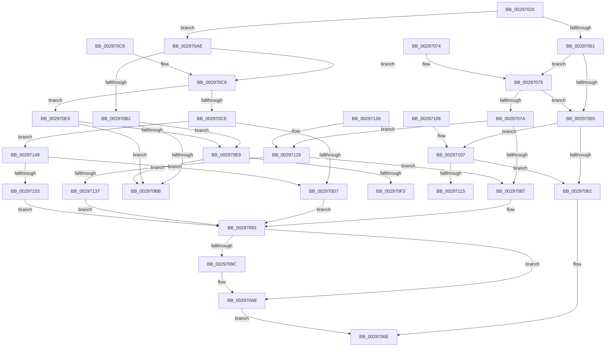

# MiUnlockVadTree

- RVA: `0x00297020`–`0x00297165` (길이 `325` bytes)
- VA: `0x0000000140297020`
- 실행 섹션: `.text`
- PDB 이름 있음: `예`; PDB Function 태그: `아니요`
- unwind 정보 RVA: `0x00067968`
- 디코드: `85`개 명령, `325/325` bytes 표시
- 미해석 바이트: `0` (있으면 어셈블리에 `.byte`로 보존)

> 이 문서는 커널 이미지의 기계어와 PDB 기호를 분석해 생성했습니다. 4번과 5번은 함수 원형과 자료형을 바이너리 사용 방식에서 추정한 C 해석이며 원본 소스 복구 결과는 아닙니다.

## 1. Dependencies

- 직접 호출 지점: **5**; 고유 호출 대상: **3**
- 직접 호출자로 확인된 함수: **35**
- RIP 상대 이미지 참조: **3**

### Outgoing calls
- `0x002970A3` → [KiLowerIrqlProcessIrqlFlags](../4F/KiLowerIrqlProcessIrqlFlags_function_004F5698.md) (function, `0x004F5698`)
- `0x002970FB` → [ExpReleaseSpinLockExclusiveFromDpcLevelInstrumented](../2C/ExpReleaseSpinLockExclusiveFromDpcLevelInstrumented_function_002C0F44.md) (function, `0x002C0F44`)
- `0x0029711D` → [ExpReleaseSpinLockSharedFromDpcLevelInstrumented](../2F/ExpReleaseSpinLockSharedFromDpcLevelInstrumented_function_002F0F48.md) (function, `0x002F0F48`)
- `0x0029713F` → [ExpReleaseSpinLockSharedFromDpcLevelInstrumented](../2F/ExpReleaseSpinLockSharedFromDpcLevelInstrumented_function_002F0F48.md) (function, `0x002F0F48`)
- `0x0029715B` → [ExpReleaseSpinLockExclusiveFromDpcLevelInstrumented](../2C/ExpReleaseSpinLockExclusiveFromDpcLevelInstrumented_function_002C0F44.md) (function, `0x002C0F44`)

### Direct callers
- [MiTranslatePageForCopy](../22/MiTranslatePageForCopy_function_00228960.md) at `0x00228E54`
- [sub_0027F36E](../27/Unknown_function_0027F36E.md) at `0x0027F3D9`
- [sub_00283850](../28/Unknown_function_00283850.md) at `0x002839C5`
- [sub_00283AFC](../28/Unknown_function_00283AFC.md) at `0x00283B87`
- [sub_00283AFC](../28/Unknown_function_00283AFC.md) at `0x00283C04`
- [MiObtainReferencedSecureVad](MiObtainReferencedSecureVad_function_00295688.md) at `0x00295700`
- [MiObtainReferencedSecureVad](MiObtainReferencedSecureVad_function_00295688.md) at `0x00295797`
- [MiRemoveVad](MiRemoveVad_function_00295C78.md) at `0x00295DE4`
- [MiSetVadDeleted](MiSetVadDeleted_function_00296E00.md) at `0x00296EB5`
- [MiBeginProcessClean](../2A/MiBeginProcessClean_function_002A473C.md) at `0x002A47A0`
- [MiPerformVadSplitting](../2A/MiPerformVadSplitting_function_002A5A80.md) at `0x002A5C2C`
- [sub_002B5C0F](../2B/Unknown_function_002B5C0F.md) at `0x002B5C40`
- [sub_002B5C0F](../2B/Unknown_function_002B5C0F.md) at `0x002B5CD3`
- [MiInitializeReadInProgressPfn](../2B/MiInitializeReadInProgressPfn_function_002B6990.md) at `0x002B6E8D`
- [MiTrimSharedPageFromViews](../2E/MiTrimSharedPageFromViews_function_002E16F8.md) at `0x002E1DAC`
- [MiTrimSharedPageFromViews](../2E/MiTrimSharedPageFromViews_function_002E16F8.md) at `0x002E20F0`
- [sub_00316832](../31/Unknown_function_00316832.md) at `0x00316841`
- [MiReturnLockedVadOrNextVa](../31/MiReturnLockedVadOrNextVa_function_00316980.md) at `0x00316D45`
- [MiResolveProtoPteFault](../32/MiResolveProtoPteFault_function_00321750.md) at `0x00322413`
- [MiValidFault](../32/MiValidFault_function_003280B4.md) at `0x00328429`
- [MiFindActualFaultingPte](../32/MiFindActualFaultingPte_function_0032899C.md) at `0x00328B2C`
- [MiUserFault](../32/MiUserFault_function_00329840.md) at `0x0032A0BD`
- [MiUserFault](../32/MiUserFault_function_00329840.md) at `0x0032A0D0`
- [MiUserFault](../32/MiUserFault_function_00329840.md) at `0x0032A0FF`
- [MiCompletePrivateZeroFault](../33/MiCompletePrivateZeroFault_function_00330CC0.md) at `0x00331D7E`
- [MiCopyOnWrite](../36/MiCopyOnWrite_function_00362A0C.md) at `0x0036351A`
- [MiImagePageOk](../36/MiImagePageOk_function_00365AE0.md) at `0x00365BD1`
- [MiResolveMappedFileFault](../36/MiResolveMappedFileFault_function_0036B640.md) at `0x0036B825`
- [MiResolveMappedFileFault](../36/MiResolveMappedFileFault_function_0036B640.md) at `0x0036BF67`
- [MiResolvePageFileFault](../36/MiResolvePageFileFault_function_0036D968.md) at `0x0036DC7C`
- [MiResolvePageFileFault](../36/MiResolvePageFileFault_function_0036D968.md) at `0x0036EA3A`
- [MiResolvePageFileFault](../36/MiResolvePageFileFault_function_0036D968.md) at `0x0036EC81`
- [MiReservePageFileSpace](../38/MiReservePageFileSpace_function_00383ED8.md) at `0x00383FBA`
- [MiInPagePageTable](../3E/MiInPagePageTable_function_003EF8DC.md) at `0x003EFC96`
- [MiInPagePageTable](../3E/MiInPagePageTable_function_003EF8DC.md) at `0x003EFDB6`
- [MiInPagePageTable](../3E/MiInPagePageTable_function_003EF8DC.md) at `0x003EFE92`
- [MiInPagePageTable](../3E/MiInPagePageTable_function_003EF8DC.md) at `0x003EFF26`
- [MiUpdatePrefetchPriority](../40/MiUpdatePrefetchPriority_function_00402CB0.md) at `0x00402F8A`
- [MiProcessCommitIntact](../40/MiProcessCommitIntact_function_004093C0.md) at `0x00409459`
- [MiComputeMaximumFaultCluster](../41/MiComputeMaximumFaultCluster_function_00418210.md) at `0x0041837A`
- [MiSetVadFlags](../43/MiSetVadFlags_function_004311FC.md) at `0x004312C6`
- [MiCaptureWriteWatchDirtyBit](../46/MiCaptureWriteWatchDirtyBit_function_00465224.md) at `0x0046526D`
- [MiStoreGetVadForAddress](../47/MiStoreGetVadForAddress_function_00474CB0.md) at `0x00474CD3`
- [MiCanGrantExecute](../4A/MiCanGrantExecute_function_004AD788.md) at `0x004AD7D5`
- [MiLeapPrefetch](../4C/MiLeapPrefetch_function_004CAED0.md) at `0x004CAFF2`
- [MiLeapPrefetch](../4C/MiLeapPrefetch_function_004CAED0.md) at `0x004CB04D`
- [MiLeapPrefetch](../4C/MiLeapPrefetch_function_004CAED0.md) at `0x004CB07F`
- [MiStoreDiscardPoisonedPage](../69/MiStoreDiscardPoisonedPage_function_00692858.md) at `0x00692A45`
- [MiStoreDiscardPoisonedPage](../69/MiStoreDiscardPoisonedPage_function_00692858.md) at `0x00692A5C`
- [sub_006EAE58](../6E/Unknown_function_006EAE58.md) at `0x006EAE82`
- [sub_006EAE58](../6E/Unknown_function_006EAE58.md) at `0x006EAEB2`

### Static image references
- `0x00297055` → RVA `0x00FC6B06` (`ALMOSTRO`; read)
- `0x00297093` → RVA `0x00FC6D20` (`ALMOSTRO`; read)
- `0x002970E9` → RVA `0x00F0DE58` (`.data`; read)

## 2. Other-region calls and transfers

- 다른 실행 섹션으로 향하는 call: **0**
- 별도 외부 분기/꼬리 이동을 확인하지 못했습니다.

## 3. Assembly (complete function range)

```asm
00297020  40 53                           push rbx
00297022  48 83 EC 20                     sub rsp, 0x20
00297026  65 4C 8B 04 25 88 01 00 00      mov r8, qword ptr gs:[0x188]
0029702F  8B C1                           mov eax, ecx
00297031  83 E0 01                        and eax, 1
00297034  0F B6 DA                        movzx ebx, dl
00297037  4D 8B 88 B8 00 00 00            mov r9, qword ptr [r8 + 0xb8]
0029703E  4D 8B 81 10 04 00 00            mov r8, qword ptr [r9 + 0x410]
00297045  49 81 C0 EC 03 00 00            add r8, 0x3ec
0029704C  F6 C1 02                        test cl, 2
0029704F  75 5D                           jne 0x1402970ae
00297051  85 C0                           test eax, eax
00297053  74 20                           je 0x140297075
00297055  F6 05 AA FA D2 00 01            test byte ptr [rip + 0xd2faaa], 1
0029705C  0F 85 A5 00 00 00               jne 0x140297107
00297062  F0 41 81 20 FF FF FF BF         lock and dword ptr [r8], 0xbfffffff
0029706A  F0 41 FF 08                     lock dec dword ptr [r8]
0029706E  48 83 C4 20                     add rsp, 0x20
00297072  5B                              pop rbx
00297073  C3                              ret
00297074  CC                              int3
00297075  80 FB 11                        cmp bl, 0x11
00297078  74 DB                           je 0x140297055
0029707A  F6 05 85 FA D2 00 01            test byte ptr [rip + 0xd2fa85], 1
00297081  0F 85 A2 00 00 00               jne 0x140297129
00297087  F0 41 81 20 FF FF FF BF         lock and dword ptr [r8], 0xbfffffff
0029708F  F0 41 FF 08                     lock dec dword ptr [r8]
00297093  83 3D 86 FC D2 00 00            cmp dword ptr [rip + 0xd2fc86], 0
0029709A  74 0C                           je 0x1402970a8
0029709C  0F B6 D3                        movzx edx, bl
0029709F  44 0F 20 C1                     mov rcx, cr8
002970A3  E8 F0 E5 25 00                  call 0x1404f5698
002970A8  44 0F 22 C3                     mov cr8, rbx
002970AC  EB C0                           jmp 0x14029706e
002970AE  85 C0                           test eax, eax
002970B0  74 17                           je 0x1402970c9
002970B2  F6 05 4D FA D2 00 01            test byte ptr [rip + 0xd2fa4d], 1
002970B9  75 2E                           jne 0x1402970e9
002970BB  41 C7 00 00 00 00 00            mov dword ptr [r8], 0
002970C2  48 83 C4 20                     add rsp, 0x20
002970C6  5B                              pop rbx
002970C7  C3                              ret
002970C8  CC                              int3
002970C9  80 FB 11                        cmp bl, 0x11
002970CC  74 12                           je 0x1402970e0
002970CE  F6 05 31 FA D2 00 01            test byte ptr [rip + 0xd2fa31], 1
002970D5  75 72                           jne 0x140297149
002970D7  41 C7 00 00 00 00 00            mov dword ptr [r8], 0
002970DE  EB B3                           jmp 0x140297093
002970E0  F6 05 1F FA D2 00 01            test byte ptr [rip + 0xd2fa1f], 1
002970E7  74 D2                           je 0x1402970bb
002970E9  8B 05 69 6D C7 00               mov eax, dword ptr [rip + 0xc76d69]
002970EF  85 C0                           test eax, eax
002970F1  75 C8                           jne 0x1402970bb
002970F3  48 8B 54 24 28                  mov rdx, qword ptr [rsp + 0x28]
002970F8  49 8B C8                        mov rcx, r8
002970FB  E8 44 9E 02 00                  call 0x1402c0f44
00297100  48 83 C4 20                     add rsp, 0x20
00297104  5B                              pop rbx
00297105  C3                              ret
00297106  CC                              int3
00297107  8B 05 4B 6D C7 00               mov eax, dword ptr [rip + 0xc76d4b]
0029710D  85 C0                           test eax, eax
0029710F  0F 85 4D FF FF FF               jne 0x140297062
00297115  48 8B 54 24 28                  mov rdx, qword ptr [rsp + 0x28]
0029711A  49 8B C8                        mov rcx, r8
0029711D  E8 26 9E 05 00                  call 0x1402f0f48
00297122  48 83 C4 20                     add rsp, 0x20
00297126  5B                              pop rbx
00297127  C3                              ret
00297128  CC                              int3
00297129  8B 05 29 6D C7 00               mov eax, dword ptr [rip + 0xc76d29]
0029712F  85 C0                           test eax, eax
00297131  0F 85 50 FF FF FF               jne 0x140297087
00297137  48 8B 54 24 28                  mov rdx, qword ptr [rsp + 0x28]
0029713C  49 8B C8                        mov rcx, r8
0029713F  E8 04 9E 05 00                  call 0x1402f0f48
00297144  E9 4A FF FF FF                  jmp 0x140297093
00297149  8B 05 09 6D C7 00               mov eax, dword ptr [rip + 0xc76d09]
0029714F  85 C0                           test eax, eax
00297151  75 84                           jne 0x1402970d7
00297153  48 8B 54 24 28                  mov rdx, qword ptr [rsp + 0x28]
00297158  49 8B C8                        mov rcx, r8
0029715B  E8 E4 9D 02 00                  call 0x1402c0f44
00297160  E9 2E FF FF FF                  jmp 0x140297093
```

## 4. C-style interpretation (structured pseudocode)

```c
__int64 __fastcall MiUnlockVadTree(int a1, unsigned __int8 a2)
{
    __int64 result;
    __int64 v_rsp;
    unsigned __int64 v_stack_p50;
    unsigned __int64 v_stack_p78;
    unsigned __int64 v_stack_pA0;

    v_rsp = (v_rsp) - (32);
    result = (unsigned int)(((unsigned int)(a1)) & (1));
    a3 = (*(unsigned __int64 *)(*(unsigned __int64 *)(*(unsigned __int64 *)(gs_base + (0 + 392)) + 184) + 1040)) + (0x3ECULL);
    if ((((unsigned __int8)(a1)) & (2)) != 0) goto loc_002970AE;
    if ((unsigned int)(result) == 0) goto loc_00297075;
loc_00297055:
    if (((*(unsigned __int8 *)(v_rip + 13826730)) & (1)) != 0) goto loc_00297107;
loc_00297062:
loc_0029706E:
    v_rsp = (v_rsp) + (32);
    return result;
loc_00297075:
    if (a2 == 17) goto loc_00297055;
    if (((*(unsigned __int8 *)(v_rip + 13826693)) & (1)) != 0) goto loc_00297129;
loc_00297087:
loc_00297093:
    if ((*(unsigned int *)(v_rip + 13827206)) != 0) {
        a2 = a2;
        a1 = v_cr8;
        result = KiLowerIrqlProcessIrqlFlags(a1, a2, a3, *(unsigned __int64 *)(*(unsigned __int64 *)(gs_base + (0 + 392)) + 184));
    }
    goto loc_0029706E;
loc_002970AE:
    if ((unsigned int)(result) == 0) goto loc_002970C9;
    if (((*(unsigned __int8 *)(v_rip + 13826637)) & (1)) != 0) goto loc_002970E9;
loc_002970BB:
    *(unsigned int *)(a3) = 0;
    v_rsp = (v_rsp) + (32);
    return result;
loc_002970C9:
    if (a2 == 17) goto loc_002970E0;
    if (((*(unsigned __int8 *)(v_rip + 13826609)) & (1)) != 0) goto loc_00297149;
loc_002970D7:
    *(unsigned int *)(a3) = 0;
    goto loc_00297093;
loc_002970E0:
    if (((*(unsigned __int8 *)(v_rip + 13826591)) & (1)) == 0) goto loc_002970BB;
loc_002970E9:
    if ((unsigned int)((unsigned int)(*(unsigned int *)(v_rip + 13069673))) != 0) goto loc_002970BB;
    result = ExpReleaseSpinLockExclusiveFromDpcLevelInstrumented(a3, v_stack_p50, a3, *(unsigned __int64 *)(*(unsigned __int64 *)(gs_base + (0 + 392)) + 184));
    v_rsp = (v_rsp) + (32);
    return result;
loc_00297107:
    if ((unsigned int)((unsigned int)(*(unsigned int *)(v_rip + 13069643))) != 0) goto loc_00297062;
    result = ExpReleaseSpinLockSharedFromDpcLevelInstrumented(a3, v_stack_p78, a3, *(unsigned __int64 *)(*(unsigned __int64 *)(gs_base + (0 + 392)) + 184));
    v_rsp = (v_rsp) + (32);
    return result;
loc_00297129:
    if ((unsigned int)((unsigned int)(*(unsigned int *)(v_rip + 13069609))) != 0) goto loc_00297087;
    result = ExpReleaseSpinLockSharedFromDpcLevelInstrumented(a3, v_stack_pA0, a3, *(unsigned __int64 *)(*(unsigned __int64 *)(gs_base + (0 + 392)) + 184));
    goto loc_00297093;
loc_00297149:
    if ((unsigned int)((unsigned int)(*(unsigned int *)(v_rip + 13069577))) != 0) goto loc_002970D7;
    result = ExpReleaseSpinLockExclusiveFromDpcLevelInstrumented(a3, v_stack_pA0, a3, *(unsigned __int64 *)(*(unsigned __int64 *)(gs_base + (0 + 392)) + 184));
    goto loc_00297093;
}
```

## 5. (Beta) C Style

```c
int64_t MiUnlockVadTree(int32_t Arg1, uint8_t Arg2)
{
    int64_t result;
    int64_t local_rsp;
    uint64_t v_stack_p50;
    uint64_t v_stack_p78;
    uint64_t v_stack_pA0;

    local_rsp = (local_rsp) - (32);
    result = (uint32_t)(((uint32_t)(Arg1)) & (1));
    a3 = (*(uint64_t *)(*(uint64_t *)(*(uint64_t *)(gs_base + (0 + 0x188)) + 0xB8) + 0x410)) + (0x3ECULL);
    if ((((uint8_t)(Arg1)) & (2)) != 0) goto loc_002970AE;
    if ((uint32_t)(result) == 0) goto loc_00297075;
loc_00297055:
    if (((*(uint8_t *)(v_rip + 0xD2FAAA)) & (1)) != 0) goto loc_00297107;
loc_00297062:
loc_0029706E:
    local_rsp = (local_rsp) + (32);
    return result;
loc_00297075:
    if (Arg2 == 17) goto loc_00297055;
    if (((*(uint8_t *)(v_rip + 0xD2FA85)) & (1)) != 0) goto loc_00297129;
loc_00297087:
loc_00297093:
    if ((*(uint32_t *)(v_rip + 0xD2FC86)) != 0) {
        Arg2 = Arg2;
        Arg1 = v_cr8;
        result = KiLowerIrqlProcessIrqlFlags(Arg1, Arg2, a3, *(uint64_t *)(*(uint64_t *)(gs_base + (0 + 0x188)) + 0xB8));
    }
    goto loc_0029706E;
loc_002970AE:
    if ((uint32_t)(result) == 0) goto loc_002970C9;
    if (((*(uint8_t *)(v_rip + 0xD2FA4D)) & (1)) != 0) goto loc_002970E9;
loc_002970BB:
    *(uint32_t *)(a3) = 0;
    local_rsp = (local_rsp) + (32);
    return result;
loc_002970C9:
    if (Arg2 == 17) goto loc_002970E0;
    if (((*(uint8_t *)(v_rip + 0xD2FA31)) & (1)) != 0) goto loc_00297149;
loc_002970D7:
    *(uint32_t *)(a3) = 0;
    goto loc_00297093;
loc_002970E0:
    if (((*(uint8_t *)(v_rip + 0xD2FA1F)) & (1)) == 0) goto loc_002970BB;
loc_002970E9:
    if ((uint32_t)((uint32_t)(*(uint32_t *)(v_rip + 0xC76D69))) != 0) goto loc_002970BB;
    result = ExpReleaseSpinLockExclusiveFromDpcLevelInstrumented(a3, v_stack_p50, a3, *(uint64_t *)(*(uint64_t *)(gs_base + (0 + 0x188)) + 0xB8));
    local_rsp = (local_rsp) + (32);
    return result;
loc_00297107:
    if ((uint32_t)((uint32_t)(*(uint32_t *)(v_rip + 0xC76D4B))) != 0) goto loc_00297062;
    result = ExpReleaseSpinLockSharedFromDpcLevelInstrumented(a3, v_stack_p78, a3, *(uint64_t *)(*(uint64_t *)(gs_base + (0 + 0x188)) + 0xB8));
    local_rsp = (local_rsp) + (32);
    return result;
loc_00297129:
    if ((uint32_t)((uint32_t)(*(uint32_t *)(v_rip + 0xC76D29))) != 0) goto loc_00297087;
    result = ExpReleaseSpinLockSharedFromDpcLevelInstrumented(a3, v_stack_pA0, a3, *(uint64_t *)(*(uint64_t *)(gs_base + (0 + 0x188)) + 0xB8));
    goto loc_00297093;
loc_00297149:
    if ((uint32_t)((uint32_t)(*(uint32_t *)(v_rip + 0xC76D09))) != 0) goto loc_002970D7;
    result = ExpReleaseSpinLockExclusiveFromDpcLevelInstrumented(a3, v_stack_pA0, a3, *(uint64_t *)(*(uint64_t *)(gs_base + (0 + 0x188)) + 0xB8));
    goto loc_00297093;
}
```

## 6. Execution-region graph

[열기: 2D/3D 그래프와 함수 탐색 컨트롤 패널](../../../control-panel.html?section=text&rva=0x00297020&view=graph)

- 2D 그래프는 위에서 아래로 흐르고, 3D 그래프는 빈 공간을 드래그해 회전합니다. Shift+드래그는 이동, 휠은 확대·축소, 함수 노드 선택은 대상 보고서 이동입니다.

### Static fallback


