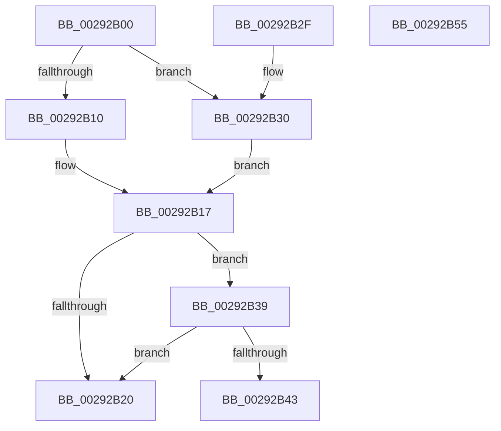

# MiUnlockWorkingSetCoreShared

- RVA: `0x00292B00`–`0x00292B56` (길이 `86` bytes)
- VA: `0x0000000140292B00`
- 실행 섹션: `.text`
- PDB 이름 있음: `예`; PDB Function 태그: `아니요`
- unwind 정보 RVA: `0x000675A8`
- 디코드: `24`개 명령, `86/86` bytes 표시
- 미해석 바이트: `0` (있으면 어셈블리에 `.byte`로 보존)

> 이 문서는 커널 이미지의 기계어와 PDB 기호를 분석해 생성했습니다. 4번과 5번은 함수 원형과 자료형을 바이너리 사용 방식에서 추정한 C 해석이며 원본 소스 복구 결과는 아닙니다.

## 1. Dependencies

- 직접 호출 지점: **1**; 고유 호출 대상: **1**
- 직접 호출자로 확인된 함수: **3**
- RIP 상대 이미지 참조: **3**

### Outgoing calls
- `0x00292B4B` → [ExpReleaseSpinLockSharedFromDpcLevelInstrumented](../2F/ExpReleaseSpinLockSharedFromDpcLevelInstrumented_function_002F0F48.md) (function, `0x002F0F48`)

### Direct callers
- [MiRemoveWsle](../22/MiRemoveWsle_function_0022D0C4.md) at `0x0022D202`
- [sub_00292218](Unknown_function_00292218.md) at `0x002925A2`
- [sub_0040D91B](../40/Unknown_function_0040D91B.md) at `0x0040D95F`

### Static image references
- `0x00292B10` → RVA `0x00E38880` (`.data`; read)
- `0x00292B17` → RVA `0x00FC6B06` (`ALMOSTRO`; read)
- `0x00292B39` → RVA `0x00F0DE58` (`.data`; read)

## 2. Other-region calls and transfers

- 다른 실행 섹션으로 향하는 call: **0**
- 별도 외부 분기/꼬리 이동을 확인하지 못했습니다.

## 3. Assembly (complete function range)

```asm
00292B00  48 83 EC 28                     sub rsp, 0x28
00292B04  8B 81 B8 00 00 00               mov eax, dword ptr [rcx + 0xb8]
00292B0A  24 0F                           and al, 0xf
00292B0C  3C 01                           cmp al, 1
00292B0E  75 20                           jne 0x140292b30
00292B10  48 8D 05 69 5D BA 00            lea rax, [rip + 0xba5d69]
00292B17  F6 05 E8 3F D3 00 01            test byte ptr [rip + 0xd33fe8], 1
00292B1E  75 19                           jne 0x140292b39
00292B20  F0 81 20 FF FF FF BF            lock and dword ptr [rax], 0xbfffffff
00292B27  F0 FF 08                        lock dec dword ptr [rax]
00292B2A  48 83 C4 28                     add rsp, 0x28
00292B2E  C3                              ret
00292B2F  CC                              int3
00292B30  48 8D 81 00 01 00 00            lea rax, [rcx + 0x100]
00292B37  EB DE                           jmp 0x140292b17
00292B39  8B 0D 19 B3 C7 00               mov ecx, dword ptr [rip + 0xc7b319]
00292B3F  85 C9                           test ecx, ecx
00292B41  75 DD                           jne 0x140292b20
00292B43  48 8B 54 24 28                  mov rdx, qword ptr [rsp + 0x28]
00292B48  48 8B C8                        mov rcx, rax
00292B4B  E8 F8 E3 05 00                  call 0x1402f0f48
00292B50  48 83 C4 28                     add rsp, 0x28
00292B54  C3                              ret
00292B55  CC                              int3
```

## 4. C-style interpretation (structured pseudocode)

```c
__int64 __fastcall MiUnlockWorkingSetCoreShared(__int64 a1)
{
    __int64 result;
    __int64 v_rsp;
    unsigned __int64 v_stack_p28;

    v_rsp = (v_rsp) - (40);
    result = (unsigned __int8)(((unsigned int)(*(unsigned int *)(a1 + 184))) & (15));
    if (((unsigned __int8)(result)) != 1) goto loc_00292B30;
loc_00292B17:
    if (((*(unsigned __int8 *)(v_rip + 13844456)) & (1)) != 0) goto loc_00292B39;
loc_00292B20:
    v_rsp = (v_rsp) + (40);
    return v_rip + 12213609;
loc_00292B30:
    goto loc_00292B17;
loc_00292B39:
    if ((unsigned int)((unsigned int)(*(unsigned int *)(v_rip + 13087513))) != 0) goto loc_00292B20;
    result = ExpReleaseSpinLockSharedFromDpcLevelInstrumented(a1 + 256, v_stack_p28, a3, a4);
    v_rsp = (v_rsp) + (40);
    return result;
}
```

## 5. (Beta) C Style

```c
int64_t MiUnlockWorkingSetCoreShared(void *Arg1)
{
    uint8_t *arg1 = (uint8_t *)Arg1;

    int64_t result;
    int64_t local_rsp;
    uint64_t v_stack_p28;

    local_rsp = (local_rsp) - (40);
    result = (uint8_t)(((uint32_t)(*(uint32_t *)(arg1 + 0xB8))) & (15));
    if (((uint8_t)(result)) != 1) goto loc_00292B30;
loc_00292B17:
    if (((*(uint8_t *)(v_rip + 0xD33FE8)) & (1)) != 0) goto loc_00292B39;
loc_00292B20:
    local_rsp = (local_rsp) + (40);
    return v_rip + 12213609;
loc_00292B30:
    goto loc_00292B17;
loc_00292B39:
    if ((uint32_t)((uint32_t)(*(uint32_t *)(v_rip + 0xC7B319))) != 0) goto loc_00292B20;
    result = ExpReleaseSpinLockSharedFromDpcLevelInstrumented(Arg1 + 256, v_stack_p28, a3, a4);
    local_rsp = (local_rsp) + (40);
    return result;
}
```

### 관측된 메모리 오프셋

구조체 형식이 확인되지 않은 접근은 인자 기준의 오프셋으로만 기록했습니다.

| 기준 인자 | 오프셋 표현 | 폭 (bit) | 접근 |
|---|---:|---:|---|
| `Arg1` | `+ 0xB8` | `32` | `R` |
| `Arg1` | `+ 0x100` | `64` | `R` |

## 6. Execution-region graph

[열기: 2D/3D 그래프와 함수 탐색 컨트롤 패널](../../../control-panel.html?section=text&rva=0x00292B00&view=graph)

- 2D 그래프는 위에서 아래로 흐르고, 3D 그래프는 빈 공간을 드래그해 회전합니다. Shift+드래그는 이동, 휠은 확대·축소, 함수 노드 선택은 대상 보고서 이동입니다.

### Static fallback


