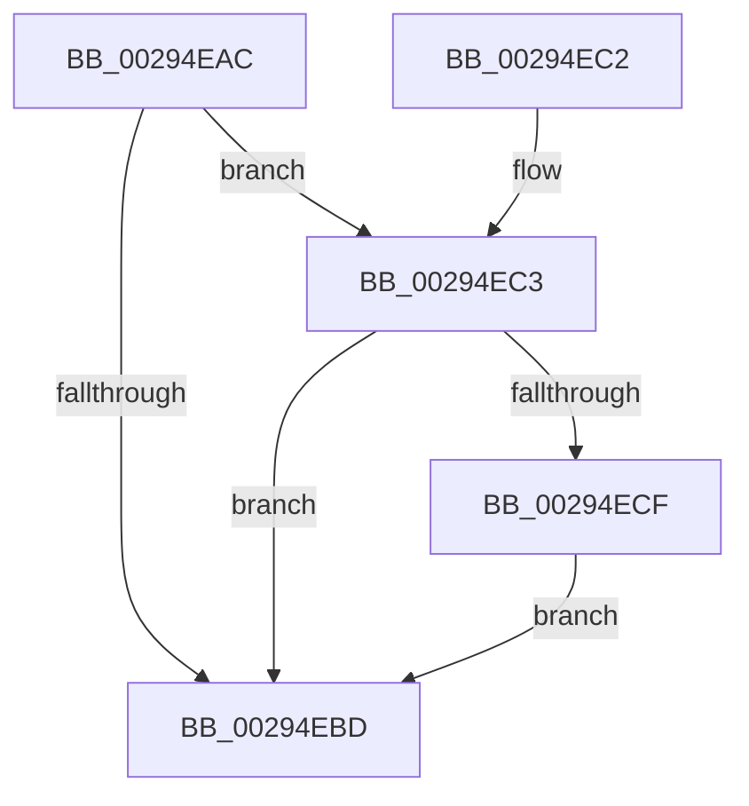

# MiWritePteShadow

- RVA: `0x00294EAC`–`0x00294EF9` (길이 `77` bytes)
- VA: `0x0000000140294EAC`
- 실행 섹션: `.text`
- PDB 이름 있음: `예`; PDB Function 태그: `아니요`
- unwind 정보 RVA: `0x000677F4`
- 디코드: `22`개 명령, `77/77` bytes 표시
- 미해석 바이트: `0` (있으면 어셈블리에 `.byte`로 보존)

> 이 문서는 커널 이미지의 기계어와 PDB 기호를 분석해 생성했습니다. 4번과 5번은 함수 원형과 자료형을 바이너리 사용 방식에서 추정한 C 해석이며 원본 소스 복구 결과는 아닙니다.

## 1. Dependencies

- 직접 호출 지점: **1**; 고유 호출 대상: **1**
- 직접 호출자로 확인된 함수: **43**
- RIP 상대 이미지 참조: **0**

### Outgoing calls
- `0x00294EB3` → [MiPteHasShadow](../32/MiPteHasShadow_function_0032B998.md) (function, `0x0032B998`)

### Direct callers
- [MmSetAddressRangeModifiedEx](../23/MmSetAddressRangeModifiedEx_function_00236F20.md) at `0x002375AB`
- [sub_0023F124](../23/Unknown_function_0023F124.md) at `0x0023F378`
- [sub_0023F124](../23/Unknown_function_0023F124.md) at `0x0023F47A`
- [MiUnlockNestedPageTableWritePte](../23/MiUnlockNestedPageTableWritePte_function_0023F4E4.md) at `0x0023F5E4`
- [MiUnlockNestedPageTableWritePte](../23/MiUnlockNestedPageTableWritePte_function_0023F4E4.md) at `0x0023F6CA`
- [sub_002401BF](../24/Unknown_function_002401BF.md) at `0x00240300`
- [sub_002401BF](../24/Unknown_function_002401BF.md) at `0x00240326`
- [MiWriteValidPteNewProtection](../28/MiWriteValidPteNewProtection_function_00281810.md) at `0x00281989`
- [MiResolveTransitionFault](../28/MiResolveTransitionFault_function_00282940.md) at `0x0028365B`
- [MiMigratePfn](../28/MiMigratePfn_function_0028DBB0.md) at `0x0028E255`
- [sub_0029430C](Unknown_function_0029430C.md) at `0x00294312`
- [MiMakePteClean](../2A/MiMakePteClean_function_002A901C.md) at `0x002A9371`
- [MiReplaceTransitionPage](../2B/MiReplaceTransitionPage_function_002B1120.md) at `0x002B1A6D`
- [MiStealPage](../2B/MiStealPage_function_002B28D0.md) at `0x002B3113`
- [MiStealPage](../2B/MiStealPage_function_002B28D0.md) at `0x002B332C`
- [MiResolveProtoPteFault](../32/MiResolveProtoPteFault_function_00321750.md) at `0x003224D6`
- [MiRewritePteWithLockBit](../32/MiRewritePteWithLockBit_function_00322FEC.md) at `0x00323144`
- [MiCompletePrivateZeroFault](../33/MiCompletePrivateZeroFault_function_00330CC0.md) at `0x00331CAD`
- [MiCompletePrivateZeroFault](../33/MiCompletePrivateZeroFault_function_00330CC0.md) at `0x00331D4E`
- [MiAllocateWsle](../33/MiAllocateWsle_function_003332C0.md) at `0x00333C9D`
- [MiRestoreTransitionPte](../33/MiRestoreTransitionPte_function_0033DD90.md) at `0x0033E1B8`
- [MiMakeFaultPfnActive](../36/MiMakeFaultPfnActive_function_00361D00.md) at `0x00361EEC`
- [MiCopyOnWrite](../36/MiCopyOnWrite_function_00362A0C.md) at `0x00363499`
- [MiWriteEnclavePte](../36/MiWriteEnclavePte_function_00368570.md) at `0x00368707`
- [MiOutSwapWorkingSetPte](../37/MiOutSwapWorkingSetPte_function_00372190.md) at `0x003722D1`
- [MiTradeActivePage](../37/MiTradeActivePage_function_00374424.md) at `0x003747C8`
- [MiTradeActivePage](../37/MiTradeActivePage_function_00374424.md) at `0x003747D8`
- [MiWriteValidPteNewPage](../37/MiWriteValidPteNewPage_function_00376068.md) at `0x0037618B`
- [MiRewriteTrimPteAsDemandZero](../38/MiRewriteTrimPteAsDemandZero_function_003823F4.md) at `0x003825E0`
- [MiSwapNumaStandbyPage](../38/MiSwapNumaStandbyPage_function_00385144.md) at `0x003855EA`
- [MiSwapHardFaultPage](../38/MiSwapHardFaultPage_function_00385F34.md) at `0x003860D0`
- [MiInvalidateCollidedIos](../38/MiInvalidateCollidedIos_function_00386110.md) at `0x003863B2`
- [MiInsertLargeVadMapping](../3F/MiInsertLargeVadMapping_function_003F0498.md) at `0x003F05C5`
- [MiShadowTopLevelPxes](../46/MiShadowTopLevelPxes_function_0046C6B0.md) at `0x0046C83A`
- [MiWriteRepurposedTransitionPte](../4B/MiWriteRepurposedTransitionPte_function_004B0EC8.md) at `0x004B0F86`
- [MiProtectAweRegion](../4C/MiProtectAweRegion_function_004CE62C.md) at `0x004CED7D`
- [MiSplitDirectMapPage](../4D/MiSplitDirectMapPage_function_004DAAA0.md) at `0x004DACE6`
- [MiDbgReleaseAddress](../68/MiDbgReleaseAddress_function_00685630.md) at `0x0068570E`
- [MiDbgWriteCheck](../68/MiDbgWriteCheck_function_00685BE4.md) at `0x00685EEE`
- [MiTransformValidPteViaIpi](../68/MiTransformValidPteViaIpi_function_0068A978.md) at `0x0068A9E6`
- [sub_006DC4D4](../6D/Unknown_function_006DC4D4.md) at `0x006DC692`
- [sub_006EE9B6](../6E/Unknown_function_006EE9B6.md) at `0x006EEA50`
- [MiCreateHardwareEnclave](../../page/80/MiCreateHardwareEnclave_function_00808500.md) at `0x008087DC`
- [MiUpdateUserMappings](../../pagelk/B7/MiUpdateUserMappings_function_00B7966C.md) at `0x00B796E7`
- [MiMapDummyPages](../../init/C6/MiMapDummyPages_function_00C60A58.md) at `0x00C60B56`
- [MxZeroBootMappings](../../init/C6/MxZeroBootMappings_function_00C61344.md) at `0x00C61414`
- [MiClearStaleSecurePageMapping](../../init/C6/MiClearStaleSecurePageMapping_function_00C61CD8.md) at `0x00C61D23`
- [MiFillGapPtes](../../init/C6/MiFillGapPtes_function_00C65AC0.md) at `0x00C65BB7`
- [MiInitializeBootShadowStackPage](../../init/C6/MiInitializeBootShadowStackPage_function_00C67D8C.md) at `0x00C67FFC`
- [MiInitializeBootShadowStackPage](../../init/C6/MiInitializeBootShadowStackPage_function_00C67D8C.md) at `0x00C68087`

### Static image references
- 디코드된 RIP-relative 메모리 참조가 없습니다.

## 2. Other-region calls and transfers

- 다른 실행 섹션으로 향하는 call: **0**
- 별도 외부 분기/꼬리 이동을 확인하지 못했습니다.

## 3. Assembly (complete function range)

```asm
00294EAC  48 83 EC 28                     sub rsp, 0x28
00294EB0  4C 8B C1                        mov r8, rcx
00294EB3  E8 E0 6A 09 00                  call 0x14032b998
00294EB8  48 85 C0                        test rax, rax
00294EBB  75 06                           jne 0x140294ec3
00294EBD  48 83 C4 28                     add rsp, 0x28
00294EC1  C3                              ret
00294EC2  CC                              int3
00294EC3  4C 8B 88 08 05 00 00            mov r9, qword ptr [rax + 0x508]
00294ECA  4D 85 C9                        test r9, r9
00294ECD  74 EE                           je 0x140294ebd
00294ECF  8A C2                           mov al, dl
00294ED1  48 B9 FF FF FF FF FF FF FF 7F   movabs rcx, 0x7fffffffffffffff
00294EDB  48 23 D1                        and rdx, rcx
00294EDE  24 01                           and al, 1
00294EE0  F6 D8                           neg al
00294EE2  48 1B C9                        sbb rcx, rcx
00294EE5  49 C1 E8 03                     shr r8, 3
00294EE9  48 23 CA                        and rcx, rdx
00294EEC  41 81 E0 FF 01 00 00            and r8d, 0x1ff
00294EF3  4B 89 0C C1                     mov qword ptr [r9 + r8*8], rcx
00294EF7  EB C4                           jmp 0x140294ebd
```

## 4. C-style interpretation (structured pseudocode)

```c
__int64 __fastcall MiWritePteShadow(__int64 a1, __int64 a2)
{
    __int64 result;
    __int64 v_rsp;

    v_rsp = (v_rsp) - (40);
    result = MiPteHasShadow(a1, a2, a1, a4);
    if (result != 0) goto loc_00294EC3;
loc_00294EBD:
    v_rsp = (v_rsp) + (40);
    return result;
loc_00294EC3:
    if (*(unsigned __int64 *)(result + 1288) == 0) goto loc_00294EBD;
    a2 = (a2) & (a1);
    result = (unsigned __int8)(((unsigned __int8)(a2)) & (1));
    result = (unsigned __int8)(-(result));
    a3 = (a1) >> (3);
    a1 = (a1) & (a2);
    a3 = (unsigned int)((a3) & (511));
    *(unsigned __int64 *)(*(unsigned __int64 *)(result + 1288) + a3 * 8) = a1;
    goto loc_00294EBD;
}
```

## 5. (Beta) C Style

```c
int64_t MiWritePteShadow(int64_t Arg1, int64_t Arg2)
{
    int64_t result;
    int64_t local_rsp;

    local_rsp = (local_rsp) - (40);
    result = MiPteHasShadow(Arg1, Arg2, Arg1, a4);
    if (result != 0) goto loc_00294EC3;
loc_00294EBD:
    local_rsp = (local_rsp) + (40);
    return result;
loc_00294EC3:
    if (*(uint64_t *)(result + 0x508) == 0) goto loc_00294EBD;
    Arg2 = (Arg2) & (Arg1);
    result = (uint8_t)(((uint8_t)(Arg2)) & (1));
    result = (uint8_t)(-(result));
    a3 = (Arg1) >> (3);
    Arg1 = (Arg1) & (Arg2);
    a3 = (uint32_t)((a3) & (511));
    *(uint64_t *)(*(uint64_t *)(result + 0x508) + a3 * 8) = Arg1;
    goto loc_00294EBD;
}
```

## 6. Execution-region graph

[열기: 2D/3D 그래프와 함수 탐색 컨트롤 패널](../../../control-panel.html?section=text&rva=0x00294EAC&view=graph)

- 2D 그래프는 위에서 아래로 흐르고, 3D 그래프는 빈 공간을 드래그해 회전합니다. Shift+드래그는 이동, 휠은 확대·축소, 함수 노드 선택은 대상 보고서 이동입니다.

### Static fallback


