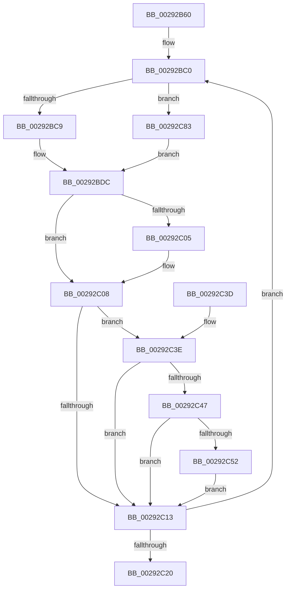

# MiWriteValidPteVolatile

- RVA: `0x00292B60`–`0x00292C8B` (길이 `299` bytes)
- VA: `0x0000000140292B60`
- 실행 섹션: `.text`
- PDB 이름 있음: `예`; PDB Function 태그: `아니요`
- unwind 정보 RVA: `0x000675B8`
- 디코드: `77`개 명령, `299/299` bytes 표시
- 미해석 바이트: `0` (있으면 어셈블리에 `.byte`로 보존)

> 이 문서는 커널 이미지의 기계어와 PDB 기호를 분석해 생성했습니다. 4번과 5번은 함수 원형과 자료형을 바이너리 사용 방식에서 추정한 C 해석이며 원본 소스 복구 결과는 아닙니다.

## 1. Dependencies

- 직접 호출 지점: **1**; 고유 호출 대상: **1**
- 직접 호출자로 확인된 함수: **6**
- RIP 상대 이미지 참조: **1**

### Outgoing calls
- `0x00292C5E` → [MiCheckLinearProtectedPteAccessedBit](MiCheckLinearProtectedPteAccessedBit_function_00292D80.md) (function, `0x00292D80`)

### Direct callers
- [MiTryLockProtoPoolPageAtDpc](../28/MiTryLockProtoPoolPageAtDpc_function_0028B3C8.md) at `0x0028B531`
- [MiLockProtoPoolPage](../2B/MiLockProtoPoolPage_function_002B8B80.md) at `0x002B91A0`
- [MiLockOwnedProtoPage](../32/MiLockOwnedProtoPage_function_00322560.md) at `0x0032268A`
- [MiLockCode](../36/MiLockCode_function_0036F91C.md) at `0x0036FF44`
- [MiLockPagedAddress](../48/MiLockPagedAddress_function_00484CDC.md) at `0x00484F04`
- [MiProtectDriverSectionPte](../67/MiProtectDriverSectionPte_function_006706C0.md) at `0x006709E9`

### Static image references
- `0x00292BF8` → RVA `0x00FC6A88` (`ALMOSTRO`; read)

## 2. Other-region calls and transfers

- 다른 실행 섹션으로 향하는 call: **0**
- 별도 외부 분기/꼬리 이동을 확인하지 못했습니다.

## 3. Assembly (complete function range)

```asm
00292B60  48 89 5C 24 08                  mov qword ptr [rsp + 8], rbx
00292B65  48 89 6C 24 10                  mov qword ptr [rsp + 0x10], rbp
00292B6A  48 89 74 24 18                  mov qword ptr [rsp + 0x18], rsi
00292B6F  57                              push rdi
00292B70  41 54                           push r12
00292B72  41 55                           push r13
00292B74  41 56                           push r14
00292B76  41 57                           push r15
00292B78  48 83 EC 20                     sub rsp, 0x20
00292B7C  48 8B 39                        mov rdi, qword ptr [rcx]
00292B7F  48 8B EA                        mov rbp, rdx
00292B82  4C 8B E2                        mov r12, rdx
00292B85  41 0F B6 F0                     movzx esi, r8b
00292B89  4C 8B FA                        mov r15, rdx
00292B8C  49 B8 00 00 00 00 80 F6 FF FF   movabs r8, 0xfffff68000000000
00292B96  B8 00 00 00 80                  mov eax, 0x80000000
00292B9B  41 83 E4 01                     and r12d, 1
00292B9F  48 23 E8                        and rbp, rax
00292BA2  4C 8B F1                        mov r14, rcx
00292BA5  41 83 E7 02                     and r15d, 2
00292BA9  48 BA FF FF FF FF FF FF FF 80   movabs rdx, 0x80ffffffffffffff
00292BB3  49 B9 00 00 00 00 40 00 00 00   movabs r9, 0x4000000000
00292BBD  0F 1F 00                        nop dword ptr [rax]
00292BC0  48 85 ED                        test rbp, rbp
00292BC3  0F 84 BA 00 00 00               je 0x140292c83
00292BC9  48 8B CE                        mov rcx, rsi
00292BCC  48 C1 E1 38                     shl rcx, 0x38
00292BD0  48 8B C1                        mov rax, rcx
00292BD3  48 33 C7                        xor rax, rdi
00292BD6  48 23 C2                        and rax, rdx
00292BD9  48 33 C1                        xor rax, rcx
00292BDC  48 8B C8                        mov rcx, rax
00292BDF  48 83 C9 20                     or rcx, 0x20
00292BE3  4D 85 E4                        test r12, r12
00292BE6  48 0F 44 C8                     cmove rcx, rax
00292BEA  48 8B D9                        mov rbx, rcx
00292BED  48 83 CB 42                     or rbx, 0x42
00292BF1  4D 85 FF                        test r15, r15
00292BF4  48 0F 44 D9                     cmove rbx, rcx
00292BF8  48 F7 05 85 3E D3 00 00 00 00 02  test qword ptr [rip + 0xd33e85], 0x2000000
00292C03  74 03                           je 0x140292c08
00292C05  0F AE E8                        lfence
00292C08  48 0F BA 25 77 3E D3 00 24      bt qword ptr [rip + 0xd33e77], 0x24
00292C11  72 2B                           jb 0x140292c3e
00292C13  48 8B C7                        mov rax, rdi
00292C16  F0 49 0F B1 1E                  lock cmpxchg qword ptr [r14], rbx
00292C1B  48 8B F8                        mov rdi, rax
00292C1E  75 A0                           jne 0x140292bc0
00292C20  48 8B 5C 24 50                  mov rbx, qword ptr [rsp + 0x50]
00292C25  48 8B 6C 24 58                  mov rbp, qword ptr [rsp + 0x58]
00292C2A  48 8B 74 24 60                  mov rsi, qword ptr [rsp + 0x60]
00292C2F  48 83 C4 20                     add rsp, 0x20
00292C33  41 5F                           pop r15
00292C35  41 5E                           pop r14
00292C37  41 5D                           pop r13
00292C39  41 5C                           pop r12
00292C3B  5F                              pop rdi
00292C3C  C3                              ret
00292C3D  CC                              int3
00292C3E  0F B6 C3                        movzx eax, bl
00292C41  24 21                           and al, 0x21
00292C43  3C 01                           cmp al, 1
00292C45  75 CC                           jne 0x140292c13
00292C47  49 8B C0                        mov rax, r8
00292C4A  49 03 C1                        add rax, r9
00292C4D  4C 3B F0                        cmp r14, rax
00292C50  72 C1                           jb 0x140292c13
00292C52  41 B8 80 00 00 00               mov r8d, 0x80
00292C58  48 8B D3                        mov rdx, rbx
00292C5B  49 8B CE                        mov rcx, r14
00292C5E  E8 1D 01 00 00                  call 0x140292d80
00292C63  48 BA FF FF FF FF FF FF FF 80   movabs rdx, 0x80ffffffffffffff
00292C6D  49 B8 00 00 00 00 80 F6 FF FF   movabs r8, 0xfffff68000000000
00292C77  49 B9 00 00 00 00 40 00 00 00   movabs r9, 0x4000000000
00292C81  EB 90                           jmp 0x140292c13
00292C83  48 8B C7                        mov rax, rdi
00292C86  E9 51 FF FF FF                  jmp 0x140292bdc
```

## 4. C-style interpretation (structured pseudocode)

```c
__int64 __fastcall MiWriteValidPteVolatile(__int64 a1, __int64 a2, unsigned __int8 a3)
{
    __int64 result;
    __int64 v_r12;
    __int64 v_r15;
    __int64 v_rbp;
    __int64 v_rbx;
    __int64 v_rsp;
    unsigned __int64 v_stack_p10;
    unsigned __int64 v_stack_p18;
    unsigned __int64 v_stack_p8;

    v_stack_p8 = v_rbx;
    v_stack_p10 = v_rbp;
    v_stack_p18 = v_rsi;
    v_rsp = (v_rsp) - (32);
    v_r12 = (unsigned int)((a2) & (1));
    v_rbp = (a2) & ((unsigned int)(0x80000000ULL));
    v_r15 = (unsigned int)((a2) & (2));
loc_00292BC0:
    if (v_rbp == 0) goto loc_00292C83;
    a1 = (a3) << (56);
    result = (a1) ^ (*(unsigned __int64 *)(a1));
    result = (result) & (a2);
    result = (result) ^ (a1);
loc_00292BDC:
    a1 = (result) | (32);
    if (v_r12 == 0) { a1 = result; }
    v_rbx = (a1) | (66);
    if (v_r15 == 0) { v_rbx = a1; }
    if (((*(unsigned __int64 *)(v_rip + 13844101)) & (0x2000000ULL)) != 0) {
    }
    if (condition_is_below) goto loc_00292C3E;
loc_00292C13:
    if (((*(unsigned __int64 *)(v_rip + 13844101)) & (0x2000000ULL)) != 0) goto loc_00292BC0;
    v_rsp = (v_rsp) + (32);
    return *(unsigned __int64 *)(a1);
loc_00292C3E:
    result = (unsigned __int8)(((unsigned __int8)(v_stack_p8)) & (33));
    if (((unsigned __int8)(result)) != 1) goto loc_00292C13;
    result = (a3) + (a4);
    if (a1 < result) goto loc_00292C13;
    result = MiCheckLinearProtectedPteAccessedBit(a1, v_stack_p8, 128, a4);
    goto loc_00292C13;
loc_00292C83:
    goto loc_00292BDC;
}
```

## 5. (Beta) C Style

```c
int64_t MiWriteValidPteVolatile(void *Arg1, int64_t Arg2, uint8_t Arg3)
{
    uint8_t *arg1 = (uint8_t *)Arg1;

    int64_t result;
    int64_t local_r12;
    int64_t local_r15;
    int64_t local_rbp;
    int64_t local_rbx;
    int64_t local_rsp;
    uint64_t v_stack_p10;
    uint64_t v_stack_p18;
    uint64_t v_stack_p8;

    v_stack_p8 = local_rbx;
    v_stack_p10 = local_rbp;
    v_stack_p18 = local_rsi;
    local_rsp = (local_rsp) - (32);
    local_r12 = (uint32_t)((Arg2) & (1));
    local_rbp = (Arg2) & ((uint32_t)(0x80000000ULL));
    local_r15 = (uint32_t)((Arg2) & (2));
loc_00292BC0:
    if (local_rbp == 0) goto loc_00292C83;
    Arg1 = (Arg3) << (56);
    result = (Arg1) ^ (*(uint64_t *)(arg1));
    result = (result) & (Arg2);
    result = (result) ^ (Arg1);
loc_00292BDC:
    Arg1 = (result) | (32);
    if (local_r12 == 0) { Arg1 = result; }
    local_rbx = (Arg1) | (66);
    if (local_r15 == 0) { local_rbx = Arg1; }
    if (((*(uint64_t *)(v_rip + 0xD33E85)) & (0x2000000ULL)) != 0) {
    }
    if (condition_is_below) goto loc_00292C3E;
loc_00292C13:
    if (((*(uint64_t *)(v_rip + 0xD33E85)) & (0x2000000ULL)) != 0) goto loc_00292BC0;
    local_rsp = (local_rsp) + (32);
    return *(uint64_t *)(arg1);
loc_00292C3E:
    result = (uint8_t)(((uint8_t)(v_stack_p8)) & (33));
    if (((uint8_t)(result)) != 1) goto loc_00292C13;
    result = (Arg3) + (a4);
    if (Arg1 < result) goto loc_00292C13;
    result = MiCheckLinearProtectedPteAccessedBit(Arg1, v_stack_p8, 128, a4);
    goto loc_00292C13;
loc_00292C83:
    goto loc_00292BDC;
}
```

### 관측된 메모리 오프셋

구조체 형식이 확인되지 않은 접근은 인자 기준의 오프셋으로만 기록했습니다.

| 기준 인자 | 오프셋 표현 | 폭 (bit) | 접근 |
|---|---:|---:|---|
| `Arg1` | `+ 0x0` | `64` | `R` |

## 6. Execution-region graph

[열기: 2D/3D 그래프와 함수 탐색 컨트롤 패널](../../../control-panel.html?section=text&rva=0x00292B60&view=graph)

- 2D 그래프는 위에서 아래로 흐르고, 3D 그래프는 빈 공간을 드래그해 회전합니다. Shift+드래그는 이동, 휠은 확대·축소, 함수 노드 선택은 대상 보고서 이동입니다.

### Static fallback


