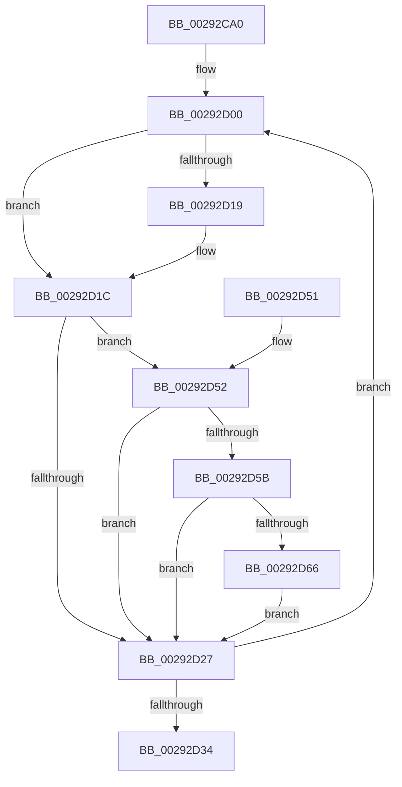

# MiWriteWsle

- RVA: `0x00292CA0`–`0x00292D79` (길이 `217` bytes)
- VA: `0x0000000140292CA0`
- 실행 섹션: `.text`
- PDB 이름 있음: `예`; PDB Function 태그: `아니요`
- unwind 정보 RVA: `0x000675D8`
- 디코드: `59`개 명령, `217/217` bytes 표시
- 미해석 바이트: `0` (있으면 어셈블리에 `.byte`로 보존)

> 이 문서는 커널 이미지의 기계어와 PDB 기호를 분석해 생성했습니다. 4번과 5번은 함수 원형과 자료형을 바이너리 사용 방식에서 추정한 C 해석이며 원본 소스 복구 결과는 아닙니다.

## 1. Dependencies

- 직접 호출 지점: **1**; 고유 호출 대상: **1**
- 직접 호출자로 확인된 함수: **8**
- RIP 상대 이미지 참조: **1**

### Outgoing calls
- `0x00292D72` → [MiCheckLinearProtectedPteAccessedBit](MiCheckLinearProtectedPteAccessedBit_function_00292D80.md) (function, `0x00292D80`)

### Direct callers
- [MiRemoveWsle](../22/MiRemoveWsle_function_0022D0C4.md) at `0x0022D1B4`
- [MiDecommitAddToList](../24/MiDecommitAddToList_function_00242264.md) at `0x00242A12`
- [sub_0040D91B](../40/Unknown_function_0040D91B.md) at `0x0040D9B9`
- [MiSetPagingOfDriver](../4A/MiSetPagingOfDriver_function_004A76C4.md) at `0x004A7898`
- [MiUnmapKernelScp](../4A/MiUnmapKernelScp_function_004A82E8.md) at `0x004A83FE`
- [MiPageBootRegistry](../66/MiPageBootRegistry_function_0066E82C.md) at `0x0066E9F0`
- [MiCreatePteWsle](../67/MiCreatePteWsle_function_00673D00.md) at `0x00673D2D`
- [MiClearDriverTablePtes](../68/MiClearDriverTablePtes_function_00683024.md) at `0x0068317E`

### Static image references
- `0x00292D0C` → RVA `0x00FC6A88` (`ALMOSTRO`; read)

## 2. Other-region calls and transfers

- 다른 실행 섹션으로 향하는 call: **0**
- 별도 외부 분기/꼬리 이동을 확인하지 못했습니다.

## 3. Assembly (complete function range)

```asm
00292CA0  48 89 5C 24 08                  mov qword ptr [rsp + 8], rbx
00292CA5  48 89 6C 24 10                  mov qword ptr [rsp + 0x10], rbp
00292CAA  48 89 74 24 18                  mov qword ptr [rsp + 0x18], rsi
00292CAF  57                              push rdi
00292CB0  41 54                           push r12
00292CB2  41 55                           push r13
00292CB4  41 56                           push r14
00292CB6  41 57                           push r15
00292CB8  48 83 EC 20                     sub rsp, 0x20
00292CBC  48 8B F2                        mov rsi, rdx
00292CBF  49 BC 00 00 00 00 80 F6 FF FF   movabs r12, 0xfffff68000000000
00292CC9  48 C1 EE 09                     shr rsi, 9
00292CCD  48 B8 F8 FF FF FF 7F 00 00 00   movabs rax, 0x7ffffffff8
00292CD7  48 23 F0                        and rsi, rax
00292CDA  49 8B C4                        mov rax, r12
00292CDD  48 03 F0                        add rsi, rax
00292CE0  41 0F B6 E8                     movzx ebp, r8b
00292CE4  48 C1 E5 38                     shl rbp, 0x38
00292CE8  49 BF FF FF FF FF FF FF FF 80   movabs r15, 0x80ffffffffffffff
00292CF2  49 BD 00 00 00 00 40 00 00 00   movabs r13, 0x4000000000
00292CFC  48 8B 3E                        mov rdi, qword ptr [rsi]
00292CFF  90                              nop
00292D00  48 8B DD                        mov rbx, rbp
00292D03  48 33 DF                        xor rbx, rdi
00292D06  49 23 DF                        and rbx, r15
00292D09  48 33 DD                        xor rbx, rbp
00292D0C  48 F7 05 71 3D D3 00 00 00 00 02  test qword ptr [rip + 0xd33d71], 0x2000000
00292D17  74 03                           je 0x140292d1c
00292D19  0F AE E8                        lfence
00292D1C  48 0F BA 25 63 3D D3 00 24      bt qword ptr [rip + 0xd33d63], 0x24
00292D25  72 2B                           jb 0x140292d52
00292D27  48 8B C7                        mov rax, rdi
00292D2A  F0 48 0F B1 1E                  lock cmpxchg qword ptr [rsi], rbx
00292D2F  48 8B F8                        mov rdi, rax
00292D32  75 CC                           jne 0x140292d00
00292D34  48 8B 5C 24 50                  mov rbx, qword ptr [rsp + 0x50]
00292D39  48 8B 6C 24 58                  mov rbp, qword ptr [rsp + 0x58]
00292D3E  48 8B 74 24 60                  mov rsi, qword ptr [rsp + 0x60]
00292D43  48 83 C4 20                     add rsp, 0x20
00292D47  41 5F                           pop r15
00292D49  41 5E                           pop r14
00292D4B  41 5D                           pop r13
00292D4D  41 5C                           pop r12
00292D4F  5F                              pop rdi
00292D50  C3                              ret
00292D51  CC                              int3
00292D52  0F B6 C3                        movzx eax, bl
00292D55  24 21                           and al, 0x21
00292D57  3C 01                           cmp al, 1
00292D59  75 CC                           jne 0x140292d27
00292D5B  49 8B C4                        mov rax, r12
00292D5E  49 03 C5                        add rax, r13
00292D61  48 3B F0                        cmp rsi, rax
00292D64  72 C1                           jb 0x140292d27
00292D66  41 B8 80 00 00 00               mov r8d, 0x80
00292D6C  48 8B D3                        mov rdx, rbx
00292D6F  48 8B CE                        mov rcx, rsi
00292D72  E8 09 00 00 00                  call 0x140292d80
00292D77  EB AE                           jmp 0x140292d27
```

## 4. C-style interpretation (structured pseudocode)

```c
__int64 __fastcall MiWriteWsle(__int64 a1, __int64 a2, unsigned __int8 a3)
{
    __int64 result;
    __int64 v_rbp;
    __int64 v_rbx;
    __int64 v_rsi;
    __int64 v_rsp;
    unsigned __int64 v_stack_p10;
    unsigned __int64 v_stack_p18;
    unsigned __int64 v_stack_p8;

    v_stack_p8 = v_rbx;
    v_stack_p10 = v_rbp;
    v_stack_p18 = v_rsi;
    v_rsp = (v_rsp) - (32);
    v_rsi = (a2) >> (9);
    v_rsi = (v_rsi) & (result);
    v_rsi = (v_rsi) + (v_r12);
    v_rbp = (a3) << (56);
loc_00292D00:
    v_rbx = (v_rbp) ^ (*(unsigned __int64 *)(v_rsi));
    v_rbx = (v_rbx) & (v_r15);
    v_rbx = (v_rbx) ^ (v_rbp);
    if (((*(unsigned __int64 *)(v_rip + 13843825)) & (0x2000000ULL)) != 0) {
    }
    if (condition_is_below) goto loc_00292D52;
loc_00292D27:
    if (((*(unsigned __int64 *)(v_rip + 13843825)) & (0x2000000ULL)) != 0) goto loc_00292D00;
    v_rsp = (v_rsp) + (32);
    return *(unsigned __int64 *)(v_rsi);
loc_00292D52:
    result = (unsigned __int8)(((unsigned __int8)(v_stack_p8)) & (33));
    if (((unsigned __int8)(result)) != 1) goto loc_00292D27;
    result = (v_r12) + (v_r13);
    if (v_stack_p18 < result) goto loc_00292D27;
    result = MiCheckLinearProtectedPteAccessedBit(v_stack_p18, v_stack_p8, 128, a4);
    goto loc_00292D27;
}
```

## 5. (Beta) C Style

```c
int64_t MiWriteWsle(int64_t Arg1, int64_t Arg2, uint8_t Arg3)
{
    int64_t result;
    int64_t local_rbp;
    int64_t local_rbx;
    int64_t local_rsi;
    int64_t local_rsp;
    uint64_t v_stack_p10;
    uint64_t v_stack_p18;
    uint64_t v_stack_p8;

    v_stack_p8 = local_rbx;
    v_stack_p10 = local_rbp;
    v_stack_p18 = local_rsi;
    local_rsp = (local_rsp) - (32);
    local_rsi = (Arg2) >> (9);
    local_rsi = (local_rsi) & (result);
    local_rsi = (local_rsi) + (local_r12);
    local_rbp = (Arg3) << (56);
loc_00292D00:
    local_rbx = (local_rbp) ^ (*(uint64_t *)(local_rsi));
    local_rbx = (local_rbx) & (local_r15);
    local_rbx = (local_rbx) ^ (local_rbp);
    if (((*(uint64_t *)(v_rip + 0xD33D71)) & (0x2000000ULL)) != 0) {
    }
    if (condition_is_below) goto loc_00292D52;
loc_00292D27:
    if (((*(uint64_t *)(v_rip + 0xD33D71)) & (0x2000000ULL)) != 0) goto loc_00292D00;
    local_rsp = (local_rsp) + (32);
    return *(uint64_t *)(local_rsi);
loc_00292D52:
    result = (uint8_t)(((uint8_t)(v_stack_p8)) & (33));
    if (((uint8_t)(result)) != 1) goto loc_00292D27;
    result = (local_r12) + (local_r13);
    if (v_stack_p18 < result) goto loc_00292D27;
    result = MiCheckLinearProtectedPteAccessedBit(v_stack_p18, v_stack_p8, 128, a4);
    goto loc_00292D27;
}
```

## 6. Execution-region graph

[열기: 2D/3D 그래프와 함수 탐색 컨트롤 패널](../../../control-panel.html?section=text&rva=0x00292CA0&view=graph)

- 2D 그래프는 위에서 아래로 흐르고, 3D 그래프는 빈 공간을 드래그해 회전합니다. Shift+드래그는 이동, 휠은 확대·축소, 함수 노드 선택은 대상 보고서 이동입니다.

### Static fallback


