# MiZeroPageWrite

- RVA: `0x0029F280`–`0x0029F539` (길이 `697` bytes)
- VA: `0x000000014029F280`
- 실행 섹션: `.text`
- PDB 이름 있음: `예`; PDB Function 태그: `아니요`
- unwind 정보 RVA: `0x000682CC`
- 디코드: `185`개 명령, `697/697` bytes 표시
- 미해석 바이트: `0` (있으면 어셈블리에 `.byte`로 보존)

> 이 문서는 커널 이미지의 기계어와 PDB 기호를 분석해 생성했습니다. 4번과 5번은 함수 원형과 자료형을 바이너리 사용 방식에서 추정한 C 해석이며 원본 소스 복구 결과는 아닙니다.

## 1. Dependencies

- 직접 호출 지점: **9**; 고유 호출 대상: **9**
- 직접 호출자로 확인된 함수: **4**
- RIP 상대 이미지 참조: **2**

### Outgoing calls
- `0x0029F2D1` → [memset](../6C/memset_function_006C6C40.md) (function, `0x006C6C40`)
- `0x0029F309` → [IoAllocateMdl](IoAllocateMdl_function_0029EBF0.md) (function, `0x0029EBF0`)
- `0x0029F3FE` → [IoSynchronousPageWriteEx](IoSynchronousPageWriteEx_function_0029A860.md) (function, `0x0029A860`)
- `0x0029F41F` → [KeWaitForSingleObject](../20/KeWaitForSingleObject_function_0020E6B0.md) (function, `0x0020E6B0`)
- `0x0029F48A` → [MiIsRetryIoStatus](../40/MiIsRetryIoStatus_function_00408640.md) (function, `0x00408640`)
- `0x0029F4A6` → [IoFreeMdl](IoFreeMdl_function_0029EA80.md) (function, `0x0029EA80`)
- `0x0029F4B5` → [_security_check_cookie](../6A/_security_check_cookie_function_006AC640.md) (function, `0x006AC640`)
- `0x0029F50E` → [MiRetardMdl](../40/MiRetardMdl_function_0040494C.md) (function, `0x0040494C`)
- `0x0029F51F` → [MmUnmapLockedPages](../24/MmUnmapLockedPages_function_00246E60.md) (function, `0x00246E60`)

### Direct callers
- [CcZeroDataOnDisk](../38/CcZeroDataOnDisk_function_00386B80.md) at `0x00386BD2`
- [MmZeroPageWrite](../49/MmZeroPageWrite_function_0049E74C.md) at `0x0049E78F`
- [sub_006E4CB8](../6E/Unknown_function_006E4CB8.md) at `0x006E4CE3`
- [sub_006F82EA](../6F/Unknown_function_006F82EA.md) at `0x006F8302`

### Static image references
- `0x0029F299` → RVA `0x00E0A740` (`.data`; read)
- `0x0029F397` → RVA `0x00E37440` (`.data`; read)

## 2. Other-region calls and transfers

- 다른 실행 섹션으로 향하는 call: **0**
- 별도 외부 분기/꼬리 이동을 확인하지 못했습니다.

## 3. Assembly (complete function range)

```asm
0029F280  40 55                           push rbp
0029F282  53                              push rbx
0029F283  56                              push rsi
0029F284  57                              push rdi
0029F285  41 54                           push r12
0029F287  41 55                           push r13
0029F289  41 56                           push r14
0029F28B  41 57                           push r15
0029F28D  48 8D 6C 24 A8                  lea rbp, [rsp - 0x58]
0029F292  48 81 EC 58 01 00 00            sub rsp, 0x158
0029F299  48 8B 05 A0 B4 B6 00            mov rax, qword ptr [rip + 0xb6b4a0]
0029F2A0  48 33 C4                        xor rax, rsp
0029F2A3  48 89 45 40                     mov qword ptr [rbp + 0x40], rax
0029F2A7  83 64 24 74 00                  and dword ptr [rsp + 0x74], 0
0029F2AC  41 8B F1                        mov esi, r9d
0029F2AF  45 8B F8                        mov r15d, r8d
0029F2B2  41 B8 B0 00 00 00               mov r8d, 0xb0
0029F2B8  48 89 54 24 68                  mov qword ptr [rsp + 0x68], rdx
0029F2BD  33 D2                           xor edx, edx
0029F2BF  48 89 4D 80                     mov qword ptr [rbp - 0x80], rcx
0029F2C3  48 8D 4D 90                     lea rcx, [rbp - 0x70]
0029F2C7  44 89 7C 24 48                  mov dword ptr [rsp + 0x48], r15d
0029F2CC  C6 44 24 53 00                  mov byte ptr [rsp + 0x53], 0
0029F2D1  E8 6A 79 42 00                  call 0x1406c6c40
0029F2D6  45 33 C0                        xor r8d, r8d
0029F2D9  41 BD FF 0F 00 00               mov r13d, 0xfff
0029F2DF  41 8B D8                        mov ebx, r8d
0029F2E2  41 8B FF                        mov edi, r15d
0029F2E5  4F 8D 34 2F                     lea r14, [r15 + r13]
0029F2E9  49 C1 EE 0C                     shr r14, 0xc
0029F2ED  85 F6                           test esi, esi
0029F2EF  0F 85 0B 02 00 00               jne 0x14029f500
0029F2F5  81 FF 00 00 01 00               cmp edi, 0x10000
0029F2FB  76 17                           jbe 0x14029f314
0029F2FD  45 33 C9                        xor r9d, r9d
0029F300  4C 89 44 24 20                  mov qword ptr [rsp + 0x20], r8
0029F305  8B D7                           mov edx, edi
0029F307  33 C9                           xor ecx, ecx
0029F309  E8 E2 F8 FF FF                  call 0x14029ebf0
0029F30E  48 8B D8                        mov rbx, rax
0029F311  45 33 C0                        xor r8d, r8d
0029F314  49 03 FD                        add rdi, r13
0029F317  48 C1 EF 0C                     shr rdi, 0xc
0029F31B  48 85 DB                        test rbx, rbx
0029F31E  0F 85 C7 01 00 00               jne 0x14029f4eb
0029F324  8D 43 10                        lea eax, [rbx + 0x10]
0029F327  45 8B E0                        mov r12d, r8d
0029F32A  3B F8                           cmp edi, eax
0029F32C  48 8D 5D 90                     lea rbx, [rbp - 0x70]
0029F330  0F 47 F8                        cmova edi, eax
0029F333  B8 02 40 00 00                  mov eax, 0x4002
0029F338  44 89 44 24 40                  mov dword ptr [rsp + 0x40], r8d
0029F33D  66 44 0B E0                     or r12w, ax
0029F341  48 8D 53 30                     lea rdx, [rbx + 0x30]
0029F345  8B F7                           mov esi, edi
0029F347  41 3B F6                        cmp esi, r14d
0029F34A  41 8B C6                        mov eax, r14d
0029F34D  0F 46 C6                        cmovbe eax, esi
0029F350  8B C8                           mov ecx, eax
0029F352  8B F0                           mov esi, eax
0029F354  C1 E1 0C                        shl ecx, 0xc
0029F357  44 3B F0                        cmp r14d, eax
0029F35A  0F 84 6F 01 00 00               je 0x14029f4cf
0029F360  48 8D 81 FF 0F 00 00            lea rax, [rcx + 0xfff]
0029F367  44 8B E9                        mov r13d, ecx
0029F36A  48 C1 E8 0C                     shr rax, 0xc
0029F36E  66 83 C0 06                     add ax, 6
0029F372  89 4B 28                        mov dword ptr [rbx + 0x28], ecx
0029F375  66 C1 E0 03                     shl ax, 3
0029F379  48 8B CA                        mov rcx, rdx
0029F37C  4C 89 03                        mov qword ptr [rbx], r8
0029F37F  66 89 43 08                     mov word ptr [rbx + 8], ax
0029F383  4C 89 43 20                     mov qword ptr [rbx + 0x20], r8
0029F387  44 89 43 2C                     mov dword ptr [rbx + 0x2c], r8d
0029F38B  66 44 89 63 0A                  mov word ptr [rbx + 0xa], r12w
0029F390  85 F6                           test esi, esi
0029F392  74 17                           je 0x14029f3ab
0029F394  48 8B D6                        mov rdx, rsi
0029F397  48 8B 05 A2 80 B9 00            mov rax, qword ptr [rip + 0xb980a2]
0029F39E  48 89 01                        mov qword ptr [rcx], rax
0029F3A1  48 8D 49 08                     lea rcx, [rcx + 8]
0029F3A5  48 83 EA 01                     sub rdx, 1
0029F3A9  75 EC                           jne 0x14029f397
0029F3AB  48 8B 4D 80                     mov rcx, qword ptr [rbp - 0x80]
0029F3AF  48 8D 44 24 58                  lea rax, [rsp + 0x58]
0029F3B4  66 83 64 24 50 00               and word ptr [rsp + 0x50], 0
0029F3BA  4C 8D 4C 24 50                  lea r9, [rsp + 0x50]
0029F3BF  48 89 44 24 60                  mov qword ptr [rsp + 0x60], rax
0029F3C4  48 8B D3                        mov rdx, rbx
0029F3C7  48 8D 44 24 58                  lea rax, [rsp + 0x58]
0029F3CC  44 89 44 24 54                  mov dword ptr [rsp + 0x54], r8d
0029F3D1  48 89 44 24 58                  mov qword ptr [rsp + 0x58], rax
0029F3D6  48 8D 44 24 70                  lea rax, [rsp + 0x70]
0029F3DB  48 89 44 24 30                  mov qword ptr [rsp + 0x30], rax
0029F3E0  4C 89 44 24 28                  mov qword ptr [rsp + 0x28], r8
0029F3E5  44 88 44 24 20                  mov byte ptr [rsp + 0x20], r8b
0029F3EA  44 89 44 24 70                  mov dword ptr [rsp + 0x70], r8d
0029F3EF  4C 89 44 24 78                  mov qword ptr [rsp + 0x78], r8
0029F3F4  4C 8B 44 24 68                  mov r8, qword ptr [rsp + 0x68]
0029F3F9  C6 44 24 52 06                  mov byte ptr [rsp + 0x52], 6
0029F3FE  E8 5D B4 FF FF                  call 0x14029a860
0029F403  44 8B F8                        mov r15d, eax
0029F406  85 C0                           test eax, eax
0029F408  78 1F                           js 0x14029f429
0029F40A  48 83 64 24 20 00               and qword ptr [rsp + 0x20], 0
0029F410  48 8D 4C 24 50                  lea rcx, [rsp + 0x50]
0029F415  45 33 C9                        xor r9d, r9d
0029F418  45 33 C0                        xor r8d, r8d
0029F41B  41 8D 51 13                     lea edx, [r9 + 0x13]
0029F41F  E8 8C F2 F6 FF                  call 0x14020e6b0
0029F424  44 8B 7C 24 70                  mov r15d, dword ptr [rsp + 0x70]
0029F429  66 0F BA 63 0A 09               bt word ptr [rbx + 0xa], 9
0029F42F  0F 82 D6 00 00 00               jb 0x14029f50b
0029F435  F6 43 0A 01                     test byte ptr [rbx + 0xa], 1
0029F439  0F 85 D9 00 00 00               jne 0x14029f518
0029F43F  45 33 C0                        xor r8d, r8d
0029F442  45 85 FF                        test r15d, r15d
0029F445  78 35                           js 0x14029f47c
0029F447  48 8B 44 24 68                  mov rax, qword ptr [rsp + 0x68]
0029F44C  44 2B F6                        sub r14d, esi
0029F44F  8B 54 24 40                     mov edx, dword ptr [rsp + 0x40]
0029F453  4C 01 28                        add qword ptr [rax], r13
0029F456  85 D2                           test edx, edx
0029F458  0F 85 97 00 00 00               jne 0x14029f4f5
0029F45E  3B F7                           cmp esi, edi
0029F460  0F 42 F7                        cmovb esi, edi
0029F463  48 8D 53 30                     lea rdx, [rbx + 0x30]
0029F467  41 BD FF 0F 00 00               mov r13d, 0xfff
0029F46D  45 85 F6                        test r14d, r14d
0029F470  74 28                           je 0x14029f49a
0029F472  44 8B 7C 24 48                  mov r15d, dword ptr [rsp + 0x48]
0029F477  E9 CB FE FF FF                  jmp 0x14029f347
0029F47C  49 8B D5                        mov rdx, r13
0029F47F  C7 44 24 40 08 00 00 00         mov dword ptr [rsp + 0x40], 8
0029F487  41 8B CF                        mov ecx, r15d
0029F48A  E8 B1 91 16 00                  call 0x140408640
0029F48F  45 33 C0                        xor r8d, r8d
0029F492  85 C0                           test eax, eax
0029F494  0F 85 8F 00 00 00               jne 0x14029f529
0029F49A  48 8D 45 90                     lea rax, [rbp - 0x70]
0029F49E  48 3B D8                        cmp rbx, rax
0029F4A1  74 08                           je 0x14029f4ab
0029F4A3  48 8B CB                        mov rcx, rbx
0029F4A6  E8 D5 F5 FF FF                  call 0x14029ea80
0029F4AB  41 8B C7                        mov eax, r15d
0029F4AE  48 8B 4D 40                     mov rcx, qword ptr [rbp + 0x40]
0029F4B2  48 33 CC                        xor rcx, rsp
0029F4B5  E8 86 D1 40 00                  call 0x1406ac640
0029F4BA  48 81 C4 58 01 00 00            add rsp, 0x158
0029F4C1  41 5F                           pop r15
0029F4C3  41 5E                           pop r14
0029F4C5  41 5D                           pop r13
0029F4C7  41 5C                           pop r12
0029F4C9  5F                              pop rdi
0029F4CA  5E                              pop rsi
0029F4CB  5B                              pop rbx
0029F4CC  5D                              pop rbp
0029F4CD  C3                              ret
0029F4CE  CC                              int3
0029F4CF  41 8B C7                        mov eax, r15d
0029F4D2  41 8B FE                        mov edi, r14d
0029F4D5  41 23 C5                        and eax, r13d
0029F4D8  0F 84 82 FE FF FF               je 0x14029f360
0029F4DE  0B C8                           or ecx, eax
0029F4E0  81 C1 00 F0 FF FF               add ecx, 0xfffff000
0029F4E6  E9 75 FE FF FF                  jmp 0x14029f360
0029F4EB  44 0F B7 63 0A                  movzx r12d, word ptr [rbx + 0xa]
0029F4F0  E9 3E FE FF FF                  jmp 0x14029f333
0029F4F5  FF CA                           dec edx
0029F4F7  89 54 24 40                     mov dword ptr [rsp + 0x40], edx
0029F4FB  E9 63 FF FF FF                  jmp 0x14029f463
0029F500  44 3B FE                        cmp r15d, esi
0029F503  0F 47 FE                        cmova edi, esi
0029F506  E9 EA FD FF FF                  jmp 0x14029f2f5
0029F50B  48 8B CB                        mov rcx, rbx
0029F50E  E8 39 54 16 00                  call 0x14040494c
0029F513  E9 1D FF FF FF                  jmp 0x14029f435
0029F518  48 8B 4B 18                     mov rcx, qword ptr [rbx + 0x18]
0029F51C  48 8B D3                        mov rdx, rbx
0029F51F  E8 3C 79 FA FF                  call 0x140246e60
0029F524  E9 16 FF FF FF                  jmp 0x14029f43f
0029F529  83 FE 01                        cmp esi, 1
0029F52C  0F 84 68 FF FF FF               je 0x14029f49a
0029F532  D1 EE                           shr esi, 1
0029F534  E9 2A FF FF FF                  jmp 0x14029f463
```

## 4. C-style interpretation (structured pseudocode)

```c
__int64 __fastcall MiZeroPageWrite(__int64 a1, __int64 a2, int a3, int a4)
{
    __int64 result;
    __int64 v_r12;
    __int64 v_r14;
    __int64 v_r15;
    __int64 v_rbx;
    __int64 v_rdi;
    __int64 v_rsi;
    __int64 v_rsp;
    unsigned __int64 v_stack_m108;
    unsigned __int64 v_stack_m118;
    unsigned __int64 v_stack_m120;
    unsigned int v_stack_m124;
    unsigned __int64 v_stack_m128;
    unsigned __int64 v_stack_m130;
    unsigned __int64 v_stack_m138;
    unsigned __int64 v_stack_m140;
    unsigned int v_stack_m144;
    unsigned __int8 v_stack_m145;
    unsigned __int8 v_stack_m146;
    unsigned __int16 v_stack_m148;
    unsigned int v_stack_m150;
    unsigned int v_stack_m158;
    unsigned __int64 v_stack_m168;
    unsigned __int64 v_stack_m170;
    unsigned __int64 v_stack_m178;
    unsigned __int64 v_stack_m58;
    unsigned __int64 v_stack_m98;
    unsigned int v_stack_p40;

    v_rsp = (v_rsp) - (344);
    result = (*(unsigned __int64 *)(v_rip + 11973792)) ^ (v_rsp);
    v_stack_m58 = result;
    v_stack_m130 = a2;
    a2 = 0;
    v_stack_m118 = a1;
    v_stack_m150 = (unsigned int)((unsigned int)(a3));
    v_stack_m145 = 0;
    result = memset(v_stack_m108, a2, 176, a4);
    a3 = 0;
    v_r14 = ((unsigned int)(a3) + (unsigned int)(0xFFFULL) * 1) >> (12);
    if ((unsigned int)((unsigned int)(a4)) != 0) goto loc_0029F500;
loc_0029F2F5:
    v_rbx = 0;
    if (((unsigned int)((unsigned int)((unsigned int)((unsigned int)(a3))))) >= = 0x10000ULL) {
        a4 = 0;
        v_stack_m178 = 0;
        a2 = (unsigned int)((unsigned int)((unsigned int)((unsigned int)(a3))));
        a1 = 0;
        result = IoAllocateMdl(a1, a2, a3, a4);
        v_rbx = result;
        a3 = 0;
    }
    v_rdi = ((unsigned int)((unsigned int)((unsigned int)(a3)))) + ((unsigned int)(0xFFFULL));
    v_rdi = (v_rdi) >> (12);
    if (v_rbx != 0) goto loc_0029F4EB;
    if (((unsigned int)(v_rdi)) > ((unsigned int)(v_rbx + 16))) { v_rdi = (unsigned int)(v_rbx + 16); }
loc_0029F333:
    v_stack_m158 = 0;
    v_r12 = (unsigned __int16)((0) | ((unsigned __int16)((unsigned int)(0x4002ULL))));
loc_0029F347:
    result = (unsigned int)((unsigned int)(v_r14));
    if (((unsigned int)((unsigned int)((unsigned int)(v_rdi)))) <= ((unsigned int)(v_r14))) { result = (unsigned int)((unsigned int)((unsigned int)(v_rdi))); }
    a1 = (unsigned int)(((unsigned int)((unsigned int)(result))) << (12));
    if (((unsigned int)(v_r14)) == ((unsigned int)(result))) goto loc_0029F4CF;
loc_0029F360:
    result = (a1 + 4095) >> (12);
    result = (unsigned __int16)((result) + (6));
    *(unsigned int *)(v_stack_m108 + 40) = (unsigned int)(a1);
    result = (unsigned __int16)((result) << (3));
    *(unsigned __int64 *)(v_stack_m108) = 0;
    *(unsigned __int16 *)(v_stack_m108 + 8) = (unsigned __int16)(result);
    *(unsigned __int64 *)(v_stack_m108 + 32) = 0;
    *(unsigned int *)(v_stack_m108 + 44) = 0;
    *(unsigned __int16 *)(v_stack_m108 + 10) = (unsigned __int16)(v_r12);
    if ((unsigned int)((unsigned int)((unsigned int)(result))) == 0) goto loc_0029F3AB;
loc_0029F397:
    *(unsigned __int64 *)(v_stack_m108 + 48) = *(unsigned __int64 *)(v_rip + 12157090);
    a2 = ((unsigned int)((unsigned int)(result))) - (1);
    if (condition_is_not_equal) goto loc_0029F397;
loc_0029F3AB:
    v_stack_m138 = v_stack_m140;
    v_stack_m144 = 0;
    v_stack_m140 = v_stack_m140;
    v_stack_m168 = v_stack_m128;
    v_stack_m170 = 0;
    v_stack_m178 = 0;
    v_stack_m128 = 0;
    v_stack_m120 = 0;
    v_stack_m146 = 6;
    result = IoSynchronousPageWriteEx(v_stack_m118, v_stack_m108, v_stack_m130, v_stack_m148);
    v_r15 = (unsigned int)((unsigned int)(result));
    if (!(sign_flag)) {
        a1 = v_stack_m148;
        a4 = 0;
        a3 = 0;
        a2 = a4 + 19;
        result = KeWaitForSingleObject(a1, a2, a3, a4);
        v_r15 = v_stack_m128;
    }
    if (condition_is_below) goto loc_0029F50B;
loc_0029F435:
    if (((*(unsigned __int8 *)(v_stack_m108 + 10)) & (1)) != 0) goto loc_0029F518;
loc_0029F43F:
    a3 = 0;
    if (sign_flag) goto loc_0029F47C;
    v_r14 = (unsigned int)((v_r14) - ((unsigned int)((unsigned int)((unsigned int)(result)))));
    if ((unsigned int)((unsigned int)(v_stack_m158)) != 0) goto loc_0029F4F5;
    v_rsi = (unsigned int)((unsigned int)(result));
    if (((unsigned int)((unsigned int)((unsigned int)(result)))) < ((unsigned int)(v_rdi))) { v_rsi = (unsigned int)(v_rdi); }
loc_0029F463:
    if ((unsigned int)(v_r14) == 0) goto loc_0029F49A;
    goto loc_0029F347;
loc_0029F47C:
    v_stack_m158 = 8;
    result = MiIsRetryIoStatus((unsigned int)((unsigned int)((unsigned int)(v_stack_m150))), (unsigned int)(0xFFFULL), a3, a4);
    a3 = 0;
    if ((unsigned int)(result) != 0) goto loc_0029F529;
loc_0029F49A:
    result = v_stack_m108;
    if (v_stack_m108 != v_stack_m108) {
        a1 = v_stack_m108;
        result = IoFreeMdl(a1, (unsigned int)(0xFFFULL), a3, a4);
    }
    a1 = (v_stack_m58) ^ (v_rsp);
    result = _security_check_cookie(a1, (unsigned int)(0xFFFULL), a3, a4);
    v_rsp = (v_rsp) + (344);
    return result;
loc_0029F4CF:
    result = (unsigned int)(((unsigned int)((unsigned int)((unsigned int)(v_stack_m150)))) & ((unsigned int)((unsigned int)(0xFFFULL))));
    if (condition_is_equal) goto loc_0029F360;
    a1 = (unsigned int)((a1) | ((unsigned int)(result)));
    a1 = (unsigned int)((a1) + (0xFFFFF000ULL));
    goto loc_0029F360;
loc_0029F4EB:
    goto loc_0029F333;
loc_0029F4F5:
    a2 = (unsigned int)(((unsigned int)(0xFFFULL)) - 1);
    v_stack_p40 = (unsigned int)(a2);
    goto loc_0029F463;
loc_0029F500:
    v_rdi = (unsigned int)((unsigned int)(v_r14));
    if (((unsigned int)((unsigned int)(v_stack_m150))) > ((unsigned int)(v_rsi))) { v_rdi = (unsigned int)(v_rsi); }
    goto loc_0029F2F5;
loc_0029F50B:
    result = MiRetardMdl(v_stack_m108, a2, a3, a4);
    goto loc_0029F435;
loc_0029F518:
    result = MmUnmapLockedPages(*(unsigned __int64 *)(v_stack_m108 + 24), v_stack_m108, a3, a4);
    goto loc_0029F43F;
loc_0029F529:
    if (((unsigned int)(v_rsi)) == 1) goto loc_0029F49A;
    v_rsi = (unsigned int)((v_rsi) >> (1));
    goto loc_0029F463;
}
```

## 5. (Beta) C Style

```c
int64_t MiZeroPageWrite(int64_t Arg1, int64_t Arg2, void *Arg3, int32_t Arg4)
{
    uint8_t *arg3 = (uint8_t *)Arg3;

    int64_t result;
    int64_t local_r12;
    int64_t local_r14;
    int64_t local_r15;
    int64_t local_rbx;
    int64_t local_rdi;
    int64_t local_rsi;
    int64_t local_rsp;
    uint64_t v_stack_m108;
    uint64_t v_stack_m118;
    uint64_t v_stack_m120;
    uint32_t v_stack_m124;
    uint64_t v_stack_m128;
    uint64_t v_stack_m130;
    uint64_t v_stack_m138;
    uint64_t v_stack_m140;
    uint32_t v_stack_m144;
    uint8_t v_stack_m145;
    uint8_t v_stack_m146;
    uint16_t v_stack_m148;
    uint32_t v_stack_m150;
    uint32_t v_stack_m158;
    uint64_t v_stack_m168;
    uint64_t v_stack_m170;
    uint64_t v_stack_m178;
    uint64_t v_stack_m58;
    uint64_t v_stack_m98;
    uint32_t v_stack_p40;

    local_rsp = (local_rsp) - (344);
    result = (*(uint64_t *)(v_rip + 0xB6B4A0)) ^ (local_rsp);
    v_stack_m58 = result;
    v_stack_m130 = Arg2;
    Arg2 = 0;
    v_stack_m118 = Arg1;
    v_stack_m150 = (uint32_t)((uint32_t)(Arg3));
    v_stack_m145 = 0;
    result = memset(v_stack_m108, Arg2, 176, Arg4);
    Arg3 = 0;
    local_r14 = ((uint32_t)(Arg3) + (uint32_t)(0xFFFULL) * 1) >> (12);
    if ((uint32_t)((uint32_t)(Arg4)) != 0) goto loc_0029F500;
loc_0029F2F5:
    local_rbx = 0;
    if (((uint32_t)((uint32_t)((uint32_t)((uint32_t)(Arg3))))) >= = 0x10000ULL) {
        Arg4 = 0;
        v_stack_m178 = 0;
        Arg2 = (uint32_t)((uint32_t)((uint32_t)((uint32_t)(Arg3))));
        Arg1 = 0;
        result = IoAllocateMdl(Arg1, Arg2, Arg3, Arg4);
        local_rbx = result;
        Arg3 = 0;
    }
    local_rdi = ((uint32_t)((uint32_t)((uint32_t)(Arg3)))) + ((uint32_t)(0xFFFULL));
    local_rdi = (local_rdi) >> (12);
    if (local_rbx != 0) goto loc_0029F4EB;
    if (((uint32_t)(local_rdi)) > ((uint32_t)(local_rbx + 16))) { local_rdi = (uint32_t)(local_rbx + 16); }
loc_0029F333:
    v_stack_m158 = 0;
    local_r12 = (uint16_t)((0) | ((uint16_t)((uint32_t)(0x4002ULL))));
loc_0029F347:
    result = (uint32_t)((uint32_t)(local_r14));
    if (((uint32_t)((uint32_t)((uint32_t)(local_rdi)))) <= ((uint32_t)(local_r14))) { result = (uint32_t)((uint32_t)((uint32_t)(local_rdi))); }
    Arg1 = (uint32_t)(((uint32_t)((uint32_t)(result))) << (12));
    if (((uint32_t)(local_r14)) == ((uint32_t)(result))) goto loc_0029F4CF;
loc_0029F360:
    result = (Arg1 + 4095) >> (12);
    result = (uint16_t)((result) + (6));
    *(uint32_t *)(v_stack_m108 + 0x28) = (uint32_t)(Arg1);
    result = (uint16_t)((result) << (3));
    *(uint64_t *)(v_stack_m108) = 0;
    *(uint16_t *)(v_stack_m108 + 0x8) = (uint16_t)(result);
    *(uint64_t *)(v_stack_m108 + 0x20) = 0;
    *(uint32_t *)(v_stack_m108 + 0x2C) = 0;
    *(uint16_t *)(v_stack_m108 + 0xA) = (uint16_t)(local_r12);
    if ((uint32_t)((uint32_t)((uint32_t)(result))) == 0) goto loc_0029F3AB;
loc_0029F397:
    *(uint64_t *)(v_stack_m108 + 0x30) = *(uint64_t *)(v_rip + 0xB980A2);
    Arg2 = ((uint32_t)((uint32_t)(result))) - (1);
    if (condition_is_not_equal) goto loc_0029F397;
loc_0029F3AB:
    v_stack_m138 = v_stack_m140;
    v_stack_m144 = 0;
    v_stack_m140 = v_stack_m140;
    v_stack_m168 = v_stack_m128;
    v_stack_m170 = 0;
    v_stack_m178 = 0;
    v_stack_m128 = 0;
    v_stack_m120 = 0;
    v_stack_m146 = 6;
    result = IoSynchronousPageWriteEx(v_stack_m118, v_stack_m108, v_stack_m130, v_stack_m148);
    local_r15 = (uint32_t)((uint32_t)(result));
    if (!(sign_flag)) {
        Arg1 = v_stack_m148;
        Arg4 = 0;
        Arg3 = 0;
        Arg2 = Arg4 + 19;
        result = KeWaitForSingleObject(Arg1, Arg2, Arg3, Arg4);
        local_r15 = v_stack_m128;
    }
    if (condition_is_below) goto loc_0029F50B;
loc_0029F435:
    if (((*(uint8_t *)(v_stack_m108 + 0xA)) & (1)) != 0) goto loc_0029F518;
loc_0029F43F:
    Arg3 = 0;
    if (sign_flag) goto loc_0029F47C;
    local_r14 = (uint32_t)((local_r14) - ((uint32_t)((uint32_t)((uint32_t)(result)))));
    if ((uint32_t)((uint32_t)(v_stack_m158)) != 0) goto loc_0029F4F5;
    local_rsi = (uint32_t)((uint32_t)(result));
    if (((uint32_t)((uint32_t)((uint32_t)(result)))) < ((uint32_t)(local_rdi))) { local_rsi = (uint32_t)(local_rdi); }
loc_0029F463:
    if ((uint32_t)(local_r14) == 0) goto loc_0029F49A;
    goto loc_0029F347;
loc_0029F47C:
    v_stack_m158 = 8;
    result = MiIsRetryIoStatus((uint32_t)((uint32_t)((uint32_t)(v_stack_m150))), (uint32_t)(0xFFFULL), Arg3, Arg4);
    Arg3 = 0;
    if ((uint32_t)(result) != 0) goto loc_0029F529;
loc_0029F49A:
    result = v_stack_m108;
    if (v_stack_m108 != v_stack_m108) {
        Arg1 = v_stack_m108;
        result = IoFreeMdl(Arg1, (uint32_t)(0xFFFULL), Arg3, Arg4);
    }
    Arg1 = (v_stack_m58) ^ (local_rsp);
    result = _security_check_cookie(Arg1, (uint32_t)(0xFFFULL), Arg3, Arg4);
    local_rsp = (local_rsp) + (344);
    return result;
loc_0029F4CF:
    result = (uint32_t)(((uint32_t)((uint32_t)((uint32_t)(v_stack_m150)))) & ((uint32_t)((uint32_t)(0xFFFULL))));
    if (condition_is_equal) goto loc_0029F360;
    Arg1 = (uint32_t)((Arg1) | ((uint32_t)(result)));
    Arg1 = (uint32_t)((Arg1) + (0xFFFFF000ULL));
    goto loc_0029F360;
loc_0029F4EB:
    goto loc_0029F333;
loc_0029F4F5:
    Arg2 = (uint32_t)(((uint32_t)(0xFFFULL)) - 1);
    v_stack_p40 = (uint32_t)(Arg2);
    goto loc_0029F463;
loc_0029F500:
    local_rdi = (uint32_t)((uint32_t)(local_r14));
    if (((uint32_t)((uint32_t)(v_stack_m150))) > ((uint32_t)(local_rsi))) { local_rdi = (uint32_t)(local_rsi); }
    goto loc_0029F2F5;
loc_0029F50B:
    result = MiRetardMdl(v_stack_m108, Arg2, Arg3, Arg4);
    goto loc_0029F435;
loc_0029F518:
    result = MmUnmapLockedPages(*(uint64_t *)(v_stack_m108 + 0x18), v_stack_m108, Arg3, Arg4);
    goto loc_0029F43F;
loc_0029F529:
    if (((uint32_t)(local_rsi)) == 1) goto loc_0029F49A;
    local_rsi = (uint32_t)((local_rsi) >> (1));
    goto loc_0029F463;
}
```

### 관측된 메모리 오프셋

구조체 형식이 확인되지 않은 접근은 인자 기준의 오프셋으로만 기록했습니다.

| 기준 인자 | 오프셋 표현 | 폭 (bit) | 접근 |
|---|---:|---:|---|
| `Arg3` | `+ 0x0 + r13*1` | `64` | `R` |

## 6. Execution-region graph

[열기: 2D/3D 그래프와 함수 탐색 컨트롤 패널](../../../control-panel.html?section=text&rva=0x0029F280&view=graph)

- 2D 그래프는 위에서 아래로 흐르고, 3D 그래프는 빈 공간을 드래그해 회전합니다. Shift+드래그는 이동, 휠은 확대·축소, 함수 노드 선택은 대상 보고서 이동입니다.

### Static fallback

```mermaid
flowchart TD
  bb_0029F280[BB_0029F280]
  bb_0029F2F5[BB_0029F2F5]
  bb_0029F2FD[BB_0029F2FD]
  bb_0029F314[BB_0029F314]
  bb_0029F324[BB_0029F324]
  bb_0029F333[BB_0029F333]
  bb_0029F347[BB_0029F347]
  bb_0029F360[BB_0029F360]
  bb_0029F394[BB_0029F394]
  bb_0029F397[BB_0029F397]
  bb_0029F3AB[BB_0029F3AB]
  bb_0029F40A[BB_0029F40A]
  bb_0029F429[BB_0029F429]
  bb_0029F435[BB_0029F435]
  bb_0029F43F[BB_0029F43F]
  bb_0029F447[BB_0029F447]
  bb_0029F45E[BB_0029F45E]
  bb_0029F463[BB_0029F463]
  bb_0029F472[BB_0029F472]
  bb_0029F47C[BB_0029F47C]
  bb_0029F49A[BB_0029F49A]
  bb_0029F4A3[BB_0029F4A3]
  bb_0029F4AB[BB_0029F4AB]
  bb_0029F4CE[BB_0029F4CE]
  bb_0029F4CF[BB_0029F4CF]
  bb_0029F4DE[BB_0029F4DE]
  bb_0029F4EB[BB_0029F4EB]
  bb_0029F4F5[BB_0029F4F5]
  bb_0029F500[BB_0029F500]
  bb_0029F50B[BB_0029F50B]
  bb_0029F518[BB_0029F518]
  bb_0029F529[BB_0029F529]
  bb_0029F532[BB_0029F532]
  bb_0029F280 -->|branch| bb_0029F500
  bb_0029F280 -->|fallthrough| bb_0029F2F5
  bb_0029F2F5 -->|branch| bb_0029F314
  bb_0029F2F5 -->|fallthrough| bb_0029F2FD
  bb_0029F2FD -->|flow| bb_0029F314
  bb_0029F314 -->|branch| bb_0029F4EB
  bb_0029F314 -->|fallthrough| bb_0029F324
  bb_0029F324 -->|flow| bb_0029F333
  bb_0029F333 -->|flow| bb_0029F347
  bb_0029F347 -->|branch| bb_0029F4CF
  bb_0029F347 -->|fallthrough| bb_0029F360
  bb_0029F360 -->|branch| bb_0029F3AB
  bb_0029F360 -->|fallthrough| bb_0029F394
  bb_0029F394 -->|flow| bb_0029F397
  bb_0029F397 -->|branch| bb_0029F397
  bb_0029F397 -->|fallthrough| bb_0029F3AB
  bb_0029F3AB -->|branch| bb_0029F429
  bb_0029F3AB -->|fallthrough| bb_0029F40A
  bb_0029F40A -->|flow| bb_0029F429
  bb_0029F429 -->|branch| bb_0029F50B
  bb_0029F429 -->|fallthrough| bb_0029F435
  bb_0029F435 -->|branch| bb_0029F518
  bb_0029F435 -->|fallthrough| bb_0029F43F
  bb_0029F43F -->|branch| bb_0029F47C
  bb_0029F43F -->|fallthrough| bb_0029F447
  bb_0029F447 -->|branch| bb_0029F4F5
  bb_0029F447 -->|fallthrough| bb_0029F45E
  bb_0029F45E -->|flow| bb_0029F463
  bb_0029F463 -->|branch| bb_0029F49A
  bb_0029F463 -->|fallthrough| bb_0029F472
  bb_0029F472 -->|branch| bb_0029F347
  bb_0029F47C -->|branch| bb_0029F529
  bb_0029F47C -->|fallthrough| bb_0029F49A
  bb_0029F49A -->|branch| bb_0029F4AB
  bb_0029F49A -->|fallthrough| bb_0029F4A3
  bb_0029F4A3 -->|flow| bb_0029F4AB
  bb_0029F4CE -->|flow| bb_0029F4CF
  bb_0029F4CF -->|branch| bb_0029F360
  bb_0029F4CF -->|fallthrough| bb_0029F4DE
  bb_0029F4DE -->|branch| bb_0029F360
  bb_0029F4EB -->|branch| bb_0029F333
  bb_0029F4F5 -->|branch| bb_0029F463
  bb_0029F500 -->|branch| bb_0029F2F5
  bb_0029F50B -->|branch| bb_0029F435
  bb_0029F518 -->|branch| bb_0029F43F
  bb_0029F529 -->|branch| bb_0029F49A
  bb_0029F529 -->|fallthrough| bb_0029F532
  bb_0029F532 -->|branch| bb_0029F463
```


