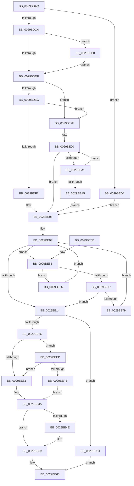

# MmIsFileObjectAPagingFile

- RVA: `0x0029BDAC`–`0x0029BF11` (길이 `357` bytes)
- VA: `0x000000014029BDAC`
- 실행 섹션: `.text`
- PDB 이름 있음: `예`; PDB Function 태그: `아니요`
- unwind 정보 RVA: `0x00067E48`
- 디코드: `81`개 명령, `357/357` bytes 표시
- 미해석 바이트: `0` (있으면 어셈블리에 `.byte`로 보존)

> 이 문서는 커널 이미지의 기계어와 PDB 기호를 분석해 생성했습니다. 4번과 5번은 함수 원형과 자료형을 바이너리 사용 방식에서 추정한 C 해석이며 원본 소스 복구 결과는 아닙니다.

## 1. Dependencies

- 직접 호출 지점: **7**; 고유 호출 대상: **7**
- 직접 호출자로 확인된 함수: **7**
- RIP 상대 이미지 참조: **6**

### Outgoing calls
- `0x0029BE03` → [ExpAcquireSpinLockSharedAtDpcLevelInstrumented](../27/ExpAcquireSpinLockSharedAtDpcLevelInstrumented_function_0027CD20.md) (function, `0x0027CD20`)
- `0x0029BE54` → [KiLowerIrqlProcessIrqlFlags](../4F/KiLowerIrqlProcessIrqlFlags_function_004F5698.md) (function, `0x004F5698`)
- `0x0029BEAE` → [ExpWaitForSpinLockSharedAndAcquire](../36/ExpWaitForSpinLockSharedAndAcquire_function_00362380.md) (function, `0x00362380`)
- `0x0029BEBA` → [KiRaiseIrqlProcessIrqlFlags](../4F/KiRaiseIrqlProcessIrqlFlags_function_004F56FC.md) (function, `0x004F56FC`)
- `0x0029BECB` → [ExReleaseSpinLockSharedFromDpcLevel](../24/ExReleaseSpinLockSharedFromDpcLevel_function_0024A590.md) (function, `0x0024A590`)
- `0x0029BEE3` → [ExAcquireSpinLockSharedAtDpcLevel](../24/ExAcquireSpinLockSharedAtDpcLevel_function_00248E30.md) (function, `0x00248E30`)
- `0x0029BF07` → [ExpReleaseSpinLockSharedFromDpcLevelInstrumented](../2F/ExpReleaseSpinLockSharedFromDpcLevelInstrumented_function_002F0F48.md) (function, `0x002F0F48`)

### Direct callers
- [MiIssueAsynchronousFlush](MiIssueAsynchronousFlush_function_00299898.md) at `0x00299ABB`
- [IoAsynchronousPageWrite](IoAsynchronousPageWrite_function_00299C08.md) at `0x00299D8E`
- [MiSynchronousPageWrite](MiSynchronousPageWrite_function_0029A2E4.md) at `0x0029A49A`
- [MiIssueSynchronousFlush](MiIssueSynchronousFlush_function_0029A588.md) at `0x0029A74A`
- [FsRtlIsSystemPagingFile](FsRtlIsSystemPagingFile_function_0029A840.md) at `0x0029A844`
- [IoSynchronousPageWriteEx](IoSynchronousPageWriteEx_function_0029A860.md) at `0x0029AA5A`
- [IoPageReadEx](IoPageReadEx_function_0029ABF0.md) at `0x0029ACAE`
- [IoPageReadEx](IoPageReadEx_function_0029ABF0.md) at `0x0029AFA9`

### Static image references
- `0x0029BDD2` → RVA `0x00FC6D20` (`ALMOSTRO`; read)
- `0x0029BDDF` → RVA `0x00FC6B06` (`ALMOSTRO`; read)
- `0x0029BDEC` → RVA `0x00F0DE58` (`.data`; read)
- `0x0029BDFC` → RVA `0x00E37388` (`.data`; read)
- `0x0029BE08` → RVA `0x00E37380` (`.data`; read)
- `0x0029BE33` → RVA `0x00E37388` (`.data`; read/write)

## 2. Other-region calls and transfers

- 다른 실행 섹션으로 향하는 call: **0**
- 별도 외부 분기/꼬리 이동을 확인하지 못했습니다.

## 3. Assembly (complete function range)

```asm
0029BDAC  48 89 5C 24 08                  mov qword ptr [rsp + 8], rbx
0029BDB1  56                              push rsi
0029BDB2  48 83 EC 20                     sub rsp, 0x20
0029BDB6  48 8B F1                        mov rsi, rcx
0029BDB9  44 0F 20 C0                     mov rax, cr8
0029BDBD  BA 02 00 00 00                  mov edx, 2
0029BDC2  3A C2                           cmp al, dl
0029BDC4  0F 84 10 01 00 00               je 0x14029beda
0029BDCA  44 0F 20 C3                     mov rbx, cr8
0029BDCE  44 0F 22 C2                     mov cr8, rdx
0029BDD2  83 3D 47 AF D2 00 00            cmp dword ptr [rip + 0xd2af47], 0
0029BDD9  0F 85 D9 00 00 00               jne 0x14029beb8
0029BDDF  F6 05 20 AD D2 00 21            test byte ptr [rip + 0xd2ad20], 0x21
0029BDE6  0F 84 93 00 00 00               je 0x14029be7f
0029BDEC  8B 05 66 20 C7 00               mov eax, dword ptr [rip + 0xc72066]
0029BDF2  85 C0                           test eax, eax
0029BDF4  0F 85 85 00 00 00               jne 0x14029be7f
0029BDFA  8A D3                           mov dl, bl
0029BDFC  48 8D 0D 85 B5 B9 00            lea rcx, [rip + 0xb9b585]
0029BE03  E8 18 0F FE FF                  call 0x14027cd20
0029BE08  48 8B 05 71 B5 B9 00            mov rax, qword ptr [rip + 0xb9b571]
0029BE0F  48 85 C0                        test rax, rax
0029BE12  75 5A                           jne 0x14029be6e
0029BE14  33 F6                           xor esi, esi
0029BE16  48 85 C0                        test rax, rax
0029BE19  40 0F 95 C6                     setne sil
0029BE1D  80 FB 11                        cmp bl, 0x11
0029BE20  0F 84 9E 00 00 00               je 0x14029bec4
0029BE26  F6 05 D9 AC D2 00 01            test byte ptr [rip + 0xd2acd9], 1
0029BE2D  0F 85 BA 00 00 00               jne 0x14029beed
0029BE33  F0 81 25 4A B5 B9 00 FF FF FF BF  lock and dword ptr [rip + 0xb9b54a], 0xbfffffff
0029BE3E  F0 FF 0D 43 B5 B9 00            lock dec dword ptr [rip + 0xb9b543]
0029BE45  83 3D D4 AE D2 00 00            cmp dword ptr [rip + 0xd2aed4], 0
0029BE4C  74 0B                           je 0x14029be59
0029BE4E  44 0F 20 C1                     mov rcx, cr8
0029BE52  8A D3                           mov dl, bl
0029BE54  E8 3F 98 25 00                  call 0x1404f5698
0029BE59  0F B6 CB                        movzx ecx, bl
0029BE5C  44 0F 22 C1                     mov cr8, rcx
0029BE60  48 8B 5C 24 30                  mov rbx, qword ptr [rsp + 0x30]
0029BE65  8B C6                           mov eax, esi
0029BE67  48 83 C4 20                     add rsp, 0x20
0029BE6B  5E                              pop rsi
0029BE6C  C3                              ret
0029BE6D  CC                              int3
0029BE6E  48 3B B0 38 FF FF FF            cmp rsi, qword ptr [rax - 0xc8]
0029BE75  72 5B                           jb 0x14029bed2
0029BE77  76 9B                           jbe 0x14029be14
0029BE79  48 8B 40 08                     mov rax, qword ptr [rax + 8]
0029BE7D  EB 90                           jmp 0x14029be0f
0029BE7F  0F 0D 0D 02 B5 B9 00            prefetchw byte ptr [rip + 0xb9b502]
0029BE86  8B 05 FC B4 B9 00               mov eax, dword ptr [rip + 0xb9b4fc]
0029BE8C  0F BA F0 1F                     btr eax, 0x1f
0029BE90  8D 48 01                        lea ecx, [rax + 1]
0029BE93  F0 0F B1 0D ED B4 B9 00         lock cmpxchg dword ptr [rip + 0xb9b4ed], ecx
0029BE9B  0F 84 67 FF FF FF               je 0x14029be08
0029BEA1  85 C0                           test eax, eax
0029BEA3  79 EB                           jns 0x14029be90
0029BEA5  8A D3                           mov dl, bl
0029BEA7  48 8D 0D DA B4 B9 00            lea rcx, [rip + 0xb9b4da]
0029BEAE  E8 CD 64 0C 00                  call 0x140362380
0029BEB3  E9 50 FF FF FF                  jmp 0x14029be08
0029BEB8  8A CB                           mov cl, bl
0029BEBA  E8 3D 98 25 00                  call 0x1404f56fc
0029BEBF  E9 1B FF FF FF                  jmp 0x14029bddf
0029BEC4  48 8D 0D BD B4 B9 00            lea rcx, [rip + 0xb9b4bd]
0029BECB  E8 C0 E6 FA FF                  call 0x14024a590
0029BED0  EB 8E                           jmp 0x14029be60
0029BED2  48 8B 00                        mov rax, qword ptr [rax]
0029BED5  E9 35 FF FF FF                  jmp 0x14029be0f
0029BEDA  48 8D 0D A7 B4 B9 00            lea rcx, [rip + 0xb9b4a7]
0029BEE1  B3 11                           mov bl, 0x11
0029BEE3  E8 48 CF FA FF                  call 0x140248e30
0029BEE8  E9 1B FF FF FF                  jmp 0x14029be08
0029BEED  8B 05 65 1F C7 00               mov eax, dword ptr [rip + 0xc71f65]
0029BEF3  85 C0                           test eax, eax
0029BEF5  0F 85 38 FF FF FF               jne 0x14029be33
0029BEFB  48 8B 54 24 28                  mov rdx, qword ptr [rsp + 0x28]
0029BF00  48 8D 0D 81 B4 B9 00            lea rcx, [rip + 0xb9b481]
0029BF07  E8 3C 50 05 00                  call 0x1402f0f48
0029BF0C  E9 34 FF FF FF                  jmp 0x14029be45
```

## 4. C-style interpretation (structured pseudocode)

```c
__int64 __fastcall MmIsFileObjectAPagingFile(__int64 a1)
{
    __int64 result;
    __int64 v_rsi;
    __int64 v_rsp;
    unsigned __int64 v_stack_p28;
    unsigned __int64 v_stack_p8;

    v_stack_p8 = v_rbx;
    v_rsp = (v_rsp) - (32);
    if (((unsigned __int8)(v_cr8)) == 2) goto loc_0029BEDA;
    if ((*(unsigned int *)(v_rip + 13807431)) != 0) goto loc_0029BEB8;
loc_0029BDDF:
    if (((*(unsigned __int8 *)(v_rip + 13806880)) & (33)) == 0) goto loc_0029BE7F;
    if ((unsigned int)((unsigned int)(*(unsigned int *)(v_rip + 13049958))) != 0) goto loc_0029BE7F;
    result = ExpAcquireSpinLockSharedAtDpcLevelInstrumented(v_rip + 12170629, (unsigned __int8)(v_cr8), a3, a4);
loc_0029BE08:
loc_0029BE0F:
    if (*(unsigned __int64 *)(v_rip + 12170609) != 0) goto loc_0029BE6E;
loc_0029BE14:
    v_rsi = 0;
    v_rsi = (*(unsigned __int64 *)(v_rip + 12170609) != 0) ? 1 : 0;
    if (((unsigned __int8)(v_cr8)) == 17) goto loc_0029BEC4;
    if (((*(unsigned __int8 *)(v_rip + 13806809)) & (1)) != 0) goto loc_0029BEED;
loc_0029BE33:
loc_0029BE45:
    result = *(unsigned __int64 *)(v_rip + 12170609);
    if ((*(unsigned int *)(v_rip + 13807316)) != 0) {
        a1 = 2;
        a2 = (unsigned __int8)(v_cr8);
        result = KiLowerIrqlProcessIrqlFlags(a1, a2, a3, a4);
    }
loc_0029BE60:
    v_rsp = (v_rsp) + (32);
    return (unsigned int)((unsigned int)(v_rsi));
loc_0029BE6E:
    if (v_rsi < (*(unsigned __int64 *)((unsigned int)((unsigned int)(v_rsi)) - 200))) goto loc_0029BED2;
    if (v_rsi <= (*(unsigned __int64 *)((unsigned int)((unsigned int)(v_rsi)) - 200))) goto loc_0029BE14;
    goto loc_0029BE0F;
loc_0029BE7F:
loc_0029BE90:
    if (v_rsi == (*(unsigned __int64 *)((unsigned int)((unsigned int)(v_rsi)) - 200))) goto loc_0029BE08;
    if (!sign_flag) goto loc_0029BE90;
    result = ExpWaitForSpinLockSharedAndAcquire(v_rip + 12170458, (unsigned __int8)(v_stack_p8), a3, a4);
    goto loc_0029BE08;
loc_0029BEB8:
    result = KiRaiseIrqlProcessIrqlFlags((unsigned __int8)(v_stack_p8), (unsigned __int8)(v_stack_p8), a3, a4);
    goto loc_0029BDDF;
loc_0029BEC4:
    result = ExReleaseSpinLockSharedFromDpcLevel(v_rip + 12170429, (unsigned __int8)(v_stack_p8), a3, a4);
    goto loc_0029BE60;
loc_0029BED2:
    goto loc_0029BE0F;
loc_0029BEDA:
    result = ExAcquireSpinLockSharedAtDpcLevel(v_rip + 12170407, (unsigned __int8)(v_stack_p8), a3, a4);
    goto loc_0029BE08;
loc_0029BEED:
    if ((unsigned int)((unsigned int)(*(unsigned int *)(v_rip + 13049701))) != 0) goto loc_0029BE33;
    result = ExpReleaseSpinLockSharedFromDpcLevelInstrumented(v_rip + 12170369, v_stack_p28, a3, a4);
    goto loc_0029BE45;
}
```

## 5. (Beta) C Style

```c
int64_t MmIsFileObjectAPagingFile(int64_t Arg1)
{
    int64_t result;
    int64_t local_rsi;
    int64_t local_rsp;
    uint64_t v_stack_p28;
    uint64_t v_stack_p8;

    v_stack_p8 = local_rbx;
    local_rsp = (local_rsp) - (32);
    if (((uint8_t)(v_cr8)) == 2) goto loc_0029BEDA;
    if ((*(uint32_t *)(v_rip + 0xD2AF47)) != 0) goto loc_0029BEB8;
loc_0029BDDF:
    if (((*(uint8_t *)(v_rip + 0xD2AD20)) & (33)) == 0) goto loc_0029BE7F;
    if ((uint32_t)((uint32_t)(*(uint32_t *)(v_rip + 0xC72066))) != 0) goto loc_0029BE7F;
    result = ExpAcquireSpinLockSharedAtDpcLevelInstrumented(v_rip + 12170629, (uint8_t)(v_cr8), a3, a4);
loc_0029BE08:
loc_0029BE0F:
    if (*(uint64_t *)(v_rip + 0xB9B571) != 0) goto loc_0029BE6E;
loc_0029BE14:
    local_rsi = 0;
    local_rsi = (*(uint64_t *)(v_rip + 0xB9B571) != 0) ? 1 : 0;
    if (((uint8_t)(v_cr8)) == 17) goto loc_0029BEC4;
    if (((*(uint8_t *)(v_rip + 0xD2ACD9)) & (1)) != 0) goto loc_0029BEED;
loc_0029BE33:
loc_0029BE45:
    result = *(uint64_t *)(v_rip + 0xB9B571);
    if ((*(uint32_t *)(v_rip + 0xD2AED4)) != 0) {
        Arg1 = 2;
        a2 = (uint8_t)(v_cr8);
        result = KiLowerIrqlProcessIrqlFlags(Arg1, a2, a3, a4);
    }
loc_0029BE60:
    local_rsp = (local_rsp) + (32);
    return (uint32_t)((uint32_t)(local_rsi));
loc_0029BE6E:
    if (local_rsi < (*(uint64_t *)((uint32_t)((uint32_t)(local_rsi)) - 0xC8))) goto loc_0029BED2;
    if (local_rsi <= (*(uint64_t *)((uint32_t)((uint32_t)(local_rsi)) - 0xC8))) goto loc_0029BE14;
    goto loc_0029BE0F;
loc_0029BE7F:
loc_0029BE90:
    if (local_rsi == (*(uint64_t *)((uint32_t)((uint32_t)(local_rsi)) - 0xC8))) goto loc_0029BE08;
    if (!sign_flag) goto loc_0029BE90;
    result = ExpWaitForSpinLockSharedAndAcquire(v_rip + 12170458, (uint8_t)(v_stack_p8), a3, a4);
    goto loc_0029BE08;
loc_0029BEB8:
    result = KiRaiseIrqlProcessIrqlFlags((uint8_t)(v_stack_p8), (uint8_t)(v_stack_p8), a3, a4);
    goto loc_0029BDDF;
loc_0029BEC4:
    result = ExReleaseSpinLockSharedFromDpcLevel(v_rip + 12170429, (uint8_t)(v_stack_p8), a3, a4);
    goto loc_0029BE60;
loc_0029BED2:
    goto loc_0029BE0F;
loc_0029BEDA:
    result = ExAcquireSpinLockSharedAtDpcLevel(v_rip + 12170407, (uint8_t)(v_stack_p8), a3, a4);
    goto loc_0029BE08;
loc_0029BEED:
    if ((uint32_t)((uint32_t)(*(uint32_t *)(v_rip + 0xC71F65))) != 0) goto loc_0029BE33;
    result = ExpReleaseSpinLockSharedFromDpcLevelInstrumented(v_rip + 12170369, v_stack_p28, a3, a4);
    goto loc_0029BE45;
}
```

## 6. Execution-region graph

[열기: 2D/3D 그래프와 함수 탐색 컨트롤 패널](../../../control-panel.html?section=text&rva=0x0029BDAC&view=graph)

- 2D 그래프는 위에서 아래로 흐르고, 3D 그래프는 빈 공간을 드래그해 회전합니다. Shift+드래그는 이동, 휠은 확대·축소, 함수 노드 선택은 대상 보고서 이동입니다.

### Static fallback


