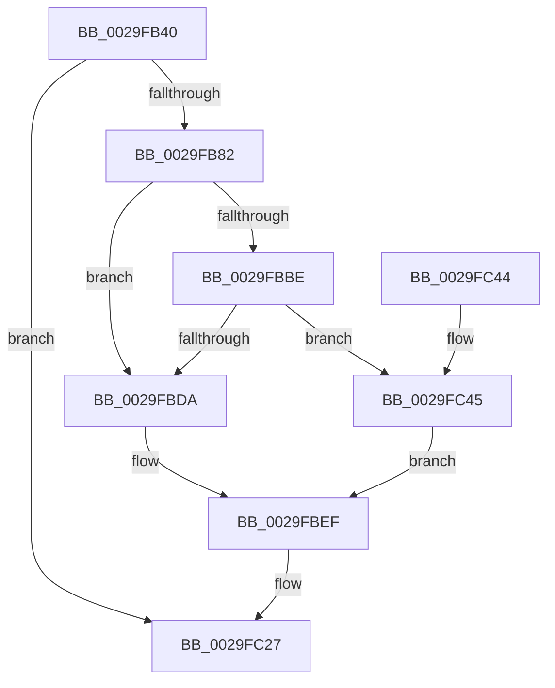

# MmOutPageKernelStack

- RVA: `0x0029FB40`–`0x0029FC4E` (길이 `270` bytes)
- VA: `0x000000014029FB40`
- 실행 섹션: `.text`
- PDB 이름 있음: `예`; PDB Function 태그: `아니요`
- unwind 정보 RVA: `0x00068354`
- 디코드: `63`개 명령, `270/270` bytes 표시
- 미해석 바이트: `0` (있으면 어셈블리에 `.byte`로 보존)

> 이 문서는 커널 이미지의 기계어와 PDB 기호를 분석해 생성했습니다. 4번과 5번은 함수 원형과 자료형을 바이너리 사용 방식에서 추정한 C 해석이며 원본 소스 복구 결과는 아닙니다.

## 1. Dependencies

- 직접 호출 지점: **4**; 고유 호출 대상: **4**
- 직접 호출자로 확인된 함수: **1**
- RIP 상대 이미지 참조: **5**

### Outgoing calls
- `0x0029FB70` → [memset](../6C/memset_function_006C6C40.md) (function, `0x006C6C40`)
- `0x0029FC18` → [KeEnumerateKernelStackSegments](../2A/KeEnumerateKernelStackSegments_function_002A13B8.md) (function, `0x002A13B8`)
- `0x0029FC22` → [MiFlushTbList](../31/MiFlushTbList_function_00311FC0.md) (function, `0x00311FC0`)
- `0x0029FC2E` → [_security_check_cookie](../6A/_security_check_cookie_function_006AC640.md) (function, `0x006AC640`)

### Direct callers
- [KiOutSwapKernelStacks](KiOutSwapKernelStacks_function_0029F628.md) at `0x0029F7E9`

### Static image references
- `0x0029FB52` → RVA `0x00E0A740` (`.data`; read)
- `0x0029FB75` → RVA `0x00FC6A88` (`ALMOSTRO`; read)
- `0x0029FB82` → RVA `0x00E383F8` (`.data`; read)
- `0x0029FB88` → RVA `0x00E38340` (`.data`; read)
- `0x0029FC03` → RVA `0x002A1790` (`MiOutPageSingleKernelStack`; read)

## 2. Other-region calls and transfers

- 다른 실행 섹션으로 향하는 call: **0**
- 별도 외부 분기/꼬리 이동을 확인하지 못했습니다.

## 3. Assembly (complete function range)

```asm
0029FB40  48 89 5C 24 10                  mov qword ptr [rsp + 0x10], rbx
0029FB45  55                              push rbp
0029FB46  48 8D 6C 24 A9                  lea rbp, [rsp - 0x57]
0029FB4B  48 81 EC 00 01 00 00            sub rsp, 0x100
0029FB52  48 8B 05 E7 AB B6 00            mov rax, qword ptr [rip + 0xb6abe7]
0029FB59  48 33 C4                        xor rax, rsp
0029FB5C  48 89 45 47                     mov qword ptr [rbp + 0x47], rax
0029FB60  48 8B D9                        mov rbx, rcx
0029FB63  33 D2                           xor edx, edx
0029FB65  48 8D 4C 24 20                  lea rcx, [rsp + 0x20]
0029FB6A  41 B8 C8 00 00 00               mov r8d, 0xc8
0029FB70  E8 CB 70 42 00                  call 0x1406c6c40
0029FB75  F6 05 0C 6F D2 00 40            test byte ptr [rip + 0xd26f0c], 0x40
0029FB7C  0F 84 A5 00 00 00               je 0x14029fc27
0029FB82  8B 05 70 88 B9 00               mov eax, dword ptr [rip + 0xb98870]
0029FB88  48 8D 15 B1 87 B9 00            lea rdx, [rip + 0xb987b1]
0029FB8F  C1 E8 08                        shr eax, 8
0029FB92  C0 E8 03                        shr al, 3
0029FB95  24 01                           and al, 1
0029FB97  C7 45 83 14 00 00 00            mov dword ptr [rbp - 0x7d], 0x14
0029FB9E  88 45 8F                        mov byte ptr [rbp - 0x71], al
0029FBA1  8B 05 51 88 B9 00               mov eax, dword ptr [rip + 0xb98851]
0029FBA7  C7 45 87 08 00 00 00            mov dword ptr [rbp - 0x79], 8
0029FBAE  C7 45 8B 01 00 00 00            mov dword ptr [rbp - 0x75], 1
0029FBB5  48 89 54 24 20                  mov qword ptr [rsp + 0x20], rdx
0029FBBA  A8 0F                           test al, 0xf
0029FBBC  75 1C                           jne 0x14029fbda
0029FBBE  65 48 8B 04 25 88 01 00 00      mov rax, qword ptr gs:[0x188]
0029FBC7  48 8B 88 B8 00 00 00            mov rcx, qword ptr [rax + 0xb8]
0029FBCE  48 81 C1 00 04 00 00            add rcx, 0x400
0029FBD5  48 3B D1                        cmp rdx, rcx
0029FBD8  75 6B                           jne 0x14029fc45
0029FBDA  8B 05 18 88 B9 00               mov eax, dword ptr [rip + 0xb98818]
0029FBE0  A8 0F                           test al, 0xf
0029FBE2  8B 4D 87                        mov ecx, dword ptr [rbp - 0x79]
0029FBE5  B8 00 00 00 00                  mov eax, 0
0029FBEA  8B D0                           mov edx, eax
0029FBEC  0F 94 C2                        sete dl
0029FBEF  66 83 65 90 00                  and word ptr [rbp - 0x70], 0
0029FBF4  4C 8D 44 24 20                  lea r8, [rsp + 0x20]
0029FBF9  83 E1 DB                        and ecx, 0xffffffdb
0029FBFC  89 54 24 28                     mov dword ptr [rsp + 0x28], edx
0029FC00  89 4D 87                        mov dword ptr [rbp - 0x79], ecx
0029FC03  48 8D 15 86 1B 00 00            lea rdx, [rip + 0x1b86]
0029FC0A  48 8B CB                        mov rcx, rbx
0029FC0D  89 45 93                        mov dword ptr [rbp - 0x6d], eax
0029FC10  48 89 45 97                     mov qword ptr [rbp - 0x69], rax
0029FC14  48 89 45 9F                     mov qword ptr [rbp - 0x61], rax
0029FC18  E8 9B 17 00 00                  call 0x1402a13b8
0029FC1D  48 8D 4C 24 20                  lea rcx, [rsp + 0x20]
0029FC22  E8 99 23 07 00                  call 0x140311fc0
0029FC27  48 8B 4D 47                     mov rcx, qword ptr [rbp + 0x47]
0029FC2B  48 33 CC                        xor rcx, rsp
0029FC2E  E8 0D CA 40 00                  call 0x1406ac640
0029FC33  48 8B 9C 24 18 01 00 00         mov rbx, qword ptr [rsp + 0x118]
0029FC3B  48 81 C4 00 01 00 00            add rsp, 0x100
0029FC42  5D                              pop rbp
0029FC43  C3                              ret
0029FC44  CC                              int3
0029FC45  33 C0                           xor eax, eax
0029FC47  8B D0                           mov edx, eax
0029FC49  8D 48 09                        lea ecx, [rax + 9]
0029FC4C  EB A1                           jmp 0x14029fbef
```

## 4. C-style interpretation (structured pseudocode)

```c
__int64 __fastcall MmOutPageKernelStack(__int64 a1, int a2)
{
    __int64 result;
    __int64 v_rsp;
    unsigned __int64 v_stack_m18;
    unsigned __int64 v_stack_m5F;
    unsigned __int64 v_stack_mC0;
    unsigned __int64 v_stack_mC8;
    unsigned int v_stack_mCC;
    unsigned __int16 v_stack_mCF;
    unsigned __int8 v_stack_mD0;
    unsigned int v_stack_mD4;
    unsigned int v_stack_mD8;
    unsigned int v_stack_mDC;
    unsigned int v_stack_mE0;
    unsigned __int64 v_stack_mE8;
    unsigned __int64 v_stack_p10;

    v_stack_p10 = v_rbx;
    v_rsp = (v_rsp) - (256);
    result = (*(unsigned __int64 *)(v_rip + 11971559)) ^ (v_rsp);
    v_stack_m18 = result;
    a2 = 0;
    result = memset(v_stack_mE8, a2, 200, a4);
    if (((*(unsigned __int8 *)(v_rip + 13790988)) & (64)) == 0) goto loc_0029FC27;
    result = (unsigned int)(((unsigned int)(*(unsigned int *)(v_rip + 12159088))) >> (8));
    result = (unsigned __int8)((result) >> (3));
    result = (unsigned __int8)((result) & (1));
    v_stack_mDC = 20;
    v_stack_mD0 = (unsigned __int8)(result);
    v_stack_mD8 = 8;
    v_stack_mD4 = 1;
    v_stack_mE8 = v_rip + 12158897;
    if ((((unsigned __int8)((unsigned int)(*(unsigned int *)(v_rip + 12159057)))) & (15)) != 0) goto loc_0029FBDA;
    a1 = (*(unsigned __int64 *)(*(unsigned __int64 *)(gs_base + (0 + 392)) + 184)) + (0x400ULL);
    if ((v_rip + 12158897) != a1) goto loc_0029FC45;
loc_0029FBDA:
    a2 = ((((unsigned __int8)((unsigned int)(*(unsigned int *)(v_rip + 12159000)))) & (15)) == 0) ? 1 : 0;
loc_0029FBEF:
    a1 = (unsigned int)(((unsigned int)(v_stack_mD8)) & (0xFFFFFFDBULL));
    v_stack_mE0 = a2;
    v_stack_mD8 = (unsigned int)(a1);
    v_stack_mCC = 0;
    v_stack_mC8 = 0;
    v_stack_mC0 = 0;
    result = KeEnumerateKernelStackSegments(a1, v_rip + 7046, v_stack_mE8, a4);
    result = MiFlushTbList(v_stack_mE8, v_rip + 7046, v_stack_mE8, a4);
loc_0029FC27:
    a1 = (v_stack_m18) ^ (v_rsp);
    result = _security_check_cookie(a1, v_rip + 7046, v_stack_mE8, a4);
    v_rsp = (v_rsp) + (256);
    return result;
loc_0029FC45:
    result = 0;
    goto loc_0029FBEF;
}
```

## 5. (Beta) C Style

```c
int64_t MmOutPageKernelStack(int64_t Arg1, int32_t Arg2)
{
    int64_t result;
    int64_t local_rsp;
    uint64_t v_stack_m18;
    uint64_t v_stack_m5F;
    uint64_t v_stack_mC0;
    uint64_t v_stack_mC8;
    uint32_t v_stack_mCC;
    uint16_t v_stack_mCF;
    uint8_t v_stack_mD0;
    uint32_t v_stack_mD4;
    uint32_t v_stack_mD8;
    uint32_t v_stack_mDC;
    uint32_t v_stack_mE0;
    uint64_t v_stack_mE8;
    uint64_t v_stack_p10;

    v_stack_p10 = local_rbx;
    local_rsp = (local_rsp) - (256);
    result = (*(uint64_t *)(v_rip + 0xB6ABE7)) ^ (local_rsp);
    v_stack_m18 = result;
    Arg2 = 0;
    result = memset(v_stack_mE8, Arg2, 200, a4);
    if (((*(uint8_t *)(v_rip + 0xD26F0C)) & (64)) == 0) goto loc_0029FC27;
    result = (uint32_t)(((uint32_t)(*(uint32_t *)(v_rip + 0xB98870))) >> (8));
    result = (uint8_t)((result) >> (3));
    result = (uint8_t)((result) & (1));
    v_stack_mDC = 20;
    v_stack_mD0 = (uint8_t)(result);
    v_stack_mD8 = 8;
    v_stack_mD4 = 1;
    v_stack_mE8 = v_rip + 12158897;
    if ((((uint8_t)((uint32_t)(*(uint32_t *)(v_rip + 0xB98851)))) & (15)) != 0) goto loc_0029FBDA;
    Arg1 = (*(uint64_t *)(*(uint64_t *)(gs_base + (0 + 0x188)) + 0xB8)) + (0x400ULL);
    if ((v_rip + 12158897) != Arg1) goto loc_0029FC45;
loc_0029FBDA:
    Arg2 = ((((uint8_t)((uint32_t)(*(uint32_t *)(v_rip + 0xB98818)))) & (15)) == 0) ? 1 : 0;
loc_0029FBEF:
    Arg1 = (uint32_t)(((uint32_t)(v_stack_mD8)) & (0xFFFFFFDBULL));
    v_stack_mE0 = Arg2;
    v_stack_mD8 = (uint32_t)(Arg1);
    v_stack_mCC = 0;
    v_stack_mC8 = 0;
    v_stack_mC0 = 0;
    result = KeEnumerateKernelStackSegments(Arg1, v_rip + 7046, v_stack_mE8, a4);
    result = MiFlushTbList(v_stack_mE8, v_rip + 7046, v_stack_mE8, a4);
loc_0029FC27:
    Arg1 = (v_stack_m18) ^ (local_rsp);
    result = _security_check_cookie(Arg1, v_rip + 7046, v_stack_mE8, a4);
    local_rsp = (local_rsp) + (256);
    return result;
loc_0029FC45:
    result = 0;
    goto loc_0029FBEF;
}
```

## 6. Execution-region graph

[열기: 2D/3D 그래프와 함수 탐색 컨트롤 패널](../../../control-panel.html?section=text&rva=0x0029FB40&view=graph)

- 2D 그래프는 위에서 아래로 흐르고, 3D 그래프는 빈 공간을 드래그해 회전합니다. Shift+드래그는 이동, 휠은 확대·축소, 함수 노드 선택은 대상 보고서 이동입니다.

### Static fallback


