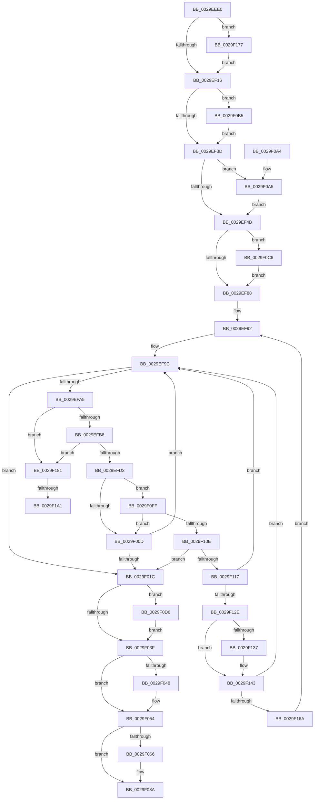

# MmUnlockPages

- RVA: `0x0029EEE0`–`0x0029F1AA` (길이 `714` bytes)
- VA: `0x000000014029EEE0`
- 실행 섹션: `.text`
- PDB 이름 있음: `예`; PDB Function 태그: `예`
- unwind 정보 RVA: `0x00068290`
- 디코드: `162`개 명령, `714/714` bytes 표시
- 미해석 바이트: `0` (있으면 어셈블리에 `.byte`로 보존)

> 이 문서는 커널 이미지의 기계어와 PDB 기호를 분석해 생성했습니다. 4번과 5번은 함수 원형과 자료형을 바이너리 사용 방식에서 추정한 C 해석이며 원본 소스 복구 결과는 아닙니다.

## 1. Dependencies

- 직접 호출 지점: **10**; 고유 호출 대상: **8**
- 직접 호출자로 확인된 함수: **62**
- RIP 상대 이미지 참조: **3**

### Outgoing calls
- `0x0029EFF7` → [MiProbeUnlockPage](../24/MiProbeUnlockPage_function_00243860.md) (function, `0x00243860`)
- `0x0029F04F` → [KiLowerIrqlProcessIrqlFlags](../4F/KiLowerIrqlProcessIrqlFlags_function_004F5698.md) (function, `0x004F5698`)
- `0x0029F0AB` → [MiFreeMdlTracker](../49/MiFreeMdlTracker_function_00494838.md) (function, `0x00494838`)
- `0x0029F0BC` → [MmUnmapLockedPages](../24/MmUnmapLockedPages_function_00246E60.md) (function, `0x00246E60`)
- `0x0029F0CC` → [KiRaiseIrqlProcessIrqlFlags](../4F/KiRaiseIrqlProcessIrqlFlags_function_004F56FC.md) (function, `0x004F56FC`)
- `0x0029F0F5` → [MiUnlockPageTableCharges](../40/MiUnlockPageTableCharges_function_00408140.md) (function, `0x00408140`)
- `0x0029F117` → [KeShouldYieldProcessor](../27/KeShouldYieldProcessor_function_002773E0.md) (function, `0x002773E0`)
- `0x0029F13E` → [KiLowerIrqlProcessIrqlFlags](../4F/KiLowerIrqlProcessIrqlFlags_function_004F5698.md) (function, `0x004F5698`)
- `0x0029F16D` → [KiRaiseIrqlProcessIrqlFlags](../4F/KiRaiseIrqlProcessIrqlFlags_function_004F56FC.md) (function, `0x004F56FC`)
- `0x0029F177` → [MiRetardMdl](../40/MiRetardMdl_function_0040494C.md) (function, `0x0040494C`)

### Direct callers
- [IopfCompleteRequest](IopfCompleteRequest_function_0029B5F8.md) at `0x0029B9FF`
- [VslpLockPagesForTransfer](VslpLockPagesForTransfer_function_0029E0FC.md) at `0x0029E319`
- [MiGetWorkingSetInfo](MiGetWorkingSetInfo_function_0029E498.md) at `0x0029E5CC`
- [CcZeroDataInCache](CcZeroDataInCache_function_0029E894.md) at `0x0029E9E5`
- [VslpUnlockPagesForTransfer](VslpUnlockPagesForTransfer_function_0029EE4C.md) at `0x0029EE63`
- [VslpUnlockPagesForTransfer](VslpUnlockPagesForTransfer_function_0029EE4C.md) at `0x0029EE80`
- [IopUnlockAndFreeMdl](IopUnlockAndFreeMdl_function_0029F200.md) at `0x0029F22B`
- [ExUnlockUserBuffer](ExUnlockUserBuffer_function_0029F258.md) at `0x0029F261`
- [KeSwappablePageDereference](KeSwappablePageDereference_function_0029F540.md) at `0x0029F5ED`
- [MiGetWorkingSetInfoList](../2A/MiGetWorkingSetInfoList_function_002AF770.md) at `0x002B06E9`
- [MiGetWorkingSetInfoList](../2A/MiGetWorkingSetInfoList_function_002AF770.md) at `0x002B0957`
- [CcMdlWriteComplete2](../3C/CcMdlWriteComplete2_function_003CA36C.md) at `0x003CA3CD`
- [CcMapAndCopyInToCache](../3C/CcMapAndCopyInToCache_function_003CA7F0.md) at `0x003CB0C7`
- [CcCopyBytesToUserBuffer](../3C/CcCopyBytesToUserBuffer_function_003CC3D0.md) at `0x003CC523`
- [CcLockSystemCacheBuffer](../3C/CcLockSystemCacheBuffer_function_003CC5B8.md) at `0x003CC68D`
- [VslFinalizeSecureImageHash](../4A/VslFinalizeSecureImageHash_function_004AA400.md) at `0x004AA4D0`
- [CcMdlWriteAbort](../57/CcMdlWriteAbort_function_0057DA70.md) at `0x0057DAB5`
- [KiOpPatchCode](../5C/KiOpPatchCode_function_005C6900.md) at `0x005C6A4B`
- [PspIumAllocatePartitionState](../5E/PspIumAllocatePartitionState_function_005E43A8.md) at `0x005E451E`
- [PspIumFreePartitionState](../5E/PspIumFreePartitionState_function_005E48C4.md) at `0x005E4932`
- [SmRecordDecompressionFailureDumpPayload](../61/SmRecordDecompressionFailureDumpPayload_function_00611120.md) at `0x00611380`
- [DifMmUnlockPagesWrapper](../63/DifMmUnlockPagesWrapper_function_00636CC0.md) at `0x00636D86`
- [VmProbeAndLockPages](../64/VmProbeAndLockPages_function_0064C340.md) at `0x0064C3B9`
- [VmUnlockPages](../64/VmUnlockPages_function_0064C3F0.md) at `0x0064C438`
- [CcPrepareMdlWrite$fin$0](../6D/CcPrepareMdlWrite_fin_0_function_006D3DF5.md) at `0x006D3EA3`
- [sub_006D7904](../6D/Unknown_function_006D7904.md) at `0x006D793C`
- [sub_006D794C](../6D/Unknown_function_006D794C.md) at `0x006D7989`
- [sub_006DAA04](../6D/Unknown_function_006DAA04.md) at `0x006DAA13`
- [sub_006F793C](../6F/Unknown_function_006F793C.md) at `0x006F7975`
- [sub_006F88AE](../6F/Unknown_function_006F88AE.md) at `0x006F8F5F`
- [FsRtlpFreeMdlChain](../../page/71/FsRtlpFreeMdlChain_function_00716394.md) at `0x007163B2`
- [NT_DISK::Read](../../page/71/NT_DISK_Read_function_00717100.md) at `0x00717169`
- [NT_DISK::Write](../../page/71/NT_DISK_Write_function_007171A0.md) at `0x00717209`
- [VslObtainHotPatchUndoTable](../../page/71/VslObtainHotPatchUndoTable_function_00718F50.md) at `0x007190B9`
- [IopSetFileObjectIosbRange](../../page/71/IopSetFileObjectIosbRange_function_0071C1C8.md) at `0x0071C60D`
- [SmProcessStatsRequest](../../page/7A/SmProcessStatsRequest_function_007A6E68.md) at `0x007A714E`
- [ExpProfileDelete](../../page/7D/ExpProfileDelete_function_007D1FE0.md) at `0x007D200A`
- [NtStartProfile](../../page/7D/NtStartProfile_function_007D22C0.md) at `0x007D2451`
- [NtStartProfile](../../page/7D/NtStartProfile_function_007D22C0.md) at `0x007D2531`
- [NtStopProfile](../../page/7D/NtStopProfile_function_007D25C0.md) at `0x007D2680`
- [NtPssCaptureVaSpaceBulk](../../page/7D/NtPssCaptureVaSpaceBulk_function_007D4EA0.md) at `0x007D52C0`
- [CmpLockKeyBodyIntoMemory](../../page/7E/CmpLockKeyBodyIntoMemory_function_007EAF10.md) at `0x007EB041`
- [MiApplyImageHotPatch](../../page/80/MiApplyImageHotPatch_function_00802330.md) at `0x0080255D`
- [sub_0086560A](../../page/86/Unknown_function_0086560A.md) at `0x00865A38`
- [sub_0086560A](../../page/86/Unknown_function_0086560A.md) at `0x00865A40`
- [WbCreateHeapExecutedBlock](../../page/8D/WbCreateHeapExecutedBlock_function_008D4BE8.md) at `0x008D52DC`
- [WbCreateHeapExecutedBlock](../../page/8D/WbCreateHeapExecutedBlock_function_008D4BE8.md) at `0x008D52FE`
- [WbCreateHeapExecutedBlock](../../page/8D/WbCreateHeapExecutedBlock_function_008D4BE8.md) at `0x008D5405`
- [PspExitThread](../../page/90/PspExitThread_function_00905F60.md) at `0x00906748`
- [sub_009A1390](../../page/9A/Unknown_function_009A1390.md) at `0x009A139D`
- [WbMakeUserExecutablePagesKernelWritable](../../page/9A/WbMakeUserExecutablePagesKernelWritable_function_009A14F4.md) at `0x009A15E9`
- [WbMakeUserDataPagesKernelWritable](../../page/9A/WbMakeUserDataPagesKernelWritable_function_009A15FC.md) at `0x009A173B`
- [MiCopyVirtualMemory](../../page/9B/MiCopyVirtualMemory_function_009BBB50.md) at `0x009BC01C`
- [MiCopyVirtualMemory](../../page/9B/MiCopyVirtualMemory_function_009BBB50.md) at `0x009BC162`
- [MiCopyVirtualMemory](../../page/9B/MiCopyVirtualMemory_function_009BBB50.md) at `0x009BC1E4`
- [MiCopyVirtualMemory](../../page/9B/MiCopyVirtualMemory_function_009BBB50.md) at `0x009BC23E`
- [MiCopyVirtualMemory](../../page/9B/MiCopyVirtualMemory_function_009BBB50.md) at `0x009BC2D8`
- [MiCopyVirtualMemory](../../page/9B/MiCopyVirtualMemory_function_009BBB50.md) at `0x009BC35E`
- [IopCleanupFileObjectIosbRange](../../page/9E/IopCleanupFileObjectIosbRange_function_009E88A8.md) at `0x009E893B`
- [VslCallEnclave](../../page/A0/VslCallEnclave_function_00A0D838.md) at `0x00A0DA09`
- [AlpcpInitializeCompletionList](../../page/A1/AlpcpInitializeCompletionList_function_00A1A6D0.md) at `0x00A1ABFB`
- [AlpcpFreeCompletionList](../../page/A1/AlpcpFreeCompletionList_function_00A1AD08.md) at `0x00A1AD20`
- [MiRotateToFrameBuffer](../../page/A3/MiRotateToFrameBuffer_function_00A38214.md) at `0x00A384D3`
- [MiCopyPagesIntoEnclave](../../page/A4/MiCopyPagesIntoEnclave_function_00A472AC.md) at `0x00A478DF`
- [MiCopyPagesIntoEnclave](../../page/A4/MiCopyPagesIntoEnclave_function_00A472AC.md) at `0x00A478F1`
- [CcMdlReadComplete2](../../page/A4/CcMdlReadComplete2_function_00A49298.md) at `0x00A492B0`
- [VslValidateDynamicCodePages](../../page/A5/VslValidateDynamicCodePages_function_00A5687C.md) at `0x00A569F7`
- [MiReplaceRotateWithDemandZero](../../page/A7/MiReplaceRotateWithDemandZero_function_00A7C010.md) at `0x00A7C2C3`
- [PspCreateSecureThread](../../page/A8/PspCreateSecureThread_function_00A89160.md) at `0x00A89288`
- [PopReadPagesFromHiberFile](../../page/AC/PopReadPagesFromHiberFile_function_00AC8F78.md) at `0x00AC9184`
- [MiReleaseHotPatchResources](../../page/AC/MiReleaseHotPatchResources_function_00ACCD60.md) at `0x00ACCDD1`
- [MiLoadDataIntoVsmEnclave](../../page/AC/MiLoadDataIntoVsmEnclave_function_00ACD114.md) at `0x00ACD48A`
- [MiQueryMemoryPhysicalContiguity](../../page/AD/MiQueryMemoryPhysicalContiguity_function_00AD5B98.md) at `0x00AD609E`
- [CcMdlRead$fin$0](../../page/B1/CcMdlRead_fin_0_function_00B139D8.md) at `0x00B13A40`

### Static image references
- `0x0029EF3D` → RVA `0x00FC6BBC` (`ALMOSTRO`; read)
- `0x0029EF7B` → RVA `0x00FC6D20` (`ALMOSTRO`; read)
- `0x0029EFA5` → RVA `0x00E2DCE0` (`.data`; read)

## 2. Other-region calls and transfers

- 다른 실행 섹션으로 향하는 call: **0**
- call이 아닌 외부 분기/꼬리 이동: **2**
  - `0x0029F19B` → [sub_006DAA8E + 0x47](../6D/Unknown_function_006DAA8E.md) (`tail-transfer`)
  - `0x0029F1A5` → [sub_006DAA8E](../6D/Unknown_function_006DAA8E.md) (`tail-transfer`)

## 3. Assembly (complete function range)

```asm
0029EEE0  48 89 4C 24 08                  mov qword ptr [rsp + 8], rcx
0029EEE5  53                              push rbx
0029EEE6  55                              push rbp
0029EEE7  56                              push rsi
0029EEE8  57                              push rdi
0029EEE9  41 54                           push r12
0029EEEB  41 55                           push r13
0029EEED  41 56                           push r14
0029EEEF  41 57                           push r15
0029EEF1  48 83 EC 38                     sub rsp, 0x38
0029EEF5  44 0F BF 79 0A                  movsx r15d, word ptr [rcx + 0xa]
0029EEFA  48 8D 71 30                     lea rsi, [rcx + 0x30]
0029EEFE  66 41 0F BA E7 09               bt r15w, 9
0029EF04  4C 8B 71 10                     mov r14, qword ptr [rcx + 0x10]
0029EF08  48 8B D9                        mov rbx, rcx
0029EF0B  4C 89 74 24 20                  mov qword ptr [rsp + 0x20], r14
0029EF10  0F 82 61 02 00 00               jb 0x14029f177
0029EF16  8B 4B 2C                        mov ecx, dword ptr [rbx + 0x2c]
0029EF19  03 4B 20                        add ecx, dword ptr [rbx + 0x20]
0029EF1C  8B 7B 28                        mov edi, dword ptr [rbx + 0x28]
0029EF1F  81 E1 FF 0F 00 00               and ecx, 0xfff
0029EF25  48 81 C7 FF 0F 00 00            add rdi, 0xfff
0029EF2C  48 03 F9                        add rdi, rcx
0029EF2F  48 C1 EF 0C                     shr rdi, 0xc
0029EF33  41 F6 C7 01                     test r15b, 1
0029EF37  0F 85 78 01 00 00               jne 0x14029f0b5
0029EF3D  8B 05 79 7C D2 00               mov eax, dword ptr [rip + 0xd27c79]
0029EF43  A8 01                           test al, 1
0029EF45  0F 85 5A 01 00 00               jne 0x14029f0a5
0029EF4B  48 B8 FF FF FF FF 3F 00 00 00   movabs rax, 0x3fffffffff
0029EF55  C7 84 24 88 00 00 00 01 00 00 00  mov dword ptr [rsp + 0x88], 1
0029EF60  48 89 84 24 98 00 00 00         mov qword ptr [rsp + 0x98], rax
0029EF68  4C 8D 24 FE                     lea r12, [rsi + rdi*8]
0029EF6C  45 33 ED                        xor r13d, r13d
0029EF6F  44 0F 20 C5                     mov rbp, cr8
0029EF73  45 8D 75 02                     lea r14d, [r13 + 2]
0029EF77  45 0F 22 C6                     mov cr8, r14
0029EF7B  44 39 2D 9E 7D D2 00            cmp dword ptr [rip + 0xd27d9e], r13d
0029EF82  0F 85 3E 01 00 00               jne 0x14029f0c6
0029EF88  48 BB 00 00 00 00 00 DE FF FF   movabs rbx, 0xffffde0000000000
0029EF92  49 BB 28 00 00 00 00 DE FF FF   movabs r11, 0xffffde0000000028
0029EF9C  48 8B 06                        mov rax, qword ptr [rsi]
0029EF9F  48 83 F8 FF                     cmp rax, -1
0029EFA3  74 77                           je 0x14029f01c
0029EFA5  48 3B 05 34 ED B8 00            cmp rax, qword ptr [rip + 0xb8ed34]
0029EFAC  41 BE 01 00 00 00               mov r14d, 1
0029EFB2  0F 87 C9 01 00 00               ja 0x14029f181
0029EFB8  48 8D 0C 40                     lea rcx, [rax + rax*2]
0029EFBC  48 03 C9                        add rcx, rcx
0029EFBF  49 8B C3                        mov rax, r11
0029EFC2  48 8B 04 C8                     mov rax, qword ptr [rax + rcx*8]
0029EFC6  48 C1 E8 36                     shr rax, 0x36
0029EFCA  41 85 C6                        test r14d, eax
0029EFCD  0F 84 AE 01 00 00               je 0x14029f181
0029EFD3  48 8B 06                        mov rax, qword ptr [rsi]
0029EFD6  41 8B D7                        mov edx, r15d
0029EFD9  48 8D 0C 40                     lea rcx, [rax + rax*2]
0029EFDD  48 C1 E1 04                     shl rcx, 4
0029EFE1  48 8B C3                        mov rax, rbx
0029EFE4  48 03 C8                        add rcx, rax
0029EFE7  4C 8D 8C 24 88 00 00 00         lea r9, [rsp + 0x88]
0029EFEF  4C 8D 84 24 98 00 00 00         lea r8, [rsp + 0x98]
0029EFF7  E8 64 48 FA FF                  call 0x140243860
0029EFFC  49 FF C5                        inc r13
0029EFFF  4A 8D 34 F6                     lea rsi, [rsi + r14*8]
0029F003  41 F6 C5 3F                     test r13b, 0x3f
0029F007  0F 84 F2 00 00 00               je 0x14029f0ff
0029F00D  49 BB 28 00 00 00 00 DE FF FF   movabs r11, 0xffffde0000000028
0029F017  49 3B F4                        cmp rsi, r12
0029F01A  72 80                           jb 0x14029ef9c
0029F01C  48 8B 84 24 98 00 00 00         mov rax, qword ptr [rsp + 0x98]
0029F024  48 B9 FF FF FF FF 3F 00 00 00   movabs rcx, 0x3fffffffff
0029F02E  48 8B 9C 24 80 00 00 00         mov rbx, qword ptr [rsp + 0x80]
0029F036  48 3B C1                        cmp rax, rcx
0029F039  0F 85 97 00 00 00               jne 0x14029f0d6
0029F03F  83 3D DA 7C D2 00 00            cmp dword ptr [rip + 0xd27cda], 0
0029F046  74 0C                           je 0x14029f054
0029F048  44 0F 20 C1                     mov rcx, cr8
0029F04C  40 8A D5                        mov dl, bpl
0029F04F  E8 44 66 25 00                  call 0x1404f5698
0029F054  40 0F B6 C5                     movzx eax, bpl
0029F058  44 0F 22 C0                     mov cr8, rax
0029F05C  4C 8B 74 24 20                  mov r14, qword ptr [rsp + 0x20]
0029F061  4D 85 F6                        test r14, r14
0029F064  74 24                           je 0x14029f08a
0029F066  65 8B 04 25 A4 01 00 00         mov eax, dword ptr gs:[0x1a4]
0029F06E  48 F7 DF                        neg rdi
0029F071  48 D1 E8                        shr rax, 1
0029F074  83 E0 03                        and eax, 3
0029F077  48 83 C0 08                     add rax, 8
0029F07B  48 C1 E0 06                     shl rax, 6
0029F07F  49 03 86 10 04 00 00            add rax, qword ptr [r14 + 0x410]
0029F086  F0 48 01 38                     lock add qword ptr [rax], rdi
0029F08A  B9 FD F6 FF FF                  mov ecx, 0xfffff6fd
0029F08F  66 21 4B 0A                     and word ptr [rbx + 0xa], cx
0029F093  48 83 C4 38                     add rsp, 0x38
0029F097  41 5F                           pop r15
0029F099  41 5E                           pop r14
0029F09B  41 5D                           pop r13
0029F09D  41 5C                           pop r12
0029F09F  5F                              pop rdi
0029F0A0  5E                              pop rsi
0029F0A1  5D                              pop rbp
0029F0A2  5B                              pop rbx
0029F0A3  C3                              ret
0029F0A4  CC                              int3
0029F0A5  48 8B D7                        mov rdx, rdi
0029F0A8  48 8B CB                        mov rcx, rbx
0029F0AB  E8 88 57 1F 00                  call 0x140494838
0029F0B0  E9 96 FE FF FF                  jmp 0x14029ef4b
0029F0B5  48 8B 4B 18                     mov rcx, qword ptr [rbx + 0x18]
0029F0B9  48 8B D3                        mov rdx, rbx
0029F0BC  E8 9F 7D FA FF                  call 0x140246e60
0029F0C1  E9 77 FE FF FF                  jmp 0x14029ef3d
0029F0C6  41 8A D6                        mov dl, r14b
0029F0C9  40 8A CD                        mov cl, bpl
0029F0CC  E8 2B 66 25 00                  call 0x1404f56fc
0029F0D1  E9 B2 FE FF FF                  jmp 0x14029ef88
0029F0D6  48 8D 0C 40                     lea rcx, [rax + rax*2]
0029F0DA  48 B8 00 00 00 00 00 DE FF FF   movabs rax, 0xffffde0000000000
0029F0E4  48 C1 E1 04                     shl rcx, 4
0029F0E8  48 8B C0                        mov rax, rax
0029F0EB  8B 94 24 88 00 00 00            mov edx, dword ptr [rsp + 0x88]
0029F0F2  48 03 C8                        add rcx, rax
0029F0F5  E8 46 90 16 00                  call 0x140408140
0029F0FA  E9 40 FF FF FF                  jmp 0x14029f03f
0029F0FF  41 BE 02 00 00 00               mov r14d, 2
0029F105  41 3A EE                        cmp bpl, r14b
0029F108  0F 83 FF FE FF FF               jae 0x14029f00d
0029F10E  49 3B F4                        cmp rsi, r12
0029F111  0F 83 05 FF FF FF               jae 0x14029f01c
0029F117  E8 C4 82 FD FF                  call 0x1402773e0
0029F11C  49 BB 28 00 00 00 00 DE FF FF   movabs r11, 0xffffde0000000028
0029F126  85 C0                           test eax, eax
0029F128  0F 84 6E FE FF FF               je 0x14029ef9c
0029F12E  83 3D EB 7B D2 00 00            cmp dword ptr [rip + 0xd27beb], 0
0029F135  74 0C                           je 0x14029f143
0029F137  44 0F 20 C1                     mov rcx, cr8
0029F13B  40 8A D5                        mov dl, bpl
0029F13E  E8 55 65 25 00                  call 0x1404f5698
0029F143  40 0F B6 C5                     movzx eax, bpl
0029F147  44 0F 22 C0                     mov cr8, rax
0029F14B  44 0F 20 C1                     mov rcx, cr8
0029F14F  45 0F 22 C6                     mov cr8, r14
0029F153  83 3D C6 7B D2 00 00            cmp dword ptr [rip + 0xd27bc6], 0
0029F15A  49 BB 28 00 00 00 00 DE FF FF   movabs r11, 0xffffde0000000028
0029F164  0F 84 32 FE FF FF               je 0x14029ef9c
0029F16A  41 8A D6                        mov dl, r14b
0029F16D  E8 8A 65 25 00                  call 0x1404f56fc
0029F172  E9 1B FE FF FF                  jmp 0x14029ef92
0029F177  E8 D0 57 16 00                  call 0x14040494c
0029F17C  E9 95 FD FF FF                  jmp 0x14029ef16
0029F181  48 8B 16                        mov rdx, qword ptr [rsi]
0029F184  41 BA 00 02 00 00               mov r10d, 0x200
0029F18A  48 8B C2                        mov rax, rdx
0029F18D  48 8B CA                        mov rcx, rdx
0029F190  25 FF 01 00 00                  and eax, 0x1ff
0029F195  4C 2B D0                        sub r10, rax
0029F198  4D 3B F2                        cmp r14, r10
0029F19B  0F 83 34 B9 43 00               jae 0x1406daad5
0029F1A1  4C 8D 4E 08                     lea r9, [rsi + 8]
0029F1A5  E9 E4 B8 43 00                  jmp 0x1406daa8e
```

## 4. C-style interpretation (structured pseudocode)

```c
__int64 __fastcall MmUnlockPages(__int64 a1)
{
    __int64 result;
    __int64 v_r10;
    __int64 v_r13;
    __int64 v_rdi;
    __int64 v_rsp;
    unsigned __int64 v_stack_m58;
    unsigned int v_stack_p10;
    unsigned __int64 v_stack_p20;
    unsigned __int64 v_stack_p8;
    unsigned int v_stack_p88;

    v_stack_p8 = a1;
    v_rsp = (v_rsp) - (56);
    v_stack_m58 = *(unsigned __int64 *)(a1 + 16);
    if (condition_is_below) goto loc_0029F177;
loc_0029EF16:
    a1 = (unsigned int)(((unsigned int)(*(unsigned int *)(a1 + 44))) + (*(unsigned int *)(a1 + 32)));
    a1 = (unsigned int)((a1) & (0xFFFULL));
    v_rdi = ((unsigned int)(*(unsigned int *)(a1 + 40))) + (0xFFFULL);
    v_rdi = (v_rdi) + (a1);
    v_rdi = (v_rdi) >> (12);
    if ((((unsigned __int8)((__int16)(*(unsigned __int16 *)(a1 + 10)))) & (1)) != 0) goto loc_0029F0B5;
loc_0029EF3D:
    if ((((unsigned __int8)((unsigned int)(*(unsigned int *)(v_rip + 13794425)))) & (1)) != 0) goto loc_0029F0A5;
loc_0029EF4B:
    v_stack_p10 = 1;
    v_stack_p20 = (unsigned int)(*(unsigned int *)(v_rip + 13794425));
    v_r13 = 0;
    if ((*(unsigned int *)(v_rip + 13794718)) != 0) goto loc_0029F0C6;
loc_0029EF88:
loc_0029EF92:
loc_0029EF9C:
    if ((*(unsigned __int64 *)(a1 + 48)) == -1) goto loc_0029F01C;
    if ((*(unsigned __int64 *)(a1 + 48)) > (*(unsigned __int64 *)(v_rip + 12119348))) goto loc_0029F181;
    a1 = (*(unsigned __int64 *)(a1 + 48) + *(unsigned __int64 *)(a1 + 48) * 2) + (*(unsigned __int64 *)(a1 + 48) + *(unsigned __int64 *)(a1 + 48) * 2);
    result = (*(unsigned __int64 *)(v_r11 + a1 * 8)) >> (54);
    if (((1) & ((unsigned int)(result))) == 0) goto loc_0029F181;
    a1 = (*(unsigned __int64 *)(a1 + 48) + *(unsigned __int64 *)(a1 + 48) * 2) << (4);
    a1 = (a1) + (a1);
    result = MiProbeUnlockPage(a1, (unsigned int)((unsigned int)((__int16)(*(unsigned __int16 *)(a1 + 10)))), v_stack_p20, v_stack_p10);
    v_r13 = (v_r13) + 1;
    if ((((unsigned __int8)(v_r13)) & (63)) == 0) goto loc_0029F0FF;
loc_0029F00D:
    if ((a1 + 48 + 1 * 8) < (a1 + 48 + v_rdi * 8)) goto loc_0029EF9C;
loc_0029F01C:
    if (v_stack_p20 != a1) goto loc_0029F0D6;
loc_0029F03F:
    result = v_stack_p20;
    if ((*(unsigned int *)(v_rip + 13794522)) != 0) {
        a1 = v_r13 + 2;
        a2 = (unsigned __int8)(v_cr8);
        result = KiLowerIrqlProcessIrqlFlags(a1, a2, v_stack_p20, v_stack_p10);
    }
    result = (unsigned __int8)(v_cr8);
    if (v_stack_m58 != 0) {
        result = *(unsigned int *)(gs_base + (0 + 420));
        v_rdi = -(v_rdi);
        result = (result) >> (1);
        result = (unsigned int)((result) & (3));
        result = (result) + (8);
        result = (result) << (6);
        result = (result) + (*(unsigned __int64 *)(v_stack_m58 + 1040));
    }
    v_rsp = (v_rsp) + (56);
    return result;
loc_0029F0A5:
    result = MiFreeMdlTracker(v_stack_p8, v_rdi, v_stack_p20, v_stack_p10);
    goto loc_0029EF4B;
loc_0029F0B5:
    result = MmUnmapLockedPages(*(unsigned __int64 *)(v_stack_p8 + 24), v_stack_p8, v_stack_p20, v_stack_p10);
    goto loc_0029EF3D;
loc_0029F0C6:
    result = KiRaiseIrqlProcessIrqlFlags((unsigned __int8)(v_cr8), (unsigned __int8)(v_stack_m58), v_stack_p20, v_stack_p10);
    goto loc_0029EF88;
loc_0029F0D6:
    a1 = (result + result * 2) << (4);
    a1 = (a1) + (result);
    result = MiUnlockPageTableCharges(a1, (unsigned int)(v_stack_p88), v_stack_p20, v_stack_p10);
    goto loc_0029F03F;
loc_0029F0FF:
    if (((unsigned __int8)(v_cr8)) >= 2) goto loc_0029F00D;
    if ((a1 + 48 + 1 * 8) >= (a1 + 48 + v_rdi * 8)) goto loc_0029F01C;
    result = KeShouldYieldProcessor(a1, (unsigned int)(v_stack_p88), v_stack_p20, v_stack_p10);
    if ((unsigned int)(result) == 0) goto loc_0029EF9C;
    if ((*(unsigned int *)(v_rip + 13794283)) != 0) {
        a1 = (unsigned __int8)(v_cr8);
        a2 = (unsigned __int8)(v_cr8);
        result = KiLowerIrqlProcessIrqlFlags(a1, a2, v_stack_p20, v_stack_p10);
    }
    if ((*(unsigned int *)(v_rip + 13794246)) == 0) goto loc_0029EF9C;
    result = KiRaiseIrqlProcessIrqlFlags((unsigned __int8)(v_cr8), 2, v_stack_p20, v_stack_p10);
    goto loc_0029EF92;
loc_0029F177:
    result = MiRetardMdl((unsigned __int8)(v_cr8), 2, v_stack_p20, v_stack_p10);
    goto loc_0029EF16;
loc_0029F181:
    result = (unsigned int)((*(unsigned __int64 *)(a1 + 48 + 1 * 8)) & (511));
    v_r10 = (512) - (result);
}
```

## 5. (Beta) C Style

```c
int64_t MmUnlockPages(void *Arg1)
{
    uint8_t *arg1 = (uint8_t *)Arg1;

    int64_t result;
    int64_t local_r10;
    int64_t local_r13;
    int64_t local_rdi;
    int64_t local_rsp;
    uint64_t v_stack_m58;
    uint32_t v_stack_p10;
    uint64_t v_stack_p20;
    uint64_t v_stack_p8;
    uint32_t v_stack_p88;

    v_stack_p8 = Arg1;
    local_rsp = (local_rsp) - (56);
    v_stack_m58 = *(uint64_t *)(arg1 + 0x10);
    if (condition_is_below) goto loc_0029F177;
loc_0029EF16:
    Arg1 = (uint32_t)(((uint32_t)(*(uint32_t *)(arg1 + 0x2C))) + (*(uint32_t *)(arg1 + 0x20)));
    Arg1 = (uint32_t)((Arg1) & (0xFFFULL));
    local_rdi = ((uint32_t)(*(uint32_t *)(arg1 + 0x28))) + (0xFFFULL);
    local_rdi = (local_rdi) + (Arg1);
    local_rdi = (local_rdi) >> (12);
    if ((((uint8_t)((int16_t)(*(uint16_t *)(arg1 + 0xA)))) & (1)) != 0) goto loc_0029F0B5;
loc_0029EF3D:
    if ((((uint8_t)((uint32_t)(*(uint32_t *)(v_rip + 0xD27C79)))) & (1)) != 0) goto loc_0029F0A5;
loc_0029EF4B:
    v_stack_p10 = 1;
    v_stack_p20 = (uint32_t)(*(uint32_t *)(v_rip + 0xD27C79));
    local_r13 = 0;
    if ((*(uint32_t *)(v_rip + 0xD27D9E)) != 0) goto loc_0029F0C6;
loc_0029EF88:
loc_0029EF92:
loc_0029EF9C:
    if ((*(uint64_t *)(arg1 + 0x30)) == -1) goto loc_0029F01C;
    if ((*(uint64_t *)(arg1 + 0x30)) > (*(uint64_t *)(v_rip + 0xB8ED34))) goto loc_0029F181;
    Arg1 = (*(uint64_t *)(arg1 + 0x30) + *(uint64_t *)(arg1 + 0x30) * 2) + (*(uint64_t *)(arg1 + 0x30) + *(uint64_t *)(arg1 + 0x30) * 2);
    result = (*(uint64_t *)(local_r11 + arg1 * 8)) >> (54);
    if (((1) & ((uint32_t)(result))) == 0) goto loc_0029F181;
    Arg1 = (*(uint64_t *)(arg1 + 0x30) + *(uint64_t *)(arg1 + 0x30) * 2) << (4);
    Arg1 = (Arg1) + (Arg1);
    result = MiProbeUnlockPage(Arg1, (uint32_t)((uint32_t)((int16_t)(*(uint16_t *)(arg1 + 0xA)))), v_stack_p20, v_stack_p10);
    local_r13 = (local_r13) + 1;
    if ((((uint8_t)(local_r13)) & (63)) == 0) goto loc_0029F0FF;
loc_0029F00D:
    if ((Arg1 + 48 + 1 * 8) < (Arg1 + 48 + local_rdi * 8)) goto loc_0029EF9C;
loc_0029F01C:
    if (v_stack_p20 != Arg1) goto loc_0029F0D6;
loc_0029F03F:
    result = v_stack_p20;
    if ((*(uint32_t *)(v_rip + 0xD27CDA)) != 0) {
        Arg1 = local_r13 + 2;
        a2 = (uint8_t)(v_cr8);
        result = KiLowerIrqlProcessIrqlFlags(Arg1, a2, v_stack_p20, v_stack_p10);
    }
    result = (uint8_t)(v_cr8);
    if (v_stack_m58 != 0) {
        result = *(uint32_t *)(gs_base + (0 + 0x1A4));
        local_rdi = -(local_rdi);
        result = (result) >> (1);
        result = (uint32_t)((result) & (3));
        result = (result) + (8);
        result = (result) << (6);
        result = (result) + (*(uint64_t *)(v_stack_m58 + 0x410));
    }
    local_rsp = (local_rsp) + (56);
    return result;
loc_0029F0A5:
    result = MiFreeMdlTracker(v_stack_p8, local_rdi, v_stack_p20, v_stack_p10);
    goto loc_0029EF4B;
loc_0029F0B5:
    result = MmUnmapLockedPages(*(uint64_t *)(v_stack_p8 + 0x18), v_stack_p8, v_stack_p20, v_stack_p10);
    goto loc_0029EF3D;
loc_0029F0C6:
    result = KiRaiseIrqlProcessIrqlFlags((uint8_t)(v_cr8), (uint8_t)(v_stack_m58), v_stack_p20, v_stack_p10);
    goto loc_0029EF88;
loc_0029F0D6:
    Arg1 = (result + result * 2) << (4);
    Arg1 = (Arg1) + (result);
    result = MiUnlockPageTableCharges(Arg1, (uint32_t)(v_stack_p88), v_stack_p20, v_stack_p10);
    goto loc_0029F03F;
loc_0029F0FF:
    if (((uint8_t)(v_cr8)) >= 2) goto loc_0029F00D;
    if ((Arg1 + 48 + 1 * 8) >= (Arg1 + 48 + local_rdi * 8)) goto loc_0029F01C;
    result = KeShouldYieldProcessor(Arg1, (uint32_t)(v_stack_p88), v_stack_p20, v_stack_p10);
    if ((uint32_t)(result) == 0) goto loc_0029EF9C;
    if ((*(uint32_t *)(v_rip + 0xD27BEB)) != 0) {
        Arg1 = (uint8_t)(v_cr8);
        a2 = (uint8_t)(v_cr8);
        result = KiLowerIrqlProcessIrqlFlags(Arg1, a2, v_stack_p20, v_stack_p10);
    }
    if ((*(uint32_t *)(v_rip + 0xD27BC6)) == 0) goto loc_0029EF9C;
    result = KiRaiseIrqlProcessIrqlFlags((uint8_t)(v_cr8), 2, v_stack_p20, v_stack_p10);
    goto loc_0029EF92;
loc_0029F177:
    result = MiRetardMdl((uint8_t)(v_cr8), 2, v_stack_p20, v_stack_p10);
    goto loc_0029EF16;
loc_0029F181:
    result = (uint32_t)((*(uint64_t *)(arg1 + 0x30 + 0x1 * 8)) & (511));
    local_r10 = (512) - (result);
}
```

### 관측된 메모리 오프셋

구조체 형식이 확인되지 않은 접근은 인자 기준의 오프셋으로만 기록했습니다.

| 기준 인자 | 오프셋 표현 | 폭 (bit) | 접근 |
|---|---:|---:|---|
| `Arg1` | `+ 0x0 + rdi*8` | `64` | `R` |
| `Arg1` | `+ 0xA` | `16` | `R` |
| `Arg1` | `+ 0x10` | `64` | `R` |
| `Arg1` | `+ 0x18` | `64` | `R` |
| `Arg1` | `+ 0x20` | `32` | `R` |
| `Arg1` | `+ 0x28` | `32` | `R` |
| `Arg1` | `+ 0x2C` | `32` | `R` |
| `Arg1` | `+ 0x30` | `64` | `R` |

## 6. Execution-region graph

[열기: 2D/3D 그래프와 함수 탐색 컨트롤 패널](../../../control-panel.html?section=text&rva=0x0029EEE0&view=graph)

- 2D 그래프는 위에서 아래로 흐르고, 3D 그래프는 빈 공간을 드래그해 회전합니다. Shift+드래그는 이동, 휠은 확대·축소, 함수 노드 선택은 대상 보고서 이동입니다.

### Static fallback


