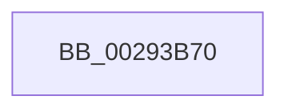

# MmUnmapViewInSystemCache

- RVA: `0x00293B70`–`0x00293C9B` (길이 `299` bytes)
- VA: `0x0000000140293B70`
- 실행 섹션: `.text`
- PDB 이름 있음: `예`; PDB Function 태그: `아니요`
- unwind 정보 RVA: `0x000676F0`
- 디코드: `71`개 명령, `299/299` bytes 표시
- 미해석 바이트: `0` (있으면 어셈블리에 `.byte`로 보존)

> 이 문서는 커널 이미지의 기계어와 PDB 기호를 분석해 생성했습니다. 4번과 5번은 함수 원형과 자료형을 바이너리 사용 방식에서 추정한 C 해석이며 원본 소스 복구 결과는 아닙니다.

## 1. Dependencies

- 직접 호출 지점: **3**; 고유 호출 대상: **3**
- 직접 호출자로 확인된 함수: **1**
- RIP 상대 이미지 참조: **1**

### Outgoing calls
- `0x00293BAA` → [memset](../6C/memset_function_006C6C40.md) (function, `0x006C6C40`)
- `0x00293BF6` → [MiSectionControlArea](MiSectionControlArea_function_00294CB0.md) (function, `0x00294CB0`)
- `0x00293C52` → [MiGetSystemCacheReverseMap](MiGetSystemCacheReverseMap_function_00294BF0.md) (function, `0x00294BF0`)

### Direct callers
- [sub_009E9606](../../page/9E/Unknown_function_009E9606.md) at `0x009E9655`

### Static image references
- `0x00293BFB` → RVA `0x00E30088` (`.data`; read)

## 2. Other-region calls and transfers

- 다른 실행 섹션으로 향하는 call: **0**
- call이 아닌 외부 분기/꼬리 이동: **1**
  - `0x00293C95` → [sub_002942F1](Unknown_function_002942F1.md) (`tail-transfer`)

## 3. Assembly (complete function range)

```asm
00293B70  48 8B C4                        mov rax, rsp
00293B73  44 89 40 18                     mov dword ptr [rax + 0x18], r8d
00293B77  48 89 50 10                     mov qword ptr [rax + 0x10], rdx
00293B7B  48 89 48 08                     mov qword ptr [rax + 8], rcx
00293B7F  53                              push rbx
00293B80  55                              push rbp
00293B81  56                              push rsi
00293B82  57                              push rdi
00293B83  41 55                           push r13
00293B85  41 56                           push r14
00293B87  41 57                           push r15
00293B89  48 81 EC 30 01 00 00            sub rsp, 0x130
00293B90  48 8B EA                        mov rbp, rdx
00293B93  C6 40 20 00                     mov byte ptr [rax + 0x20], 0
00293B97  33 D2                           xor edx, edx
00293B99  41 8B D8                        mov ebx, r8d
00293B9C  48 8B F9                        mov rdi, rcx
00293B9F  48 8D 88 48 FF FF FF            lea rcx, [rax - 0xb8]
00293BA6  44 8D 42 68                     lea r8d, [rdx + 0x68]
00293BAA  E8 91 30 43 00                  call 0x1406c6c40
00293BAF  48 B8 F8 FF FF FF 7F 00 00 00   movabs rax, 0x7ffffffff8
00293BB9  C6 44 24 30 00                  mov byte ptr [rsp + 0x30], 0
00293BBE  4C 8B F7                        mov r14, rdi
00293BC1  83 E3 01                        and ebx, 1
00293BC4  49 C1 EE 09                     shr r14, 9
00293BC8  4C 23 F0                        and r14, rax
00293BCB  89 5C 24 58                     mov dword ptr [rsp + 0x58], ebx
00293BCF  48 B8 00 00 00 00 80 F6 FF FF   movabs rax, 0xfffff68000000000
00293BD9  48 8B C0                        mov rax, rax
00293BDC  4C 03 F0                        add r14, rax
00293BDF  48 8B CD                        mov rcx, rbp
00293BE2  4C 89 B4 24 A0 00 00 00         mov qword ptr [rsp + 0xa0], r14
00293BEA  49 8D 86 00 02 00 00            lea rax, [r14 + 0x200]
00293BF1  48 89 44 24 68                  mov qword ptr [rsp + 0x68], rax
00293BF6  E8 B5 10 00 00                  call 0x140294cb0
00293BFB  48 8B 0D 86 C4 B9 00            mov rcx, qword ptr [rip + 0xb9c486]
00293C02  4C 8B C0                        mov r8, rax
00293C05  48 89 84 24 90 00 00 00         mov qword ptr [rsp + 0x90], rax
00293C0D  33 F6                           xor esi, esi
00293C0F  89 74 24 34                     mov dword ptr [rsp + 0x34], esi
00293C13  33 DB                           xor ebx, ebx
00293C15  48 8B 40 40                     mov rax, qword ptr [rax + 0x40]
00293C19  45 33 FF                        xor r15d, r15d
00293C1C  41 0F B7 50 3C                  movzx edx, word ptr [r8 + 0x3c]
00293C21  48 83 E0 F0                     and rax, 0xfffffffffffffff0
00293C25  81 E2 FF 03 00 00               and edx, 0x3ff
00293C2B  48 89 44 24 50                  mov qword ptr [rsp + 0x50], rax
00293C30  48 8B 04 D1                     mov rax, qword ptr [rcx + rdx*8]
00293C34  33 D2                           xor edx, edx
00293C36  48 8B CF                        mov rcx, rdi
00293C39  48 89 84 24 98 00 00 00         mov qword ptr [rsp + 0x98], rax
00293C41  48 89 54 24 60                  mov qword ptr [rsp + 0x60], rdx
00293C46  4C 8D A8 80 49 00 00            lea r13, [rax + 0x4980]
00293C4D  4C 89 6C 24 40                  mov qword ptr [rsp + 0x40], r13
00293C52  E8 99 0F 00 00                  call 0x140294bf0
00293C57  4C 8B D0                        mov r10, rax
00293C5A  48 89 44 24 70                  mov qword ptr [rsp + 0x70], rax
00293C5F  41 B9 02 00 00 00               mov r9d, 2
00293C65  48 8B 50 18                     mov rdx, qword ptr [rax + 0x18]
00293C69  B8 04 00 00 00                  mov eax, 4
00293C6E  48 8B CA                        mov rcx, rdx
00293C71  83 E1 01                        and ecx, 1
00293C74  41 0F 44 C1                     cmove eax, r9d
00293C78  89 44 24 5C                     mov dword ptr [rsp + 0x5c], eax
00293C7C  48 8B C2                        mov rax, rdx
00293C7F  48 83 E0 FE                     and rax, 0xfffffffffffffffe
00293C83  48 85 C9                        test rcx, rcx
00293C86  48 0F 44 C2                     cmove rax, rdx
00293C8A  48 89 84 24 88 00 00 00         mov qword ptr [rsp + 0x88], rax
00293C92  4C 39 00                        cmp qword ptr [rax], r8
00293C95  0F 85 56 06 00 00               jne 0x1402942f1
```

## 4. C-style interpretation (structured pseudocode)

```c
__int64 __fastcall MmUnmapViewInSystemCache(__int64 a1, __int64 a2, int a3)
{
    __int64 result;
    __int64 v_r14;
    __int64 v_r15;
    __int64 v_rbx;
    __int64 v_rsi;
    __int64 v_rsp;
    unsigned __int64 v_stack_m100;
    unsigned __int64 v_stack_m108;
    unsigned int v_stack_m10C;
    unsigned int v_stack_m110;
    unsigned __int64 v_stack_m118;
    unsigned __int64 v_stack_m128;
    unsigned int v_stack_m134;
    unsigned __int8 v_stack_m138;
    unsigned __int64 v_stack_mC8;
    unsigned __int64 v_stack_mD0;
    unsigned __int64 v_stack_mD8;
    unsigned __int64 v_stack_mE0;
    unsigned __int64 v_stack_mF8;

    *(unsigned int *)(v_rsp + 24) = a3;
    *(unsigned __int64 *)(v_rsp + 16) = a2;
    *(unsigned __int64 *)(v_rsp + 8) = a1;
    v_rsp = (v_rsp) - (304);
    *(unsigned __int8 *)(v_rsp + 32) = 0;
    a2 = 0;
    result = memset(v_rsp - 184, a2, a2 + 104, a4);
    v_stack_m138 = 0;
    v_rbx = (unsigned int)(((unsigned int)(a3)) & (1));
    v_r14 = (a1) >> (9);
    v_r14 = (v_r14) & (result);
    v_stack_m110 = (unsigned int)(v_rbx);
    v_r14 = (v_r14) + (result);
    v_stack_mC8 = v_r14;
    v_stack_m100 = v_r14 + 512;
    result = MiSectionControlArea(0, a2, a2 + 104, a4);
    v_stack_mD8 = result;
    v_rsi = 0;
    v_stack_m134 = 0;
    v_rbx = 0;
    v_r15 = 0;
    result = (*(unsigned __int64 *)(result + 64)) & (-16);
    a2 = (unsigned int)((*(unsigned __int16 *)(result + 60)) & (0x3FFULL));
    v_stack_m118 = result;
    a2 = 0;
    v_stack_mD0 = *(unsigned __int64 *)(*(unsigned __int64 *)(v_rip + 12174470) + a2 * 8);
    v_stack_m108 = 0;
    v_stack_m128 = *(unsigned __int64 *)(*(unsigned __int64 *)(v_rip + 12174470) + a2 * 8) + 18816;
    result = MiGetSystemCacheReverseMap(a1, a2, result, a4);
    v_stack_mF8 = result;
    a1 = (unsigned int)((*(unsigned __int64 *)(result + 24)) & (1));
    result = 4;
    if (condition_is_equal) { result = 2; }
    v_stack_m10C = (unsigned int)(result);
    result = (*(unsigned __int64 *)(result + 24)) & (-2);
    if (a1 == 0) { result = *(unsigned __int64 *)(result + 24); }
    v_stack_mE0 = result;
}
```

## 5. (Beta) C Style

```c
int64_t MmUnmapViewInSystemCache(int64_t Arg1, int64_t Arg2, int32_t Arg3)
{
    int64_t result;
    int64_t local_r14;
    int64_t local_r15;
    int64_t local_rbx;
    int64_t local_rsi;
    int64_t local_rsp;
    uint64_t v_stack_m100;
    uint64_t v_stack_m108;
    uint32_t v_stack_m10C;
    uint32_t v_stack_m110;
    uint64_t v_stack_m118;
    uint64_t v_stack_m128;
    uint32_t v_stack_m134;
    uint8_t v_stack_m138;
    uint64_t v_stack_mC8;
    uint64_t v_stack_mD0;
    uint64_t v_stack_mD8;
    uint64_t v_stack_mE0;
    uint64_t v_stack_mF8;

    *(uint32_t *)(local_rsp + 0x18) = Arg3;
    *(uint64_t *)(local_rsp + 0x10) = Arg2;
    *(uint64_t *)(local_rsp + 0x8) = Arg1;
    local_rsp = (local_rsp) - (304);
    *(uint8_t *)(local_rsp + 0x20) = 0;
    Arg2 = 0;
    result = memset(local_rsp - 184, Arg2, Arg2 + 104, a4);
    v_stack_m138 = 0;
    local_rbx = (uint32_t)(((uint32_t)(Arg3)) & (1));
    local_r14 = (Arg1) >> (9);
    local_r14 = (local_r14) & (result);
    v_stack_m110 = (uint32_t)(local_rbx);
    local_r14 = (local_r14) + (result);
    v_stack_mC8 = local_r14;
    v_stack_m100 = local_r14 + 512;
    result = MiSectionControlArea(0, Arg2, Arg2 + 104, a4);
    v_stack_mD8 = result;
    local_rsi = 0;
    v_stack_m134 = 0;
    local_rbx = 0;
    local_r15 = 0;
    result = (*(uint64_t *)(result + 0x40)) & (-16);
    Arg2 = (uint32_t)((*(uint16_t *)(result + 0x3C)) & (0x3FFULL));
    v_stack_m118 = result;
    Arg2 = 0;
    v_stack_mD0 = *(uint64_t *)(*(uint64_t *)(v_rip + 0xB9C486) + Arg2 * 8);
    v_stack_m108 = 0;
    v_stack_m128 = *(uint64_t *)(*(uint64_t *)(v_rip + 0xB9C486) + Arg2 * 8) + 18816;
    result = MiGetSystemCacheReverseMap(Arg1, Arg2, result, a4);
    v_stack_mF8 = result;
    Arg1 = (uint32_t)((*(uint64_t *)(result + 0x18)) & (1));
    result = 4;
    if (condition_is_equal) { result = 2; }
    v_stack_m10C = (uint32_t)(result);
    result = (*(uint64_t *)(result + 0x18)) & (-2);
    if (Arg1 == 0) { result = *(uint64_t *)(result + 0x18); }
    v_stack_mE0 = result;
}
```

## 6. Execution-region graph

[열기: 2D/3D 그래프와 함수 탐색 컨트롤 패널](../../../control-panel.html?section=text&rva=0x00293B70&view=graph)

- 2D 그래프는 위에서 아래로 흐르고, 3D 그래프는 빈 공간을 드래그해 회전합니다. Shift+드래그는 이동, 휠은 확대·축소, 함수 노드 선택은 대상 보고서 이동입니다.

### Static fallback


