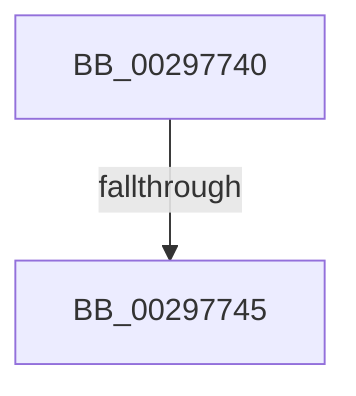

# RtlClearBitsEx

- RVA: `0x00297740`–`0x0029774A` (길이 `10` bytes)
- VA: `0x0000000140297740`
- 실행 섹션: `.text`
- PDB 이름 있음: `예`; PDB Function 태그: `아니요`
- unwind 정보 RVA: `0x000679CC`
- 디코드: `4`개 명령, `10/10` bytes 표시
- 미해석 바이트: `0` (있으면 어셈블리에 `.byte`로 보존)

> 이 문서는 커널 이미지의 기계어와 PDB 기호를 분석해 생성했습니다. 4번과 5번은 함수 원형과 자료형을 바이너리 사용 방식에서 추정한 C 해석이며 원본 소스 복구 결과는 아닙니다.

## 1. Dependencies

- 직접 호출 지점: **0**; 고유 호출 대상: **0**
- 직접 호출자로 확인된 함수: **31**
- RIP 상대 이미지 참조: **0**

### Outgoing calls
- 직접 디코드된 call 명령이 없습니다.

### Direct callers
- [RtlFindSetBitsAndClearEx](RtlFindSetBitsAndClearEx_function_002958B0.md) at `0x00295904`
- [MiGetHighestUltraLevel](MiGetHighestUltraLevel_function_002972AC.md) at `0x0029738C`
- [MiClearVadCellBits](MiClearVadCellBits_function_0029753C.md) at `0x002975EC`
- [IopLiveDumpDiscardVirtualAddressRange](IopLiveDumpDiscardVirtualAddressRange_function_002977F4.md) at `0x0029785F`
- [MiMoveDirtyBitsToPfns](../2A/MiMoveDirtyBitsToPfns_function_002A8624.md) at `0x002A88E5`
- [MiMirrorOmitPagesFromCopy](../2B/MiMirrorOmitPagesFromCopy_function_002B7AF0.md) at `0x002B7BFD`
- [MiUpdateLargePageBitMap](../37/MiUpdateLargePageBitMap_function_0037619C.md) at `0x00376435`
- [MiMarkSystemVaAllocated](../3B/MiMarkSystemVaAllocated_function_003B3878.md) at `0x003B3A3E`
- [MiExtendDynamicBitMap](../3B/MiExtendDynamicBitMap_function_003B6934.md) at `0x003B6A4C`
- [ExpSaPageGroupFreeMemory](../49/ExpSaPageGroupFreeMemory_function_00493E8C.md) at `0x00493EF4`
- [RtlpHpFixedVsFree](../4A/RtlpHpFixedVsFree_function_004A7FE0.md) at `0x004A807E`
- [MiMakeSystemRangeAvailable](../4E/MiMakeSystemRangeAvailable_function_004EE174.md) at `0x004EE2FB`
- [IopAddPageRangeToPageMaps](../59/IopAddPageRangeToPageMaps_function_005944B0.md) at `0x00594565`
- [IopRemovePageFromPageMap](../59/IopRemovePageFromPageMap_function_00596034.md) at `0x005960AE`
- [IopRemovePageFromPageMap](../59/IopRemovePageFromPageMap_function_00596034.md) at `0x00596180`
- [RtlShiftLeftBitMapEx](../5E/RtlShiftLeftBitMapEx_function_005E65F0.md) at `0x005E664A`
- [MiHotRemoveHugeRange](../67/MiHotRemoveHugeRange_function_00675DD0.md) at `0x00675FA3`
- [MiClearMirrorBitmaps](../67/MiClearMirrorBitmaps_function_0067887C.md) at `0x00678A66`
- [MiActOnPartitionNodePages](../68/MiActOnPartitionNodePages_function_0068F7F4.md) at `0x0068FD9E`
- [MiActOnPartitionNodePages](../68/MiActOnPartitionNodePages_function_0068F7F4.md) at `0x00690075`
- [MiActOnPartitionNodePages](../68/MiActOnPartitionNodePages_function_0068F7F4.md) at `0x006900DF`
- [MiAddRangeToPartitionTree](../69/MiAddRangeToPartitionTree_function_0069020C.md) at `0x00690555`
- [MiClearRangeInPartitionTree](../69/MiClearRangeInPartitionTree_function_00690734.md) at `0x006907D8`
- [MiApplyHotPatchToDriverDataPages](../../page/80/MiApplyHotPatchToDriverDataPages_function_00801F18.md) at `0x0080202B`
- [MiDeleteAweInfoPages](../../page/80/MiDeleteAweInfoPages_function_0080AA40.md) at `0x0080AB1A`
- [MiFreeToSubAllocatedRegion](../../page/87/MiFreeToSubAllocatedRegion_function_0087FB7C.md) at `0x0087FC10`
- [MiCopyToCfgBitMap](../../page/8D/MiCopyToCfgBitMap_function_008D1140.md) at `0x008D16B4`
- [sub_00988BDE](../../page/98/Unknown_function_00988BDE.md) at `0x00988BE8`
- [sub_00988CC0](../../page/98/Unknown_function_00988CC0.md) at `0x00988CCA`
- [MiObtainRelocationBits](../../page/98/MiObtainRelocationBits_function_0098997C.md) at `0x00989AA5`
- [MiObtainRelocationBits](../../page/98/MiObtainRelocationBits_function_0098997C.md) at `0x00989ABD`
- [MiMarkRetpolineBits](../../page/AA/MiMarkRetpolineBits_function_00AA0394.md) at `0x00AA0408`
- [MiActOnMirrorBitmap](../../page/AC/MiActOnMirrorBitmap_function_00AC21D0.md) at `0x00AC2258`
- [MiInitializeSystemImageRegion](../../init/C6/MiInitializeSystemImageRegion_function_00C6C05C.md) at `0x00C6C175`
- [MiInitializeUltraSpace](../../init/C6/MiInitializeUltraSpace_function_00C6CDFC.md) at `0x00C6CE71`

### Static image references
- 디코드된 RIP-relative 메모리 참조가 없습니다.

## 2. Other-region calls and transfers

- 다른 실행 섹션으로 향하는 call: **0**
- call이 아닌 외부 분기/꼬리 이동: **1**
  - `0x00297743` → [sub_0029774A + 0x4C](Unknown_function_0029774A.md) (`tail-transfer`)

## 3. Assembly (complete function range)

```asm
00297740  4D 85 C0                        test r8, r8
00297743  74 51                           je 0x140297796
00297745  53                              push rbx
00297746  48 83 EC 20                     sub rsp, 0x20
```

## 4. C-style interpretation (structured pseudocode)

```c
void __fastcall RtlClearBitsEx(__int64 a1, __int64 a2, __int64 a3)
{
    __int64 v_rsp;

    v_rsp = (v_rsp) - (32);
    return;
}
```

## 5. (Beta) C Style

```c
void RtlClearBitsEx(int64_t Arg1, int64_t Arg2, int64_t Arg3)
{
    int64_t local_rsp;

    local_rsp = (local_rsp) - (32);
    return;
}
```

## 6. Execution-region graph

[열기: 2D/3D 그래프와 함수 탐색 컨트롤 패널](../../../control-panel.html?section=text&rva=0x00297740&view=graph)

- 2D 그래프는 위에서 아래로 흐르고, 3D 그래프는 빈 공간을 드래그해 회전합니다. Shift+드래그는 이동, 휠은 확대·축소, 함수 노드 선택은 대상 보고서 이동입니다.

### Static fallback


