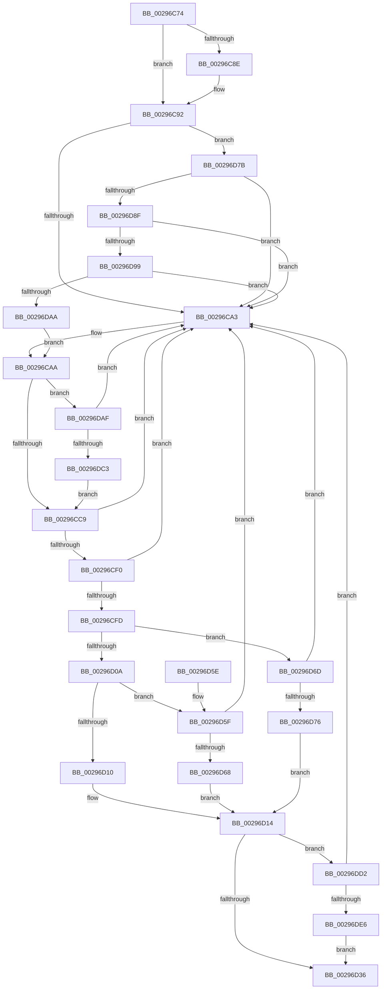

# RtlpTreeDoubleRotateNodes

- RVA: `0x00296C74`–`0x00296DF5` (길이 `385` bytes)
- VA: `0x0000000140296C74`
- 실행 섹션: `.text`
- PDB 이름 있음: `예`; PDB Function 태그: `아니요`
- unwind 정보 RVA: `0x0006793C`
- 디코드: `103`개 명령, `385/385` bytes 표시
- 미해석 바이트: `0` (있으면 어셈블리에 `.byte`로 보존)

> 이 문서는 커널 이미지의 기계어와 PDB 기호를 분석해 생성했습니다. 4번과 5번은 함수 원형과 자료형을 바이너리 사용 방식에서 추정한 C 해석이며 원본 소스 복구 결과는 아닙니다.

## 1. Dependencies

- 직접 호출 지점: **0**; 고유 호출 대상: **0**
- 직접 호출자로 확인된 함수: **2**
- RIP 상대 이미지 참조: **0**

### Outgoing calls
- 직접 디코드된 call 명령이 없습니다.

### Direct callers
- [MiUpdateSystemProtoPtesTree](MiUpdateSystemProtoPtesTree_function_00295F0C.md) at `0x00296126`
- [RtlAvlRemoveNode](RtlAvlRemoveNode_function_00296650.md) at `0x00296958`

### Static image references
- 디코드된 RIP-relative 메모리 참조가 없습니다.

## 2. Other-region calls and transfers

- 다른 실행 섹션으로 향하는 call: **0**
- 별도 외부 분기/꼬리 이동을 확인하지 못했습니다.

## 3. Assembly (complete function range)

```asm
00296C74  48 89 5C 24 08                  mov qword ptr [rsp + 8], rbx
00296C79  48 89 74 24 10                  mov qword ptr [rsp + 0x10], rsi
00296C7E  48 89 7C 24 18                  mov qword ptr [rsp + 0x18], rdi
00296C83  4D 8B 10                        mov r10, qword ptr [r8]
00296C86  48 8B F1                        mov rsi, rcx
00296C89  45 85 C9                        test r9d, r9d
00296C8C  75 04                           jne 0x140296c92
00296C8E  4D 8B 50 08                     mov r10, qword ptr [r8 + 8]
00296C92  49 8B 42 10                     mov rax, qword ptr [r10 + 0x10]
00296C96  48 83 E0 FC                     and rax, 0xfffffffffffffffc
00296C9A  49 3B C0                        cmp rax, r8
00296C9D  0F 84 D8 00 00 00               je 0x140296d7b
00296CA3  B9 1D 00 00 00                  mov ecx, 0x1d
00296CA8  CD 29                           int 0x29
00296CAA  4E 89 14 DA                     mov qword ptr [rdx + r11*8], r10
00296CAE  41 8B 42 10                     mov eax, dword ptr [r10 + 0x10]
00296CB2  83 E0 03                        and eax, 3
00296CB5  48 0B C2                        or rax, rdx
00296CB8  49 89 42 10                     mov qword ptr [r10 + 0x10], rax
00296CBC  4B 8B 3C DA                     mov rdi, qword ptr [r10 + r11*8]
00296CC0  48 85 FF                        test rdi, rdi
00296CC3  0F 85 E6 00 00 00               jne 0x140296daf
00296CC9  49 89 3C D8                     mov qword ptr [r8 + rbx*8], rdi
00296CCD  41 83 F1 01                     xor r9d, 1
00296CD1  4F 89 04 DA                     mov qword ptr [r10 + r11*8], r8
00296CD5  41 8B 40 10                     mov eax, dword ptr [r8 + 0x10]
00296CD9  83 E0 03                        and eax, 3
00296CDC  49 0B C2                        or rax, r10
00296CDF  49 89 40 10                     mov qword ptr [r8 + 0x10], rax
00296CE3  49 8B 42 10                     mov rax, qword ptr [r10 + 0x10]
00296CE7  48 83 E0 FC                     and rax, 0xfffffffffffffffc
00296CEB  48 3B C2                        cmp rax, rdx
00296CEE  75 B3                           jne 0x140296ca3
00296CF0  45 8B D9                        mov r11d, r9d
00296CF3  49 83 F1 01                     xor r9, 1
00296CF7  4E 39 14 CA                     cmp qword ptr [rdx + r9*8], r10
00296CFB  75 A6                           jne 0x140296ca3
00296CFD  4C 8B 42 10                     mov r8, qword ptr [rdx + 0x10]
00296D01  49 8B C8                        mov rcx, r8
00296D04  48 83 E1 FC                     and rcx, 0xfffffffffffffffc
00296D08  74 63                           je 0x140296d6d
00296D0A  48 39 51 08                     cmp qword ptr [rcx + 8], rdx
00296D0E  75 4F                           jne 0x140296d5f
00296D10  4C 89 51 08                     mov qword ptr [rcx + 8], r10
00296D14  49 8B 42 10                     mov rax, qword ptr [r10 + 0x10]
00296D18  48 8B C8                        mov rcx, rax
00296D1B  49 33 C8                        xor rcx, r8
00296D1E  48 83 E1 FC                     and rcx, 0xfffffffffffffffc
00296D22  48 33 C8                        xor rcx, rax
00296D25  49 89 4A 10                     mov qword ptr [r10 + 0x10], rcx
00296D29  4F 8B 04 DA                     mov r8, qword ptr [r10 + r11*8]
00296D2D  4D 85 C0                        test r8, r8
00296D30  0F 85 9C 00 00 00               jne 0x140296dd2
00296D36  48 8B 5C 24 08                  mov rbx, qword ptr [rsp + 8]
00296D3B  49 8B C2                        mov rax, r10
00296D3E  48 8B 74 24 10                  mov rsi, qword ptr [rsp + 0x10]
00296D43  48 8B 7C 24 18                  mov rdi, qword ptr [rsp + 0x18]
00296D48  4E 89 04 CA                     mov qword ptr [rdx + r9*8], r8
00296D4C  4B 89 14 DA                     mov qword ptr [r10 + r11*8], rdx
00296D50  8B 4A 10                        mov ecx, dword ptr [rdx + 0x10]
00296D53  83 E1 03                        and ecx, 3
00296D56  49 0B CA                        or rcx, r10
00296D59  48 89 4A 10                     mov qword ptr [rdx + 0x10], rcx
00296D5D  C3                              ret
00296D5E  CC                              int3
00296D5F  48 39 11                        cmp qword ptr [rcx], rdx
00296D62  0F 85 3B FF FF FF               jne 0x140296ca3
00296D68  4C 89 11                        mov qword ptr [rcx], r10
00296D6B  EB A7                           jmp 0x140296d14
00296D6D  48 39 16                        cmp qword ptr [rsi], rdx
00296D70  0F 85 2D FF FF FF               jne 0x140296ca3
00296D76  4C 89 16                        mov qword ptr [rsi], r10
00296D79  EB 99                           jmp 0x140296d14
00296D7B  41 8B D9                        mov ebx, r9d
00296D7E  48 83 F3 01                     xor rbx, 1
00296D82  45 8B D9                        mov r11d, r9d
00296D85  4D 39 14 D8                     cmp qword ptr [r8 + rbx*8], r10
00296D89  0F 85 14 FF FF FF               jne 0x140296ca3
00296D8F  4E 39 04 DA                     cmp qword ptr [rdx + r11*8], r8
00296D93  0F 85 0A FF FF FF               jne 0x140296ca3
00296D99  49 8B 40 10                     mov rax, qword ptr [r8 + 0x10]
00296D9D  48 83 E0 FC                     and rax, 0xfffffffffffffffc
00296DA1  48 3B C2                        cmp rax, rdx
00296DA4  0F 85 F9 FE FF FF               jne 0x140296ca3
00296DAA  E9 FB FE FF FF                  jmp 0x140296caa
00296DAF  48 8B 4F 10                     mov rcx, qword ptr [rdi + 0x10]
00296DB3  48 8B C1                        mov rax, rcx
00296DB6  48 83 E0 FC                     and rax, 0xfffffffffffffffc
00296DBA  49 3B C2                        cmp rax, r10
00296DBD  0F 85 E0 FE FF FF               jne 0x140296ca3
00296DC3  83 E1 03                        and ecx, 3
00296DC6  49 0B C8                        or rcx, r8
00296DC9  48 89 4F 10                     mov qword ptr [rdi + 0x10], rcx
00296DCD  E9 F7 FE FF FF                  jmp 0x140296cc9
00296DD2  49 8B 48 10                     mov rcx, qword ptr [r8 + 0x10]
00296DD6  48 8B C1                        mov rax, rcx
00296DD9  48 83 E0 FC                     and rax, 0xfffffffffffffffc
00296DDD  49 3B C2                        cmp rax, r10
00296DE0  0F 85 BD FE FF FF               jne 0x140296ca3
00296DE6  83 E1 03                        and ecx, 3
00296DE9  48 0B CA                        or rcx, rdx
00296DEC  49 89 48 10                     mov qword ptr [r8 + 0x10], rcx
00296DF0  E9 41 FF FF FF                  jmp 0x140296d36
```

## 4. C-style interpretation (structured pseudocode)

```c
__int64 __fastcall RtlpTreeDoubleRotateNodes(__int64 a1, __int64 a2, __int64 a3, int a4)
{
    __int64 result;
    __int64 v_r10;
    __int64 v_rbx;
    unsigned __int64 v_stack_p10;
    unsigned __int64 v_stack_p18;
    unsigned __int64 v_stack_p8;

    v_stack_p8 = v_rbx;
    v_stack_p10 = v_rsi;
    v_stack_p18 = v_rdi;
    v_r10 = *(unsigned __int64 *)(a3);
    if (a4 == 0) {
        v_r10 = *(unsigned __int64 *)(a3 + 8);
    }
    result = (*(unsigned __int64 *)(v_r10 + 16)) & (-4);
    if (result == a3) goto loc_00296D7B;
loc_00296CA3:
loc_00296CAA:
    *(unsigned __int64 *)(a2 + v_r11 * 8) = v_r10;
    result = (unsigned int)(((unsigned int)(*(unsigned int *)(v_r10 + 16))) & (3));
    result = (result) | (a2);
    *(unsigned __int64 *)(v_r10 + 16) = result;
    if (*(unsigned __int64 *)(v_r10 + v_r11 * 8) != 0) goto loc_00296DAF;
loc_00296CC9:
    *(unsigned __int64 *)(a3 + v_rbx * 8) = *(unsigned __int64 *)(v_r10 + v_r11 * 8);
    a4 = (unsigned int)((a4) ^ (1));
    *(unsigned __int64 *)(v_r10 + v_r11 * 8) = a3;
    result = (unsigned int)(((unsigned int)(*(unsigned int *)(a3 + 16))) & (3));
    result = (result) | (v_r10);
    *(unsigned __int64 *)(a3 + 16) = result;
    result = (*(unsigned __int64 *)(v_r10 + 16)) & (-4);
    if (result != a2) goto loc_00296CA3;
    a4 = (a4) ^ (1);
    if ((*(unsigned __int64 *)(a2 + a4 * 8)) != v_r10) goto loc_00296CA3;
    a1 = (*(unsigned __int64 *)(a2 + 16)) & (-4);
    if (condition_is_equal) goto loc_00296D6D;
    if ((*(unsigned __int64 *)(a1 + 8)) != a2) goto loc_00296D5F;
    *(unsigned __int64 *)(a1 + 8) = v_r10;
loc_00296D14:
    a1 = (*(unsigned __int64 *)(v_r10 + 16)) ^ (*(unsigned __int64 *)(a2 + 16));
    a1 = (a1) & (-4);
    a1 = (a1) ^ (*(unsigned __int64 *)(v_r10 + 16));
    *(unsigned __int64 *)(v_r10 + 16) = a1;
    if (*(unsigned __int64 *)(v_r10 + (unsigned int)(a4) * 8) != 0) goto loc_00296DD2;
loc_00296D36:
    *(unsigned __int64 *)(a2 + a4 * 8) = *(unsigned __int64 *)(v_r10 + (unsigned int)(a4) * 8);
    *(unsigned __int64 *)(v_r10 + (unsigned int)(a4) * 8) = a2;
    a1 = (unsigned int)(((unsigned int)(*(unsigned int *)(a2 + 16))) & (3));
    a1 = (a1) | (v_r10);
    *(unsigned __int64 *)(a2 + 16) = a1;
    return v_r10;
loc_00296D5F:
    if ((*(unsigned __int64 *)(a1)) != a2) goto loc_00296CA3;
    *(unsigned __int64 *)(a1) = v_r10;
    goto loc_00296D14;
loc_00296D6D:
    if ((*(unsigned __int64 *)(v_stack_p10)) != a2) goto loc_00296CA3;
    *(unsigned __int64 *)(v_stack_p10) = v_r10;
    goto loc_00296D14;
loc_00296D7B:
    v_rbx = ((unsigned int)(a4)) ^ (1);
    if ((*(unsigned __int64 *)(*(unsigned __int64 *)(v_r10 + (unsigned int)(a4) * 8) + v_rbx * 8)) != v_r10) goto loc_00296CA3;
    if ((*(unsigned __int64 *)(a2 + (unsigned int)(a4) * 8)) != (*(unsigned __int64 *)(v_r10 + (unsigned int)(a4) * 8))) goto loc_00296CA3;
    result = (*(unsigned __int64 *)(*(unsigned __int64 *)(v_r10 + (unsigned int)(a4) * 8) + 16)) & (-4);
    if (result != a2) goto loc_00296CA3;
    goto loc_00296CAA;
loc_00296DAF:
    result = (*(unsigned __int64 *)(v_stack_p18 + 16)) & (-4);
    if (result != v_r10) goto loc_00296CA3;
    a1 = (unsigned int)((*(unsigned __int64 *)(v_stack_p18 + 16)) & (3));
    a1 = (a1) | (*(unsigned __int64 *)(v_r10 + (unsigned int)(a4) * 8));
    *(unsigned __int64 *)(v_stack_p18 + 16) = a1;
    goto loc_00296CC9;
loc_00296DD2:
    result = (*(unsigned __int64 *)(*(unsigned __int64 *)(v_r10 + (unsigned int)(a4) * 8) + 16)) & (-4);
    if (result != v_r10) goto loc_00296CA3;
    a1 = (unsigned int)((*(unsigned __int64 *)(*(unsigned __int64 *)(v_r10 + (unsigned int)(a4) * 8) + 16)) & (3));
    a1 = (a1) | (a2);
    *(unsigned __int64 *)(*(unsigned __int64 *)(v_r10 + (unsigned int)(a4) * 8) + 16) = a1;
    goto loc_00296D36;
}
```

## 5. (Beta) C Style

```c
int64_t RtlpTreeDoubleRotateNodes(void *Arg1, void *Arg2, void *Arg3, int32_t Arg4)
{
    uint8_t *arg1 = (uint8_t *)Arg1;
    uint8_t *arg2 = (uint8_t *)Arg2;
    uint8_t *arg3 = (uint8_t *)Arg3;

    int64_t result;
    int64_t local_r10;
    int64_t local_rbx;
    uint64_t v_stack_p10;
    uint64_t v_stack_p18;
    uint64_t v_stack_p8;

    v_stack_p8 = local_rbx;
    v_stack_p10 = local_rsi;
    v_stack_p18 = local_rdi;
    local_r10 = *(uint64_t *)(arg3);
    if (Arg4 == 0) {
        local_r10 = *(uint64_t *)(arg3 + 0x8);
    }
    result = (*(uint64_t *)(local_r10 + 0x10)) & (-4);
    if (result == Arg3) goto loc_00296D7B;
loc_00296CA3:
loc_00296CAA:
    *(uint64_t *)(arg2 + local_r11 * 8) = local_r10;
    result = (uint32_t)(((uint32_t)(*(uint32_t *)(local_r10 + 0x10))) & (3));
    result = (result) | (Arg2);
    *(uint64_t *)(local_r10 + 0x10) = result;
    if (*(uint64_t *)(local_r10 + local_r11 * 8) != 0) goto loc_00296DAF;
loc_00296CC9:
    *(uint64_t *)(arg3 + local_rbx * 8) = *(uint64_t *)(local_r10 + local_r11 * 8);
    Arg4 = (uint32_t)((Arg4) ^ (1));
    *(void **)(local_r10 + local_r11 * 8) = Arg3;
    result = (uint32_t)(((uint32_t)(*(uint32_t *)(arg3 + 0x10))) & (3));
    result = (result) | (local_r10);
    *(uint64_t *)(arg3 + 0x10) = result;
    result = (*(uint64_t *)(local_r10 + 0x10)) & (-4);
    if (result != Arg2) goto loc_00296CA3;
    Arg4 = (Arg4) ^ (1);
    if ((*(uint64_t *)(arg2 + Arg4 * 8)) != local_r10) goto loc_00296CA3;
    Arg1 = (*(uint64_t *)(arg2 + 0x10)) & (-4);
    if (condition_is_equal) goto loc_00296D6D;
    if ((*(uint64_t *)(arg1 + 0x8)) != Arg2) goto loc_00296D5F;
    *(uint64_t *)(arg1 + 0x8) = local_r10;
loc_00296D14:
    Arg1 = (*(uint64_t *)(local_r10 + 0x10)) ^ (*(uint64_t *)(arg2 + 0x10));
    Arg1 = (Arg1) & (-4);
    Arg1 = (Arg1) ^ (*(uint64_t *)(local_r10 + 0x10));
    *(void **)(local_r10 + 0x10) = Arg1;
    if (*(uint64_t *)(local_r10 + (uint32_t)(Arg4) * 8) != 0) goto loc_00296DD2;
loc_00296D36:
    *(uint64_t *)(arg2 + Arg4 * 8) = *(uint64_t *)(local_r10 + (uint32_t)(Arg4) * 8);
    *(void **)(local_r10 + (uint32_t)(Arg4) * 8) = Arg2;
    Arg1 = (uint32_t)(((uint32_t)(*(uint32_t *)(arg2 + 0x10))) & (3));
    Arg1 = (Arg1) | (local_r10);
    *(void **)(arg2 + 0x10) = Arg1;
    return local_r10;
loc_00296D5F:
    if ((*(uint64_t *)(arg1)) != Arg2) goto loc_00296CA3;
    *(uint64_t *)(arg1) = local_r10;
    goto loc_00296D14;
loc_00296D6D:
    if ((*(uint64_t *)(v_stack_p10)) != Arg2) goto loc_00296CA3;
    *(uint64_t *)(v_stack_p10) = local_r10;
    goto loc_00296D14;
loc_00296D7B:
    local_rbx = ((uint32_t)(Arg4)) ^ (1);
    if ((*(uint64_t *)(*(uint64_t *)(local_r10 + (uint32_t)(Arg4) * 8) + local_rbx * 8)) != local_r10) goto loc_00296CA3;
    if ((*(uint64_t *)(arg2 + (uint32_t)(Arg4) * 8)) != (*(uint64_t *)(local_r10 + (uint32_t)(Arg4) * 8))) goto loc_00296CA3;
    result = (*(uint64_t *)(*(uint64_t *)(local_r10 + (uint32_t)(Arg4) * 8) + 0x10)) & (-4);
    if (result != Arg2) goto loc_00296CA3;
    goto loc_00296CAA;
loc_00296DAF:
    result = (*(uint64_t *)(v_stack_p18 + 0x10)) & (-4);
    if (result != local_r10) goto loc_00296CA3;
    Arg1 = (uint32_t)((*(uint64_t *)(v_stack_p18 + 0x10)) & (3));
    Arg1 = (Arg1) | (*(uint64_t *)(local_r10 + (uint32_t)(Arg4) * 8));
    *(void **)(v_stack_p18 + 0x10) = Arg1;
    goto loc_00296CC9;
loc_00296DD2:
    result = (*(uint64_t *)(*(uint64_t *)(local_r10 + (uint32_t)(Arg4) * 8) + 0x10)) & (-4);
    if (result != local_r10) goto loc_00296CA3;
    Arg1 = (uint32_t)((*(uint64_t *)(*(uint64_t *)(local_r10 + (uint32_t)(Arg4) * 8) + 0x10)) & (3));
    Arg1 = (Arg1) | (Arg2);
    *(void **)(*(uint64_t *)(local_r10 + (uint32_t)(Arg4) * 8) + 0x10) = Arg1;
    goto loc_00296D36;
}
```

### 관측된 메모리 오프셋

구조체 형식이 확인되지 않은 접근은 인자 기준의 오프셋으로만 기록했습니다.

| 기준 인자 | 오프셋 표현 | 폭 (bit) | 접근 |
|---|---:|---:|---|
| `Arg1` | `+ 0x0` | `64` | `R` |
| `Arg1` | `+ 0x0` | `64` | `W` |
| `Arg2` | `+ 0x0 + r11*8` | `64` | `R` |
| `Arg2` | `+ 0x0 + r11*8` | `64` | `W` |
| `Arg2` | `+ 0x0 + r9*8` | `64` | `R` |
| `Arg2` | `+ 0x0 + r9*8` | `64` | `W` |
| `Arg2` | `+ 0x10` | `32` | `R` |
| `Arg2` | `+ 0x10` | `64` | `R` |
| `Arg2` | `+ 0x10` | `64` | `W` |
| `Arg3` | `+ 0x0` | `64` | `R` |
| `Arg3` | `+ 0x0 + rbx*8` | `64` | `R` |
| `Arg3` | `+ 0x8` | `64` | `R` |
| `Arg3` | `+ 0x10` | `64` | `R` |

## 6. Execution-region graph

[열기: 2D/3D 그래프와 함수 탐색 컨트롤 패널](../../../control-panel.html?section=text&rva=0x00296C74&view=graph)

- 2D 그래프는 위에서 아래로 흐르고, 3D 그래프는 빈 공간을 드래그해 회전합니다. Shift+드래그는 이동, 휠은 확대·축소, 함수 노드 선택은 대상 보고서 이동입니다.

### Static fallback


