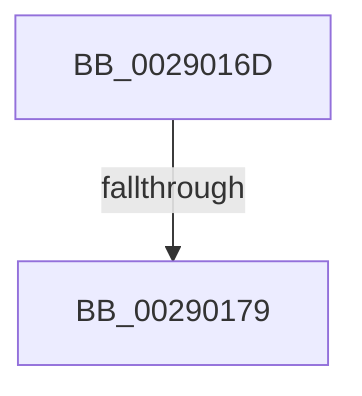

# sub_0029016D

- RVA: `0x0029016D`–`0x002901B8` (길이 `75` bytes)
- VA: `0x000000014029016D`
- 실행 섹션: `.text`
- PDB 이름 있음: `아니요`; PDB Function 태그: `아니요`
- unwind 정보 RVA: `0x000673F8`
- 디코드: `19`개 명령, `75/75` bytes 표시
- 미해석 바이트: `0` (있으면 어셈블리에 `.byte`로 보존)

> 이 문서는 커널 이미지의 기계어와 PDB 기호를 분석해 생성했습니다. 4번과 5번은 함수 원형과 자료형을 바이너리 사용 방식에서 추정한 C 해석이며 원본 소스 복구 결과는 아닙니다.

## 1. Dependencies

- 직접 호출 지점: **1**; 고유 호출 대상: **1**
- 직접 호출자로 확인된 함수: **0**
- RIP 상대 이미지 참조: **0**

### Outgoing calls
- `0x00290193` → [MI_READ_PTE_LOCK_FREE](../28/MI_READ_PTE_LOCK_FREE_function_002828A0.md) (function, `0x002828A0`)

### Direct callers
- 이 함수 시작 RVA로 연결되는 직접 call은 확인되지 않았습니다. 간접 호출은 완전히 역산할 수 없습니다.

### Static image references
- 디코드된 RIP-relative 메모리 참조가 없습니다.

## 2. Other-region calls and transfers

- 다른 실행 섹션으로 향하는 call: **0**
- call이 아닌 외부 분기/꼬리 이동: **2**
  - `0x00290173` → [MiAgePteWorker + 0x68](../28/MiAgePteWorker_function_0028FB20.md) (`tail-transfer`)
  - `0x002901B3` → [MiAgePteWorker + 0xB1](../28/MiAgePteWorker_function_0028FB20.md) (`tail-transfer`)

## 3. Assembly (complete function range)

```asm
0029016D  49 8B C0                        mov rax, r8
00290170  4C 3B E8                        cmp r13, rax
00290173  0F 87 0F FA FF FF               ja 0x14028fb88
00290179  49 8B CD                        mov rcx, r13
0029017C  48 B8 F8 FF FF FF 7F 00 00 00   movabs rax, 0x7ffffffff8
00290186  48 C1 E9 09                     shr rcx, 9
0029018A  48 23 C8                        and rcx, rax
0029018D  48 8B C2                        mov rax, rdx
00290190  48 03 C8                        add rcx, rax
00290193  E8 08 27 FF FF                  call 0x1402828a0
00290198  48 C1 E8 0C                     shr rax, 0xc
0029019C  48 23 C3                        and rax, rbx
0029019F  48 8D 0C 40                     lea rcx, [rax + rax*2]
002901A3  48 03 C9                        add rcx, rcx
002901A6  48 8B C7                        mov rax, rdi
002901A9  48 8B 04 C8                     mov rax, qword ptr [rax + rcx*8]
002901AD  48 C1 E8 2A                     shr rax, 0x2a
002901B1  24 07                           and al, 7
002901B3  E9 19 FA FF FF                  jmp 0x14028fbd1
```

## 4. C-style interpretation (structured pseudocode)

```c
__int64 __fastcall sub_0029016D(__int64 a1, __int64 a2, __int64 a3)
{
    __int64 result;

    a1 = (v_r13) >> (9);
    a1 = (a1) & (a3);
    a1 = (a1) + (a2);
    result = MI_READ_PTE_LOCK_FREE(a1, a2, a3, a4);
    result = (result) >> (12);
    result = (result) & (v_rbx);
    a1 = (result + result * 2) + (result + result * 2);
    result = (*(unsigned __int64 *)(v_rdi + a1 * 8)) >> (42);
    result = (unsigned __int8)((result) & (7));
}
```

## 5. (Beta) C Style

```c
int64_t sub_0029016D(int64_t Arg1, int64_t Arg2, int64_t Arg3)
{
    int64_t result;

    Arg1 = (local_r13) >> (9);
    Arg1 = (Arg1) & (Arg3);
    Arg1 = (Arg1) + (Arg2);
    result = MI_READ_PTE_LOCK_FREE(Arg1, Arg2, Arg3, a4);
    result = (result) >> (12);
    result = (result) & (local_rbx);
    Arg1 = (result + result * 2) + (result + result * 2);
    result = (*(uint64_t *)(local_rdi + Arg1 * 8)) >> (42);
    result = (uint8_t)((result) & (7));
}
```

## 6. Execution-region graph

[열기: 2D/3D 그래프와 함수 탐색 컨트롤 패널](../../../control-panel.html?section=text&rva=0x0029016D&view=graph)

- 2D 그래프는 위에서 아래로 흐르고, 3D 그래프는 빈 공간을 드래그해 회전합니다. Shift+드래그는 이동, 휠은 확대·축소, 함수 노드 선택은 대상 보고서 이동입니다.

### Static fallback


