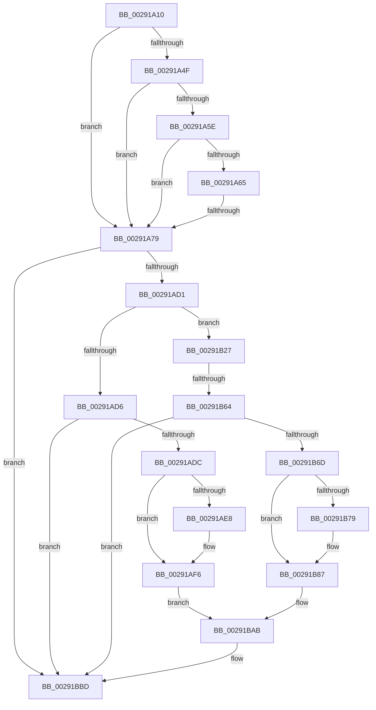

# sub_00291A10

- RVA: `0x00291A10`–`0x00291BD3` (길이 `451` bytes)
- VA: `0x0000000140291A10`
- 실행 섹션: `.text`
- PDB 이름 있음: `아니요`; PDB Function 태그: `아니요`
- unwind 정보 RVA: `0x00067474`
- 디코드: `112`개 명령, `451/451` bytes 표시
- 미해석 바이트: `0` (있으면 어셈블리에 `.byte`로 보존)

> 이 문서는 커널 이미지의 기계어와 PDB 기호를 분석해 생성했습니다. 4번과 5번은 함수 원형과 자료형을 바이너리 사용 방식에서 추정한 C 해석이며 원본 소스 복구 결과는 아닙니다.

## 1. Dependencies

- 직접 호출 지점: **3**; 고유 호출 대상: **2**
- 직접 호출자로 확인된 함수: **0**
- RIP 상대 이미지 참조: **0**

### Outgoing calls
- `0x00291AF1` → [MiRemoveActivePageTableLinks](MiRemoveActivePageTableLinks_function_00291FA8.md) (function, `0x00291FA8`)
- `0x00291B82` → [MiRemoveActivePageTableLinks](MiRemoveActivePageTableLinks_function_00291FA8.md) (function, `0x00291FA8`)
- `0x00291BB8` → [MiInsertActivePageTableLinksTail](MiInsertActivePageTableLinksTail_function_00291D98.md) (function, `0x00291D98`)

### Direct callers
- 이 함수 시작 RVA로 연결되는 직접 call은 확인되지 않았습니다. 간접 호출은 완전히 역산할 수 없습니다.

### Static image references
- 디코드된 RIP-relative 메모리 참조가 없습니다.

## 2. Other-region calls and transfers

- 다른 실행 섹션으로 향하는 call: **0**
- call이 아닌 외부 분기/꼬리 이동: **3**
  - `0x00291A73` → [sub_00291C32](Unknown_function_00291C32.md) (`tail-transfer`)
  - `0x00291B5E` → [sub_00291CF5](Unknown_function_00291CF5.md) (`tail-transfer`)
  - `0x00291BD1` → [sub_00291BD3 + 0x16](Unknown_function_00291BD3.md) (`tail-transfer`)

## 3. Assembly (complete function range)

```asm
00291A10  48 89 74 24 58                  mov qword ptr [rsp + 0x58], rsi
00291A15  49 C1 EA 12                     shr r10, 0x12
00291A19  4D 8B F1                        mov r14, r9
00291A1C  41 81 E2 F8 FF FF 3F            and r10d, 0x3ffffff8
00291A23  41 0F B6 F0                     movzx esi, r8b
00291A27  4C 8B CA                        mov r9, rdx
00291A2A  48 8B E9                        mov rbp, rcx
00291A2D  45 33 FF                        xor r15d, r15d
00291A30  48 B8 00 00 00 40 FB F6 FF FF   movabs rax, 0xfffff6fb40000000
00291A3A  4C 03 D0                        add r10, rax
00291A3D  49 8B 02                        mov rax, qword ptr [r10]
00291A40  48 B9 00 D0 BE 7D FB F6 FF FF   movabs rcx, 0xfffff6fb7dbed000
00291A4A  4C 3B D1                        cmp r10, rcx
00291A4D  72 2A                           jb 0x140291a79
00291A4F  48 B9 F8 D7 BE 7D FB F6 FF FF   movabs rcx, 0xfffff6fb7dbed7f8
00291A59  4C 3B D1                        cmp r10, rcx
00291A5C  77 1B                           ja 0x140291a79
00291A5E  48 8B C8                        mov rcx, rax
00291A61  A8 01                           test al, 1
00291A63  74 14                           je 0x140291a79
00291A65  A8 42                           test al, 0x42
00291A67  41 0F 95 C0                     setne r8b
00291A6B  A8 20                           test al, 0x20
00291A6D  0F 95 C2                        setne dl
00291A70  44 84 C2                        test dl, r8b
00291A73  0F 84 B9 01 00 00               je 0x140291c32
00291A79  48 C1 E8 0C                     shr rax, 0xc
00291A7D  48 B9 FF FF FF FF FF 00 00 00   movabs rcx, 0xffffffffff
00291A87  48 23 C1                        and rax, rcx
00291A8A  48 89 5C 24 50                  mov qword ptr [rsp + 0x50], rbx
00291A8F  4C 89 64 24 60                  mov qword ptr [rsp + 0x60], r12
00291A94  48 8D 3C 40                     lea rdi, [rax + rax*2]
00291A98  48 C1 E7 04                     shl rdi, 4
00291A9C  48 B8 00 00 00 00 00 DE FF FF   movabs rax, 0xffffde0000000000
00291AA6  48 03 F8                        add rdi, rax
00291AA9  41 BD 01 00 00 00               mov r13d, 1
00291AAF  48 8B 07                        mov rax, qword ptr [rdi]
00291AB2  4C 8B 07                        mov r8, qword ptr [rdi]
00291AB5  49 C1 E8 2D                     shr r8, 0x2d
00291AB9  48 C1 E8 37                     shr rax, 0x37
00291ABD  41 81 E0 FF 03 00 00            and r8d, 0x3ff
00291AC4  24 07                           and al, 7
00291AC6  F6 44 24 70 08                  test byte ptr [rsp + 0x70], 8
00291ACB  0F 85 EC 00 00 00               jne 0x140291bbd
00291AD1  40 3A F0                        cmp sil, al
00291AD4  74 51                           je 0x140291b27
00291AD6  0F 86 E1 00 00 00               jbe 0x140291bbd
00291ADC  48 8B 1F                        mov rbx, qword ptr [rdi]
00291ADF  8B 47 24                        mov eax, dword ptr [rdi + 0x24]
00291AE2  0F BA E0 1A                     bt eax, 0x1a
00291AE6  73 0E                           jae 0x140291af6
00291AE8  45 33 C0                        xor r8d, r8d
00291AEB  48 8B D7                        mov rdx, rdi
00291AEE  48 8B CD                        mov rcx, rbp
00291AF1  E8 B2 04 00 00                  call 0x140291fa8
00291AF6  48 8B CE                        mov rcx, rsi
00291AF9  49 8B C6                        mov rax, r14
00291AFC  83 E1 07                        and ecx, 7
00291AFF  25 FF 03 00 00                  and eax, 0x3ff
00291B04  48 C1 E1 0A                     shl rcx, 0xa
00291B08  48 BA FF FF FF FF FF 1F 00 FC   movabs rdx, 0xfc001fffffffffff
00291B12  48 0B C8                        or rcx, rax
00291B15  48 23 DA                        and rbx, rdx
00291B18  48 C1 E1 2D                     shl rcx, 0x2d
00291B1C  48 0B CB                        or rcx, rbx
00291B1F  48 89 0F                        mov qword ptr [rdi], rcx
00291B22  E9 84 00 00 00                  jmp 0x140291bab
00291B27  48 8B 07                        mov rax, qword ptr [rdi]
00291B2A  43 8D 0C 30                     lea ecx, [r8 + r14]
00291B2E  8B D1                           mov edx, ecx
00291B30  44 8B E1                        mov r12d, ecx
00291B33  48 C1 E2 2D                     shl rdx, 0x2d
00291B37  41 81 E4 FF 03 00 00            and r12d, 0x3ff
00291B3E  48 8B CA                        mov rcx, rdx
00291B41  48 33 C8                        xor rcx, rax
00291B44  48 B8 FF FF FF FF FF 1F 80 FF   movabs rax, 0xff801fffffffffff
00291B4E  48 23 C8                        and rcx, rax
00291B51  4B 8D 04 30                     lea rax, [r8 + r14]
00291B55  48 33 CA                        xor rcx, rdx
00291B58  48 89 0F                        mov qword ptr [rdi], rcx
00291B5B  48 85 C0                        test rax, rax
00291B5E  0F 84 91 01 00 00               je 0x140291cf5
00291B64  8B 47 24                        mov eax, dword ptr [rdi + 0x24]
00291B67  0F BA E0 1A                     bt eax, 0x1a
00291B6B  72 50                           jb 0x140291bbd
00291B6D  48 8B 1F                        mov rbx, qword ptr [rdi]
00291B70  8B 47 24                        mov eax, dword ptr [rdi + 0x24]
00291B73  0F BA E0 1A                     bt eax, 0x1a
00291B77  73 0E                           jae 0x140291b87
00291B79  45 33 C0                        xor r8d, r8d
00291B7C  48 8B D7                        mov rdx, rdi
00291B7F  48 8B CD                        mov rcx, rbp
00291B82  E8 21 04 00 00                  call 0x140291fa8
00291B87  48 8B C6                        mov rax, rsi
00291B8A  48 BA FF FF FF FF FF 1F 00 FC   movabs rdx, 0xfc001fffffffffff
00291B94  83 E0 07                        and eax, 7
00291B97  48 23 DA                        and rbx, rdx
00291B9A  48 C1 E0 0A                     shl rax, 0xa
00291B9E  49 0B C4                        or rax, r12
00291BA1  48 C1 E0 2D                     shl rax, 0x2d
00291BA5  48 0B C3                        or rax, rbx
00291BA8  48 89 07                        mov qword ptr [rdi], rax
00291BAB  45 33 C9                        xor r9d, r9d
00291BAE  44 0F B6 C6                     movzx r8d, sil
00291BB2  48 8B D7                        mov rdx, rdi
00291BB5  48 8B CD                        mov rcx, rbp
00291BB8  E8 DB 01 00 00                  call 0x140291d98
00291BBD  F0 4C 01 74 F5 28               lock add qword ptr [rbp + rsi*8 + 0x28], r14
00291BC3  4C 8B 64 24 60                  mov r12, qword ptr [rsp + 0x60]
00291BC8  40 80 FE 07                     cmp sil, 7
00291BCC  48 8B 74 24 58                  mov rsi, qword ptr [rsp + 0x58]
00291BD1  74 16                           je 0x140291be9
```

## 4. C-style interpretation (structured pseudocode)

```c
__int64 __fastcall sub_00291A10(__int64 a1, __int64 a2, unsigned __int8 a3, __int64 a4, __int64 a5, __int64 a6, __int64 a7, __int64 a8, __int64 a9, __int64 a10, __int64 a11, __int64 a12, __int64 a13, unsigned __int8 a14)
{
    __int64 result;
    __int64 v_r10;
    __int64 v_r12;
    __int64 v_r15;
    __int64 v_rbx;
    __int64 v_rdi;
    unsigned __int64 v_stack_p50;
    unsigned __int64 v_stack_p58;
    unsigned __int64 v_stack_p60;

    v_stack_p58 = v_rsi;
    v_r10 = (v_r10) >> (18);
    v_r10 = (unsigned int)((v_r10) & (0x3FFFFFF8ULL));
    v_r15 = 0;
    v_r10 = (v_r10) + (result);
    if (v_r10 < a1) goto loc_00291A79;
    if (v_r10 > a1) goto loc_00291A79;
    if ((((unsigned __int8)(*(unsigned __int64 *)(v_r10))) & (1)) == 0) goto loc_00291A79;
    a3 = ((((unsigned __int8)(*(unsigned __int64 *)(v_r10))) & (66)) != 0) ? 1 : 0;
    a2 = ((((unsigned __int8)(*(unsigned __int64 *)(v_r10))) & (32)) != 0) ? 1 : 0;
loc_00291A79:
    result = (*(unsigned __int64 *)(v_r10)) >> (12);
    result = (result) & (*(unsigned __int64 *)(v_r10));
    v_stack_p50 = v_rbx;
    v_stack_p60 = v_r12;
    v_rdi = (result + result * 2) << (4);
    v_rdi = (v_rdi) + (result);
    a3 = (*(unsigned __int64 *)(v_rdi)) >> (45);
    result = (*(unsigned __int64 *)(v_rdi)) >> (55);
    a3 = (unsigned int)((a3) & (0x3FFULL));
    result = (unsigned __int8)((result) & (7));
    if (((a14) & (8)) != 0) goto loc_00291BBD;
    if (a3 == ((unsigned __int8)(result))) goto loc_00291B27;
    if (a3 <= ((unsigned __int8)(result))) goto loc_00291BBD;
    result = (unsigned int)(*(unsigned int *)(v_rdi + 36));
    if (a3 < ((unsigned __int8)(result))) {
        a3 = 0;
        a2 = v_rdi;
        a1 = a1;
        result = MiRemoveActivePageTableLinks(a1, a2, a3, a2);
    }
    a1 = (unsigned int)((0) & (7));
    result = (unsigned int)((a4) & (0x3FFULL));
    a1 = (a1) << (10);
    a1 = (a1) | (result);
    v_rbx = (*(unsigned __int64 *)(v_rdi)) & (a2);
    a1 = (a1) << (45);
    a1 = (a1) | (v_rbx);
    *(unsigned __int64 *)(v_rdi) = a1;
    goto loc_00291BAB;
loc_00291B27:
    a2 = ((unsigned int)((unsigned int)(a3 + a4 * 1))) << (45);
    v_r12 = (unsigned int)(((unsigned int)((unsigned int)(a3 + a4 * 1))) & (0x3FFULL));
    a1 = (a2) ^ (*(unsigned __int64 *)(v_rdi));
    a1 = (a1) & (*(unsigned __int64 *)(v_rdi));
    a1 = (a1) ^ (a2);
    *(unsigned __int64 *)(v_rdi) = a1;
    if (condition_is_below) goto loc_00291BBD;
    result = (unsigned int)(*(unsigned int *)(v_rdi + 36));
    if (!(condition_is_above_or_equal)) {
        a3 = 0;
        a2 = v_rdi;
        a1 = a1;
        result = MiRemoveActivePageTableLinks(a1, a2, a3, a2);
    }
    result = (unsigned int)((0) & (7));
    v_rbx = (*(unsigned __int64 *)(v_rdi)) & (a2);
    result = (result) << (10);
    result = (result) | (v_r12);
    result = (result) << (45);
    result = (result) | (v_rbx);
    *(unsigned __int64 *)(v_rdi) = result;
loc_00291BAB:
    a4 = 0;
    result = MiInsertActivePageTableLinksTail(a1, v_rdi, 0, a4);
loc_00291BBD:
}
```

## 5. (Beta) C Style

```c
int64_t sub_00291A10(void *Arg1, int64_t Arg2, uint8_t Arg3, int64_t Arg4, uint64_t Arg5, uint64_t Arg6, uint64_t Arg7, uint64_t Arg8, uint64_t Arg9, uint64_t Arg10, int64_t Arg11, int64_t Arg12, uint64_t Arg13, uint8_t Arg14)
{
    uint8_t *arg1 = (uint8_t *)Arg1;

    int64_t result;
    int64_t local_r10;
    int64_t local_r12;
    int64_t local_r15;
    int64_t local_rbx;
    int64_t local_rdi;
    uint64_t v_stack_p50;
    uint64_t v_stack_p58;
    uint64_t v_stack_p60;

    v_stack_p58 = local_rsi;
    local_r10 = (local_r10) >> (18);
    local_r10 = (uint32_t)((local_r10) & (0x3FFFFFF8ULL));
    local_r15 = 0;
    local_r10 = (local_r10) + (result);
    if (local_r10 < Arg1) goto loc_00291A79;
    if (local_r10 > Arg1) goto loc_00291A79;
    if ((((uint8_t)(*(uint64_t *)(local_r10))) & (1)) == 0) goto loc_00291A79;
    Arg3 = ((((uint8_t)(*(uint64_t *)(local_r10))) & (66)) != 0) ? 1 : 0;
    Arg2 = ((((uint8_t)(*(uint64_t *)(local_r10))) & (32)) != 0) ? 1 : 0;
loc_00291A79:
    result = (*(uint64_t *)(local_r10)) >> (12);
    result = (result) & (*(uint64_t *)(local_r10));
    v_stack_p50 = local_rbx;
    v_stack_p60 = local_r12;
    local_rdi = (result + result * 2) << (4);
    local_rdi = (local_rdi) + (result);
    Arg3 = (*(uint64_t *)(local_rdi)) >> (45);
    result = (*(uint64_t *)(local_rdi)) >> (55);
    Arg3 = (uint32_t)((Arg3) & (0x3FFULL));
    result = (uint8_t)((result) & (7));
    if (((Arg14) & (8)) != 0) goto loc_00291BBD;
    if (Arg3 == ((uint8_t)(result))) goto loc_00291B27;
    if (Arg3 <= ((uint8_t)(result))) goto loc_00291BBD;
    result = (uint32_t)(*(uint32_t *)(local_rdi + 0x24));
    if (Arg3 < ((uint8_t)(result))) {
        Arg3 = 0;
        Arg2 = local_rdi;
        Arg1 = Arg1;
        result = MiRemoveActivePageTableLinks(Arg1, Arg2, Arg3, Arg2);
    }
    Arg1 = (uint32_t)((0) & (7));
    result = (uint32_t)((Arg4) & (0x3FFULL));
    Arg1 = (Arg1) << (10);
    Arg1 = (Arg1) | (result);
    local_rbx = (*(uint64_t *)(local_rdi)) & (Arg2);
    Arg1 = (Arg1) << (45);
    Arg1 = (Arg1) | (local_rbx);
    *(void **)(local_rdi) = Arg1;
    goto loc_00291BAB;
loc_00291B27:
    Arg2 = ((uint32_t)((uint32_t)(Arg3 + Arg4 * 1))) << (45);
    local_r12 = (uint32_t)(((uint32_t)((uint32_t)(Arg3 + Arg4 * 1))) & (0x3FFULL));
    Arg1 = (Arg2) ^ (*(uint64_t *)(local_rdi));
    Arg1 = (Arg1) & (*(uint64_t *)(local_rdi));
    Arg1 = (Arg1) ^ (Arg2);
    *(void **)(local_rdi) = Arg1;
    if (condition_is_below) goto loc_00291BBD;
    result = (uint32_t)(*(uint32_t *)(local_rdi + 0x24));
    if (!(condition_is_above_or_equal)) {
        Arg3 = 0;
        Arg2 = local_rdi;
        Arg1 = Arg1;
        result = MiRemoveActivePageTableLinks(Arg1, Arg2, Arg3, Arg2);
    }
    result = (uint32_t)((0) & (7));
    local_rbx = (*(uint64_t *)(local_rdi)) & (Arg2);
    result = (result) << (10);
    result = (result) | (local_r12);
    result = (result) << (45);
    result = (result) | (local_rbx);
    *(uint64_t *)(local_rdi) = result;
loc_00291BAB:
    Arg4 = 0;
    result = MiInsertActivePageTableLinksTail(Arg1, local_rdi, 0, Arg4);
loc_00291BBD:
}
```

### 관측된 메모리 오프셋

구조체 형식이 확인되지 않은 접근은 인자 기준의 오프셋으로만 기록했습니다.

| 기준 인자 | 오프셋 표현 | 폭 (bit) | 접근 |
|---|---:|---:|---|
| `Arg1` | `+ 0x28 + rsi*8` | `64` | `R/W` |

## 6. Execution-region graph

[열기: 2D/3D 그래프와 함수 탐색 컨트롤 패널](../../../control-panel.html?section=text&rva=0x00291A10&view=graph)

- 2D 그래프는 위에서 아래로 흐르고, 3D 그래프는 빈 공간을 드래그해 회전합니다. Shift+드래그는 이동, 휠은 확대·축소, 함수 노드 선택은 대상 보고서 이동입니다.

### Static fallback


