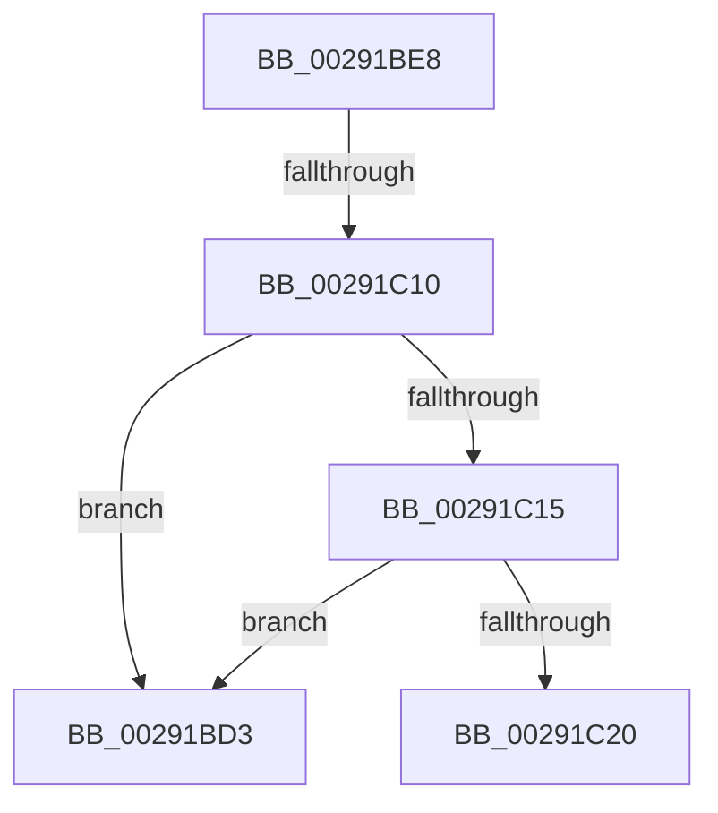

# sub_00291BD3

- RVA: `0x00291BD3`–`0x00291C32` (길이 `95` bytes)
- VA: `0x0000000140291BD3`
- 실행 섹션: `.text`
- PDB 이름 있음: `아니요`; PDB Function 태그: `아니요`
- unwind 정보 RVA: `0x00067490`
- 디코드: `25`개 명령, `95/95` bytes 표시
- 미해석 바이트: `0` (있으면 어셈블리에 `.byte`로 보존)

> 이 문서는 커널 이미지의 기계어와 PDB 기호를 분석해 생성했습니다. 4번과 5번은 함수 원형과 자료형을 바이너리 사용 방식에서 추정한 C 해석이며 원본 소스 복구 결과는 아닙니다.

## 1. Dependencies

- 직접 호출 지점: **0**; 고유 호출 대상: **0**
- 직접 호출자로 확인된 함수: **0**
- RIP 상대 이미지 참조: **1**

### Outgoing calls
- 직접 디코드된 call 명령이 없습니다.

### Direct callers
- 이 함수 시작 RVA로 연결되는 직접 call은 확인되지 않았습니다. 간접 호출은 완전히 역산할 수 없습니다.

### Static image references
- `0x00291BF4` → RVA `0x00E30088` (`.data`; read)

## 2. Other-region calls and transfers

- 다른 실행 섹션으로 향하는 call: **0**
- call이 아닌 외부 분기/꼬리 이동: **2**
  - `0x00291C0A` → [sub_00291C9C](Unknown_function_00291C9C.md) (`tail-transfer`)
  - `0x00291C2D` → [sub_00291C9C + 0x1F](Unknown_function_00291C9C.md) (`tail-transfer`)

## 3. Assembly (complete function range)

```asm
00291BD3  48 8B 5C 24 50                  mov rbx, qword ptr [rsp + 0x50]
00291BD8  41 8B C7                        mov eax, r15d
00291BDB  48 83 C4 20                     add rsp, 0x20
00291BDF  41 5F                           pop r15
00291BE1  41 5E                           pop r14
00291BE3  41 5D                           pop r13
00291BE5  5F                              pop rdi
00291BE6  5D                              pop rbp
00291BE7  C3                              ret
00291BE8  CC                              int3
00291BE9  48 8B 55 60                     mov rdx, qword ptr [rbp + 0x60]
00291BED  0F B7 8D AE 00 00 00            movzx ecx, word ptr [rbp + 0xae]
00291BF4  48 8B 05 8D E4 B9 00            mov rax, qword ptr [rip + 0xb9e48d]
00291BFB  48 8B 1C C8                     mov rbx, qword ptr [rax + rcx*8]
00291BFF  48 8B BB C0 44 00 00            mov rdi, qword ptr [rbx + 0x44c0]
00291C06  48 3B 57 38                     cmp rdx, qword ptr [rdi + 0x38]
00291C0A  0F 83 8C 00 00 00               jae 0x140291c9c
00291C10  4D 85 F6                        test r14, r14
00291C13  7F BE                           jg 0x140291bd3
00291C15  48 83 C5 18                     add rbp, 0x18
00291C19  48 83 7D 00 00                  cmp qword ptr [rbp], 0
00291C1E  74 B3                           je 0x140291bd3
00291C20  48 8B 83 D0 44 00 00            mov rax, qword ptr [rbx + 0x44d0]
00291C27  41 BD 02 00 00 00               mov r13d, 2
00291C2D  E9 89 00 00 00                  jmp 0x140291cbb
```

## 4. C-style interpretation (structured pseudocode)

```c
__int64 __fastcall sub_00291BD3(__int64 a1, __int64 a2, __int64 a3, __int64 a4, __int64 a5, __int64 a6, __int64 a7, __int64 a8, __int64 a9, __int64 a10)
{
    __int64 v_rsp;

    v_rsp = (v_rsp) + (32);
    return (unsigned int)((unsigned int)(v_r15));
}
```

## 5. (Beta) C Style

```c
int64_t sub_00291BD3(int64_t Arg1, int64_t Arg2, int64_t Arg3, int64_t Arg4, uint64_t Arg5, uint64_t Arg6, uint64_t Arg7, uint64_t Arg8, uint64_t Arg9, int64_t Arg10)
{
    int64_t local_rsp;

    local_rsp = (local_rsp) + (32);
    return (uint32_t)((uint32_t)(local_r15));
}
```

## 6. Execution-region graph

[열기: 2D/3D 그래프와 함수 탐색 컨트롤 패널](../../../control-panel.html?section=text&rva=0x00291BD3&view=graph)

- 2D 그래프는 위에서 아래로 흐르고, 3D 그래프는 빈 공간을 드래그해 회전합니다. Shift+드래그는 이동, 휠은 확대·축소, 함수 노드 선택은 대상 보고서 이동입니다.

### Static fallback


