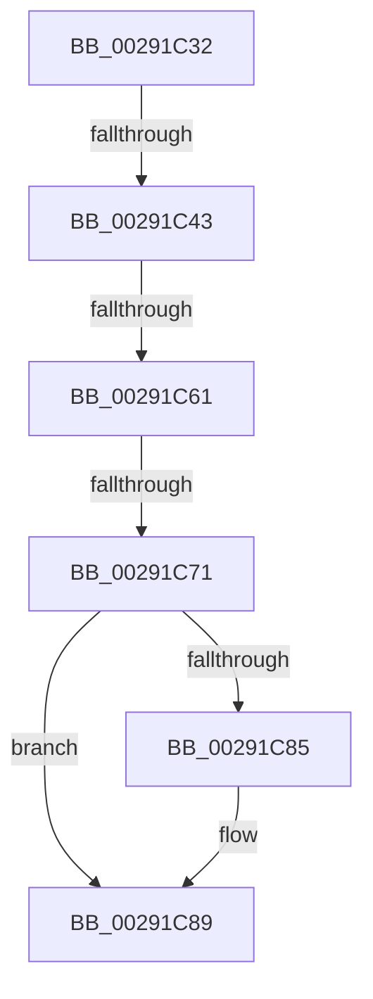

# sub_00291C32

- RVA: `0x00291C32`–`0x00291C9C` (길이 `106` bytes)
- VA: `0x0000000140291C32`
- 실행 섹션: `.text`
- PDB 이름 있음: `아니요`; PDB Function 태그: `아니요`
- unwind 정보 RVA: `0x000674A8`
- 디코드: `20`개 명령, `106/106` bytes 표시
- 미해석 바이트: `0` (있으면 어셈블리에 `.byte`로 보존)

> 이 문서는 커널 이미지의 기계어와 PDB 기호를 분석해 생성했습니다. 4번과 5번은 함수 원형과 자료형을 바이너리 사용 방식에서 추정한 C 해석이며 원본 소스 복구 결과는 아닙니다.

## 1. Dependencies

- 직접 호출 지점: **0**; 고유 호출 대상: **0**
- 직접 호출자로 확인된 함수: **0**
- RIP 상대 이미지 참조: **1**

### Outgoing calls
- 직접 디코드된 call 명령이 없습니다.

### Direct callers
- 이 함수 시작 RVA로 연결되는 직접 call은 확인되지 않았습니다. 간접 호출은 완전히 역산할 수 없습니다.

### Static image references
- `0x00291C32` → RVA `0x00FC6A88` (`ALMOSTRO`; read)

## 2. Other-region calls and transfers

- 다른 실행 섹션으로 향하는 call: **0**
- call이 아닌 외부 분기/꼬리 이동: **4**
  - `0x00291C3D` → [sub_00291A10 + 0x69](Unknown_function_00291A10.md) (`tail-transfer`)
  - `0x00291C5B` → [sub_00291A10 + 0x69](Unknown_function_00291A10.md) (`tail-transfer`)
  - `0x00291C6B` → [sub_00291A10 + 0x69](Unknown_function_00291A10.md) (`tail-transfer`)
  - `0x00291C97` → [sub_00291A10 + 0x69](Unknown_function_00291A10.md) (`tail-transfer`)

## 3. Assembly (complete function range)

```asm
00291C32  48 F7 05 4B 4E D3 00 00 00 60 00  test qword ptr [rip + 0xd34e4b], 0x600000
00291C3D  0F 84 36 FE FF FF               je 0x140291a79
00291C43  65 48 8B 14 25 88 01 00 00      mov rdx, qword ptr gs:[0x188]
00291C4C  4C 8B 82 B8 00 00 00            mov r8, qword ptr [rdx + 0xb8]
00291C53  41 80 B8 60 01 00 00 01         cmp byte ptr [r8 + 0x160], 1
00291C5B  0F 84 18 FE FF FF               je 0x140291a79
00291C61  49 8B 90 08 05 00 00            mov rdx, qword ptr [r8 + 0x508]
00291C68  48 85 D2                        test rdx, rdx
00291C6B  0F 84 08 FE FF FF               je 0x140291a79
00291C71  49 C1 EA 03                     shr r10, 3
00291C75  41 81 E2 FF 01 00 00            and r10d, 0x1ff
00291C7C  4A 8B 14 D2                     mov rdx, qword ptr [rdx + r10*8]
00291C80  F6 C2 20                        test dl, 0x20
00291C83  74 04                           je 0x140291c89
00291C85  48 83 C9 20                     or rcx, 0x20
00291C89  48 8B C1                        mov rax, rcx
00291C8C  48 83 C8 42                     or rax, 0x42
00291C90  F6 C2 42                        test dl, 0x42
00291C93  48 0F 44 C1                     cmove rax, rcx
00291C97  E9 DD FD FF FF                  jmp 0x140291a79
```

## 4. C-style interpretation (structured pseudocode)

```c
__int64 __fastcall sub_00291C32(__int64 a1)
{
    __int64 result;
    __int64 v_r10;

    v_r10 = (v_r10) >> (3);
    v_r10 = (unsigned int)((v_r10) & (511));
    if ((((unsigned __int8)(*(unsigned __int64 *)(*(unsigned __int64 *)(*(unsigned __int64 *)(*(unsigned __int64 *)(gs_base + (0 + 392)) + 184) + 1288) + v_r10 * 8))) & (32)) != 0) {
        a1 = (a1) | (32);
    }
    result = (a1) | (66);
    if ((((unsigned __int8)(*(unsigned __int64 *)(*(unsigned __int64 *)(*(unsigned __int64 *)(*(unsigned __int64 *)(gs_base + (0 + 392)) + 184) + 1288) + v_r10 * 8))) & (66)) == 0) { result = a1; }
}
```

## 5. (Beta) C Style

```c
int64_t sub_00291C32(int64_t Arg1)
{
    int64_t result;
    int64_t local_r10;

    local_r10 = (local_r10) >> (3);
    local_r10 = (uint32_t)((local_r10) & (511));
    if ((((uint8_t)(*(uint64_t *)(*(uint64_t *)(*(uint64_t *)(*(uint64_t *)(gs_base + (0 + 0x188)) + 0xB8) + 0x508) + local_r10 * 8))) & (32)) != 0) {
        Arg1 = (Arg1) | (32);
    }
    result = (Arg1) | (66);
    if ((((uint8_t)(*(uint64_t *)(*(uint64_t *)(*(uint64_t *)(*(uint64_t *)(gs_base + (0 + 0x188)) + 0xB8) + 0x508) + local_r10 * 8))) & (66)) == 0) { result = Arg1; }
}
```

## 6. Execution-region graph

[열기: 2D/3D 그래프와 함수 탐색 컨트롤 패널](../../../control-panel.html?section=text&rva=0x00291C32&view=graph)

- 2D 그래프는 위에서 아래로 흐르고, 3D 그래프는 빈 공간을 드래그해 회전합니다. Shift+드래그는 이동, 휠은 확대·축소, 함수 노드 선택은 대상 보고서 이동입니다.

### Static fallback


