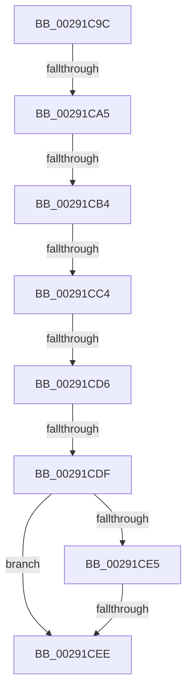

# sub_00291C9C

- RVA: `0x00291C9C`–`0x00291CF5` (길이 `89` bytes)
- VA: `0x0000000140291C9C`
- 실행 섹션: `.text`
- PDB 이름 있음: `아니요`; PDB Function 태그: `아니요`
- unwind 정보 RVA: `0x000674BC`
- 디코드: `22`개 명령, `89/89` bytes 표시
- 미해석 바이트: `0` (있으면 어셈블리에 `.byte`로 보존)

> 이 문서는 커널 이미지의 기계어와 PDB 기호를 분석해 생성했습니다. 4번과 5번은 함수 원형과 자료형을 바이너리 사용 방식에서 추정한 C 해석이며 원본 소스 복구 결과는 아닙니다.

## 1. Dependencies

- 직접 호출 지점: **1**; 고유 호출 대상: **1**
- 직접 호출자로 확인된 함수: **0**
- RIP 상대 이미지 참조: **1**

### Outgoing calls
- `0x00291CCB` → [ExAcquireSpinLockExclusiveAtDpcLevel](../24/ExAcquireSpinLockExclusiveAtDpcLevel_function_00248E80.md) (function, `0x00248E80`)

### Direct callers
- 이 함수 시작 RVA로 연결되는 직접 call은 확인되지 않았습니다. 간접 호출은 완전히 역산할 수 없습니다.

### Static image references
- `0x00291CC4` → RVA `0x00E374C0` (`.data`; read)

## 2. Other-region calls and transfers

- 다른 실행 섹션으로 향하는 call: **0**
- call이 아닌 외부 분기/꼬리 이동: **6**
  - `0x00291C9F` → [sub_00291BD3](Unknown_function_00291BD3.md) (`tail-transfer`)
  - `0x00291CAE` → [sub_00291BD3](Unknown_function_00291BD3.md) (`tail-transfer`)
  - `0x00291CBE` → [sub_00291BD3](Unknown_function_00291BD3.md) (`tail-transfer`)
  - `0x00291CD4` → [sub_00291D0B + 0x48](Unknown_function_00291D0B.md) (`tail-transfer`)
  - `0x00291CDD` → [sub_00291D0B + 0x48](Unknown_function_00291D0B.md) (`tail-transfer`)
  - `0x00291CEC` → [sub_00291D0B](Unknown_function_00291D0B.md) (`tail-transfer`)

## 3. Assembly (complete function range)

```asm
00291C9C  4D 85 F6                        test r14, r14
00291C9F  0F 88 2E FF FF FF               js 0x140291bd3
00291CA5  48 83 C5 18                     add rbp, 0x18
00291CA9  48 83 7D 00 00                  cmp qword ptr [rbp], 0
00291CAE  0F 84 1F FF FF FF               je 0x140291bd3
00291CB4  48 8B 83 C8 44 00 00            mov rax, qword ptr [rbx + 0x44c8]
00291CBB  48 3B C5                        cmp rax, rbp
00291CBE  0F 84 0F FF FF FF               je 0x140291bd3
00291CC4  48 8D 0D F5 57 BA 00            lea rcx, [rip + 0xba57f5]
00291CCB  E8 B0 71 FB FF                  call 0x140248e80
00291CD0  80 7F 35 00                     cmp byte ptr [rdi + 0x35], 0
00291CD4  75 7D                           jne 0x140291d53
00291CD6  48 8B 45 00                     mov rax, qword ptr [rbp]
00291CDA  48 85 C0                        test rax, rax
00291CDD  74 74                           je 0x140291d53
00291CDF  48 39 68 08                     cmp qword ptr [rax + 8], rbp
00291CE3  75 09                           jne 0x140291cee
00291CE5  48 8B 4D 08                     mov rcx, qword ptr [rbp + 8]
00291CE9  48 39 29                        cmp qword ptr [rcx], rbp
00291CEC  74 1D                           je 0x140291d0b
00291CEE  B9 03 00 00 00                  mov ecx, 3
00291CF3  CD 29                           int 0x29
```

## 4. C-style interpretation (structured pseudocode)

```c
__int64 __fastcall sub_00291C9C(void)
{
    __int64 result;
    __int64 v_rbp;

    v_rbp = (v_rbp) + (24);
    result = ExAcquireSpinLockExclusiveAtDpcLevel(v_rip + 12212213, a2, a3, a4);
    if ((*(unsigned __int64 *)(*(unsigned __int64 *)(v_rbp) + 8)) != v_rbp) goto loc_00291CEE;
loc_00291CEE:
    return *(unsigned __int64 *)(v_rbp);
}
```

## 5. (Beta) C Style

```c
void sub_00291C9C(void)
{
    int64_t result;
    int64_t local_rbp;

    local_rbp = (local_rbp) + (24);
    result = ExAcquireSpinLockExclusiveAtDpcLevel(v_rip + 12212213, a2, a3, a4);
    if ((*(uint64_t *)(*(uint64_t *)(local_rbp) + 0x8)) != local_rbp) goto loc_00291CEE;
loc_00291CEE:
    return *(uint64_t *)(local_rbp);
}
```

## 6. Execution-region graph

[열기: 2D/3D 그래프와 함수 탐색 컨트롤 패널](../../../control-panel.html?section=text&rva=0x00291C9C&view=graph)

- 2D 그래프는 위에서 아래로 흐르고, 3D 그래프는 빈 공간을 드래그해 회전합니다. Shift+드래그는 이동, 휠은 확대·축소, 함수 노드 선택은 대상 보고서 이동입니다.

### Static fallback


