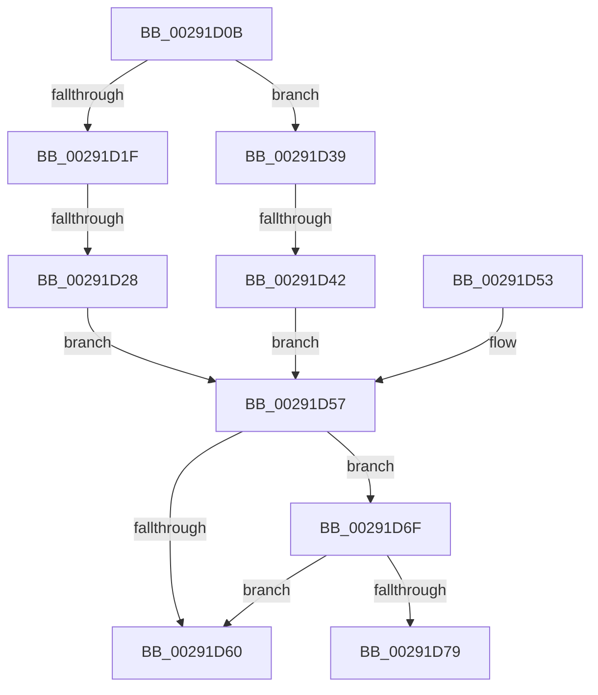

# sub_00291D0B

- RVA: `0x00291D0B`–`0x00291D8F` (길이 `132` bytes)
- VA: `0x0000000140291D0B`
- 실행 섹션: `.text`
- PDB 이름 있음: `아니요`; PDB Function 태그: `아니요`
- unwind 정보 RVA: `0x000674EC`
- 디코드: `33`개 명령, `132/132` bytes 표시
- 미해석 바이트: `0` (있으면 어셈블리에 `.byte`로 보존)

> 이 문서는 커널 이미지의 기계어와 PDB 기호를 분석해 생성했습니다. 4번과 5번은 함수 원형과 자료형을 바이너리 사용 방식에서 추정한 C 해석이며 원본 소스 복구 결과는 아닙니다.

## 1. Dependencies

- 직접 호출 지점: **1**; 고유 호출 대상: **1**
- 직접 호출자로 확인된 함수: **0**
- RIP 상대 이미지 참조: **4**

### Outgoing calls
- `0x00291D85` → [ExpReleaseSpinLockExclusiveFromDpcLevelInstrumented](../2C/ExpReleaseSpinLockExclusiveFromDpcLevelInstrumented_function_002C0F44.md) (function, `0x002C0F44`)

### Direct callers
- 이 함수 시작 RVA로 연결되는 직접 call은 확인되지 않았습니다. 간접 호출은 완전히 역산할 수 없습니다.

### Static image references
- `0x00291D57` → RVA `0x00FC6B06` (`ALMOSTRO`; read)
- `0x00291D60` → RVA `0x00E374C0` (`.data`; write)
- `0x00291D6F` → RVA `0x00F0DE58` (`.data`; read)
- `0x00291D7E` → RVA `0x00E374C0` (`.data`; read)

## 2. Other-region calls and transfers

- 다른 실행 섹션으로 향하는 call: **0**
- call이 아닌 외부 분기/꼬리 이동: **4**
  - `0x00291D26` → [sub_00291C9C + 0x52](Unknown_function_00291C9C.md) (`tail-transfer`)
  - `0x00291D40` → [sub_00291C9C + 0x52](Unknown_function_00291C9C.md) (`tail-transfer`)
  - `0x00291D6A` → [sub_00291BD3](Unknown_function_00291BD3.md) (`tail-transfer`)
  - `0x00291D8A` → [sub_00291BD3](Unknown_function_00291BD3.md) (`tail-transfer`)

## 3. Assembly (complete function range)

```asm
00291D0B  48 81 C3 C8 44 00 00            add rbx, 0x44c8
00291D12  48 89 01                        mov qword ptr [rcx], rax
00291D15  48 89 48 08                     mov qword ptr [rax + 8], rcx
00291D19  41 83 FD 01                     cmp r13d, 1
00291D1D  75 1A                           jne 0x140291d39
00291D1F  48 8B 03                        mov rax, qword ptr [rbx]
00291D22  48 39 58 08                     cmp qword ptr [rax + 8], rbx
00291D26  75 C6                           jne 0x140291cee
00291D28  48 89 45 00                     mov qword ptr [rbp], rax
00291D2C  48 89 5D 08                     mov qword ptr [rbp + 8], rbx
00291D30  48 89 68 08                     mov qword ptr [rax + 8], rbp
00291D34  48 89 2B                        mov qword ptr [rbx], rbp
00291D37  EB 1E                           jmp 0x140291d57
00291D39  48 8B 43 08                     mov rax, qword ptr [rbx + 8]
00291D3D  48 39 18                        cmp qword ptr [rax], rbx
00291D40  75 AC                           jne 0x140291cee
00291D42  48 89 5D 00                     mov qword ptr [rbp], rbx
00291D46  48 89 45 08                     mov qword ptr [rbp + 8], rax
00291D4A  48 89 28                        mov qword ptr [rax], rbp
00291D4D  48 89 6B 08                     mov qword ptr [rbx + 8], rbp
00291D51  EB 04                           jmp 0x140291d57
00291D53  C6 47 36 01                     mov byte ptr [rdi + 0x36], 1
00291D57  F6 05 A8 4D D3 00 01            test byte ptr [rip + 0xd34da8], 1
00291D5E  75 0F                           jne 0x140291d6f
00291D60  C7 05 56 57 BA 00 00 00 00 00   mov dword ptr [rip + 0xba5756], 0
00291D6A  E9 64 FE FF FF                  jmp 0x140291bd3
00291D6F  8B 05 E3 C0 C7 00               mov eax, dword ptr [rip + 0xc7c0e3]
00291D75  85 C0                           test eax, eax
00291D77  75 E7                           jne 0x140291d60
00291D79  48 8B 54 24 48                  mov rdx, qword ptr [rsp + 0x48]
00291D7E  48 8D 0D 3B 57 BA 00            lea rcx, [rip + 0xba573b]
00291D85  E8 BA F1 02 00                  call 0x1402c0f44
00291D8A  E9 44 FE FF FF                  jmp 0x140291bd3
```

## 4. C-style interpretation (structured pseudocode)

```c
__int64 __fastcall sub_00291D0B(__int64 a1, __int64 a2, __int64 a3, __int64 a4, __int64 a5, __int64 a6, __int64 a7, __int64 a8, __int64 a9)
{
    __int64 result;
    __int64 v_rbx;

    v_rbx = (v_rbx) + (0x44C8ULL);
    *(unsigned __int64 *)(a1) = result;
    *(unsigned __int64 *)(result + 8) = a1;
    if (((unsigned int)(v_r13)) != 1) goto loc_00291D39;
    *(unsigned __int64 *)(v_rbp) = *(unsigned __int64 *)(v_rbx);
    *(unsigned __int64 *)(v_rbp + 8) = v_rbx;
    *(unsigned __int64 *)(*(unsigned __int64 *)(v_rbx) + 8) = v_rbp;
    *(unsigned __int64 *)(v_rbx) = v_rbp;
    goto loc_00291D57;
loc_00291D39:
    *(unsigned __int64 *)(v_rbp) = v_rbx;
    *(unsigned __int64 *)(v_rbp + 8) = *(unsigned __int64 *)(v_rbx + 8);
    *(unsigned __int64 *)(*(unsigned __int64 *)(v_rbx + 8)) = v_rbp;
    *(unsigned __int64 *)(v_rbx + 8) = v_rbp;
    goto loc_00291D57;
loc_00291D57:
    if (((*(unsigned __int8 *)(v_rip + 13847976)) & (1)) != 0) goto loc_00291D6F;
loc_00291D60:
    *(unsigned int *)(v_rip + 12212054) = 0;
loc_00291D6F:
    if ((unsigned int)((unsigned int)(*(unsigned int *)(v_rip + 13091043))) != 0) goto loc_00291D60;
    result = ExpReleaseSpinLockExclusiveFromDpcLevelInstrumented(v_rip + 12212027, a9, a3, a4);
}
```

## 5. (Beta) C Style

```c
int64_t sub_00291D0B(void *Arg1, int64_t Arg2, int64_t Arg3, int64_t Arg4, uint64_t Arg5, uint64_t Arg6, uint64_t Arg7, uint64_t Arg8, int64_t Arg9)
{
    uint8_t *arg1 = (uint8_t *)Arg1;

    int64_t result;
    int64_t local_rbx;

    local_rbx = (local_rbx) + (0x44C8ULL);
    *(uint64_t *)(arg1) = result;
    *(void **)(result + 0x8) = Arg1;
    if (((uint32_t)(local_r13)) != 1) goto loc_00291D39;
    *(uint64_t *)(local_rbp) = *(uint64_t *)(local_rbx);
    *(uint64_t *)(local_rbp + 0x8) = local_rbx;
    *(uint64_t *)(*(uint64_t *)(local_rbx) + 0x8) = local_rbp;
    *(uint64_t *)(local_rbx) = local_rbp;
    goto loc_00291D57;
loc_00291D39:
    *(uint64_t *)(local_rbp) = local_rbx;
    *(uint64_t *)(local_rbp + 0x8) = *(uint64_t *)(local_rbx + 0x8);
    *(uint64_t *)(*(uint64_t *)(local_rbx + 0x8)) = local_rbp;
    *(uint64_t *)(local_rbx + 0x8) = local_rbp;
    goto loc_00291D57;
loc_00291D57:
    if (((*(uint8_t *)(v_rip + 0xD34DA8)) & (1)) != 0) goto loc_00291D6F;
loc_00291D60:
    *(uint32_t *)(v_rip + 0xBA5756) = 0;
loc_00291D6F:
    if ((uint32_t)((uint32_t)(*(uint32_t *)(v_rip + 0xC7C0E3))) != 0) goto loc_00291D60;
    result = ExpReleaseSpinLockExclusiveFromDpcLevelInstrumented(v_rip + 12212027, Arg9, Arg3, Arg4);
}
```

### 관측된 메모리 오프셋

구조체 형식이 확인되지 않은 접근은 인자 기준의 오프셋으로만 기록했습니다.

| 기준 인자 | 오프셋 표현 | 폭 (bit) | 접근 |
|---|---:|---:|---|
| `Arg1` | `+ 0x0` | `64` | `W` |

## 6. Execution-region graph

[열기: 2D/3D 그래프와 함수 탐색 컨트롤 패널](../../../control-panel.html?section=text&rva=0x00291D0B&view=graph)

- 2D 그래프는 위에서 아래로 흐르고, 3D 그래프는 빈 공간을 드래그해 회전합니다. Shift+드래그는 이동, 휠은 확대·축소, 함수 노드 선택은 대상 보고서 이동입니다.

### Static fallback


