# sub_00292218

- RVA: `0x00292218`–`0x0029271B` (길이 `1,283` bytes)
- VA: `0x0000000140292218`
- 실행 섹션: `.text`
- PDB 이름 있음: `아니요`; PDB Function 태그: `아니요`
- unwind 정보 RVA: `0x00067558`
- 디코드: `289`개 명령, `1,283/1,283` bytes 표시
- 미해석 바이트: `0` (있으면 어셈블리에 `.byte`로 보존)

> 이 문서는 커널 이미지의 기계어와 PDB 기호를 분석해 생성했습니다. 4번과 5번은 함수 원형과 자료형을 바이너리 사용 방식에서 추정한 C 해석이며 원본 소스 복구 결과는 아닙니다.

## 1. Dependencies

- 직접 호출 지점: **5**; 고유 호출 대상: **4**
- 직접 호출자로 확인된 함수: **0**
- RIP 상대 이미지 참조: **2**

### Outgoing calls
- `0x002922C5` → [MiLockWorkingSetCoreShared](../27/MiLockWorkingSetCoreShared_function_0027C3E0.md) (function, `0x0027C3E0`)
- `0x00292478` → [MiRemoveActivePageTableLinks](MiRemoveActivePageTableLinks_function_00291FA8.md) (function, `0x00291FA8`)
- `0x0029250C` → [MiRemoveActivePageTableLinks](MiRemoveActivePageTableLinks_function_00291FA8.md) (function, `0x00291FA8`)
- `0x00292548` → [MiInsertActivePageTableLinksTail](MiInsertActivePageTableLinksTail_function_00291D98.md) (function, `0x00291D98`)
- `0x002925A2` → [MiUnlockWorkingSetCoreShared](MiUnlockWorkingSetCoreShared_function_00292B00.md) (function, `0x00292B00`)

### Direct callers
- 이 함수 시작 RVA로 연결되는 직접 call은 확인되지 않았습니다. 간접 호출은 완전히 역산할 수 없습니다.

### Static image references
- `0x002926C0` → RVA `0x00FC6A88` (`ALMOSTRO`; read)
- `0x002926F3` → RVA `0x00FC6B04` (`ALMOSTRO`; read)

## 2. Other-region calls and transfers

- 다른 실행 섹션으로 향하는 call: **0**
- call이 아닌 외부 분기/꼬리 이동: **13**
  - `0x00292269` → [sub_0029273F + 0x1B3](Unknown_function_0029273F.md) (`tail-transfer`)
  - `0x00292293` → [sub_0029273F + 0x2AD](Unknown_function_0029273F.md) (`tail-transfer`)
  - `0x002922F1` → [sub_0029273F + 0x37A](Unknown_function_0029273F.md) (`tail-transfer`)
  - `0x002922FD` → [sub_0029273F + 0x27B](Unknown_function_0029273F.md) (`tail-transfer`)
  - `0x0029234F` → [sub_0029273F + 0x1EA](Unknown_function_0029273F.md) (`tail-transfer`)
  - `0x00292378` → [sub_0029273F + 0x29F](Unknown_function_0029273F.md) (`tail-transfer`)
  - `0x00292425` → [sub_0029273F + 0x44](Unknown_function_0029273F.md) (`tail-transfer`)
  - `0x002924E6` → [sub_0029273F + 0x1F9](Unknown_function_0029273F.md) (`tail-transfer`)
  - `0x00292565` → [sub_0029273F](Unknown_function_0029273F.md) (`tail-transfer`)
  - `0x00292599` → [sub_0029273F + 0x1CA](Unknown_function_0029273F.md) (`tail-transfer`)
  - `0x0029267A` → [sub_0029273F + 0xF9](Unknown_function_0029273F.md) (`tail-transfer`)
  - `0x002926D7` → [sub_0029273F + 0x163](Unknown_function_0029273F.md) (`tail-transfer`)
  - `0x002926FD` → [sub_0029273F + 0x388](Unknown_function_0029273F.md) (`tail-transfer`)

## 3. Assembly (complete function range)

```asm
00292218  48 89 AC 24 E0 00 00 00         mov qword ptr [rsp + 0xe0], rbp
00292220  44 8B F2                        mov r14d, edx
00292223  49 8D AF 72 40 00 00            lea rbp, [r15 + 0x4072]
0029222A  45 8B F8                        mov r15d, r8d
0029222D  49 B8 FF FF FF FF FF F6 FF FF   movabs r8, 0xfffff6ffffffffff
00292237  0F B6 4D FF                     movzx ecx, byte ptr [rbp - 1]
0029223B  F6 C1 01                        test cl, 1
0029223E  74 5D                           je 0x14029229d
00292240  0F B7 5D 00                     movzx ebx, word ptr [rbp]
00292244  48 FF C7                        inc rdi
00292247  48 C1 E3 1C                     shl rbx, 0x1c
0029224B  49 8B C2                        mov rax, r10
0029224E  48 C1 E0 19                     shl rax, 0x19
00292252  48 2B D8                        sub rbx, rax
00292255  49 8B C1                        mov rax, r9
00292258  48 C1 E0 19                     shl rax, 0x19
0029225C  48 03 D8                        add rbx, rax
0029225F  48 C1 FB 10                     sar rbx, 0x10
00292263  49 8B C2                        mov rax, r10
00292266  48 3B D8                        cmp rbx, rax
00292269  0F 83 83 06 00 00               jae 0x1402928f2
0029226F  41 BC 02 00 00 00               mov r12d, 2
00292275  F6 C1 02                        test cl, 2
00292278  74 11                           je 0x14029228b
0029227A  49 FF C5                        inc r13
0029227D  41 83 FC 02                     cmp r12d, 2
00292281  75 08                           jne 0x14029228b
00292283  48 FF C2                        inc rdx
00292286  48 89 54 24 30                  mov qword ptr [rsp + 0x30], rdx
0029228B  40 0F B6 C6                     movzx eax, sil
0029228F  24 0F                           and al, 0xf
00292291  3C 03                           cmp al, 3
00292293  0F 84 53 07 00 00               je 0x1402929ec
00292299  8B 5C 24 20                     mov ebx, dword ptr [rsp + 0x20]
0029229D  48 83 C5 08                     add rbp, 8
002922A1  49 83 EF 01                     sub r15, 1
002922A5  75 90                           jne 0x140292237
002922A7  44 89 74 24 24                  mov dword ptr [rsp + 0x24], r14d
002922AC  4C 8B 74 24 58                  mov r14, qword ptr [rsp + 0x58]
002922B1  48 89 7C 24 38                  mov qword ptr [rsp + 0x38], rdi
002922B6  49 8B FF                        mov rdi, r15
002922B9  45 85 E4                        test r12d, r12d
002922BC  0F 84 51 04 00 00               je 0x140292713
002922C2  49 8B CE                        mov rcx, r14
002922C5  E8 16 A1 FE FF                  call 0x14027c3e0
002922CA  4D 85 ED                        test r13, r13
002922CD  74 20                           je 0x1402922ef
002922CF  49 F7 DD                        neg r13
002922D2  F0 4D 01 AE 98 00 00 00         lock add qword ptr [r14 + 0x98], r13
002922DA  48 8B 44 24 30                  mov rax, qword ptr [rsp + 0x30]
002922DF  48 85 C0                        test rax, rax
002922E2  74 0B                           je 0x1402922ef
002922E4  48 F7 D8                        neg rax
002922E7  F0 49 01 86 88 00 00 00         lock add qword ptr [r14 + 0x88], rax
002922EF  85 DB                           test ebx, ebx
002922F1  0F 85 C2 07 00 00               jne 0x140292ab9
002922F7  8B 44 24 24                     mov eax, dword ptr [rsp + 0x24]
002922FB  85 C0                           test eax, eax
002922FD  0F 85 B7 06 00 00               jne 0x1402929ba
00292303  48 8B 44 24 38                  mov rax, qword ptr [rsp + 0x38]
00292308  48 F7 D8                        neg rax
0029230B  48 89 44 24 38                  mov qword ptr [rsp + 0x38], rax
00292310  F0 49 01 86 90 00 00 00         lock add qword ptr [r14 + 0x90], rax
00292318  48 8B 5C 24 60                  mov rbx, qword ptr [rsp + 0x60]
0029231D  0F 57 C0                        xorps xmm0, xmm0
00292320  48 8B 54 24 50                  mov rdx, qword ptr [rsp + 0x50]
00292325  48 8B CF                        mov rcx, rdi
00292328  4C 8B 44 24 28                  mov r8, qword ptr [rsp + 0x28]
0029232D  0F 11 44 24 68                  movups xmmword ptr [rsp + 0x68], xmm0
00292332  0F 11 44 24 78                  movups xmmword ptr [rsp + 0x78], xmm0
00292337  66 0F 1F 84 00 00 00 00 00      nop word ptr [rax + rax]
00292340  41 F6 84 C8 71 40 00 00 01      test byte ptr [r8 + rcx*8 + 0x4071], 1
00292349  74 43                           je 0x14029238e
0029234B  41 83 FC 01                     cmp r12d, 1
0029234F  0F 84 D4 05 00 00               je 0x140292929
00292355  F0 49 FF 8E 80 00 00 00         lock dec qword ptr [r14 + 0x80]
0029235D  48 8D 47 01                     lea rax, [rdi + 1]
00292361  48 85 DB                        test rbx, rbx
00292364  48 0F 44 C7                     cmove rax, rdi
00292368  48 8B F8                        mov rdi, rax
0029236B  41 0F B6 84 C8 70 40 00 00      movzx eax, byte ptr [r8 + rcx*8 + 0x4070]
00292374  24 0F                           and al, 0xf
00292376  3C 08                           cmp al, 8
00292378  0F 84 60 06 00 00               je 0x1402929de
0029237E  41 0F B6 84 C8 70 40 00 00      movzx eax, byte ptr [r8 + rcx*8 + 0x4070]
00292387  83 E0 0F                        and eax, 0xf
0029238A  FF 44 84 68                     inc dword ptr [rsp + rax*4 + 0x68]
0029238E  48 FF C1                        inc rcx
00292391  48 3B CA                        cmp rcx, rdx
00292394  72 AA                           jb 0x140292340
00292396  40 32 ED                        xor bpl, bpl
00292399  48 BA 00 00 00 40 FB F6 FF FF   movabs rdx, 0xfffff6fb40000000
002923A3  49 BF F8 D7 BE 7D FB F6 FF FF   movabs r15, 0xfffff6fb7dbed7f8
002923AD  49 BB 00 00 00 00 00 DE FF FF   movabs r11, 0xffffde0000000000
002923B7  40 0F B6 C5                     movzx eax, bpl
002923BB  48 BB FF FF FF FF FF 00 00 00   movabs rbx, 0xffffffffff
002923C5  8B 44 84 68                     mov eax, dword ptr [rsp + rax*4 + 0x68]
002923C9  85 C0                           test eax, eax
002923CB  0F 84 B3 01 00 00               je 0x140292584
002923D1  4D 8B 90 60 40 00 00            mov r10, qword ptr [r8 + 0x4060]
002923D8  44 8B E8                        mov r13d, eax
002923DB  4D 8B CA                        mov r9, r10
002923DE  49 F7 DD                        neg r13
002923E1  49 C1 E9 12                     shr r9, 0x12
002923E5  41 81 E1 F8 FF FF 3F            and r9d, 0x3ffffff8
002923EC  48 8B C2                        mov rax, rdx
002923EF  4C 03 C8                        add r9, rax
002923F2  48 B8 00 D0 BE 7D FB F6 FF FF   movabs rax, 0xfffff6fb7dbed000
002923FC  49 8B 11                        mov rdx, qword ptr [r9]
002923FF  48 8B C0                        mov rax, rax
00292402  4C 3B C8                        cmp r9, rax
00292405  72 24                           jb 0x14029242b
00292407  49 8B C7                        mov rax, r15
0029240A  4C 3B C8                        cmp r9, rax
0029240D  77 1C                           ja 0x14029242b
0029240F  4C 8B C2                        mov r8, rdx
00292412  F6 C2 01                        test dl, 1
00292415  74 14                           je 0x14029242b
00292417  F6 C2 42                        test dl, 0x42
0029241A  0F 95 C1                        setne cl
0029241D  F6 C2 20                        test dl, 0x20
00292420  0F 95 C0                        setne al
00292423  84 C8                           test al, cl
00292425  0F 84 58 03 00 00               je 0x140292783
0029242B  48 C1 EA 0C                     shr rdx, 0xc
0029242F  48 23 D3                        and rdx, rbx
00292432  4C 8D 3C 52                     lea r15, [rdx + rdx*2]
00292436  49 C1 E7 04                     shl r15, 4
0029243A  49 8B C3                        mov rax, r11
0029243D  4C 03 F8                        add r15, rax
00292440  49 8B 07                        mov rax, qword ptr [r15]
00292443  4D 8B 07                        mov r8, qword ptr [r15]
00292446  49 C1 E8 2D                     shr r8, 0x2d
0029244A  48 C1 E8 37                     shr rax, 0x37
0029244E  41 81 E0 FF 03 00 00            and r8d, 0x3ff
00292455  24 07                           and al, 7
00292457  40 3A E8                        cmp bpl, al
0029245A  74 54                           je 0x1402924b0
0029245C  0F 86 F5 00 00 00               jbe 0x140292557
00292462  49 8B 1F                        mov rbx, qword ptr [r15]
00292465  41 8B 47 24                     mov eax, dword ptr [r15 + 0x24]
00292469  0F BA E0 1A                     bt eax, 0x1a
0029246D  73 0E                           jae 0x14029247d
0029246F  45 33 C0                        xor r8d, r8d
00292472  49 8B D7                        mov rdx, r15
00292475  49 8B CE                        mov rcx, r14
00292478  E8 2B FB FF FF                  call 0x140291fa8
0029247D  40 0F B6 C5                     movzx eax, bpl
00292481  49 8B CD                        mov rcx, r13
00292484  83 E0 07                        and eax, 7
00292487  81 E1 FF 03 00 00               and ecx, 0x3ff
0029248D  48 C1 E0 0A                     shl rax, 0xa
00292491  48 0B C8                        or rcx, rax
00292494  48 B8 FF FF FF FF FF 1F 00 FC   movabs rax, 0xfc001fffffffffff
0029249E  48 23 D8                        and rbx, rax
002924A1  48 C1 E1 2D                     shl rcx, 0x2d
002924A5  48 0B CB                        or rcx, rbx
002924A8  49 89 0F                        mov qword ptr [r15], rcx
002924AB  E9 8B 00 00 00                  jmp 0x14029253b
002924B0  49 8B 07                        mov rax, qword ptr [r15]
002924B3  4B 8D 0C 28                     lea rcx, [r8 + r13]
002924B7  48 8B D1                        mov rdx, rcx
002924BA  49 B9 FF FF FF FF FF 1F 80 FF   movabs r9, 0xff801fffffffffff
002924C4  48 C1 E1 2D                     shl rcx, 0x2d
002924C8  81 E2 FF 03 00 00               and edx, 0x3ff
002924CE  48 33 C1                        xor rax, rcx
002924D1  48 89 54 24 58                  mov qword ptr [rsp + 0x58], rdx
002924D6  49 23 C1                        and rax, r9
002924D9  48 33 C1                        xor rax, rcx
002924DC  49 89 07                        mov qword ptr [r15], rax
002924DF  4B 8D 04 28                     lea rax, [r8 + r13]
002924E3  48 85 C0                        test rax, rax
002924E6  0F 84 4C 04 00 00               je 0x140292938
002924EC  41 8B 47 24                     mov eax, dword ptr [r15 + 0x24]
002924F0  0F BA E0 1A                     bt eax, 0x1a
002924F4  72 61                           jb 0x140292557
002924F6  49 8B 1F                        mov rbx, qword ptr [r15]
002924F9  41 8B 47 24                     mov eax, dword ptr [r15 + 0x24]
002924FD  0F BA E0 1A                     bt eax, 0x1a
00292501  73 13                           jae 0x140292516
00292503  45 33 C0                        xor r8d, r8d
00292506  49 8B D7                        mov rdx, r15
00292509  49 8B CE                        mov rcx, r14
0029250C  E8 97 FA FF FF                  call 0x140291fa8
00292511  48 8B 54 24 58                  mov rdx, qword ptr [rsp + 0x58]
00292516  40 0F B6 C5                     movzx eax, bpl
0029251A  48 B9 FF FF FF FF FF 1F 00 FC   movabs rcx, 0xfc001fffffffffff
00292524  83 E0 07                        and eax, 7
00292527  48 23 D9                        and rbx, rcx
0029252A  48 C1 E0 0A                     shl rax, 0xa
0029252E  48 0B C2                        or rax, rdx
00292531  48 C1 E0 2D                     shl rax, 0x2d
00292535  48 0B C3                        or rax, rbx
00292538  49 89 07                        mov qword ptr [r15], rax
0029253B  45 33 C9                        xor r9d, r9d
0029253E  44 0F B6 C5                     movzx r8d, bpl
00292542  49 8B D7                        mov rdx, r15
00292545  49 8B CE                        mov rcx, r14
00292548  E8 4B F8 FF FF                  call 0x140291d98
0029254D  49 BB 00 00 00 00 00 DE FF FF   movabs r11, 0xffffde0000000000
00292557  40 0F B6 C5                     movzx eax, bpl
0029255B  F0 4D 01 6C C6 28               lock add qword ptr [r14 + rax*8 + 0x28], r13
00292561  40 80 FD 07                     cmp bpl, 7
00292565  0F 84 D4 01 00 00               je 0x14029273f
0029256B  4C 8B 44 24 28                  mov r8, qword ptr [rsp + 0x28]
00292570  48 BA 00 00 00 40 FB F6 FF FF   movabs rdx, 0xfffff6fb40000000
0029257A  49 BF F8 D7 BE 7D FB F6 FF FF   movabs r15, 0xfffff6fb7dbed7f8
00292584  40 FE C5                        inc bpl
00292587  40 80 FD 08                     cmp bpl, 8
0029258B  0F 82 26 FE FF FF               jb 0x1402923b7
00292591  48 8B 4C 24 60                  mov rcx, qword ptr [rsp + 0x60]
00292596  48 85 C9                        test rcx, rcx
00292599  0F 85 6A 03 00 00               jne 0x140292909
0029259F  49 8B CE                        mov rcx, r14
002925A2  E8 59 05 00 00                  call 0x140292b00
002925A7  4C 8B 7C 24 28                  mov r15, qword ptr [rsp + 0x28]
002925AC  48 BA 00 00 00 00 10 00 00 00   movabs rdx, 0x1000000000
002925B6  4C 8B 6C 24 40                  mov r13, qword ptr [rsp + 0x40]
002925BB  49 81 C7 72 40 00 00            add r15, 0x4072
002925C2  49 B8 FF FF FF FF FF FF FF 8A   movabs r8, 0x8affffffffffffff
002925CC  49 BB 00 00 00 00 00 00 00 0A   movabs r11, 0xa00000000000000
002925D6  66 66 0F 1F 84 00 00 00 00 00   nop word ptr [rax + rax]
002925E0  41 F6 47 FF 01                  test byte ptr [r15 - 1], 1
002925E5  0F 84 18 01 00 00               je 0x140292703
002925EB  41 0F B7 2F                     movzx ebp, word ptr [r15]
002925EF  48 C1 E5 1C                     shl rbp, 0x1c
002925F3  48 BB 00 00 00 00 80 F6 FF FF   movabs rbx, 0xfffff68000000000
002925FD  48 8B C3                        mov rax, rbx
00292600  48 C1 E0 19                     shl rax, 0x19
00292604  48 2B E8                        sub rbp, rax
00292607  49 8B C5                        mov rax, r13
0029260A  48 C1 E0 19                     shl rax, 0x19
0029260E  48 03 E8                        add rbp, rax
00292611  48 C1 FD 10                     sar rbp, 0x10
00292615  41 83 FC 02                     cmp r12d, 2
00292619  0F 85 D4 00 00 00               jne 0x1402926f3
0029261F  4C 8B CD                        mov r9, rbp
00292622  48 B8 F8 FF FF FF 7F 00 00 00   movabs rax, 0x7ffffffff8
0029262C  49 C1 E9 09                     shr r9, 9
00292630  4C 23 C8                        and r9, rax
00292633  48 8B C3                        mov rax, rbx
00292636  4D 8D 14 01                     lea r10, [r9 + rax]
0029263A  48 B9 00 D0 BE 7D FB F6 FF FF   movabs rcx, 0xfffff6fb7dbed000
00292644  49 8B 02                        mov rax, qword ptr [r10]
00292647  48 8B C9                        mov rcx, rcx
0029264A  4C 3B D1                        cmp r10, rcx
0029264D  72 45                           jb 0x140292694
0029264F  48 B9 F8 D7 BE 7D FB F6 FF FF   movabs rcx, 0xfffff6fb7dbed7f8
00292659  48 8B C9                        mov rcx, rcx
0029265C  4C 3B D1                        cmp r10, rcx
0029265F  77 33                           ja 0x140292694
00292661  48 8B C8                        mov rcx, rax
00292664  A8 01                           test al, 1
00292666  0F 84 87 00 00 00               je 0x1402926f3
0029266C  A8 42                           test al, 0x42
0029266E  41 0F 95 C0                     setne r8b
00292672  A8 20                           test al, 0x20
00292674  0F 95 C2                        setne dl
00292677  44 84 C2                        test dl, r8b
0029267A  0F 84 B8 01 00 00               je 0x140292838
00292680  49 B8 FF FF FF FF FF FF FF 8A   movabs r8, 0x8affffffffffffff
0029268A  48 BA 00 00 00 00 10 00 00 00   movabs rdx, 0x1000000000
00292694  A8 01                           test al, 1
00292696  74 5B                           je 0x1402926f3
00292698  48 8B C3                        mov rax, rbx
0029269B  49 8B 3C 01                     mov rdi, qword ptr [r9 + rax]
0029269F  4D 8D 34 01                     lea r14, [r9 + rax]
002926A3  49 BD 00 00 00 00 80 F6 FF FF   movabs r13, 0xfffff68000000000
002926AD  48 BE 00 00 00 00 40 00 00 00   movabs rsi, 0x4000000000
002926B7  48 8B DF                        mov rbx, rdi
002926BA  49 23 D8                        and rbx, r8
002926BD  49 0B DB                        or rbx, r11
002926C0  48 F7 05 BD 43 D3 00 00 00 00 02  test qword ptr [rip + 0xd343bd], 0x2000000
002926CB  74 03                           je 0x1402926d0
002926CD  0F AE E8                        lfence
002926D0  48 85 15 B1 43 D3 00            test qword ptr [rip + 0xd343b1], rdx
002926D7  0F 85 C5 01 00 00               jne 0x1402928a2
002926DD  48 8B C7                        mov rax, rdi
002926E0  F0 49 0F B1 1E                  lock cmpxchg qword ptr [r14], rbx
002926E5  48 8B F8                        mov rdi, rax
002926E8  75 CD                           jne 0x1402926b7
002926EA  8B 74 24 48                     mov esi, dword ptr [rsp + 0x48]
002926EE  4C 8B 6C 24 40                  mov r13, qword ptr [rsp + 0x40]
002926F3  F7 05 07 44 D3 00 00 00 00 08   test dword ptr [rip + 0xd34407], 0x8000000
002926FD  0F 85 C4 03 00 00               jne 0x140292ac7
00292703  49 83 C7 08                     add r15, 8
00292707  48 83 6C 24 50 01               sub qword ptr [rsp + 0x50], 1
0029270D  0F 85 CD FE FF FF               jne 0x1402925e0
00292713  48 8B AC 24 E0 00 00 00         mov rbp, qword ptr [rsp + 0xe0]
```

## 4. C-style interpretation (structured pseudocode)

```c
__int64 __fastcall sub_00292218(__int64 a1, __int64 a2, int a3, __int64 a4, __int64 a5, __int64 a6, __int64 a7, __int64 a8, unsigned int a9, __int64 a10, __int64 a11, __int64 a12, unsigned int a13, __int64 a14, __int64 a15, __int64 a16, __int64 a17, __int64 a18, __int64 a19, __int64 a20, __int64 a21, __int64 a22, __int64 a23, __int64 a24, __int64 a25, __int64 a26, __int64 a27, __int64 a28)
{
    __int64 result;
    __int64 v_r13;
    __int64 v_r15;
    __int64 v_rbp;
    __int64 v_rbx;
    __int64 v_rdi;
    unsigned int v_stack_p20;
    unsigned int v_stack_p24;
    unsigned __int64 v_stack_p30;
    unsigned __int64 v_stack_p38;
    unsigned __int64 v_stack_p58;
    unsigned __int64 v_stack_pE0;

    v_stack_pE0 = v_rbp;
loc_00292237:
    if ((((unsigned __int8)(*(unsigned __int8 *)(v_r15 + 16498 - 1))) & (1)) == 0) goto loc_0029229D;
    v_rdi = (v_rdi) + 1;
    v_rbx = (*(unsigned __int16 *)(v_r15 + 16498)) << (28);
    result = (v_r10) << (25);
    v_rbx = (v_rbx) - (result);
    result = (a4) << (25);
    v_rbx = (v_rbx) + (result);
    v_rbx = (v_rbx) >> (16);
    if ((((unsigned __int8)(*(unsigned __int8 *)(v_r15 + 16498 - 1))) & (2)) == 0) goto loc_0029228B;
    v_r13 = (v_r13) + 1;
    if (2 == 2) {
        a2 = (a2) + 1;
        v_stack_p30 = a2;
    }
    result = (unsigned __int8)(((unsigned __int8)(v_rsi)) & (15));
loc_0029229D:
    v_rbp = (v_r15 + 16498) + (8);
    v_r15 = ((unsigned int)(a3)) - (1);
    if (condition_is_not_equal) goto loc_00292237;
    v_stack_p24 = (unsigned int)((unsigned int)((unsigned int)(a2)));
    v_stack_p38 = v_rdi;
    if (2 == 0) goto loc_00292713;
    result = MiLockWorkingSetCoreShared(a11, a2, a3, a4);
    if (v_r13 == 0) goto loc_002922EF;
    v_r13 = -(v_r13);
    result = a6;
    if (a6 != 0) {
        result = -(a6);
    }
    result = -(a7);
    v_stack_p38 = result;
    a13 = v_xmm0;
    a15 = v_xmm0;
loc_00292340:
    if (((*(unsigned __int8 *)(a5 + v_r15 * 8 + 16497)) & (1)) == 0) goto loc_0029238E;
    result = v_r15 + 1;
    if (a12 == 0) { result = v_r15; }
    result = (unsigned __int8)((*(unsigned __int8 *)(a5 + v_r15 * 8 + 16496)) & (15));
    result = (unsigned int)((*(unsigned __int8 *)(a5 + v_r15 * 8 + 16496)) & (15));
loc_0029238E:
    a1 = (v_r15) + 1;
    if (a1 < a10) goto loc_00292340;
    v_rbp = 0;
loc_002923B7:
    if ((unsigned int)((unsigned int)(*(unsigned int *)(v_rsp + 0 * 4 + 104))) == 0) goto loc_00292584;
    v_r13 = -((unsigned int)((unsigned int)((unsigned int)(*(unsigned int *)(v_rsp + 0 * 4 + 104)))));
    a4 = (*(unsigned __int64 *)(a5 + 16480)) >> (18);
    a4 = (unsigned int)((a4) & (0x3FFFFFF8ULL));
    a4 = (a4) + (a10);
    if (a4 < a10) goto loc_0029242B;
    if (a4 > v_r15) goto loc_0029242B;
    if ((((unsigned __int8)(*(unsigned __int64 *)(a4))) & (1)) == 0) goto loc_0029242B;
    a1 = ((((unsigned __int8)(*(unsigned __int64 *)(a4))) & (66)) != 0) ? 1 : 0;
    result = ((((unsigned __int8)(*(unsigned __int64 *)(a4))) & (32)) != 0) ? 1 : 0;
loc_0029242B:
    a2 = (*(unsigned __int64 *)(a4)) >> (12);
    a2 = (a2) & (a12);
    v_r15 = (a2 + a2 * 2) << (4);
    v_r15 = (v_r15) + (v_r11);
    a3 = (*(unsigned __int64 *)(v_r15)) >> (45);
    result = (*(unsigned __int64 *)(v_r15)) >> (55);
    a3 = (unsigned int)((a3) & (0x3FFULL));
    result = (unsigned __int8)((result) & (7));
    if (0 == ((unsigned __int8)(result))) goto loc_002924B0;
    if (0 <= ((unsigned __int8)(result))) goto loc_00292557;
    result = (unsigned int)(*(unsigned int *)(v_r15 + 36));
    if (0 < ((unsigned __int8)(result))) {
        a3 = 0;
        a2 = v_r15;
        a1 = a11;
        result = MiRemoveActivePageTableLinks(a1, a2, a3, a4);
    }
    result = (unsigned int)((0) & (7));
    a1 = (unsigned int)((v_r13) & (0x3FFULL));
    result = (result) << (10);
    a1 = (a1) | (result);
    v_rbx = (*(unsigned __int64 *)(v_r15)) & (result);
    a1 = (a1) << (45);
    a1 = (a1) | (v_rbx);
    *(unsigned __int64 *)(v_r15) = a1;
    goto loc_0029253B;
loc_002924B0:
    a1 = (a3 + v_r13 * 1) << (45);
    a2 = (unsigned int)((a3 + v_r13 * 1) & (0x3FFULL));
    result = (*(unsigned __int64 *)(v_r15)) ^ (a1);
    v_stack_p58 = a2;
    result = (result) & (a4);
    result = (result) ^ (a1);
    *(unsigned __int64 *)(v_r15) = result;
    if (condition_is_below) goto loc_00292557;
    result = (unsigned int)(*(unsigned int *)(v_r15 + 36));
    if (!(condition_is_above_or_equal)) {
        a3 = 0;
        a2 = v_r15;
        a1 = a11;
        result = MiRemoveActivePageTableLinks(a1, a2, a3, a4);
        a2 = a11;
    }
    result = (unsigned int)((0) & (7));
    v_rbx = (*(unsigned __int64 *)(v_r15)) & (a1);
    result = (result) << (10);
    result = (result) | (a2);
    result = (result) << (45);
    result = (result) | (v_rbx);
    *(unsigned __int64 *)(v_r15) = result;
loc_0029253B:
    a4 = 0;
    result = MiInsertActivePageTableLinksTail(a11, v_r15, 0, a4);
loc_00292557:
loc_00292584:
    v_rbp = (unsigned __int8)((v_rbp) + 1);
    if (((unsigned __int8)(v_rbp)) < 8) goto loc_002923B7;
    result = MiUnlockWorkingSetCoreShared(a11, v_r15, a5, a4);
    v_r15 = (a5) + (0x4072ULL);
loc_002925E0:
    if (((*(unsigned __int8 *)(v_r15 - 1)) & (1)) == 0) goto loc_00292703;
    v_rbp = (*(unsigned __int16 *)(v_r15)) << (28);
    result = (v_rbx) << (25);
    v_rbp = (v_rbp) - (result);
    result = (a8) << (25);
    v_rbp = (v_rbp) + (result);
    v_rbp = (v_rbp) >> (16);
    if (2 != 2) goto loc_002926F3;
    a4 = (v_rbp) >> (9);
    a4 = (a4) & (result);
    if ((a4 + v_rbx * 1) < a11) goto loc_00292694;
    if ((a4 + v_rbx * 1) > a11) goto loc_00292694;
    if ((((unsigned __int8)(*(unsigned __int64 *)(a4 + v_rbx * 1))) & (1)) == 0) goto loc_002926F3;
    a3 = ((((unsigned __int8)(*(unsigned __int64 *)(a4 + v_rbx * 1))) & (66)) != 0) ? 1 : 0;
    a2 = ((((unsigned __int8)(*(unsigned __int64 *)(a4 + v_rbx * 1))) & (32)) != 0) ? 1 : 0;
loc_00292694:
    if ((((unsigned __int8)(*(unsigned __int64 *)(a4 + v_rbx * 1))) & (1)) == 0) goto loc_002926F3;
loc_002926B7:
    v_rbx = (*(unsigned __int64 *)(a4 + v_rbx * 1)) & (a3);
    v_rbx = (v_rbx) | (v_r11);
    if (((*(unsigned __int64 *)(v_rip + 13845437)) & (0x2000000ULL)) != 0) {
    }
    if (((*(unsigned __int64 *)(v_rip + 13845425)) & (a2)) != 0) goto loc_002926B7;
loc_002926F3:
loc_00292703:
    v_r15 = (v_r15) + (8);
    if (condition_is_not_equal) goto loc_002925E0;
loc_00292713:
    return *(unsigned __int64 *)(a4 + v_rbx * 1);
}
```

## 5. (Beta) C Style

```c
int64_t sub_00292218(int64_t Arg1, int64_t Arg2, int32_t Arg3, int64_t Arg4, void *Arg5, int64_t Arg6, int64_t Arg7, int64_t Arg8, uint32_t Arg9, int64_t Arg10, void *Arg11, int64_t Arg12, uint32_t Arg13, uint64_t Arg14, int64_t Arg15, uint64_t Arg16, uint64_t Arg17, uint64_t Arg18, uint64_t Arg19, uint64_t Arg20, uint64_t Arg21, uint64_t Arg22, uint64_t Arg23, uint64_t Arg24, uint64_t Arg25, uint64_t Arg26, uint64_t Arg27, int64_t Arg28)
{
    uint8_t *arg5 = (uint8_t *)Arg5;
    uint8_t *arg11 = (uint8_t *)Arg11;

    int64_t result;
    int64_t local_r13;
    int64_t local_r15;
    int64_t local_rbp;
    int64_t local_rbx;
    int64_t local_rdi;
    uint32_t v_stack_p20;
    uint32_t v_stack_p24;
    uint64_t v_stack_p30;
    uint64_t v_stack_p38;
    uint64_t v_stack_p58;
    uint64_t v_stack_pE0;

    v_stack_pE0 = local_rbp;
loc_00292237:
    if ((((uint8_t)(*(uint8_t *)(local_r15 + 0x4072 - 0x1))) & (1)) == 0) goto loc_0029229D;
    local_rdi = (local_rdi) + 1;
    local_rbx = (*(uint16_t *)(local_r15 + 0x4072)) << (28);
    result = (local_r10) << (25);
    local_rbx = (local_rbx) - (result);
    result = (Arg4) << (25);
    local_rbx = (local_rbx) + (result);
    local_rbx = (local_rbx) >> (16);
    if ((((uint8_t)(*(uint8_t *)(local_r15 + 0x4072 - 0x1))) & (2)) == 0) goto loc_0029228B;
    local_r13 = (local_r13) + 1;
    if (2 == 2) {
        Arg2 = (Arg2) + 1;
        v_stack_p30 = Arg2;
    }
    result = (uint8_t)(((uint8_t)(local_rsi)) & (15));
loc_0029229D:
    local_rbp = (local_r15 + 16498) + (8);
    local_r15 = ((uint32_t)(Arg3)) - (1);
    if (condition_is_not_equal) goto loc_00292237;
    v_stack_p24 = (uint32_t)((uint32_t)((uint32_t)(Arg2)));
    v_stack_p38 = local_rdi;
    if (2 == 0) goto loc_00292713;
    result = MiLockWorkingSetCoreShared(Arg11, Arg2, Arg3, Arg4);
    if (local_r13 == 0) goto loc_002922EF;
    local_r13 = -(local_r13);
    result = Arg6;
    if (Arg6 != 0) {
        result = -(Arg6);
    }
    result = -(Arg7);
    v_stack_p38 = result;
    Arg13 = v_xmm0;
    Arg15 = v_xmm0;
loc_00292340:
    if (((*(uint8_t *)(arg5 + local_r15 * 8 + 0x4071)) & (1)) == 0) goto loc_0029238E;
    result = local_r15 + 1;
    if (Arg12 == 0) { result = local_r15; }
    result = (uint8_t)((*(uint8_t *)(arg5 + local_r15 * 8 + 0x4070)) & (15));
    result = (uint32_t)((*(uint8_t *)(arg5 + local_r15 * 8 + 0x4070)) & (15));
loc_0029238E:
    Arg1 = (local_r15) + 1;
    if (Arg1 < Arg10) goto loc_00292340;
    local_rbp = 0;
loc_002923B7:
    if ((uint32_t)((uint32_t)(*(uint32_t *)(local_rsp + 0x0 * 4 + 0x68))) == 0) goto loc_00292584;
    local_r13 = -((uint32_t)((uint32_t)((uint32_t)(*(uint32_t *)(local_rsp + 0x0 * 4 + 0x68)))));
    Arg4 = (*(uint64_t *)(arg5 + 0x4060)) >> (18);
    Arg4 = (uint32_t)((Arg4) & (0x3FFFFFF8ULL));
    Arg4 = (Arg4) + (Arg10);
    if (Arg4 < Arg10) goto loc_0029242B;
    if (Arg4 > local_r15) goto loc_0029242B;
    if ((((uint8_t)(*(uint64_t *)(Arg4))) & (1)) == 0) goto loc_0029242B;
    Arg1 = ((((uint8_t)(*(uint64_t *)(Arg4))) & (66)) != 0) ? 1 : 0;
    result = ((((uint8_t)(*(uint64_t *)(Arg4))) & (32)) != 0) ? 1 : 0;
loc_0029242B:
    Arg2 = (*(uint64_t *)(Arg4)) >> (12);
    Arg2 = (Arg2) & (Arg12);
    local_r15 = (Arg2 + Arg2 * 2) << (4);
    local_r15 = (local_r15) + (local_r11);
    Arg3 = (*(uint64_t *)(local_r15)) >> (45);
    result = (*(uint64_t *)(local_r15)) >> (55);
    Arg3 = (uint32_t)((Arg3) & (0x3FFULL));
    result = (uint8_t)((result) & (7));
    if (0 == ((uint8_t)(result))) goto loc_002924B0;
    if (0 <= ((uint8_t)(result))) goto loc_00292557;
    result = (uint32_t)(*(uint32_t *)(local_r15 + 0x24));
    if (0 < ((uint8_t)(result))) {
        Arg3 = 0;
        Arg2 = local_r15;
        Arg1 = Arg11;
        result = MiRemoveActivePageTableLinks(Arg1, Arg2, Arg3, Arg4);
    }
    result = (uint32_t)((0) & (7));
    Arg1 = (uint32_t)((local_r13) & (0x3FFULL));
    result = (result) << (10);
    Arg1 = (Arg1) | (result);
    local_rbx = (*(uint64_t *)(local_r15)) & (result);
    Arg1 = (Arg1) << (45);
    Arg1 = (Arg1) | (local_rbx);
    *(uint64_t *)(local_r15) = Arg1;
    goto loc_0029253B;
loc_002924B0:
    Arg1 = (Arg3 + local_r13 * 1) << (45);
    Arg2 = (uint32_t)((Arg3 + local_r13 * 1) & (0x3FFULL));
    result = (*(uint64_t *)(local_r15)) ^ (Arg1);
    v_stack_p58 = Arg2;
    result = (result) & (Arg4);
    result = (result) ^ (Arg1);
    *(uint64_t *)(local_r15) = result;
    if (condition_is_below) goto loc_00292557;
    result = (uint32_t)(*(uint32_t *)(local_r15 + 0x24));
    if (!(condition_is_above_or_equal)) {
        Arg3 = 0;
        Arg2 = local_r15;
        Arg1 = Arg11;
        result = MiRemoveActivePageTableLinks(Arg1, Arg2, Arg3, Arg4);
        Arg2 = Arg11;
    }
    result = (uint32_t)((0) & (7));
    local_rbx = (*(uint64_t *)(local_r15)) & (Arg1);
    result = (result) << (10);
    result = (result) | (Arg2);
    result = (result) << (45);
    result = (result) | (local_rbx);
    *(uint64_t *)(local_r15) = result;
loc_0029253B:
    Arg4 = 0;
    result = MiInsertActivePageTableLinksTail(Arg11, local_r15, 0, Arg4);
loc_00292557:
loc_00292584:
    local_rbp = (uint8_t)((local_rbp) + 1);
    if (((uint8_t)(local_rbp)) < 8) goto loc_002923B7;
    result = MiUnlockWorkingSetCoreShared(Arg11, local_r15, Arg5, Arg4);
    local_r15 = (Arg5) + (0x4072ULL);
loc_002925E0:
    if (((*(uint8_t *)(local_r15 - 0x1)) & (1)) == 0) goto loc_00292703;
    local_rbp = (*(uint16_t *)(local_r15)) << (28);
    result = (local_rbx) << (25);
    local_rbp = (local_rbp) - (result);
    result = (Arg8) << (25);
    local_rbp = (local_rbp) + (result);
    local_rbp = (local_rbp) >> (16);
    if (2 != 2) goto loc_002926F3;
    Arg4 = (local_rbp) >> (9);
    Arg4 = (Arg4) & (result);
    if ((Arg4 + local_rbx * 1) < Arg11) goto loc_00292694;
    if ((Arg4 + local_rbx * 1) > Arg11) goto loc_00292694;
    if ((((uint8_t)(*(uint64_t *)(Arg4 + local_rbx * 1))) & (1)) == 0) goto loc_002926F3;
    Arg3 = ((((uint8_t)(*(uint64_t *)(Arg4 + local_rbx * 1))) & (66)) != 0) ? 1 : 0;
    Arg2 = ((((uint8_t)(*(uint64_t *)(Arg4 + local_rbx * 1))) & (32)) != 0) ? 1 : 0;
loc_00292694:
    if ((((uint8_t)(*(uint64_t *)(Arg4 + local_rbx * 1))) & (1)) == 0) goto loc_002926F3;
loc_002926B7:
    local_rbx = (*(uint64_t *)(Arg4 + local_rbx * 1)) & (Arg3);
    local_rbx = (local_rbx) | (local_r11);
    if (((*(uint64_t *)(v_rip + 0xD343BD)) & (0x2000000ULL)) != 0) {
    }
    if (((*(uint64_t *)(v_rip + 0xD343B1)) & (Arg2)) != 0) goto loc_002926B7;
loc_002926F3:
loc_00292703:
    local_r15 = (local_r15) + (8);
    if (condition_is_not_equal) goto loc_002925E0;
loc_00292713:
    return *(uint64_t *)(Arg4 + local_rbx * 1);
}
```

### 관측된 메모리 오프셋

구조체 형식이 확인되지 않은 접근은 인자 기준의 오프셋으로만 기록했습니다.

| 기준 인자 | 오프셋 표현 | 폭 (bit) | 접근 |
|---|---:|---:|---|
| `Arg5` | `- 0x1` | `8` | `R` |
| `Arg5` | `+ 0x0` | `16` | `R` |
| `Arg5` | `+ 0x4060` | `64` | `R` |
| `Arg5` | `+ 0x4070 + rcx*8` | `8` | `R` |
| `Arg5` | `+ 0x4071 + rcx*8` | `8` | `R` |
| `Arg11` | `+ 0x28 + rax*8` | `64` | `R/W` |
| `Arg11` | `+ 0x80` | `64` | `R/W` |
| `Arg11` | `+ 0x88` | `64` | `R/W` |
| `Arg11` | `+ 0x90` | `64` | `R/W` |
| `Arg11` | `+ 0x98` | `64` | `R/W` |

## 6. Execution-region graph

[열기: 2D/3D 그래프와 함수 탐색 컨트롤 패널](../../../control-panel.html?section=text&rva=0x00292218&view=graph)

- 2D 그래프는 위에서 아래로 흐르고, 3D 그래프는 빈 공간을 드래그해 회전합니다. Shift+드래그는 이동, 휠은 확대·축소, 함수 노드 선택은 대상 보고서 이동입니다.

### Static fallback

```mermaid
flowchart TD
  bb_00292218[BB_00292218]
  bb_00292237[BB_00292237]
  bb_00292240[BB_00292240]
  bb_0029226F[BB_0029226F]
  bb_0029227A[BB_0029227A]
  bb_00292283[BB_00292283]
  bb_0029228B[BB_0029228B]
  bb_00292299[BB_00292299]
  bb_0029229D[BB_0029229D]
  bb_002922A7[BB_002922A7]
  bb_002922C2[BB_002922C2]
  bb_002922CF[BB_002922CF]
  bb_002922E4[BB_002922E4]
  bb_002922EF[BB_002922EF]
  bb_002922F7[BB_002922F7]
  bb_00292303[BB_00292303]
  bb_00292340[BB_00292340]
  bb_0029234B[BB_0029234B]
  bb_00292355[BB_00292355]
  bb_0029237E[BB_0029237E]
  bb_0029238E[BB_0029238E]
  bb_00292396[BB_00292396]
  bb_002923B7[BB_002923B7]
  bb_002923D1[BB_002923D1]
  bb_00292407[BB_00292407]
  bb_0029240F[BB_0029240F]
  bb_00292417[BB_00292417]
  bb_0029242B[BB_0029242B]
  bb_0029245C[BB_0029245C]
  bb_00292462[BB_00292462]
  bb_0029246F[BB_0029246F]
  bb_0029247D[BB_0029247D]
  bb_002924B0[BB_002924B0]
  bb_002924EC[BB_002924EC]
  bb_002924F6[BB_002924F6]
  bb_00292503[BB_00292503]
  bb_00292516[BB_00292516]
  bb_0029253B[BB_0029253B]
  bb_00292557[BB_00292557]
  bb_0029256B[BB_0029256B]
  bb_00292584[BB_00292584]
  bb_00292591[BB_00292591]
  bb_0029259F[BB_0029259F]
  bb_002925E0[BB_002925E0]
  bb_002925EB[BB_002925EB]
  bb_0029261F[BB_0029261F]
  bb_0029264F[BB_0029264F]
  bb_00292661[BB_00292661]
  bb_0029266C[BB_0029266C]
  bb_00292680[BB_00292680]
  bb_00292694[BB_00292694]
  bb_00292698[BB_00292698]
  bb_002926B7[BB_002926B7]
  bb_002926CD[BB_002926CD]
  bb_002926D0[BB_002926D0]
  bb_002926DD[BB_002926DD]
  bb_002926EA[BB_002926EA]
  bb_002926F3[BB_002926F3]
  bb_00292703[BB_00292703]
  bb_00292713[BB_00292713]
  bb_00292218 -->|flow| bb_00292237
  bb_00292237 -->|branch| bb_0029229D
  bb_00292237 -->|fallthrough| bb_00292240
  bb_00292240 -->|fallthrough| bb_0029226F
  bb_0029226F -->|branch| bb_0029228B
  bb_0029226F -->|fallthrough| bb_0029227A
  bb_0029227A -->|branch| bb_0029228B
  bb_0029227A -->|fallthrough| bb_00292283
  bb_00292283 -->|flow| bb_0029228B
  bb_0029228B -->|fallthrough| bb_00292299
  bb_00292299 -->|flow| bb_0029229D
  bb_0029229D -->|branch| bb_00292237
  bb_0029229D -->|fallthrough| bb_002922A7
  bb_002922A7 -->|branch| bb_00292713
  bb_002922A7 -->|fallthrough| bb_002922C2
  bb_002922C2 -->|branch| bb_002922EF
  bb_002922C2 -->|fallthrough| bb_002922CF
  bb_002922CF -->|branch| bb_002922EF
  bb_002922CF -->|fallthrough| bb_002922E4
  bb_002922E4 -->|flow| bb_002922EF
  bb_002922EF -->|fallthrough| bb_002922F7
  bb_002922F7 -->|fallthrough| bb_00292303
  bb_00292303 -->|flow| bb_00292340
  bb_00292340 -->|branch| bb_0029238E
  bb_00292340 -->|fallthrough| bb_0029234B
  bb_0029234B -->|fallthrough| bb_00292355
  bb_00292355 -->|fallthrough| bb_0029237E
  bb_0029237E -->|flow| bb_0029238E
  bb_0029238E -->|branch| bb_00292340
  bb_0029238E -->|fallthrough| bb_00292396
  bb_00292396 -->|flow| bb_002923B7
  bb_002923B7 -->|branch| bb_00292584
  bb_002923B7 -->|fallthrough| bb_002923D1
  bb_002923D1 -->|branch| bb_0029242B
  bb_002923D1 -->|fallthrough| bb_00292407
  bb_00292407 -->|branch| bb_0029242B
  bb_00292407 -->|fallthrough| bb_0029240F
  bb_0029240F -->|branch| bb_0029242B
  bb_0029240F -->|fallthrough| bb_00292417
  bb_00292417 -->|fallthrough| bb_0029242B
  bb_0029242B -->|branch| bb_002924B0
  bb_0029242B -->|fallthrough| bb_0029245C
  bb_0029245C -->|branch| bb_00292557
  bb_0029245C -->|fallthrough| bb_00292462
  bb_00292462 -->|branch| bb_0029247D
  bb_00292462 -->|fallthrough| bb_0029246F
  bb_0029246F -->|flow| bb_0029247D
  bb_0029247D -->|branch| bb_0029253B
  bb_002924B0 -->|fallthrough| bb_002924EC
  bb_002924EC -->|branch| bb_00292557
  bb_002924EC -->|fallthrough| bb_002924F6
  bb_002924F6 -->|branch| bb_00292516
  bb_002924F6 -->|fallthrough| bb_00292503
  bb_00292503 -->|flow| bb_00292516
  bb_00292516 -->|flow| bb_0029253B
  bb_0029253B -->|flow| bb_00292557
  bb_00292557 -->|fallthrough| bb_0029256B
  bb_0029256B -->|flow| bb_00292584
  bb_00292584 -->|branch| bb_002923B7
  bb_00292584 -->|fallthrough| bb_00292591
  bb_00292591 -->|fallthrough| bb_0029259F
  bb_0029259F -->|flow| bb_002925E0
  bb_002925E0 -->|branch| bb_00292703
  bb_002925E0 -->|fallthrough| bb_002925EB
  bb_002925EB -->|branch| bb_002926F3
  bb_002925EB -->|fallthrough| bb_0029261F
  bb_0029261F -->|branch| bb_00292694
  bb_0029261F -->|fallthrough| bb_0029264F
  bb_0029264F -->|branch| bb_00292694
  bb_0029264F -->|fallthrough| bb_00292661
  bb_00292661 -->|branch| bb_002926F3
  bb_00292661 -->|fallthrough| bb_0029266C
  bb_0029266C -->|fallthrough| bb_00292680
  bb_00292680 -->|flow| bb_00292694
  bb_00292694 -->|branch| bb_002926F3
  bb_00292694 -->|fallthrough| bb_00292698
  bb_00292698 -->|flow| bb_002926B7
  bb_002926B7 -->|branch| bb_002926D0
  bb_002926B7 -->|fallthrough| bb_002926CD
  bb_002926CD -->|flow| bb_002926D0
  bb_002926D0 -->|fallthrough| bb_002926DD
  bb_002926DD -->|branch| bb_002926B7
  bb_002926DD -->|fallthrough| bb_002926EA
  bb_002926EA -->|flow| bb_002926F3
  bb_002926F3 -->|fallthrough| bb_00292703
  bb_00292703 -->|branch| bb_002925E0
  bb_00292703 -->|fallthrough| bb_00292713
```


