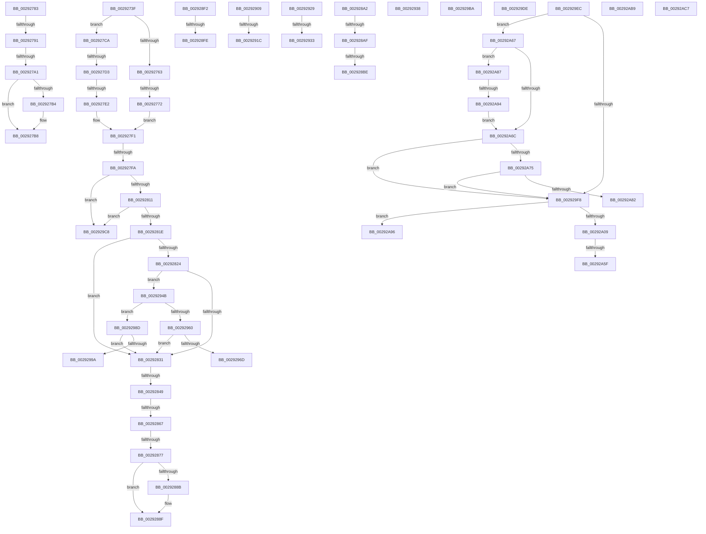

# sub_0029273F

- RVA: `0x0029273F`–`0x00292AF9` (길이 `954` bytes)
- VA: `0x000000014029273F`
- 실행 섹션: `.text`
- PDB 이름 있음: `아니요`; PDB Function 태그: `아니요`
- unwind 정보 RVA: `0x00067580`
- 디코드: `194`개 명령, `954/954` bytes 표시
- 미해석 바이트: `0` (있으면 어셈블리에 `.byte`로 보존)

> 이 문서는 커널 이미지의 기계어와 PDB 기호를 분석해 생성했습니다. 4번과 5번은 함수 원형과 자료형을 바이너리 사용 방식에서 추정한 C 해석이며 원본 소스 복구 결과는 아닙니다.

## 1. Dependencies

- 직접 호출 지점: **10**; 고유 호출 대상: **8**
- 직접 호출자로 확인된 함수: **0**
- RIP 상대 이미지 참조: **9**

### Outgoing calls
- `0x00292783` → [MiPteHasShadow](../32/MiPteHasShadow_function_0032B998.md) (function, `0x0032B998`)
- `0x00292801` → [ExAcquireSpinLockExclusiveAtDpcLevel](../24/ExAcquireSpinLockExclusiveAtDpcLevel_function_00248E80.md) (function, `0x00248E80`)
- `0x002928CA` → [MiCheckLinearProtectedPteAccessedBit](MiCheckLinearProtectedPteAccessedBit_function_00292D80.md) (function, `0x00292D80`)
- `0x00292941` → [MiRebuildPageTableAges](../40/MiRebuildPageTableAges_function_0040D4E0.md) (function, `0x0040D4E0`)
- `0x00292983` → [ExReleaseSpinLockExclusiveFromDpcLevel](../24/ExReleaseSpinLockExclusiveFromDpcLevel_function_002497E0.md) (function, `0x002497E0`)
- `0x002929B0` → [ExReleaseSpinLockExclusiveFromDpcLevel](../24/ExReleaseSpinLockExclusiveFromDpcLevel_function_002497E0.md) (function, `0x002497E0`)
- `0x002929D4` → [ExReleaseSpinLockExclusiveFromDpcLevel](../24/ExReleaseSpinLockExclusiveFromDpcLevel_function_002497E0.md) (function, `0x002497E0`)
- `0x002929FB` → [MiGetSystemRegionType](../28/MiGetSystemRegionType_function_0028EC80.md) (function, `0x0028EC80`)
- `0x00292A2F` → [MiIsDriverPage](../2A/MiIsDriverPage_function_002A5514.md) (function, `0x002A5514`)
- `0x00292AD1` → [MiLogRemoveWsleEvent](../4D/MiLogRemoveWsleEvent_function_004D64BC.md) (function, `0x004D64BC`)

### Direct callers
- 이 함수 시작 RVA로 연결되는 직접 call은 확인되지 않았습니다. 간접 호출은 완전히 역산할 수 없습니다.

### Static image references
- `0x0029274B` → RVA `0x00E30088` (`.data`; read)
- `0x002927FA` → RVA `0x00E374C0` (`.data`; read)
- `0x00292838` → RVA `0x00FC6A88` (`ALMOSTRO`; read)
- `0x002929BC` → RVA `0x00E2D96C` (`.data`; read/write)
- `0x002929EC` → RVA `0x00FC6B28` (`ALMOSTRO`; read)
- `0x00292A6C` → RVA `0x00FC6B98` (`ALMOSTRO`; read)
- `0x00292A75` → RVA `0x00FC6D90` (`ALMOSTRO`; read)
- `0x00292A87` → RVA `0x00FC6CB0` (`ALMOSTRO`; read)
- `0x00292ABB` → RVA `0x00E2D968` (`.data`; read/write)

## 2. Other-region calls and transfers

- 다른 실행 섹션으로 향하는 call: **0**
- call이 아닌 외부 분기/꼬리 이동: **33**
  - `0x0029276C` → [sub_00292218 + 0x353](Unknown_function_00292218.md) (`tail-transfer`)
  - `0x0029278B` → [sub_00292218 + 0x213](Unknown_function_00292218.md) (`tail-transfer`)
  - `0x0029279B` → [sub_00292218 + 0x213](Unknown_function_00292218.md) (`tail-transfer`)
  - `0x002927C5` → [sub_00292218 + 0x213](Unknown_function_00292218.md) (`tail-transfer`)
  - `0x002927CD` → [sub_00292218 + 0x353](Unknown_function_00292218.md) (`tail-transfer`)
  - `0x002927DC` → [sub_00292218 + 0x353](Unknown_function_00292218.md) (`tail-transfer`)
  - `0x002927F4` → [sub_00292218 + 0x353](Unknown_function_00292218.md) (`tail-transfer`)
  - `0x00292843` → [sub_00292218 + 0x468](Unknown_function_00292218.md) (`tail-transfer`)
  - `0x00292861` → [sub_00292218 + 0x468](Unknown_function_00292218.md) (`tail-transfer`)
  - `0x00292871` → [sub_00292218 + 0x468](Unknown_function_00292218.md) (`tail-transfer`)
  - `0x0029289D` → [sub_00292218 + 0x468](Unknown_function_00292218.md) (`tail-transfer`)
  - `0x002928A9` → [sub_00292218 + 0x4C5](Unknown_function_00292218.md) (`tail-transfer`)
  - `0x002928B8` → [sub_00292218 + 0x4C5](Unknown_function_00292218.md) (`tail-transfer`)
  - `0x002928ED` → [sub_00292218 + 0x4C5](Unknown_function_00292218.md) (`tail-transfer`)
  - `0x002928F8` → [sub_00292218 + 0x57](Unknown_function_00292218.md) (`tail-transfer`)
  - `0x00292904` → [sub_00292218 + 0x5D](Unknown_function_00292218.md) (`tail-transfer`)
  - `0x00292916` → [sub_00292218 + 0x387](Unknown_function_00292218.md) (`tail-transfer`)
  - `0x00292924` → [sub_00292218 + 0x387](Unknown_function_00292218.md) (`tail-transfer`)
  - `0x0029292D` → [sub_00292218 + 0x166](Unknown_function_00292218.md) (`tail-transfer`)
  - `0x00292933` → [sub_00292218 + 0x176](Unknown_function_00292218.md) (`tail-transfer`)
  - `0x00292946` → [sub_00292218 + 0x335](Unknown_function_00292218.md) (`tail-transfer`)
  - `0x00292988` → [sub_00292218 + 0x379](Unknown_function_00292218.md) (`tail-transfer`)
  - `0x002929B5` → [sub_00292218 + 0x379](Unknown_function_00292218.md) (`tail-transfer`)
  - `0x002929C3` → [sub_00292218 + 0xEB](Unknown_function_00292218.md) (`tail-transfer`)
  - `0x002929D9` → [sub_00292218 + 0x379](Unknown_function_00292218.md) (`tail-transfer`)
  - `0x002929E7` → [sub_00292218 + 0x176](Unknown_function_00292218.md) (`tail-transfer`)
  - `0x00292A59` → [sub_00292218 + 0x85](Unknown_function_00292218.md) (`tail-transfer`)
  - `0x00292A62` → [sub_00292218 + 0x85](Unknown_function_00292218.md) (`tail-transfer`)
  - `0x00292A82` → [sub_006DA55C](../6D/Unknown_function_006DA55C.md) (`tail-transfer`)
  - `0x00292A8E` → [sub_006DA55C](../6D/Unknown_function_006DA55C.md) (`tail-transfer`)
  - `0x00292AB4` → [sub_00292218 + 0x81](Unknown_function_00292218.md) (`tail-transfer`)
  - `0x00292AC2` → [sub_00292218 + 0xDF](Unknown_function_00292218.md) (`tail-transfer`)
  - `0x00292AF4` → [sub_00292218 + 0x4EB](Unknown_function_00292218.md) (`tail-transfer`)

## 3. Assembly (complete function range)

```asm
0029273F  49 8B 56 60                     mov rdx, qword ptr [r14 + 0x60]
00292743  41 0F B7 8E AE 00 00 00         movzx ecx, word ptr [r14 + 0xae]
0029274B  48 8B 05 36 D9 B9 00            mov rax, qword ptr [rip + 0xb9d936]
00292752  48 8B 1C C8                     mov rbx, qword ptr [rax + rcx*8]
00292756  4C 8B BB C0 44 00 00            mov r15, qword ptr [rbx + 0x44c0]
0029275D  49 3B 57 38                     cmp rdx, qword ptr [r15 + 0x38]
00292761  73 67                           jae 0x1402927ca
00292763  49 83 7E 18 00                  cmp qword ptr [r14 + 0x18], 0
00292768  4D 8D 6E 18                     lea r13, [r14 + 0x18]
0029276C  0F 84 F9 FD FF FF               je 0x14029256b
00292772  48 8B 83 D0 44 00 00            mov rax, qword ptr [rbx + 0x44d0]
00292779  C7 44 24 24 02 00 00 00         mov dword ptr [rsp + 0x24], 2
00292781  EB 6E                           jmp 0x1402927f1
00292783  E8 10 92 09 00                  call 0x14032b998
00292788  48 85 C0                        test rax, rax
0029278B  0F 84 9A FC FF FF               je 0x14029242b
00292791  48 8B 80 08 05 00 00            mov rax, qword ptr [rax + 0x508]
00292798  48 85 C0                        test rax, rax
0029279B  0F 84 8A FC FF FF               je 0x14029242b
002927A1  49 C1 E9 03                     shr r9, 3
002927A5  41 81 E1 FF 01 00 00            and r9d, 0x1ff
002927AC  4A 8B 04 C8                     mov rax, qword ptr [rax + r9*8]
002927B0  A8 20                           test al, 0x20
002927B2  74 04                           je 0x1402927b8
002927B4  49 83 C8 20                     or r8, 0x20
002927B8  49 8B D0                        mov rdx, r8
002927BB  48 83 CA 42                     or rdx, 0x42
002927BF  A8 42                           test al, 0x42
002927C1  49 0F 44 D0                     cmove rdx, r8
002927C5  E9 61 FC FF FF                  jmp 0x14029242b
002927CA  4D 85 ED                        test r13, r13
002927CD  0F 88 98 FD FF FF               js 0x14029256b
002927D3  49 83 7E 18 00                  cmp qword ptr [r14 + 0x18], 0
002927D8  4D 8D 6E 18                     lea r13, [r14 + 0x18]
002927DC  0F 84 89 FD FF FF               je 0x14029256b
002927E2  48 8B 83 C8 44 00 00            mov rax, qword ptr [rbx + 0x44c8]
002927E9  C7 44 24 24 01 00 00 00         mov dword ptr [rsp + 0x24], 1
002927F1  49 3B C5                        cmp rax, r13
002927F4  0F 84 71 FD FF FF               je 0x14029256b
002927FA  48 8D 0D BF 4C BA 00            lea rcx, [rip + 0xba4cbf]
00292801  E8 7A 66 FB FF                  call 0x140248e80
00292806  41 80 7F 35 00                  cmp byte ptr [r15 + 0x35], 0
0029280B  0F 85 B7 01 00 00               jne 0x1402929c8
00292811  49 8B 45 00                     mov rax, qword ptr [r13]
00292815  48 85 C0                        test rax, rax
00292818  0F 84 AA 01 00 00               je 0x1402929c8
0029281E  4C 39 68 08                     cmp qword ptr [rax + 8], r13
00292822  75 0D                           jne 0x140292831
00292824  49 8B 4D 08                     mov rcx, qword ptr [r13 + 8]
00292828  4C 39 29                        cmp qword ptr [rcx], r13
0029282B  0F 84 1A 01 00 00               je 0x14029294b
00292831  B9 03 00 00 00                  mov ecx, 3
00292836  CD 29                           int 0x29
00292838  48 F7 05 45 42 D3 00 00 00 60 00  test qword ptr [rip + 0xd34245], 0x600000
00292843  0F 84 37 FE FF FF               je 0x140292680
00292849  65 48 8B 14 25 88 01 00 00      mov rdx, qword ptr gs:[0x188]
00292852  4C 8B 82 B8 00 00 00            mov r8, qword ptr [rdx + 0xb8]
00292859  41 80 B8 60 01 00 00 01         cmp byte ptr [r8 + 0x160], 1
00292861  0F 84 19 FE FF FF               je 0x140292680
00292867  49 8B 90 08 05 00 00            mov rdx, qword ptr [r8 + 0x508]
0029286E  48 85 D2                        test rdx, rdx
00292871  0F 84 09 FE FF FF               je 0x140292680
00292877  49 C1 EA 03                     shr r10, 3
0029287B  41 81 E2 FF 01 00 00            and r10d, 0x1ff
00292882  4A 8B 14 D2                     mov rdx, qword ptr [rdx + r10*8]
00292886  F6 C2 20                        test dl, 0x20
00292889  74 04                           je 0x14029288f
0029288B  48 83 C9 20                     or rcx, 0x20
0029288F  48 8B C1                        mov rax, rcx
00292892  48 83 C8 42                     or rax, 0x42
00292896  F6 C2 42                        test dl, 0x42
00292899  48 0F 44 C1                     cmove rax, rcx
0029289D  E9 DE FD FF FF                  jmp 0x140292680
002928A2  0F B6 C3                        movzx eax, bl
002928A5  24 21                           and al, 0x21
002928A7  3C 01                           cmp al, 1
002928A9  0F 85 2E FE FF FF               jne 0x1402926dd
002928AF  49 8B C5                        mov rax, r13
002928B2  48 03 C6                        add rax, rsi
002928B5  4C 3B F0                        cmp r14, rax
002928B8  0F 82 1F FE FF FF               jb 0x1402926dd
002928BE  41 B8 80 00 00 00               mov r8d, 0x80
002928C4  48 8B D3                        mov rdx, rbx
002928C7  49 8B CE                        mov rcx, r14
002928CA  E8 B1 04 00 00                  call 0x140292d80
002928CF  48 BA 00 00 00 00 10 00 00 00   movabs rdx, 0x1000000000
002928D9  49 B8 FF FF FF FF FF FF FF 8A   movabs r8, 0x8affffffffffffff
002928E3  49 BB 00 00 00 00 00 00 00 0A   movabs r11, 0xa00000000000000
002928ED  E9 EB FD FF FF                  jmp 0x1402926dd
002928F2  49 8B C0                        mov rax, r8
002928F5  48 3B D8                        cmp rbx, rax
002928F8  0F 87 71 F9 FF FF               ja 0x14029226f
002928FE  41 BC 01 00 00 00               mov r12d, 1
00292904  E9 6C F9 FF FF                  jmp 0x140292275
00292909  48 8B 44 24 38                  mov rax, qword ptr [rsp + 0x38]
0029290E  F0 48 01 41 08                  lock add qword ptr [rcx + 8], rax
00292913  48 85 FF                        test rdi, rdi
00292916  0F 84 83 FC FF FF               je 0x14029259f
0029291C  48 F7 DF                        neg rdi
0029291F  F0 48 01 79 10                  lock add qword ptr [rcx + 0x10], rdi
00292924  E9 76 FC FF FF                  jmp 0x14029259f
00292929  40 F6 C6 0F                     test sil, 0xf
0029292D  0F 84 4B FA FF FF               je 0x14029237e
00292933  E9 56 FA FF FF                  jmp 0x14029238e
00292938  45 33 C0                        xor r8d, r8d
0029293B  49 8B D2                        mov rdx, r10
0029293E  49 8B CE                        mov rcx, r14
00292941  E8 9A AB 17 00                  call 0x14040d4e0
00292946  E9 02 FC FF FF                  jmp 0x14029254d
0029294B  48 81 C3 C8 44 00 00            add rbx, 0x44c8
00292952  48 89 01                        mov qword ptr [rcx], rax
00292955  83 7C 24 24 01                  cmp dword ptr [rsp + 0x24], 1
0029295A  48 89 48 08                     mov qword ptr [rax + 8], rcx
0029295E  75 2D                           jne 0x14029298d
00292960  48 8B 03                        mov rax, qword ptr [rbx]
00292963  48 39 58 08                     cmp qword ptr [rax + 8], rbx
00292967  0F 85 C4 FE FF FF               jne 0x140292831
0029296D  49 89 45 00                     mov qword ptr [r13], rax
00292971  48 8D 0D 48 4B BA 00            lea rcx, [rip + 0xba4b48]
00292978  49 89 5D 08                     mov qword ptr [r13 + 8], rbx
0029297C  4C 89 68 08                     mov qword ptr [rax + 8], r13
00292980  4C 89 2B                        mov qword ptr [rbx], r13
00292983  E8 58 6E FB FF                  call 0x1402497e0
00292988  E9 04 FC FF FF                  jmp 0x140292591
0029298D  48 8B 43 08                     mov rax, qword ptr [rbx + 8]
00292991  48 39 18                        cmp qword ptr [rax], rbx
00292994  0F 85 97 FE FF FF               jne 0x140292831
0029299A  49 89 5D 00                     mov qword ptr [r13], rbx
0029299E  48 8D 0D 1B 4B BA 00            lea rcx, [rip + 0xba4b1b]
002929A5  49 89 45 08                     mov qword ptr [r13 + 8], rax
002929A9  4C 89 28                        mov qword ptr [rax], r13
002929AC  4C 89 6B 08                     mov qword ptr [rbx + 8], r13
002929B0  E8 2B 6E FB FF                  call 0x1402497e0
002929B5  E9 D7 FB FF FF                  jmp 0x140292591
002929BA  F7 D8                           neg eax
002929BC  F0 01 05 A9 AF B9 00            lock add dword ptr [rip + 0xb9afa9], eax
002929C3  E9 3B F9 FF FF                  jmp 0x140292303
002929C8  48 8D 0D F1 4A BA 00            lea rcx, [rip + 0xba4af1]
002929CF  41 C6 47 36 01                  mov byte ptr [r15 + 0x36], 1
002929D4  E8 07 6E FB FF                  call 0x1402497e0
002929D9  E9 B3 FB FF FF                  jmp 0x140292591
002929DE  49 8B 46 10                     mov rax, qword ptr [r14 + 0x10]
002929E2  F0 48 FF 48 20                  lock dec qword ptr [rax + 0x20]
002929E7  E9 A2 F9 FF FF                  jmp 0x14029238e
002929EC  48 8B 05 35 41 D3 00            mov rax, qword ptr [rip + 0xd34135]
002929F3  48 85 C0                        test rax, rax
002929F6  75 6F                           jne 0x140292a67
002929F8  48 8B CB                        mov rcx, rbx
002929FB  E8 80 C2 FF FF                  call 0x14028ec80
00292A00  83 F8 0B                        cmp eax, 0xb
00292A03  0F 85 8D 00 00 00               jne 0x140292a96
00292A09  48 C1 EB 09                     shr rbx, 9
00292A0D  48 B9 F8 FF FF FF 7F 00 00 00   movabs rcx, 0x7ffffffff8
00292A17  48 23 CB                        and rcx, rbx
00292A1A  48 B8 00 00 00 00 80 F6 FF FF   movabs rax, 0xfffff68000000000
00292A24  48 8B C0                        mov rax, rax
00292A27  48 03 C8                        add rcx, rax
00292A2A  BA 01 00 00 00                  mov edx, 1
00292A2F  E8 E0 2A 01 00                  call 0x1402a5514
00292A34  48 8B 54 24 30                  mov rdx, qword ptr [rsp + 0x30]
00292A39  8B 5C 24 20                     mov ebx, dword ptr [rsp + 0x20]
00292A3D  4C 8B 4C 24 40                  mov r9, qword ptr [rsp + 0x40]
00292A42  49 B8 FF FF FF FF FF F6 FF FF   movabs r8, 0xfffff6ffffffffff
00292A4C  49 BA 00 00 00 00 80 F6 FF FF   movabs r10, 0xfffff68000000000
00292A56  48 85 C0                        test rax, rax
00292A59  0F 84 3E F8 FF FF               je 0x14029229d
00292A5F  41 FF C6                        inc r14d
00292A62  E9 36 F8 FF FF                  jmp 0x14029229d
00292A67  48 3B D8                        cmp rbx, rax
00292A6A  73 1B                           jae 0x140292a87
00292A6C  48 3B 1D 25 41 D3 00            cmp rbx, qword ptr [rip + 0xd34125]
00292A73  72 83                           jb 0x1402929f8
00292A75  48 3B 1D 14 43 D3 00            cmp rbx, qword ptr [rip + 0xd34314]
00292A7C  0F 83 76 FF FF FF               jae 0x1402929f8
00292A82  E9 D5 7A 44 00                  jmp 0x1406da55c
00292A87  48 3B 1D 22 42 D3 00            cmp rbx, qword ptr [rip + 0xd34222]
00292A8E  0F 82 C8 7A 44 00               jb 0x1406da55c
00292A94  EB D6                           jmp 0x140292a6c
00292A96  48 8B 54 24 30                  mov rdx, qword ptr [rsp + 0x30]
00292A9B  4C 8B 4C 24 40                  mov r9, qword ptr [rsp + 0x40]
00292AA0  49 B8 FF FF FF FF FF F6 FF FF   movabs r8, 0xfffff6ffffffffff
00292AAA  49 BA 00 00 00 00 80 F6 FF FF   movabs r10, 0xfffff68000000000
00292AB4  E9 E0 F7 FF FF                  jmp 0x140292299
00292AB9  F7 DB                           neg ebx
00292ABB  F0 01 1D A6 AE B9 00            lock add dword ptr [rip + 0xb9aea6], ebx
00292AC2  E9 30 F8 FF FF                  jmp 0x1402922f7
00292AC7  40 0F B6 D6                     movzx edx, sil
00292ACB  48 8B CD                        mov rcx, rbp
00292ACE  83 E2 0F                        and edx, 0xf
00292AD1  E8 E6 39 24 00                  call 0x1404d64bc
00292AD6  48 BA 00 00 00 00 10 00 00 00   movabs rdx, 0x1000000000
00292AE0  49 B8 FF FF FF FF FF FF FF 8A   movabs r8, 0x8affffffffffffff
00292AEA  49 BB 00 00 00 00 00 00 00 0A   movabs r11, 0xa00000000000000
00292AF4  E9 0A FC FF FF                  jmp 0x140292703
```

## 4. C-style interpretation (structured pseudocode)

```c
__int64 __fastcall sub_0029273F(__int64 a1, __int64 a2, __int64 a3, __int64 a4)
{
    __int64 result;
    __int64 v_r10;
    __int64 v_rbx;
    unsigned int v_stack_p20;
    unsigned int v_stack_p24;
    unsigned __int64 v_stack_p30;
    unsigned __int64 v_stack_p38;
    unsigned __int64 v_stack_p40;

    if ((*(unsigned __int64 *)(v_r14 + 96)) >= (*(unsigned __int64 *)(*(unsigned __int64 *)(*(unsigned __int64 *)(*(unsigned __int64 *)(v_rip + 12179766) + *(unsigned __int16 *)(v_r14 + 174) * 8) + 17600) + 56))) goto loc_002927CA;
    v_stack_p24 = 2;
    goto loc_002927F1;
loc_002927CA:
    v_stack_p24 = 1;
loc_002927F1:
    result = ExAcquireSpinLockExclusiveAtDpcLevel(v_rip + 12209343, *(unsigned __int64 *)(v_r14 + 96), a3, a4);
    if ((*(unsigned __int8 *)(*(unsigned __int64 *)(*(unsigned __int64 *)(*(unsigned __int64 *)(v_rip + 12179766) + *(unsigned __int16 *)(v_r14 + 174) * 8) + 17600) + 53)) != 0) goto loc_002929C8;
    if (*(unsigned __int64 *)(v_r14 + 24) == 0) goto loc_002929C8;
    if ((*(unsigned __int64 *)(*(unsigned __int64 *)(v_r14 + 24) + 8)) != (v_r14 + 24)) goto loc_00292831;
    if ((*(unsigned __int64 *)(*(unsigned __int64 *)(v_r14 + 24 + 8))) == (v_r14 + 24)) goto loc_0029294B;
loc_00292831:
    v_r10 = (v_r10) >> (3);
    v_r10 = (unsigned int)((v_r10) & (511));
    if ((((unsigned __int8)(*(unsigned __int64 *)(*(unsigned __int64 *)(*(unsigned __int64 *)(*(unsigned __int64 *)(gs_base + (0 + 392)) + 184) + 1288) + v_r10 * 8))) & (32)) != 0) {
        a1 = (3) | (32);
    }
    result = (a1) | (66);
    if ((((unsigned __int8)(*(unsigned __int64 *)(*(unsigned __int64 *)(*(unsigned __int64 *)(*(unsigned __int64 *)(gs_base + (0 + 392)) + 184) + 1288) + v_r10 * 8))) & (66)) == 0) { result = a1; }
loc_0029294B:
    v_rbx = (*(unsigned __int64 *)(*(unsigned __int64 *)(v_rip + 12179766) + *(unsigned __int16 *)(v_r14 + 174) * 8)) + (0x44C8ULL);
    *(unsigned __int64 *)(a1) = result;
    *(unsigned __int64 *)(result + 8) = a1;
    if (v_stack_p24 != 1) goto loc_0029298D;
    if ((*(unsigned __int64 *)(*(unsigned __int64 *)(v_rbx) + 8)) != v_rbx) goto loc_00292831;
    *(unsigned __int64 *)(v_r14 + 24) = *(unsigned __int64 *)(v_rbx);
    *(unsigned __int64 *)(v_r14 + 24 + 8) = v_rbx;
    *(unsigned __int64 *)(*(unsigned __int64 *)(v_rbx) + 8) = v_r14 + 24;
    *(unsigned __int64 *)(v_rbx) = v_r14 + 24;
    result = ExReleaseSpinLockExclusiveFromDpcLevel(v_rip + 12208968, *(unsigned __int64 *)(*(unsigned __int64 *)(*(unsigned __int64 *)(*(unsigned __int64 *)(gs_base + (0 + 392)) + 184) + 1288) + v_r10 * 8), *(unsigned __int64 *)(*(unsigned __int64 *)(gs_base + (0 + 392)) + 184), a4);
loc_0029298D:
    if ((*(unsigned __int64 *)(*(unsigned __int64 *)(v_rbx + 8))) != v_rbx) goto loc_00292831;
    *(unsigned __int64 *)(v_r14 + 24) = v_rbx;
    *(unsigned __int64 *)(v_r14 + 24 + 8) = *(unsigned __int64 *)(v_rbx + 8);
    *(unsigned __int64 *)(*(unsigned __int64 *)(v_rbx + 8)) = v_r14 + 24;
    *(unsigned __int64 *)(v_rbx + 8) = v_r14 + 24;
    result = ExReleaseSpinLockExclusiveFromDpcLevel(v_rip + 12208923, *(unsigned __int64 *)(*(unsigned __int64 *)(*(unsigned __int64 *)(*(unsigned __int64 *)(gs_base + (0 + 392)) + 184) + 1288) + v_r10 * 8), *(unsigned __int64 *)(*(unsigned __int64 *)(gs_base + (0 + 392)) + 184), a4);
loc_002929C8:
    *(unsigned __int8 *)(*(unsigned __int64 *)(*(unsigned __int64 *)(*(unsigned __int64 *)(v_rip + 12179766) + *(unsigned __int16 *)(v_r14 + 174) * 8) + 17600) + 54) = 1;
    result = ExReleaseSpinLockExclusiveFromDpcLevel(v_rip + 12208881, *(unsigned __int64 *)(*(unsigned __int64 *)(*(unsigned __int64 *)(*(unsigned __int64 *)(gs_base + (0 + 392)) + 184) + 1288) + v_r10 * 8), *(unsigned __int64 *)(*(unsigned __int64 *)(gs_base + (0 + 392)) + 184), a4);
}
```

## 5. (Beta) C Style

```c
int64_t sub_0029273F(int64_t Arg1, int64_t Arg2, int64_t Arg3, int64_t Arg4)
{
    int64_t result;
    int64_t local_r10;
    int64_t local_rbx;
    uint32_t v_stack_p20;
    uint32_t v_stack_p24;
    uint64_t v_stack_p30;
    uint64_t v_stack_p38;
    uint64_t v_stack_p40;

    if ((*(uint64_t *)(local_r14 + 0x60)) >= (*(uint64_t *)(*(uint64_t *)(*(uint64_t *)(*(uint64_t *)(v_rip + 0xB9D936) + *(uint16_t *)(local_r14 + 0xAE) * 8) + 0x44C0) + 0x38))) goto loc_002927CA;
    v_stack_p24 = 2;
    goto loc_002927F1;
loc_002927CA:
    v_stack_p24 = 1;
loc_002927F1:
    result = ExAcquireSpinLockExclusiveAtDpcLevel(v_rip + 12209343, *(uint64_t *)(local_r14 + 0x60), Arg3, Arg4);
    if ((*(uint8_t *)(*(uint64_t *)(*(uint64_t *)(*(uint64_t *)(v_rip + 0xB9D936) + *(uint16_t *)(local_r14 + 0xAE) * 8) + 0x44C0) + 0x35)) != 0) goto loc_002929C8;
    if (*(uint64_t *)(local_r14 + 0x18) == 0) goto loc_002929C8;
    if ((*(uint64_t *)(*(uint64_t *)(local_r14 + 0x18) + 0x8)) != (local_r14 + 24)) goto loc_00292831;
    if ((*(uint64_t *)(*(uint64_t *)(local_r14 + 0x18 + 0x8))) == (local_r14 + 24)) goto loc_0029294B;
loc_00292831:
    local_r10 = (local_r10) >> (3);
    local_r10 = (uint32_t)((local_r10) & (511));
    if ((((uint8_t)(*(uint64_t *)(*(uint64_t *)(*(uint64_t *)(*(uint64_t *)(gs_base + (0 + 0x188)) + 0xB8) + 0x508) + local_r10 * 8))) & (32)) != 0) {
        Arg1 = (3) | (32);
    }
    result = (Arg1) | (66);
    if ((((uint8_t)(*(uint64_t *)(*(uint64_t *)(*(uint64_t *)(*(uint64_t *)(gs_base + (0 + 0x188)) + 0xB8) + 0x508) + local_r10 * 8))) & (66)) == 0) { result = Arg1; }
loc_0029294B:
    local_rbx = (*(uint64_t *)(*(uint64_t *)(v_rip + 0xB9D936) + *(uint16_t *)(local_r14 + 0xAE) * 8)) + (0x44C8ULL);
    *(uint64_t *)(Arg1) = result;
    *(uint64_t *)(result + 0x8) = Arg1;
    if (v_stack_p24 != 1) goto loc_0029298D;
    if ((*(uint64_t *)(*(uint64_t *)(local_rbx) + 0x8)) != local_rbx) goto loc_00292831;
    *(uint64_t *)(local_r14 + 0x18) = *(uint64_t *)(local_rbx);
    *(uint64_t *)(local_r14 + 0x18 + 0x8) = local_rbx;
    *(uint64_t *)(*(uint64_t *)(local_rbx) + 0x8) = local_r14 + 24;
    *(uint64_t *)(local_rbx) = local_r14 + 24;
    result = ExReleaseSpinLockExclusiveFromDpcLevel(v_rip + 12208968, *(uint64_t *)(*(uint64_t *)(*(uint64_t *)(*(uint64_t *)(gs_base + (0 + 0x188)) + 0xB8) + 0x508) + local_r10 * 8), *(uint64_t *)(*(uint64_t *)(gs_base + (0 + 0x188)) + 0xB8), Arg4);
loc_0029298D:
    if ((*(uint64_t *)(*(uint64_t *)(local_rbx + 0x8))) != local_rbx) goto loc_00292831;
    *(uint64_t *)(local_r14 + 0x18) = local_rbx;
    *(uint64_t *)(local_r14 + 0x18 + 0x8) = *(uint64_t *)(local_rbx + 0x8);
    *(uint64_t *)(*(uint64_t *)(local_rbx + 0x8)) = local_r14 + 24;
    *(uint64_t *)(local_rbx + 0x8) = local_r14 + 24;
    result = ExReleaseSpinLockExclusiveFromDpcLevel(v_rip + 12208923, *(uint64_t *)(*(uint64_t *)(*(uint64_t *)(*(uint64_t *)(gs_base + (0 + 0x188)) + 0xB8) + 0x508) + local_r10 * 8), *(uint64_t *)(*(uint64_t *)(gs_base + (0 + 0x188)) + 0xB8), Arg4);
loc_002929C8:
    *(uint8_t *)(*(uint64_t *)(*(uint64_t *)(*(uint64_t *)(v_rip + 0xB9D936) + *(uint16_t *)(local_r14 + 0xAE) * 8) + 0x44C0) + 0x36) = 1;
    result = ExReleaseSpinLockExclusiveFromDpcLevel(v_rip + 12208881, *(uint64_t *)(*(uint64_t *)(*(uint64_t *)(*(uint64_t *)(gs_base + (0 + 0x188)) + 0xB8) + 0x508) + local_r10 * 8), *(uint64_t *)(*(uint64_t *)(gs_base + (0 + 0x188)) + 0xB8), Arg4);
}
```

## 6. Execution-region graph

[열기: 2D/3D 그래프와 함수 탐색 컨트롤 패널](../../../control-panel.html?section=text&rva=0x0029273F&view=graph)

- 2D 그래프는 위에서 아래로 흐르고, 3D 그래프는 빈 공간을 드래그해 회전합니다. Shift+드래그는 이동, 휠은 확대·축소, 함수 노드 선택은 대상 보고서 이동입니다.

### Static fallback


